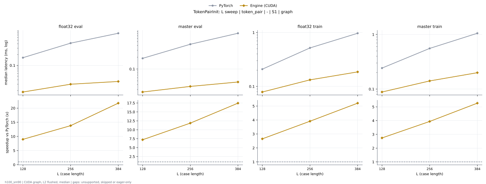

# TokenPairInit on h100_sm90

Generated by `python -m foldjet_engine.measure.plot` from speed tokens `judge/tokens/h100_sm90/`; do not edit.

### L sweep: token_pair | - | S1 | graph

**float32 eval** (median ms; x = speedup vs PyTorch)

| L | PyTorch | Engine (Triton) | Engine (CUDA) |
|---|---|---|---|
| 128 | 0.1638 | 0.02298 (7.13x) | 0.01826 (8.97x) |
| 256 | 0.4143 | 0.03253 (12.74x) | 0.03002 (13.80x) |
| 384 | 0.7795 | 0.04779 (16.31x) | 0.03582 (21.76x) |

**master eval** (median ms; x = speedup vs PyTorch)

| L | PyTorch | Engine (Triton) | Engine (CUDA) |
|---|---|---|---|
| 128 | 0.1872 | 0.0291 (6.43x) | 0.02598 (7.21x) |
| 256 | 0.4278 | 0.03922 (10.91x) | 0.03606 (11.86x) |
| 384 | 0.8152 | 0.05571 (14.63x) | 0.0467 (17.46x) |

**float32 train** (median ms; x = speedup vs PyTorch)

| L | PyTorch | Engine (Triton) | Engine (CUDA) |
|---|---|---|---|
| 128 | 0.2089 | 0.0849 (2.46x) | 0.07882 (2.65x) |
| 256 | 0.5182 | 0.21 (2.47x) | 0.1324 (3.91x) |
| 384 | 0.9688 | 0.3371 (2.87x) | 0.186 (5.21x) |

**master train** (median ms; x = speedup vs PyTorch)

| L | PyTorch | Engine (Triton) | Engine (CUDA) |
|---|---|---|---|
| 128 | 0.2424 | 0.09461 (2.56x) | 0.08845 (2.74x) |
| 256 | 0.5557 | 0.2207 (2.52x) | 0.141 (3.94x) |
| 384 | 1.052 | 0.3478 (3.02x) | 0.1996 (5.27x) |

