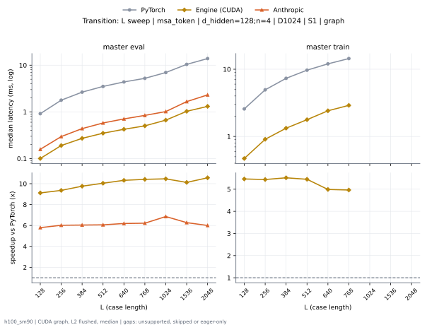
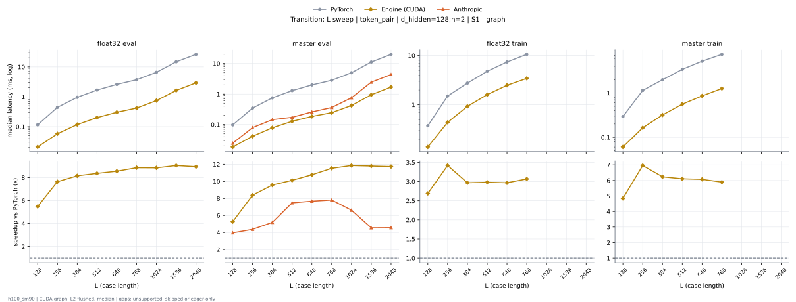
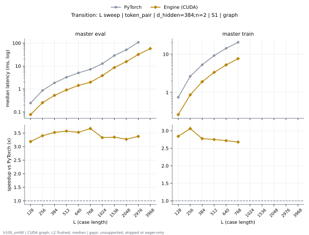
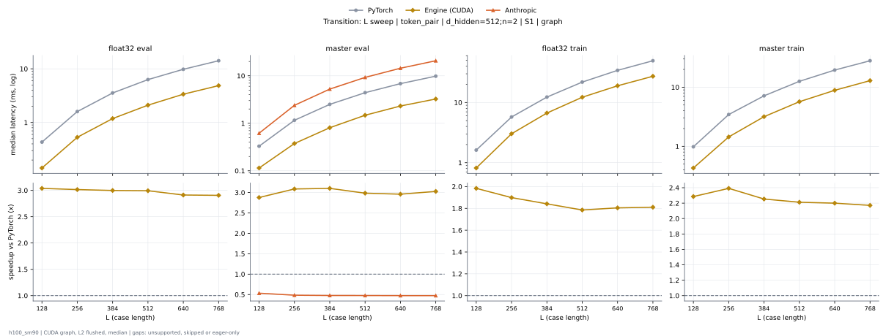
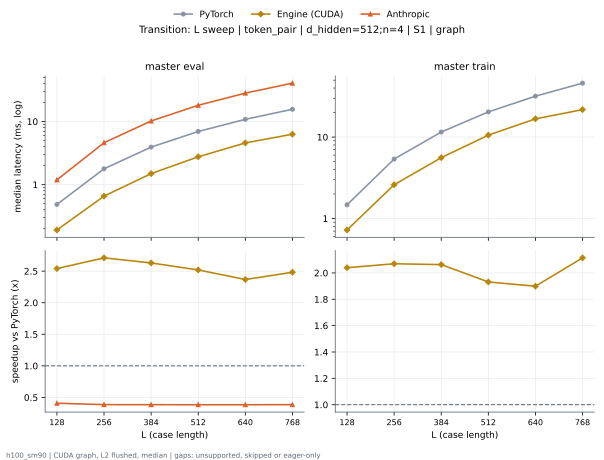
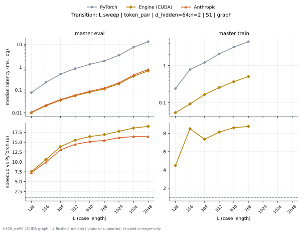
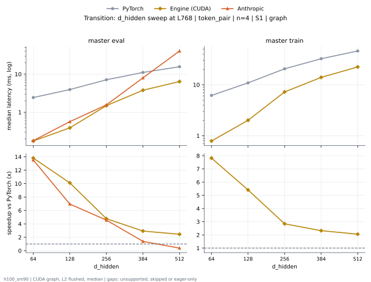

# Transition on h100_sm90

Generated by `python -m miniworld_engine.measure.plot` from speed tokens `judge/tokens/h100_sm90/`; do not edit.

### L sweep: msa_token | d_hidden=128;n=4 | D1024 | S1 | graph

**master eval** (median ms; x = speedup vs PyTorch)

| L | PyTorch | Engine (Triton) | Engine (CUDA) | Anthropic |
|---|---|---|---|---|
| 128 | 0.9189 | 0.2308 (3.98x) | 0.1014 (9.06x) | 0.1579 (5.82x) |
| 256 | 1.777 | 0.4349 (4.09x) | 0.1881 (9.45x) | 0.2956 (6.01x) |
| 384 | 2.652 | 0.6335 (4.19x) | 0.2768 (9.58x) | 0.4382 (6.05x) |
| 512 | 3.515 | 0.8328 (4.22x) | 0.3627 (9.69x) | 0.5784 (6.08x) |
| 640 | 4.38 | 1.036 (4.23x) | 0.4368 (10.03x) | 0.707 (6.19x) |
| 768 | 5.236 | 1.249 (4.19x) | 0.5154 (10.16x) | 0.8407 (6.23x) |
| 1024 | 6.984 | 1.674 (4.17x) | 0.6847 (10.20x) | 1.015 (6.88x) |
| 1536 | 10.45 | 2.457 (4.25x) | 1.015 (10.30x) | 1.659 (6.30x) |
| 2048 | 13.9 | 3.306 (4.20x) | 1.41 (9.86x) | 2.31 (6.02x) |

**master train** (median ms; x = speedup vs PyTorch)

| L | PyTorch | Engine (Triton) | Engine (CUDA) | Anthropic |
|---|---|---|---|---|
| 128 | 2.561 | 0.8607 (2.98x) | 0.466 (5.49x) | unsupported |
| 256 | 4.949 | 1.654 (2.99x) | 0.9066 (5.46x) | unsupported |
| 384 | 7.371 | 2.435 (3.03x) | 1.357 (5.43x) | unsupported |
| 512 | 9.704 | 3.223 (3.01x) | 1.88 (5.16x) | unsupported |
| 640 | 12.04 | 4.02 (2.99x) | 2.408 (5.00x) | unsupported |
| 768 | 14.43 | 4.79 (3.01x) | 2.909 (4.96x) | unsupported |
| 1024 |  |  |  |  |
| 1536 |  |  |  |  |
| 2048 |  |  |  |  |

### L sweep: msa_token | d_hidden=256;n=4 | D1024 | S1 | graph

**master eval** (median ms; x = speedup vs PyTorch)

| L | PyTorch | Engine (Triton) | Engine (CUDA) | Anthropic |
|---|---|---|---|---|
| 128 | 1.639 | 0.5316 (3.08x) | 0.3475 (4.72x) | 0.6835 (2.40x) |
| 256 | 3.207 | 1.127 (2.84x) | 0.6717 (4.77x) | 1.33 (2.41x) |
| 384 | 4.774 | 1.659 (2.88x) | 0.9946 (4.80x) | 1.96 (2.44x) |
| 512 | 6.346 | 2.2 (2.88x) | 1.368 (4.64x) | 2.585 (2.45x) |
| 640 | 7.915 | 2.76 (2.87x) | 1.612 (4.91x) | 3.204 (2.47x) |
| 768 | 9.485 | 3.319 (2.86x) | 2.183 (4.34x) | 3.828 (2.48x) |

**master train** (median ms; x = speedup vs PyTorch)

| L | PyTorch | Engine (Triton) | Engine (CUDA) | Anthropic |
|---|---|---|---|---|
| 128 | 4.718 | 1.906 (2.48x) | 1.643 (2.87x) | unsupported |
| 256 | 9.217 | 3.763 (2.45x) | 3.172 (2.91x) | unsupported |
| 384 | 13.75 | 5.79 (2.37x) | 4.827 (2.85x) | unsupported |
| 512 | 18.3 | 7.719 (2.37x) | 6.429 (2.85x) | unsupported |
| 640 | 22.86 | 9.528 (2.40x) | 8.041 (2.84x) | unsupported |
| 768 | 27.37 | 11.29 (2.42x) | 9.613 (2.85x) | unsupported |

### L sweep: msa_token | d_hidden=64;n=4 | D384 | S1 | graph

**master eval** (median ms; x = speedup vs PyTorch)

| L | PyTorch | Engine (Triton) | Engine (CUDA) | Anthropic |
|---|---|---|---|---|
| 128 | 0.2236 | 0.05026 (4.45x) | 0.02077 (10.77x) | 0.03078 (7.26x) |
| 256 | 0.4313 | 0.08957 (4.82x) | 0.03326 (12.97x) | 0.05125 (8.42x) |
| 384 | 0.6368 | 0.1234 (5.16x) | 0.04621 (13.78x) | 0.08229 (7.74x) |
| 512 | 0.8391 | 0.1572 (5.34x) | 0.05866 (14.30x) | 0.09064 (9.26x) |
| 640 | 1.041 | 0.1894 (5.50x) | 0.07253 (14.35x) | 0.1139 (9.14x) |
| 768 | 1.24 | 0.2222 (5.58x) | 0.08435 (14.70x) | 0.1343 (9.24x) |
| 1024 | 1.638 | 0.2882 (5.68x) | 0.1114 (14.70x) | 0.1749 (9.36x) |
| 1536 | 2.428 | 0.4176 (5.81x) | 0.174 (13.95x) | 0.2554 (9.51x) |
| 2048 | 3.218 | 0.5468 (5.88x) | 0.2297 (14.01x) | 0.3358 (9.58x) |

**master train** (median ms; x = speedup vs PyTorch)

| L | PyTorch | Engine (Triton) | Engine (CUDA) | Anthropic |
|---|---|---|---|---|
| 128 | 0.7343 | 0.206 (3.56x) | 0.09227 (7.96x) | unsupported |
| 256 | 1.131 | 0.3511 (3.22x) | 0.1581 (7.15x) | unsupported |
| 384 | 1.663 | 0.4917 (3.38x) | 0.2217 (7.50x) | unsupported |
| 512 | 2.166 | 0.6308 (3.43x) | 0.283 (7.65x) | unsupported |
| 640 | 2.669 | 0.7673 (3.48x) | 0.3475 (7.68x) | unsupported |
| 768 | 3.17 | 0.9062 (3.50x) | 0.4075 (7.78x) | unsupported |
| 1024 |  |  |  |  |
| 1536 |  |  |  |  |
| 2048 |  |  |  |  |

### L sweep: token_pair | d_hidden=128;n=2 | S1 | graph

**float32 eval** (median ms; x = speedup vs PyTorch)

| L | PyTorch | Engine (Triton) | Engine (CUDA) | Anthropic |
|---|---|---|---|---|
| 128 | 0.1154 | 0.04011 (2.88x) | 0.02104 (5.49x) | unsupported |
| 256 | 0.444 | 0.147 (3.02x) | 0.05811 (7.64x) | unsupported |
| 384 | 0.9606 | 0.3044 (3.16x) | 0.1178 (8.16x) | unsupported |
| 512 | 1.681 | 0.5237 (3.21x) | 0.2009 (8.37x) | unsupported |
| 640 | 2.594 | 0.8008 (3.24x) | 0.3033 (8.55x) | unsupported |
| 768 | 3.715 | 1.14 (3.26x) | 0.4193 (8.86x) | unsupported |
| 1024 | 6.588 | 2.004 (3.29x) | 0.7446 (8.85x) | unsupported |
| 1536 | 14.76 | 4.483 (3.29x) | 1.631 (9.05x) | unsupported |
| 2048 | 26.14 | 7.951 (3.29x) | 2.922 (8.95x) | unsupported |

**master eval** (median ms; x = speedup vs PyTorch)

| L | PyTorch | Engine (Triton) | Engine (CUDA) | Anthropic |
|---|---|---|---|---|
| 128 | 0.09758 | 0.03155 (3.09x) | 0.0185 (5.28x) | 0.02461 (3.97x) |
| 256 | 0.3464 | 0.08403 (4.12x) | 0.04133 (8.38x) | 0.07918 (4.37x) |
| 384 | 0.75 | 0.1718 (4.37x) | 0.07835 (9.57x) | 0.1445 (5.19x) |
| 512 | 1.295 | 0.2806 (4.61x) | 0.1278 (10.13x) | 0.1731 (7.48x) |
| 640 | 1.989 | 0.4239 (4.69x) | 0.1846 (10.77x) | 0.2592 (7.67x) |
| 768 | 2.829 | 0.5981 (4.73x) | 0.2452 (11.54x) | 0.3621 (7.81x) |
| 1024 | 4.992 | 1.042 (4.79x) | 0.4209 (11.86x) | 0.7548 (6.61x) |
| 1536 | 11.17 | 2.311 (4.84x) | 0.947 (11.80x) | 2.455 (4.55x) |
| 2048 | 19.91 | 4.088 (4.87x) | 1.697 (11.74x) | 4.361 (4.57x) |

**float32 train** (median ms; x = speedup vs PyTorch)

| L | PyTorch | Engine (Triton) | Engine (CUDA) | Anthropic |
|---|---|---|---|---|
| 128 | 0.3758 | 0.187 (2.01x) | 0.1397 (2.69x) | unsupported |
| 256 | 1.509 | 0.5377 (2.81x) | 0.4415 (3.42x) | unsupported |
| 384 | 2.762 | 1.076 (2.57x) | 0.9306 (2.97x) | unsupported |
| 512 | 4.802 | 1.834 (2.62x) | 1.611 (2.98x) | unsupported |
| 640 | 7.405 | 2.822 (2.62x) | 2.495 (2.97x) | unsupported |
| 768 | 10.57 | 4.018 (2.63x) | 3.445 (3.07x) | unsupported |
| 1024 |  |  |  |  |
| 1536 |  |  |  |  |
| 2048 |  |  |  |  |

**master train** (median ms; x = speedup vs PyTorch)

| L | PyTorch | Engine (Triton) | Engine (CUDA) | Anthropic |
|---|---|---|---|---|
| 128 | 0.2938 | 0.1127 (2.61x) | 0.06062 (4.85x) | unsupported |
| 256 | 1.142 | 0.3083 (3.70x) | 0.164 (6.96x) | unsupported |
| 384 | 1.989 | 0.5976 (3.33x) | 0.319 (6.24x) | unsupported |
| 512 | 3.414 | 0.9957 (3.43x) | 0.559 (6.11x) | unsupported |
| 640 | 5.213 | 1.512 (3.45x) | 0.8586 (6.07x) | unsupported |
| 768 | 7.424 | 2.131 (3.48x) | 1.26 (5.89x) | unsupported |
| 1024 |  |  |  |  |
| 1536 |  |  |  |  |
| 2048 |  |  |  |  |

### L sweep: token_pair | d_hidden=128;n=4 | S1 | graph

**master eval** (median ms; x = speedup vs PyTorch)

| L | PyTorch | Engine (Triton) | Engine (CUDA) | Anthropic |
|---|---|---|---|---|
| 128 | 0.133 | 0.04253 (3.13x) | 0.0233 (5.71x) | 0.0235 (5.66x) |
| 256 | 0.4803 | 0.1294 (3.71x) | 0.05773 (8.32x) | 0.07622 (6.30x) |
| 384 | 1.03 | 0.2572 (4.00x) | 0.1137 (9.06x) | 0.1556 (6.62x) |
| 512 | 1.78 | 0.4342 (4.10x) | 0.1892 (9.41x) | 0.2664 (6.68x) |
| 640 | 2.758 | 0.6576 (4.19x) | 0.2861 (9.64x) | 0.4061 (6.79x) |
| 768 | 3.95 | 0.9347 (4.23x) | 0.3907 (10.11x) | 0.5682 (6.95x) |
| 1024 | 6.979 | 1.65 (4.23x) | 0.6776 (10.30x) | 1.032 (6.76x) |
| 1536 | 15.64 | 3.71 (4.21x) | 1.586 (9.86x) | 2.34 (6.68x) |
| 2048 | 27.76 | 6.631 (4.19x) | 2.875 (9.66x) | 4.2 (6.61x) |

**master train** (median ms; x = speedup vs PyTorch)

| L | PyTorch | Engine (Triton) | Engine (CUDA) | Anthropic |
|---|---|---|---|---|
| 128 | 0.4008 | 0.1567 (2.56x) | 0.08618 (4.65x) | unsupported |
| 256 | 1.555 | 0.4743 (3.28x) | 0.2521 (6.17x) | unsupported |
| 384 | 2.863 | 0.9614 (2.98x) | 0.5285 (5.42x) | unsupported |
| 512 | 4.946 | 1.654 (2.99x) | 0.9128 (5.42x) | unsupported |
| 640 | 7.668 | 2.534 (3.03x) | 1.457 (5.26x) | unsupported |
| 768 | 10.89 | 3.622 (3.01x) | 2.013 (5.41x) | unsupported |
| 1024 |  |  |  |  |
| 1536 |  |  |  |  |
| 2048 |  |  |  |  |

### L sweep: token_pair | d_hidden=256;n=2 | S1 | graph

**float32 eval** (median ms; x = speedup vs PyTorch)

| L | PyTorch | Engine (Triton) | Engine (CUDA) | Anthropic |
|---|---|---|---|---|
| 128 | 0.2131 | 0.09518 (2.24x) | 0.04206 (5.07x) | unsupported |
| 256 | 0.7861 | 0.3389 (2.32x) | 0.1511 (5.20x) | unsupported |
| 384 | 1.716 | 0.7271 (2.36x) | 0.3223 (5.32x) | unsupported |
| 512 | 3.014 | 1.272 (2.37x) | 0.5488 (5.49x) | unsupported |
| 640 | 4.691 | 1.99 (2.36x) | 0.8495 (5.52x) | unsupported |
| 768 | 6.733 | 2.893 (2.33x) | 1.246 (5.40x) | unsupported |
| 1024 | 11.96 | 5.327 (2.24x) | 2.256 (5.30x) | unsupported |
| 1536 | 26.85 | 11.93 (2.25x) | 5.22 (5.14x) | unsupported |
| 2048 | 47.75 | 21.06 (2.27x) | 9.424 (5.07x) | unsupported |

**master eval** (median ms; x = speedup vs PyTorch)

| L | PyTorch | Engine (Triton) | Engine (CUDA) | Anthropic |
|---|---|---|---|---|
| 128 | 0.1622 | 0.05648 (2.87x) | 0.0375 (4.33x) | 0.05026 (3.23x) |
| 256 | 0.6011 | 0.18 (3.34x) | 0.1151 (5.22x) | 0.1818 (3.31x) |
| 384 | 1.273 | 0.3621 (3.52x) | 0.2326 (5.47x) | 0.3456 (3.68x) |
| 512 | 2.217 | 0.6192 (3.58x) | 0.3989 (5.56x) | 0.6988 (3.17x) |
| 640 | 3.429 | 0.9809 (3.50x) | 0.6088 (5.63x) | 1.059 (3.24x) |
| 768 | 4.895 | 1.406 (3.48x) | 0.8362 (5.85x) | 1.494 (3.28x) |
| 1024 | 8.683 | 2.488 (3.49x) | 1.486 (5.84x) | 2.213 (3.92x) |
| 1536 | 19.47 | 5.653 (3.44x) | 3.6 (5.41x) | 5.789 (3.36x) |
| 2048 | 34.55 | 10.53 (3.28x) | 6.411 (5.39x) | 10.23 (3.38x) |

**float32 train** (median ms; x = speedup vs PyTorch)

| L | PyTorch | Engine (Triton) | Engine (CUDA) | Anthropic |
|---|---|---|---|---|
| 128 | 0.735 | 0.3938 (1.87x) | 0.2936 (2.50x) | unsupported |
| 256 | 2.733 | 1.252 (2.18x) | 0.9575 (2.85x) | unsupported |
| 384 | 5.471 | 2.541 (2.15x) | 2.054 (2.66x) | unsupported |
| 512 | 9.545 | 4.584 (2.08x) | 3.651 (2.61x) | unsupported |
| 640 | 14.8 | 7.377 (2.01x) | 5.673 (2.61x) | unsupported |
| 768 | 21.24 | 10.16 (2.09x) | 8.322 (2.55x) | unsupported |
| 1024 |  |  |  |  |
| 1536 |  |  |  |  |
| 2048 |  |  |  |  |

**master train** (median ms; x = speedup vs PyTorch)

| L | PyTorch | Engine (Triton) | Engine (CUDA) | Anthropic |
|---|---|---|---|---|
| 128 | 0.5102 | 0.1953 (2.61x) | 0.1616 (3.16x) | unsupported |
| 256 | 1.888 | 0.6045 (3.12x) | 0.5013 (3.77x) | unsupported |
| 384 | 3.537 | 1.232 (2.87x) | 1.018 (3.47x) | unsupported |
| 512 | 6.185 | 2.138 (2.89x) | 1.867 (3.31x) | unsupported |
| 640 | 9.598 | 3.379 (2.84x) | 2.927 (3.28x) | unsupported |
| 768 | 13.72 | 4.846 (2.83x) | 4.163 (3.30x) | unsupported |
| 1024 |  |  |  |  |
| 1536 |  |  |  |  |
| 2048 |  |  |  |  |

### L sweep: token_pair | d_hidden=256;n=4 | S1 | graph

**master eval** (median ms; x = speedup vs PyTorch)

| L | PyTorch | Engine (Triton) | Engine (CUDA) | Anthropic |
|---|---|---|---|---|
| 128 | 0.2414 | 0.08398 (2.87x) | 0.05427 (4.45x) | 0.08235 (2.93x) |
| 256 | 0.852 | 0.2813 (3.03x) | 0.1836 (4.64x) | 0.3015 (2.83x) |
| 384 | 1.833 | 0.6058 (3.03x) | 0.3865 (4.74x) | 0.4214 (4.35x) |
| 512 | 3.207 | 1.097 (2.92x) | 0.6693 (4.79x) | 0.7028 (4.56x) |
| 640 | 4.972 | 1.736 (2.86x) | 1.05 (4.74x) | 1.067 (4.66x) |
| 768 | 7.13 | 2.441 (2.92x) | 1.494 (4.77x) | 1.565 (4.56x) |
| 1024 | 12.6 | 4.512 (2.79x) | 2.877 (4.38x) | 2.953 (4.27x) |
| 1536 | 28.33 | 10.25 (2.77x) | 6.383 (4.44x) | 6.881 (4.12x) |
| 2048 | 50.33 | 17.98 (2.80x) | 11.45 (4.40x) | 12.52 (4.02x) |

**master train** (median ms; x = speedup vs PyTorch)

| L | PyTorch | Engine (Triton) | Engine (CUDA) | Anthropic |
|---|---|---|---|---|
| 128 | 0.7539 | 0.3049 (2.47x) | 0.2533 (2.98x) | unsupported |
| 256 | 2.67 | 0.9886 (2.70x) | 0.8156 (3.27x) | unsupported |
| 384 | 5.284 | 2.161 (2.44x) | 1.82 (2.90x) | unsupported |
| 512 | 9.218 | 3.766 (2.45x) | 3.264 (2.82x) | unsupported |
| 640 | 14.33 | 5.842 (2.45x) | 5.043 (2.84x) | unsupported |
| 768 | 20.55 | 8.567 (2.40x) | 7.233 (2.84x) | unsupported |
| 1024 |  |  |  |  |
| 1536 |  |  |  |  |
| 2048 |  |  |  |  |

### L sweep: token_pair | d_hidden=384;n=2 | S1 | graph

**master eval** (median ms; x = speedup vs PyTorch)

| L | PyTorch | Engine (Triton) | Engine (CUDA) | Anthropic |
|---|---|---|---|---|
| 128 | 0.243 | 0.0952 (2.55x) | 0.07629 (3.19x) | unsupported |
| 256 | 0.8589 | 0.3105 (2.77x) | 0.2526 (3.40x) | unsupported |
| 384 | 1.852 | 0.6822 (2.71x) | 0.5256 (3.52x) | unsupported |
| 512 | 3.242 | 1.217 (2.66x) | 0.9075 (3.57x) | unsupported |
| 640 | 5.032 | 1.911 (2.63x) | 1.427 (3.53x) | unsupported |
| 768 | 7.216 | 2.751 (2.62x) | 1.969 (3.66x) | unsupported |
| 1024 | 12.74 | 4.887 (2.61x) | 3.825 (3.33x) | unsupported |
| 1536 | 28.66 | 11.27 (2.54x) | 8.56 (3.35x) | unsupported |
| 2048 | 50.98 | 20.2 (2.52x) | 15.59 (3.27x) | unsupported |
| 2976 | 107.9 | 41.68 (2.59x) | 31.96 (3.38x) | unsupported |
| 3968 | skipped | 75.18 | 57.57 | unsupported |

**master train** (median ms; x = speedup vs PyTorch)

| L | PyTorch | Engine (Triton) | Engine (CUDA) | Anthropic |
|---|---|---|---|---|
| 128 | 0.7441 | 0.3105 (2.40x) | 0.2619 (2.84x) | unsupported |
| 256 | 2.631 | 0.9865 (2.67x) | 0.8594 (3.06x) | unsupported |
| 384 | 5.273 | 2.191 (2.41x) | 1.9 (2.78x) | unsupported |
| 512 | 9.183 | 3.847 (2.39x) | 3.34 (2.75x) | unsupported |
| 640 | 14.23 | 6.136 (2.32x) | 5.236 (2.72x) | unsupported |
| 768 | 20.42 | 8.874 (2.30x) | 7.627 (2.68x) | unsupported |
| 1024 |  |  |  |  |
| 1536 |  |  |  |  |
| 2048 |  |  |  |  |
| 2976 |  |  |  |  |
| 3968 |  |  |  |  |

### L sweep: token_pair | d_hidden=384;n=4 | S1 | graph

**master eval** (median ms; x = speedup vs PyTorch)

| L | PyTorch | Engine (Triton) | Engine (CUDA) | Anthropic |
|---|---|---|---|---|
| 128 | 0.3687 | 0.1604 (2.30x) | 0.1261 (2.92x) | 0.2419 (1.52x) |
| 256 | 1.289 | 0.5264 (2.45x) | 0.4099 (3.14x) | 0.8895 (1.45x) |
| 384 | 2.818 | 1.192 (2.36x) | 0.8921 (3.16x) | 1.946 (1.45x) |
| 512 | 4.956 | 2.141 (2.31x) | 1.661 (2.98x) | 3.464 (1.43x) |
| 640 | 7.723 | 3.442 (2.24x) | 2.647 (2.92x) | 5.427 (1.42x) |
| 768 | 11.1 | 5.104 (2.17x) | 3.79 (2.93x) | 8.008 (1.39x) |
| 1024 | 19.65 | 9.124 (2.15x) | 6.849 (2.87x) | 13.92 (1.41x) |
| 1536 | 44.27 | 20.39 (2.17x) | 15.2 (2.91x) | 31.91 (1.39x) |
| 2048 | 78.83 | 36.01 (2.19x) | 25.96 (3.04x) | 56.61 (1.39x) |

**master train** (median ms; x = speedup vs PyTorch)

| L | PyTorch | Engine (Triton) | Engine (CUDA) | Anthropic |
|---|---|---|---|---|
| 128 | 1.108 | 0.5014 (2.21x) | 0.4264 (2.60x) | unsupported |
| 256 | 3.949 | 1.78 (2.22x) | 1.481 (2.67x) | unsupported |
| 384 | 8.253 | 4.335 (1.90x) | 3.465 (2.38x) | unsupported |
| 512 | 14.5 | 7.105 (2.04x) | 6.28 (2.31x) | unsupported |
| 640 | 22.57 | 11.19 (2.02x) | 9.541 (2.37x) | unsupported |
| 768 | 32.41 | 15.92 (2.04x) | 13.96 (2.32x) | unsupported |
| 1024 |  |  |  |  |
| 1536 |  |  |  |  |
| 2048 |  |  |  |  |

### L sweep: token_pair | d_hidden=512;n=2 | S1 | graph

**float32 eval** (median ms; x = speedup vs PyTorch)

| L | PyTorch | Engine (Triton) | Engine (CUDA) | Anthropic |
|---|---|---|---|---|
| 128 | 0.4328 | 0.2497 (1.73x) | 0.1425 (3.04x) | unsupported |
| 256 | 1.604 | 0.9434 (1.70x) | 0.5238 (3.06x) | unsupported |
| 384 | 3.572 | 2.151 (1.66x) | 1.164 (3.07x) | unsupported |
| 512 | 6.331 | 3.892 (1.63x) | 2.054 (3.08x) | unsupported |
| 640 | 9.818 | 6.101 (1.61x) | 3.368 (2.91x) | unsupported |
| 768 | 14.15 | 9.014 (1.57x) | 4.75 (2.98x) | unsupported |

**master eval** (median ms; x = speedup vs PyTorch)

| L | PyTorch | Engine (Triton) | Engine (CUDA) | Anthropic |
|---|---|---|---|---|
| 128 | 0.3277 | 0.1365 (2.40x) | 0.1137 (2.88x) | 0.6176 (0.53x) |
| 256 | 1.154 | 0.4682 (2.46x) | 0.3724 (3.10x) | 2.389 (0.48x) |
| 384 | 2.506 | 1.052 (2.38x) | 0.8038 (3.12x) | 5.247 (0.48x) |
| 512 | 4.43 | 1.952 (2.27x) | 1.407 (3.15x) | 9.26 (0.48x) |
| 640 | 6.872 | 3.062 (2.24x) | 2.323 (2.96x) | 14.44 (0.48x) |
| 768 | 9.879 | 4.327 (2.28x) | 3.312 (2.98x) | 20.75 (0.48x) |

**float32 train** (median ms; x = speedup vs PyTorch)

| L | PyTorch | Engine (Triton) | Engine (CUDA) | Anthropic |
|---|---|---|---|---|
| 128 | 1.616 | 1.025 (1.58x) | 0.8107 (1.99x) | unsupported |
| 256 | 5.775 | 3.753 (1.54x) | 3.007 (1.92x) | unsupported |
| 384 | 12.35 | 8.254 (1.50x) | 6.708 (1.84x) | unsupported |
| 512 | 21.86 | 15.14 (1.44x) | 11.97 (1.83x) | unsupported |
| 640 | 34.25 | 23.49 (1.46x) | 18.8 (1.82x) | unsupported |
| 768 | 49.39 | 33.78 (1.46x) | 27.25 (1.81x) | unsupported |

**master train** (median ms; x = speedup vs PyTorch)

| L | PyTorch | Engine (Triton) | Engine (CUDA) | Anthropic |
|---|---|---|---|---|
| 128 | 0.9784 | 0.4332 (2.26x) | 0.3708 (2.64x) | unsupported |
| 256 | 3.463 | 1.493 (2.32x) | 1.262 (2.74x) | unsupported |
| 384 | 7.187 | 3.408 (2.11x) | 2.884 (2.49x) | unsupported |
| 512 | 12.65 | 6.083 (2.08x) | 5.221 (2.42x) | unsupported |
| 640 | 19.64 | 9.454 (2.08x) | 8.076 (2.43x) | unsupported |
| 768 | 28.23 | 13.84 (2.04x) | 11.92 (2.37x) | unsupported |

### L sweep: token_pair | d_hidden=512;n=4 | S1 | graph

**master eval** (median ms; x = speedup vs PyTorch)

| L | PyTorch | Engine (Triton) | Engine (CUDA) | Anthropic |
|---|---|---|---|---|
| 128 | 0.488 | 0.2298 (2.12x) | 0.1926 (2.53x) | 1.191 (0.41x) |
| 256 | 1.787 | 0.8424 (2.12x) | 0.6605 (2.71x) | 4.616 (0.39x) |
| 384 | 3.946 | 1.938 (2.04x) | 1.482 (2.66x) | 10.21 (0.39x) |
| 512 | 6.993 | 3.561 (1.96x) | 2.768 (2.53x) | 18.09 (0.39x) |
| 640 | 10.89 | 5.526 (1.97x) | 4.487 (2.43x) | 28.2 (0.39x) |
| 768 | 15.67 | 7.882 (1.99x) | 6.4 (2.45x) | 40.56 (0.39x) |

**master train** (median ms; x = speedup vs PyTorch)

| L | PyTorch | Engine (Triton) | Engine (CUDA) | Anthropic |
|---|---|---|---|---|
| 128 | 1.468 | 0.7258 (2.02x) | 0.6188 (2.37x) | unsupported |
| 256 | 5.411 | 2.802 (1.93x) | 2.478 (2.18x) | unsupported |
| 384 | 11.6 | 6.498 (1.79x) | 5.584 (2.08x) | unsupported |
| 512 | 20.5 | 11.22 (1.83x) | 9.906 (2.07x) | unsupported |
| 640 | 31.93 | 17.69 (1.81x) | 15.43 (2.07x) | unsupported |
| 768 | 45.95 | 25.32 (1.81x) | 22.35 (2.06x) | unsupported |

### L sweep: token_pair | d_hidden=64;n=2 | S1 | graph

**master eval** (median ms; x = speedup vs PyTorch)

| L | PyTorch | Engine (Triton) | Engine (CUDA) | Anthropic |
|---|---|---|---|---|
| 128 | 0.07658 | 0.02366 (3.24x) | 0.009984 (7.67x) | 0.01059 (7.23x) |
| 256 | 0.2161 | 0.04467 (4.84x) | 0.02016 (10.72x) | 0.02178 (9.92x) |
| 384 | 0.4961 | 0.08325 (5.96x) | 0.03565 (13.92x) | 0.03805 (13.04x) |
| 512 | 0.8639 | 0.1357 (6.37x) | 0.05586 (15.47x) | 0.05978 (14.45x) |
| 640 | 1.321 | 0.1968 (6.71x) | 0.08069 (16.37x) | 0.08731 (15.13x) |
| 768 | 1.882 | 0.2729 (6.89x) | 0.1122 (16.77x) | 0.1218 (15.45x) |
| 1024 | 3.314 | 0.4624 (7.17x) | 0.1889 (17.54x) | 0.2059 (16.09x) |
| 1536 | 7.38 | 1.004 (7.35x) | 0.3972 (18.58x) | 0.4506 (16.38x) |
| 2048 | 13.08 | 1.764 (7.42x) | 0.688 (19.01x) | 0.7966 (16.42x) |

**master train** (median ms; x = speedup vs PyTorch)

| L | PyTorch | Engine (Triton) | Engine (CUDA) | Anthropic |
|---|---|---|---|---|
| 128 | 0.2349 | 0.07523 (3.12x) | 0.05213 (4.51x) | unsupported |
| 256 | 0.7674 | 0.1693 (4.53x) | 0.09224 (8.32x) | unsupported |
| 384 | 1.216 | 0.3258 (3.73x) | 0.1655 (7.35x) | unsupported |
| 512 | 2.082 | 0.5248 (3.97x) | 0.2569 (8.10x) | unsupported |
| 640 | 3.163 | 0.7759 (4.08x) | 0.3672 (8.62x) | unsupported |
| 768 | 4.472 | 1.076 (4.16x) | 0.5072 (8.82x) | unsupported |
| 1024 |  |  |  |  |
| 1536 |  |  |  |  |
| 2048 |  |  |  |  |

### L sweep: token_pair | d_hidden=64;n=4 | S1 | graph

**master eval** (median ms; x = speedup vs PyTorch)

| L | PyTorch | Engine (Triton) | Engine (CUDA) | Anthropic |
|---|---|---|---|---|
| 128 | 0.08874 | 0.02778 (3.19x) | 0.012 (7.39x) | unsupported |
| 256 | 0.2926 | 0.06109 (4.79x) | 0.02778 (10.54x) | unsupported |
| 384 | 0.6394 | 0.1234 (5.18x) | 0.04645 (13.77x) | 0.08222 (7.78x) |
| 512 | 1.111 | 0.2018 (5.50x) | 0.08414 (13.20x) | 0.08722 (12.73x) |
| 640 | 1.702 | 0.2999 (5.67x) | 0.1128 (15.08x) | 0.1293 (13.16x) |
| 768 | 2.437 | 0.4157 (5.86x) | 0.1765 (13.80x) | 0.1802 (13.52x) |
| 1024 | 4.295 | 0.7205 (5.96x) | 0.2715 (15.82x) | 0.3088 (13.91x) |
| 1536 | 9.608 | 1.584 (6.06x) | 0.5929 (16.20x) | 0.6743 (14.25x) |
| 2048 | 17.01 | 2.786 (6.10x) | 1.08 (15.75x) | 1.213 (14.02x) |

**master train** (median ms; x = speedup vs PyTorch)

| L | PyTorch | Engine (Triton) | Engine (CUDA) | Anthropic |
|---|---|---|---|---|
| 128 | 0.2667 | 0.0979 (2.72x) | 0.0439 (6.08x) | unsupported |
| 256 | 0.9927 | 0.2536 (3.92x) | 0.1112 (8.92x) | unsupported |
| 384 | 1.66 | 0.4911 (3.38x) | 0.2197 (7.56x) | unsupported |
| 512 | 2.84 | 0.8168 (3.48x) | 0.3697 (7.68x) | unsupported |
| 640 | 4.337 | 1.234 (3.51x) | 0.5571 (7.79x) | unsupported |
| 768 | 6.178 | 1.735 (3.56x) | 0.7899 (7.82x) | unsupported |
| 1024 |  |  |  |  |
| 1536 |  |  |  |  |
| 2048 |  |  |  |  |

### L sweep: token_single | d_hidden=384;n=2 | S1 | graph

**float32 eval** (median ms; x = speedup vs PyTorch)

| L | PyTorch | Engine (Triton) | Engine (CUDA) | Anthropic |
|---|---|---|---|---|
| 128 | 0.03494 | 0.02414 (1.45x) | 0.02221 (1.57x) | unsupported |
| 256 | 0.03614 | 0.02438 (1.48x) | 0.02315 (1.56x) | unsupported |
| 384 | 0.0364 | 0.02453 (1.48x) | 0.02288 (1.59x) | unsupported |
| 512 | 0.0372 | 0.02496 (1.49x) | 0.02333 (1.59x) | unsupported |
| 640 | 0.03589 | 0.02555 (1.40x) | 0.02214 (1.62x) | unsupported |
| 768 | 0.03821 | 0.02822 (1.35x) | 0.02242 (1.70x) | unsupported |
| 1024 | 0.0421 | 0.03878 (1.09x) | 0.02326 (1.81x) | unsupported |
| 1536 | 0.0499 | 0.05003 (1.00x) | 0.02848 (1.75x) | unsupported |
| 2048 | 0.05654 | 0.05086 (1.11x) | 0.0299 (1.89x) | unsupported |

**master eval** (median ms; x = speedup vs PyTorch)

| L | PyTorch | Engine (Triton) | Engine (CUDA) | Anthropic |
|---|---|---|---|---|
| 128 | 0.04669 | 0.02707 (1.72x) | 0.01672 (2.79x) | 0.03179 (1.47x) |
| 256 | 0.04758 | 0.0275 (1.73x) | 0.01662 (2.86x) | 0.03186 (1.49x) |
| 384 | 0.04786 | 0.02768 (1.73x) | 0.01661 (2.88x) | 0.03232 (1.48x) |
| 512 | 0.04912 | 0.02786 (1.76x) | 0.01661 (2.96x) | 0.0335 (1.47x) |
| 640 | 0.04942 | 0.02822 (1.75x) | 0.01661 (2.98x) | 0.03405 (1.45x) |
| 768 | 0.05099 | 0.02902 (1.76x) | 0.01694 (3.01x) | 0.03576 (1.43x) |
| 1024 | 0.05181 | 0.04181 (1.24x) | 0.01741 (2.98x) | 0.03645 (1.42x) |
| 1536 | 0.05643 | 0.04477 (1.26x) | 0.02038 (2.77x) | 0.04102 (1.38x) |
| 2048 | 0.06035 | 0.04498 (1.34x) | 0.02083 (2.90x) | 0.0444 (1.36x) |

**float32 train** (median ms; x = speedup vs PyTorch)

| L | PyTorch | Engine (Triton) | Engine (CUDA) | Anthropic |
|---|---|---|---|---|
| 128 | 0.08554 | 0.066 (1.30x) | 0.05693 (1.50x) | unsupported |
| 256 | 0.09278 | 0.07182 (1.29x) | 0.0601 (1.54x) | unsupported |
| 384 | 0.1025 | 0.07834 (1.31x) | 0.06373 (1.61x) | unsupported |
| 512 | 0.1087 | 0.08232 (1.32x) | 0.0744 (1.46x) | unsupported |
| 640 | 0.1227 | 0.09029 (1.36x) | 0.07901 (1.55x) | unsupported |
| 768 | 0.1268 | 0.09773 (1.30x) | 0.08085 (1.57x) | unsupported |
| 1024 |  |  |  |  |
| 1536 |  |  |  |  |
| 2048 |  |  |  |  |

**master train** (median ms; x = speedup vs PyTorch)

| L | PyTorch | Engine (Triton) | Engine (CUDA) | Anthropic |
|---|---|---|---|---|
| 128 | 0.1079 | 0.06554 (1.65x) | 0.04014 (2.69x) | unsupported |
| 256 | 0.1112 | 0.06701 (1.66x) | 0.0423 (2.63x) | unsupported |
| 384 | 0.1154 | 0.06826 (1.69x) | 0.04405 (2.62x) | unsupported |
| 512 | 0.1177 | 0.07008 (1.68x) | 0.04546 (2.59x) | unsupported |
| 640 | 0.1215 | 0.07091 (1.71x) | 0.04558 (2.67x) | unsupported |
| 768 | 0.1238 | 0.07344 (1.69x) | 0.04634 (2.67x) | unsupported |
| 1024 |  |  |  |  |
| 1536 |  |  |  |  |
| 2048 |  |  |  |  |

### L sweep: token_single | d_hidden=384;n=4 | S1 | graph

**master eval** (median ms; x = speedup vs PyTorch)

| L | PyTorch | Engine (Triton) | Engine (CUDA) | Anthropic |
|---|---|---|---|---|
| 128 | 0.04997 | 0.02938 (1.70x) | 0.01934 (2.58x) | 0.08064 (0.62x) |
| 256 | 0.05099 | 0.02976 (1.71x) | 0.01952 (2.61x) | 0.07995 (0.64x) |
| 384 | 0.05277 | 0.03155 (1.67x) | 0.01958 (2.69x) | 0.08005 (0.66x) |
| 512 | 0.05384 | 0.03232 (1.67x) | 0.01966 (2.74x) | 0.08003 (0.67x) |
| 640 | 0.0551 | 0.03258 (1.69x) | 0.01966 (2.80x) | 0.08018 (0.69x) |
| 768 | 0.05683 | 0.03504 (1.62x) | 0.02259 (2.52x) | 0.0805 (0.71x) |
| 1024 | 0.05906 | 0.05066 (1.17x) | 0.02317 (2.55x) | 0.08099 (0.73x) |
| 1536 | 0.06682 | 0.0596 (1.12x) | 0.02638 (2.53x) | 0.08248 (0.81x) |
| 2048 | 0.0745 | 0.06048 (1.23x) | 0.02712 (2.75x) | 0.08528 (0.87x) |
| 2976 | 0.09059 | 0.0668 (1.36x) | 0.03541 (2.56x) | 0.155 (0.58x) |
| 3968 | 0.1074 | 0.0704 (1.53x) | 0.03866 (2.78x) | 0.1565 (0.69x) |

**master train** (median ms; x = speedup vs PyTorch)

| L | PyTorch | Engine (Triton) | Engine (CUDA) | Anthropic |
|---|---|---|---|---|
| 128 | 0.115 | 0.07168 (1.60x) | 0.05174 (2.22x) | unsupported |
| 256 | 0.1202 | 0.07384 (1.63x) | 0.0513 (2.34x) | unsupported |
| 384 | 0.1256 | 0.07784 (1.61x) | 0.05277 (2.38x) | unsupported |
| 512 | 0.1305 | 0.0816 (1.60x) | 0.05507 (2.37x) | unsupported |
| 640 | 0.1359 | 0.084 (1.62x) | 0.06226 (2.18x) | unsupported |
| 768 | 0.1384 | 0.08659 (1.60x) | 0.06195 (2.23x) | unsupported |
| 1024 |  |  |  |  |
| 1536 |  |  |  |  |
| 2048 |  |  |  |  |
| 2976 |  |  |  |  |
| 3968 |  |  |  |  |

### L sweep: token_single | d_hidden=768;n=2 | S1 | graph

**float32 eval** (median ms; x = speedup vs PyTorch)

| L | PyTorch | Engine (Triton) | Engine (CUDA) | Anthropic |
|---|---|---|---|---|
| 128 | 0.04189 | 0.03214 (1.30x) | 0.03 (1.40x) | unsupported |
| 256 | 0.04451 | 0.03349 (1.33x) | 0.03174 (1.40x) | unsupported |
| 384 | 0.05117 | 0.04146 (1.23x) | 0.03318 (1.54x) | unsupported |
| 512 | 0.0508 | 0.04235 (1.20x) | 0.03384 (1.50x) | unsupported |
| 640 | 0.05499 | 0.0432 (1.27x) | 0.03478 (1.58x) | unsupported |
| 768 | 0.06163 | 0.05205 (1.18x) | 0.04294 (1.44x) | unsupported |
| 1024 | 0.06829 | 0.06765 (1.01x) | 0.04352 (1.57x) | unsupported |
| 1536 | 0.09878 | 0.08379 (1.18x) | 0.06069 (1.63x) | unsupported |
| 2048 | 0.1119 | 0.08746 (1.28x) | 0.06731 (1.66x) | unsupported |

**master eval** (median ms; x = speedup vs PyTorch)

| L | PyTorch | Engine (Triton) | Engine (CUDA) | Anthropic |
|---|---|---|---|---|
| 128 | 0.05618 | 0.03746 (1.50x) | 0.0221 (2.54x) | unsupported |
| 256 | 0.05795 | 0.03875 (1.50x) | 0.02246 (2.58x) | unsupported |
| 384 | 0.06069 | 0.04267 (1.42x) | 0.02259 (2.69x) | unsupported |
| 512 | 0.0624 | 0.04293 (1.45x) | 0.02288 (2.73x) | unsupported |
| 640 | 0.06384 | 0.04358 (1.46x) | 0.02339 (2.73x) | unsupported |
| 768 | 0.0699 | 0.04827 (1.45x) | 0.02814 (2.48x) | unsupported |
| 1024 | 0.07094 | 0.0591 (1.20x) | 0.02875 (2.47x) | unsupported |
| 1536 | 0.08554 | 0.06698 (1.28x) | 0.03648 (2.34x) | unsupported |
| 2048 | 0.09459 | 0.06886 (1.37x) | 0.03747 (2.52x) | unsupported |

**float32 train** (median ms; x = speedup vs PyTorch)

| L | PyTorch | Engine (Triton) | Engine (CUDA) | Anthropic |
|---|---|---|---|---|
| 128 | 0.1139 | 0.09138 (1.25x) | 0.07565 (1.51x) | unsupported |
| 256 | 0.1306 | 0.1049 (1.24x) | 0.09254 (1.41x) | unsupported |
| 384 | 0.1576 | 0.1348 (1.17x) | 0.108 (1.46x) | unsupported |
| 512 | 0.1773 | 0.1506 (1.18x) | 0.1123 (1.58x) | unsupported |
| 640 | 0.1905 | 0.1566 (1.22x) | 0.1372 (1.39x) | unsupported |
| 768 | 0.2164 | 0.1807 (1.20x) | 0.1628 (1.33x) | unsupported |
| 1024 |  |  |  |  |
| 1536 |  |  |  |  |
| 2048 |  |  |  |  |

**master train** (median ms; x = speedup vs PyTorch)

| L | PyTorch | Engine (Triton) | Engine (CUDA) | Anthropic |
|---|---|---|---|---|
| 128 | 0.1341 | 0.08638 (1.55x) | 0.0592 (2.27x) | unsupported |
| 256 | 0.1401 | 0.09054 (1.55x) | 0.06392 (2.19x) | unsupported |
| 384 | 0.1469 | 0.09688 (1.52x) | 0.06576 (2.23x) | unsupported |
| 512 | 0.154 | 0.1006 (1.53x) | 0.07104 (2.17x) | unsupported |
| 640 | 0.1591 | 0.1029 (1.55x) | 0.07526 (2.11x) | unsupported |
| 768 | 0.168 | 0.1108 (1.52x) | 0.08419 (1.99x) | unsupported |
| 1024 |  |  |  |  |
| 1536 |  |  |  |  |
| 2048 |  |  |  |  |

### d_hidden sweep at L768: token_pair | n=2 | S1 | graph

**float32 eval** (median ms; x = speedup vs PyTorch)

| d_hidden | PyTorch | Engine (Triton) | Engine (CUDA) | Anthropic |
|---|---|---|---|---|
| 64 |  |  |  |  |
| 128 | 3.715 | 1.14 (3.26x) | 0.4193 (8.86x) | unsupported |
| 256 | 6.733 | 2.893 (2.33x) | 1.246 (5.40x) | unsupported |
| 384 |  |  |  |  |
| 512 | 14.15 | 9.014 (1.57x) | 4.75 (2.98x) | unsupported |

**master eval** (median ms; x = speedup vs PyTorch)

| d_hidden | PyTorch | Engine (Triton) | Engine (CUDA) | Anthropic |
|---|---|---|---|---|
| 64 | 1.882 | 0.2729 (6.89x) | 0.1122 (16.77x) | 0.1218 (15.45x) |
| 128 | 2.829 | 0.5981 (4.73x) | 0.2452 (11.54x) | 0.3621 (7.81x) |
| 256 | 4.895 | 1.406 (3.48x) | 0.8362 (5.85x) | 1.494 (3.28x) |
| 384 | 7.216 | 2.751 (2.62x) | 1.969 (3.66x) | unsupported |
| 512 | 9.879 | 4.327 (2.28x) | 3.312 (2.98x) | 20.75 (0.48x) |

**float32 train** (median ms; x = speedup vs PyTorch)

| d_hidden | PyTorch | Engine (Triton) | Engine (CUDA) | Anthropic |
|---|---|---|---|---|
| 64 |  |  |  |  |
| 128 | 10.57 | 4.018 (2.63x) | 3.445 (3.07x) | unsupported |
| 256 | 21.24 | 10.16 (2.09x) | 8.322 (2.55x) | unsupported |
| 384 |  |  |  |  |
| 512 | 49.39 | 33.78 (1.46x) | 27.25 (1.81x) | unsupported |

**master train** (median ms; x = speedup vs PyTorch)

| d_hidden | PyTorch | Engine (Triton) | Engine (CUDA) | Anthropic |
|---|---|---|---|---|
| 64 | 4.472 | 1.076 (4.16x) | 0.5072 (8.82x) | unsupported |
| 128 | 7.424 | 2.131 (3.48x) | 1.26 (5.89x) | unsupported |
| 256 | 13.72 | 4.846 (2.83x) | 4.163 (3.30x) | unsupported |
| 384 | 20.42 | 8.874 (2.30x) | 7.627 (2.68x) | unsupported |
| 512 | 28.23 | 13.84 (2.04x) | 11.92 (2.37x) | unsupported |

### d_hidden sweep at L768: token_pair | n=4 | S1 | graph

**master eval** (median ms; x = speedup vs PyTorch)

| d_hidden | PyTorch | Engine (Triton) | Engine (CUDA) | Anthropic |
|---|---|---|---|---|
| 64 | 2.437 | 0.4157 (5.86x) | 0.1765 (13.80x) | 0.1802 (13.52x) |
| 128 | 3.95 | 0.9347 (4.23x) | 0.3907 (10.11x) | 0.5682 (6.95x) |
| 256 | 7.13 | 2.441 (2.92x) | 1.494 (4.77x) | 1.565 (4.56x) |
| 384 | 11.1 | 5.104 (2.17x) | 3.79 (2.93x) | 8.008 (1.39x) |
| 512 | 15.67 | 7.882 (1.99x) | 6.4 (2.45x) | 40.56 (0.39x) |

**master train** (median ms; x = speedup vs PyTorch)

| d_hidden | PyTorch | Engine (Triton) | Engine (CUDA) | Anthropic |
|---|---|---|---|---|
| 64 | 6.178 | 1.735 (3.56x) | 0.7899 (7.82x) | unsupported |
| 128 | 10.89 | 3.622 (3.01x) | 2.013 (5.41x) | unsupported |
| 256 | 20.55 | 8.567 (2.40x) | 7.233 (2.84x) | unsupported |
| 384 | 32.41 | 15.92 (2.04x) | 13.96 (2.32x) | unsupported |
| 512 | 45.95 | 25.32 (1.81x) | 22.35 (2.06x) | unsupported |

