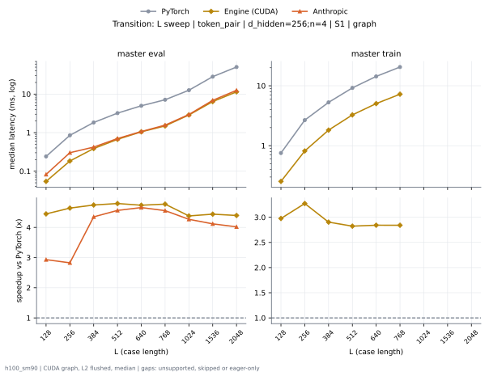
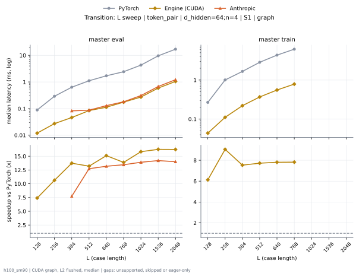
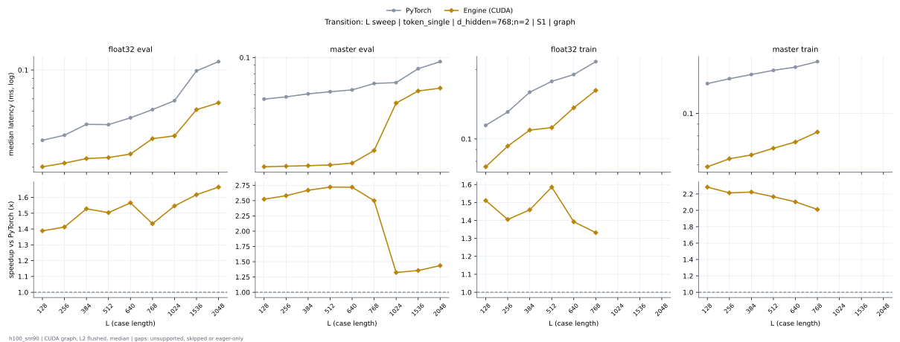
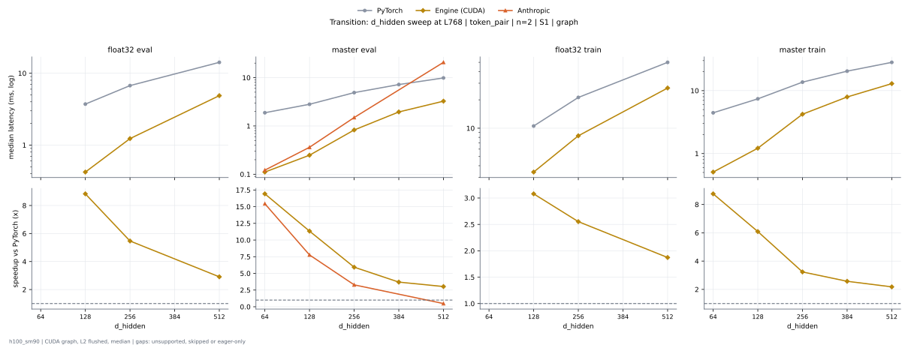

# Transition on h100_sm90

Generated by `python -m miniworld_engine.measure.plot` from speed tokens `judge/tokens/h100_sm90/`; do not edit.

### L sweep: msa_token | d_hidden=128;n=4 | D1024 | S1 | graph

**master eval** (median ms; x = speedup vs PyTorch)

| L | PyTorch | Engine (Triton) | Engine (CUDA) | Anthropic |
|---|---|---|---|---|
| 128 | 0.915 | 0.2308 (3.97x) | 0.1004 (9.12x) | 0.1579 (5.80x) |
| 256 | 1.78 | 0.4349 (4.09x) | 0.1902 (9.36x) | 0.2956 (6.02x) |
| 384 | 2.648 | 0.6335 (4.18x) | 0.2712 (9.76x) | 0.4382 (6.04x) |
| 512 | 3.507 | 0.8328 (4.21x) | 0.3491 (10.04x) | 0.5784 (6.06x) |
| 640 | 4.376 | 1.036 (4.23x) | 0.424 (10.32x) | 0.707 (6.19x) |
| 768 | 5.229 | 1.249 (4.19x) | 0.502 (10.42x) | 0.8407 (6.22x) |
| 1024 | 6.962 | 1.674 (4.16x) | 0.6652 (10.46x) | 1.015 (6.86x) |
| 1536 | 10.41 | 2.457 (4.24x) | 1.028 (10.12x) | 1.659 (6.27x) |
| 2048 | 13.86 | 3.306 (4.19x) | 1.312 (10.56x) | 2.31 (6.00x) |

**master train** (median ms; x = speedup vs PyTorch)

| L | PyTorch | Engine (Triton) | Engine (CUDA) | Anthropic |
|---|---|---|---|---|
| 128 | 2.571 | 0.8607 (2.99x) | 0.4706 (5.46x) | unsupported |
| 256 | 4.94 | 1.654 (2.99x) | 0.9087 (5.44x) | unsupported |
| 384 | 7.323 | 2.435 (3.01x) | 1.328 (5.51x) | unsupported |
| 512 | 9.685 | 3.223 (3.00x) | 1.778 (5.45x) | unsupported |
| 640 | 12.02 | 4.02 (2.99x) | 2.41 (4.99x) | unsupported |
| 768 | 14.41 | 4.79 (3.01x) | 2.903 (4.96x) | unsupported |
| 1024 |  |  |  |  |
| 1536 |  |  |  |  |
| 2048 |  |  |  |  |

### L sweep: msa_token | d_hidden=256;n=4 | D1024 | S1 | graph

**master eval** (median ms; x = speedup vs PyTorch)

| L | PyTorch | Engine (Triton) | Engine (CUDA) | Anthropic |
|---|---|---|---|---|
| 128 | 1.635 | 0.5316 (3.08x) | 0.3466 (4.72x) | 0.6835 (2.39x) |
| 256 | 3.203 | 1.127 (2.84x) | 0.6775 (4.73x) | 1.33 (2.41x) |
| 384 | 4.767 | 1.659 (2.87x) | 0.9861 (4.83x) | 1.96 (2.43x) |
| 512 | 6.33 | 2.2 (2.88x) | 1.378 (4.59x) | 2.585 (2.45x) |
| 640 | 7.896 | 2.76 (2.86x) | 1.718 (4.60x) | 3.204 (2.46x) |
| 768 | 9.462 | 3.319 (2.85x) | 1.92 (4.93x) | 3.828 (2.47x) |

**master train** (median ms; x = speedup vs PyTorch)

| L | PyTorch | Engine (Triton) | Engine (CUDA) | Anthropic |
|---|---|---|---|---|
| 128 | 4.709 | 1.906 (2.47x) | 1.6 (2.94x) | unsupported |
| 256 | 9.197 | 3.763 (2.44x) | 3.132 (2.94x) | unsupported |
| 384 | 13.75 | 5.79 (2.37x) | 4.848 (2.84x) | unsupported |
| 512 | 18.27 | 7.719 (2.37x) | 6.44 (2.84x) | unsupported |
| 640 | 22.79 | 9.528 (2.39x) | 7.964 (2.86x) | unsupported |
| 768 | 27.31 | 11.29 (2.42x) | 9.633 (2.84x) | unsupported |

### L sweep: msa_token | d_hidden=64;n=4 | D384 | S1 | graph

**master eval** (median ms; x = speedup vs PyTorch)

| L | PyTorch | Engine (Triton) | Engine (CUDA) | Anthropic |
|---|---|---|---|---|
| 128 | 0.2239 | 0.05026 (4.45x) | 0.02093 (10.70x) | 0.03078 (7.27x) |
| 256 | 0.4306 | 0.08957 (4.81x) | 0.03357 (12.83x) | 0.05125 (8.40x) |
| 384 | 0.6371 | 0.1234 (5.16x) | 0.04651 (13.70x) | 0.08229 (7.74x) |
| 512 | 0.8372 | 0.1572 (5.33x) | 0.05858 (14.29x) | 0.09064 (9.24x) |
| 640 | 1.038 | 0.1894 (5.48x) | 0.07176 (14.46x) | 0.1139 (9.12x) |
| 768 | 1.236 | 0.2222 (5.56x) | 0.08416 (14.68x) | 0.1343 (9.20x) |
| 1024 | 1.639 | 0.2882 (5.69x) | 0.1112 (14.73x) | 0.1749 (9.37x) |
| 1536 | 2.436 | 0.4176 (5.83x) | 0.1763 (13.82x) | 0.2554 (9.54x) |
| 2048 | 3.231 | 0.5468 (5.91x) | 0.2309 (13.99x) | 0.3358 (9.62x) |

**master train** (median ms; x = speedup vs PyTorch)

| L | PyTorch | Engine (Triton) | Engine (CUDA) | Anthropic |
|---|---|---|---|---|
| 128 | 0.7223 | 0.206 (3.51x) | 0.09274 (7.79x) | unsupported |
| 256 | 1.131 | 0.3511 (3.22x) | 0.1575 (7.18x) | unsupported |
| 384 | 1.662 | 0.4917 (3.38x) | 0.2206 (7.53x) | unsupported |
| 512 | 2.175 | 0.6308 (3.45x) | 0.2843 (7.65x) | unsupported |
| 640 | 2.675 | 0.7673 (3.49x) | 0.3468 (7.71x) | unsupported |
| 768 | 3.163 | 0.9062 (3.49x) | 0.4066 (7.78x) | unsupported |
| 1024 |  |  |  |  |
| 1536 |  |  |  |  |
| 2048 |  |  |  |  |

### L sweep: token_pair | d_hidden=128;n=2 | S1 | graph

**float32 eval** (median ms; x = speedup vs PyTorch)

| L | PyTorch | Engine (Triton) | Engine (CUDA) | Anthropic |
|---|---|---|---|---|
| 128 | 0.1149 | 0.04011 (2.87x) | 0.02064 (5.57x) | unsupported |
| 256 | 0.4426 | 0.147 (3.01x) | 0.05776 (7.66x) | unsupported |
| 384 | 0.9585 | 0.3044 (3.15x) | 0.1166 (8.22x) | unsupported |
| 512 | 1.672 | 0.5237 (3.19x) | 0.199 (8.40x) | unsupported |
| 640 | 2.595 | 0.8008 (3.24x) | 0.3026 (8.58x) | unsupported |
| 768 | 3.698 | 1.14 (3.25x) | 0.4199 (8.81x) | unsupported |
| 1024 | 6.565 | 2.004 (3.28x) | 0.7437 (8.83x) | unsupported |
| 1536 | 14.74 | 4.483 (3.29x) | 1.641 (8.98x) | unsupported |
| 2048 | 26.11 | 7.951 (3.28x) | 2.904 (8.99x) | unsupported |

**master eval** (median ms; x = speedup vs PyTorch)

| L | PyTorch | Engine (Triton) | Engine (CUDA) | Anthropic |
|---|---|---|---|---|
| 128 | 0.09754 | 0.03155 (3.09x) | 0.01845 (5.29x) | 0.02461 (3.96x) |
| 256 | 0.346 | 0.08403 (4.12x) | 0.0413 (8.38x) | 0.07918 (4.37x) |
| 384 | 0.75 | 0.1718 (4.37x) | 0.07845 (9.56x) | 0.1445 (5.19x) |
| 512 | 1.288 | 0.2806 (4.59x) | 0.1255 (10.26x) | 0.1731 (7.44x) |
| 640 | 1.97 | 0.4239 (4.65x) | 0.1823 (10.81x) | 0.2592 (7.60x) |
| 768 | 2.832 | 0.5981 (4.74x) | 0.2543 (11.14x) | 0.3621 (7.82x) |
| 1024 | 4.987 | 1.042 (4.79x) | 0.429 (11.62x) | 0.7548 (6.61x) |
| 1536 | 11.16 | 2.311 (4.83x) | 0.9524 (11.72x) | 2.455 (4.55x) |
| 2048 | 19.81 | 4.088 (4.85x) | 1.708 (11.60x) | 4.361 (4.54x) |

**float32 train** (median ms; x = speedup vs PyTorch)

| L | PyTorch | Engine (Triton) | Engine (CUDA) | Anthropic |
|---|---|---|---|---|
| 128 | 0.3727 | 0.187 (1.99x) | 0.1389 (2.68x) | unsupported |
| 256 | 1.514 | 0.5377 (2.81x) | 0.4455 (3.40x) | unsupported |
| 384 | 2.766 | 1.076 (2.57x) | 0.9351 (2.96x) | unsupported |
| 512 | 4.796 | 1.834 (2.61x) | 1.603 (2.99x) | unsupported |
| 640 | 7.383 | 2.822 (2.62x) | 2.457 (3.00x) | unsupported |
| 768 | 10.55 | 4.018 (2.63x) | 3.432 (3.07x) | unsupported |
| 1024 |  |  |  |  |
| 1536 |  |  |  |  |
| 2048 |  |  |  |  |

**master train** (median ms; x = speedup vs PyTorch)

| L | PyTorch | Engine (Triton) | Engine (CUDA) | Anthropic |
|---|---|---|---|---|
| 128 | 0.2935 | 0.1127 (2.61x) | 0.06013 (4.88x) | unsupported |
| 256 | 1.144 | 0.3083 (3.71x) | 0.1661 (6.89x) | unsupported |
| 384 | 1.993 | 0.5976 (3.33x) | 0.3213 (6.20x) | unsupported |
| 512 | 3.406 | 0.9957 (3.42x) | 0.5544 (6.14x) | unsupported |
| 640 | 5.196 | 1.512 (3.44x) | 0.8497 (6.12x) | unsupported |
| 768 | 7.39 | 2.131 (3.47x) | 1.233 (5.99x) | unsupported |
| 1024 |  |  |  |  |
| 1536 |  |  |  |  |
| 2048 |  |  |  |  |

### L sweep: token_pair | d_hidden=128;n=4 | S1 | graph

**master eval** (median ms; x = speedup vs PyTorch)

| L | PyTorch | Engine (Triton) | Engine (CUDA) | Anthropic |
|---|---|---|---|---|
| 128 | 0.1322 | 0.04253 (3.11x) | 0.02354 (5.62x) | 0.0235 (5.62x) |
| 256 | 0.478 | 0.1294 (3.69x) | 0.05707 (8.38x) | 0.07622 (6.27x) |
| 384 | 1.026 | 0.2572 (3.99x) | 0.1133 (9.06x) | 0.1556 (6.60x) |
| 512 | 1.778 | 0.4342 (4.09x) | 0.1875 (9.48x) | 0.2664 (6.67x) |
| 640 | 2.741 | 0.6576 (4.17x) | 0.2758 (9.94x) | 0.4061 (6.75x) |
| 768 | 3.941 | 0.9347 (4.22x) | 0.3791 (10.40x) | 0.5682 (6.94x) |
| 1024 | 6.974 | 1.65 (4.23x) | 0.6695 (10.42x) | 1.032 (6.76x) |
| 1536 | 15.6 | 3.71 (4.20x) | 1.597 (9.77x) | 2.34 (6.67x) |
| 2048 | 27.73 | 6.631 (4.18x) | 2.913 (9.52x) | 4.2 (6.60x) |

**master train** (median ms; x = speedup vs PyTorch)

| L | PyTorch | Engine (Triton) | Engine (CUDA) | Anthropic |
|---|---|---|---|---|
| 128 | 0.3972 | 0.1567 (2.53x) | 0.08571 (4.63x) | unsupported |
| 256 | 1.559 | 0.4743 (3.29x) | 0.2509 (6.21x) | unsupported |
| 384 | 2.862 | 0.9614 (2.98x) | 0.528 (5.42x) | unsupported |
| 512 | 4.93 | 1.654 (2.98x) | 0.9038 (5.45x) | unsupported |
| 640 | 7.629 | 2.534 (3.01x) | 1.395 (5.47x) | unsupported |
| 768 | 10.85 | 3.622 (3.00x) | 2.133 (5.09x) | unsupported |
| 1024 |  |  |  |  |
| 1536 |  |  |  |  |
| 2048 |  |  |  |  |

### L sweep: token_pair | d_hidden=256;n=2 | S1 | graph

**float32 eval** (median ms; x = speedup vs PyTorch)

| L | PyTorch | Engine (Triton) | Engine (CUDA) | Anthropic |
|---|---|---|---|---|
| 128 | 0.2129 | 0.09518 (2.24x) | 0.04237 (5.02x) | unsupported |
| 256 | 0.7865 | 0.3389 (2.32x) | 0.1516 (5.19x) | unsupported |
| 384 | 1.711 | 0.7271 (2.35x) | 0.3194 (5.36x) | unsupported |
| 512 | 3.009 | 1.272 (2.37x) | 0.5491 (5.48x) | unsupported |
| 640 | 4.683 | 1.99 (2.35x) | 0.8509 (5.50x) | unsupported |
| 768 | 6.725 | 2.893 (2.32x) | 1.183 (5.68x) | unsupported |
| 1024 | 11.93 | 5.327 (2.24x) | 2.255 (5.29x) | unsupported |
| 1536 | 26.82 | 11.93 (2.25x) | 5.155 (5.20x) | unsupported |
| 2048 | 47.67 | 21.06 (2.26x) | 9.338 (5.11x) | unsupported |

**master eval** (median ms; x = speedup vs PyTorch)

| L | PyTorch | Engine (Triton) | Engine (CUDA) | Anthropic |
|---|---|---|---|---|
| 128 | 0.1632 | 0.05648 (2.89x) | 0.03728 (4.38x) | 0.05026 (3.25x) |
| 256 | 0.6 | 0.18 (3.33x) | 0.1148 (5.23x) | 0.1818 (3.30x) |
| 384 | 1.269 | 0.3621 (3.50x) | 0.2296 (5.52x) | 0.3456 (3.67x) |
| 512 | 2.217 | 0.6192 (3.58x) | 0.3952 (5.61x) | 0.6988 (3.17x) |
| 640 | 3.428 | 0.9809 (3.50x) | 0.6028 (5.69x) | 1.059 (3.24x) |
| 768 | 4.907 | 1.406 (3.49x) | 0.8287 (5.92x) | 1.494 (3.28x) |
| 1024 | 8.62 | 2.488 (3.46x) | 1.563 (5.51x) | 2.213 (3.89x) |
| 1536 | 19.47 | 5.653 (3.44x) | 3.56 (5.47x) | 5.789 (3.36x) |
| 2048 | 34.54 | 10.53 (3.28x) | 6.318 (5.47x) | 10.23 (3.38x) |

**float32 train** (median ms; x = speedup vs PyTorch)

| L | PyTorch | Engine (Triton) | Engine (CUDA) | Anthropic |
|---|---|---|---|---|
| 128 | 0.7289 | 0.3938 (1.85x) | 0.2955 (2.47x) | unsupported |
| 256 | 2.727 | 1.252 (2.18x) | 0.9523 (2.86x) | unsupported |
| 384 | 5.448 | 2.541 (2.14x) | 2.049 (2.66x) | unsupported |
| 512 | 9.52 | 4.584 (2.08x) | 3.581 (2.66x) | unsupported |
| 640 | 14.76 | 7.377 (2.00x) | 5.798 (2.55x) | unsupported |
| 768 | 21.17 | 10.16 (2.08x) | 8.207 (2.58x) | unsupported |
| 1024 |  |  |  |  |
| 1536 |  |  |  |  |
| 2048 |  |  |  |  |

**master train** (median ms; x = speedup vs PyTorch)

| L | PyTorch | Engine (Triton) | Engine (CUDA) | Anthropic |
|---|---|---|---|---|
| 128 | 0.5124 | 0.1953 (2.62x) | 0.1621 (3.16x) | unsupported |
| 256 | 1.883 | 0.6045 (3.12x) | 0.5015 (3.75x) | unsupported |
| 384 | 3.533 | 1.232 (2.87x) | 1.011 (3.49x) | unsupported |
| 512 | 6.151 | 2.138 (2.88x) | 1.83 (3.36x) | unsupported |
| 640 | 9.534 | 3.379 (2.82x) | 2.907 (3.28x) | unsupported |
| 768 | 13.64 | 4.846 (2.81x) | 4.114 (3.32x) | unsupported |
| 1024 |  |  |  |  |
| 1536 |  |  |  |  |
| 2048 |  |  |  |  |

### L sweep: token_pair | d_hidden=256;n=4 | S1 | graph

**master eval** (median ms; x = speedup vs PyTorch)

| L | PyTorch | Engine (Triton) | Engine (CUDA) | Anthropic |
|---|---|---|---|---|
| 128 | 0.2416 | 0.08398 (2.88x) | 0.05381 (4.49x) | 0.08235 (2.93x) |
| 256 | 0.8497 | 0.2813 (3.02x) | 0.1841 (4.62x) | 0.3015 (2.82x) |
| 384 | 1.83 | 0.6058 (3.02x) | 0.3868 (4.73x) | 0.4214 (4.34x) |
| 512 | 3.202 | 1.097 (2.92x) | 0.6674 (4.80x) | 0.7028 (4.56x) |
| 640 | 4.961 | 1.736 (2.86x) | 1.024 (4.84x) | 1.067 (4.65x) |
| 768 | 7.113 | 2.441 (2.91x) | 1.494 (4.76x) | 1.565 (4.55x) |
| 1024 | 12.57 | 4.512 (2.78x) | 2.821 (4.45x) | 2.953 (4.26x) |
| 1536 | 28.27 | 10.25 (2.76x) | 6.371 (4.44x) | 6.881 (4.11x) |
| 2048 | 50.19 | 17.98 (2.79x) | 11.44 (4.39x) | 12.52 (4.01x) |

**master train** (median ms; x = speedup vs PyTorch)

| L | PyTorch | Engine (Triton) | Engine (CUDA) | Anthropic |
|---|---|---|---|---|
| 128 | 0.7599 | 0.3049 (2.49x) | 0.2545 (2.99x) | unsupported |
| 256 | 2.662 | 0.9886 (2.69x) | 0.8166 (3.26x) | unsupported |
| 384 | 5.271 | 2.161 (2.44x) | 1.792 (2.94x) | unsupported |
| 512 | 9.195 | 3.766 (2.44x) | 3.204 (2.87x) | unsupported |
| 640 | 14.33 | 5.842 (2.45x) | 5.05 (2.84x) | unsupported |
| 768 | 20.53 | 8.567 (2.40x) | 7.243 (2.83x) | unsupported |
| 1024 |  |  |  |  |
| 1536 |  |  |  |  |
| 2048 |  |  |  |  |

### L sweep: token_pair | d_hidden=384;n=2 | S1 | graph

**master eval** (median ms; x = speedup vs PyTorch)

| L | PyTorch | Engine (Triton) | Engine (CUDA) | Anthropic |
|---|---|---|---|---|
| 128 | 0.2421 | 0.0952 (2.54x) | 0.07611 (3.18x) | unsupported |
| 256 | 0.8557 | 0.3105 (2.76x) | 0.2537 (3.37x) | unsupported |
| 384 | 1.85 | 0.6822 (2.71x) | 0.5241 (3.53x) | unsupported |
| 512 | 3.221 | 1.217 (2.65x) | 0.8997 (3.58x) | unsupported |
| 640 | 5.012 | 1.911 (2.62x) | 1.444 (3.47x) | unsupported |
| 768 | 7.187 | 2.751 (2.61x) | 2.084 (3.45x) | unsupported |
| 1024 | 12.7 | 4.887 (2.60x) | 3.82 (3.32x) | unsupported |
| 1536 | 28.54 | 11.27 (2.53x) | 8.465 (3.37x) | unsupported |
| 2048 | 50.81 | 20.2 (2.52x) | 15.53 (3.27x) | unsupported |
| 2976 | 107.6 | 41.68 (2.58x) | 31.34 (3.43x) | unsupported |
| 3968 | skipped | 75.18 | 64.63 | unsupported |

**master train** (median ms; x = speedup vs PyTorch)

| L | PyTorch | Engine (Triton) | Engine (CUDA) | Anthropic |
|---|---|---|---|---|
| 128 | 0.7417 | 0.3105 (2.39x) | 0.2634 (2.82x) | unsupported |
| 256 | 2.626 | 0.9865 (2.66x) | 0.8948 (2.93x) | unsupported |
| 384 | 5.262 | 2.191 (2.40x) | 1.903 (2.77x) | unsupported |
| 512 | 9.15 | 3.847 (2.38x) | 3.485 (2.63x) | unsupported |
| 640 | 14.18 | 6.136 (2.31x) | 5.544 (2.56x) | unsupported |
| 768 | 20.34 | 8.874 (2.29x) | 7.758 (2.62x) | unsupported |
| 1024 |  |  |  |  |
| 1536 |  |  |  |  |
| 2048 |  |  |  |  |
| 2976 |  |  |  |  |
| 3968 |  |  |  |  |

### L sweep: token_pair | d_hidden=384;n=4 | S1 | graph

**master eval** (median ms; x = speedup vs PyTorch)

| L | PyTorch | Engine (Triton) | Engine (CUDA) | Anthropic |
|---|---|---|---|---|
| 128 | 0.3681 | 0.1604 (2.29x) | 0.1257 (2.93x) | 0.2419 (1.52x) |
| 256 | 1.312 | 0.5264 (2.49x) | 0.4063 (3.23x) | 0.8895 (1.48x) |
| 384 | 2.804 | 1.192 (2.35x) | 0.8784 (3.19x) | 1.946 (1.44x) |
| 512 | 4.933 | 2.141 (2.30x) | 1.534 (3.22x) | 3.464 (1.42x) |
| 640 | 7.68 | 3.442 (2.23x) | 2.608 (2.94x) | 5.427 (1.42x) |
| 768 | 11.04 | 5.104 (2.16x) | 3.738 (2.95x) | 8.008 (1.38x) |
| 1024 | 19.59 | 9.124 (2.15x) | 6.618 (2.96x) | 13.92 (1.41x) |
| 1536 | 44.09 | 20.39 (2.16x) | 15.08 (2.92x) | 31.91 (1.38x) |
| 2048 | 78.34 | 36.01 (2.18x) | 25.95 (3.02x) | 56.61 (1.38x) |

**master train** (median ms; x = speedup vs PyTorch)

| L | PyTorch | Engine (Triton) | Engine (CUDA) | Anthropic |
|---|---|---|---|---|
| 128 | 1.109 | 0.5014 (2.21x) | 0.4258 (2.60x) | unsupported |
| 256 | 3.934 | 1.78 (2.21x) | 1.587 (2.48x) | unsupported |
| 384 | 8.221 | 4.335 (1.90x) | 3.617 (2.27x) | unsupported |
| 512 | 14.44 | 7.105 (2.03x) | 6.488 (2.23x) | unsupported |
| 640 | 22.46 | 11.19 (2.01x) | 9.971 (2.25x) | unsupported |
| 768 | 32.26 | 15.92 (2.03x) | 14.29 (2.26x) | unsupported |
| 1024 |  |  |  |  |
| 1536 |  |  |  |  |
| 2048 |  |  |  |  |

### L sweep: token_pair | d_hidden=512;n=2 | S1 | graph

**float32 eval** (median ms; x = speedup vs PyTorch)

| L | PyTorch | Engine (Triton) | Engine (CUDA) | Anthropic |
|---|---|---|---|---|
| 128 | 0.4318 | 0.2497 (1.73x) | 0.1421 (3.04x) | unsupported |
| 256 | 1.599 | 0.9434 (1.69x) | 0.5302 (3.02x) | unsupported |
| 384 | 3.549 | 2.151 (1.65x) | 1.184 (3.00x) | unsupported |
| 512 | 6.296 | 3.892 (1.62x) | 2.103 (2.99x) | unsupported |
| 640 | 9.801 | 6.101 (1.61x) | 3.366 (2.91x) | unsupported |
| 768 | 14.14 | 9.014 (1.57x) | 4.866 (2.91x) | unsupported |

**master eval** (median ms; x = speedup vs PyTorch)

| L | PyTorch | Engine (Triton) | Engine (CUDA) | Anthropic |
|---|---|---|---|---|
| 128 | 0.329 | 0.1365 (2.41x) | 0.1143 (2.88x) | 0.6176 (0.53x) |
| 256 | 1.157 | 0.4682 (2.47x) | 0.3747 (3.09x) | 2.389 (0.48x) |
| 384 | 2.502 | 1.052 (2.38x) | 0.8064 (3.10x) | 5.247 (0.48x) |
| 512 | 4.409 | 1.952 (2.26x) | 1.477 (2.98x) | 9.26 (0.48x) |
| 640 | 6.839 | 3.062 (2.23x) | 2.311 (2.96x) | 14.44 (0.47x) |
| 768 | 9.827 | 4.327 (2.27x) | 3.246 (3.03x) | 20.75 (0.47x) |

**float32 train** (median ms; x = speedup vs PyTorch)

| L | PyTorch | Engine (Triton) | Engine (CUDA) | Anthropic |
|---|---|---|---|---|
| 128 | 1.619 | 1.025 (1.58x) | 0.8162 (1.98x) | unsupported |
| 256 | 5.746 | 3.753 (1.53x) | 3.026 (1.90x) | unsupported |
| 384 | 12.31 | 8.254 (1.49x) | 6.682 (1.84x) | unsupported |
| 512 | 21.84 | 15.14 (1.44x) | 12.23 (1.79x) | unsupported |
| 640 | 34.22 | 23.49 (1.46x) | 18.96 (1.80x) | unsupported |
| 768 | 49.42 | 33.78 (1.46x) | 27.29 (1.81x) | unsupported |

**master train** (median ms; x = speedup vs PyTorch)

| L | PyTorch | Engine (Triton) | Engine (CUDA) | Anthropic |
|---|---|---|---|---|
| 128 | 0.9824 | 0.4332 (2.27x) | 0.4298 (2.29x) | unsupported |
| 256 | 3.45 | 1.493 (2.31x) | 1.443 (2.39x) | unsupported |
| 384 | 7.151 | 3.408 (2.10x) | 3.174 (2.25x) | unsupported |
| 512 | 12.58 | 6.083 (2.07x) | 5.689 (2.21x) | unsupported |
| 640 | 19.52 | 9.454 (2.06x) | 8.872 (2.20x) | unsupported |
| 768 | 28.06 | 13.84 (2.03x) | 12.93 (2.17x) | unsupported |

### L sweep: token_pair | d_hidden=512;n=4 | S1 | graph

**master eval** (median ms; x = speedup vs PyTorch)

| L | PyTorch | Engine (Triton) | Engine (CUDA) | Anthropic |
|---|---|---|---|---|
| 128 | 0.4876 | 0.2298 (2.12x) | 0.1936 (2.52x) | 1.191 (0.41x) |
| 256 | 1.785 | 0.8424 (2.12x) | 0.658 (2.71x) | 4.616 (0.39x) |
| 384 | 3.928 | 1.938 (2.03x) | 1.509 (2.60x) | 10.21 (0.38x) |
| 512 | 6.942 | 3.561 (1.95x) | 2.772 (2.50x) | 18.09 (0.38x) |
| 640 | 10.82 | 5.526 (1.96x) | 4.519 (2.39x) | 28.2 (0.38x) |
| 768 | 15.57 | 7.882 (1.98x) | 6.142 (2.53x) | 40.56 (0.38x) |

**master train** (median ms; x = speedup vs PyTorch)

| L | PyTorch | Engine (Triton) | Engine (CUDA) | Anthropic |
|---|---|---|---|---|
| 128 | 1.473 | 0.7258 (2.03x) | 0.7173 (2.05x) | unsupported |
| 256 | 5.376 | 2.802 (1.92x) | 2.674 (2.01x) | unsupported |
| 384 | 11.51 | 6.498 (1.77x) | 5.672 (2.03x) | unsupported |
| 512 | 20.35 | 11.22 (1.81x) | 10.44 (1.95x) | unsupported |
| 640 | 31.71 | 17.69 (1.79x) | 16.63 (1.91x) | unsupported |
| 768 | 45.64 | 25.32 (1.80x) | 22.04 (2.07x) | unsupported |

### L sweep: token_pair | d_hidden=64;n=2 | S1 | graph

**master eval** (median ms; x = speedup vs PyTorch)

| L | PyTorch | Engine (Triton) | Engine (CUDA) | Anthropic |
|---|---|---|---|---|
| 128 | 0.0772 | 0.02366 (3.26x) | 0.01018 (7.59x) | 0.01059 (7.29x) |
| 256 | 0.2163 | 0.04467 (4.84x) | 0.02038 (10.61x) | 0.02178 (9.93x) |
| 384 | 0.4968 | 0.08325 (5.97x) | 0.03597 (13.81x) | 0.03805 (13.06x) |
| 512 | 0.8637 | 0.1357 (6.36x) | 0.05597 (15.43x) | 0.05978 (14.45x) |
| 640 | 1.325 | 0.1968 (6.73x) | 0.08162 (16.23x) | 0.08731 (15.17x) |
| 768 | 1.88 | 0.2729 (6.89x) | 0.1117 (16.83x) | 0.1218 (15.44x) |
| 1024 | 3.313 | 0.4624 (7.16x) | 0.187 (17.71x) | 0.2059 (16.09x) |
| 1536 | 7.399 | 1.004 (7.37x) | 0.3992 (18.54x) | 0.4506 (16.42x) |
| 2048 | 13.07 | 1.764 (7.41x) | 0.6891 (18.97x) | 0.7966 (16.41x) |

**master train** (median ms; x = speedup vs PyTorch)

| L | PyTorch | Engine (Triton) | Engine (CUDA) | Anthropic |
|---|---|---|---|---|
| 128 | 0.2312 | 0.07523 (3.07x) | 0.05198 (4.45x) | unsupported |
| 256 | 0.7833 | 0.1693 (4.63x) | 0.09306 (8.42x) | unsupported |
| 384 | 1.216 | 0.3258 (3.73x) | 0.1647 (7.39x) | unsupported |
| 512 | 2.08 | 0.5248 (3.96x) | 0.2539 (8.19x) | unsupported |
| 640 | 3.157 | 0.7759 (4.07x) | 0.3677 (8.59x) | unsupported |
| 768 | 4.449 | 1.076 (4.13x) | 0.5073 (8.77x) | unsupported |
| 1024 |  |  |  |  |
| 1536 |  |  |  |  |
| 2048 |  |  |  |  |

### L sweep: token_pair | d_hidden=64;n=4 | S1 | graph

**master eval** (median ms; x = speedup vs PyTorch)

| L | PyTorch | Engine (Triton) | Engine (CUDA) | Anthropic |
|---|---|---|---|---|
| 128 | 0.08883 | 0.02778 (3.20x) | 0.012 (7.40x) | unsupported |
| 256 | 0.2908 | 0.06109 (4.76x) | 0.02736 (10.63x) | unsupported |
| 384 | 0.6356 | 0.1234 (5.15x) | 0.04629 (13.73x) | 0.08222 (7.73x) |
| 512 | 1.11 | 0.2018 (5.50x) | 0.08419 (13.19x) | 0.08722 (12.73x) |
| 640 | 1.704 | 0.2999 (5.68x) | 0.1128 (15.10x) | 0.1293 (13.18x) |
| 768 | 2.424 | 0.4157 (5.83x) | 0.1747 (13.88x) | 0.1802 (13.45x) |
| 1024 | 4.293 | 0.7205 (5.96x) | 0.2713 (15.82x) | 0.3088 (13.90x) |
| 1536 | 9.578 | 1.584 (6.04x) | 0.5895 (16.25x) | 0.6743 (14.20x) |
| 2048 | 16.99 | 2.786 (6.10x) | 1.047 (16.23x) | 1.213 (14.00x) |

**master train** (median ms; x = speedup vs PyTorch)

| L | PyTorch | Engine (Triton) | Engine (CUDA) | Anthropic |
|---|---|---|---|---|
| 128 | 0.2685 | 0.0979 (2.74x) | 0.04384 (6.12x) | unsupported |
| 256 | 1.007 | 0.2536 (3.97x) | 0.1113 (9.05x) | unsupported |
| 384 | 1.664 | 0.4911 (3.39x) | 0.2209 (7.53x) | unsupported |
| 512 | 2.85 | 0.8168 (3.49x) | 0.3691 (7.72x) | unsupported |
| 640 | 4.343 | 1.234 (3.52x) | 0.5562 (7.81x) | unsupported |
| 768 | 6.162 | 1.735 (3.55x) | 0.7879 (7.82x) | unsupported |
| 1024 |  |  |  |  |
| 1536 |  |  |  |  |
| 2048 |  |  |  |  |

### L sweep: token_single | d_hidden=384;n=2 | S1 | graph

**float32 eval** (median ms; x = speedup vs PyTorch)

| L | PyTorch | Engine (Triton) | Engine (CUDA) | Anthropic |
|---|---|---|---|---|
| 128 | 0.0352 | 0.02414 (1.46x) | 0.02234 (1.58x) | unsupported |
| 256 | 0.03626 | 0.02438 (1.49x) | 0.02333 (1.55x) | unsupported |
| 384 | 0.03674 | 0.02453 (1.50x) | 0.02339 (1.57x) | unsupported |
| 512 | 0.03774 | 0.02496 (1.51x) | 0.02349 (1.61x) | unsupported |
| 640 | 0.03618 | 0.02555 (1.42x) | 0.0223 (1.62x) | unsupported |
| 768 | 0.03846 | 0.02822 (1.36x) | 0.02251 (1.71x) | unsupported |
| 1024 | 0.04232 | 0.03878 (1.09x) | 0.02336 (1.81x) | unsupported |
| 1536 | 0.05022 | 0.05003 (1.00x) | 0.02848 (1.76x) | unsupported |
| 2048 | 0.05619 | 0.05086 (1.10x) | 0.03021 (1.86x) | unsupported |

**master eval** (median ms; x = speedup vs PyTorch)

| L | PyTorch | Engine (Triton) | Engine (CUDA) | Anthropic |
|---|---|---|---|---|
| 128 | 0.0471 | 0.02707 (1.74x) | 0.01656 (2.84x) | 0.03179 (1.48x) |
| 256 | 0.04749 | 0.0275 (1.73x) | 0.01698 (2.80x) | 0.03186 (1.49x) |
| 384 | 0.0484 | 0.02768 (1.75x) | 0.01654 (2.93x) | 0.03232 (1.50x) |
| 512 | 0.04942 | 0.02786 (1.77x) | 0.01706 (2.90x) | 0.0335 (1.48x) |
| 640 | 0.04989 | 0.02822 (1.77x) | 0.0173 (2.88x) | 0.03405 (1.47x) |
| 768 | 0.05142 | 0.02902 (1.77x) | 0.01712 (3.00x) | 0.03576 (1.44x) |
| 1024 | 0.05251 | 0.04181 (1.26x) | 0.01744 (3.01x) | 0.03645 (1.44x) |
| 1536 | 0.05731 | 0.04477 (1.28x) | 0.02072 (2.77x) | 0.04102 (1.40x) |
| 2048 | 0.06128 | 0.04498 (1.36x) | 0.02112 (2.90x) | 0.0444 (1.38x) |

**float32 train** (median ms; x = speedup vs PyTorch)

| L | PyTorch | Engine (Triton) | Engine (CUDA) | Anthropic |
|---|---|---|---|---|
| 128 | 0.0856 | 0.066 (1.30x) | 0.05674 (1.51x) | unsupported |
| 256 | 0.0935 | 0.07182 (1.30x) | 0.06021 (1.55x) | unsupported |
| 384 | 0.1036 | 0.07834 (1.32x) | 0.0631 (1.64x) | unsupported |
| 512 | 0.1086 | 0.08232 (1.32x) | 0.07434 (1.46x) | unsupported |
| 640 | 0.1222 | 0.09029 (1.35x) | 0.07779 (1.57x) | unsupported |
| 768 | 0.1269 | 0.09773 (1.30x) | 0.08011 (1.58x) | unsupported |
| 1024 |  |  |  |  |
| 1536 |  |  |  |  |
| 2048 |  |  |  |  |

**master train** (median ms; x = speedup vs PyTorch)

| L | PyTorch | Engine (Triton) | Engine (CUDA) | Anthropic |
|---|---|---|---|---|
| 128 | 0.1078 | 0.06554 (1.65x) | 0.03954 (2.73x) | unsupported |
| 256 | 0.1113 | 0.06701 (1.66x) | 0.04214 (2.64x) | unsupported |
| 384 | 0.1151 | 0.06826 (1.69x) | 0.04309 (2.67x) | unsupported |
| 512 | 0.1181 | 0.07008 (1.68x) | 0.04448 (2.65x) | unsupported |
| 640 | 0.121 | 0.07091 (1.71x) | 0.04546 (2.66x) | unsupported |
| 768 | 0.1242 | 0.07344 (1.69x) | 0.0457 (2.72x) | unsupported |
| 1024 |  |  |  |  |
| 1536 |  |  |  |  |
| 2048 |  |  |  |  |

### L sweep: token_single | d_hidden=384;n=4 | S1 | graph

**master eval** (median ms; x = speedup vs PyTorch)

| L | PyTorch | Engine (Triton) | Engine (CUDA) | Anthropic |
|---|---|---|---|---|
| 128 | 0.05 | 0.02938 (1.70x) | 0.01979 (2.53x) | 0.08064 (0.62x) |
| 256 | 0.05117 | 0.02976 (1.72x) | 0.01958 (2.61x) | 0.07995 (0.64x) |
| 384 | 0.05296 | 0.03155 (1.68x) | 0.01974 (2.68x) | 0.08005 (0.66x) |
| 512 | 0.04818 | 0.03232 (1.49x) | 0.01957 (2.46x) | 0.08003 (0.60x) |
| 640 | 0.05581 | 0.03258 (1.71x) | 0.01987 (2.81x) | 0.08018 (0.70x) |
| 768 | 0.05752 | 0.03504 (1.64x) | 0.02294 (2.51x) | 0.0805 (0.71x) |
| 1024 | 0.06022 | 0.05066 (1.19x) | 0.02342 (2.57x) | 0.08099 (0.74x) |
| 1536 | 0.06718 | 0.0596 (1.13x) | 0.02635 (2.55x) | 0.08248 (0.81x) |
| 2048 | 0.07488 | 0.06048 (1.24x) | 0.02723 (2.75x) | 0.08528 (0.88x) |
| 2976 | 0.09144 | 0.0668 (1.37x) | 0.03592 (2.55x) | 0.155 (0.59x) |
| 3968 | 0.1082 | 0.0704 (1.54x) | 0.03883 (2.79x) | 0.1565 (0.69x) |

**master train** (median ms; x = speedup vs PyTorch)

| L | PyTorch | Engine (Triton) | Engine (CUDA) | Anthropic |
|---|---|---|---|---|
| 128 | 0.1154 | 0.07168 (1.61x) | 0.05051 (2.28x) | unsupported |
| 256 | 0.1202 | 0.07384 (1.63x) | 0.05051 (2.38x) | unsupported |
| 384 | 0.1258 | 0.07784 (1.62x) | 0.05187 (2.43x) | unsupported |
| 512 | 0.1307 | 0.0816 (1.60x) | 0.05456 (2.40x) | unsupported |
| 640 | 0.1361 | 0.084 (1.62x) | 0.05706 (2.38x) | unsupported |
| 768 | 0.1384 | 0.08659 (1.60x) | 0.06114 (2.26x) | unsupported |
| 1024 |  |  |  |  |
| 1536 |  |  |  |  |
| 2048 |  |  |  |  |
| 2976 |  |  |  |  |
| 3968 |  |  |  |  |

### L sweep: token_single | d_hidden=768;n=2 | S1 | graph

**float32 eval** (median ms; x = speedup vs PyTorch)

| L | PyTorch | Engine (Triton) | Engine (CUDA) | Anthropic |
|---|---|---|---|---|
| 128 | 0.04186 | 0.03214 (1.30x) | 0.03014 (1.39x) | unsupported |
| 256 | 0.04448 | 0.03349 (1.33x) | 0.03142 (1.42x) | unsupported |
| 384 | 0.05192 | 0.04146 (1.25x) | 0.03331 (1.56x) | unsupported |
| 512 | 0.05091 | 0.04235 (1.20x) | 0.03323 (1.53x) | unsupported |
| 640 | 0.05528 | 0.0432 (1.28x) | 0.03522 (1.57x) | unsupported |
| 768 | 0.06133 | 0.05205 (1.18x) | 0.04205 (1.46x) | unsupported |
| 1024 | 0.06843 | 0.06765 (1.01x) | 0.04363 (1.57x) | unsupported |
| 1536 | 0.0985 | 0.08379 (1.18x) | 0.06106 (1.61x) | unsupported |
| 2048 | 0.1098 | 0.08746 (1.26x) | 0.06642 (1.65x) | unsupported |

**master eval** (median ms; x = speedup vs PyTorch)

| L | PyTorch | Engine (Triton) | Engine (CUDA) | Anthropic |
|---|---|---|---|---|
| 128 | 0.05632 | 0.03746 (1.50x) | 0.0223 (2.53x) | unsupported |
| 256 | 0.0585 | 0.03875 (1.51x) | 0.02224 (2.63x) | unsupported |
| 384 | 0.06093 | 0.04267 (1.43x) | 0.02253 (2.70x) | unsupported |
| 512 | 0.06283 | 0.04293 (1.46x) | 0.02309 (2.72x) | unsupported |
| 640 | 0.06405 | 0.04358 (1.47x) | 0.0235 (2.72x) | unsupported |
| 768 | 0.07045 | 0.04827 (1.46x) | 0.02773 (2.54x) | unsupported |
| 1024 | 0.07096 | 0.0591 (1.20x) | 0.02859 (2.48x) | unsupported |
| 1536 | 0.08518 | 0.06698 (1.27x) | 0.03646 (2.34x) | unsupported |
| 2048 | 0.09461 | 0.06886 (1.37x) | 0.03754 (2.52x) | unsupported |

**float32 train** (median ms; x = speedup vs PyTorch)

| L | PyTorch | Engine (Triton) | Engine (CUDA) | Anthropic |
|---|---|---|---|---|
| 128 | 0.115 | 0.09138 (1.26x) | 0.076 (1.51x) | unsupported |
| 256 | 0.13 | 0.1049 (1.24x) | 0.09282 (1.40x) | unsupported |
| 384 | 0.1584 | 0.1348 (1.18x) | 0.1084 (1.46x) | unsupported |
| 512 | 0.1772 | 0.1506 (1.18x) | 0.1122 (1.58x) | unsupported |
| 640 | 0.1897 | 0.1566 (1.21x) | 0.1354 (1.40x) | unsupported |
| 768 | 0.2149 | 0.1807 (1.19x) | 0.1618 (1.33x) | unsupported |
| 1024 |  |  |  |  |
| 1536 |  |  |  |  |
| 2048 |  |  |  |  |

**master train** (median ms; x = speedup vs PyTorch)

| L | PyTorch | Engine (Triton) | Engine (CUDA) | Anthropic |
|---|---|---|---|---|
| 128 | 0.1338 | 0.08638 (1.55x) | 0.0592 (2.26x) | unsupported |
| 256 | 0.1405 | 0.09054 (1.55x) | 0.06378 (2.20x) | unsupported |
| 384 | 0.1472 | 0.09688 (1.52x) | 0.06678 (2.20x) | unsupported |
| 512 | 0.1538 | 0.1006 (1.53x) | 0.07022 (2.19x) | unsupported |
| 640 | 0.1585 | 0.1029 (1.54x) | 0.07536 (2.10x) | unsupported |
| 768 | 0.1673 | 0.1108 (1.51x) | 0.08256 (2.03x) | unsupported |
| 1024 |  |  |  |  |
| 1536 |  |  |  |  |
| 2048 |  |  |  |  |

### d_hidden sweep at L768: token_pair | n=2 | S1 | graph

**float32 eval** (median ms; x = speedup vs PyTorch)

| d_hidden | PyTorch | Engine (Triton) | Engine (CUDA) | Anthropic |
|---|---|---|---|---|
| 64 |  |  |  |  |
| 128 | 3.698 | 1.14 (3.25x) | 0.4199 (8.81x) | unsupported |
| 256 | 6.725 | 2.893 (2.32x) | 1.183 (5.68x) | unsupported |
| 384 |  |  |  |  |
| 512 | 14.14 | 9.014 (1.57x) | 4.866 (2.91x) | unsupported |

**master eval** (median ms; x = speedup vs PyTorch)

| d_hidden | PyTorch | Engine (Triton) | Engine (CUDA) | Anthropic |
|---|---|---|---|---|
| 64 | 1.88 | 0.2729 (6.89x) | 0.1117 (16.83x) | 0.1218 (15.44x) |
| 128 | 2.832 | 0.5981 (4.74x) | 0.2543 (11.14x) | 0.3621 (7.82x) |
| 256 | 4.907 | 1.406 (3.49x) | 0.8287 (5.92x) | 1.494 (3.28x) |
| 384 | 7.187 | 2.751 (2.61x) | 2.084 (3.45x) | unsupported |
| 512 | 9.827 | 4.327 (2.27x) | 3.246 (3.03x) | 20.75 (0.47x) |

**float32 train** (median ms; x = speedup vs PyTorch)

| d_hidden | PyTorch | Engine (Triton) | Engine (CUDA) | Anthropic |
|---|---|---|---|---|
| 64 |  |  |  |  |
| 128 | 10.55 | 4.018 (2.63x) | 3.432 (3.07x) | unsupported |
| 256 | 21.17 | 10.16 (2.08x) | 8.207 (2.58x) | unsupported |
| 384 |  |  |  |  |
| 512 | 49.42 | 33.78 (1.46x) | 27.29 (1.81x) | unsupported |

**master train** (median ms; x = speedup vs PyTorch)

| d_hidden | PyTorch | Engine (Triton) | Engine (CUDA) | Anthropic |
|---|---|---|---|---|
| 64 | 4.449 | 1.076 (4.13x) | 0.5073 (8.77x) | unsupported |
| 128 | 7.39 | 2.131 (3.47x) | 1.233 (5.99x) | unsupported |
| 256 | 13.64 | 4.846 (2.81x) | 4.114 (3.32x) | unsupported |
| 384 | 20.34 | 8.874 (2.29x) | 7.758 (2.62x) | unsupported |
| 512 | 28.06 | 13.84 (2.03x) | 12.93 (2.17x) | unsupported |

### d_hidden sweep at L768: token_pair | n=4 | S1 | graph

**master eval** (median ms; x = speedup vs PyTorch)

| d_hidden | PyTorch | Engine (Triton) | Engine (CUDA) | Anthropic |
|---|---|---|---|---|
| 64 | 2.424 | 0.4157 (5.83x) | 0.1747 (13.88x) | 0.1802 (13.45x) |
| 128 | 3.941 | 0.9347 (4.22x) | 0.3791 (10.40x) | 0.5682 (6.94x) |
| 256 | 7.113 | 2.441 (2.91x) | 1.494 (4.76x) | 1.565 (4.55x) |
| 384 | 11.04 | 5.104 (2.16x) | 3.738 (2.95x) | 8.008 (1.38x) |
| 512 | 15.57 | 7.882 (1.98x) | 6.142 (2.53x) | 40.56 (0.38x) |

**master train** (median ms; x = speedup vs PyTorch)

| d_hidden | PyTorch | Engine (Triton) | Engine (CUDA) | Anthropic |
|---|---|---|---|---|
| 64 | 6.162 | 1.735 (3.55x) | 0.7879 (7.82x) | unsupported |
| 128 | 10.85 | 3.622 (3.00x) | 2.133 (5.09x) | unsupported |
| 256 | 20.53 | 8.567 (2.40x) | 7.243 (2.83x) | unsupported |
| 384 | 32.26 | 15.92 (2.03x) | 14.29 (2.26x) | unsupported |
| 512 | 45.64 | 25.32 (1.80x) | 22.04 (2.07x) | unsupported |

