# Transition on h100_sm90

Generated by `python -m miniworld_engine.measure.plot` from speed tokens `judge/tokens/h100_sm90/`; do not edit.

### L sweep: msa_token | d_hidden=128;n=4 | D1024 | S1 | graph

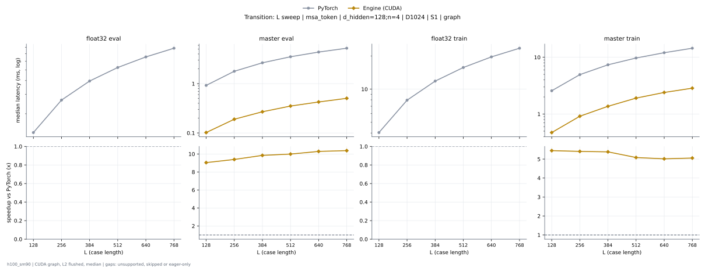

**float32 eval** (median ms; x = speedup vs PyTorch)

| L | PyTorch | Engine (Triton) | Engine (CUDA) | Anthropic |
|---|---|---|---|---|
| 128 | 1.35 | 0.4402 (3.07x) | 0.2855 (4.73x) | unsupported |
| 256 | 2.656 | 0.8522 (3.12x) | 0.5478 (4.85x) | unsupported |
| 384 | 3.952 | 1.26 (3.14x) | 0.8007 (4.94x) | unsupported |
| 512 | 5.256 | 1.653 (3.18x) | 1.061 (4.95x) | unsupported |
| 640 | 6.56 | 2.064 (3.18x) | 1.32 (4.97x) | unsupported |
| 768 | 7.865 | 2.463 (3.19x) | 1.615 (4.87x) | unsupported |

**master eval** (median ms; x = speedup vs PyTorch)

| L | PyTorch | Engine (Triton) | Engine (CUDA) | Anthropic |
|---|---|---|---|---|
| 128 | 0.9228 | 0.233 (3.96x) | 0.1023 (9.02x) | 0.1573 (5.87x) |
| 256 | 1.784 | 0.4362 (4.09x) | 0.1912 (9.33x) | 0.2995 (5.96x) |
| 384 | 2.652 | 0.6351 (4.18x) | 0.2704 (9.81x) | 0.4341 (6.11x) |
| 512 | 3.516 | 0.8352 (4.21x) | 0.3515 (10.00x) | 0.5724 (6.14x) |
| 640 | 4.362 | 1.038 (4.20x) | 0.431 (10.12x) | 0.7039 (6.20x) |
| 768 | 5.222 | 1.246 (4.19x) | 0.5128 (10.18x) | 0.841 (6.21x) |

**float32 train** (median ms; x = speedup vs PyTorch)

| L | PyTorch | Engine (Triton) | Engine (CUDA) | Anthropic |
|---|---|---|---|---|
| 128 | 4.044 | 1.82 (2.22x) | 1.404 (2.88x) | unsupported |
| 256 | 7.938 | 3.523 (2.25x) | 2.714 (2.93x) | unsupported |
| 384 | 11.83 | 5.208 (2.27x) | 4.059 (2.91x) | unsupported |
| 512 | 15.72 | 6.91 (2.28x) | 5.366 (2.93x) | unsupported |
| 640 | 19.62 | 8.602 (2.28x) | 6.735 (2.91x) | unsupported |
| 768 | 23.53 | 10.23 (2.30x) | 8.048 (2.92x) | unsupported |

**master train** (median ms; x = speedup vs PyTorch)

| L | PyTorch | Engine (Triton) | Engine (CUDA) | Anthropic |
|---|---|---|---|---|
| 128 | 2.57 | 0.8616 (2.98x) | 0.4722 (5.44x) | unsupported |
| 256 | 4.948 | 1.66 (2.98x) | 0.9092 (5.44x) | unsupported |
| 384 | 7.354 | 2.444 (3.01x) | 1.35 (5.45x) | unsupported |
| 512 | 9.703 | 3.218 (3.01x) | 1.839 (5.28x) | unsupported |
| 640 | 12.05 | 3.997 (3.02x) | 2.328 (5.18x) | unsupported |
| 768 | 14.43 | 4.775 (3.02x) | 2.806 (5.14x) | unsupported |

### L sweep: msa_token | d_hidden=256;n=4 | D1024 | S1 | graph

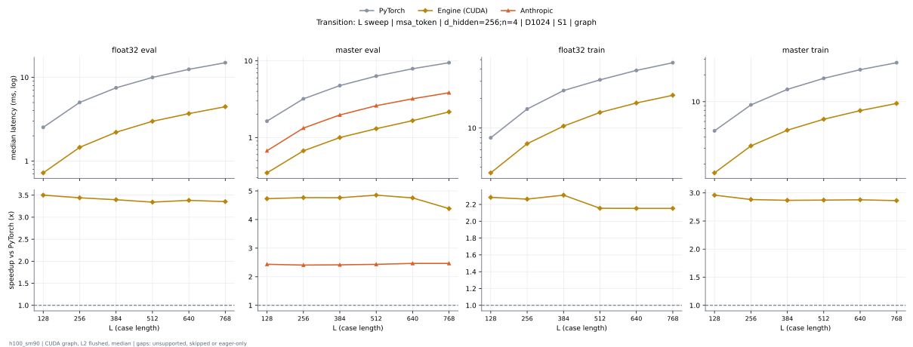

**float32 eval** (median ms; x = speedup vs PyTorch)

| L | PyTorch | Engine (Triton) | Engine (CUDA) | Anthropic |
|---|---|---|---|---|
| 128 | 2.53 | 1.077 (2.35x) | 0.7229 (3.50x) | unsupported |
| 256 | 5.02 | 2.186 (2.30x) | 1.459 (3.44x) | unsupported |
| 384 | 7.504 | 3.282 (2.29x) | 2.209 (3.40x) | unsupported |
| 512 | 9.985 | 4.601 (2.17x) | 2.988 (3.34x) | unsupported |
| 640 | 12.48 | 5.749 (2.17x) | 3.69 (3.38x) | unsupported |
| 768 | 14.97 | 6.875 (2.18x) | 4.463 (3.35x) | unsupported |

**master eval** (median ms; x = speedup vs PyTorch)

| L | PyTorch | Engine (Triton) | Engine (CUDA) | Anthropic |
|---|---|---|---|---|
| 128 | 1.636 | 0.5242 (3.12x) | 0.346 (4.73x) | 0.6721 (2.43x) |
| 256 | 3.198 | 1.084 (2.95x) | 0.6711 (4.77x) | 1.329 (2.41x) |
| 384 | 4.76 | 1.582 (3.01x) | 0.9996 (4.76x) | 1.97 (2.42x) |
| 512 | 6.329 | 2.2 (2.88x) | 1.304 (4.85x) | 2.601 (2.43x) |
| 640 | 7.899 | 2.712 (2.91x) | 1.661 (4.76x) | 3.204 (2.47x) |
| 768 | 9.465 | 3.296 (2.87x) | 2.16 (4.38x) | 3.84 (2.47x) |

**float32 train** (median ms; x = speedup vs PyTorch)

| L | PyTorch | Engine (Triton) | Engine (CUDA) | Anthropic |
|---|---|---|---|---|
| 128 | 7.949 | 5.059 (1.57x) | 3.48 (2.28x) | unsupported |
| 256 | 15.65 | 10.22 (1.53x) | 6.914 (2.26x) | unsupported |
| 384 | 24.17 | 15.3 (1.58x) | 10.46 (2.31x) | unsupported |
| 512 | 31.09 | 20.11 (1.55x) | 14.43 (2.15x) | unsupported |
| 640 | 38.81 | 24.95 (1.56x) | 18.03 (2.15x) | unsupported |
| 768 | 46.54 | 30.23 (1.54x) | 21.62 (2.15x) | unsupported |

**master train** (median ms; x = speedup vs PyTorch)

| L | PyTorch | Engine (Triton) | Engine (CUDA) | Anthropic |
|---|---|---|---|---|
| 128 | 4.714 | 1.926 (2.45x) | 1.593 (2.96x) | unsupported |
| 256 | 9.207 | 3.748 (2.46x) | 3.195 (2.88x) | unsupported |
| 384 | 13.73 | 5.629 (2.44x) | 4.788 (2.87x) | unsupported |
| 512 | 18.27 | 7.559 (2.42x) | 6.361 (2.87x) | unsupported |
| 640 | 22.84 | 9.55 (2.39x) | 7.94 (2.88x) | unsupported |
| 768 | 27.34 | 11.25 (2.43x) | 9.552 (2.86x) | unsupported |

### L sweep: msa_token | d_hidden=64;n=4 | D384 | S1 | graph

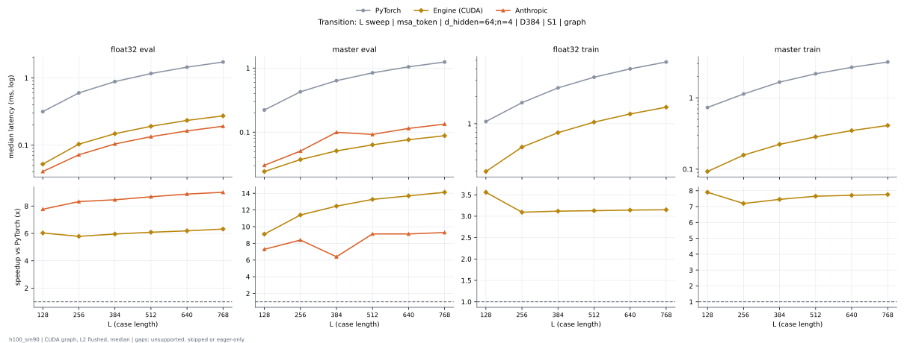

**float32 eval** (median ms; x = speedup vs PyTorch)

| L | PyTorch | Engine (Triton) | Engine (CUDA) | Anthropic |
|---|---|---|---|---|
| 128 | 0.3155 | 0.0897 (3.52x) | 0.0523 (6.03x) | 0.04061 (7.77x) |
| 256 | 0.5991 | 0.159 (3.77x) | 0.1035 (5.79x) | 0.07194 (8.33x) |
| 384 | 0.8822 | 0.2315 (3.81x) | 0.1482 (5.95x) | 0.1043 (8.46x) |
| 512 | 1.162 | 0.2991 (3.88x) | 0.1909 (6.09x) | 0.1338 (8.68x) |
| 640 | 1.445 | 0.3694 (3.91x) | 0.2336 (6.19x) | 0.1628 (8.88x) |
| 768 | 1.724 | 0.4364 (3.95x) | 0.2729 (6.32x) | 0.1914 (9.01x) |

**master eval** (median ms; x = speedup vs PyTorch)

| L | PyTorch | Engine (Triton) | Engine (CUDA) | Anthropic |
|---|---|---|---|---|
| 128 | 0.2219 | 0.05005 (4.43x) | 0.02437 (9.10x) | 0.03043 (7.29x) |
| 256 | 0.4264 | 0.09014 (4.73x) | 0.03741 (11.40x) | 0.05078 (8.40x) |
| 384 | 0.6363 | 0.1233 (5.16x) | 0.05107 (12.46x) | 0.09952 (6.39x) |
| 512 | 0.8422 | 0.1579 (5.33x) | 0.06349 (13.27x) | 0.09226 (9.13x) |
| 640 | 1.045 | 0.1906 (5.48x) | 0.07635 (13.69x) | 0.1145 (9.13x) |
| 768 | 1.243 | 0.2217 (5.61x) | 0.08805 (14.12x) | 0.1337 (9.30x) |

**float32 train** (median ms; x = speedup vs PyTorch)

| L | PyTorch | Engine (Triton) | Engine (CUDA) | Anthropic |
|---|---|---|---|---|
| 128 | 1.057 | 0.3893 (2.72x) | 0.297 (3.56x) | unsupported |
| 256 | 1.706 | 0.6696 (2.55x) | 0.5516 (3.09x) | unsupported |
| 384 | 2.483 | 0.955 (2.60x) | 0.7963 (3.12x) | unsupported |
| 512 | 3.257 | 1.231 (2.64x) | 1.041 (3.13x) | unsupported |
| 640 | 4.024 | 1.512 (2.66x) | 1.281 (3.14x) | unsupported |
| 768 | 4.791 | 1.793 (2.67x) | 1.521 (3.15x) | unsupported |

**master train** (median ms; x = speedup vs PyTorch)

| L | PyTorch | Engine (Triton) | Engine (CUDA) | Anthropic |
|---|---|---|---|---|
| 128 | 0.7328 | 0.2058 (3.56x) | 0.09275 (7.90x) | unsupported |
| 256 | 1.133 | 0.351 (3.23x) | 0.1574 (7.20x) | unsupported |
| 384 | 1.661 | 0.4923 (3.37x) | 0.2229 (7.45x) | unsupported |
| 512 | 2.174 | 0.6306 (3.45x) | 0.284 (7.65x) | unsupported |
| 640 | 2.68 | 0.7728 (3.47x) | 0.3475 (7.71x) | unsupported |
| 768 | 3.18 | 0.9079 (3.50x) | 0.4098 (7.76x) | unsupported |

### L sweep: token_pair | d_hidden=128;n=2 | S1 | graph

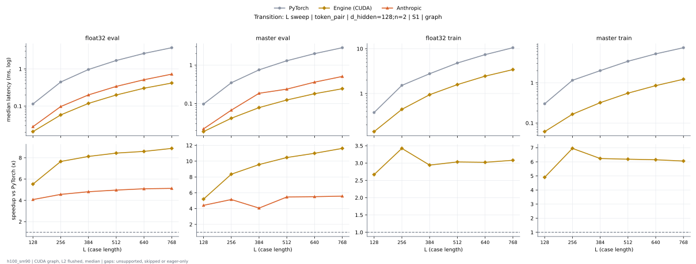

**float32 eval** (median ms; x = speedup vs PyTorch)

| L | PyTorch | Engine (Triton) | Engine (CUDA) | Anthropic |
|---|---|---|---|---|
| 128 | 0.1158 | 0.04382 (2.64x) | 0.03296 (3.51x) | 0.02808 (4.13x) |
| 256 | 0.4443 | 0.1485 (2.99x) | 0.1036 (4.29x) | 0.09742 (4.56x) |
| 384 | 0.9635 | 0.3089 (3.12x) | 0.2174 (4.43x) | 0.2002 (4.81x) |
| 512 | 1.681 | 0.5306 (3.17x) | 0.3753 (4.48x) | 0.3386 (4.96x) |
| 640 | 2.597 | 0.8111 (3.20x) | 0.5705 (4.55x) | 0.5114 (5.08x) |
| 768 | 3.713 | 1.156 (3.21x) | 0.8125 (4.57x) | 0.7232 (5.13x) |

**master eval** (median ms; x = speedup vs PyTorch)

| L | PyTorch | Engine (Triton) | Engine (CUDA) | Anthropic |
|---|---|---|---|---|
| 128 | 0.09699 | 0.03133 (3.10x) | 0.01856 (5.23x) | 0.02202 (4.41x) |
| 256 | 0.3469 | 0.08464 (4.10x) | 0.04165 (8.33x) | 0.06739 (5.15x) |
| 384 | 0.7506 | 0.171 (4.39x) | 0.07878 (9.53x) | 0.1849 (4.06x) |
| 512 | 1.294 | 0.2822 (4.58x) | 0.1266 (10.22x) | 0.237 (5.46x) |
| 640 | 1.983 | 0.4247 (4.67x) | 0.185 (10.72x) | 0.3598 (5.51x) |
| 768 | 2.824 | 0.6012 (4.70x) | 0.2526 (11.18x) | 0.5062 (5.58x) |

**float32 train** (median ms; x = speedup vs PyTorch)

| L | PyTorch | Engine (Triton) | Engine (CUDA) | Anthropic |
|---|---|---|---|---|
| 128 | 0.3755 | 0.2104 (1.78x) | 0.1476 (2.54x) | unsupported |
| 256 | 1.516 | 0.6221 (2.44x) | 0.4765 (3.18x) | unsupported |
| 384 | 2.77 | 1.247 (2.22x) | 0.9909 (2.80x) | unsupported |
| 512 | 4.806 | 2.076 (2.31x) | 1.707 (2.82x) | unsupported |
| 640 | 7.388 | 3.181 (2.32x) | 2.634 (2.81x) | unsupported |
| 768 | 10.56 | 4.527 (2.33x) | 3.763 (2.81x) | unsupported |

**master train** (median ms; x = speedup vs PyTorch)

| L | PyTorch | Engine (Triton) | Engine (CUDA) | Anthropic |
|---|---|---|---|---|
| 128 | 0.2955 | 0.1129 (2.62x) | 0.05995 (4.93x) | unsupported |
| 256 | 1.149 | 0.3076 (3.73x) | 0.1641 (7.00x) | unsupported |
| 384 | 1.995 | 0.5981 (3.34x) | 0.3209 (6.22x) | unsupported |
| 512 | 3.413 | 0.9939 (3.43x) | 0.5551 (6.15x) | unsupported |
| 640 | 5.214 | 1.519 (3.43x) | 0.8584 (6.07x) | unsupported |
| 768 | 7.405 | 2.134 (3.47x) | 1.197 (6.19x) | unsupported |

### L sweep: token_pair | d_hidden=128;n=4 | S1 | graph

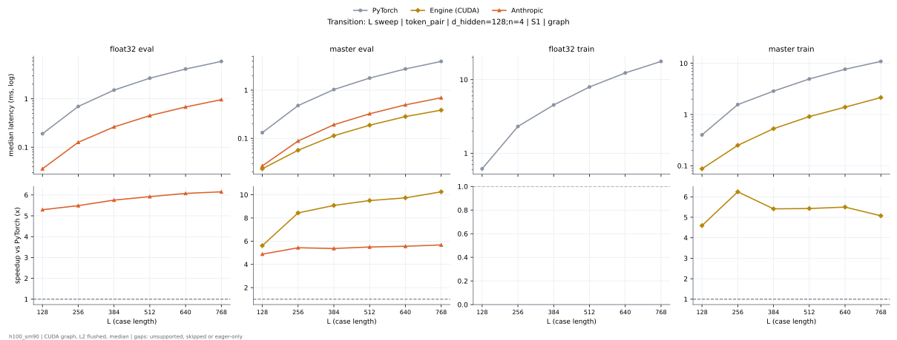

**float32 eval** (median ms; x = speedup vs PyTorch)

| L | PyTorch | Engine (Triton) | Engine (CUDA) | Anthropic |
|---|---|---|---|---|
| 128 | 0.19 | 0.06419 (2.96x) | 0.04266 (4.45x) | 0.03502 (5.42x) |
| 256 | 0.6958 | 0.2308 (3.01x) | 0.1526 (4.56x) | 0.1267 (5.49x) |
| 384 | 1.513 | 0.4912 (3.08x) | 0.3162 (4.78x) | 0.2625 (5.76x) |
| 512 | 2.664 | 0.8483 (3.14x) | 0.5444 (4.89x) | 0.4493 (5.93x) |
| 640 | 4.115 | 1.311 (3.14x) | 0.8307 (4.95x) | 0.6753 (6.09x) |
| 768 | 5.912 | 1.864 (3.17x) | 1.196 (4.94x) | 0.9596 (6.16x) |

**master eval** (median ms; x = speedup vs PyTorch)

| L | PyTorch | Engine (Triton) | Engine (CUDA) | Anthropic |
|---|---|---|---|---|
| 128 | 0.1304 | 0.04267 (3.06x) | 0.02326 (5.60x) | 0.0271 (4.81x) |
| 256 | 0.4795 | 0.129 (3.72x) | 0.05744 (8.35x) | 0.08914 (5.38x) |
| 384 | 1.031 | 0.2597 (3.97x) | 0.1147 (8.99x) | 0.1928 (5.35x) |
| 512 | 1.784 | 0.4357 (4.09x) | 0.19 (9.39x) | 0.326 (5.47x) |
| 640 | 2.749 | 0.66 (4.16x) | 0.2826 (9.73x) | 0.4927 (5.58x) |
| 768 | 3.937 | 0.9427 (4.18x) | 0.3846 (10.24x) | 0.6937 (5.68x) |

**float32 train** (median ms; x = speedup vs PyTorch)

| L | PyTorch | Engine (Triton) | Engine (CUDA) | Anthropic |
|---|---|---|---|---|
| 128 | 0.6128 | 0.316 (1.94x) | 0.2196 (2.79x) | unsupported |
| 256 | 2.315 | 0.9669 (2.39x) | 0.7459 (3.10x) | unsupported |
| 384 | 4.531 | 2.039 (2.22x) | 1.563 (2.90x) | unsupported |
| 512 | 7.947 | 3.522 (2.26x) | 2.724 (2.92x) | unsupported |
| 640 | 12.31 | 5.419 (2.27x) | 4.197 (2.93x) | unsupported |
| 768 | 17.68 | 7.747 (2.28x) | 6.028 (2.93x) | unsupported |

**master train** (median ms; x = speedup vs PyTorch)

| L | PyTorch | Engine (Triton) | Engine (CUDA) | Anthropic |
|---|---|---|---|---|
| 128 | 0.4012 | 0.1582 (2.54x) | 0.0871 (4.61x) | unsupported |
| 256 | 1.567 | 0.4738 (3.31x) | 0.2523 (6.21x) | unsupported |
| 384 | 2.866 | 0.9708 (2.95x) | 0.53 (5.41x) | unsupported |
| 512 | 4.947 | 1.656 (2.99x) | 0.9149 (5.41x) | unsupported |
| 640 | 7.655 | 2.533 (3.02x) | 1.391 (5.50x) | unsupported |
| 768 | 10.88 | 3.615 (3.01x) | 2.081 (5.23x) | unsupported |

### L sweep: token_pair | d_hidden=256;n=2 | S1 | graph

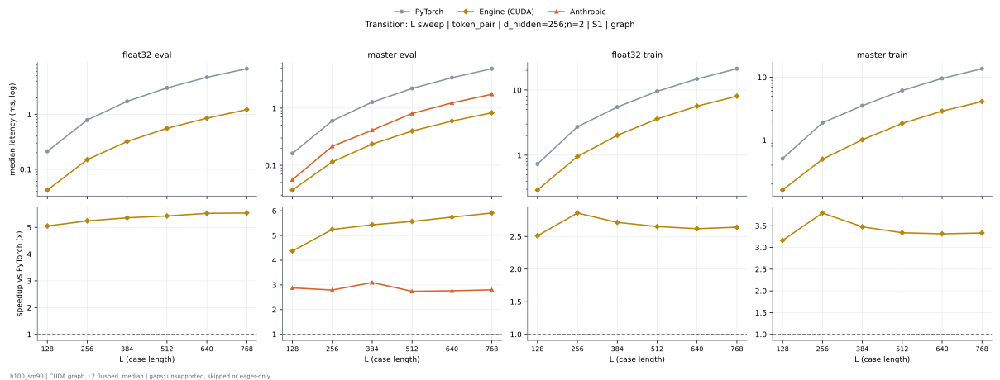

**float32 eval** (median ms; x = speedup vs PyTorch)

| L | PyTorch | Engine (Triton) | Engine (CUDA) | Anthropic |
|---|---|---|---|---|
| 128 | 0.2134 | 0.09533 (2.24x) | 0.06866 (3.11x) | unsupported |
| 256 | 0.7862 | 0.3546 (2.22x) | 0.2449 (3.21x) | unsupported |
| 384 | 1.717 | 0.7606 (2.26x) | 0.5155 (3.33x) | unsupported |
| 512 | 3.019 | 1.332 (2.27x) | 0.9028 (3.34x) | unsupported |
| 640 | 4.694 | 2.075 (2.26x) | 1.404 (3.34x) | unsupported |
| 768 | 6.737 | 2.951 (2.28x) | 2.026 (3.33x) | unsupported |

**master eval** (median ms; x = speedup vs PyTorch)

| L | PyTorch | Engine (Triton) | Engine (CUDA) | Anthropic |
|---|---|---|---|---|
| 128 | 0.1623 | 0.05573 (2.91x) | 0.04074 (3.98x) | 0.05598 (2.90x) |
| 256 | 0.6001 | 0.1798 (3.34x) | 0.1173 (5.12x) | 0.2148 (2.79x) |
| 384 | 1.277 | 0.3678 (3.47x) | 0.2362 (5.41x) | 0.4118 (3.10x) |
| 512 | 2.214 | 0.6218 (3.56x) | 0.3943 (5.62x) | 0.808 (2.74x) |
| 640 | 3.428 | 0.9834 (3.49x) | 0.5984 (5.73x) | 1.236 (2.77x) |
| 768 | 4.905 | 1.398 (3.51x) | 0.8257 (5.94x) | 1.753 (2.80x) |

**float32 train** (median ms; x = speedup vs PyTorch)

| L | PyTorch | Engine (Triton) | Engine (CUDA) | Anthropic |
|---|---|---|---|---|
| 128 | 0.7333 | 0.458 (1.60x) | 0.3113 (2.36x) | unsupported |
| 256 | 2.734 | 1.49 (1.84x) | 1.025 (2.67x) | unsupported |
| 384 | 5.471 | 3.085 (1.77x) | 2.206 (2.48x) | unsupported |
| 512 | 9.538 | 5.241 (1.82x) | 3.862 (2.47x) | unsupported |
| 640 | 14.79 | 8.7 (1.70x) | 6.012 (2.46x) | unsupported |
| 768 | 21.21 | 11.61 (1.83x) | 8.662 (2.45x) | unsupported |

**master train** (median ms; x = speedup vs PyTorch)

| L | PyTorch | Engine (Triton) | Engine (CUDA) | Anthropic |
|---|---|---|---|---|
| 128 | 0.5075 | 0.1955 (2.60x) | 0.1617 (3.14x) | unsupported |
| 256 | 1.887 | 0.6036 (3.13x) | 0.4987 (3.78x) | unsupported |
| 384 | 3.533 | 1.234 (2.86x) | 1.029 (3.43x) | unsupported |
| 512 | 6.177 | 2.153 (2.87x) | 1.817 (3.40x) | unsupported |
| 640 | 9.609 | 3.382 (2.84x) | 2.908 (3.30x) | unsupported |
| 768 | 13.72 | 4.823 (2.84x) | 4.138 (3.32x) | unsupported |

### L sweep: token_pair | d_hidden=256;n=4 | S1 | graph

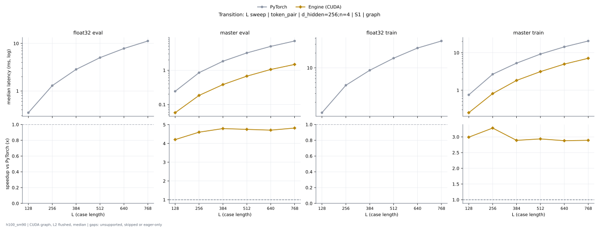

**float32 eval** (median ms; x = speedup vs PyTorch)

| L | PyTorch | Engine (Triton) | Engine (CUDA) | Anthropic |
|---|---|---|---|---|
| 128 | 0.3491 | 0.1514 (2.31x) | 0.1016 (3.44x) | unsupported |
| 256 | 1.293 | 0.557 (2.32x) | 0.3755 (3.44x) | unsupported |
| 384 | 2.847 | 1.24 (2.30x) | 0.8027 (3.55x) | unsupported |
| 512 | 5.023 | 2.201 (2.28x) | 1.443 (3.48x) | unsupported |
| 640 | 7.819 | 3.476 (2.25x) | 2.3 (3.40x) | unsupported |
| 768 | 11.25 | 5.179 (2.17x) | 3.4 (3.31x) | unsupported |

**master eval** (median ms; x = speedup vs PyTorch)

| L | PyTorch | Engine (Triton) | Engine (CUDA) | Anthropic |
|---|---|---|---|---|
| 128 | 0.2431 | 0.08531 (2.85x) | 0.05776 (4.21x) | 0.08832 (2.75x) |
| 256 | 0.853 | 0.2845 (3.00x) | 0.1859 (4.59x) | 0.3465 (2.46x) |
| 384 | 1.834 | 0.6075 (3.02x) | 0.3837 (4.78x) | 0.76 (2.41x) |
| 512 | 3.192 | 1.108 (2.88x) | 0.6664 (4.79x) | 1.331 (2.40x) |
| 640 | 4.966 | 1.722 (2.88x) | 1.081 (4.59x) | 2.054 (2.42x) |
| 768 | 7.12 | 2.51 (2.84x) | 1.605 (4.44x) | 2.901 (2.45x) |

**float32 train** (median ms; x = speedup vs PyTorch)

| L | PyTorch | Engine (Triton) | Engine (CUDA) | Anthropic |
|---|---|---|---|---|
| 128 | 1.228 | 0.7879 (1.56x) | 0.511 (2.40x) | unsupported |
| 256 | 4.417 | 2.626 (1.68x) | 1.768 (2.50x) | unsupported |
| 384 | 8.918 | 5.852 (1.52x) | 3.896 (2.29x) | unsupported |
| 512 | 15.68 | 10.28 (1.52x) | 6.924 (2.26x) | unsupported |
| 640 | 25.22 | 15.69 (1.61x) | 11.09 (2.27x) | unsupported |
| 768 | 35.04 | 22.64 (1.55x) | 16.03 (2.19x) | unsupported |

**master train** (median ms; x = speedup vs PyTorch)

| L | PyTorch | Engine (Triton) | Engine (CUDA) | Anthropic |
|---|---|---|---|---|
| 128 | 0.7557 | 0.3043 (2.48x) | 0.2532 (2.98x) | unsupported |
| 256 | 2.665 | 0.9892 (2.69x) | 0.8206 (3.25x) | unsupported |
| 384 | 5.28 | 2.163 (2.44x) | 1.752 (3.01x) | unsupported |
| 512 | 9.216 | 3.777 (2.44x) | 3.215 (2.87x) | unsupported |
| 640 | 14.34 | 5.964 (2.40x) | 5.008 (2.86x) | unsupported |
| 768 | 20.55 | 8.638 (2.38x) | 7.205 (2.85x) | unsupported |

### L sweep: token_pair | d_hidden=384;n=2 | S1 | graph

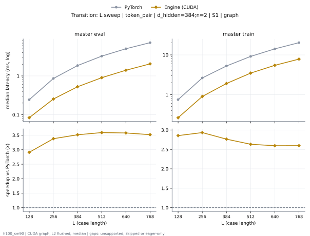

**float32 eval** (median ms; x = speedup vs PyTorch)

| L | PyTorch | Engine (Triton) | Engine (CUDA) | Anthropic |
|---|---|---|---|---|
| 128 | 0.3239 | 0.1756 (1.85x) | 0.117 (2.77x) | unsupported |
| 256 | 1.158 | 0.643 (1.80x) | 0.422 (2.74x) | unsupported |
| 384 | 2.551 | 1.486 (1.72x) | 0.9253 (2.76x) | unsupported |
| 512 | 4.495 | 2.565 (1.75x) | 1.702 (2.64x) | unsupported |
| 640 | 6.991 | 4.026 (1.74x) | 2.658 (2.63x) | unsupported |
| 768 | 10.05 | 6.021 (1.67x) | 3.869 (2.60x) | unsupported |

**master eval** (median ms; x = speedup vs PyTorch)

| L | PyTorch | Engine (Triton) | Engine (CUDA) | Anthropic |
|---|---|---|---|---|
| 128 | 0.2427 | 0.09494 (2.56x) | 0.08298 (2.92x) | unsupported |
| 256 | 0.8602 | 0.3122 (2.76x) | 0.2575 (3.34x) | unsupported |
| 384 | 1.853 | 0.6839 (2.71x) | 0.5281 (3.51x) | unsupported |
| 512 | 3.232 | 1.217 (2.66x) | 0.903 (3.58x) | unsupported |
| 640 | 5.015 | 1.919 (2.61x) | 1.46 (3.43x) | unsupported |
| 768 | 7.201 | 2.771 (2.60x) | 2.112 (3.41x) | unsupported |

**float32 train** (median ms; x = speedup vs PyTorch)

| L | PyTorch | Engine (Triton) | Engine (CUDA) | Anthropic |
|---|---|---|---|---|
| 128 | 1.146 | 0.8564 (1.34x) | 0.5664 (2.02x) | unsupported |
| 256 | 4.18 | 3.069 (1.36x) | 2.055 (2.03x) | unsupported |
| 384 | 8.5 | 6.491 (1.31x) | 4.316 (1.97x) | unsupported |
| 512 | 14.98 | 11.24 (1.33x) | 7.732 (1.94x) | unsupported |
| 640 | 23.34 | 17.35 (1.35x) | 12.24 (1.91x) | unsupported |
| 768 | 34.35 | 25.12 (1.37x) | 17.58 (1.95x) | unsupported |

**master train** (median ms; x = speedup vs PyTorch)

| L | PyTorch | Engine (Triton) | Engine (CUDA) | Anthropic |
|---|---|---|---|---|
| 128 | 0.7452 | 0.3074 (2.42x) | 0.2631 (2.83x) | unsupported |
| 256 | 2.633 | 1.001 (2.63x) | 0.9003 (2.92x) | unsupported |
| 384 | 5.267 | 2.196 (2.40x) | 1.98 (2.66x) | unsupported |
| 512 | 9.162 | 3.879 (2.36x) | 3.541 (2.59x) | unsupported |
| 640 | 14.2 | 6.293 (2.26x) | 5.491 (2.59x) | unsupported |
| 768 | 20.38 | 8.966 (2.27x) | 7.719 (2.64x) | unsupported |

### L sweep: token_pair | d_hidden=384;n=4 | S1 | graph

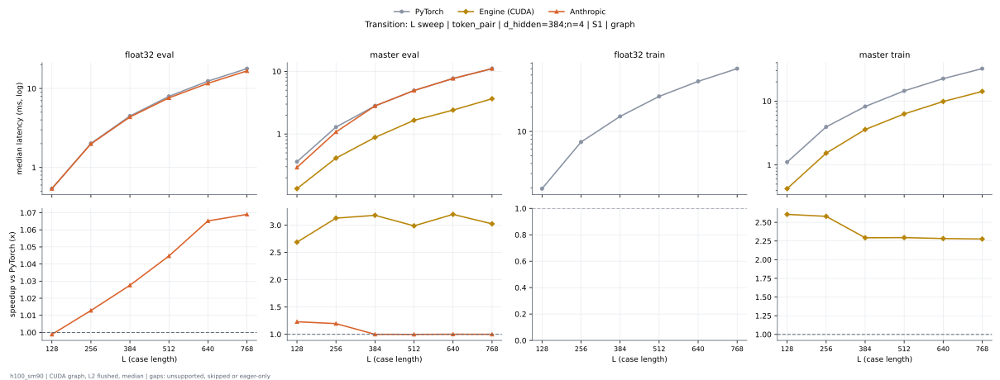

**float32 eval** (median ms; x = speedup vs PyTorch)

| L | PyTorch | Engine (Triton) | Engine (CUDA) | Anthropic |
|---|---|---|---|---|
| 128 | 0.5382 | 0.3004 (1.79x) | 0.1871 (2.88x) | 0.5384 (1.00x) |
| 256 | 2.001 | 1.151 (1.74x) | 0.6812 (2.94x) | 1.999 (1.00x) |
| 384 | 4.452 | 2.616 (1.70x) | 1.491 (2.99x) | 4.306 (1.03x) |
| 512 | 7.89 | 4.689 (1.68x) | 2.904 (2.72x) | 7.576 (1.04x) |
| 640 | 12.33 | 7.849 (1.57x) | 4.451 (2.77x) | 11.62 (1.06x) |
| 768 | 17.75 | 11.46 (1.55x) | 6.375 (2.78x) | 16.73 (1.06x) |

**master eval** (median ms; x = speedup vs PyTorch)

| L | PyTorch | Engine (Triton) | Engine (CUDA) | Anthropic |
|---|---|---|---|---|
| 128 | 0.3612 | 0.159 (2.27x) | 0.1336 (2.70x) | 0.2414 (1.50x) |
| 256 | 1.286 | 0.5306 (2.42x) | 0.4161 (3.09x) | 0.8881 (1.45x) |
| 384 | 2.803 | 1.213 (2.31x) | 0.8794 (3.19x) | 1.936 (1.45x) |
| 512 | 4.931 | 2.183 (2.26x) | 1.57 (3.14x) | 3.419 (1.44x) |
| 640 | 7.68 | 3.566 (2.15x) | 2.731 (2.81x) | 5.384 (1.43x) |
| 768 | 11.04 | 5.148 (2.14x) | 3.77 (2.93x) | 7.824 (1.41x) |

**float32 train** (median ms; x = speedup vs PyTorch)

| L | PyTorch | Engine (Triton) | Engine (CUDA) | Anthropic |
|---|---|---|---|---|
| 128 | 1.96 | 1.448 (1.35x) | 0.9406 (2.08x) | unsupported |
| 256 | 7.376 | 5.414 (1.36x) | 3.552 (2.08x) | unsupported |
| 384 | 15.29 | 11.81 (1.29x) | 8.155 (1.87x) | unsupported |
| 512 | 27.05 | 21.03 (1.29x) | 14.57 (1.86x) | unsupported |
| 640 | 41.63 | 33.33 (1.25x) | 22.98 (1.81x) | unsupported |
| 768 | 59.99 | 49.39 (1.21x) | 33.34 (1.80x) | unsupported |

**master train** (median ms; x = speedup vs PyTorch)

| L | PyTorch | Engine (Triton) | Engine (CUDA) | Anthropic |
|---|---|---|---|---|
| 128 | 1.107 | 0.5015 (2.21x) | 0.4219 (2.63x) | unsupported |
| 256 | 3.94 | 1.744 (2.26x) | 1.549 (2.54x) | unsupported |
| 384 | 8.212 | 4.119 (1.99x) | 3.586 (2.29x) | unsupported |
| 512 | 14.42 | 7.113 (2.03x) | 6.348 (2.27x) | unsupported |
| 640 | 22.44 | 11.1 (2.02x) | 9.827 (2.28x) | unsupported |
| 768 | 32.23 | 16.02 (2.01x) | 14.08 (2.29x) | unsupported |

### L sweep: token_pair | d_hidden=512;n=2 | S1 | graph

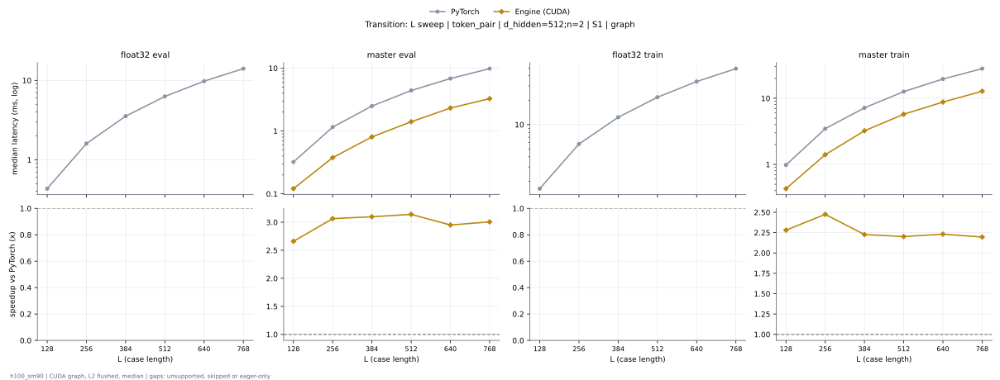

**float32 eval** (median ms; x = speedup vs PyTorch)

| L | PyTorch | Engine (Triton) | Engine (CUDA) | Anthropic |
|---|---|---|---|---|
| 128 | 0.4327 | 0.2503 (1.73x) | 0.1758 (2.46x) | unsupported |
| 256 | 1.599 | 0.9549 (1.67x) | 0.6423 (2.49x) | unsupported |
| 384 | 3.539 | 2.178 (1.62x) | 1.41 (2.51x) | unsupported |
| 512 | 6.272 | 3.948 (1.59x) | 2.665 (2.35x) | unsupported |
| 640 | 9.755 | 6.266 (1.56x) | 4.175 (2.34x) | unsupported |
| 768 | 14.08 | 8.686 (1.62x) | 5.901 (2.39x) | unsupported |

**master eval** (median ms; x = speedup vs PyTorch)

| L | PyTorch | Engine (Triton) | Engine (CUDA) | Anthropic |
|---|---|---|---|---|
| 128 | 0.3279 | 0.1369 (2.39x) | 0.1217 (2.69x) | 0.6139 (0.53x) |
| 256 | 1.152 | 0.4566 (2.52x) | 0.3755 (3.07x) | 2.391 (0.48x) |
| 384 | 2.505 | 1.038 (2.41x) | 0.8065 (3.11x) | 5.228 (0.48x) |
| 512 | 4.412 | 1.796 (2.46x) | 1.447 (3.05x) | 9.265 (0.48x) |
| 640 | 6.841 | 3.006 (2.28x) | 2.321 (2.95x) | 14.38 (0.48x) |
| 768 | 9.836 | 4.294 (2.29x) | 3.334 (2.95x) | 20.77 (0.47x) |

**float32 train** (median ms; x = speedup vs PyTorch)

| L | PyTorch | Engine (Triton) | Engine (CUDA) | Anthropic |
|---|---|---|---|---|
| 128 | 1.621 | 1.047 (1.55x) | 0.8251 (1.96x) | unsupported |
| 256 | 5.749 | 4.722 (1.22x) | 3.059 (1.88x) | unsupported |
| 384 | 12.3 | 10.19 (1.21x) | 7.132 (1.73x) | unsupported |
| 512 | 21.8 | 18.06 (1.21x) | 12.48 (1.75x) | unsupported |
| 640 | 33.89 | 28.22 (1.20x) | 19.04 (1.78x) | unsupported |
| 768 | 49.09 | 41.71 (1.18x) | 28.14 (1.74x) | unsupported |

**master train** (median ms; x = speedup vs PyTorch)

| L | PyTorch | Engine (Triton) | Engine (CUDA) | Anthropic |
|---|---|---|---|---|
| 128 | 0.9782 | 0.4359 (2.24x) | 0.4319 (2.27x) | unsupported |
| 256 | 3.449 | 1.507 (2.29x) | 1.418 (2.43x) | unsupported |
| 384 | 7.16 | 3.379 (2.12x) | 3.161 (2.27x) | unsupported |
| 512 | 12.59 | 6.075 (2.07x) | 5.67 (2.22x) | unsupported |
| 640 | 19.54 | 9.431 (2.07x) | 8.891 (2.20x) | unsupported |
| 768 | 28.07 | 13.27 (2.12x) | 12.23 (2.30x) | unsupported |

### L sweep: token_pair | d_hidden=512;n=4 | S1 | graph

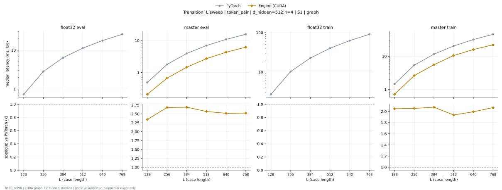

**float32 eval** (median ms; x = speedup vs PyTorch)

| L | PyTorch | Engine (Triton) | Engine (CUDA) | Anthropic |
|---|---|---|---|---|
| 128 | 0.7364 | 0.4198 (1.75x) | 0.2825 (2.61x) | unsupported |
| 256 | 2.819 | 1.73 (1.63x) | 1.118 (2.52x) | unsupported |
| 384 | 6.403 | 3.889 (1.65x) | 2.63 (2.43x) | unsupported |
| 512 | 11.24 | 7.062 (1.59x) | 4.84 (2.32x) | unsupported |
| 640 | 17.65 | 11.52 (1.53x) | 7.274 (2.43x) | unsupported |
| 768 | 25.49 | 16.31 (1.56x) | 10.77 (2.37x) | unsupported |

**master eval** (median ms; x = speedup vs PyTorch)

| L | PyTorch | Engine (Triton) | Engine (CUDA) | Anthropic |
|---|---|---|---|---|
| 128 | 0.4879 | 0.2321 (2.10x) | 0.2039 (2.39x) | 1.191 (0.41x) |
| 256 | 1.786 | 0.8377 (2.13x) | 0.6666 (2.68x) | 4.615 (0.39x) |
| 384 | 3.923 | 1.958 (2.00x) | 1.526 (2.57x) | 10.21 (0.38x) |
| 512 | 6.948 | 3.483 (1.99x) | 2.739 (2.54x) | 18.08 (0.38x) |
| 640 | 10.8 | 5.311 (2.03x) | 4.304 (2.51x) | 28.09 (0.38x) |
| 768 | 15.57 | 7.757 (2.01x) | 6.086 (2.56x) | 40.53 (0.38x) |

**float32 train** (median ms; x = speedup vs PyTorch)

| L | PyTorch | Engine (Triton) | Engine (CUDA) | Anthropic |
|---|---|---|---|---|
| 128 | 2.712 | 1.685 (1.61x) | 1.451 (1.87x) | unsupported |
| 256 | 10.28 | 8.57 (1.20x) | 5.944 (1.73x) | unsupported |
| 384 | 22.59 | 18.93 (1.19x) | 12.92 (1.75x) | unsupported |
| 512 | 39.86 | 33.81 (1.18x) | 23.64 (1.69x) | unsupported |
| 640 | 62.62 | 54.31 (1.15x) | 37.05 (1.69x) | unsupported |
| 768 | 90.6 | 76.81 (1.18x) | 53.75 (1.69x) | unsupported |

**master train** (median ms; x = speedup vs PyTorch)

| L | PyTorch | Engine (Triton) | Engine (CUDA) | Anthropic |
|---|---|---|---|---|
| 128 | 1.466 | 0.7153 (2.05x) | 0.7157 (2.05x) | unsupported |
| 256 | 5.385 | 2.772 (1.94x) | 2.544 (2.12x) | unsupported |
| 384 | 11.52 | 6.307 (1.83x) | 5.61 (2.05x) | unsupported |
| 512 | 20.34 | 11.22 (1.81x) | 10.54 (1.93x) | unsupported |
| 640 | 31.62 | 17.7 (1.79x) | 16.6 (1.90x) | unsupported |
| 768 | 45.54 | 25.14 (1.81x) | 22.07 (2.06x) | unsupported |

### L sweep: token_pair | d_hidden=64;n=2 | S1 | graph

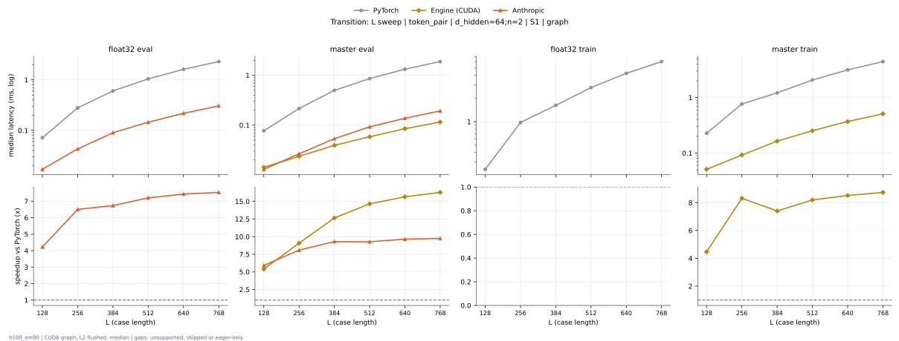

**float32 eval** (median ms; x = speedup vs PyTorch)

| L | PyTorch | Engine (Triton) | Engine (CUDA) | Anthropic |
|---|---|---|---|---|
| 128 | 0.0716 | 0.02565 (2.79x) | 0.02022 (3.54x) | 0.01691 (4.23x) |
| 256 | 0.2791 | 0.07085 (3.94x) | 0.05242 (5.33x) | 0.04381 (6.37x) |
| 384 | 0.6048 | 0.1503 (4.02x) | 0.1076 (5.62x) | 0.09022 (6.70x) |
| 512 | 1.043 | 0.2481 (4.20x) | 0.1806 (5.77x) | 0.1452 (7.18x) |
| 640 | 1.62 | 0.3798 (4.27x) | 0.2725 (5.94x) | 0.2196 (7.38x) |
| 768 | 2.314 | 0.5364 (4.31x) | 0.3836 (6.03x) | 0.3068 (7.54x) |

**master eval** (median ms; x = speedup vs PyTorch)

| L | PyTorch | Engine (Triton) | Engine (CUDA) | Anthropic |
|---|---|---|---|---|
| 128 | 0.07682 | 0.02365 (3.25x) | 0.01403 (5.47x) | 0.01302 (5.90x) |
| 256 | 0.2147 | 0.04493 (4.78x) | 0.02387 (9.00x) | 0.02661 (8.07x) |
| 384 | 0.4961 | 0.08379 (5.92x) | 0.03989 (12.44x) | 0.05504 (9.01x) |
| 512 | 0.8647 | 0.1357 (6.37x) | 0.06 (14.41x) | 0.09387 (9.21x) |
| 640 | 1.326 | 0.1969 (6.73x) | 0.08518 (15.56x) | 0.1386 (9.57x) |
| 768 | 1.887 | 0.2719 (6.94x) | 0.1155 (16.34x) | 0.1941 (9.72x) |

**float32 train** (median ms; x = speedup vs PyTorch)

| L | PyTorch | Engine (Triton) | Engine (CUDA) | Anthropic |
|---|---|---|---|---|
| 128 | 0.241 | 0.1262 (1.91x) | 0.0895 (2.69x) | unsupported |
| 256 | 0.977 | 0.3226 (3.03x) | 0.264 (3.70x) | unsupported |
| 384 | 1.628 | 0.6046 (2.69x) | 0.5265 (3.09x) | unsupported |
| 512 | 2.767 | 0.9928 (2.79x) | 0.8856 (3.12x) | unsupported |
| 640 | 4.237 | 1.427 (2.97x) | 1.341 (3.16x) | unsupported |
| 768 | 6.023 | 2.072 (2.91x) | 1.901 (3.17x) | unsupported |

**master train** (median ms; x = speedup vs PyTorch)

| L | PyTorch | Engine (Triton) | Engine (CUDA) | Anthropic |
|---|---|---|---|---|
| 128 | 0.228 | 0.07501 (3.04x) | 0.05067 (4.50x) | unsupported |
| 256 | 0.7648 | 0.1691 (4.52x) | 0.09189 (8.32x) | unsupported |
| 384 | 1.215 | 0.3259 (3.73x) | 0.1646 (7.38x) | unsupported |
| 512 | 2.083 | 0.527 (3.95x) | 0.2558 (8.14x) | unsupported |
| 640 | 3.163 | 0.777 (4.07x) | 0.3663 (8.64x) | unsupported |
| 768 | 4.464 | 1.08 (4.13x) | 0.5091 (8.77x) | unsupported |

### L sweep: token_pair | d_hidden=64;n=4 | S1 | graph

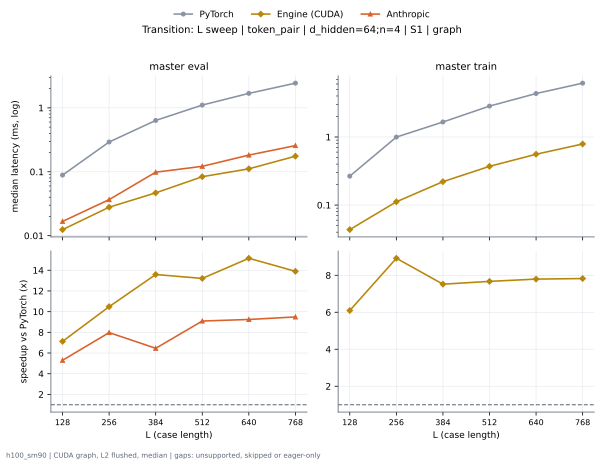

**float32 eval** (median ms; x = speedup vs PyTorch)

| L | PyTorch | Engine (Triton) | Engine (CUDA) | Anthropic |
|---|---|---|---|---|
| 128 | 0.104 | 0.03478 (2.99x) | 0.02371 (4.39x) | 0.0201 (5.18x) |
| 256 | 0.4104 | 0.1115 (3.68x) | 0.07002 (5.86x) | 0.04958 (8.28x) |
| 384 | 0.8798 | 0.2305 (3.82x) | 0.1472 (5.98x) | 0.1043 (8.44x) |
| 512 | 1.539 | 0.3924 (3.92x) | 0.2472 (6.23x) | 0.1732 (8.89x) |
| 640 | 2.383 | 0.5985 (3.98x) | 0.374 (6.37x) | 0.2602 (9.16x) |
| 768 | 3.395 | 0.8471 (4.01x) | 0.5191 (6.54x) | 0.3632 (9.35x) |

**master eval** (median ms; x = speedup vs PyTorch)

| L | PyTorch | Engine (Triton) | Engine (CUDA) | Anthropic |
|---|---|---|---|---|
| 128 | 0.0876 | 0.02805 (3.12x) | 0.01578 (5.55x) | 0.01674 (5.23x) |
| 256 | 0.2911 | 0.06102 (4.77x) | 0.03139 (9.27x) | 0.03667 (7.94x) |
| 384 | 0.6402 | 0.1229 (5.21x) | 0.05043 (12.69x) | 0.09851 (6.50x) |
| 512 | 1.112 | 0.2036 (5.46x) | 0.08859 (12.55x) | 0.1217 (9.14x) |
| 640 | 1.685 | 0.3002 (5.61x) | 0.1165 (14.46x) | 0.1824 (9.24x) |
| 768 | 2.421 | 0.4152 (5.83x) | 0.1789 (13.53x) | 0.2569 (9.42x) |

**float32 train** (median ms; x = speedup vs PyTorch)

| L | PyTorch | Engine (Triton) | Engine (CUDA) | Anthropic |
|---|---|---|---|---|
| 128 | 0.3445 | 0.1737 (1.98x) | 0.1204 (2.86x) | unsupported |
| 256 | 1.393 | 0.4834 (2.88x) | 0.3819 (3.65x) | unsupported |
| 384 | 2.486 | 0.9579 (2.60x) | 0.7966 (3.12x) | unsupported |
| 512 | 4.286 | 1.609 (2.66x) | 1.36 (3.15x) | unsupported |
| 640 | 6.594 | 2.448 (2.69x) | 2.089 (3.16x) | unsupported |
| 768 | 9.468 | 3.442 (2.75x) | 2.978 (3.18x) | unsupported |

**master train** (median ms; x = speedup vs PyTorch)

| L | PyTorch | Engine (Triton) | Engine (CUDA) | Anthropic |
|---|---|---|---|---|
| 128 | 0.2649 | 0.09664 (2.74x) | 0.04368 (6.07x) | unsupported |
| 256 | 0.9924 | 0.2522 (3.94x) | 0.1118 (8.88x) | unsupported |
| 384 | 1.658 | 0.4915 (3.37x) | 0.2202 (7.53x) | unsupported |
| 512 | 2.85 | 0.817 (3.49x) | 0.3701 (7.70x) | unsupported |
| 640 | 4.35 | 1.234 (3.53x) | 0.5578 (7.80x) | unsupported |
| 768 | 6.18 | 1.735 (3.56x) | 0.7916 (7.81x) | unsupported |

### L sweep: token_single | d_hidden=384;n=2 | S1 | graph

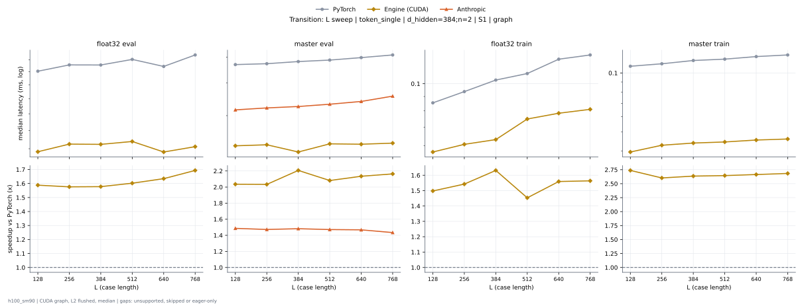

**float32 eval** (median ms; x = speedup vs PyTorch)

| L | PyTorch | Engine (Triton) | Engine (CUDA) | Anthropic |
|---|---|---|---|---|
| 128 | 0.03555 | 0.02419 (1.47x) | 0.02211 (1.61x) | unsupported |
| 256 | 0.03616 | 0.02445 (1.48x) | 0.02322 (1.56x) | unsupported |
| 384 | 0.03626 | 0.0245 (1.48x) | 0.0228 (1.59x) | unsupported |
| 512 | 0.03778 | 0.02488 (1.52x) | 0.02339 (1.61x) | unsupported |
| 640 | 0.0363 | 0.02518 (1.44x) | 0.02237 (1.62x) | unsupported |
| 768 | 0.03872 | 0.02806 (1.38x) | 0.02246 (1.72x) | unsupported |

**master eval** (median ms; x = speedup vs PyTorch)

| L | PyTorch | Engine (Triton) | Engine (CUDA) | Anthropic |
|---|---|---|---|---|
| 128 | 0.04648 | 0.0271 (1.71x) | 0.02144 (2.17x) | 0.03155 (1.47x) |
| 256 | 0.04747 | 0.02746 (1.73x) | 0.0232 (2.05x) | 0.0321 (1.48x) |
| 384 | 0.04846 | 0.02758 (1.76x) | 0.02318 (2.09x) | 0.0325 (1.49x) |
| 512 | 0.04917 | 0.02766 (1.78x) | 0.02325 (2.11x) | 0.03315 (1.48x) |
| 640 | 0.04995 | 0.02813 (1.78x) | 0.02339 (2.14x) | 0.03397 (1.47x) |
| 768 | 0.05094 | 0.02898 (1.76x) | 0.02387 (2.13x) | 0.03558 (1.43x) |

**float32 train** (median ms; x = speedup vs PyTorch)

| L | PyTorch | Engine (Triton) | Engine (CUDA) | Anthropic |
|---|---|---|---|---|
| 128 | 0.08502 | 0.06555 (1.30x) | 0.06318 (1.35x) | unsupported |
| 256 | 0.09333 | 0.0717 (1.30x) | 0.06827 (1.37x) | unsupported |
| 384 | 0.1027 | 0.07864 (1.31x) | 0.07131 (1.44x) | unsupported |
| 512 | 0.1084 | 0.08221 (1.32x) | 0.07443 (1.46x) | unsupported |
| 640 | 0.1219 | 0.09 (1.35x) | 0.07778 (1.57x) | unsupported |
| 768 | 0.1267 | 0.09779 (1.30x) | 0.0809 (1.57x) | unsupported |

**master train** (median ms; x = speedup vs PyTorch)

| L | PyTorch | Engine (Triton) | Engine (CUDA) | Anthropic |
|---|---|---|---|---|
| 128 | 0.1075 | 0.0649 (1.66x) | 0.0396 (2.72x) | unsupported |
| 256 | 0.1115 | 0.06701 (1.66x) | 0.04301 (2.59x) | unsupported |
| 384 | 0.1154 | 0.06821 (1.69x) | 0.04358 (2.65x) | unsupported |
| 512 | 0.1175 | 0.06986 (1.68x) | 0.04475 (2.63x) | unsupported |
| 640 | 0.1215 | 0.07074 (1.72x) | 0.04502 (2.70x) | unsupported |
| 768 | 0.1235 | 0.07346 (1.68x) | 0.04622 (2.67x) | unsupported |

### L sweep: token_single | d_hidden=384;n=4 | S1 | graph

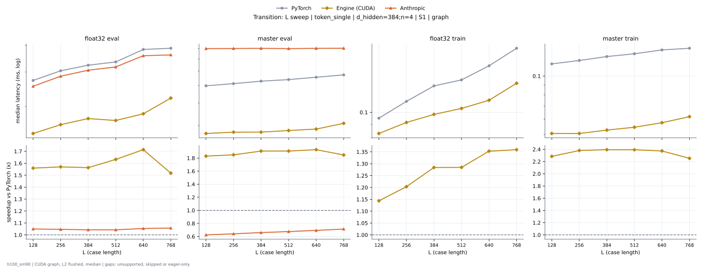

**float32 eval** (median ms; x = speedup vs PyTorch)

| L | PyTorch | Engine (Triton) | Engine (CUDA) | Anthropic |
|---|---|---|---|---|
| 128 | 0.03728 | 0.02539 (1.47x) | 0.0239 (1.56x) | 0.0355 (1.05x) |
| 256 | 0.04042 | 0.02598 (1.56x) | 0.02574 (1.57x) | 0.03862 (1.05x) |
| 384 | 0.04235 | 0.02874 (1.47x) | 0.02709 (1.56x) | 0.04061 (1.04x) |
| 512 | 0.04352 | 0.02978 (1.46x) | 0.02666 (1.63x) | 0.04174 (1.04x) |
| 640 | 0.04832 | 0.03046 (1.59x) | 0.02819 (1.71x) | 0.04586 (1.05x) |
| 768 | 0.0488 | 0.0347 (1.41x) | 0.03216 (1.52x) | 0.04616 (1.06x) |

**master eval** (median ms; x = speedup vs PyTorch)

| L | PyTorch | Engine (Triton) | Engine (CUDA) | Anthropic |
|---|---|---|---|---|
| 128 | 0.04978 | 0.0297 (1.68x) | 0.0272 (1.83x) | 0.07974 (0.62x) |
| 256 | 0.05117 | 0.02966 (1.72x) | 0.02766 (1.85x) | 0.07984 (0.64x) |
| 384 | 0.05278 | 0.03131 (1.69x) | 0.02768 (1.91x) | 0.08 (0.66x) |
| 512 | 0.05386 | 0.03221 (1.67x) | 0.02824 (1.91x) | 0.07973 (0.68x) |
| 640 | 0.05547 | 0.03262 (1.70x) | 0.02877 (1.93x) | 0.08 (0.69x) |
| 768 | 0.05715 | 0.03488 (1.64x) | 0.03094 (1.85x) | 0.08008 (0.71x) |

**float32 train** (median ms; x = speedup vs PyTorch)

| L | PyTorch | Engine (Triton) | Engine (CUDA) | Anthropic |
|---|---|---|---|---|
| 128 | 0.09498 | 0.07507 (1.27x) | 0.08304 (1.14x) | unsupported |
| 256 | 0.1101 | 0.08418 (1.31x) | 0.09149 (1.20x) | unsupported |
| 384 | 0.1261 | 0.09565 (1.32x) | 0.09821 (1.28x) | unsupported |
| 512 | 0.1329 | 0.1021 (1.30x) | 0.1035 (1.28x) | unsupported |
| 640 | 0.1505 | 0.1124 (1.34x) | 0.1112 (1.35x) | unsupported |
| 768 | 0.1755 | 0.1386 (1.27x) | 0.1291 (1.36x) | unsupported |

**master train** (median ms; x = speedup vs PyTorch)

| L | PyTorch | Engine (Triton) | Engine (CUDA) | Anthropic |
|---|---|---|---|---|
| 128 | 0.1156 | 0.07192 (1.61x) | 0.05059 (2.28x) | unsupported |
| 256 | 0.1204 | 0.07365 (1.63x) | 0.05058 (2.38x) | unsupported |
| 384 | 0.1261 | 0.07794 (1.62x) | 0.05267 (2.39x) | unsupported |
| 512 | 0.1303 | 0.08104 (1.61x) | 0.05448 (2.39x) | unsupported |
| 640 | 0.1364 | 0.08339 (1.64x) | 0.05749 (2.37x) | unsupported |
| 768 | 0.1391 | 0.08691 (1.60x) | 0.06178 (2.25x) | unsupported |

### L sweep: token_single | d_hidden=768;n=2 | S1 | graph

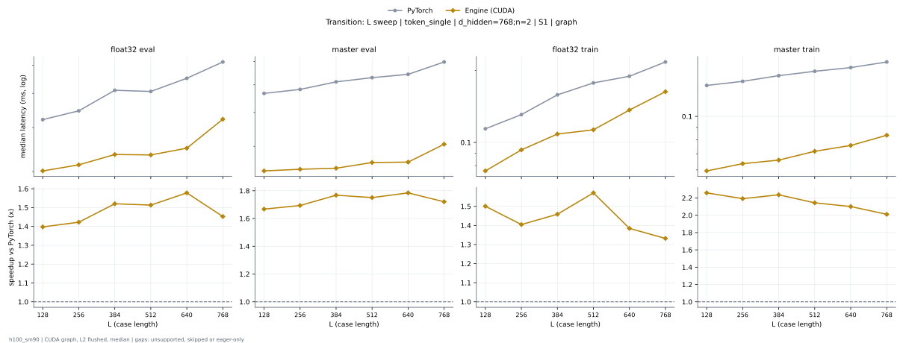

**float32 eval** (median ms; x = speedup vs PyTorch)

| L | PyTorch | Engine (Triton) | Engine (CUDA) | Anthropic |
|---|---|---|---|---|
| 128 | 0.04194 | 0.03222 (1.30x) | 0.03016 (1.39x) | unsupported |
| 256 | 0.04458 | 0.03341 (1.33x) | 0.0312 (1.43x) | unsupported |
| 384 | 0.05093 | 0.04133 (1.23x) | 0.03374 (1.51x) | unsupported |
| 512 | 0.05056 | 0.04274 (1.18x) | 0.0339 (1.49x) | unsupported |
| 640 | 0.05509 | 0.04352 (1.27x) | 0.03498 (1.58x) | unsupported |
| 768 | 0.06136 | 0.05187 (1.18x) | 0.04198 (1.46x) | unsupported |

**master eval** (median ms; x = speedup vs PyTorch)

| L | PyTorch | Engine (Triton) | Engine (CUDA) | Anthropic |
|---|---|---|---|---|
| 128 | 0.05597 | 0.0377 (1.48x) | 0.034 (1.65x) | unsupported |
| 256 | 0.05798 | 0.0385 (1.51x) | 0.03432 (1.69x) | unsupported |
| 384 | 0.06061 | 0.04229 (1.43x) | 0.03454 (1.75x) | unsupported |
| 512 | 0.06245 | 0.04267 (1.46x) | 0.03552 (1.76x) | unsupported |
| 640 | 0.06398 | 0.0432 (1.48x) | 0.03606 (1.77x) | unsupported |
| 768 | 0.06986 | 0.04813 (1.45x) | 0.04024 (1.74x) | unsupported |

**float32 train** (median ms; x = speedup vs PyTorch)

| L | PyTorch | Engine (Triton) | Engine (CUDA) | Anthropic |
|---|---|---|---|---|
| 128 | 0.1141 | 0.09051 (1.26x) | 0.07549 (1.51x) | unsupported |
| 256 | 0.1303 | 0.1045 (1.25x) | 0.09299 (1.40x) | unsupported |
| 384 | 0.1581 | 0.135 (1.17x) | 0.1079 (1.47x) | unsupported |
| 512 | 0.1776 | 0.1508 (1.18x) | 0.1123 (1.58x) | unsupported |
| 640 | 0.189 | 0.1572 (1.20x) | 0.1362 (1.39x) | unsupported |
| 768 | 0.217 | 0.182 (1.19x) | 0.1626 (1.33x) | unsupported |

**master train** (median ms; x = speedup vs PyTorch)

| L | PyTorch | Engine (Triton) | Engine (CUDA) | Anthropic |
|---|---|---|---|---|
| 128 | 0.1335 | 0.08651 (1.54x) | 0.05957 (2.24x) | unsupported |
| 256 | 0.14 | 0.08997 (1.56x) | 0.06421 (2.18x) | unsupported |
| 384 | 0.147 | 0.0967 (1.52x) | 0.06656 (2.21x) | unsupported |
| 512 | 0.1534 | 0.1008 (1.52x) | 0.07072 (2.17x) | unsupported |
| 640 | 0.1589 | 0.1052 (1.51x) | 0.07469 (2.13x) | unsupported |
| 768 | 0.168 | 0.1128 (1.49x) | 0.08384 (2.00x) | unsupported |

### d_hidden sweep at L768: token_pair | n=2 | S1 | graph

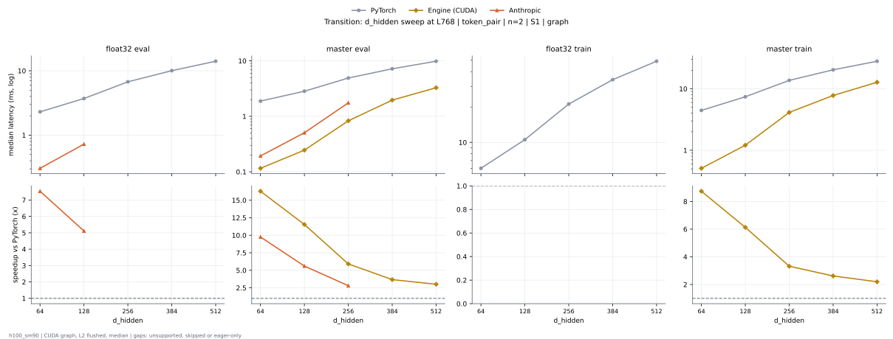

**float32 eval** (median ms; x = speedup vs PyTorch)

| d_hidden | PyTorch | Engine (Triton) | Engine (CUDA) | Anthropic |
|---|---|---|---|---|
| 64 | 2.314 | 0.5364 (4.31x) | 0.3836 (6.03x) | 0.3068 (7.54x) |
| 128 | 3.713 | 1.156 (3.21x) | 0.8125 (4.57x) | 0.7232 (5.13x) |
| 256 | 6.737 | 2.951 (2.28x) | 2.026 (3.33x) | unsupported |
| 384 | 10.05 | 6.021 (1.67x) | 3.869 (2.60x) | unsupported |
| 512 | 14.08 | 8.686 (1.62x) | 5.901 (2.39x) | unsupported |

**master eval** (median ms; x = speedup vs PyTorch)

| d_hidden | PyTorch | Engine (Triton) | Engine (CUDA) | Anthropic |
|---|---|---|---|---|
| 64 | 1.887 | 0.2719 (6.94x) | 0.1155 (16.34x) | 0.1941 (9.72x) |
| 128 | 2.824 | 0.6012 (4.70x) | 0.2526 (11.18x) | 0.5062 (5.58x) |
| 256 | 4.905 | 1.398 (3.51x) | 0.8257 (5.94x) | 1.753 (2.80x) |
| 384 | 7.201 | 2.771 (2.60x) | 2.112 (3.41x) | unsupported |
| 512 | 9.836 | 4.294 (2.29x) | 3.334 (2.95x) | 20.77 (0.47x) |

**float32 train** (median ms; x = speedup vs PyTorch)

| d_hidden | PyTorch | Engine (Triton) | Engine (CUDA) | Anthropic |
|---|---|---|---|---|
| 64 | 6.023 | 2.072 (2.91x) | 1.901 (3.17x) | unsupported |
| 128 | 10.56 | 4.527 (2.33x) | 3.763 (2.81x) | unsupported |
| 256 | 21.21 | 11.61 (1.83x) | 8.662 (2.45x) | unsupported |
| 384 | 34.35 | 25.12 (1.37x) | 17.58 (1.95x) | unsupported |
| 512 | 49.09 | 41.71 (1.18x) | 28.14 (1.74x) | unsupported |

**master train** (median ms; x = speedup vs PyTorch)

| d_hidden | PyTorch | Engine (Triton) | Engine (CUDA) | Anthropic |
|---|---|---|---|---|
| 64 | 4.464 | 1.08 (4.13x) | 0.5091 (8.77x) | unsupported |
| 128 | 7.405 | 2.134 (3.47x) | 1.197 (6.19x) | unsupported |
| 256 | 13.72 | 4.823 (2.84x) | 4.138 (3.32x) | unsupported |
| 384 | 20.38 | 8.966 (2.27x) | 7.719 (2.64x) | unsupported |
| 512 | 28.07 | 13.27 (2.12x) | 12.23 (2.30x) | unsupported |

### d_hidden sweep at L768: token_pair | n=4 | S1 | graph

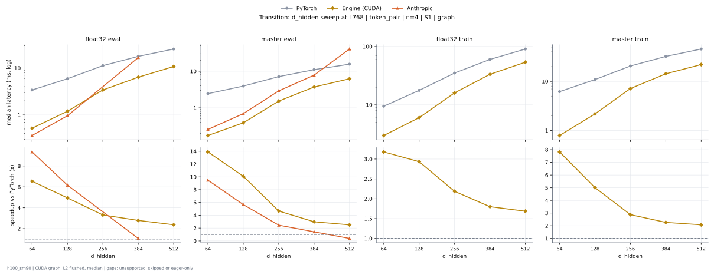

**float32 eval** (median ms; x = speedup vs PyTorch)

| d_hidden | PyTorch | Engine (Triton) | Engine (CUDA) | Anthropic |
|---|---|---|---|---|
| 64 | 3.395 | 0.8471 (4.01x) | 0.5191 (6.54x) | 0.3632 (9.35x) |
| 128 | 5.912 | 1.864 (3.17x) | 1.196 (4.94x) | 0.9596 (6.16x) |
| 256 | 11.25 | 5.179 (2.17x) | 3.4 (3.31x) | unsupported |
| 384 | 17.75 | 11.46 (1.55x) | 6.375 (2.78x) | 16.73 (1.06x) |
| 512 | 25.49 | 16.31 (1.56x) | 10.77 (2.37x) | unsupported |

**master eval** (median ms; x = speedup vs PyTorch)

| d_hidden | PyTorch | Engine (Triton) | Engine (CUDA) | Anthropic |
|---|---|---|---|---|
| 64 | 2.421 | 0.4152 (5.83x) | 0.1789 (13.53x) | 0.2569 (9.42x) |
| 128 | 3.937 | 0.9427 (4.18x) | 0.3846 (10.24x) | 0.6937 (5.68x) |
| 256 | 7.12 | 2.51 (2.84x) | 1.605 (4.44x) | 2.901 (2.45x) |
| 384 | 11.04 | 5.148 (2.14x) | 3.77 (2.93x) | 7.824 (1.41x) |
| 512 | 15.57 | 7.757 (2.01x) | 6.086 (2.56x) | 40.53 (0.38x) |

**float32 train** (median ms; x = speedup vs PyTorch)

| d_hidden | PyTorch | Engine (Triton) | Engine (CUDA) | Anthropic |
|---|---|---|---|---|
| 64 | 9.468 | 3.442 (2.75x) | 2.978 (3.18x) | unsupported |
| 128 | 17.68 | 7.747 (2.28x) | 6.028 (2.93x) | unsupported |
| 256 | 35.04 | 22.64 (1.55x) | 16.03 (2.19x) | unsupported |
| 384 | 59.99 | 49.39 (1.21x) | 33.34 (1.80x) | unsupported |
| 512 | 90.6 | 76.81 (1.18x) | 53.75 (1.69x) | unsupported |

**master train** (median ms; x = speedup vs PyTorch)

| d_hidden | PyTorch | Engine (Triton) | Engine (CUDA) | Anthropic |
|---|---|---|---|---|
| 64 | 6.18 | 1.735 (3.56x) | 0.7916 (7.81x) | unsupported |
| 128 | 10.88 | 3.615 (3.01x) | 2.081 (5.23x) | unsupported |
| 256 | 20.55 | 8.638 (2.38x) | 7.205 (2.85x) | unsupported |
| 384 | 32.23 | 16.02 (2.01x) | 14.08 (2.29x) | unsupported |
| 512 | 45.54 | 25.14 (1.81x) | 22.07 (2.06x) | unsupported |

