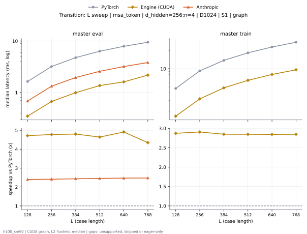
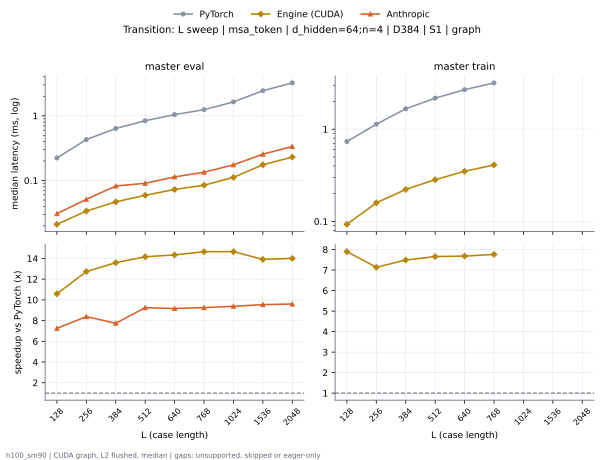
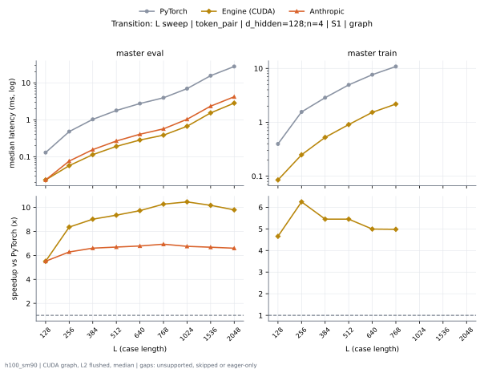
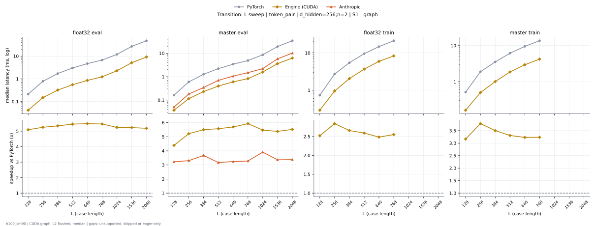
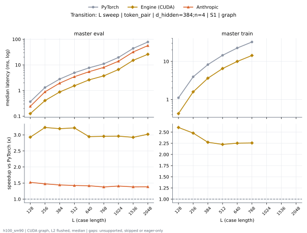
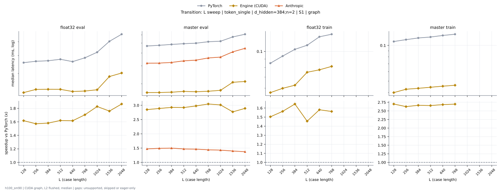
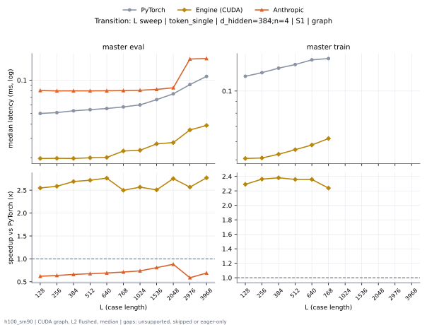

# Transition on h100_sm90

Generated by `python -m miniworld_engine.measure.plot` from speed tokens `judge/tokens/h100_sm90/`; do not edit.

### L sweep: msa_token | d_hidden=128;n=4 | D1024 | S1 | graph

**master eval** (median ms; x = speedup vs PyTorch)

| L | PyTorch | Engine (Triton) | Engine (CUDA) | Anthropic |
|---|---|---|---|---|
| 128 | 0.9205 | 0.2335 (3.94x) | 0.1021 (9.01x) | 0.1579 (5.83x) |
| 256 | 1.775 | 0.4328 (4.10x) | 0.1875 (9.47x) | 0.2956 (6.00x) |
| 384 | 2.651 | 0.6357 (4.17x) | 0.2718 (9.75x) | 0.4382 (6.05x) |
| 512 | 3.517 | 0.8364 (4.20x) | 0.356 (9.88x) | 0.5784 (6.08x) |
| 640 | 4.371 | 1.038 (4.21x) | 0.43 (10.16x) | 0.707 (6.18x) |
| 768 | 5.229 | 1.244 (4.20x) | 0.5071 (10.31x) | 0.8407 (6.22x) |
| 1024 | 6.97 | 1.663 (4.19x) | 0.6809 (10.24x) | 1.015 (6.87x) |
| 1536 | 10.42 | 2.491 (4.18x) | 0.9955 (10.47x) | 1.659 (6.28x) |
| 2048 | 13.88 | 3.3 (4.21x) | 1.324 (10.49x) | 2.31 (6.01x) |

**master train** (median ms; x = speedup vs PyTorch)

| L | PyTorch | Engine (Triton) | Engine (CUDA) | Anthropic |
|---|---|---|---|---|
| 128 | 2.565 | 0.8593 (2.98x) | 0.4664 (5.50x) | unsupported |
| 256 | 4.943 | 1.653 (2.99x) | 0.909 (5.44x) | unsupported |
| 384 | 7.317 | 2.441 (3.00x) | 1.336 (5.48x) | unsupported |
| 512 | 9.676 | 3.235 (2.99x) | 1.806 (5.36x) | unsupported |
| 640 | 12.03 | 4.052 (2.97x) | 2.36 (5.10x) | unsupported |
| 768 | 14.41 | 4.875 (2.96x) | 2.967 (4.86x) | unsupported |
| 1024 |  |  |  |  |
| 1536 |  |  |  |  |
| 2048 |  |  |  |  |

### L sweep: msa_token | d_hidden=256;n=4 | D1024 | S1 | graph

**master eval** (median ms; x = speedup vs PyTorch)

| L | PyTorch | Engine (Triton) | Engine (CUDA) | Anthropic |
|---|---|---|---|---|
| 128 | 1.634 | 0.5299 (3.08x) | 0.3481 (4.69x) | 0.6835 (2.39x) |
| 256 | 3.204 | 1.132 (2.83x) | 0.6723 (4.77x) | 1.33 (2.41x) |
| 384 | 4.771 | 1.688 (2.83x) | 0.9949 (4.80x) | 1.96 (2.43x) |
| 512 | 6.343 | 2.272 (2.79x) | 1.41 (4.50x) | 2.585 (2.45x) |
| 640 | 7.91 | 2.813 (2.81x) | 1.79 (4.42x) | 3.204 (2.47x) |
| 768 | 9.479 | 3.472 (2.73x) | 2.144 (4.42x) | 3.828 (2.48x) |

**master train** (median ms; x = speedup vs PyTorch)

| L | PyTorch | Engine (Triton) | Engine (CUDA) | Anthropic |
|---|---|---|---|---|
| 128 | 4.693 | 1.944 (2.41x) | 1.632 (2.87x) | unsupported |
| 256 | 9.2 | 4.015 (2.29x) | 3.265 (2.82x) | unsupported |
| 384 | 13.76 | 5.854 (2.35x) | 4.928 (2.79x) | unsupported |
| 512 | 18.29 | 7.772 (2.35x) | 6.586 (2.78x) | unsupported |
| 640 | 22.83 | 9.61 (2.38x) | 8.175 (2.79x) | unsupported |
| 768 | 27.34 | 11.69 (2.34x) | 9.754 (2.80x) | unsupported |

### L sweep: msa_token | d_hidden=64;n=4 | D384 | S1 | graph

**master eval** (median ms; x = speedup vs PyTorch)

| L | PyTorch | Engine (Triton) | Engine (CUDA) | Anthropic |
|---|---|---|---|---|
| 128 | 0.2232 | 0.05045 (4.42x) | 0.02107 (10.59x) | 0.03078 (7.25x) |
| 256 | 0.4297 | 0.08987 (4.78x) | 0.03374 (12.73x) | 0.05125 (8.38x) |
| 384 | 0.6371 | 0.124 (5.14x) | 0.04688 (13.59x) | 0.08229 (7.74x) |
| 512 | 0.8384 | 0.1573 (5.33x) | 0.0592 (14.16x) | 0.09064 (9.25x) |
| 640 | 1.044 | 0.1908 (5.47x) | 0.07278 (14.34x) | 0.1139 (9.17x) |
| 768 | 1.243 | 0.222 (5.60x) | 0.08482 (14.65x) | 0.1343 (9.25x) |
| 1024 | 1.64 | 0.2884 (5.69x) | 0.1119 (14.65x) | 0.1749 (9.38x) |
| 1536 | 2.438 | 0.4169 (5.85x) | 0.1752 (13.91x) | 0.2554 (9.54x) |
| 2048 | 3.224 | 0.5467 (5.90x) | 0.2302 (14.00x) | 0.3358 (9.60x) |

**master train** (median ms; x = speedup vs PyTorch)

| L | PyTorch | Engine (Triton) | Engine (CUDA) | Anthropic |
|---|---|---|---|---|
| 128 | 0.734 | 0.206 (3.56x) | 0.09291 (7.90x) | unsupported |
| 256 | 1.134 | 0.3517 (3.23x) | 0.1589 (7.14x) | unsupported |
| 384 | 1.665 | 0.4918 (3.38x) | 0.2222 (7.49x) | unsupported |
| 512 | 2.172 | 0.6304 (3.44x) | 0.2835 (7.66x) | unsupported |
| 640 | 2.684 | 0.7708 (3.48x) | 0.3492 (7.68x) | unsupported |
| 768 | 3.18 | 0.9062 (3.51x) | 0.4095 (7.76x) | unsupported |
| 1024 |  |  |  |  |
| 1536 |  |  |  |  |
| 2048 |  |  |  |  |

### L sweep: token_pair | d_hidden=128;n=2 | S1 | graph

**float32 eval** (median ms; x = speedup vs PyTorch)

| L | PyTorch | Engine (Triton) | Engine (CUDA) | Anthropic |
|---|---|---|---|---|
| 128 | 0.1153 | 0.0401 (2.88x) | 0.0211 (5.46x) | unsupported |
| 256 | 0.4444 | 0.1474 (3.02x) | 0.0584 (7.61x) | unsupported |
| 384 | 0.9616 | 0.3048 (3.15x) | 0.118 (8.15x) | unsupported |
| 512 | 1.674 | 0.5235 (3.20x) | 0.198 (8.46x) | unsupported |
| 640 | 2.6 | 0.801 (3.25x) | 0.3029 (8.58x) | unsupported |
| 768 | 3.722 | 1.14 (3.27x) | 0.4215 (8.83x) | unsupported |
| 1024 | 6.587 | 2.003 (3.29x) | 0.7438 (8.85x) | unsupported |
| 1536 | 14.73 | 4.481 (3.29x) | 1.643 (8.97x) | unsupported |
| 2048 | 26.18 | 7.953 (3.29x) | 2.915 (8.98x) | unsupported |

**master eval** (median ms; x = speedup vs PyTorch)

| L | PyTorch | Engine (Triton) | Engine (CUDA) | Anthropic |
|---|---|---|---|---|
| 128 | 0.0972 | 0.03154 (3.08x) | 0.01882 (5.17x) | 0.02461 (3.95x) |
| 256 | 0.3465 | 0.0845 (4.10x) | 0.0415 (8.35x) | 0.07918 (4.38x) |
| 384 | 0.7497 | 0.171 (4.38x) | 0.07861 (9.54x) | 0.1445 (5.19x) |
| 512 | 1.29 | 0.2834 (4.55x) | 0.1242 (10.38x) | 0.1731 (7.45x) |
| 640 | 1.968 | 0.4259 (4.62x) | 0.1817 (10.83x) | 0.2592 (7.59x) |
| 768 | 2.812 | 0.5989 (4.70x) | 0.2481 (11.33x) | 0.3621 (7.77x) |
| 1024 | 4.982 | 1.044 (4.77x) | 0.4203 (11.85x) | 0.7548 (6.60x) |
| 1536 | 11.2 | 2.311 (4.85x) | 0.9365 (11.96x) | 2.455 (4.56x) |
| 2048 | 19.87 | 4.088 (4.86x) | 1.683 (11.81x) | 4.361 (4.56x) |

**float32 train** (median ms; x = speedup vs PyTorch)

| L | PyTorch | Engine (Triton) | Engine (CUDA) | Anthropic |
|---|---|---|---|---|
| 128 | 0.3758 | 0.1865 (2.01x) | 0.1395 (2.69x) | unsupported |
| 256 | 1.512 | 0.5378 (2.81x) | 0.4447 (3.40x) | unsupported |
| 384 | 2.769 | 1.076 (2.57x) | 0.9399 (2.95x) | unsupported |
| 512 | 4.804 | 1.837 (2.62x) | 1.609 (2.99x) | unsupported |
| 640 | 7.393 | 2.823 (2.62x) | 2.487 (2.97x) | unsupported |
| 768 | 10.55 | 4.01 (2.63x) | 3.427 (3.08x) | unsupported |
| 1024 |  |  |  |  |
| 1536 |  |  |  |  |
| 2048 |  |  |  |  |

**master train** (median ms; x = speedup vs PyTorch)

| L | PyTorch | Engine (Triton) | Engine (CUDA) | Anthropic |
|---|---|---|---|---|
| 128 | 0.2988 | 0.114 (2.62x) | 0.06094 (4.90x) | unsupported |
| 256 | 1.147 | 0.3071 (3.74x) | 0.1631 (7.03x) | unsupported |
| 384 | 1.996 | 0.5996 (3.33x) | 0.3195 (6.25x) | unsupported |
| 512 | 3.411 | 0.9952 (3.43x) | 0.5523 (6.18x) | unsupported |
| 640 | 5.211 | 1.52 (3.43x) | 0.8478 (6.15x) | unsupported |
| 768 | 7.404 | 2.137 (3.46x) | 1.216 (6.09x) | unsupported |
| 1024 |  |  |  |  |
| 1536 |  |  |  |  |
| 2048 |  |  |  |  |

### L sweep: token_pair | d_hidden=128;n=4 | S1 | graph

**master eval** (median ms; x = speedup vs PyTorch)

| L | PyTorch | Engine (Triton) | Engine (CUDA) | Anthropic |
|---|---|---|---|---|
| 128 | 0.1296 | 0.04243 (3.05x) | 0.02352 (5.51x) | 0.0235 (5.51x) |
| 256 | 0.4792 | 0.1291 (3.71x) | 0.05733 (8.36x) | 0.07622 (6.29x) |
| 384 | 1.027 | 0.2577 (3.99x) | 0.1139 (9.02x) | 0.1556 (6.60x) |
| 512 | 1.783 | 0.4368 (4.08x) | 0.1906 (9.35x) | 0.2664 (6.69x) |
| 640 | 2.755 | 0.6624 (4.16x) | 0.2831 (9.73x) | 0.4061 (6.78x) |
| 768 | 3.94 | 0.9347 (4.22x) | 0.3835 (10.27x) | 0.5682 (6.93x) |
| 1024 | 6.974 | 1.655 (4.21x) | 0.6665 (10.46x) | 1.032 (6.76x) |
| 1536 | 15.63 | 3.717 (4.21x) | 1.537 (10.18x) | 2.34 (6.68x) |
| 2048 | 27.72 | 6.569 (4.22x) | 2.829 (9.80x) | 4.2 (6.60x) |

**master train** (median ms; x = speedup vs PyTorch)

| L | PyTorch | Engine (Triton) | Engine (CUDA) | Anthropic |
|---|---|---|---|---|
| 128 | 0.3964 | 0.1571 (2.52x) | 0.08514 (4.66x) | unsupported |
| 256 | 1.558 | 0.4718 (3.30x) | 0.2493 (6.25x) | unsupported |
| 384 | 2.862 | 0.9665 (2.96x) | 0.525 (5.45x) | unsupported |
| 512 | 4.944 | 1.65 (3.00x) | 0.9072 (5.45x) | unsupported |
| 640 | 7.642 | 2.549 (3.00x) | 1.531 (4.99x) | unsupported |
| 768 | 10.85 | 3.658 (2.97x) | 2.179 (4.98x) | unsupported |
| 1024 |  |  |  |  |
| 1536 |  |  |  |  |
| 2048 |  |  |  |  |

### L sweep: token_pair | d_hidden=256;n=2 | S1 | graph

**float32 eval** (median ms; x = speedup vs PyTorch)

| L | PyTorch | Engine (Triton) | Engine (CUDA) | Anthropic |
|---|---|---|---|---|
| 128 | 0.2123 | 0.09403 (2.26x) | 0.04168 (5.09x) | unsupported |
| 256 | 0.7849 | 0.3378 (2.32x) | 0.1494 (5.25x) | unsupported |
| 384 | 1.716 | 0.727 (2.36x) | 0.3212 (5.34x) | unsupported |
| 512 | 3.015 | 1.264 (2.39x) | 0.5527 (5.46x) | unsupported |
| 640 | 4.691 | 1.998 (2.35x) | 0.8551 (5.49x) | unsupported |
| 768 | 6.734 | 2.854 (2.36x) | 1.232 (5.46x) | unsupported |
| 1024 | 11.95 | 5.138 (2.33x) | 2.279 (5.24x) | unsupported |
| 1536 | 26.85 | 11.93 (2.25x) | 5.131 (5.23x) | unsupported |
| 2048 | 47.75 | 21.07 (2.27x) | 9.213 (5.18x) | unsupported |

**master eval** (median ms; x = speedup vs PyTorch)

| L | PyTorch | Engine (Triton) | Engine (CUDA) | Anthropic |
|---|---|---|---|---|
| 128 | 0.1619 | 0.05619 (2.88x) | 0.0369 (4.39x) | 0.05026 (3.22x) |
| 256 | 0.6006 | 0.1803 (3.33x) | 0.1152 (5.22x) | 0.1818 (3.30x) |
| 384 | 1.27 | 0.3637 (3.49x) | 0.2308 (5.50x) | 0.3456 (3.67x) |
| 512 | 2.216 | 0.6224 (3.56x) | 0.3981 (5.57x) | 0.6988 (3.17x) |
| 640 | 3.429 | 0.982 (3.49x) | 0.6021 (5.69x) | 1.059 (3.24x) |
| 768 | 4.9 | 1.377 (3.56x) | 0.8265 (5.93x) | 1.494 (3.28x) |
| 1024 | 8.643 | 2.488 (3.47x) | 1.58 (5.47x) | 2.213 (3.91x) |
| 1536 | 19.48 | 5.746 (3.39x) | 3.621 (5.38x) | 5.789 (3.36x) |
| 2048 | 34.56 | 10.46 (3.30x) | 6.26 (5.52x) | 10.23 (3.38x) |

**float32 train** (median ms; x = speedup vs PyTorch)

| L | PyTorch | Engine (Triton) | Engine (CUDA) | Anthropic |
|---|---|---|---|---|
| 128 | 0.7354 | 0.3937 (1.87x) | 0.2917 (2.52x) | unsupported |
| 256 | 2.718 | 1.245 (2.18x) | 0.9563 (2.84x) | unsupported |
| 384 | 5.452 | 2.551 (2.14x) | 2.051 (2.66x) | unsupported |
| 512 | 9.526 | 4.75 (2.01x) | 3.675 (2.59x) | unsupported |
| 640 | 14.77 | 7.493 (1.97x) | 5.942 (2.49x) | unsupported |
| 768 | 21.21 | 9.93 (2.14x) | 8.311 (2.55x) | unsupported |
| 1024 |  |  |  |  |
| 1536 |  |  |  |  |
| 2048 |  |  |  |  |

**master train** (median ms; x = speedup vs PyTorch)

| L | PyTorch | Engine (Triton) | Engine (CUDA) | Anthropic |
|---|---|---|---|---|
| 128 | 0.5136 | 0.1954 (2.63x) | 0.1623 (3.16x) | unsupported |
| 256 | 1.889 | 0.5989 (3.15x) | 0.4998 (3.78x) | unsupported |
| 384 | 3.533 | 1.234 (2.86x) | 1.009 (3.50x) | unsupported |
| 512 | 6.152 | 2.112 (2.91x) | 1.861 (3.31x) | unsupported |
| 640 | 9.512 | 3.583 (2.65x) | 2.945 (3.23x) | unsupported |
| 768 | 13.64 | 5.002 (2.73x) | 4.218 (3.23x) | unsupported |
| 1024 |  |  |  |  |
| 1536 |  |  |  |  |
| 2048 |  |  |  |  |

### L sweep: token_pair | d_hidden=256;n=4 | S1 | graph

**master eval** (median ms; x = speedup vs PyTorch)

| L | PyTorch | Engine (Triton) | Engine (CUDA) | Anthropic |
|---|---|---|---|---|
| 128 | 0.2412 | 0.08453 (2.85x) | 0.05443 (4.43x) | 0.08235 (2.93x) |
| 256 | 0.8463 | 0.2807 (3.01x) | 0.1815 (4.66x) | 0.3015 (2.81x) |
| 384 | 1.829 | 0.6166 (2.97x) | 0.3859 (4.74x) | 0.4214 (4.34x) |
| 512 | 3.203 | 1.082 (2.96x) | 0.6701 (4.78x) | 0.7028 (4.56x) |
| 640 | 4.962 | 1.737 (2.86x) | 1.048 (4.74x) | 1.067 (4.65x) |
| 768 | 7.115 | 2.442 (2.91x) | 1.432 (4.97x) | 1.565 (4.55x) |
| 1024 | 12.57 | 4.482 (2.80x) | 2.767 (4.54x) | 2.953 (4.26x) |
| 1536 | 28.27 | 10.31 (2.74x) | 6.354 (4.45x) | 6.881 (4.11x) |
| 2048 | 50.25 | 18.12 (2.77x) | 11.63 (4.32x) | 12.52 (4.01x) |

**master train** (median ms; x = speedup vs PyTorch)

| L | PyTorch | Engine (Triton) | Engine (CUDA) | Anthropic |
|---|---|---|---|---|
| 128 | 0.7544 | 0.3029 (2.49x) | 0.2518 (3.00x) | unsupported |
| 256 | 2.668 | 0.9869 (2.70x) | 0.8129 (3.28x) | unsupported |
| 384 | 5.283 | 2.139 (2.47x) | 1.814 (2.91x) | unsupported |
| 512 | 9.213 | 3.753 (2.45x) | 3.201 (2.88x) | unsupported |
| 640 | 14.31 | 5.979 (2.39x) | 5.004 (2.86x) | unsupported |
| 768 | 20.54 | 8.624 (2.38x) | 7.11 (2.89x) | unsupported |
| 1024 |  |  |  |  |
| 1536 |  |  |  |  |
| 2048 |  |  |  |  |

### L sweep: token_pair | d_hidden=384;n=2 | S1 | graph

**master eval** (median ms; x = speedup vs PyTorch)

| L | PyTorch | Engine (Triton) | Engine (CUDA) | Anthropic |
|---|---|---|---|---|
| 128 | 0.2425 | 0.0951 (2.55x) | 0.07618 (3.18x) | unsupported |
| 256 | 0.8595 | 0.313 (2.75x) | 0.2547 (3.37x) | unsupported |
| 384 | 1.853 | 0.6738 (2.75x) | 0.5244 (3.53x) | unsupported |
| 512 | 3.237 | 1.219 (2.66x) | 0.915 (3.54x) | unsupported |
| 640 | 5.016 | 1.915 (2.62x) | 1.438 (3.49x) | unsupported |
| 768 | 7.201 | 2.752 (2.62x) | 1.951 (3.69x) | unsupported |
| 1024 | 12.72 | 5.039 (2.52x) | 3.777 (3.37x) | unsupported |
| 1536 | 28.6 | 11.14 (2.57x) | 8.505 (3.36x) | unsupported |
| 2048 | 50.84 | 19.91 (2.55x) | 15.55 (3.27x) | unsupported |
| 2976 | 107.6 | 41.1 (2.62x) | 31.49 (3.42x) | unsupported |
| 3968 | skipped | 75.25 | 63.4 | unsupported |

**master train** (median ms; x = speedup vs PyTorch)

| L | PyTorch | Engine (Triton) | Engine (CUDA) | Anthropic |
|---|---|---|---|---|
| 128 | 0.7437 | 0.3109 (2.39x) | 0.2639 (2.82x) | unsupported |
| 256 | 2.625 | 0.9804 (2.68x) | 0.8976 (2.92x) | unsupported |
| 384 | 5.242 | 2.215 (2.37x) | 1.893 (2.77x) | unsupported |
| 512 | 9.167 | 3.874 (2.37x) | 3.578 (2.56x) | unsupported |
| 640 | 14.2 | 6.374 (2.23x) | 5.475 (2.59x) | unsupported |
| 768 | 20.4 | 8.913 (2.29x) | 7.928 (2.57x) | unsupported |
| 1024 |  |  |  |  |
| 1536 |  |  |  |  |
| 2048 |  |  |  |  |
| 2976 |  |  |  |  |
| 3968 |  |  |  |  |

### L sweep: token_pair | d_hidden=384;n=4 | S1 | graph

**master eval** (median ms; x = speedup vs PyTorch)

| L | PyTorch | Engine (Triton) | Engine (CUDA) | Anthropic |
|---|---|---|---|---|
| 128 | 0.368 | 0.1603 (2.30x) | 0.1259 (2.92x) | 0.2419 (1.52x) |
| 256 | 1.29 | 0.5267 (2.45x) | 0.4077 (3.16x) | 0.8895 (1.45x) |
| 384 | 2.807 | 1.196 (2.35x) | 0.8754 (3.21x) | 1.946 (1.44x) |
| 512 | 4.935 | 2.161 (2.28x) | 1.648 (2.99x) | 3.464 (1.42x) |
| 640 | 7.688 | 3.299 (2.33x) | 2.567 (2.99x) | 5.427 (1.42x) |
| 768 | 11.04 | 5.07 (2.18x) | 3.633 (3.04x) | 8.008 (1.38x) |
| 1024 | 19.59 | 9.177 (2.13x) | 6.513 (3.01x) | 13.92 (1.41x) |
| 1536 | 44.09 | 20.04 (2.20x) | 15.16 (2.91x) | 31.91 (1.38x) |
| 2048 | 78.48 | 35.75 (2.20x) | 25.64 (3.06x) | 56.61 (1.39x) |

**master train** (median ms; x = speedup vs PyTorch)

| L | PyTorch | Engine (Triton) | Engine (CUDA) | Anthropic |
|---|---|---|---|---|
| 128 | 1.107 | 0.5029 (2.20x) | 0.4256 (2.60x) | unsupported |
| 256 | 3.946 | 1.772 (2.23x) | 1.571 (2.51x) | unsupported |
| 384 | 8.228 | 4.092 (2.01x) | 3.638 (2.26x) | unsupported |
| 512 | 14.45 | 7.136 (2.02x) | 6.367 (2.27x) | unsupported |
| 640 | 22.47 | 11.26 (2.00x) | 9.409 (2.39x) | unsupported |
| 768 | 32.28 | 16.03 (2.01x) | 14.31 (2.26x) | unsupported |
| 1024 |  |  |  |  |
| 1536 |  |  |  |  |
| 2048 |  |  |  |  |

### L sweep: token_pair | d_hidden=512;n=2 | S1 | graph

**float32 eval** (median ms; x = speedup vs PyTorch)

| L | PyTorch | Engine (Triton) | Engine (CUDA) | Anthropic |
|---|---|---|---|---|
| 128 | 0.432 | 0.2492 (1.73x) | 0.1418 (3.05x) | unsupported |
| 256 | 1.604 | 0.9411 (1.70x) | 0.533 (3.01x) | unsupported |
| 384 | 3.557 | 2.074 (1.72x) | 1.176 (3.02x) | unsupported |
| 512 | 6.306 | 3.907 (1.61x) | 2.157 (2.92x) | unsupported |
| 640 | 9.8 | 6.159 (1.59x) | 3.379 (2.90x) | unsupported |
| 768 | 14.19 | 9.132 (1.55x) | 4.879 (2.91x) | unsupported |

**master eval** (median ms; x = speedup vs PyTorch)

| L | PyTorch | Engine (Triton) | Engine (CUDA) | Anthropic |
|---|---|---|---|---|
| 128 | 0.3279 | 0.1374 (2.39x) | 0.1131 (2.90x) | 0.6176 (0.53x) |
| 256 | 1.155 | 0.4662 (2.48x) | 0.3761 (3.07x) | 2.389 (0.48x) |
| 384 | 2.5 | 1.041 (2.40x) | 0.8025 (3.12x) | 5.247 (0.48x) |
| 512 | 4.412 | 1.978 (2.23x) | 1.401 (3.15x) | 9.26 (0.48x) |
| 640 | 6.848 | 3.081 (2.22x) | 2.283 (3.00x) | 14.44 (0.47x) |
| 768 | 9.867 | 4.699 (2.10x) | 3.261 (3.03x) | 20.75 (0.48x) |

**float32 train** (median ms; x = speedup vs PyTorch)

| L | PyTorch | Engine (Triton) | Engine (CUDA) | Anthropic |
|---|---|---|---|---|
| 128 | 1.616 | 1.028 (1.57x) | 0.8191 (1.97x) | unsupported |
| 256 | 5.747 | 3.784 (1.52x) | 2.983 (1.93x) | unsupported |
| 384 | 12.33 | 8.333 (1.48x) | 7.016 (1.76x) | unsupported |
| 512 | 21.9 | 15.12 (1.45x) | 12.33 (1.78x) | unsupported |
| 640 | 34.4 | 23.36 (1.47x) | 18.85 (1.82x) | unsupported |
| 768 | 49.97 | 33.29 (1.50x) | 26.69 (1.87x) | unsupported |

**master train** (median ms; x = speedup vs PyTorch)

| L | PyTorch | Engine (Triton) | Engine (CUDA) | Anthropic |
|---|---|---|---|---|
| 128 | 0.9792 | 0.4325 (2.26x) | 0.4291 (2.28x) | unsupported |
| 256 | 3.452 | 1.488 (2.32x) | 1.439 (2.40x) | unsupported |
| 384 | 7.149 | 3.358 (2.13x) | 3.244 (2.20x) | unsupported |
| 512 | 12.6 | 5.973 (2.11x) | 5.782 (2.18x) | unsupported |
| 640 | 19.56 | 9.678 (2.02x) | 8.996 (2.17x) | unsupported |
| 768 | 28.16 | 13.83 (2.04x) | 12.92 (2.18x) | unsupported |

### L sweep: token_pair | d_hidden=512;n=4 | S1 | graph

**master eval** (median ms; x = speedup vs PyTorch)

| L | PyTorch | Engine (Triton) | Engine (CUDA) | Anthropic |
|---|---|---|---|---|
| 128 | 0.4861 | 0.2304 (2.11x) | 0.1913 (2.54x) | 1.191 (0.41x) |
| 256 | 1.784 | 0.8532 (2.09x) | 0.6582 (2.71x) | 4.616 (0.39x) |
| 384 | 3.935 | 1.839 (2.14x) | 1.496 (2.63x) | 10.21 (0.39x) |
| 512 | 6.962 | 3.498 (1.99x) | 2.764 (2.52x) | 18.09 (0.38x) |
| 640 | 10.85 | 5.557 (1.95x) | 4.583 (2.37x) | 28.2 (0.38x) |
| 768 | 15.64 | 7.889 (1.98x) | 6.303 (2.48x) | 40.56 (0.39x) |

**master train** (median ms; x = speedup vs PyTorch)

| L | PyTorch | Engine (Triton) | Engine (CUDA) | Anthropic |
|---|---|---|---|---|
| 128 | 1.473 | 0.7184 (2.05x) | 0.7223 (2.04x) | unsupported |
| 256 | 5.373 | 2.788 (1.93x) | 2.597 (2.07x) | unsupported |
| 384 | 11.53 | 6.339 (1.82x) | 5.589 (2.06x) | unsupported |
| 512 | 20.39 | 11.41 (1.79x) | 10.56 (1.93x) | unsupported |
| 640 | 31.8 | 17.86 (1.78x) | 16.75 (1.90x) | unsupported |
| 768 | 45.94 | 25.56 (1.80x) | 21.73 (2.11x) | unsupported |

### L sweep: token_pair | d_hidden=64;n=2 | S1 | graph

**master eval** (median ms; x = speedup vs PyTorch)

| L | PyTorch | Engine (Triton) | Engine (CUDA) | Anthropic |
|---|---|---|---|---|
| 128 | 0.07726 | 0.02384 (3.24x) | 0.01022 (7.56x) | 0.01059 (7.29x) |
| 256 | 0.2162 | 0.04493 (4.81x) | 0.02038 (10.60x) | 0.02178 (9.93x) |
| 384 | 0.497 | 0.08304 (5.98x) | 0.03579 (13.89x) | 0.03805 (13.06x) |
| 512 | 0.8639 | 0.1355 (6.37x) | 0.05571 (15.51x) | 0.05978 (14.45x) |
| 640 | 1.323 | 0.1965 (6.73x) | 0.08051 (16.43x) | 0.08731 (15.15x) |
| 768 | 1.88 | 0.2722 (6.91x) | 0.1111 (16.92x) | 0.1218 (15.44x) |
| 1024 | 3.321 | 0.4617 (7.19x) | 0.1871 (17.75x) | 0.2059 (16.13x) |
| 1536 | 7.4 | 1.003 (7.38x) | 0.3981 (18.59x) | 0.4506 (16.42x) |
| 2048 | 13.07 | 1.763 (7.41x) | 0.6878 (19.00x) | 0.7966 (16.41x) |

**master train** (median ms; x = speedup vs PyTorch)

| L | PyTorch | Engine (Triton) | Engine (CUDA) | Anthropic |
|---|---|---|---|---|
| 128 | 0.24 | 0.07475 (3.21x) | 0.05365 (4.47x) | unsupported |
| 256 | 0.7827 | 0.169 (4.63x) | 0.09219 (8.49x) | unsupported |
| 384 | 1.213 | 0.3247 (3.74x) | 0.1652 (7.34x) | unsupported |
| 512 | 2.073 | 0.5246 (3.95x) | 0.2549 (8.13x) | unsupported |
| 640 | 3.16 | 0.7774 (4.06x) | 0.3674 (8.60x) | unsupported |
| 768 | 4.444 | 1.077 (4.13x) | 0.5078 (8.75x) | unsupported |
| 1024 |  |  |  |  |
| 1536 |  |  |  |  |
| 2048 |  |  |  |  |

### L sweep: token_pair | d_hidden=64;n=4 | S1 | graph

**master eval** (median ms; x = speedup vs PyTorch)

| L | PyTorch | Engine (Triton) | Engine (CUDA) | Anthropic |
|---|---|---|---|---|
| 128 | 0.08794 | 0.0277 (3.18x) | 0.01197 (7.35x) | unsupported |
| 256 | 0.2898 | 0.06102 (4.75x) | 0.02734 (10.60x) | unsupported |
| 384 | 0.6341 | 0.1236 (5.13x) | 0.04634 (13.69x) | 0.08222 (7.71x) |
| 512 | 1.107 | 0.2018 (5.49x) | 0.08453 (13.10x) | 0.08722 (12.70x) |
| 640 | 1.701 | 0.2987 (5.69x) | 0.1122 (15.16x) | 0.1293 (13.16x) |
| 768 | 2.432 | 0.4166 (5.84x) | 0.1748 (13.91x) | 0.1802 (13.49x) |
| 1024 | 4.294 | 0.7207 (5.96x) | 0.2696 (15.93x) | 0.3088 (13.91x) |
| 1536 | 9.555 | 1.587 (6.02x) | 0.5902 (16.19x) | 0.6743 (14.17x) |
| 2048 | 16.95 | 2.792 (6.07x) | 1.039 (16.30x) | 1.213 (13.97x) |

**master train** (median ms; x = speedup vs PyTorch)

| L | PyTorch | Engine (Triton) | Engine (CUDA) | Anthropic |
|---|---|---|---|---|
| 128 | 0.2651 | 0.09669 (2.74x) | 0.04328 (6.13x) | unsupported |
| 256 | 0.9971 | 0.2534 (3.93x) | 0.1114 (8.95x) | unsupported |
| 384 | 1.666 | 0.4926 (3.38x) | 0.2217 (7.51x) | unsupported |
| 512 | 2.848 | 0.8178 (3.48x) | 0.3695 (7.71x) | unsupported |
| 640 | 4.345 | 1.233 (3.52x) | 0.5549 (7.83x) | unsupported |
| 768 | 6.18 | 1.736 (3.56x) | 0.7915 (7.81x) | unsupported |
| 1024 |  |  |  |  |
| 1536 |  |  |  |  |
| 2048 |  |  |  |  |

### L sweep: token_single | d_hidden=384;n=2 | S1 | graph

**float32 eval** (median ms; x = speedup vs PyTorch)

| L | PyTorch | Engine (Triton) | Engine (CUDA) | Anthropic |
|---|---|---|---|---|
| 128 | 0.03571 | 0.02405 (1.49x) | 0.02208 (1.62x) | unsupported |
| 256 | 0.03651 | 0.02437 (1.50x) | 0.02323 (1.57x) | unsupported |
| 384 | 0.03682 | 0.02469 (1.49x) | 0.02328 (1.58x) | unsupported |
| 512 | 0.0377 | 0.02499 (1.51x) | 0.02326 (1.62x) | unsupported |
| 640 | 0.0363 | 0.02539 (1.43x) | 0.02246 (1.62x) | unsupported |
| 768 | 0.03859 | 0.02814 (1.37x) | 0.02264 (1.70x) | unsupported |
| 1024 | 0.04221 | 0.03853 (1.10x) | 0.0231 (1.83x) | unsupported |
| 1536 | 0.05027 | 0.04974 (1.01x) | 0.02858 (1.76x) | unsupported |
| 2048 | 0.05637 | 0.05134 (1.10x) | 0.03024 (1.86x) | unsupported |

**master eval** (median ms; x = speedup vs PyTorch)

| L | PyTorch | Engine (Triton) | Engine (CUDA) | Anthropic |
|---|---|---|---|---|
| 128 | 0.04678 | 0.02691 (1.74x) | 0.01642 (2.85x) | 0.03179 (1.47x) |
| 256 | 0.04752 | 0.02726 (1.74x) | 0.01645 (2.89x) | 0.03186 (1.49x) |
| 384 | 0.04846 | 0.02771 (1.75x) | 0.01656 (2.93x) | 0.03232 (1.50x) |
| 512 | 0.04926 | 0.02779 (1.77x) | 0.01686 (2.92x) | 0.0335 (1.47x) |
| 640 | 0.04984 | 0.028 (1.78x) | 0.01674 (2.98x) | 0.03405 (1.46x) |
| 768 | 0.0515 | 0.0291 (1.77x) | 0.01691 (3.05x) | 0.03576 (1.44x) |
| 1024 | 0.05208 | 0.04182 (1.25x) | 0.01728 (3.01x) | 0.03645 (1.43x) |
| 1536 | 0.05736 | 0.04483 (1.28x) | 0.0207 (2.77x) | 0.04102 (1.40x) |
| 2048 | 0.06094 | 0.0447 (1.36x) | 0.02107 (2.89x) | 0.0444 (1.37x) |

**float32 train** (median ms; x = speedup vs PyTorch)

| L | PyTorch | Engine (Triton) | Engine (CUDA) | Anthropic |
|---|---|---|---|---|
| 128 | 0.08498 | 0.06568 (1.29x) | 0.05651 (1.50x) | unsupported |
| 256 | 0.09376 | 0.07197 (1.30x) | 0.05997 (1.56x) | unsupported |
| 384 | 0.103 | 0.07891 (1.30x) | 0.06261 (1.64x) | unsupported |
| 512 | 0.109 | 0.0831 (1.31x) | 0.07493 (1.46x) | unsupported |
| 640 | 0.1226 | 0.08946 (1.37x) | 0.07752 (1.58x) | unsupported |
| 768 | 0.127 | 0.09798 (1.30x) | 0.08128 (1.56x) | unsupported |
| 1024 |  |  |  |  |
| 1536 |  |  |  |  |
| 2048 |  |  |  |  |

**master train** (median ms; x = speedup vs PyTorch)

| L | PyTorch | Engine (Triton) | Engine (CUDA) | Anthropic |
|---|---|---|---|---|
| 128 | 0.1079 | 0.06534 (1.65x) | 0.03995 (2.70x) | unsupported |
| 256 | 0.1119 | 0.06707 (1.67x) | 0.04264 (2.62x) | unsupported |
| 384 | 0.1156 | 0.06808 (1.70x) | 0.04341 (2.66x) | unsupported |
| 512 | 0.1177 | 0.06957 (1.69x) | 0.04434 (2.66x) | unsupported |
| 640 | 0.1214 | 0.07112 (1.71x) | 0.04525 (2.68x) | unsupported |
| 768 | 0.1243 | 0.07354 (1.69x) | 0.0461 (2.70x) | unsupported |
| 1024 |  |  |  |  |
| 1536 |  |  |  |  |
| 2048 |  |  |  |  |

### L sweep: token_single | d_hidden=384;n=4 | S1 | graph

**master eval** (median ms; x = speedup vs PyTorch)

| L | PyTorch | Engine (Triton) | Engine (CUDA) | Anthropic |
|---|---|---|---|---|
| 128 | 0.05005 | 0.02982 (1.68x) | 0.01965 (2.55x) | 0.08064 (0.62x) |
| 256 | 0.05096 | 0.02976 (1.71x) | 0.01971 (2.59x) | 0.07995 (0.64x) |
| 384 | 0.05286 | 0.03126 (1.69x) | 0.01966 (2.69x) | 0.08005 (0.66x) |
| 512 | 0.05416 | 0.03216 (1.68x) | 0.01994 (2.72x) | 0.08003 (0.68x) |
| 640 | 0.05546 | 0.03251 (1.71x) | 0.02008 (2.76x) | 0.08018 (0.69x) |
| 768 | 0.05734 | 0.03488 (1.64x) | 0.02296 (2.50x) | 0.0805 (0.71x) |
| 1024 | 0.05978 | 0.05038 (1.19x) | 0.0233 (2.57x) | 0.08099 (0.74x) |
| 1536 | 0.06672 | 0.0593 (1.13x) | 0.02662 (2.51x) | 0.08248 (0.81x) |
| 2048 | 0.07522 | 0.05982 (1.26x) | 0.02733 (2.75x) | 0.08528 (0.88x) |
| 2976 | 0.09118 | 0.0664 (1.37x) | 0.03554 (2.57x) | 0.155 (0.59x) |
| 3968 | 0.1081 | 0.06968 (1.55x) | 0.03902 (2.77x) | 0.1565 (0.69x) |

**master train** (median ms; x = speedup vs PyTorch)

| L | PyTorch | Engine (Triton) | Engine (CUDA) | Anthropic |
|---|---|---|---|---|
| 128 | 0.1161 | 0.07179 (1.62x) | 0.05067 (2.29x) | unsupported |
| 256 | 0.1203 | 0.07387 (1.63x) | 0.05094 (2.36x) | unsupported |
| 384 | 0.1259 | 0.07803 (1.61x) | 0.0529 (2.38x) | unsupported |
| 512 | 0.1306 | 0.08179 (1.60x) | 0.05538 (2.36x) | unsupported |
| 640 | 0.1369 | 0.08406 (1.63x) | 0.05806 (2.36x) | unsupported |
| 768 | 0.1387 | 0.0865 (1.60x) | 0.06197 (2.24x) | unsupported |
| 1024 |  |  |  |  |
| 1536 |  |  |  |  |
| 2048 |  |  |  |  |
| 2976 |  |  |  |  |
| 3968 |  |  |  |  |

### L sweep: token_single | d_hidden=768;n=2 | S1 | graph

**float32 eval** (median ms; x = speedup vs PyTorch)

| L | PyTorch | Engine (Triton) | Engine (CUDA) | Anthropic |
|---|---|---|---|---|
| 128 | 0.04187 | 0.03261 (1.28x) | 0.03016 (1.39x) | unsupported |
| 256 | 0.04459 | 0.03339 (1.34x) | 0.03157 (1.41x) | unsupported |
| 384 | 0.05102 | 0.04125 (1.24x) | 0.03339 (1.53x) | unsupported |
| 512 | 0.05083 | 0.04232 (1.20x) | 0.03381 (1.50x) | unsupported |
| 640 | 0.05531 | 0.0435 (1.27x) | 0.03533 (1.57x) | unsupported |
| 768 | 0.06125 | 0.05206 (1.18x) | 0.04272 (1.43x) | unsupported |
| 1024 | 0.06837 | 0.06779 (1.01x) | 0.04422 (1.55x) | unsupported |
| 1536 | 0.09894 | 0.08403 (1.18x) | 0.06118 (1.62x) | unsupported |
| 2048 | 0.1109 | 0.08746 (1.27x) | 0.06661 (1.67x) | unsupported |

**master eval** (median ms; x = speedup vs PyTorch)

| L | PyTorch | Engine (Triton) | Engine (CUDA) | Anthropic |
|---|---|---|---|---|
| 128 | 0.05664 | 0.03765 (1.50x) | 0.02245 (2.52x) | unsupported |
| 256 | 0.05838 | 0.0383 (1.52x) | 0.02262 (2.58x) | unsupported |
| 384 | 0.06083 | 0.04242 (1.43x) | 0.02278 (2.67x) | unsupported |
| 512 | 0.06261 | 0.0432 (1.45x) | 0.02301 (2.72x) | unsupported |
| 640 | 0.06419 | 0.0437 (1.47x) | 0.0236 (2.72x) | unsupported |
| 768 | 0.07008 | 0.04816 (1.46x) | 0.02805 (2.50x) | unsupported |
| 1024 | 0.07094 | 0.05938 (1.19x) | 0.05362 (1.32x) | unsupported |
| 1536 | 0.08578 | 0.06733 (1.27x) | 0.06325 (1.36x) | unsupported |
| 2048 | 0.09451 | 0.06866 (1.38x) | 0.06579 (1.44x) | unsupported |

**float32 train** (median ms; x = speedup vs PyTorch)

| L | PyTorch | Engine (Triton) | Engine (CUDA) | Anthropic |
|---|---|---|---|---|
| 128 | 0.1145 | 0.09166 (1.25x) | 0.07576 (1.51x) | unsupported |
| 256 | 0.1308 | 0.1045 (1.25x) | 0.0931 (1.41x) | unsupported |
| 384 | 0.1593 | 0.1344 (1.19x) | 0.1092 (1.46x) | unsupported |
| 512 | 0.1774 | 0.151 (1.18x) | 0.1119 (1.59x) | unsupported |
| 640 | 0.1899 | 0.1569 (1.21x) | 0.1364 (1.39x) | unsupported |
| 768 | 0.216 | 0.1808 (1.19x) | 0.1621 (1.33x) | unsupported |
| 1024 |  |  |  |  |
| 1536 |  |  |  |  |
| 2048 |  |  |  |  |

**master train** (median ms; x = speedup vs PyTorch)

| L | PyTorch | Engine (Triton) | Engine (CUDA) | Anthropic |
|---|---|---|---|---|
| 128 | 0.1345 | 0.0865 (1.56x) | 0.05891 (2.28x) | unsupported |
| 256 | 0.1412 | 0.09072 (1.56x) | 0.06379 (2.21x) | unsupported |
| 384 | 0.1473 | 0.09635 (1.53x) | 0.06624 (2.22x) | unsupported |
| 512 | 0.1534 | 0.1008 (1.52x) | 0.07082 (2.17x) | unsupported |
| 640 | 0.1585 | 0.1029 (1.54x) | 0.07533 (2.10x) | unsupported |
| 768 | 0.1673 | 0.1116 (1.50x) | 0.0832 (2.01x) | unsupported |
| 1024 |  |  |  |  |
| 1536 |  |  |  |  |
| 2048 |  |  |  |  |

### d_hidden sweep at L768: token_pair | n=2 | S1 | graph

**float32 eval** (median ms; x = speedup vs PyTorch)

| d_hidden | PyTorch | Engine (Triton) | Engine (CUDA) | Anthropic |
|---|---|---|---|---|
| 64 |  |  |  |  |
| 128 | 3.722 | 1.14 (3.27x) | 0.4215 (8.83x) | unsupported |
| 256 | 6.734 | 2.854 (2.36x) | 1.232 (5.46x) | unsupported |
| 384 |  |  |  |  |
| 512 | 14.19 | 9.132 (1.55x) | 4.879 (2.91x) | unsupported |

**master eval** (median ms; x = speedup vs PyTorch)

| d_hidden | PyTorch | Engine (Triton) | Engine (CUDA) | Anthropic |
|---|---|---|---|---|
| 64 | 1.88 | 0.2722 (6.91x) | 0.1111 (16.92x) | 0.1218 (15.44x) |
| 128 | 2.812 | 0.5989 (4.70x) | 0.2481 (11.33x) | 0.3621 (7.77x) |
| 256 | 4.9 | 1.377 (3.56x) | 0.8265 (5.93x) | 1.494 (3.28x) |
| 384 | 7.201 | 2.752 (2.62x) | 1.951 (3.69x) | unsupported |
| 512 | 9.867 | 4.699 (2.10x) | 3.261 (3.03x) | 20.75 (0.48x) |

**float32 train** (median ms; x = speedup vs PyTorch)

| d_hidden | PyTorch | Engine (Triton) | Engine (CUDA) | Anthropic |
|---|---|---|---|---|
| 64 |  |  |  |  |
| 128 | 10.55 | 4.01 (2.63x) | 3.427 (3.08x) | unsupported |
| 256 | 21.21 | 9.93 (2.14x) | 8.311 (2.55x) | unsupported |
| 384 |  |  |  |  |
| 512 | 49.97 | 33.29 (1.50x) | 26.69 (1.87x) | unsupported |

**master train** (median ms; x = speedup vs PyTorch)

| d_hidden | PyTorch | Engine (Triton) | Engine (CUDA) | Anthropic |
|---|---|---|---|---|
| 64 | 4.444 | 1.077 (4.13x) | 0.5078 (8.75x) | unsupported |
| 128 | 7.404 | 2.137 (3.46x) | 1.216 (6.09x) | unsupported |
| 256 | 13.64 | 5.002 (2.73x) | 4.218 (3.23x) | unsupported |
| 384 | 20.4 | 8.913 (2.29x) | 7.928 (2.57x) | unsupported |
| 512 | 28.16 | 13.83 (2.04x) | 12.92 (2.18x) | unsupported |

### d_hidden sweep at L768: token_pair | n=4 | S1 | graph

**master eval** (median ms; x = speedup vs PyTorch)

| d_hidden | PyTorch | Engine (Triton) | Engine (CUDA) | Anthropic |
|---|---|---|---|---|
| 64 | 2.432 | 0.4166 (5.84x) | 0.1748 (13.91x) | 0.1802 (13.49x) |
| 128 | 3.94 | 0.9347 (4.22x) | 0.3835 (10.27x) | 0.5682 (6.93x) |
| 256 | 7.115 | 2.442 (2.91x) | 1.432 (4.97x) | 1.565 (4.55x) |
| 384 | 11.04 | 5.07 (2.18x) | 3.633 (3.04x) | 8.008 (1.38x) |
| 512 | 15.64 | 7.889 (1.98x) | 6.303 (2.48x) | 40.56 (0.39x) |

**master train** (median ms; x = speedup vs PyTorch)

| d_hidden | PyTorch | Engine (Triton) | Engine (CUDA) | Anthropic |
|---|---|---|---|---|
| 64 | 6.18 | 1.736 (3.56x) | 0.7915 (7.81x) | unsupported |
| 128 | 10.85 | 3.658 (2.97x) | 2.179 (4.98x) | unsupported |
| 256 | 20.54 | 8.624 (2.38x) | 7.11 (2.89x) | unsupported |
| 384 | 32.28 | 16.03 (2.01x) | 14.31 (2.26x) | unsupported |
| 512 | 45.94 | 25.56 (1.80x) | 21.73 (2.11x) | unsupported |

