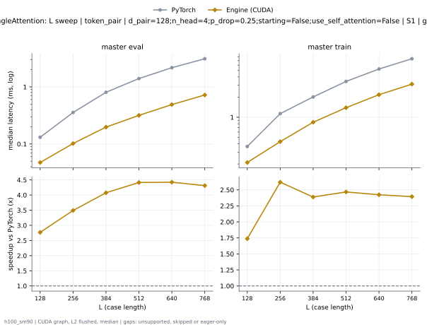
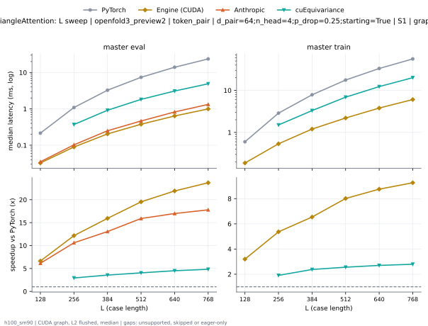
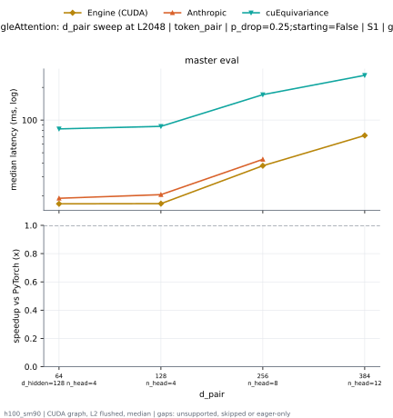
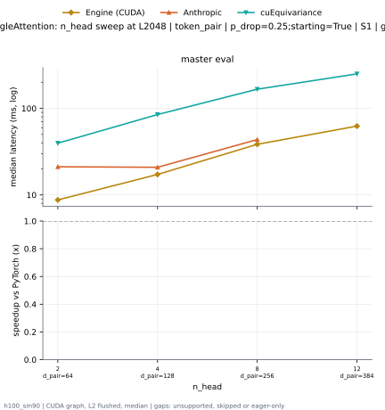

# TriangleAttention on h100_sm90

Generated by `python -m foldjet_engine.measure.plot` from speed tokens `judge/tokens/h100_sm90/`; do not edit.

### L sweep: token_pair | d_pair=128;n_head=4;p_drop=0.25;starting=False;use_self_attention=False | S1 | graph

**master eval** (median ms; x = speedup vs PyTorch)

| L | PyTorch | Engine (Triton) | Engine (CUDA) | Anthropic | cuEquivariance |
|---|---|---|---|---|---|
| 128 | 0.1313 | 0.08403 (1.56x) | 0.04742 (2.77x) | unsupported | unsupported |
| 256 | 0.3563 | 0.2302 (1.55x) | 0.102 (3.49x) | unsupported | unsupported |
| 384 | 0.8048 | 0.4889 (1.65x) | 0.1975 (4.08x) | unsupported | unsupported |
| 512 | 1.4 | 0.8344 (1.68x) | 0.3172 (4.41x) | unsupported | unsupported |
| 640 | 2.169 | 1.303 (1.67x) | 0.4903 (4.42x) | unsupported | unsupported |
| 768 | 3.112 | 1.867 (1.67x) | 0.722 (4.31x) | unsupported | unsupported |

**master train** (median ms; x = speedup vs PyTorch)

| L | PyTorch | Engine (Triton) | Engine (CUDA) | Anthropic | cuEquivariance |
|---|---|---|---|---|---|
| 128 | 0.3654 | 0.2621 (1.39x) | 0.2104 (1.74x) | unsupported | unsupported |
| 256 | 1.131 | 0.7082 (1.60x) | 0.4317 (2.62x) | unsupported | unsupported |
| 384 | 2.009 | 1.514 (1.33x) | 0.8413 (2.39x) | unsupported | unsupported |
| 512 | 3.428 | 2.519 (1.36x) | 1.389 (2.47x) | unsupported | unsupported |
| 640 | 5.26 | 4.047 (1.30x) | 2.17 (2.42x) | unsupported | unsupported |
| 768 | 7.486 | 6.093 (1.23x) | 3.126 (2.39x) | unsupported | unsupported |

### L sweep: token_pair | d_pair=128;n_head=4;p_drop=0.25;starting=True;use_self_attention=False | S1 | graph

**master eval** (median ms; x = speedup vs PyTorch)

| L | PyTorch | Engine (Triton) | Engine (CUDA) | Anthropic | cuEquivariance |
|---|---|---|---|---|---|
| 128 | 0.1126 | 0.0725 (1.55x) | 0.04032 (2.79x) | unsupported | unsupported |
| 256 | 0.3153 | 0.1873 (1.68x) | 0.09149 (3.45x) | unsupported | unsupported |
| 384 | 0.7076 | 0.3897 (1.82x) | 0.1887 (3.75x) | unsupported | unsupported |
| 512 | 1.228 | 0.6611 (1.86x) | 0.3131 (3.92x) | unsupported | unsupported |
| 640 | 1.901 | 1.034 (1.84x) | 0.4887 (3.89x) | unsupported | unsupported |
| 768 | 2.722 | 1.479 (1.84x) | 0.6998 (3.89x) | unsupported | unsupported |

**master train** (median ms; x = speedup vs PyTorch)

| L | PyTorch | Engine (Triton) | Engine (CUDA) | Anthropic | cuEquivariance |
|---|---|---|---|---|---|
| 128 | 0.3413 | 0.2373 (1.44x) | 0.1658 (2.06x) | unsupported | unsupported |
| 256 | 1.052 | 0.6247 (1.68x) | 0.3738 (2.82x) | unsupported | unsupported |
| 384 | 1.833 | 1.333 (1.38x) | 0.775 (2.37x) | unsupported | unsupported |
| 512 | 3.111 | 2.203 (1.41x) | 1.272 (2.45x) | unsupported | unsupported |
| 640 | 4.782 | 3.557 (1.34x) | 2.017 (2.37x) | unsupported | unsupported |
| 768 | 6.792 | 5.391 (1.26x) | 2.826 (2.40x) | unsupported | unsupported |

### L sweep: boltz2|openfold3_preview2|protenix | token_pair | d_pair=128;n_head=4;p_drop=0.25;starting=False | S1 | graph

**master eval** (median ms; x = speedup vs PyTorch)

| L | PyTorch | Engine (Triton) | Engine (CUDA) | Anthropic | cuEquivariance |
|---|---|---|---|---|---|
| 128 | 0.2597 | 0.1231 (2.11x) | 0.03706 (7.01x) | 0.0719 (3.61x) | 0.1572 (1.65x) |
| 256 | 1.278 | 0.3914 (3.27x) | 0.1041 (12.28x) | 0.1932 (6.61x) | 0.5301 (2.41x) |
| 384 | 3.752 | 0.9443 (3.97x) | 0.2343 (16.01x) | 0.411 (9.13x) | 1.296 (2.89x) |
| 512 | 8.179 | 1.728 (4.73x) | 0.4333 (18.88x) | 0.6943 (11.78x) | 2.431 (3.36x) |
| 640 | 15.22 | 2.858 (5.33x) | 0.7383 (20.61x) | 1.12 (13.59x) | 4.07 (3.74x) |
| 768 | 25.44 | 4.287 (5.93x) | 1.157 (21.99x) | 1.7 (14.96x) | 6.309 (4.03x) |
| 1024 | 56.81 | 8.381 (6.78x) | 2.575 (22.06x) | 3.343 (17.00x) | 12.52 (4.54x) |
| 1536 | skipped | 22.8 | 7.523 | 9.385 | 37.86 |
| 2048 | skipped | 49.47 | 17 | 20.58 | 87.53 |

**master train** (median ms; x = speedup vs PyTorch)

| L | PyTorch | Engine (Triton) | Engine (CUDA) | Anthropic | cuEquivariance |
|---|---|---|---|---|---|
| 128 | 0.7194 | 0.4286 (1.68x) | 0.1577 (4.56x) | unsupported | 0.5318 (1.35x) |
| 256 | 3.407 | 1.486 (2.29x) | 0.4638 (7.35x) | unsupported | 1.988 (1.71x) |
| 384 | 9.163 | 3.032 (3.02x) | 1.094 (8.37x) | unsupported | 4.489 (2.04x) |
| 512 | 19.79 | 5.671 (3.49x) | 2.035 (9.72x) | unsupported | 8.812 (2.25x) |
| 640 | 36.53 | 9.391 (3.89x) | 3.567 (10.24x) | unsupported | 15.25 (2.40x) |
| 768 | 60.84 | 14.53 (4.19x) | 5.81 (10.47x) | unsupported | 24.33 (2.50x) |
| 1024 |  |  |  |  |  |
| 1536 |  |  |  |  |  |
| 2048 |  |  |  |  |  |

### L sweep: boltz2|openfold3_preview2|protenix | token_pair | d_pair=128;n_head=4;p_drop=0.25;starting=True | S1 | graph

**master eval** (median ms; x = speedup vs PyTorch)

| L | PyTorch | Engine (Triton) | Engine (CUDA) | Anthropic | cuEquivariance |
|---|---|---|---|---|---|
| 128 | 0.2559 | 0.1096 (2.34x) | 0.03915 (6.54x) | 0.07259 (3.53x) | 0.1463 (1.75x) |
| 256 | 1.236 | 0.35 (3.53x) | 0.106 (11.67x) | 0.1929 (6.41x) | 0.4908 (2.52x) |
| 384 | 3.654 | 0.8417 (4.34x) | 0.2316 (15.78x) | 0.406 (9.00x) | 1.201 (3.04x) |
| 512 | 7.995 | 1.562 (5.12x) | 0.4324 (18.49x) | 0.7035 (11.36x) | 2.287 (3.50x) |
| 640 | 14.92 | 2.574 (5.80x) | 0.7354 (20.29x) | 1.148 (13.00x) | 3.808 (3.92x) |
| 768 | 25.01 | 3.873 (6.46x) | 1.192 (20.99x) | 1.74 (14.38x) | 5.941 (4.21x) |
| 1024 | 56.12 | 7.71 (7.28x) | 2.515 (22.31x) | 3.421 (16.41x) | 11.85 (4.73x) |
| 1536 | skipped | 21.31 | 7.516 | 9.578 | 36.42 |
| 2048 | skipped | 46.95 | 17.26 | 20.88 | 84.96 |

**master train** (median ms; x = speedup vs PyTorch)

| L | PyTorch | Engine (Triton) | Engine (CUDA) | Anthropic | cuEquivariance |
|---|---|---|---|---|---|
| 128 | 0.6935 | 0.3989 (1.74x) | 0.157 (4.42x) | unsupported | 0.5015 (1.38x) |
| 256 | 3.332 | 1.395 (2.39x) | 0.4652 (7.16x) | unsupported | 1.9 (1.75x) |
| 384 | 8.976 | 2.843 (3.16x) | 1.092 (8.22x) | unsupported | 4.291 (2.09x) |
| 512 | 19.47 | 5.373 (3.62x) | 2.028 (9.60x) | unsupported | 8.515 (2.29x) |
| 640 | 36.04 | 8.917 (4.04x) | 3.594 (10.03x) | unsupported | 14.77 (2.44x) |
| 768 | 60.19 | 13.83 (4.35x) | 5.782 (10.41x) | unsupported | 23.65 (2.55x) |
| 1024 |  |  |  |  |  |
| 1536 |  |  |  |  |  |
| 2048 |  |  |  |  |  |

### L sweep: boltz2|protenix | token_pair | d_hidden=128;d_pair=64;n_head=4;p_drop=0.25;starting=False | S1 | graph

**master eval** (median ms; x = speedup vs PyTorch)

| L | PyTorch | Engine (Triton) | Engine (CUDA) | Anthropic | cuEquivariance |
|---|---|---|---|---|---|
| 128 | 0.2437 | 0.1102 (2.21x) | 0.03773 (6.46x) | 0.06763 (3.60x) | 0.1445 (1.69x) |
| 256 | 1.202 | 0.3199 (3.76x) | 0.1143 (10.51x) | 0.1581 (7.60x) | 0.457 (2.63x) |
| 384 | 3.584 | 0.7796 (4.60x) | 0.2532 (14.16x) | 0.3356 (10.68x) | 1.14 (3.14x) |
| 512 | 7.894 | 1.463 (5.40x) | 0.465 (16.98x) | 0.5775 (13.67x) | 2.156 (3.66x) |
| 640 | 14.78 | 2.443 (6.05x) | 0.78 (18.95x) | 0.9446 (15.64x) | 3.66 (4.04x) |
| 768 | 24.84 | 3.677 (6.76x) | 1.259 (19.73x) | 1.447 (17.17x) | 5.679 (4.37x) |
| 1024 | 55.75 | 7.323 (7.61x) | 2.569 (21.70x) | 2.921 (19.08x) | 11.47 (4.86x) |
| 1536 | skipped | 20.34 | 7.689 | 8.448 | 35.47 |
| 2048 | skipped | 44.97 | 16.94 | 19.05 | 82.94 |

**master train** (median ms; x = speedup vs PyTorch)

| L | PyTorch | Engine (Triton) | Engine (CUDA) | Anthropic | cuEquivariance |
|---|---|---|---|---|---|
| 128 | 0.6706 | 0.3838 (1.75x) | 0.1795 (3.74x) | unsupported | 0.4831 (1.39x) |
| 256 | 3.171 | 1.247 (2.54x) | 0.5304 (5.98x) | unsupported | 1.78 (1.78x) |
| 384 | 8.619 | 2.504 (3.44x) | 1.202 (7.17x) | unsupported | 3.943 (2.19x) |
| 512 | 18.91 | 4.772 (3.96x) | 2.211 (8.55x) | unsupported | 7.907 (2.39x) |
| 640 | 35.21 | 8.044 (4.38x) | 3.807 (9.25x) | unsupported | 13.83 (2.55x) |
| 768 | 58.92 | 12.57 (4.69x) | 6.095 (9.67x) | unsupported | 22.27 (2.65x) |
| 1024 |  |  |  |  |  |
| 1536 |  |  |  |  |  |
| 2048 |  |  |  |  |  |

### L sweep: boltz2|protenix | token_pair | d_hidden=128;d_pair=64;n_head=4;p_drop=0.25;starting=True | S1 | graph

**master eval** (median ms; x = speedup vs PyTorch)

| L | PyTorch | Engine (Triton) | Engine (CUDA) | Anthropic | cuEquivariance |
|---|---|---|---|---|---|
| 128 | 0.2457 | 0.1024 (2.40x) | 0.03891 (6.31x) | 0.068 (3.61x) | 0.1378 (1.78x) |
| 256 | 1.181 | 0.2984 (3.96x) | 0.11 (10.73x) | 0.1588 (7.44x) | 0.4421 (2.67x) |
| 384 | 3.543 | 0.7306 (4.85x) | 0.2516 (14.08x) | 0.3329 (10.64x) | 1.088 (3.25x) |
| 512 | 7.817 | 1.367 (5.72x) | 0.4633 (16.87x) | 0.5728 (13.65x) | 2.075 (3.77x) |
| 640 | 14.66 | 2.263 (6.48x) | 0.776 (18.90x) | 0.9426 (15.56x) | 3.55 (4.13x) |
| 768 | 24.63 | 3.481 (7.08x) | 1.221 (20.17x) | 1.446 (17.04x) | 5.517 (4.46x) |
| 1024 | 55.41 | 7.004 (7.91x) | 2.466 (22.47x) | 2.91 (19.04x) | 11.12 (4.98x) |
| 1536 | skipped | 19.57 | 7.628 | 8.455 | 34.71 |
| 2048 | skipped | 43.59 | 17.11 | 19.21 | 81.72 |

**master train** (median ms; x = speedup vs PyTorch)

| L | PyTorch | Engine (Triton) | Engine (CUDA) | Anthropic | cuEquivariance |
|---|---|---|---|---|---|
| 128 | 0.6584 | 0.364 (1.81x) | 0.1788 (3.68x) | unsupported | 0.47 (1.40x) |
| 256 | 3.136 | 1.2 (2.61x) | 0.5256 (5.97x) | unsupported | 1.725 (1.82x) |
| 384 | 8.529 | 2.413 (3.53x) | 1.193 (7.15x) | unsupported | 3.827 (2.23x) |
| 512 | 18.73 | 4.624 (4.05x) | 2.194 (8.54x) | unsupported | 7.752 (2.42x) |
| 640 | 34.96 | 7.802 (4.48x) | 3.763 (9.29x) | unsupported | 13.58 (2.57x) |
| 768 | 58.55 | 12.23 (4.79x) | 6.073 (9.64x) | unsupported | 21.99 (2.66x) |
| 1024 |  |  |  |  |  |
| 1536 |  |  |  |  |  |
| 2048 |  |  |  |  |  |

### L sweep: opendde | token_pair | d_pair=384;n_head=12;p_drop=0.25;starting=False | S1 | graph

**master eval** (median ms; x = speedup vs PyTorch)

| L | PyTorch | Engine (Triton) | Engine (CUDA) | Anthropic | cuEquivariance |
|---|---|---|---|---|---|
| 128 | 0.6354 | 0.255 (2.49x) | 0.1098 (5.78x) | 0.3756 (1.69x) | 0.3394 (1.87x) |
| 256 | 3.661 | 1.021 (3.58x) | 0.4156 (8.81x) | 1.463 (2.50x) | 1.434 (2.55x) |
| 384 | 10.75 | 2.366 (4.54x) | 1.005 (10.70x) | 3.302 (3.25x) | 3.438 (3.13x) |
| 512 | 23.68 | 4.466 (5.30x) | 1.976 (11.98x) | 5.862 (4.04x) | 6.583 (3.60x) |
| 640 | 44.45 | 7.424 (5.99x) | 3.301 (13.46x) | 9.345 (4.76x) | 11.17 (3.98x) |
| 768 | skipped | 11.45 | 5.16 | 13.7 | 17.56 |
| 1024 | skipped | 23.43 | 10.36 | 25.46 | 40.48 |
| 1536 | skipped | 68.85 | 29.27 | 63.95 | 125.9 |
| 2048 | skipped | 156.2 | 72.14 | skipped | 258.2 |
| 2976 | skipped | 494.8 | 231 | skipped | skipped |
| 3968 | skipped | 1047 | 436.2 | skipped | skipped |

**master train** (median ms; x = speedup vs PyTorch)

| L | PyTorch | Engine (Triton) | Engine (CUDA) | Anthropic | cuEquivariance |
|---|---|---|---|---|---|
| 128 | 1.769 | 0.929 (1.90x) | 0.4716 (3.75x) | unsupported | 1.203 (1.47x) |
| 256 | 9.373 | 3.594 (2.61x) | 1.57 (5.97x) | unsupported | 5.141 (1.82x) |
| 384 | 26.49 | 8.148 (3.25x) | 3.93 (6.74x) | unsupported | 12.51 (2.12x) |
| 512 | 57.96 | 15.74 (3.68x) | 7.635 (7.59x) | unsupported | 25.22 (2.30x) |
| 640 | 108.1 | 26.87 (4.02x) | 13.28 (8.14x) | unsupported | 46.03 (2.35x) |
| 768 | skipped | 41.98 | 21.19 | unsupported | 77.09 |
| 1024 |  |  |  |  |  |
| 1536 |  |  |  |  |  |
| 2048 |  |  |  |  |  |
| 2976 |  |  |  |  |  |
| 3968 |  |  |  |  |  |

### L sweep: opendde | token_pair | d_pair=384;n_head=12;p_drop=0.25;starting=True | S1 | graph

**master eval** (median ms; x = speedup vs PyTorch)

| L | PyTorch | Engine (Triton) | Engine (CUDA) | Anthropic | cuEquivariance |
|---|---|---|---|---|---|
| 128 | 0.6201 | 0.2269 (2.73x) | 0.1104 (5.62x) | 0.3501 (1.77x) | 0.3181 (1.95x) |
| 256 | 3.514 | 0.8901 (3.95x) | 0.4045 (8.69x) | 1.35 (2.60x) | 1.298 (2.71x) |
| 384 | 10.46 | 2.068 (5.06x) | 0.916 (11.42x) | 3.019 (3.46x) | 3.135 (3.34x) |
| 512 | 23.14 | 3.943 (5.87x) | 1.829 (12.65x) | 5.38 (4.30x) | 6.046 (3.83x) |
| 640 | 43.65 | 6.641 (6.57x) | 3.102 (14.07x) | 8.653 (5.04x) | 10.39 (4.20x) |
| 768 | skipped | 10.31 | 4.933 | 12.62 | 16.45 |
| 1024 | skipped | 21.48 | 9.828 | 23.56 | 38.61 |
| 1536 | skipped | 64.8 | 28.38 | 59.74 | 121.4 |
| 2048 | skipped | 147.4 | 62.46 | skipped | 250.7 |
| 2976 | skipped | 466.1 | 210.2 | skipped | 768.7 |
| 3968 | skipped | 1004 | 399.2 | skipped | skipped |

**master train** (median ms; x = speedup vs PyTorch)

| L | PyTorch | Engine (Triton) | Engine (CUDA) | Anthropic | cuEquivariance |
|---|---|---|---|---|---|
| 128 | 1.716 | 0.873 (1.97x) | 0.4615 (3.72x) | unsupported | 1.158 (1.48x) |
| 256 | 9.135 | 3.367 (2.71x) | 1.539 (5.94x) | unsupported | 4.909 (1.86x) |
| 384 | 25.99 | 7.619 (3.41x) | 3.825 (6.79x) | unsupported | 11.99 (2.17x) |
| 512 | 57.03 | 14.83 (3.85x) | 7.506 (7.60x) | unsupported | 24.28 (2.35x) |
| 640 | 106.7 | 25.41 (4.20x) | 13.06 (8.17x) | unsupported | 44.61 (2.39x) |
| 768 | skipped | 39.91 | 20.98 | unsupported | 75.02 |
| 1024 |  |  |  |  |  |
| 1536 |  |  |  |  |  |
| 2048 |  |  |  |  |  |
| 2976 |  |  |  |  |  |
| 3968 |  |  |  |  |  |

### L sweep: opendde|protenix | token_pair | d_pair=64;n_head=2;p_drop=0.25;starting=False | S1 | graph

**master eval** (median ms; x = speedup vs PyTorch)

| L | PyTorch | Engine (Triton) | Engine (CUDA) | Anthropic | cuEquivariance |
|---|---|---|---|---|---|
| 128 | 0.163 | 0.09971 (1.63x) | 0.02893 (5.63x) | 0.1379 (1.18x) | 0.1246 (1.31x) |
| 256 | 0.714 | 0.259 (2.76x) | 0.07197 (9.92x) | 0.54 (eager) | 0.3355 (2.13x) |
| 384 | 2 | 0.5891 (3.39x) | 0.1542 (12.97x) | 0.6944 (2.88x) | 0.7771 (2.57x) |
| 512 | 4.308 | 1.093 (3.94x) | 0.2757 (15.62x) | 1.221 (3.53x) | 1.453 (2.96x) |
| 640 | 7.942 | 1.764 (4.50x) | 0.4471 (17.76x) | 1.893 (4.20x) | 2.377 (3.34x) |
| 768 | 13.16 | 2.609 (5.04x) | 0.6808 (19.33x) | 2.716 (4.84x) | 3.635 (3.62x) |
| 1024 | 29.18 | 5.066 (5.76x) | 1.352 (21.57x) | 4.986 (5.85x) | 7.106 (4.11x) |
| 1536 | skipped | 13.1 | 4.135 | 11.81 | 19.39 |
| 2048 | skipped | 26.77 | 8.863 | 22.49 | 40.74 |

**master train** (median ms; x = speedup vs PyTorch)

| L | PyTorch | Engine (Triton) | Engine (CUDA) | Anthropic | cuEquivariance |
|---|---|---|---|---|---|
| 128 | 0.4721 | 0.3296 (1.43x) | 0.1468 (3.21x) | unsupported | 0.3941 (1.20x) |
| 256 | 1.981 | 0.9934 (1.99x) | 0.3651 (5.43x) | unsupported | 1.262 (1.57x) |
| 384 | 4.806 | 1.729 (2.78x) | 0.7638 (6.29x) | unsupported | 2.474 (1.94x) |
| 512 | 10.3 | 3.224 (3.19x) | 1.339 (7.69x) | unsupported | 4.859 (2.12x) |
| 640 | 18.86 | 5.305 (3.56x) | 2.228 (8.47x) | unsupported | 8.237 (2.29x) |
| 768 | 31.23 | 8.02 (3.89x) | 3.418 (9.14x) | unsupported | 12.98 (2.41x) |
| 1024 |  |  |  |  |  |
| 1536 |  |  |  |  |  |
| 2048 |  |  |  |  |  |

### L sweep: opendde|protenix | token_pair | d_pair=64;n_head=2;p_drop=0.25;starting=True | S1 | graph

**master eval** (median ms; x = speedup vs PyTorch)

| L | PyTorch | Engine (Triton) | Engine (CUDA) | Anthropic | cuEquivariance |
|---|---|---|---|---|---|
| 128 | 0.1555 | 0.08994 (1.73x) | 0.02888 (5.38x) | 0.1296 (1.20x) | 0.1148 (1.35x) |
| 256 | 0.6956 | 0.2369 (2.94x) | 0.06893 (10.09x) | 0.3089 (2.25x) | 0.3126 (2.23x) |
| 384 | 1.957 | 0.5411 (3.62x) | 0.1521 (12.87x) | 0.6464 (3.03x) | 0.7258 (2.70x) |
| 512 | 4.228 | 1.004 (4.21x) | 0.27 (15.66x) | 1.13 (3.74x) | 1.357 (3.12x) |
| 640 | 7.805 | 1.608 (4.85x) | 0.4375 (17.84x) | 1.753 (4.45x) | 2.235 (3.49x) |
| 768 | 12.99 | 2.402 (5.41x) | 0.6663 (19.49x) | 2.517 (5.16x) | 3.489 (3.72x) |
| 1024 | 28.82 | 4.717 (6.11x) | 1.313 (21.96x) | 4.621 (6.24x) | 6.793 (4.24x) |
| 1536 | skipped | 12.32 | 4.021 | 11 | 18.61 |
| 2048 | skipped | 25.38 | 8.757 | 21.15 | 39.62 |

**master train** (median ms; x = speedup vs PyTorch)

| L | PyTorch | Engine (Triton) | Engine (CUDA) | Anthropic | cuEquivariance |
|---|---|---|---|---|---|
| 128 | 0.4571 | 0.3108 (1.47x) | 0.1459 (3.13x) | unsupported | 0.379 (1.21x) |
| 256 | 1.941 | 0.9476 (2.05x) | 0.3607 (5.38x) | unsupported | 1.226 (1.58x) |
| 384 | 4.717 | 1.645 (2.87x) | 0.7561 (6.24x) | unsupported | 2.378 (1.98x) |
| 512 | 10.15 | 3.088 (3.29x) | 1.336 (7.60x) | unsupported | 4.7 (2.16x) |
| 640 | 18.63 | 5.048 (3.69x) | 2.207 (8.44x) | unsupported | 7.983 (2.33x) |
| 768 | 30.83 | 7.661 (4.02x) | 3.373 (9.14x) | unsupported | 12.63 (2.44x) |
| 1024 |  |  |  |  |  |
| 1536 |  |  |  |  |  |
| 2048 |  |  |  |  |  |

### L sweep: openfold3_preview2 | token_pair | d_pair=64;n_head=4;p_drop=0.25;starting=False | S1 | graph

**master eval** (median ms; x = speedup vs PyTorch)

| L | PyTorch | Engine (Triton) | Engine (CUDA) | Anthropic | cuEquivariance |
|---|---|---|---|---|---|
| 128 | 0.2254 | 0.1032 (2.18x) | 0.03278 (6.87x) | 0.0355 (6.35x) | unsupported |
| 256 | 1.107 | 0.2775 (3.99x) | 0.0927 (11.94x) | 0.1033 (10.71x) | 0.3916 (2.83x) |
| 384 | 3.319 | 0.6617 (5.02x) | 0.2068 (16.05x) | 0.251 (13.22x) | 0.9699 (3.42x) |
| 512 | 7.464 | 1.259 (5.93x) | 0.3813 (19.57x) | 0.4671 (15.98x) | 1.89 (3.95x) |
| 640 | 14.11 | 2.069 (6.82x) | 0.6477 (21.78x) | 0.8225 (17.15x) | 3.225 (4.37x) |
| 768 | 23.85 | 3.166 (7.53x) | 1.013 (23.55x) | 1.324 (18.02x) | 5.127 (4.65x) |

**master train** (median ms; x = speedup vs PyTorch)

| L | PyTorch | Engine (Triton) | Engine (CUDA) | Anthropic | cuEquivariance |
|---|---|---|---|---|---|
| 128 | 0.6139 | 0.3502 (1.75x) | 0.188 (3.27x) | unsupported | unsupported |
| 256 | 2.918 | 1.124 (2.60x) | 0.5402 (5.40x) | unsupported | 1.551 (1.88x) |
| 384 | 7.946 | 2.153 (3.69x) | 1.208 (6.58x) | unsupported | 3.391 (2.34x) |
| 512 | 17.78 | 4.199 (4.24x) | 2.209 (8.05x) | unsupported | 7.03 (2.53x) |
| 640 | 33.46 | 7.134 (4.69x) | 3.808 (8.79x) | unsupported | 12.54 (2.67x) |
| 768 | 56.43 | 11.19 (5.04x) | 6.126 (9.21x) | unsupported | 20.42 (2.76x) |

### L sweep: openfold3_preview2 | token_pair | d_pair=64;n_head=4;p_drop=0.25;starting=True | S1 | graph

**master eval** (median ms; x = speedup vs PyTorch)

| L | PyTorch | Engine (Triton) | Engine (CUDA) | Anthropic | cuEquivariance |
|---|---|---|---|---|---|
| 128 | 0.2155 | 0.09381 (2.30x) | 0.03251 (6.63x) | 0.03514 (6.13x) | unsupported |
| 256 | 1.09 | 0.2585 (4.22x) | 0.08963 (12.16x) | 0.1028 (10.60x) | 0.3712 (2.94x) |
| 384 | 3.267 | 0.6078 (5.38x) | 0.2051 (15.93x) | 0.2503 (13.06x) | 0.9177 (3.56x) |
| 512 | 7.395 | 1.181 (6.26x) | 0.3786 (19.53x) | 0.4651 (15.90x) | 1.827 (4.05x) |
| 640 | 13.99 | 1.931 (7.25x) | 0.6388 (21.91x) | 0.824 (16.98x) | 3.101 (4.51x) |
| 768 | 23.65 | 2.95 (8.02x) | 0.9984 (23.69x) | 1.33 (17.79x) | 4.905 (4.82x) |

**master train** (median ms; x = speedup vs PyTorch)

| L | PyTorch | Engine (Triton) | Engine (CUDA) | Anthropic | cuEquivariance |
|---|---|---|---|---|---|
| 128 | 0.5975 | 0.3322 (1.80x) | 0.1868 (3.20x) | unsupported | unsupported |
| 256 | 2.872 | 1.077 (2.67x) | 0.5353 (5.37x) | unsupported | 1.504 (1.91x) |
| 384 | 7.857 | 2.062 (3.81x) | 1.201 (6.54x) | unsupported | 3.305 (2.38x) |
| 512 | 17.63 | 4.039 (4.36x) | 2.2 (8.01x) | unsupported | 6.893 (2.56x) |
| 640 | 33.21 | 6.897 (4.82x) | 3.794 (8.75x) | unsupported | 12.3 (2.70x) |
| 768 | 56.07 | 10.82 (5.18x) | 6.054 (9.26x) | unsupported | 20.08 (2.79x) |

### L sweep: protenix | token_pair | d_pair=256;n_head=8;p_drop=0.25;starting=False | S1 | graph

**master eval** (median ms; x = speedup vs PyTorch)

| L | PyTorch | Engine (Triton) | Engine (CUDA) | Anthropic | cuEquivariance |
|---|---|---|---|---|---|
| 128 | 0.4438 | 0.1783 (2.49x) | 0.06566 (6.76x) | 0.102 (4.35x) | 0.2427 (1.83x) |
| 256 | 2.466 | 0.7063 (3.49x) | 0.2355 (10.47x) | 0.3415 (7.22x) | 0.9913 (2.49x) |
| 384 | 7.257 | 1.654 (4.39x) | 0.5296 (13.70x) | 0.7626 (9.52x) | 2.362 (3.07x) |
| 512 | 15.93 | 3.096 (5.14x) | 1.009 (15.79x) | 1.387 (11.49x) | 4.509 (3.53x) |
| 640 | 29.79 | 5.112 (5.83x) | 1.835 (16.24x) | 2.363 (12.61x) | 7.539 (3.95x) |
| 768 | 50.01 | 7.705 (6.49x) | 2.963 (16.87x) | 3.472 (14.40x) | 11.72 (4.27x) |
| 1024 | skipped | 15.35 | 6.138 | 7.106 | 24.09 |
| 1536 | skipped | 44.82 | 17.72 | 19.88 | 83.86 |
| 2048 | skipped | 97.13 | 37.99 | 43.47 | 171.4 |

**master train** (median ms; x = speedup vs PyTorch)

| L | PyTorch | Engine (Triton) | Engine (CUDA) | Anthropic | cuEquivariance |
|---|---|---|---|---|---|
| 128 | 1.221 | 0.6549 (1.86x) | 0.3318 (3.68x) | unsupported | 0.8493 (1.44x) |
| 256 | 6.413 | 2.565 (2.50x) | 1.08 (5.94x) | unsupported | 3.57 (1.80x) |
| 384 | 17.79 | 5.589 (3.18x) | 2.554 (6.97x) | unsupported | 8.431 (2.11x) |
| 512 | 38.73 | 10.62 (3.65x) | 4.807 (8.06x) | unsupported | 16.67 (2.32x) |
| 640 | 72.04 | 17.98 (4.01x) | 8.534 (8.44x) | unsupported | 29.38 (2.45x) |
| 768 | 120.4 | 27.8 (4.33x) | 13.26 (9.08x) | unsupported | 48.6 (2.48x) |
| 1024 |  |  |  |  |  |
| 1536 |  |  |  |  |  |
| 2048 |  |  |  |  |  |

### L sweep: protenix | token_pair | d_pair=256;n_head=8;p_drop=0.25;starting=True | S1 | graph

**master eval** (median ms; x = speedup vs PyTorch)

| L | PyTorch | Engine (Triton) | Engine (CUDA) | Anthropic | cuEquivariance |
|---|---|---|---|---|---|
| 128 | 0.4531 | 0.1616 (2.80x) | 0.06608 (6.86x) | 0.1025 (4.42x) | 0.228 (1.99x) |
| 256 | 2.38 | 0.6212 (3.83x) | 0.2352 (10.12x) | 0.3385 (7.03x) | 0.9027 (2.64x) |
| 384 | 7.063 | 1.453 (4.86x) | 0.5288 (13.35x) | 0.7629 (9.26x) | 2.179 (3.24x) |
| 512 | 15.59 | 2.747 (5.68x) | 1.012 (15.40x) | 1.386 (11.25x) | 4.164 (3.74x) |
| 640 | 29.24 | 4.569 (6.40x) | 1.844 (15.86x) | 2.365 (12.36x) | 7.002 (4.18x) |
| 768 | 49.17 | 7.015 (7.01x) | 2.949 (16.67x) | 3.536 (13.90x) | 10.97 (4.48x) |
| 1024 | skipped | 14.02 | 5.911 | 7.137 | 22.87 |
| 1536 | skipped | 42.03 | 17.57 | 20.24 | 80.92 |
| 2048 | skipped | 91.72 | 38.49 | 43.64 | 166.7 |

**master train** (median ms; x = speedup vs PyTorch)

| L | PyTorch | Engine (Triton) | Engine (CUDA) | Anthropic | cuEquivariance |
|---|---|---|---|---|---|
| 128 | 1.19 | 0.6168 (1.93x) | 0.3256 (3.65x) | unsupported | 0.8086 (1.47x) |
| 256 | 6.254 | 2.392 (2.61x) | 1.06 (5.90x) | unsupported | 3.409 (1.83x) |
| 384 | 17.43 | 5.221 (3.34x) | 2.51 (6.95x) | unsupported | 8.142 (2.14x) |
| 512 | 38.11 | 10 (3.81x) | 4.731 (8.06x) | unsupported | 16.12 (2.36x) |
| 640 | 71.06 | 16.98 (4.18x) | 8.46 (8.40x) | unsupported | 28.44 (2.50x) |
| 768 | 119 | 26.46 (4.50x) | 13.18 (9.03x) | unsupported | 47.21 (2.52x) |
| 1024 |  |  |  |  |  |
| 1536 |  |  |  |  |  |
| 2048 |  |  |  |  |  |

### d_pair sweep at L2048: token_pair | p_drop=0.25;starting=False | S1 | graph

**master eval** (median ms; x = speedup vs PyTorch)

| d_pair | PyTorch | Engine (Triton) | Engine (CUDA) | Anthropic | cuEquivariance |
|---|---|---|---|---|---|
| 64 d_hidden=128 n_head=4 | skipped | 44.97 | 16.94 | 19.05 | 82.94 |
| 128 n_head=4 | skipped | 49.47 | 17 | 20.58 | 87.53 |
| 256 n_head=8 | skipped | 97.13 | 37.99 | 43.47 | 171.4 |
| 384 n_head=12 | skipped | 156.2 | 72.14 | skipped | 258.2 |

### d_pair sweep at L2048: token_pair | p_drop=0.25;starting=True | S1 | graph

**master eval** (median ms; x = speedup vs PyTorch)

| d_pair | PyTorch | Engine (Triton) | Engine (CUDA) | Anthropic | cuEquivariance |
|---|---|---|---|---|---|
| 64 d_hidden=128 n_head=4 | skipped | 43.59 | 17.11 | 19.21 | 81.72 |
| 128 n_head=4 | skipped | 46.95 | 17.26 | 20.88 | 84.96 |
| 256 n_head=8 | skipped | 91.72 | 38.49 | 43.64 | 166.7 |
| 384 n_head=12 | skipped | 147.4 | 62.46 | skipped | 250.7 |

### n_head sweep at L2048: token_pair | p_drop=0.25;starting=False | S1 | graph

**master eval** (median ms; x = speedup vs PyTorch)

| n_head | PyTorch | Engine (Triton) | Engine (CUDA) | Anthropic | cuEquivariance |
|---|---|---|---|---|---|
| 2 d_pair=64 | skipped | 26.77 | 8.863 | 22.49 | 40.74 |
| 4 d_pair=128 | skipped | 49.47 | 17 | 20.58 | 87.53 |
| 8 d_pair=256 | skipped | 97.13 | 37.99 | 43.47 | 171.4 |
| 12 d_pair=384 | skipped | 156.2 | 72.14 | skipped | 258.2 |

### n_head sweep at L2048: token_pair | p_drop=0.25;starting=True | S1 | graph

**master eval** (median ms; x = speedup vs PyTorch)

| n_head | PyTorch | Engine (Triton) | Engine (CUDA) | Anthropic | cuEquivariance |
|---|---|---|---|---|---|
| 2 d_pair=64 | skipped | 25.38 | 8.757 | 21.15 | 39.62 |
| 4 d_pair=128 | skipped | 46.95 | 17.26 | 20.88 | 84.96 |
| 8 d_pair=256 | skipped | 91.72 | 38.49 | 43.64 | 166.7 |
| 12 d_pair=384 | skipped | 147.4 | 62.46 | skipped | 250.7 |

