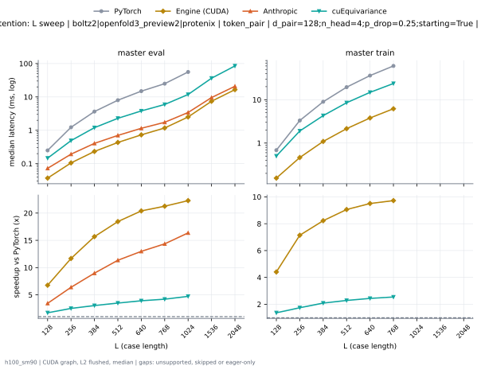
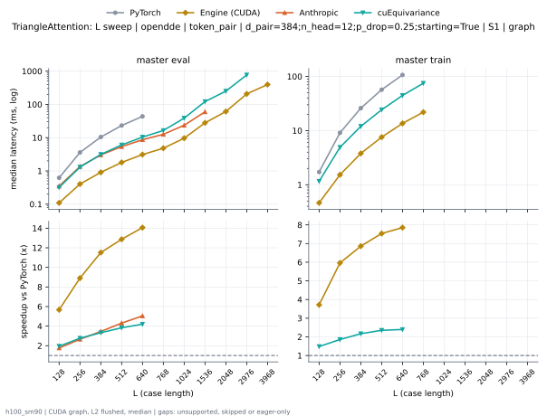
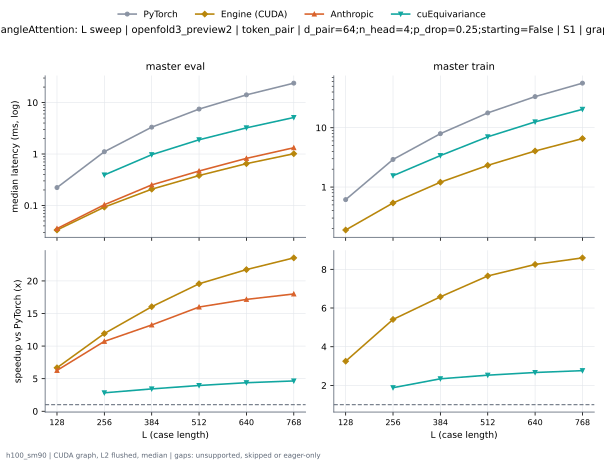
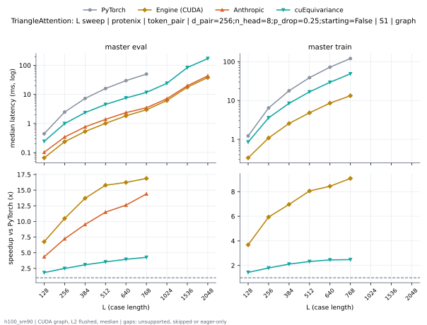

# TriangleAttention on h100_sm90

Generated by `python -m miniworld_engine.measure.plot` from speed tokens `judge/tokens/h100_sm90/`; do not edit.

### L sweep: token_pair | d_pair=128;n_head=4;p_drop=0.25;starting=False;use_self_attention=False | S1 | graph

**master eval** (median ms; x = speedup vs PyTorch)

| L | PyTorch | Engine (Triton) | Engine (CUDA) | Anthropic | cuEquivariance |
|---|---|---|---|---|---|
| 128 | 0.1237 | 0.08403 (1.47x) | 0.0648 (1.91x) | unsupported | unsupported |
| 256 | 0.3562 | 0.2302 (1.55x) | 0.134 (2.66x) | unsupported | unsupported |
| 384 | 0.8091 | 0.4889 (1.65x) | 0.27 (3.00x) | unsupported | unsupported |
| 512 | 1.4 | 0.8344 (1.68x) | 0.4414 (3.17x) | unsupported | unsupported |
| 640 | 2.169 | 1.303 (1.67x) | 0.6756 (3.21x) | unsupported | unsupported |
| 768 | 3.09 | 1.867 (1.66x) | 0.9819 (3.15x) | unsupported | unsupported |

**master train** (median ms; x = speedup vs PyTorch)

| L | PyTorch | Engine (Triton) | Engine (CUDA) | Anthropic | cuEquivariance |
|---|---|---|---|---|---|
| 128 | 0.3641 | 0.2621 (1.39x) | 0.2363 (1.54x) | unsupported | unsupported |
| 256 | 1.144 | 0.7082 (1.62x) | 0.4834 (2.37x) | unsupported | unsupported |
| 384 | 2.016 | 1.514 (1.33x) | 0.9405 (2.14x) | unsupported | unsupported |
| 512 | 3.425 | 2.519 (1.36x) | 1.553 (2.21x) | unsupported | unsupported |
| 640 | 5.258 | 4.047 (1.30x) | 2.412 (2.18x) | unsupported | unsupported |
| 768 | 7.479 | 6.093 (1.23x) | 3.47 (2.16x) | unsupported | unsupported |

### L sweep: token_pair | d_pair=128;n_head=4;p_drop=0.25;starting=True;use_self_attention=False | S1 | graph

**master eval** (median ms; x = speedup vs PyTorch)

| L | PyTorch | Engine (Triton) | Engine (CUDA) | Anthropic | cuEquivariance |
|---|---|---|---|---|---|
| 128 | 0.1121 | 0.0725 (1.55x) | 0.05586 (2.01x) | unsupported | unsupported |
| 256 | 0.3145 | 0.1873 (1.68x) | 0.1208 (2.60x) | unsupported | unsupported |
| 384 | 0.7088 | 0.3897 (1.82x) | 0.2554 (2.77x) | unsupported | unsupported |
| 512 | 1.229 | 0.6611 (1.86x) | 0.4274 (2.88x) | unsupported | unsupported |
| 640 | 1.898 | 1.034 (1.84x) | 0.6579 (2.89x) | unsupported | unsupported |
| 768 | 2.719 | 1.479 (1.84x) | 0.9431 (2.88x) | unsupported | unsupported |

**master train** (median ms; x = speedup vs PyTorch)

| L | PyTorch | Engine (Triton) | Engine (CUDA) | Anthropic | cuEquivariance |
|---|---|---|---|---|---|
| 128 | 0.3392 | 0.2373 (1.43x) | 0.1883 (1.80x) | unsupported | unsupported |
| 256 | 1.056 | 0.6247 (1.69x) | 0.4187 (2.52x) | unsupported | unsupported |
| 384 | 1.837 | 1.333 (1.38x) | 0.8606 (2.13x) | unsupported | unsupported |
| 512 | 3.114 | 2.203 (1.41x) | 1.417 (2.20x) | unsupported | unsupported |
| 640 | 4.775 | 3.557 (1.34x) | 2.227 (2.14x) | unsupported | unsupported |
| 768 | 6.789 | 5.391 (1.26x) | 3.126 (2.17x) | unsupported | unsupported |

### L sweep: boltz2|openfold3_preview2|protenix | token_pair | d_pair=128;n_head=4;p_drop=0.25;starting=False | S1 | graph

**master eval** (median ms; x = speedup vs PyTorch)

| L | PyTorch | Engine (Triton) | Engine (CUDA) | Anthropic | cuEquivariance |
|---|---|---|---|---|---|
| 128 | 0.257 | 0.1231 (2.09x) | 0.03669 (7.01x) | 0.0719 (3.57x) | 0.1572 (1.63x) |
| 256 | 1.276 | 0.3914 (3.26x) | 0.1069 (11.94x) | 0.1932 (6.61x) | 0.5301 (2.41x) |
| 384 | 3.756 | 0.9443 (3.98x) | 0.2382 (15.77x) | 0.411 (9.14x) | 1.296 (2.90x) |
| 512 | 8.174 | 1.728 (4.73x) | 0.442 (18.49x) | 0.6943 (11.77x) | 2.431 (3.36x) |
| 640 | 15.19 | 2.858 (5.31x) | 0.7527 (20.17x) | 1.12 (13.56x) | 4.07 (3.73x) |
| 768 | 25.38 | 4.287 (5.92x) | 1.179 (21.52x) | 1.7 (14.93x) | 6.309 (4.02x) |
| 1024 | 56.72 | 8.381 (6.77x) | 2.45 (23.15x) | 3.343 (16.97x) | 12.52 (4.53x) |
| 1536 | skipped | 22.8 | 7.734 | 9.385 | 37.86 |
| 2048 | skipped | 49.47 | 16.99 | 20.58 | 87.53 |

**master train** (median ms; x = speedup vs PyTorch)

| L | PyTorch | Engine (Triton) | Engine (CUDA) | Anthropic | cuEquivariance |
|---|---|---|---|---|---|
| 128 | 0.7161 | 0.4286 (1.67x) | 0.1583 (4.52x) | unsupported | 0.5318 (1.35x) |
| 256 | 3.411 | 1.486 (2.29x) | 0.4658 (7.32x) | unsupported | 1.988 (1.72x) |
| 384 | 9.157 | 3.032 (3.02x) | 1.098 (8.34x) | unsupported | 4.489 (2.04x) |
| 512 | 19.75 | 5.671 (3.48x) | 2.151 (9.18x) | unsupported | 8.812 (2.24x) |
| 640 | 36.48 | 9.391 (3.88x) | 3.797 (9.61x) | unsupported | 15.25 (2.39x) |
| 768 | 60.88 | 14.53 (4.19x) | 6.202 (9.82x) | unsupported | 24.33 (2.50x) |
| 1024 |  |  |  |  |  |
| 1536 |  |  |  |  |  |
| 2048 |  |  |  |  |  |

### L sweep: boltz2|openfold3_preview2|protenix | token_pair | d_pair=128;n_head=4;p_drop=0.25;starting=True | S1 | graph

**master eval** (median ms; x = speedup vs PyTorch)

| L | PyTorch | Engine (Triton) | Engine (CUDA) | Anthropic | cuEquivariance |
|---|---|---|---|---|---|
| 128 | 0.2432 | 0.1096 (2.22x) | 0.03579 (6.80x) | 0.07259 (3.35x) | 0.1463 (1.66x) |
| 256 | 1.232 | 0.35 (3.52x) | 0.1091 (11.29x) | 0.1929 (6.39x) | 0.4908 (2.51x) |
| 384 | 3.648 | 0.8417 (4.33x) | 0.237 (15.39x) | 0.406 (8.99x) | 1.201 (3.04x) |
| 512 | 8.005 | 1.562 (5.13x) | 0.4417 (18.12x) | 0.7035 (11.38x) | 2.287 (3.50x) |
| 640 | 14.92 | 2.574 (5.80x) | 0.7484 (19.93x) | 1.148 (12.99x) | 3.808 (3.92x) |
| 768 | 25 | 3.873 (6.46x) | 1.176 (21.26x) | 1.74 (14.37x) | 5.941 (4.21x) |
| 1024 | 56.11 | 7.71 (7.28x) | 2.608 (21.52x) | 3.421 (16.40x) | 11.85 (4.73x) |
| 1536 | skipped | 21.31 | 7.725 | 9.578 | 36.42 |
| 2048 | skipped | 46.95 | 17.22 | 20.88 | 84.96 |

**master train** (median ms; x = speedup vs PyTorch)

| L | PyTorch | Engine (Triton) | Engine (CUDA) | Anthropic | cuEquivariance |
|---|---|---|---|---|---|
| 128 | 0.6832 | 0.3989 (1.71x) | 0.156 (4.38x) | unsupported | 0.5015 (1.36x) |
| 256 | 3.326 | 1.395 (2.38x) | 0.4629 (7.18x) | unsupported | 1.9 (1.75x) |
| 384 | 8.969 | 2.843 (3.15x) | 1.093 (8.21x) | unsupported | 4.291 (2.09x) |
| 512 | 19.46 | 5.373 (3.62x) | 2.145 (9.07x) | unsupported | 8.515 (2.29x) |
| 640 | 36 | 8.917 (4.04x) | 3.775 (9.54x) | unsupported | 14.77 (2.44x) |
| 768 | 60.18 | 13.83 (4.35x) | 6.175 (9.75x) | unsupported | 23.65 (2.55x) |
| 1024 |  |  |  |  |  |
| 1536 |  |  |  |  |  |
| 2048 |  |  |  |  |  |

### L sweep: boltz2|protenix | token_pair | d_hidden=128;d_pair=64;n_head=4;p_drop=0.25;starting=False | S1 | graph

**master eval** (median ms; x = speedup vs PyTorch)

| L | PyTorch | Engine (Triton) | Engine (CUDA) | Anthropic | cuEquivariance |
|---|---|---|---|---|---|
| 128 | 0.2433 | 0.1102 (2.21x) | 0.03821 (6.37x) | 0.06763 (3.60x) | 0.1445 (1.68x) |
| 256 | 1.207 | 0.3199 (3.77x) | 0.1146 (10.53x) | 0.1581 (7.63x) | 0.457 (2.64x) |
| 384 | 3.59 | 0.7796 (4.61x) | 0.2583 (13.90x) | 0.3356 (10.70x) | 1.14 (3.15x) |
| 512 | 7.887 | 1.463 (5.39x) | 0.4738 (16.65x) | 0.5775 (13.66x) | 2.156 (3.66x) |
| 640 | 14.77 | 2.443 (6.05x) | 0.7952 (18.57x) | 0.9446 (15.64x) | 3.66 (4.04x) |
| 768 | 24.78 | 3.677 (6.74x) | 1.238 (20.03x) | 1.447 (17.13x) | 5.679 (4.36x) |
| 1024 | 55.73 | 7.323 (7.61x) | 2.749 (20.27x) | 2.921 (19.08x) | 11.47 (4.86x) |
| 1536 | skipped | 20.34 | 8.01 | 8.448 | 35.47 |
| 2048 | skipped | 44.97 | 17.59 | 19.05 | 82.94 |

**master train** (median ms; x = speedup vs PyTorch)

| L | PyTorch | Engine (Triton) | Engine (CUDA) | Anthropic | cuEquivariance |
|---|---|---|---|---|---|
| 128 | 0.669 | 0.3838 (1.74x) | 0.1797 (3.72x) | unsupported | 0.4831 (1.38x) |
| 256 | 3.174 | 1.247 (2.54x) | 0.5293 (6.00x) | unsupported | 1.78 (1.78x) |
| 384 | 8.612 | 2.504 (3.44x) | 1.203 (7.16x) | unsupported | 3.943 (2.18x) |
| 512 | 18.88 | 4.772 (3.96x) | 2.328 (8.11x) | unsupported | 7.907 (2.39x) |
| 640 | 35.16 | 8.044 (4.37x) | 4.047 (8.69x) | unsupported | 13.83 (2.54x) |
| 768 | 58.87 | 12.57 (4.68x) | 6.582 (8.94x) | unsupported | 22.27 (2.64x) |
| 1024 |  |  |  |  |  |
| 1536 |  |  |  |  |  |
| 2048 |  |  |  |  |  |

### L sweep: boltz2|protenix | token_pair | d_hidden=128;d_pair=64;n_head=4;p_drop=0.25;starting=True | S1 | graph

**master eval** (median ms; x = speedup vs PyTorch)

| L | PyTorch | Engine (Triton) | Engine (CUDA) | Anthropic | cuEquivariance |
|---|---|---|---|---|---|
| 128 | 0.2356 | 0.1024 (2.30x) | 0.03763 (6.26x) | 0.068 (3.47x) | 0.1378 (1.71x) |
| 256 | 1.185 | 0.2984 (3.97x) | 0.1111 (10.66x) | 0.1588 (7.46x) | 0.4421 (2.68x) |
| 384 | 3.535 | 0.7306 (4.84x) | 0.2554 (13.84x) | 0.3329 (10.62x) | 1.088 (3.25x) |
| 512 | 7.8 | 1.367 (5.71x) | 0.4679 (16.67x) | 0.5728 (13.62x) | 2.075 (3.76x) |
| 640 | 14.63 | 2.263 (6.47x) | 0.7868 (18.60x) | 0.9426 (15.52x) | 3.55 (4.12x) |
| 768 | 24.58 | 3.481 (7.06x) | 1.234 (19.93x) | 1.446 (17.01x) | 5.517 (4.46x) |
| 1024 | 55.3 | 7.004 (7.90x) | 2.779 (19.90x) | 2.91 (19.00x) | 11.12 (4.97x) |
| 1536 | skipped | 19.57 | 7.973 | 8.455 | 34.71 |
| 2048 | skipped | 43.59 | 17.58 | 19.21 | 81.72 |

**master train** (median ms; x = speedup vs PyTorch)

| L | PyTorch | Engine (Triton) | Engine (CUDA) | Anthropic | cuEquivariance |
|---|---|---|---|---|---|
| 128 | 0.646 | 0.364 (1.77x) | 0.1765 (3.66x) | unsupported | 0.47 (1.37x) |
| 256 | 3.123 | 1.2 (2.60x) | 0.5242 (5.96x) | unsupported | 1.725 (1.81x) |
| 384 | 8.518 | 2.413 (3.53x) | 1.191 (7.15x) | unsupported | 3.827 (2.23x) |
| 512 | 18.7 | 4.624 (4.04x) | 2.3 (8.13x) | unsupported | 7.752 (2.41x) |
| 640 | 34.89 | 7.802 (4.47x) | 4.022 (8.67x) | unsupported | 13.58 (2.57x) |
| 768 | 58.54 | 12.23 (4.79x) | 6.48 (9.03x) | unsupported | 21.99 (2.66x) |
| 1024 |  |  |  |  |  |
| 1536 |  |  |  |  |  |
| 2048 |  |  |  |  |  |

### L sweep: opendde | token_pair | d_pair=384;n_head=12;p_drop=0.25;starting=False | S1 | graph

**master eval** (median ms; x = speedup vs PyTorch)

| L | PyTorch | Engine (Triton) | Engine (CUDA) | Anthropic | cuEquivariance |
|---|---|---|---|---|---|
| 128 | 0.6392 | 0.255 (2.51x) | 0.1088 (5.88x) | 0.3756 (1.70x) | 0.3394 (1.88x) |
| 256 | 3.649 | 1.021 (3.57x) | 0.4151 (8.79x) | 1.463 (2.49x) | 1.434 (2.55x) |
| 384 | 10.74 | 2.366 (4.54x) | 0.9545 (11.25x) | 3.302 (3.25x) | 3.438 (3.12x) |
| 512 | 23.7 | 4.466 (5.31x) | 1.891 (12.53x) | 5.862 (4.04x) | 6.583 (3.60x) |
| 640 | 44.41 | 7.424 (5.98x) | 3.305 (13.44x) | 9.345 (4.75x) | 11.17 (3.98x) |
| 768 | 74.14 | 11.45 (6.47x) | 4.984 (14.87x) | 13.7 (5.41x) | 17.56 (4.22x) |
| 1024 | skipped | 23.43 | 10.2 | 25.46 | 40.48 |
| 1536 | skipped | 68.85 | 29.61 | 63.95 | 125.9 |
| 2048 | skipped | 156.2 | 72.56 | skipped | 258.2 |
| 2976 | skipped | 494.8 | 233.1 | skipped | skipped |
| 3968 | skipped | 1047 | 448.2 | skipped | skipped |

**master train** (median ms; x = speedup vs PyTorch)

| L | PyTorch | Engine (Triton) | Engine (CUDA) | Anthropic | cuEquivariance |
|---|---|---|---|---|---|
| 128 | 1.752 | 0.929 (1.89x) | 0.4741 (3.70x) | unsupported | 1.203 (1.46x) |
| 256 | 9.344 | 3.594 (2.60x) | 1.577 (5.93x) | unsupported | 5.141 (1.82x) |
| 384 | 26.52 | 8.148 (3.25x) | 3.904 (6.79x) | unsupported | 12.51 (2.12x) |
| 512 | 57.98 | 15.74 (3.68x) | 7.729 (7.50x) | unsupported | 25.22 (2.30x) |
| 640 | 108.2 | 26.87 (4.03x) | 14.04 (7.70x) | unsupported | 46.03 (2.35x) |
| 768 | skipped | 41.98 | 22.42 | unsupported | 77.09 |
| 1024 |  |  |  |  |  |
| 1536 |  |  |  |  |  |
| 2048 |  |  |  |  |  |
| 2976 |  |  |  |  |  |
| 3968 |  |  |  |  |  |

### L sweep: opendde | token_pair | d_pair=384;n_head=12;p_drop=0.25;starting=True | S1 | graph

**master eval** (median ms; x = speedup vs PyTorch)

| L | PyTorch | Engine (Triton) | Engine (CUDA) | Anthropic | cuEquivariance |
|---|---|---|---|---|---|
| 128 | 0.6189 | 0.2269 (2.73x) | 0.1087 (5.70x) | 0.3501 (1.77x) | 0.3181 (1.95x) |
| 256 | 3.504 | 0.8901 (3.94x) | 0.4041 (8.67x) | 1.35 (2.60x) | 1.298 (2.70x) |
| 384 | 10.45 | 2.068 (5.05x) | 0.9331 (11.20x) | 3.019 (3.46x) | 3.135 (3.33x) |
| 512 | 23.15 | 3.943 (5.87x) | 1.908 (12.13x) | 5.38 (4.30x) | 6.046 (3.83x) |
| 640 | 43.61 | 6.641 (6.57x) | 3.273 (13.33x) | 8.653 (5.04x) | 10.39 (4.20x) |
| 768 | 72.99 | 10.31 (7.08x) | 4.939 (14.78x) | 12.62 (5.78x) | 16.45 (4.44x) |
| 1024 | skipped | 21.48 | 9.967 | 23.56 | 38.61 |
| 1536 | skipped | 64.8 | 28.66 | 59.74 | 121.4 |
| 2048 | skipped | 147.4 | 64.84 | skipped | 250.7 |
| 2976 | skipped | 466.1 | 213.1 | skipped | 768.7 |
| 3968 | skipped | 1004 | 413 | skipped | skipped |

**master train** (median ms; x = speedup vs PyTorch)

| L | PyTorch | Engine (Triton) | Engine (CUDA) | Anthropic | cuEquivariance |
|---|---|---|---|---|---|
| 128 | 1.721 | 0.873 (1.97x) | 0.4626 (3.72x) | unsupported | 1.158 (1.49x) |
| 256 | 9.14 | 3.367 (2.71x) | 1.546 (5.91x) | unsupported | 4.909 (1.86x) |
| 384 | 25.99 | 7.619 (3.41x) | 3.817 (6.81x) | unsupported | 11.99 (2.17x) |
| 512 | 57.02 | 14.83 (3.85x) | 7.612 (7.49x) | unsupported | 24.28 (2.35x) |
| 640 | 106.7 | 25.41 (4.20x) | 13.86 (7.70x) | unsupported | 44.61 (2.39x) |
| 768 | skipped | 39.91 | 22.08 | unsupported | 75.02 |
| 1024 |  |  |  |  |  |
| 1536 |  |  |  |  |  |
| 2048 |  |  |  |  |  |
| 2976 |  |  |  |  |  |
| 3968 |  |  |  |  |  |

### L sweep: opendde|protenix | token_pair | d_pair=64;n_head=2;p_drop=0.25;starting=False | S1 | graph

**master eval** (median ms; x = speedup vs PyTorch)

| L | PyTorch | Engine (Triton) | Engine (CUDA) | Anthropic | cuEquivariance |
|---|---|---|---|---|---|
| 128 | 0.1631 | 0.09971 (1.64x) | 0.02922 (5.58x) | 0.1379 (1.18x) | 0.1246 (1.31x) |
| 256 | 0.7143 | 0.259 (2.76x) | 0.07357 (9.71x) | 0.54 (eager) | 0.3355 (2.13x) |
| 384 | 2 | 0.5891 (3.40x) | 0.1646 (12.15x) | 0.6944 (2.88x) | 0.7771 (2.57x) |
| 512 | 4.314 | 1.093 (3.95x) | 0.2857 (15.10x) | 1.221 (3.53x) | 1.453 (2.97x) |
| 640 | 7.941 | 1.764 (4.50x) | 0.47 (16.90x) | 1.893 (4.19x) | 2.377 (3.34x) |
| 768 | 13.16 | 2.609 (5.04x) | 0.7017 (18.75x) | 2.716 (4.84x) | 3.635 (3.62x) |
| 1024 | 29.17 | 5.066 (5.76x) | 1.52 (19.19x) | 4.986 (5.85x) | 7.106 (4.11x) |
| 1536 | skipped | 13.1 | 4.336 | 11.81 | 19.39 |
| 2048 | skipped | 26.77 | 9.361 | 22.49 | 40.74 |

**master train** (median ms; x = speedup vs PyTorch)

| L | PyTorch | Engine (Triton) | Engine (CUDA) | Anthropic | cuEquivariance |
|---|---|---|---|---|---|
| 128 | 0.47 | 0.3296 (1.43x) | 0.1463 (3.21x) | unsupported | 0.3941 (1.19x) |
| 256 | 1.979 | 0.9934 (1.99x) | 0.3668 (5.40x) | unsupported | 1.262 (1.57x) |
| 384 | 4.801 | 1.729 (2.78x) | 0.7658 (6.27x) | unsupported | 2.474 (1.94x) |
| 512 | 10.28 | 3.224 (3.19x) | 1.387 (7.41x) | unsupported | 4.859 (2.12x) |
| 640 | 18.85 | 5.305 (3.55x) | 2.318 (8.13x) | unsupported | 8.237 (2.29x) |
| 768 | 31.18 | 8.02 (3.89x) | 3.565 (8.75x) | unsupported | 12.98 (2.40x) |
| 1024 |  |  |  |  |  |
| 1536 |  |  |  |  |  |
| 2048 |  |  |  |  |  |

### L sweep: opendde|protenix | token_pair | d_pair=64;n_head=2;p_drop=0.25;starting=True | S1 | graph

**master eval** (median ms; x = speedup vs PyTorch)

| L | PyTorch | Engine (Triton) | Engine (CUDA) | Anthropic | cuEquivariance |
|---|---|---|---|---|---|
| 128 | 0.1529 | 0.08994 (1.70x) | 0.02843 (5.38x) | 0.1296 (1.18x) | 0.1148 (1.33x) |
| 256 | 0.6869 | 0.2369 (2.90x) | 0.06936 (9.90x) | 0.3089 (2.22x) | 0.3126 (2.20x) |
| 384 | 1.943 | 0.5411 (3.59x) | 0.1615 (12.03x) | 0.6464 (3.01x) | 0.7258 (2.68x) |
| 512 | 4.226 | 1.004 (4.21x) | 0.2838 (14.89x) | 1.13 (3.74x) | 1.357 (3.11x) |
| 640 | 7.801 | 1.608 (4.85x) | 0.4572 (17.06x) | 1.753 (4.45x) | 2.235 (3.49x) |
| 768 | 12.96 | 2.402 (5.40x) | 0.6866 (18.87x) | 2.517 (5.15x) | 3.489 (3.71x) |
| 1024 | 28.82 | 4.717 (6.11x) | 1.486 (19.39x) | 4.621 (6.24x) | 6.793 (4.24x) |
| 1536 | skipped | 12.32 | 4.295 | 11 | 18.61 |
| 2048 | skipped | 25.38 | 9.293 | 21.15 | 39.62 |

**master train** (median ms; x = speedup vs PyTorch)

| L | PyTorch | Engine (Triton) | Engine (CUDA) | Anthropic | cuEquivariance |
|---|---|---|---|---|---|
| 128 | 0.4467 | 0.3108 (1.44x) | 0.1439 (3.10x) | unsupported | 0.379 (1.18x) |
| 256 | 1.932 | 0.9476 (2.04x) | 0.361 (5.35x) | unsupported | 1.226 (1.58x) |
| 384 | 4.709 | 1.645 (2.86x) | 0.7572 (6.22x) | unsupported | 2.378 (1.98x) |
| 512 | 10.14 | 3.088 (3.28x) | 1.374 (7.38x) | unsupported | 4.7 (2.16x) |
| 640 | 18.58 | 5.048 (3.68x) | 2.301 (8.07x) | unsupported | 7.983 (2.33x) |
| 768 | 30.78 | 7.661 (4.02x) | 3.534 (8.71x) | unsupported | 12.63 (2.44x) |
| 1024 |  |  |  |  |  |
| 1536 |  |  |  |  |  |
| 2048 |  |  |  |  |  |

### L sweep: openfold3_preview2 | token_pair | d_pair=64;n_head=4;p_drop=0.25;starting=False | S1 | graph

**master eval** (median ms; x = speedup vs PyTorch)

| L | PyTorch | Engine (Triton) | Engine (CUDA) | Anthropic | cuEquivariance |
|---|---|---|---|---|---|
| 128 | 0.2223 | 0.1032 (2.15x) | 0.03475 (6.40x) | 0.0355 (6.26x) | unsupported |
| 256 | 1.109 | 0.2775 (4.00x) | 0.09741 (11.38x) | 0.1033 (10.73x) | 0.3916 (2.83x) |
| 384 | 3.321 | 0.6617 (5.02x) | 0.2283 (14.55x) | 0.251 (13.23x) | 0.9699 (3.42x) |
| 512 | 7.463 | 1.259 (5.93x) | 0.4269 (17.48x) | 0.4671 (15.98x) | 1.89 (3.95x) |
| 640 | 14.1 | 2.069 (6.81x) | 0.7409 (19.03x) | 0.8225 (17.14x) | 3.225 (4.37x) |
| 768 | 23.8 | 3.166 (7.52x) | 1.168 (20.39x) | 1.324 (17.98x) | 5.127 (4.64x) |

**master train** (median ms; x = speedup vs PyTorch)

| L | PyTorch | Engine (Triton) | Engine (CUDA) | Anthropic | cuEquivariance |
|---|---|---|---|---|---|
| 128 | 0.613 | 0.3502 (1.75x) | 0.1892 (3.24x) | unsupported | unsupported |
| 256 | 2.915 | 1.124 (2.59x) | 0.5393 (5.40x) | unsupported | 1.551 (1.88x) |
| 384 | 7.959 | 2.153 (3.70x) | 1.212 (6.57x) | unsupported | 3.391 (2.35x) |
| 512 | 17.78 | 4.199 (4.23x) | 2.323 (7.65x) | unsupported | 7.03 (2.53x) |
| 640 | 33.45 | 7.134 (4.69x) | 4.037 (8.29x) | unsupported | 12.54 (2.67x) |
| 768 | 56.42 | 11.19 (5.04x) | 6.572 (8.59x) | unsupported | 20.42 (2.76x) |

### L sweep: openfold3_preview2 | token_pair | d_pair=64;n_head=4;p_drop=0.25;starting=True | S1 | graph

**master eval** (median ms; x = speedup vs PyTorch)

| L | PyTorch | Engine (Triton) | Engine (CUDA) | Anthropic | cuEquivariance |
|---|---|---|---|---|---|
| 128 | 0.2121 | 0.09381 (2.26x) | 0.03374 (6.29x) | 0.03514 (6.04x) | unsupported |
| 256 | 1.085 | 0.2585 (4.20x) | 0.09424 (11.51x) | 0.1028 (10.55x) | 0.3712 (2.92x) |
| 384 | 3.284 | 0.6078 (5.40x) | 0.2247 (14.62x) | 0.2503 (13.12x) | 0.9177 (3.58x) |
| 512 | 7.373 | 1.181 (6.25x) | 0.4269 (17.27x) | 0.4651 (15.85x) | 1.827 (4.04x) |
| 640 | 13.96 | 1.931 (7.23x) | 0.7293 (19.15x) | 0.824 (16.95x) | 3.101 (4.50x) |
| 768 | 23.61 | 2.95 (8.00x) | 1.153 (20.47x) | 1.33 (17.75x) | 4.905 (4.81x) |

**master train** (median ms; x = speedup vs PyTorch)

| L | PyTorch | Engine (Triton) | Engine (CUDA) | Anthropic | cuEquivariance |
|---|---|---|---|---|---|
| 128 | 0.5917 | 0.3322 (1.78x) | 0.1852 (3.19x) | unsupported | unsupported |
| 256 | 2.872 | 1.077 (2.67x) | 0.5324 (5.39x) | unsupported | 1.504 (1.91x) |
| 384 | 7.854 | 2.062 (3.81x) | 1.201 (6.54x) | unsupported | 3.305 (2.38x) |
| 512 | 17.62 | 4.039 (4.36x) | 2.308 (7.63x) | unsupported | 6.893 (2.56x) |
| 640 | 33.17 | 6.897 (4.81x) | 4.035 (8.22x) | unsupported | 12.3 (2.70x) |
| 768 | 56.06 | 10.82 (5.18x) | 6.443 (8.70x) | unsupported | 20.08 (2.79x) |

### L sweep: protenix | token_pair | d_pair=256;n_head=8;p_drop=0.25;starting=False | S1 | graph

**master eval** (median ms; x = speedup vs PyTorch)

| L | PyTorch | Engine (Triton) | Engine (CUDA) | Anthropic | cuEquivariance |
|---|---|---|---|---|---|
| 128 | 0.4446 | 0.1783 (2.49x) | 0.06653 (6.68x) | 0.102 (4.36x) | 0.2427 (1.83x) |
| 256 | 2.464 | 0.7063 (3.49x) | 0.2369 (10.40x) | 0.3415 (7.22x) | 0.9913 (2.49x) |
| 384 | 7.242 | 1.654 (4.38x) | 0.5315 (13.62x) | 0.7626 (9.50x) | 2.362 (3.07x) |
| 512 | 15.93 | 3.096 (5.14x) | 1.019 (15.63x) | 1.387 (11.48x) | 4.509 (3.53x) |
| 640 | 29.76 | 5.112 (5.82x) | 1.84 (16.18x) | 2.363 (12.60x) | 7.539 (3.95x) |
| 768 | 49.98 | 7.705 (6.49x) | 2.841 (17.59x) | 3.472 (14.39x) | 11.72 (4.26x) |
| 1024 | skipped | 15.35 | 5.967 | 7.106 | 24.09 |
| 1536 | skipped | 44.82 | 17.48 | 19.88 | 83.86 |
| 2048 | skipped | 97.13 | 37.58 | 43.47 | 171.4 |

**master train** (median ms; x = speedup vs PyTorch)

| L | PyTorch | Engine (Triton) | Engine (CUDA) | Anthropic | cuEquivariance |
|---|---|---|---|---|---|
| 128 | 1.217 | 0.6549 (1.86x) | 0.3305 (3.68x) | unsupported | 0.8493 (1.43x) |
| 256 | 6.399 | 2.565 (2.49x) | 1.072 (5.97x) | unsupported | 3.57 (1.79x) |
| 384 | 17.8 | 5.589 (3.19x) | 2.558 (6.96x) | unsupported | 8.431 (2.11x) |
| 512 | 38.75 | 10.62 (3.65x) | 5.001 (7.75x) | unsupported | 16.67 (2.32x) |
| 640 | 72.06 | 17.98 (4.01x) | 8.843 (8.15x) | unsupported | 29.38 (2.45x) |
| 768 | 120.4 | 27.8 (4.33x) | 14.25 (8.45x) | unsupported | 48.6 (2.48x) |
| 1024 |  |  |  |  |  |
| 1536 |  |  |  |  |  |
| 2048 |  |  |  |  |  |

### L sweep: protenix | token_pair | d_pair=256;n_head=8;p_drop=0.25;starting=True | S1 | graph

**master eval** (median ms; x = speedup vs PyTorch)

| L | PyTorch | Engine (Triton) | Engine (CUDA) | Anthropic | cuEquivariance |
|---|---|---|---|---|---|
| 128 | 0.4309 | 0.1616 (2.67x) | 0.06584 (6.55x) | 0.1025 (4.20x) | 0.228 (1.89x) |
| 256 | 2.378 | 0.6212 (3.83x) | 0.2381 (9.99x) | 0.3385 (7.02x) | 0.9027 (2.63x) |
| 384 | 7.047 | 1.453 (4.85x) | 0.5316 (13.26x) | 0.7629 (9.24x) | 2.179 (3.23x) |
| 512 | 15.58 | 2.747 (5.67x) | 1.012 (15.39x) | 1.386 (11.24x) | 4.164 (3.74x) |
| 640 | 29.24 | 4.569 (6.40x) | 1.825 (16.02x) | 2.365 (12.36x) | 7.002 (4.18x) |
| 768 | 49.22 | 7.015 (7.02x) | 2.88 (17.09x) | 3.536 (13.92x) | 10.97 (4.49x) |
| 1024 | skipped | 14.02 | 5.887 | 7.137 | 22.87 |
| 1536 | skipped | 42.03 | 17.5 | 20.24 | 80.92 |
| 2048 | skipped | 91.72 | 37.82 | 43.64 | 166.7 |

**master train** (median ms; x = speedup vs PyTorch)

| L | PyTorch | Engine (Triton) | Engine (CUDA) | Anthropic | cuEquivariance |
|---|---|---|---|---|---|
| 128 | 1.186 | 0.6168 (1.92x) | 0.327 (3.63x) | unsupported | 0.8086 (1.47x) |
| 256 | 6.25 | 2.392 (2.61x) | 1.06 (5.90x) | unsupported | 3.409 (1.83x) |
| 384 | 17.43 | 5.221 (3.34x) | 2.528 (6.90x) | unsupported | 8.142 (2.14x) |
| 512 | 38.14 | 10 (3.81x) | 4.946 (7.71x) | unsupported | 16.12 (2.37x) |
| 640 | 71.1 | 16.98 (4.19x) | 8.741 (8.13x) | unsupported | 28.44 (2.50x) |
| 768 | 119 | 26.46 (4.50x) | 14.17 (8.39x) | unsupported | 47.21 (2.52x) |
| 1024 |  |  |  |  |  |
| 1536 |  |  |  |  |  |
| 2048 |  |  |  |  |  |

### d_pair sweep at L2048: token_pair | p_drop=0.25;starting=False | S1 | graph

**master eval** (median ms; x = speedup vs PyTorch)

| d_pair | PyTorch | Engine (Triton) | Engine (CUDA) | Anthropic | cuEquivariance |
|---|---|---|---|---|---|
| 64 d_hidden=128 n_head=4 | skipped | 44.97 | 17.59 | 19.05 | 82.94 |
| 128 n_head=4 | skipped | 49.47 | 16.99 | 20.58 | 87.53 |
| 256 n_head=8 | skipped | 97.13 | 37.58 | 43.47 | 171.4 |
| 384 n_head=12 | skipped | 156.2 | 72.56 | skipped | 258.2 |

### d_pair sweep at L2048: token_pair | p_drop=0.25;starting=True | S1 | graph

**master eval** (median ms; x = speedup vs PyTorch)

| d_pair | PyTorch | Engine (Triton) | Engine (CUDA) | Anthropic | cuEquivariance |
|---|---|---|---|---|---|
| 64 d_hidden=128 n_head=4 | skipped | 43.59 | 17.58 | 19.21 | 81.72 |
| 128 n_head=4 | skipped | 46.95 | 17.22 | 20.88 | 84.96 |
| 256 n_head=8 | skipped | 91.72 | 37.82 | 43.64 | 166.7 |
| 384 n_head=12 | skipped | 147.4 | 64.84 | skipped | 250.7 |

### n_head sweep at L2048: token_pair | p_drop=0.25;starting=False | S1 | graph

**master eval** (median ms; x = speedup vs PyTorch)

| n_head | PyTorch | Engine (Triton) | Engine (CUDA) | Anthropic | cuEquivariance |
|---|---|---|---|---|---|
| 2 d_pair=64 | skipped | 26.77 | 9.361 | 22.49 | 40.74 |
| 4 d_pair=128 | skipped | 49.47 | 16.99 | 20.58 | 87.53 |
| 8 d_pair=256 | skipped | 97.13 | 37.58 | 43.47 | 171.4 |
| 12 d_pair=384 | skipped | 156.2 | 72.56 | skipped | 258.2 |

### n_head sweep at L2048: token_pair | p_drop=0.25;starting=True | S1 | graph

**master eval** (median ms; x = speedup vs PyTorch)

| n_head | PyTorch | Engine (Triton) | Engine (CUDA) | Anthropic | cuEquivariance |
|---|---|---|---|---|---|
| 2 d_pair=64 | skipped | 25.38 | 9.293 | 21.15 | 39.62 |
| 4 d_pair=128 | skipped | 46.95 | 17.22 | 20.88 | 84.96 |
| 8 d_pair=256 | skipped | 91.72 | 37.82 | 43.64 | 166.7 |
| 12 d_pair=384 | skipped | 147.4 | 64.84 | skipped | 250.7 |

