# TriangleAttention on h100_sm90

Generated by `python -m miniworld_engine.measure.plot` from speed tokens `judge/tokens/h100_sm90/`; do not edit.

### L sweep: boltz2|openfold3_preview2|protenix | token_pair | d_pair=128;n_head=4;p_drop=0.25;starting=False | S1 | graph

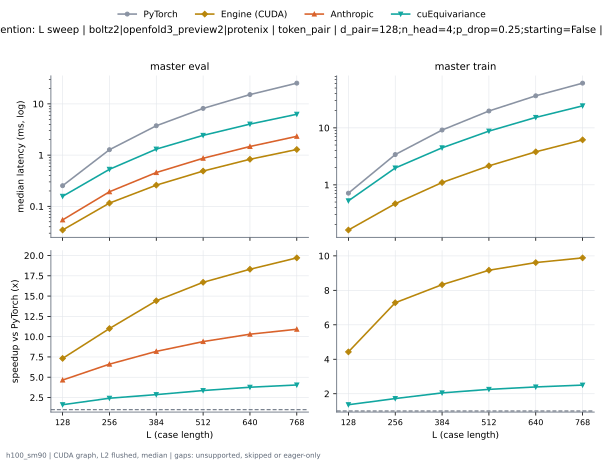

**master eval** (median ms; x = speedup vs PyTorch)

| L | PyTorch | Engine (Triton) | Engine (CUDA) | Anthropic | cuEquivariance |
|---|---|---|---|---|---|
| 128 | 0.2531 | 0.1228 (2.06x) | 0.03458 (7.32x) | 0.0544 (4.65x) | 0.1571 (1.61x) |
| 256 | 1.275 | 0.3888 (3.28x) | 0.1159 (11.00x) | 0.1929 (6.61x) | 0.5284 (2.41x) |
| 384 | 3.741 | 0.943 (3.97x) | 0.2594 (14.42x) | 0.457 (8.19x) | 1.309 (2.86x) |
| 512 | 8.161 | 1.726 (4.73x) | 0.4887 (16.70x) | 0.8688 (9.39x) | 2.43 (3.36x) |
| 640 | 15.19 | 2.852 (5.33x) | 0.8297 (18.31x) | 1.474 (10.30x) | 4.031 (3.77x) |
| 768 | 25.38 | 4.278 (5.93x) | 1.288 (19.71x) | 2.326 (10.91x) | 6.275 (4.04x) |

**master train** (median ms; x = speedup vs PyTorch)

| L | PyTorch | Engine (Triton) | Engine (CUDA) | Anthropic | cuEquivariance |
|---|---|---|---|---|---|
| 128 | 0.7151 | 0.4275 (1.67x) | 0.1615 (4.43x) | unsupported | 0.5246 (1.36x) |
| 256 | 3.403 | 1.475 (2.31x) | 0.4673 (7.28x) | unsupported | 1.977 (1.72x) |
| 384 | 9.161 | 3.041 (3.01x) | 1.1 (8.33x) | unsupported | 4.469 (2.05x) |
| 512 | 19.77 | 5.669 (3.49x) | 2.157 (9.17x) | unsupported | 8.774 (2.25x) |
| 640 | 36.51 | 9.403 (3.88x) | 3.799 (9.61x) | unsupported | 15.25 (2.39x) |
| 768 | 60.9 | 14.54 (4.19x) | 6.161 (9.88x) | unsupported | 24.34 (2.50x) |

### L sweep: boltz2|openfold3_preview2|protenix | token_pair | d_pair=128;n_head=4;p_drop=0.25;starting=True | S1 | graph

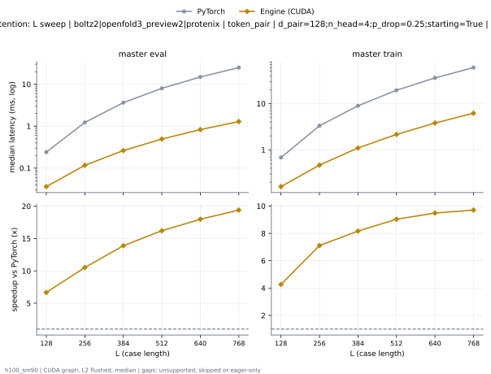

**master eval** (median ms; x = speedup vs PyTorch)

| L | PyTorch | Engine (Triton) | Engine (CUDA) | Anthropic | cuEquivariance |
|---|---|---|---|---|---|
| 128 | 0.242 | 0.1098 (2.20x) | 0.03406 (7.10x) | 0.05064 (4.78x) | 0.1483 (1.63x) |
| 256 | 1.237 | 0.3504 (3.53x) | 0.1157 (10.69x) | 0.1802 (6.86x) | 0.4919 (2.51x) |
| 384 | 3.643 | 0.8399 (4.34x) | 0.2612 (13.95x) | 0.4307 (8.46x) | 1.2 (3.04x) |
| 512 | 8.003 | 1.564 (5.12x) | 0.4922 (16.26x) | 0.8315 (9.62x) | 2.259 (3.54x) |
| 640 | 14.92 | 2.567 (5.81x) | 0.8277 (18.03x) | 1.429 (10.44x) | 3.782 (3.95x) |
| 768 | 25 | 3.902 (6.41x) | 1.286 (19.44x) | 2.242 (11.15x) | 5.897 (4.24x) |

**master train** (median ms; x = speedup vs PyTorch)

| L | PyTorch | Engine (Triton) | Engine (CUDA) | Anthropic | cuEquivariance |
|---|---|---|---|---|---|
| 128 | 0.6916 | 0.4054 (1.71x) | 0.1605 (4.31x) | unsupported | 0.5095 (1.36x) |
| 256 | 3.323 | 1.391 (2.39x) | 0.4686 (7.09x) | unsupported | 1.9 (1.75x) |
| 384 | 8.988 | 2.85 (3.15x) | 1.1 (8.17x) | unsupported | 4.293 (2.09x) |
| 512 | 19.49 | 5.374 (3.63x) | 2.152 (9.06x) | unsupported | 8.506 (2.29x) |
| 640 | 36.03 | 8.934 (4.03x) | 3.785 (9.52x) | unsupported | 14.77 (2.44x) |
| 768 | 60.14 | 13.86 (4.34x) | 6.157 (9.77x) | unsupported | 23.65 (2.54x) |

### L sweep: boltz2|protenix | token_pair | d_hidden=128;d_pair=64;n_head=4;p_drop=0.25;starting=False | S1 | graph

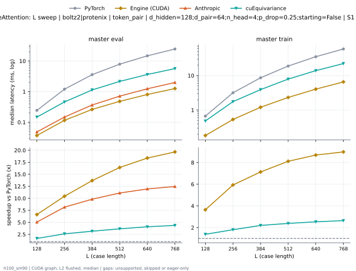

**master eval** (median ms; x = speedup vs PyTorch)

| L | PyTorch | Engine (Triton) | Engine (CUDA) | Anthropic | cuEquivariance |
|---|---|---|---|---|---|
| 128 | 0.2433 | 0.1105 (2.20x) | 0.03674 (6.62x) | 0.04808 (5.06x) | 0.1468 (1.66x) |
| 256 | 1.204 | 0.3205 (3.76x) | 0.1153 (10.44x) | 0.1474 (8.16x) | 0.4603 (2.62x) |
| 384 | 3.584 | 0.7809 (4.59x) | 0.2619 (13.69x) | 0.3652 (9.82x) | 1.135 (3.16x) |
| 512 | 7.904 | 1.457 (5.42x) | 0.4816 (16.41x) | 0.7115 (11.11x) | 2.16 (3.66x) |
| 640 | 14.8 | 2.441 (6.06x) | 0.8053 (18.38x) | 1.238 (11.95x) | 3.629 (4.08x) |
| 768 | 24.78 | 3.678 (6.74x) | 1.261 (19.65x) | 1.989 (12.46x) | 5.67 (4.37x) |

**master train** (median ms; x = speedup vs PyTorch)

| L | PyTorch | Engine (Triton) | Engine (CUDA) | Anthropic | cuEquivariance |
|---|---|---|---|---|---|
| 128 | 0.6695 | 0.3837 (1.74x) | 0.1838 (3.64x) | unsupported | 0.4843 (1.38x) |
| 256 | 3.176 | 1.241 (2.56x) | 0.5355 (5.93x) | unsupported | 1.76 (1.80x) |
| 384 | 8.622 | 2.498 (3.45x) | 1.209 (7.13x) | unsupported | 3.921 (2.20x) |
| 512 | 18.88 | 4.779 (3.95x) | 2.326 (8.12x) | unsupported | 7.908 (2.39x) |
| 640 | 35.16 | 8.062 (4.36x) | 4.046 (8.69x) | unsupported | 13.89 (2.53x) |
| 768 | 58.9 | 12.59 (4.68x) | 6.56 (8.98x) | unsupported | 22.27 (2.64x) |

### L sweep: boltz2|protenix | token_pair | d_hidden=128;d_pair=64;n_head=4;p_drop=0.25;starting=True | S1 | graph

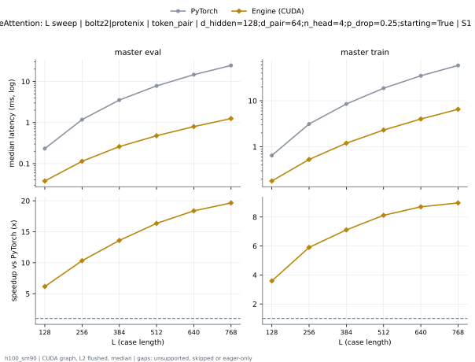

**master eval** (median ms; x = speedup vs PyTorch)

| L | PyTorch | Engine (Triton) | Engine (CUDA) | Anthropic | cuEquivariance |
|---|---|---|---|---|---|
| 128 | 0.2328 | 0.101 (2.31x) | 0.03552 (6.55x) | 0.04502 (5.17x) | 0.1372 (1.70x) |
| 256 | 1.183 | 0.2985 (3.96x) | 0.112 (10.56x) | 0.1398 (8.46x) | 0.4394 (2.69x) |
| 384 | 3.534 | 0.7295 (4.84x) | 0.2576 (13.72x) | 0.3491 (10.12x) | 1.085 (3.26x) |
| 512 | 7.801 | 1.371 (5.69x) | 0.4747 (16.43x) | 0.6873 (11.35x) | 2.073 (3.76x) |
| 640 | 14.66 | 2.265 (6.47x) | 0.796 (18.42x) | 1.203 (12.19x) | 3.479 (4.22x) |
| 768 | 24.58 | 3.468 (7.09x) | 1.243 (19.78x) | 1.942 (12.66x) | 5.452 (4.51x) |

**master train** (median ms; x = speedup vs PyTorch)

| L | PyTorch | Engine (Triton) | Engine (CUDA) | Anthropic | cuEquivariance |
|---|---|---|---|---|---|
| 128 | 0.6486 | 0.3655 (1.77x) | 0.18 (3.60x) | unsupported | 0.4649 (1.40x) |
| 256 | 3.131 | 1.203 (2.60x) | 0.5294 (5.91x) | unsupported | 1.719 (1.82x) |
| 384 | 8.516 | 2.408 (3.54x) | 1.197 (7.11x) | unsupported | 3.85 (2.21x) |
| 512 | 18.7 | 4.628 (4.04x) | 2.311 (8.09x) | unsupported | 7.726 (2.42x) |
| 640 | 34.87 | 7.814 (4.46x) | 4.021 (8.67x) | unsupported | 13.59 (2.57x) |
| 768 | 58.54 | 12.23 (4.79x) | 6.56 (8.92x) | unsupported | 21.92 (2.67x) |

### L sweep: opendde | token_pair | d_pair=384;n_head=12;p_drop=0.25;starting=False | S1 | graph

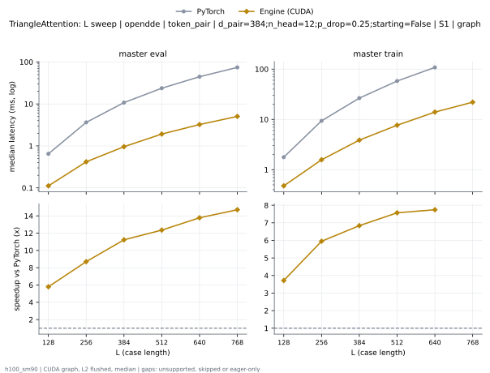

**master eval** (median ms; x = speedup vs PyTorch)

| L | PyTorch | Engine (Triton) | Engine (CUDA) | Anthropic | cuEquivariance |
|---|---|---|---|---|---|
| 128 | 0.6451 | 0.2525 (2.56x) | 0.1076 (6.00x) | 0.3629 (1.78x) | 0.341 (1.89x) |
| 256 | 3.647 | 1.023 (3.57x) | 0.4184 (8.71x) | 1.439 (2.53x) | 1.437 (2.54x) |
| 384 | 10.76 | 2.368 (4.54x) | 0.9605 (11.20x) | 3.308 (3.25x) | 3.422 (3.14x) |
| 512 | 23.71 | 4.463 (5.31x) | 1.814 (13.07x) | 6.109 (3.88x) | 6.556 (3.62x) |
| 640 | 44.45 | 7.438 (5.98x) | 3.312 (13.42x) | 9.986 (4.45x) | 11.19 (3.97x) |
| 768 | 74.29 | 11.43 (6.50x) | 5.115 (14.52x) | 15.14 (4.91x) | 17.59 (4.22x) |

**master train** (median ms; x = speedup vs PyTorch)

| L | PyTorch | Engine (Triton) | Engine (CUDA) | Anthropic | cuEquivariance |
|---|---|---|---|---|---|
| 128 | 1.772 | 0.9343 (1.90x) | 0.4785 (3.70x) | unsupported | 1.205 (1.47x) |
| 256 | 9.372 | 3.607 (2.60x) | 1.581 (5.93x) | unsupported | 5.129 (1.83x) |
| 384 | 26.52 | 8.153 (3.25x) | 3.943 (6.73x) | unsupported | 12.51 (2.12x) |
| 512 | 57.99 | 15.71 (3.69x) | 7.692 (7.54x) | unsupported | 25.21 (2.30x) |
| 640 | 108.2 | 26.83 (4.03x) | 14.01 (7.72x) | unsupported | 46.12 (2.35x) |
| 768 | skipped | 42.01 | 22.51 | unsupported | 76.88 |

### L sweep: opendde | token_pair | d_pair=384;n_head=12;p_drop=0.25;starting=True | S1 | graph

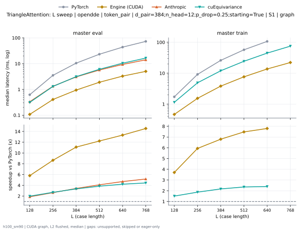

**master eval** (median ms; x = speedup vs PyTorch)

| L | PyTorch | Engine (Triton) | Engine (CUDA) | Anthropic | cuEquivariance |
|---|---|---|---|---|---|
| 128 | 0.623 | 0.2259 (2.76x) | 0.1074 (5.80x) | 0.3321 (1.88x) | 0.3134 (1.99x) |
| 256 | 3.522 | 0.8913 (3.95x) | 0.4072 (8.65x) | 1.331 (2.65x) | 1.304 (2.70x) |
| 384 | 10.46 | 2.077 (5.04x) | 0.9429 (11.09x) | 3.06 (3.42x) | 3.135 (3.34x) |
| 512 | 23.2 | 3.966 (5.85x) | 1.898 (12.22x) | 5.665 (4.10x) | 6.039 (3.84x) |
| 640 | 43.7 | 6.635 (6.59x) | 3.281 (13.32x) | 9.298 (4.70x) | 10.39 (4.21x) |
| 768 | 73.04 | 10.42 (7.01x) | 5.02 (14.55x) | 14.13 (5.17x) | 16.43 (4.44x) |

**master train** (median ms; x = speedup vs PyTorch)

| L | PyTorch | Engine (Triton) | Engine (CUDA) | Anthropic | cuEquivariance |
|---|---|---|---|---|---|
| 128 | 1.724 | 0.8754 (1.97x) | 0.4655 (3.70x) | unsupported | 1.147 (1.50x) |
| 256 | 9.147 | 3.358 (2.72x) | 1.54 (5.94x) | unsupported | 4.892 (1.87x) |
| 384 | 26 | 7.62 (3.41x) | 3.822 (6.80x) | unsupported | 11.99 (2.17x) |
| 512 | 57.08 | 14.84 (3.85x) | 7.632 (7.48x) | unsupported | 24.28 (2.35x) |
| 640 | 106.7 | 25.47 (4.19x) | 13.68 (7.80x) | unsupported | 44.62 (2.39x) |
| 768 | skipped | 39.85 | 22.16 | unsupported | 74.92 |

### L sweep: opendde|protenix | token_pair | d_pair=64;n_head=2;p_drop=0.25;starting=False | S1 | graph

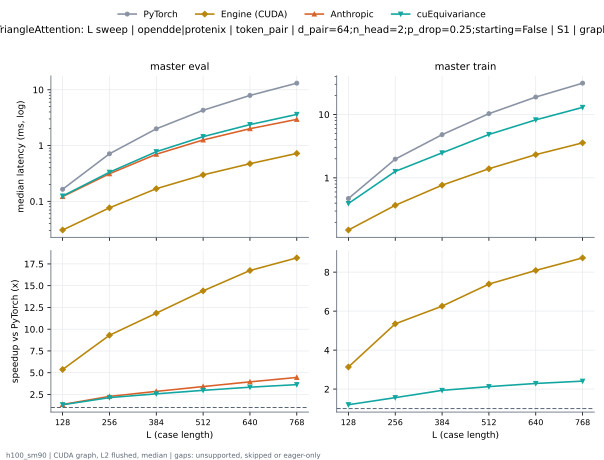

**master eval** (median ms; x = speedup vs PyTorch)

| L | PyTorch | Engine (Triton) | Engine (CUDA) | Anthropic | cuEquivariance |
|---|---|---|---|---|---|
| 128 | 0.1643 | 0.09946 (1.65x) | 0.02838 (5.79x) | 0.122 (1.35x) | 0.1247 (1.32x) |
| 256 | 0.7136 | 0.2576 (2.77x) | 0.07298 (9.78x) | 0.3127 (2.28x) | 0.3331 (2.14x) |
| 384 | 1.997 | 0.5883 (3.39x) | 0.1656 (12.06x) | 0.7001 (2.85x) | 0.7772 (2.57x) |
| 512 | 4.301 | 1.09 (3.94x) | 0.298 (14.43x) | 1.262 (3.41x) | 1.446 (2.97x) |
| 640 | 7.939 | 1.755 (4.52x) | 0.4721 (16.82x) | 2.008 (3.95x) | 2.378 (3.34x) |
| 768 | 13.16 | 2.621 (5.02x) | 0.7224 (18.21x) | 2.952 (4.46x) | 3.622 (3.63x) |

**master train** (median ms; x = speedup vs PyTorch)

| L | PyTorch | Engine (Triton) | Engine (CUDA) | Anthropic | cuEquivariance |
|---|---|---|---|---|---|
| 128 | 0.4728 | 0.3313 (1.43x) | 0.1507 (3.14x) | unsupported | 0.3946 (1.20x) |
| 256 | 1.982 | 0.9893 (2.00x) | 0.3694 (5.36x) | unsupported | 1.266 (1.57x) |
| 384 | 4.801 | 1.731 (2.77x) | 0.7698 (6.24x) | unsupported | 2.484 (1.93x) |
| 512 | 10.28 | 3.239 (3.17x) | 1.389 (7.40x) | unsupported | 4.843 (2.12x) |
| 640 | 18.86 | 5.32 (3.54x) | 2.327 (8.10x) | unsupported | 8.226 (2.29x) |
| 768 | 31.18 | 8.029 (3.88x) | 3.581 (8.71x) | unsupported | 12.95 (2.41x) |

### L sweep: opendde|protenix | token_pair | d_pair=64;n_head=2;p_drop=0.25;starting=True | S1 | graph

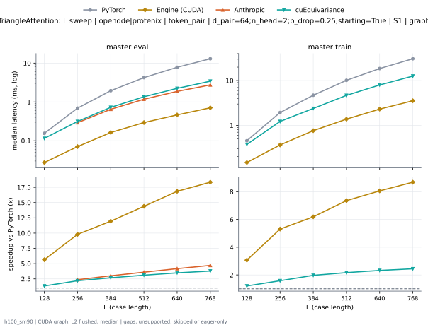

**master eval** (median ms; x = speedup vs PyTorch)

| L | PyTorch | Engine (Triton) | Engine (CUDA) | Anthropic | cuEquivariance |
|---|---|---|---|---|---|
| 128 | 0.1551 | 0.08998 (1.72x) | 0.02749 (5.64x) | 0.569 (eager) | 0.1152 (1.35x) |
| 256 | 0.6918 | 0.2381 (2.90x) | 0.07059 (9.80x) | 0.2919 (2.37x) | 0.3141 (2.20x) |
| 384 | 1.949 | 0.5395 (3.61x) | 0.1631 (11.95x) | 0.6475 (3.01x) | 0.7256 (2.69x) |
| 512 | 4.227 | 1.002 (4.22x) | 0.2938 (14.39x) | 1.174 (3.60x) | 1.36 (3.11x) |
| 640 | 7.801 | 1.609 (4.85x) | 0.4631 (16.85x) | 1.867 (4.18x) | 2.235 (3.49x) |
| 768 | 12.96 | 2.404 (5.39x) | 0.7066 (18.34x) | 2.749 (4.71x) | 3.422 (3.79x) |

**master train** (median ms; x = speedup vs PyTorch)

| L | PyTorch | Engine (Triton) | Engine (CUDA) | Anthropic | cuEquivariance |
|---|---|---|---|---|---|
| 128 | 0.4529 | 0.3136 (1.44x) | 0.1476 (3.07x) | unsupported | 0.3751 (1.21x) |
| 256 | 1.935 | 0.9485 (2.04x) | 0.3646 (5.31x) | unsupported | 1.222 (1.58x) |
| 384 | 4.708 | 1.653 (2.85x) | 0.7605 (6.19x) | unsupported | 2.387 (1.97x) |
| 512 | 10.14 | 3.089 (3.28x) | 1.378 (7.36x) | unsupported | 4.675 (2.17x) |
| 640 | 18.58 | 5.055 (3.68x) | 2.305 (8.06x) | unsupported | 7.989 (2.33x) |
| 768 | 30.79 | 7.669 (4.01x) | 3.544 (8.69x) | unsupported | 12.59 (2.44x) |

### L sweep: openfold3_preview2 | token_pair | d_pair=64;n_head=4;p_drop=0.25;starting=False | S1 | graph

**master eval** (median ms; x = speedup vs PyTorch)

| L | PyTorch | Engine (Triton) | Engine (CUDA) | Anthropic | cuEquivariance |
|---|---|---|---|---|---|
| 128 | 0.2192 | 0.1013 (2.16x) | 0.03402 (6.44x) | 0.0383 (5.72x) | unsupported |
| 256 | 1.104 | 0.2775 (3.98x) | 0.1018 (10.85x) | 0.1161 (9.51x) | 0.391 (2.82x) |
| 384 | 3.319 | 0.6559 (5.06x) | 0.2253 (14.73x) | 0.2914 (11.39x) | 0.9643 (3.44x) |
| 512 | 7.463 | 1.256 (5.94x) | 0.4221 (17.68x) | 0.5811 (12.84x) | 1.886 (3.96x) |
| 640 | 14.1 | 2.076 (6.79x) | 0.7225 (19.52x) | 1.021 (13.81x) | 3.211 (4.39x) |
| 768 | 23.81 | 3.157 (7.54x) | 1.138 (20.93x) | 1.66 (14.34x) | 5.125 (4.65x) |

**master train** (median ms; x = speedup vs PyTorch)

| L | PyTorch | Engine (Triton) | Engine (CUDA) | Anthropic | cuEquivariance |
|---|---|---|---|---|---|
| 128 | 0.6059 | 0.3474 (1.74x) | 0.191 (3.17x) | unsupported | unsupported |
| 256 | 2.915 | 1.115 (2.61x) | 0.5434 (5.36x) | unsupported | 1.55 (1.88x) |
| 384 | 7.945 | 2.17 (3.66x) | 1.211 (6.56x) | unsupported | 3.42 (2.32x) |
| 512 | 17.76 | 4.191 (4.24x) | 2.328 (7.63x) | unsupported | 7.045 (2.52x) |
| 640 | 33.46 | 7.13 (4.69x) | 4.063 (8.23x) | unsupported | 12.51 (2.67x) |
| 768 | 56.42 | 11.19 (5.04x) | 6.58 (8.57x) | unsupported | 20.4 (2.76x) |

### L sweep: openfold3_preview2 | token_pair | d_pair=64;n_head=4;p_drop=0.25;starting=True | S1 | graph

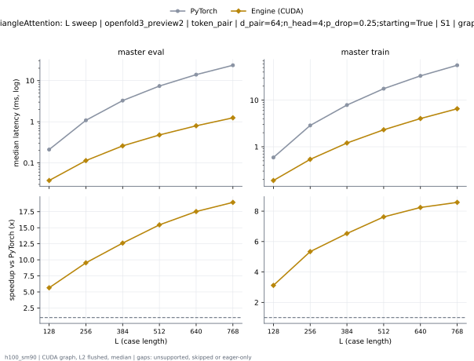

**master eval** (median ms; x = speedup vs PyTorch)

| L | PyTorch | Engine (Triton) | Engine (CUDA) | Anthropic | cuEquivariance |
|---|---|---|---|---|---|
| 128 | 0.2121 | 0.09394 (2.26x) | 0.03325 (6.38x) | 0.03552 (5.97x) | unsupported |
| 256 | 1.085 | 0.2584 (4.20x) | 0.0989 (10.97x) | 0.1098 (9.88x) | 0.3736 (2.90x) |
| 384 | 3.273 | 0.6084 (5.38x) | 0.2223 (14.73x) | 0.2753 (11.89x) | 0.9149 (3.58x) |
| 512 | 7.374 | 1.167 (6.32x) | 0.4174 (17.67x) | 0.5559 (13.27x) | 1.799 (4.10x) |
| 640 | 13.96 | 1.935 (7.22x) | 0.7168 (19.48x) | 0.9867 (14.15x) | 3.087 (4.52x) |
| 768 | 23.64 | 2.963 (7.98x) | 1.123 (21.06x) | 1.61 (14.69x) | 4.902 (4.82x) |

**master train** (median ms; x = speedup vs PyTorch)

| L | PyTorch | Engine (Triton) | Engine (CUDA) | Anthropic | cuEquivariance |
|---|---|---|---|---|---|
| 128 | 0.5939 | 0.3319 (1.79x) | 0.1897 (3.13x) | unsupported | unsupported |
| 256 | 2.871 | 1.075 (2.67x) | 0.5379 (5.34x) | unsupported | 1.522 (1.89x) |
| 384 | 7.856 | 2.056 (3.82x) | 1.204 (6.53x) | unsupported | 3.312 (2.37x) |
| 512 | 17.64 | 4.042 (4.36x) | 2.313 (7.63x) | unsupported | 6.906 (2.55x) |
| 640 | 33.25 | 6.905 (4.81x) | 4.038 (8.23x) | unsupported | 12.3 (2.70x) |
| 768 | 56.06 | 10.82 (5.18x) | 6.521 (8.60x) | unsupported | 20.08 (2.79x) |

### L sweep: protenix | token_pair | d_pair=256;n_head=8;p_drop=0.25;starting=False | S1 | graph

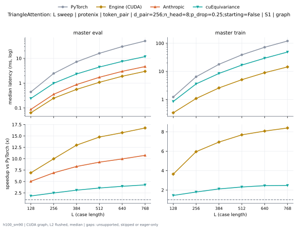

**master eval** (median ms; x = speedup vs PyTorch)

| L | PyTorch | Engine (Triton) | Engine (CUDA) | Anthropic | cuEquivariance |
|---|---|---|---|---|---|
| 128 | 0.44 | 0.1777 (2.48x) | 0.06365 (6.91x) | 0.08718 (5.05x) | 0.24 (1.83x) |
| 256 | 2.457 | 0.7096 (3.46x) | 0.246 (9.99x) | 0.3554 (6.91x) | 0.9854 (2.49x) |
| 384 | 7.244 | 1.653 (4.38x) | 0.5579 (12.98x) | 0.8725 (8.30x) | 2.335 (3.10x) |
| 512 | 15.93 | 3.089 (5.16x) | 1.079 (14.77x) | 1.722 (9.25x) | 4.454 (3.58x) |
| 640 | 29.77 | 5.036 (5.91x) | 1.894 (15.71x) | 2.988 (9.96x) | 7.532 (3.95x) |
| 768 | 49.99 | 7.713 (6.48x) | 2.985 (16.75x) | 4.652 (10.75x) | 11.73 (4.26x) |

**master train** (median ms; x = speedup vs PyTorch)

| L | PyTorch | Engine (Triton) | Engine (CUDA) | Anthropic | cuEquivariance |
|---|---|---|---|---|---|
| 128 | 1.218 | 0.6546 (1.86x) | 0.3344 (3.64x) | unsupported | 0.8431 (1.44x) |
| 256 | 6.41 | 2.56 (2.50x) | 1.077 (5.95x) | unsupported | 3.566 (1.80x) |
| 384 | 17.8 | 5.591 (3.18x) | 2.564 (6.94x) | unsupported | 8.415 (2.12x) |
| 512 | 38.75 | 10.59 (3.66x) | 5.043 (7.69x) | unsupported | 16.74 (2.32x) |
| 640 | 72.06 | 17.94 (4.02x) | 8.928 (8.07x) | unsupported | 29.38 (2.45x) |
| 768 | 120.4 | 27.79 (4.33x) | 14.35 (8.39x) | unsupported | 48.67 (2.47x) |

### L sweep: protenix | token_pair | d_pair=256;n_head=8;p_drop=0.25;starting=True | S1 | graph

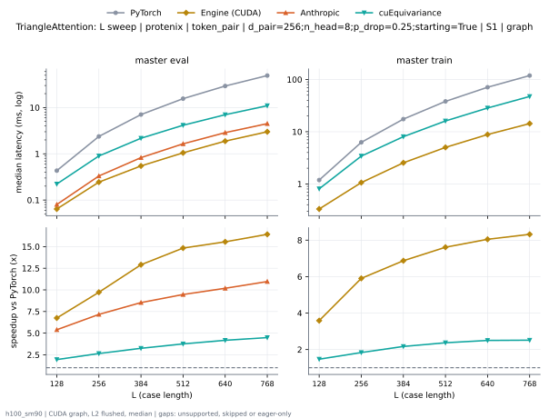

**master eval** (median ms; x = speedup vs PyTorch)

| L | PyTorch | Engine (Triton) | Engine (CUDA) | Anthropic | cuEquivariance |
|---|---|---|---|---|---|
| 128 | 0.4324 | 0.1605 (2.69x) | 0.06406 (6.75x) | 0.08014 (5.39x) | 0.222 (1.95x) |
| 256 | 2.375 | 0.6258 (3.80x) | 0.2443 (9.73x) | 0.3315 (7.17x) | 0.8977 (2.65x) |
| 384 | 7.058 | 1.457 (4.85x) | 0.5469 (12.91x) | 0.8272 (8.53x) | 2.172 (3.25x) |
| 512 | 15.58 | 2.743 (5.68x) | 1.051 (14.83x) | 1.646 (9.47x) | 4.146 (3.76x) |
| 640 | 29.24 | 4.558 (6.42x) | 1.88 (15.55x) | 2.871 (10.18x) | 7.005 (4.17x) |
| 768 | 49.23 | 6.96 (7.07x) | 2.998 (16.42x) | 4.49 (10.96x) | 10.97 (4.49x) |

**master train** (median ms; x = speedup vs PyTorch)

| L | PyTorch | Engine (Triton) | Engine (CUDA) | Anthropic | cuEquivariance |
|---|---|---|---|---|---|
| 128 | 1.186 | 0.6173 (1.92x) | 0.3308 (3.59x) | unsupported | 0.8057 (1.47x) |
| 256 | 6.26 | 2.404 (2.60x) | 1.06 (5.90x) | unsupported | 3.41 (1.84x) |
| 384 | 17.44 | 5.238 (3.33x) | 2.538 (6.87x) | unsupported | 8.041 (2.17x) |
| 512 | 38.11 | 9.974 (3.82x) | 5.006 (7.61x) | unsupported | 16.07 (2.37x) |
| 640 | 71.07 | 16.95 (4.19x) | 8.832 (8.05x) | unsupported | 28.44 (2.50x) |
| 768 | 119 | 26.49 (4.49x) | 14.31 (8.32x) | unsupported | 47.36 (2.51x) |

### d_pair sweep at L768: token_pair | p_drop=0.25;starting=False | S1 | graph

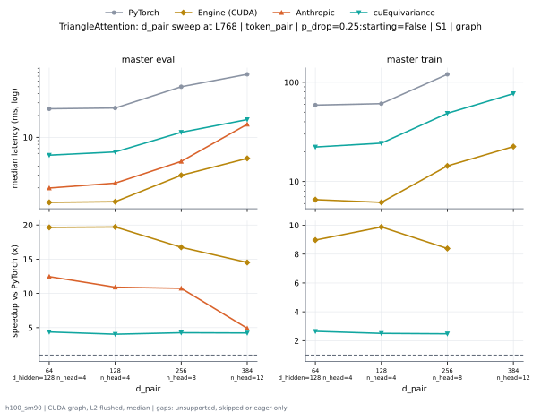

**master eval** (median ms; x = speedup vs PyTorch)

| d_pair | PyTorch | Engine (Triton) | Engine (CUDA) | Anthropic | cuEquivariance |
|---|---|---|---|---|---|
| 64 d_hidden=128 n_head=4 | 24.78 | 3.678 (6.74x) | 1.261 (19.65x) | 1.989 (12.46x) | 5.67 (4.37x) |
| 128 n_head=4 | 25.38 | 4.278 (5.93x) | 1.288 (19.71x) | 2.326 (10.91x) | 6.275 (4.04x) |
| 256 n_head=8 | 49.99 | 7.713 (6.48x) | 2.985 (16.75x) | 4.652 (10.75x) | 11.73 (4.26x) |
| 384 n_head=12 | 74.29 | 11.43 (6.50x) | 5.115 (14.52x) | 15.14 (4.91x) | 17.59 (4.22x) |

**master train** (median ms; x = speedup vs PyTorch)

| d_pair | PyTorch | Engine (Triton) | Engine (CUDA) | Anthropic | cuEquivariance |
|---|---|---|---|---|---|
| 64 d_hidden=128 n_head=4 | 58.9 | 12.59 (4.68x) | 6.56 (8.98x) | unsupported | 22.27 (2.64x) |
| 128 n_head=4 | 60.9 | 14.54 (4.19x) | 6.161 (9.88x) | unsupported | 24.34 (2.50x) |
| 256 n_head=8 | 120.4 | 27.79 (4.33x) | 14.35 (8.39x) | unsupported | 48.67 (2.47x) |
| 384 n_head=12 | skipped | 42.01 | 22.51 | unsupported | 76.88 |

### d_pair sweep at L768: token_pair | p_drop=0.25;starting=True | S1 | graph

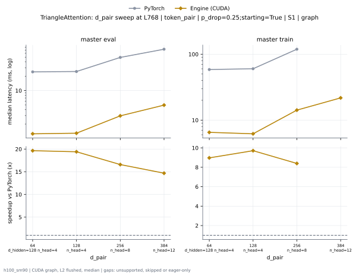

**master eval** (median ms; x = speedup vs PyTorch)

| d_pair | PyTorch | Engine (Triton) | Engine (CUDA) | Anthropic | cuEquivariance |
|---|---|---|---|---|---|
| 64 d_hidden=128 n_head=4 | 24.58 | 3.468 (7.09x) | 1.243 (19.78x) | 1.942 (12.66x) | 5.452 (4.51x) |
| 128 n_head=4 | 25 | 3.902 (6.41x) | 1.286 (19.44x) | 2.242 (11.15x) | 5.897 (4.24x) |
| 256 n_head=8 | 49.23 | 6.96 (7.07x) | 2.998 (16.42x) | 4.49 (10.96x) | 10.97 (4.49x) |
| 384 n_head=12 | 73.04 | 10.42 (7.01x) | 5.02 (14.55x) | 14.13 (5.17x) | 16.43 (4.44x) |

**master train** (median ms; x = speedup vs PyTorch)

| d_pair | PyTorch | Engine (Triton) | Engine (CUDA) | Anthropic | cuEquivariance |
|---|---|---|---|---|---|
| 64 d_hidden=128 n_head=4 | 58.54 | 12.23 (4.79x) | 6.56 (8.92x) | unsupported | 21.92 (2.67x) |
| 128 n_head=4 | 60.14 | 13.86 (4.34x) | 6.157 (9.77x) | unsupported | 23.65 (2.54x) |
| 256 n_head=8 | 119 | 26.49 (4.49x) | 14.31 (8.32x) | unsupported | 47.36 (2.51x) |
| 384 n_head=12 | skipped | 39.85 | 22.16 | unsupported | 74.92 |

### n_head sweep at L768: token_pair | p_drop=0.25;starting=False | S1 | graph

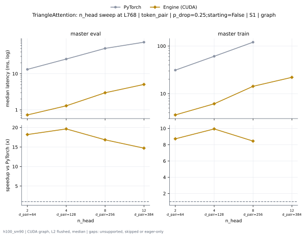

**master eval** (median ms; x = speedup vs PyTorch)

| n_head | PyTorch | Engine (Triton) | Engine (CUDA) | Anthropic | cuEquivariance |
|---|---|---|---|---|---|
| 2 d_pair=64 | 13.16 | 2.621 (5.02x) | 0.7224 (18.21x) | 2.952 (4.46x) | 3.622 (3.63x) |
| 4 d_pair=128 | 25.38 | 4.278 (5.93x) | 1.288 (19.71x) | 2.326 (10.91x) | 6.275 (4.04x) |
| 8 d_pair=256 | 49.99 | 7.713 (6.48x) | 2.985 (16.75x) | 4.652 (10.75x) | 11.73 (4.26x) |
| 12 d_pair=384 | 74.29 | 11.43 (6.50x) | 5.115 (14.52x) | 15.14 (4.91x) | 17.59 (4.22x) |

**master train** (median ms; x = speedup vs PyTorch)

| n_head | PyTorch | Engine (Triton) | Engine (CUDA) | Anthropic | cuEquivariance |
|---|---|---|---|---|---|
| 2 d_pair=64 | 31.18 | 8.029 (3.88x) | 3.581 (8.71x) | unsupported | 12.95 (2.41x) |
| 4 d_pair=128 | 60.9 | 14.54 (4.19x) | 6.161 (9.88x) | unsupported | 24.34 (2.50x) |
| 8 d_pair=256 | 120.4 | 27.79 (4.33x) | 14.35 (8.39x) | unsupported | 48.67 (2.47x) |
| 12 d_pair=384 | skipped | 42.01 | 22.51 | unsupported | 76.88 |

### n_head sweep at L768: token_pair | p_drop=0.25;starting=True | S1 | graph

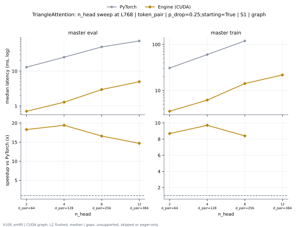

**master eval** (median ms; x = speedup vs PyTorch)

| n_head | PyTorch | Engine (Triton) | Engine (CUDA) | Anthropic | cuEquivariance |
|---|---|---|---|---|---|
| 2 d_pair=64 | 12.96 | 2.404 (5.39x) | 0.7066 (18.34x) | 2.749 (4.71x) | 3.422 (3.79x) |
| 4 d_pair=128 | 25 | 3.902 (6.41x) | 1.286 (19.44x) | 2.242 (11.15x) | 5.897 (4.24x) |
| 8 d_pair=256 | 49.23 | 6.96 (7.07x) | 2.998 (16.42x) | 4.49 (10.96x) | 10.97 (4.49x) |
| 12 d_pair=384 | 73.04 | 10.42 (7.01x) | 5.02 (14.55x) | 14.13 (5.17x) | 16.43 (4.44x) |

**master train** (median ms; x = speedup vs PyTorch)

| n_head | PyTorch | Engine (Triton) | Engine (CUDA) | Anthropic | cuEquivariance |
|---|---|---|---|---|---|
| 2 d_pair=64 | 30.79 | 7.669 (4.01x) | 3.544 (8.69x) | unsupported | 12.59 (2.44x) |
| 4 d_pair=128 | 60.14 | 13.86 (4.34x) | 6.157 (9.77x) | unsupported | 23.65 (2.54x) |
| 8 d_pair=256 | 119 | 26.49 (4.49x) | 14.31 (8.32x) | unsupported | 47.36 (2.51x) |
| 12 d_pair=384 | skipped | 39.85 | 22.16 | unsupported | 74.92 |

