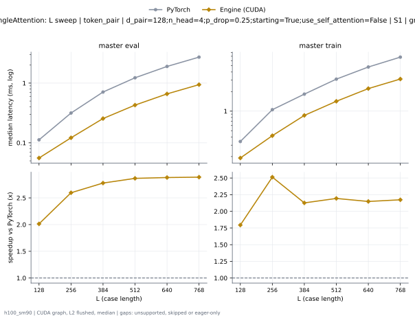
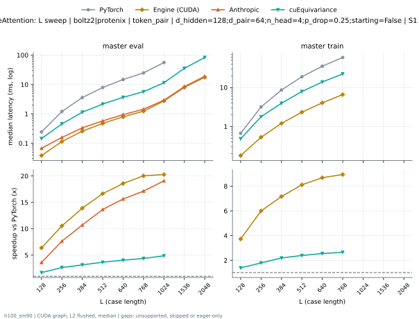
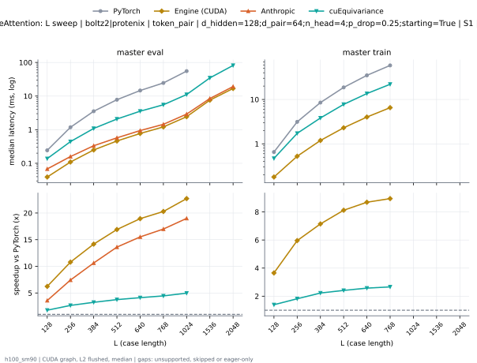
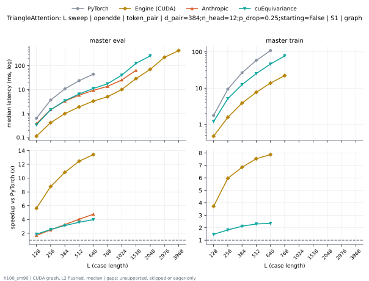
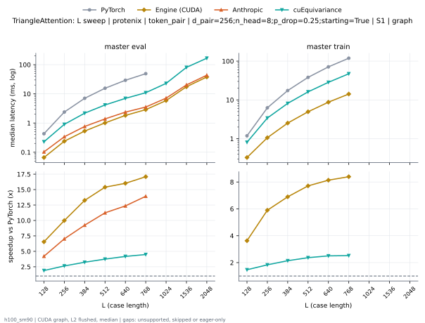
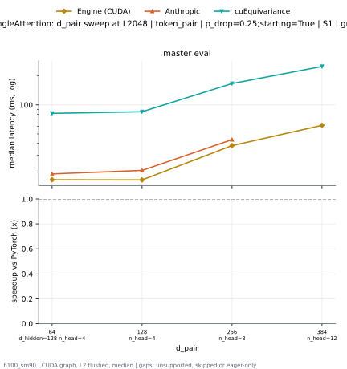

# TriangleAttention on h100_sm90

Generated by `python -m miniworld_engine.measure.plot` from speed tokens `judge/tokens/h100_sm90/`; do not edit.

### L sweep: token_pair | d_pair=128;n_head=4;p_drop=0.25;starting=False;use_self_attention=False | S1 | graph

**master eval** (median ms; x = speedup vs PyTorch)

| L | PyTorch | Engine (Triton) | Engine (CUDA) | Anthropic | cuEquivariance |
|---|---|---|---|---|---|
| 128 | 0.1274 | 0.08403 (1.52x) | 0.06477 (1.97x) | unsupported | unsupported |
| 256 | 0.3561 | 0.2302 (1.55x) | 0.1368 (2.60x) | unsupported | unsupported |
| 384 | 0.8038 | 0.4889 (1.64x) | 0.2689 (2.99x) | unsupported | unsupported |
| 512 | 1.391 | 0.8344 (1.67x) | 0.4399 (3.16x) | unsupported | unsupported |
| 640 | 2.168 | 1.303 (1.66x) | 0.6747 (3.21x) | unsupported | unsupported |
| 768 | 3.089 | 1.867 (1.65x) | 0.9794 (3.15x) | unsupported | unsupported |

**master train** (median ms; x = speedup vs PyTorch)

| L | PyTorch | Engine (Triton) | Engine (CUDA) | Anthropic | cuEquivariance |
|---|---|---|---|---|---|
| 128 | 0.3653 | 0.2621 (1.39x) | 0.2367 (1.54x) | unsupported | unsupported |
| 256 | 1.129 | 0.7082 (1.59x) | 0.4849 (2.33x) | unsupported | unsupported |
| 384 | 2.009 | 1.514 (1.33x) | 0.9354 (2.15x) | unsupported | unsupported |
| 512 | 3.408 | 2.519 (1.35x) | 1.55 (2.20x) | unsupported | unsupported |
| 640 | 5.262 | 4.047 (1.30x) | 2.411 (2.18x) | unsupported | unsupported |
| 768 | 7.478 | 6.093 (1.23x) | 3.465 (2.16x) | unsupported | unsupported |

### L sweep: token_pair | d_pair=128;n_head=4;p_drop=0.25;starting=True;use_self_attention=False | S1 | graph

**master eval** (median ms; x = speedup vs PyTorch)

| L | PyTorch | Engine (Triton) | Engine (CUDA) | Anthropic | cuEquivariance |
|---|---|---|---|---|---|
| 128 | 0.1121 | 0.0725 (1.55x) | 0.0557 (2.01x) | unsupported | unsupported |
| 256 | 0.3153 | 0.1873 (1.68x) | 0.1214 (2.60x) | unsupported | unsupported |
| 384 | 0.708 | 0.3897 (1.82x) | 0.2549 (2.78x) | unsupported | unsupported |
| 512 | 1.227 | 0.6611 (1.86x) | 0.4281 (2.87x) | unsupported | unsupported |
| 640 | 1.898 | 1.034 (1.84x) | 0.659 (2.88x) | unsupported | unsupported |
| 768 | 2.72 | 1.479 (1.84x) | 0.9417 (2.89x) | unsupported | unsupported |

**master train** (median ms; x = speedup vs PyTorch)

| L | PyTorch | Engine (Triton) | Engine (CUDA) | Anthropic | cuEquivariance |
|---|---|---|---|---|---|
| 128 | 0.3409 | 0.2373 (1.44x) | 0.19 (1.79x) | unsupported | unsupported |
| 256 | 1.053 | 0.6247 (1.69x) | 0.419 (2.51x) | unsupported | unsupported |
| 384 | 1.828 | 1.333 (1.37x) | 0.8596 (2.13x) | unsupported | unsupported |
| 512 | 3.111 | 2.203 (1.41x) | 1.418 (2.19x) | unsupported | unsupported |
| 640 | 4.78 | 3.557 (1.34x) | 2.225 (2.15x) | unsupported | unsupported |
| 768 | 6.786 | 5.391 (1.26x) | 3.122 (2.17x) | unsupported | unsupported |

### L sweep: boltz2|openfold3_preview2|protenix | token_pair | d_pair=128;n_head=4;p_drop=0.25;starting=False | S1 | graph

**master eval** (median ms; x = speedup vs PyTorch)

| L | PyTorch | Engine (Triton) | Engine (CUDA) | Anthropic | cuEquivariance |
|---|---|---|---|---|---|
| 128 | 0.2617 | 0.1231 (2.13x) | 0.0364 (7.19x) | 0.0719 (3.64x) | 0.1572 (1.66x) |
| 256 | 1.277 | 0.3914 (3.26x) | 0.1077 (11.86x) | 0.1932 (6.61x) | 0.5301 (2.41x) |
| 384 | 3.751 | 0.9443 (3.97x) | 0.2379 (15.76x) | 0.411 (9.12x) | 1.296 (2.89x) |
| 512 | 8.165 | 1.728 (4.72x) | 0.4418 (18.48x) | 0.6943 (11.76x) | 2.431 (3.36x) |
| 640 | 15.19 | 2.858 (5.32x) | 0.7555 (20.11x) | 1.12 (13.57x) | 4.07 (3.73x) |
| 768 | 25.39 | 4.287 (5.92x) | 1.182 (21.48x) | 1.7 (14.93x) | 6.309 (4.02x) |
| 1024 | 56.81 | 8.381 (6.78x) | 2.434 (23.34x) | 3.343 (17.00x) | 12.52 (4.54x) |
| 1536 | skipped | 22.8 | 7.526 | 9.385 | 37.86 |
| 2048 | skipped | 49.47 | 16.59 | 20.58 | 87.53 |

**master train** (median ms; x = speedup vs PyTorch)

| L | PyTorch | Engine (Triton) | Engine (CUDA) | Anthropic | cuEquivariance |
|---|---|---|---|---|---|
| 128 | 0.7088 | 0.4286 (1.65x) | 0.1565 (4.53x) | unsupported | 0.5318 (1.33x) |
| 256 | 3.401 | 1.486 (2.29x) | 0.4655 (7.31x) | unsupported | 1.988 (1.71x) |
| 384 | 9.152 | 3.032 (3.02x) | 1.093 (8.37x) | unsupported | 4.489 (2.04x) |
| 512 | 19.78 | 5.671 (3.49x) | 2.158 (9.16x) | unsupported | 8.812 (2.24x) |
| 640 | 36.53 | 9.391 (3.89x) | 3.795 (9.63x) | unsupported | 15.25 (2.40x) |
| 768 | 60.87 | 14.53 (4.19x) | 6.203 (9.81x) | unsupported | 24.33 (2.50x) |
| 1024 |  |  |  |  |  |
| 1536 |  |  |  |  |  |
| 2048 |  |  |  |  |  |

### L sweep: boltz2|openfold3_preview2|protenix | token_pair | d_pair=128;n_head=4;p_drop=0.25;starting=True | S1 | graph

**master eval** (median ms; x = speedup vs PyTorch)

| L | PyTorch | Engine (Triton) | Engine (CUDA) | Anthropic | cuEquivariance |
|---|---|---|---|---|---|
| 128 | 0.2443 | 0.1096 (2.23x) | 0.03648 (6.70x) | 0.07259 (3.36x) | 0.1463 (1.67x) |
| 256 | 1.236 | 0.35 (3.53x) | 0.1085 (11.38x) | 0.1929 (6.40x) | 0.4908 (2.52x) |
| 384 | 3.653 | 0.8417 (4.34x) | 0.238 (15.35x) | 0.406 (9.00x) | 1.201 (3.04x) |
| 512 | 8.005 | 1.562 (5.13x) | 0.441 (18.15x) | 0.7035 (11.38x) | 2.287 (3.50x) |
| 640 | 14.92 | 2.574 (5.80x) | 0.75 (19.90x) | 1.148 (13.00x) | 3.808 (3.92x) |
| 768 | 25.01 | 3.873 (6.46x) | 1.169 (21.38x) | 1.74 (14.37x) | 5.941 (4.21x) |
| 1024 | 56.13 | 7.71 (7.28x) | 2.508 (22.38x) | 3.421 (16.41x) | 11.85 (4.74x) |
| 1536 | skipped | 21.31 | 7.559 | 9.578 | 36.42 |
| 2048 | skipped | 46.95 | 16.64 | 20.88 | 84.96 |

**master train** (median ms; x = speedup vs PyTorch)

| L | PyTorch | Engine (Triton) | Engine (CUDA) | Anthropic | cuEquivariance |
|---|---|---|---|---|---|
| 128 | 0.6916 | 0.3989 (1.73x) | 0.1578 (4.38x) | unsupported | 0.5015 (1.38x) |
| 256 | 3.329 | 1.395 (2.39x) | 0.4672 (7.12x) | unsupported | 1.9 (1.75x) |
| 384 | 8.979 | 2.843 (3.16x) | 1.095 (8.20x) | unsupported | 4.291 (2.09x) |
| 512 | 19.47 | 5.373 (3.62x) | 2.157 (9.03x) | unsupported | 8.515 (2.29x) |
| 640 | 36.04 | 8.917 (4.04x) | 3.797 (9.49x) | unsupported | 14.77 (2.44x) |
| 768 | 60.19 | 13.83 (4.35x) | 6.2 (9.71x) | unsupported | 23.65 (2.55x) |
| 1024 |  |  |  |  |  |
| 1536 |  |  |  |  |  |
| 2048 |  |  |  |  |  |

### L sweep: boltz2|protenix | token_pair | d_hidden=128;d_pair=64;n_head=4;p_drop=0.25;starting=False | S1 | graph

**master eval** (median ms; x = speedup vs PyTorch)

| L | PyTorch | Engine (Triton) | Engine (CUDA) | Anthropic | cuEquivariance |
|---|---|---|---|---|---|
| 128 | 0.2434 | 0.1102 (2.21x) | 0.03757 (6.48x) | 0.06763 (3.60x) | 0.1445 (1.68x) |
| 256 | 1.206 | 0.3199 (3.77x) | 0.1124 (10.73x) | 0.1581 (7.63x) | 0.457 (2.64x) |
| 384 | 3.589 | 0.7796 (4.60x) | 0.2546 (14.10x) | 0.3356 (10.70x) | 1.14 (3.15x) |
| 512 | 7.891 | 1.463 (5.39x) | 0.4689 (16.83x) | 0.5775 (13.67x) | 2.156 (3.66x) |
| 640 | 14.78 | 2.443 (6.05x) | 0.7925 (18.65x) | 0.9446 (15.64x) | 3.66 (4.04x) |
| 768 | 24.83 | 3.677 (6.75x) | 1.236 (20.08x) | 1.447 (17.16x) | 5.679 (4.37x) |
| 1024 | 55.75 | 7.323 (7.61x) | 2.566 (21.72x) | 2.921 (19.08x) | 11.47 (4.86x) |
| 1536 | skipped | 20.34 | 7.617 | 8.448 | 35.47 |
| 2048 | skipped | 44.97 | 16.82 | 19.05 | 82.94 |

**master train** (median ms; x = speedup vs PyTorch)

| L | PyTorch | Engine (Triton) | Engine (CUDA) | Anthropic | cuEquivariance |
|---|---|---|---|---|---|
| 128 | 0.6707 | 0.3838 (1.75x) | 0.1808 (3.71x) | unsupported | 0.4831 (1.39x) |
| 256 | 3.17 | 1.247 (2.54x) | 0.5313 (5.97x) | unsupported | 1.78 (1.78x) |
| 384 | 8.61 | 2.504 (3.44x) | 1.202 (7.17x) | unsupported | 3.943 (2.18x) |
| 512 | 18.89 | 4.772 (3.96x) | 2.331 (8.10x) | unsupported | 7.907 (2.39x) |
| 640 | 35.18 | 8.044 (4.37x) | 4.041 (8.70x) | unsupported | 13.83 (2.54x) |
| 768 | 58.92 | 12.57 (4.69x) | 6.583 (8.95x) | unsupported | 22.27 (2.65x) |
| 1024 |  |  |  |  |  |
| 1536 |  |  |  |  |  |
| 2048 |  |  |  |  |  |

### L sweep: boltz2|protenix | token_pair | d_hidden=128;d_pair=64;n_head=4;p_drop=0.25;starting=True | S1 | graph

**master eval** (median ms; x = speedup vs PyTorch)

| L | PyTorch | Engine (Triton) | Engine (CUDA) | Anthropic | cuEquivariance |
|---|---|---|---|---|---|
| 128 | 0.2338 | 0.1024 (2.28x) | 0.03667 (6.38x) | 0.068 (3.44x) | 0.1378 (1.70x) |
| 256 | 1.182 | 0.2984 (3.96x) | 0.11 (10.75x) | 0.1588 (7.45x) | 0.4421 (2.67x) |
| 384 | 3.538 | 0.7306 (4.84x) | 0.2515 (14.07x) | 0.3329 (10.63x) | 1.088 (3.25x) |
| 512 | 7.789 | 1.367 (5.70x) | 0.4656 (16.73x) | 0.5728 (13.60x) | 2.075 (3.75x) |
| 640 | 14.64 | 2.263 (6.47x) | 0.7869 (18.60x) | 0.9426 (15.53x) | 3.55 (4.12x) |
| 768 | 24.59 | 3.481 (7.06x) | 1.228 (20.02x) | 1.446 (17.01x) | 5.517 (4.46x) |
| 1024 | 55.41 | 7.004 (7.91x) | 2.476 (22.38x) | 2.91 (19.04x) | 11.12 (4.98x) |
| 1536 | skipped | 19.57 | 7.559 | 8.455 | 34.71 |
| 2048 | skipped | 43.59 | 16.71 | 19.21 | 81.72 |

**master train** (median ms; x = speedup vs PyTorch)

| L | PyTorch | Engine (Triton) | Engine (CUDA) | Anthropic | cuEquivariance |
|---|---|---|---|---|---|
| 128 | 0.6571 | 0.364 (1.81x) | 0.1781 (3.69x) | unsupported | 0.47 (1.40x) |
| 256 | 3.132 | 1.2 (2.61x) | 0.5261 (5.95x) | unsupported | 1.725 (1.82x) |
| 384 | 8.518 | 2.413 (3.53x) | 1.195 (7.13x) | unsupported | 3.827 (2.23x) |
| 512 | 18.7 | 4.624 (4.04x) | 2.317 (8.07x) | unsupported | 7.752 (2.41x) |
| 640 | 34.92 | 7.802 (4.48x) | 4.03 (8.66x) | unsupported | 13.58 (2.57x) |
| 768 | 58.55 | 12.23 (4.79x) | 6.57 (8.91x) | unsupported | 21.99 (2.66x) |
| 1024 |  |  |  |  |  |
| 1536 |  |  |  |  |  |
| 2048 |  |  |  |  |  |

### L sweep: opendde | token_pair | d_pair=384;n_head=12;p_drop=0.25;starting=False | S1 | graph

**master eval** (median ms; x = speedup vs PyTorch)

| L | PyTorch | Engine (Triton) | Engine (CUDA) | Anthropic | cuEquivariance |
|---|---|---|---|---|---|
| 128 | 0.6317 | 0.255 (2.48x) | 0.1092 (5.79x) | 0.3756 (1.68x) | 0.3394 (1.86x) |
| 256 | 3.661 | 1.021 (3.58x) | 0.4149 (8.82x) | 1.463 (2.50x) | 1.434 (2.55x) |
| 384 | 10.76 | 2.366 (4.55x) | 1.001 (10.75x) | 3.302 (3.26x) | 3.438 (3.13x) |
| 512 | 23.67 | 4.466 (5.30x) | 1.935 (12.24x) | 5.862 (4.04x) | 6.583 (3.60x) |
| 640 | 44.44 | 7.424 (5.99x) | 3.235 (13.74x) | 9.345 (4.76x) | 11.17 (3.98x) |
| 768 | skipped | 11.45 | 5.134 | 13.7 | 17.56 |
| 1024 | skipped | 23.43 | 10.23 | 25.46 | 40.48 |
| 1536 | skipped | 68.85 | 29.28 | 63.95 | 125.9 |
| 2048 | skipped | 156.2 | 71.38 | skipped | 258.2 |
| 2976 | skipped | 494.8 | 227.3 | skipped | skipped |
| 3968 | skipped | 1047 | 437.4 | skipped | skipped |

**master train** (median ms; x = speedup vs PyTorch)

| L | PyTorch | Engine (Triton) | Engine (CUDA) | Anthropic | cuEquivariance |
|---|---|---|---|---|---|
| 128 | 1.769 | 0.929 (1.90x) | 0.4743 (3.73x) | unsupported | 1.203 (1.47x) |
| 256 | 9.378 | 3.594 (2.61x) | 1.572 (5.97x) | unsupported | 5.141 (1.82x) |
| 384 | 26.53 | 8.148 (3.26x) | 3.868 (6.86x) | unsupported | 12.51 (2.12x) |
| 512 | 57.99 | 15.74 (3.69x) | 7.668 (7.56x) | unsupported | 25.22 (2.30x) |
| 640 | 108.2 | 26.87 (4.03x) | 14.03 (7.71x) | unsupported | 46.03 (2.35x) |
| 768 | skipped | 41.98 | 22.01 | unsupported | 77.09 |
| 1024 |  |  |  |  |  |
| 1536 |  |  |  |  |  |
| 2048 |  |  |  |  |  |
| 2976 |  |  |  |  |  |
| 3968 |  |  |  |  |  |

### L sweep: opendde | token_pair | d_pair=384;n_head=12;p_drop=0.25;starting=True | S1 | graph

**master eval** (median ms; x = speedup vs PyTorch)

| L | PyTorch | Engine (Triton) | Engine (CUDA) | Anthropic | cuEquivariance |
|---|---|---|---|---|---|
| 128 | 0.6222 | 0.2269 (2.74x) | 0.11 (5.65x) | 0.3501 (1.78x) | 0.3181 (1.96x) |
| 256 | 3.523 | 0.8901 (3.96x) | 0.4067 (8.66x) | 1.35 (2.61x) | 1.298 (2.71x) |
| 384 | 10.46 | 2.068 (5.06x) | 0.9411 (11.11x) | 3.019 (3.46x) | 3.135 (3.34x) |
| 512 | 23.2 | 3.943 (5.88x) | 1.823 (12.73x) | 5.38 (4.31x) | 6.046 (3.84x) |
| 640 | 43.65 | 6.641 (6.57x) | 3.061 (14.26x) | 8.653 (5.04x) | 10.39 (4.20x) |
| 768 | skipped | 10.31 | 4.786 | 12.62 | 16.45 |
| 1024 | skipped | 21.48 | 9.736 | 23.56 | 38.61 |
| 1536 | skipped | 64.8 | 28.14 | 59.74 | 121.4 |
| 2048 | skipped | 147.4 | 61.36 | skipped | 250.7 |
| 2976 | skipped | 466.1 | 207 | skipped | 768.7 |
| 3968 | skipped | 1004 | 400.3 | skipped | skipped |

**master train** (median ms; x = speedup vs PyTorch)

| L | PyTorch | Engine (Triton) | Engine (CUDA) | Anthropic | cuEquivariance |
|---|---|---|---|---|---|
| 128 | 1.715 | 0.873 (1.96x) | 0.4614 (3.72x) | unsupported | 1.158 (1.48x) |
| 256 | 9.125 | 3.367 (2.71x) | 1.534 (5.95x) | unsupported | 4.909 (1.86x) |
| 384 | 26 | 7.619 (3.41x) | 3.791 (6.86x) | unsupported | 11.99 (2.17x) |
| 512 | 57.05 | 14.83 (3.85x) | 7.546 (7.56x) | unsupported | 24.28 (2.35x) |
| 640 | 106.7 | 25.41 (4.20x) | 13.61 (7.84x) | unsupported | 44.61 (2.39x) |
| 768 | skipped | 39.91 | 21.74 | unsupported | 75.02 |
| 1024 |  |  |  |  |  |
| 1536 |  |  |  |  |  |
| 2048 |  |  |  |  |  |
| 2976 |  |  |  |  |  |
| 3968 |  |  |  |  |  |

### L sweep: opendde|protenix | token_pair | d_pair=64;n_head=2;p_drop=0.25;starting=False | S1 | graph

**master eval** (median ms; x = speedup vs PyTorch)

| L | PyTorch | Engine (Triton) | Engine (CUDA) | Anthropic | cuEquivariance |
|---|---|---|---|---|---|
| 128 | 0.1635 | 0.09971 (1.64x) | 0.02851 (5.73x) | 0.1379 (1.19x) | 0.1246 (1.31x) |
| 256 | 0.7136 | 0.259 (2.76x) | 0.07275 (9.81x) | 0.54 (eager) | 0.3355 (2.13x) |
| 384 | 1.999 | 0.5891 (3.39x) | 0.1612 (12.40x) | 0.6944 (2.88x) | 0.7771 (2.57x) |
| 512 | 4.315 | 1.093 (3.95x) | 0.2825 (15.28x) | 1.221 (3.53x) | 1.453 (2.97x) |
| 640 | 7.957 | 1.764 (4.51x) | 0.4569 (17.42x) | 1.893 (4.20x) | 2.377 (3.35x) |
| 768 | 13.18 | 2.609 (5.05x) | 0.6919 (19.06x) | 2.716 (4.85x) | 3.635 (3.63x) |
| 1024 | 29.18 | 5.066 (5.76x) | 1.369 (21.31x) | 4.986 (5.85x) | 7.106 (4.11x) |
| 1536 | skipped | 13.1 | 4.015 | 11.81 | 19.39 |
| 2048 | skipped | 26.77 | 8.696 | 22.49 | 40.74 |

**master train** (median ms; x = speedup vs PyTorch)

| L | PyTorch | Engine (Triton) | Engine (CUDA) | Anthropic | cuEquivariance |
|---|---|---|---|---|---|
| 128 | 0.4723 | 0.3296 (1.43x) | 0.1469 (3.21x) | unsupported | 0.3941 (1.20x) |
| 256 | 1.98 | 0.9934 (1.99x) | 0.3651 (5.42x) | unsupported | 1.262 (1.57x) |
| 384 | 4.801 | 1.729 (2.78x) | 0.7652 (6.27x) | unsupported | 2.474 (1.94x) |
| 512 | 10.3 | 3.224 (3.19x) | 1.391 (7.41x) | unsupported | 4.859 (2.12x) |
| 640 | 18.86 | 5.305 (3.55x) | 2.327 (8.10x) | unsupported | 8.237 (2.29x) |
| 768 | 31.19 | 8.02 (3.89x) | 3.579 (8.71x) | unsupported | 12.98 (2.40x) |
| 1024 |  |  |  |  |  |
| 1536 |  |  |  |  |  |
| 2048 |  |  |  |  |  |

### L sweep: opendde|protenix | token_pair | d_pair=64;n_head=2;p_drop=0.25;starting=True | S1 | graph

**master eval** (median ms; x = speedup vs PyTorch)

| L | PyTorch | Engine (Triton) | Engine (CUDA) | Anthropic | cuEquivariance |
|---|---|---|---|---|---|
| 128 | 0.1544 | 0.08994 (1.72x) | 0.02808 (5.50x) | 0.1296 (1.19x) | 0.1148 (1.35x) |
| 256 | 0.6871 | 0.2369 (2.90x) | 0.06907 (9.95x) | 0.3089 (2.22x) | 0.3126 (2.20x) |
| 384 | 1.954 | 0.5411 (3.61x) | 0.1602 (12.20x) | 0.6464 (3.02x) | 0.7258 (2.69x) |
| 512 | 4.229 | 1.004 (4.21x) | 0.2774 (15.24x) | 1.13 (3.74x) | 1.357 (3.12x) |
| 640 | 7.804 | 1.608 (4.85x) | 0.4454 (17.52x) | 1.753 (4.45x) | 2.235 (3.49x) |
| 768 | 12.96 | 2.402 (5.40x) | 0.6756 (19.19x) | 2.517 (5.15x) | 3.489 (3.71x) |
| 1024 | 28.83 | 4.717 (6.11x) | 1.322 (21.82x) | 4.621 (6.24x) | 6.793 (4.24x) |
| 1536 | skipped | 12.32 | 4.012 | 11 | 18.61 |
| 2048 | skipped | 25.38 | 8.66 | 21.15 | 39.62 |

**master train** (median ms; x = speedup vs PyTorch)

| L | PyTorch | Engine (Triton) | Engine (CUDA) | Anthropic | cuEquivariance |
|---|---|---|---|---|---|
| 128 | 0.4533 | 0.3108 (1.46x) | 0.1444 (3.14x) | unsupported | 0.379 (1.20x) |
| 256 | 1.933 | 0.9476 (2.04x) | 0.3597 (5.37x) | unsupported | 1.226 (1.58x) |
| 384 | 4.708 | 1.645 (2.86x) | 0.7569 (6.22x) | unsupported | 2.378 (1.98x) |
| 512 | 10.14 | 3.088 (3.28x) | 1.373 (7.38x) | unsupported | 4.7 (2.16x) |
| 640 | 18.59 | 5.048 (3.68x) | 2.302 (8.08x) | unsupported | 7.983 (2.33x) |
| 768 | 30.84 | 7.661 (4.03x) | 3.533 (8.73x) | unsupported | 12.63 (2.44x) |
| 1024 |  |  |  |  |  |
| 1536 |  |  |  |  |  |
| 2048 |  |  |  |  |  |

### L sweep: openfold3_preview2 | token_pair | d_pair=64;n_head=4;p_drop=0.25;starting=False | S1 | graph

**master eval** (median ms; x = speedup vs PyTorch)

| L | PyTorch | Engine (Triton) | Engine (CUDA) | Anthropic | cuEquivariance |
|---|---|---|---|---|---|
| 128 | 0.223 | 0.1032 (2.16x) | 0.03318 (6.72x) | 0.0355 (6.28x) | unsupported |
| 256 | 1.109 | 0.2775 (4.00x) | 0.09784 (11.34x) | 0.1033 (10.73x) | 0.3916 (2.83x) |
| 384 | 3.32 | 0.6617 (5.02x) | 0.2227 (14.91x) | 0.251 (13.23x) | 0.9699 (3.42x) |
| 512 | 7.476 | 1.259 (5.94x) | 0.4235 (17.65x) | 0.4671 (16.01x) | 1.89 (3.95x) |
| 640 | 14.13 | 2.069 (6.83x) | 0.7276 (19.42x) | 0.8225 (17.18x) | 3.225 (4.38x) |
| 768 | 23.81 | 3.166 (7.52x) | 1.151 (20.68x) | 1.324 (17.99x) | 5.127 (4.65x) |

**master train** (median ms; x = speedup vs PyTorch)

| L | PyTorch | Engine (Triton) | Engine (CUDA) | Anthropic | cuEquivariance |
|---|---|---|---|---|---|
| 128 | 0.6137 | 0.3502 (1.75x) | 0.1885 (3.26x) | unsupported | unsupported |
| 256 | 2.918 | 1.124 (2.60x) | 0.5405 (5.40x) | unsupported | 1.551 (1.88x) |
| 384 | 7.945 | 2.153 (3.69x) | 1.213 (6.55x) | unsupported | 3.391 (2.34x) |
| 512 | 17.79 | 4.199 (4.24x) | 2.342 (7.60x) | unsupported | 7.03 (2.53x) |
| 640 | 33.42 | 7.134 (4.69x) | 4.04 (8.27x) | unsupported | 12.54 (2.67x) |
| 768 | 56.44 | 11.19 (5.04x) | 6.593 (8.56x) | unsupported | 20.42 (2.76x) |

### L sweep: openfold3_preview2 | token_pair | d_pair=64;n_head=4;p_drop=0.25;starting=True | S1 | graph

**master eval** (median ms; x = speedup vs PyTorch)

| L | PyTorch | Engine (Triton) | Engine (CUDA) | Anthropic | cuEquivariance |
|---|---|---|---|---|---|
| 128 | 0.2146 | 0.09381 (2.29x) | 0.0332 (6.46x) | 0.03514 (6.11x) | unsupported |
| 256 | 1.088 | 0.2585 (4.21x) | 0.09421 (11.55x) | 0.1028 (10.58x) | 0.3712 (2.93x) |
| 384 | 3.272 | 0.6078 (5.38x) | 0.221 (14.81x) | 0.2503 (13.07x) | 0.9177 (3.57x) |
| 512 | 7.378 | 1.181 (6.25x) | 0.4179 (17.65x) | 0.4651 (15.86x) | 1.827 (4.04x) |
| 640 | 13.99 | 1.931 (7.24x) | 0.7158 (19.55x) | 0.824 (16.98x) | 3.101 (4.51x) |
| 768 | 23.65 | 2.95 (8.02x) | 1.134 (20.85x) | 1.33 (17.79x) | 4.905 (4.82x) |

**master train** (median ms; x = speedup vs PyTorch)

| L | PyTorch | Engine (Triton) | Engine (CUDA) | Anthropic | cuEquivariance |
|---|---|---|---|---|---|
| 128 | 0.5986 | 0.3322 (1.80x) | 0.1875 (3.19x) | unsupported | unsupported |
| 256 | 2.873 | 1.077 (2.67x) | 0.5355 (5.37x) | unsupported | 1.504 (1.91x) |
| 384 | 7.855 | 2.062 (3.81x) | 1.198 (6.56x) | unsupported | 3.305 (2.38x) |
| 512 | 17.63 | 4.039 (4.36x) | 2.322 (7.59x) | unsupported | 6.893 (2.56x) |
| 640 | 33.21 | 6.897 (4.82x) | 4.025 (8.25x) | unsupported | 12.3 (2.70x) |
| 768 | 56.12 | 10.82 (5.19x) | 6.57 (8.54x) | unsupported | 20.08 (2.80x) |

### L sweep: protenix | token_pair | d_pair=256;n_head=8;p_drop=0.25;starting=False | S1 | graph

**master eval** (median ms; x = speedup vs PyTorch)

| L | PyTorch | Engine (Triton) | Engine (CUDA) | Anthropic | cuEquivariance |
|---|---|---|---|---|---|
| 128 | 0.4576 | 0.1783 (2.57x) | 0.06758 (6.77x) | 0.102 (4.48x) | 0.2427 (1.89x) |
| 256 | 2.465 | 0.7063 (3.49x) | 0.2352 (10.48x) | 0.3415 (7.22x) | 0.9913 (2.49x) |
| 384 | 7.254 | 1.654 (4.39x) | 0.5304 (13.68x) | 0.7626 (9.51x) | 2.362 (3.07x) |
| 512 | 15.93 | 3.096 (5.14x) | 1.012 (15.74x) | 1.387 (11.49x) | 4.509 (3.53x) |
| 640 | 29.77 | 5.112 (5.82x) | 1.736 (17.15x) | 2.363 (12.60x) | 7.539 (3.95x) |
| 768 | 50.01 | 7.705 (6.49x) | 2.844 (17.58x) | 3.472 (14.40x) | 11.72 (4.27x) |
| 1024 | skipped | 15.35 | 5.921 | 7.106 | 24.09 |
| 1536 | skipped | 44.82 | 17 | 19.88 | 83.86 |
| 2048 | skipped | 97.13 | 38.12 | 43.47 | 171.4 |

**master train** (median ms; x = speedup vs PyTorch)

| L | PyTorch | Engine (Triton) | Engine (CUDA) | Anthropic | cuEquivariance |
|---|---|---|---|---|---|
| 128 | 1.224 | 0.6549 (1.87x) | 0.3325 (3.68x) | unsupported | 0.8493 (1.44x) |
| 256 | 6.416 | 2.565 (2.50x) | 1.08 (5.94x) | unsupported | 3.57 (1.80x) |
| 384 | 17.8 | 5.589 (3.19x) | 2.55 (6.98x) | unsupported | 8.431 (2.11x) |
| 512 | 38.76 | 10.62 (3.65x) | 5.03 (7.71x) | unsupported | 16.67 (2.33x) |
| 640 | 72.08 | 17.98 (4.01x) | 8.787 (8.20x) | unsupported | 29.38 (2.45x) |
| 768 | 120.4 | 27.8 (4.33x) | 14.08 (8.55x) | unsupported | 48.6 (2.48x) |
| 1024 |  |  |  |  |  |
| 1536 |  |  |  |  |  |
| 2048 |  |  |  |  |  |

### L sweep: protenix | token_pair | d_pair=256;n_head=8;p_drop=0.25;starting=True | S1 | graph

**master eval** (median ms; x = speedup vs PyTorch)

| L | PyTorch | Engine (Triton) | Engine (CUDA) | Anthropic | cuEquivariance |
|---|---|---|---|---|---|
| 128 | 0.4521 | 0.1616 (2.80x) | 0.06518 (6.94x) | 0.1025 (4.41x) | 0.228 (1.98x) |
| 256 | 2.376 | 0.6212 (3.82x) | 0.2381 (9.98x) | 0.3385 (7.02x) | 0.9027 (2.63x) |
| 384 | 7.061 | 1.453 (4.86x) | 0.5321 (13.27x) | 0.7629 (9.25x) | 2.179 (3.24x) |
| 512 | 15.58 | 2.747 (5.67x) | 1.01 (15.43x) | 1.386 (11.25x) | 4.164 (3.74x) |
| 640 | 29.24 | 4.569 (6.40x) | 1.774 (16.48x) | 2.365 (12.36x) | 7.002 (4.18x) |
| 768 | 49.24 | 7.015 (7.02x) | 2.853 (17.26x) | 3.536 (13.93x) | 10.97 (4.49x) |
| 1024 | skipped | 14.02 | 5.913 | 7.137 | 22.87 |
| 1536 | skipped | 42.03 | 17.17 | 20.24 | 80.92 |
| 2048 | skipped | 91.72 | 37.82 | 43.64 | 166.7 |

**master train** (median ms; x = speedup vs PyTorch)

| L | PyTorch | Engine (Triton) | Engine (CUDA) | Anthropic | cuEquivariance |
|---|---|---|---|---|---|
| 128 | 1.191 | 0.6168 (1.93x) | 0.3297 (3.61x) | unsupported | 0.8086 (1.47x) |
| 256 | 6.251 | 2.392 (2.61x) | 1.059 (5.90x) | unsupported | 3.409 (1.83x) |
| 384 | 17.45 | 5.221 (3.34x) | 2.519 (6.93x) | unsupported | 8.142 (2.14x) |
| 512 | 38.14 | 10 (3.81x) | 4.96 (7.69x) | unsupported | 16.12 (2.37x) |
| 640 | 71.11 | 16.98 (4.19x) | 8.696 (8.18x) | unsupported | 28.44 (2.50x) |
| 768 | 119 | 26.46 (4.50x) | 13.95 (8.53x) | unsupported | 47.21 (2.52x) |
| 1024 |  |  |  |  |  |
| 1536 |  |  |  |  |  |
| 2048 |  |  |  |  |  |

### d_pair sweep at L2048: token_pair | p_drop=0.25;starting=False | S1 | graph

**master eval** (median ms; x = speedup vs PyTorch)

| d_pair | PyTorch | Engine (Triton) | Engine (CUDA) | Anthropic | cuEquivariance |
|---|---|---|---|---|---|
| 64 d_hidden=128 n_head=4 | skipped | 44.97 | 16.82 | 19.05 | 82.94 |
| 128 n_head=4 | skipped | 49.47 | 16.59 | 20.58 | 87.53 |
| 256 n_head=8 | skipped | 97.13 | 38.12 | 43.47 | 171.4 |
| 384 n_head=12 | skipped | 156.2 | 71.38 | skipped | 258.2 |

### d_pair sweep at L2048: token_pair | p_drop=0.25;starting=True | S1 | graph

**master eval** (median ms; x = speedup vs PyTorch)

| d_pair | PyTorch | Engine (Triton) | Engine (CUDA) | Anthropic | cuEquivariance |
|---|---|---|---|---|---|
| 64 d_hidden=128 n_head=4 | skipped | 43.59 | 16.71 | 19.21 | 81.72 |
| 128 n_head=4 | skipped | 46.95 | 16.64 | 20.88 | 84.96 |
| 256 n_head=8 | skipped | 91.72 | 37.82 | 43.64 | 166.7 |
| 384 n_head=12 | skipped | 147.4 | 61.36 | skipped | 250.7 |

### n_head sweep at L2048: token_pair | p_drop=0.25;starting=False | S1 | graph

**master eval** (median ms; x = speedup vs PyTorch)

| n_head | PyTorch | Engine (Triton) | Engine (CUDA) | Anthropic | cuEquivariance |
|---|---|---|---|---|---|
| 2 d_pair=64 | skipped | 26.77 | 8.696 | 22.49 | 40.74 |
| 4 d_pair=128 | skipped | 49.47 | 16.59 | 20.58 | 87.53 |
| 8 d_pair=256 | skipped | 97.13 | 38.12 | 43.47 | 171.4 |
| 12 d_pair=384 | skipped | 156.2 | 71.38 | skipped | 258.2 |

### n_head sweep at L2048: token_pair | p_drop=0.25;starting=True | S1 | graph

**master eval** (median ms; x = speedup vs PyTorch)

| n_head | PyTorch | Engine (Triton) | Engine (CUDA) | Anthropic | cuEquivariance |
|---|---|---|---|---|---|
| 2 d_pair=64 | skipped | 25.38 | 8.66 | 21.15 | 39.62 |
| 4 d_pair=128 | skipped | 46.95 | 16.64 | 20.88 | 84.96 |
| 8 d_pair=256 | skipped | 91.72 | 37.82 | 43.64 | 166.7 |
| 12 d_pair=384 | skipped | 147.4 | 61.36 | skipped | 250.7 |

