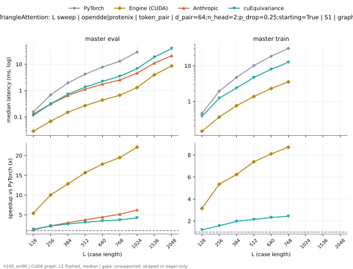

# TriangleAttention on h100_sm90

Generated by `python -m miniworld_engine.measure.plot` from speed tokens `judge/tokens/h100_sm90/`; do not edit.

### L sweep: token_pair | d_pair=128;n_head=4;p_drop=0.25;starting=False;use_self_attention=False | S1 | graph

**master eval** (median ms; x = speedup vs PyTorch)

| L | PyTorch | Engine (Triton) | Engine (CUDA) | Anthropic | cuEquivariance |
|---|---|---|---|---|---|
| 128 | 0.1364 | 0.08403 (1.62x) | 0.04802 (2.84x) | unsupported | unsupported |
| 256 | 0.3552 | 0.2302 (1.54x) | 0.1004 (3.54x) | unsupported | unsupported |
| 384 | 0.8024 | 0.4889 (1.64x) | 0.1977 (4.06x) | unsupported | unsupported |
| 512 | 1.388 | 0.8344 (1.66x) | 0.3161 (4.39x) | unsupported | unsupported |
| 640 | 2.159 | 1.303 (1.66x) | 0.4893 (4.41x) | unsupported | unsupported |
| 768 | 3.086 | 1.867 (1.65x) | 0.7197 (4.29x) | unsupported | unsupported |

**master train** (median ms; x = speedup vs PyTorch)

| L | PyTorch | Engine (Triton) | Engine (CUDA) | Anthropic | cuEquivariance |
|---|---|---|---|---|---|
| 128 | 0.3627 | 0.2621 (1.38x) | 0.2096 (1.73x) | unsupported | unsupported |
| 256 | 1.128 | 0.7082 (1.59x) | 0.4298 (2.63x) | unsupported | unsupported |
| 384 | 2.002 | 1.514 (1.32x) | 0.8365 (2.39x) | unsupported | unsupported |
| 512 | 3.419 | 2.519 (1.36x) | 1.384 (2.47x) | unsupported | unsupported |
| 640 | 5.254 | 4.047 (1.30x) | 2.165 (2.43x) | unsupported | unsupported |
| 768 | 7.469 | 6.093 (1.23x) | 3.116 (2.40x) | unsupported | unsupported |

### L sweep: token_pair | d_pair=128;n_head=4;p_drop=0.25;starting=True;use_self_attention=False | S1 | graph

**master eval** (median ms; x = speedup vs PyTorch)

| L | PyTorch | Engine (Triton) | Engine (CUDA) | Anthropic | cuEquivariance |
|---|---|---|---|---|---|
| 128 | 0.1118 | 0.0725 (1.54x) | 0.03998 (2.80x) | unsupported | unsupported |
| 256 | 0.3146 | 0.1873 (1.68x) | 0.0904 (3.48x) | unsupported | unsupported |
| 384 | 0.7083 | 0.3897 (1.82x) | 0.189 (3.75x) | unsupported | unsupported |
| 512 | 1.226 | 0.6611 (1.85x) | 0.3111 (3.94x) | unsupported | unsupported |
| 640 | 1.897 | 1.034 (1.83x) | 0.4864 (3.90x) | unsupported | unsupported |
| 768 | 2.719 | 1.479 (1.84x) | 0.6988 (3.89x) | unsupported | unsupported |

**master train** (median ms; x = speedup vs PyTorch)

| L | PyTorch | Engine (Triton) | Engine (CUDA) | Anthropic | cuEquivariance |
|---|---|---|---|---|---|
| 128 | 0.3391 | 0.2373 (1.43x) | 0.165 (2.05x) | unsupported | unsupported |
| 256 | 1.062 | 0.6247 (1.70x) | 0.3707 (2.86x) | unsupported | unsupported |
| 384 | 1.831 | 1.333 (1.37x) | 0.7738 (2.37x) | unsupported | unsupported |
| 512 | 3.105 | 2.203 (1.41x) | 1.268 (2.45x) | unsupported | unsupported |
| 640 | 4.77 | 3.557 (1.34x) | 2.011 (2.37x) | unsupported | unsupported |
| 768 | 6.778 | 5.391 (1.26x) | 2.817 (2.41x) | unsupported | unsupported |

### L sweep: boltz2|openfold3_preview2|protenix | token_pair | d_pair=128;n_head=4;p_drop=0.25;starting=False | S1 | graph

**master eval** (median ms; x = speedup vs PyTorch)

| L | PyTorch | Engine (Triton) | Engine (CUDA) | Anthropic | cuEquivariance |
|---|---|---|---|---|---|
| 128 | 0.2558 | 0.1231 (2.08x) | 0.03685 (6.94x) | 0.0719 (3.56x) | 0.1572 (1.63x) |
| 256 | 1.272 | 0.3914 (3.25x) | 0.1035 (12.29x) | 0.1932 (6.58x) | 0.5301 (2.40x) |
| 384 | 3.745 | 0.9443 (3.97x) | 0.2335 (16.04x) | 0.411 (9.11x) | 1.296 (2.89x) |
| 512 | 8.155 | 1.728 (4.72x) | 0.4335 (18.81x) | 0.6943 (11.75x) | 2.431 (3.35x) |
| 640 | 15.2 | 2.858 (5.32x) | 0.7355 (20.66x) | 1.12 (13.57x) | 4.07 (3.73x) |
| 768 | 25.37 | 4.287 (5.92x) | 1.149 (22.08x) | 1.7 (14.92x) | 6.309 (4.02x) |
| 1024 | 56.76 | 8.381 (6.77x) | 2.499 (22.72x) | 3.343 (16.98x) | 12.52 (4.53x) |
| 1536 | skipped | 22.8 | 7.481 | 9.385 | 37.86 |
| 2048 | skipped | 49.47 | 16.73 | 20.58 | 87.53 |

**master train** (median ms; x = speedup vs PyTorch)

| L | PyTorch | Engine (Triton) | Engine (CUDA) | Anthropic | cuEquivariance |
|---|---|---|---|---|---|
| 128 | 0.7147 | 0.4286 (1.67x) | 0.1562 (4.58x) | unsupported | 0.5318 (1.34x) |
| 256 | 3.401 | 1.486 (2.29x) | 0.4646 (7.32x) | unsupported | 1.988 (1.71x) |
| 384 | 9.144 | 3.032 (3.02x) | 1.094 (8.36x) | unsupported | 4.489 (2.04x) |
| 512 | 19.77 | 5.671 (3.49x) | 2.153 (9.18x) | unsupported | 8.812 (2.24x) |
| 640 | 36.5 | 9.391 (3.89x) | 3.808 (9.58x) | unsupported | 15.25 (2.39x) |
| 768 | 60.85 | 14.53 (4.19x) | 6.187 (9.83x) | unsupported | 24.33 (2.50x) |
| 1024 |  |  |  |  |  |
| 1536 |  |  |  |  |  |
| 2048 |  |  |  |  |  |

### L sweep: boltz2|openfold3_preview2|protenix | token_pair | d_pair=128;n_head=4;p_drop=0.25;starting=True | S1 | graph

**master eval** (median ms; x = speedup vs PyTorch)

| L | PyTorch | Engine (Triton) | Engine (CUDA) | Anthropic | cuEquivariance |
|---|---|---|---|---|---|
| 128 | 0.2499 | 0.1096 (2.28x) | 0.03694 (6.76x) | 0.07259 (3.44x) | 0.1463 (1.71x) |
| 256 | 1.232 | 0.35 (3.52x) | 0.1056 (11.68x) | 0.1929 (6.39x) | 0.4908 (2.51x) |
| 384 | 3.646 | 0.8417 (4.33x) | 0.2325 (15.68x) | 0.406 (8.98x) | 1.201 (3.04x) |
| 512 | 7.984 | 1.562 (5.11x) | 0.4329 (18.44x) | 0.7035 (11.35x) | 2.287 (3.49x) |
| 640 | 14.91 | 2.574 (5.79x) | 0.7307 (20.40x) | 1.148 (12.98x) | 3.808 (3.92x) |
| 768 | 24.98 | 3.873 (6.45x) | 1.175 (21.26x) | 1.74 (14.36x) | 5.941 (4.20x) |
| 1024 | 56 | 7.71 (7.26x) | 2.512 (22.29x) | 3.421 (16.37x) | 11.85 (4.72x) |
| 1536 | skipped | 21.31 | 7.421 | 9.578 | 36.42 |
| 2048 | skipped | 46.95 | 16.56 | 20.88 | 84.96 |

**master train** (median ms; x = speedup vs PyTorch)

| L | PyTorch | Engine (Triton) | Engine (CUDA) | Anthropic | cuEquivariance |
|---|---|---|---|---|---|
| 128 | 0.6851 | 0.3989 (1.72x) | 0.1555 (4.41x) | unsupported | 0.5015 (1.37x) |
| 256 | 3.311 | 1.395 (2.37x) | 0.4636 (7.14x) | unsupported | 1.9 (1.74x) |
| 384 | 8.966 | 2.843 (3.15x) | 1.09 (8.22x) | unsupported | 4.291 (2.09x) |
| 512 | 19.46 | 5.373 (3.62x) | 2.148 (9.06x) | unsupported | 8.515 (2.29x) |
| 640 | 36.02 | 8.917 (4.04x) | 3.79 (9.50x) | unsupported | 14.77 (2.44x) |
| 768 | 60.12 | 13.83 (4.35x) | 6.185 (9.72x) | unsupported | 23.65 (2.54x) |
| 1024 |  |  |  |  |  |
| 1536 |  |  |  |  |  |
| 2048 |  |  |  |  |  |

### L sweep: boltz2|protenix | token_pair | d_hidden=128;d_pair=64;n_head=4;p_drop=0.25;starting=False | S1 | graph

**master eval** (median ms; x = speedup vs PyTorch)

| L | PyTorch | Engine (Triton) | Engine (CUDA) | Anthropic | cuEquivariance |
|---|---|---|---|---|---|
| 128 | 0.2436 | 0.1102 (2.21x) | 0.03766 (6.47x) | 0.06763 (3.60x) | 0.1445 (1.69x) |
| 256 | 1.204 | 0.3199 (3.76x) | 0.1128 (10.67x) | 0.1581 (7.61x) | 0.457 (2.63x) |
| 384 | 3.588 | 0.7796 (4.60x) | 0.2533 (14.17x) | 0.3356 (10.69x) | 1.14 (3.15x) |
| 512 | 7.9 | 1.463 (5.40x) | 0.4634 (17.05x) | 0.5775 (13.68x) | 2.156 (3.66x) |
| 640 | 14.76 | 2.443 (6.04x) | 0.7768 (19.01x) | 0.9446 (15.63x) | 3.66 (4.03x) |
| 768 | 24.77 | 3.677 (6.74x) | 1.22 (20.30x) | 1.447 (17.12x) | 5.679 (4.36x) |
| 1024 | 55.61 | 7.323 (7.59x) | 2.603 (21.36x) | 2.921 (19.04x) | 11.47 (4.85x) |
| 1536 | skipped | 20.34 | 7.611 | 8.448 | 35.47 |
| 2048 | skipped | 44.97 | 16.93 | 19.05 | 82.94 |

**master train** (median ms; x = speedup vs PyTorch)

| L | PyTorch | Engine (Triton) | Engine (CUDA) | Anthropic | cuEquivariance |
|---|---|---|---|---|---|
| 128 | 0.669 | 0.3838 (1.74x) | 0.1794 (3.73x) | unsupported | 0.4831 (1.38x) |
| 256 | 3.169 | 1.247 (2.54x) | 0.5297 (5.98x) | unsupported | 1.78 (1.78x) |
| 384 | 8.612 | 2.504 (3.44x) | 1.203 (7.16x) | unsupported | 3.943 (2.18x) |
| 512 | 18.87 | 4.772 (3.95x) | 2.314 (8.15x) | unsupported | 7.907 (2.39x) |
| 640 | 35.15 | 8.044 (4.37x) | 4.055 (8.67x) | unsupported | 13.83 (2.54x) |
| 768 | 58.87 | 12.57 (4.68x) | 6.56 (8.97x) | unsupported | 22.27 (2.64x) |
| 1024 |  |  |  |  |  |
| 1536 |  |  |  |  |  |
| 2048 |  |  |  |  |  |

### L sweep: boltz2|protenix | token_pair | d_hidden=128;d_pair=64;n_head=4;p_drop=0.25;starting=True | S1 | graph

**master eval** (median ms; x = speedup vs PyTorch)

| L | PyTorch | Engine (Triton) | Engine (CUDA) | Anthropic | cuEquivariance |
|---|---|---|---|---|---|
| 128 | 0.2437 | 0.1024 (2.38x) | 0.0391 (6.23x) | 0.068 (3.58x) | 0.1378 (1.77x) |
| 256 | 1.18 | 0.2984 (3.95x) | 0.1093 (10.79x) | 0.1588 (7.43x) | 0.4421 (2.67x) |
| 384 | 3.538 | 0.7306 (4.84x) | 0.2497 (14.17x) | 0.3329 (10.63x) | 1.088 (3.25x) |
| 512 | 7.796 | 1.367 (5.70x) | 0.4611 (16.91x) | 0.5728 (13.61x) | 2.075 (3.76x) |
| 640 | 14.63 | 2.263 (6.46x) | 0.7723 (18.94x) | 0.9426 (15.52x) | 3.55 (4.12x) |
| 768 | 24.57 | 3.481 (7.06x) | 1.211 (20.29x) | 1.446 (16.99x) | 5.517 (4.45x) |
| 1024 | 55.28 | 7.004 (7.89x) | 2.434 (22.71x) | 2.91 (18.99x) | 11.12 (4.97x) |
| 1536 | skipped | 19.57 | 7.564 | 8.455 | 34.71 |
| 2048 | skipped | 43.59 | 16.84 | 19.21 | 81.72 |

**master train** (median ms; x = speedup vs PyTorch)

| L | PyTorch | Engine (Triton) | Engine (CUDA) | Anthropic | cuEquivariance |
|---|---|---|---|---|---|
| 128 | 0.6541 | 0.364 (1.80x) | 0.1789 (3.66x) | unsupported | 0.47 (1.39x) |
| 256 | 3.133 | 1.2 (2.61x) | 0.5258 (5.96x) | unsupported | 1.725 (1.82x) |
| 384 | 8.513 | 2.413 (3.53x) | 1.191 (7.15x) | unsupported | 3.827 (2.22x) |
| 512 | 18.69 | 4.624 (4.04x) | 2.301 (8.12x) | unsupported | 7.752 (2.41x) |
| 640 | 34.94 | 7.802 (4.48x) | 4.019 (8.69x) | unsupported | 13.58 (2.57x) |
| 768 | 58.52 | 12.23 (4.78x) | 6.537 (8.95x) | unsupported | 21.99 (2.66x) |
| 1024 |  |  |  |  |  |
| 1536 |  |  |  |  |  |
| 2048 |  |  |  |  |  |

### L sweep: opendde | token_pair | d_pair=384;n_head=12;p_drop=0.25;starting=False | S1 | graph

**master eval** (median ms; x = speedup vs PyTorch)

| L | PyTorch | Engine (Triton) | Engine (CUDA) | Anthropic | cuEquivariance |
|---|---|---|---|---|---|
| 128 | 0.6359 | 0.255 (2.49x) | 0.1129 (5.63x) | 0.3756 (1.69x) | 0.3394 (1.87x) |
| 256 | 3.657 | 1.021 (3.58x) | 0.4163 (8.79x) | 1.463 (2.50x) | 1.434 (2.55x) |
| 384 | 10.76 | 2.366 (4.55x) | 0.9918 (10.85x) | 3.302 (3.26x) | 3.438 (3.13x) |
| 512 | 23.68 | 4.466 (5.30x) | 1.901 (12.46x) | 5.862 (4.04x) | 6.583 (3.60x) |
| 640 | 44.46 | 7.424 (5.99x) | 3.313 (13.42x) | 9.345 (4.76x) | 11.17 (3.98x) |
| 768 | skipped | 11.45 | 5.036 | 13.7 | 17.56 |
| 1024 | skipped | 23.43 | 10.13 | 25.46 | 40.48 |
| 1536 | skipped | 68.85 | 28.88 | 63.95 | 125.9 |
| 2048 | skipped | 156.2 | 70.79 | skipped | 258.2 |
| 2976 | skipped | 494.8 | 224.8 | skipped | skipped |
| 3968 | skipped | 1047 | 429.9 | skipped | skipped |

**master train** (median ms; x = speedup vs PyTorch)

| L | PyTorch | Engine (Triton) | Engine (CUDA) | Anthropic | cuEquivariance |
|---|---|---|---|---|---|
| 128 | 1.767 | 0.929 (1.90x) | 0.4753 (3.72x) | unsupported | 1.203 (1.47x) |
| 256 | 9.371 | 3.594 (2.61x) | 1.572 (5.96x) | unsupported | 5.141 (1.82x) |
| 384 | 26.51 | 8.148 (3.25x) | 3.871 (6.85x) | unsupported | 12.51 (2.12x) |
| 512 | 58 | 15.74 (3.69x) | 7.7 (7.53x) | unsupported | 25.22 (2.30x) |
| 640 | 108.2 | 26.87 (4.03x) | 13.76 (7.86x) | unsupported | 46.03 (2.35x) |
| 768 | skipped | 41.98 | 22.18 | unsupported | 77.09 |
| 1024 |  |  |  |  |  |
| 1536 |  |  |  |  |  |
| 2048 |  |  |  |  |  |
| 2976 |  |  |  |  |  |
| 3968 |  |  |  |  |  |

### L sweep: opendde | token_pair | d_pair=384;n_head=12;p_drop=0.25;starting=True | S1 | graph

**master eval** (median ms; x = speedup vs PyTorch)

| L | PyTorch | Engine (Triton) | Engine (CUDA) | Anthropic | cuEquivariance |
|---|---|---|---|---|---|
| 128 | 0.6203 | 0.2269 (2.73x) | 0.1094 (5.67x) | 0.3501 (1.77x) | 0.3181 (1.95x) |
| 256 | 3.59 | 0.8901 (4.03x) | 0.4031 (8.91x) | 1.35 (2.66x) | 1.298 (2.76x) |
| 384 | 10.44 | 2.068 (5.05x) | 0.9063 (11.52x) | 3.019 (3.46x) | 3.135 (3.33x) |
| 512 | 23.18 | 3.943 (5.88x) | 1.801 (12.87x) | 5.38 (4.31x) | 6.046 (3.83x) |
| 640 | 43.66 | 6.641 (6.57x) | 3.104 (14.06x) | 8.653 (5.05x) | 10.39 (4.20x) |
| 768 | skipped | 10.31 | 4.802 | 12.62 | 16.45 |
| 1024 | skipped | 21.48 | 9.635 | 23.56 | 38.61 |
| 1536 | skipped | 64.8 | 27.89 | 59.74 | 121.4 |
| 2048 | skipped | 147.4 | 61.12 | skipped | 250.7 |
| 2976 | skipped | 466.1 | 206.6 | skipped | 768.7 |
| 3968 | skipped | 1004 | 396.4 | skipped | skipped |

**master train** (median ms; x = speedup vs PyTorch)

| L | PyTorch | Engine (Triton) | Engine (CUDA) | Anthropic | cuEquivariance |
|---|---|---|---|---|---|
| 128 | 1.716 | 0.873 (1.97x) | 0.4619 (3.72x) | unsupported | 1.158 (1.48x) |
| 256 | 9.114 | 3.367 (2.71x) | 1.529 (5.96x) | unsupported | 4.909 (1.86x) |
| 384 | 25.99 | 7.619 (3.41x) | 3.788 (6.86x) | unsupported | 11.99 (2.17x) |
| 512 | 57.06 | 14.83 (3.85x) | 7.57 (7.54x) | unsupported | 24.28 (2.35x) |
| 640 | 106.8 | 25.41 (4.20x) | 13.59 (7.85x) | unsupported | 44.61 (2.39x) |
| 768 | skipped | 39.91 | 21.92 | unsupported | 75.02 |
| 1024 |  |  |  |  |  |
| 1536 |  |  |  |  |  |
| 2048 |  |  |  |  |  |
| 2976 |  |  |  |  |  |
| 3968 |  |  |  |  |  |

### L sweep: opendde|protenix | token_pair | d_pair=64;n_head=2;p_drop=0.25;starting=False | S1 | graph

**master eval** (median ms; x = speedup vs PyTorch)

| L | PyTorch | Engine (Triton) | Engine (CUDA) | Anthropic | cuEquivariance |
|---|---|---|---|---|---|
| 128 | 0.1627 | 0.09971 (1.63x) | 0.02902 (5.61x) | 0.1379 (1.18x) | 0.1246 (1.31x) |
| 256 | 0.7132 | 0.259 (2.75x) | 0.07214 (9.89x) | 0.54 (eager) | 0.3355 (2.13x) |
| 384 | 1.999 | 0.5891 (3.39x) | 0.1549 (12.90x) | 0.6944 (2.88x) | 0.7771 (2.57x) |
| 512 | 4.316 | 1.093 (3.95x) | 0.2745 (15.72x) | 1.221 (3.54x) | 1.453 (2.97x) |
| 640 | 7.943 | 1.764 (4.50x) | 0.4499 (17.66x) | 1.893 (4.20x) | 2.377 (3.34x) |
| 768 | 13.16 | 2.609 (5.04x) | 0.6789 (19.38x) | 2.716 (4.85x) | 3.635 (3.62x) |
| 1024 | 29.26 | 5.066 (5.78x) | 1.348 (21.71x) | 4.986 (5.87x) | 7.106 (4.12x) |
| 1536 | skipped | 13.1 | 4.027 | 11.81 | 19.39 |
| 2048 | skipped | 26.77 | 8.769 | 22.49 | 40.74 |

**master train** (median ms; x = speedup vs PyTorch)

| L | PyTorch | Engine (Triton) | Engine (CUDA) | Anthropic | cuEquivariance |
|---|---|---|---|---|---|
| 128 | 0.4819 | 0.3296 (1.46x) | 0.1448 (3.33x) | unsupported | 0.3941 (1.22x) |
| 256 | 1.971 | 0.9934 (1.98x) | 0.3652 (5.40x) | unsupported | 1.262 (1.56x) |
| 384 | 4.799 | 1.729 (2.78x) | 0.7652 (6.27x) | unsupported | 2.474 (1.94x) |
| 512 | 10.29 | 3.224 (3.19x) | 1.386 (7.43x) | unsupported | 4.859 (2.12x) |
| 640 | 18.85 | 5.305 (3.55x) | 2.32 (8.13x) | unsupported | 8.237 (2.29x) |
| 768 | 31.17 | 8.02 (3.89x) | 3.571 (8.73x) | unsupported | 12.98 (2.40x) |
| 1024 |  |  |  |  |  |
| 1536 |  |  |  |  |  |
| 2048 |  |  |  |  |  |

### L sweep: opendde|protenix | token_pair | d_pair=64;n_head=2;p_drop=0.25;starting=True | S1 | graph

**master eval** (median ms; x = speedup vs PyTorch)

| L | PyTorch | Engine (Triton) | Engine (CUDA) | Anthropic | cuEquivariance |
|---|---|---|---|---|---|
| 128 | 0.1559 | 0.08994 (1.73x) | 0.02883 (5.41x) | 0.1296 (1.20x) | 0.1148 (1.36x) |
| 256 | 0.6867 | 0.2369 (2.90x) | 0.06834 (10.05x) | 0.3089 (2.22x) | 0.3126 (2.20x) |
| 384 | 1.95 | 0.5411 (3.60x) | 0.1519 (12.84x) | 0.6464 (3.02x) | 0.7258 (2.69x) |
| 512 | 4.223 | 1.004 (4.21x) | 0.2694 (15.67x) | 1.13 (3.74x) | 1.357 (3.11x) |
| 640 | 7.805 | 1.608 (4.85x) | 0.4375 (17.84x) | 1.753 (4.45x) | 2.235 (3.49x) |
| 768 | 12.96 | 2.402 (5.40x) | 0.665 (19.49x) | 2.517 (5.15x) | 3.489 (3.71x) |
| 1024 | 28.86 | 4.717 (6.12x) | 1.304 (22.13x) | 4.621 (6.25x) | 6.793 (4.25x) |
| 1536 | skipped | 12.32 | 3.964 | 11 | 18.61 |
| 2048 | skipped | 25.38 | 8.601 | 21.15 | 39.62 |

**master train** (median ms; x = speedup vs PyTorch)

| L | PyTorch | Engine (Triton) | Engine (CUDA) | Anthropic | cuEquivariance |
|---|---|---|---|---|---|
| 128 | 0.4556 | 0.3108 (1.47x) | 0.1448 (3.15x) | unsupported | 0.379 (1.20x) |
| 256 | 1.933 | 0.9476 (2.04x) | 0.3612 (5.35x) | unsupported | 1.226 (1.58x) |
| 384 | 4.704 | 1.645 (2.86x) | 0.7546 (6.23x) | unsupported | 2.378 (1.98x) |
| 512 | 10.12 | 3.088 (3.28x) | 1.37 (7.39x) | unsupported | 4.7 (2.15x) |
| 640 | 18.58 | 5.048 (3.68x) | 2.292 (8.10x) | unsupported | 7.983 (2.33x) |
| 768 | 30.81 | 7.661 (4.02x) | 3.535 (8.72x) | unsupported | 12.63 (2.44x) |
| 1024 |  |  |  |  |  |
| 1536 |  |  |  |  |  |
| 2048 |  |  |  |  |  |

### L sweep: openfold3_preview2 | token_pair | d_pair=64;n_head=4;p_drop=0.25;starting=False | S1 | graph

**master eval** (median ms; x = speedup vs PyTorch)

| L | PyTorch | Engine (Triton) | Engine (CUDA) | Anthropic | cuEquivariance |
|---|---|---|---|---|---|
| 128 | 0.2225 | 0.1032 (2.15x) | 0.03334 (6.67x) | 0.0355 (6.27x) | unsupported |
| 256 | 1.108 | 0.2775 (3.99x) | 0.09294 (11.92x) | 0.1033 (10.72x) | 0.3916 (2.83x) |
| 384 | 3.325 | 0.6617 (5.02x) | 0.2072 (16.05x) | 0.251 (13.24x) | 0.9699 (3.43x) |
| 512 | 7.471 | 1.259 (5.94x) | 0.3819 (19.57x) | 0.4671 (16.00x) | 1.89 (3.95x) |
| 640 | 14.12 | 2.069 (6.82x) | 0.6494 (21.74x) | 0.8225 (17.16x) | 3.225 (4.38x) |
| 768 | 23.83 | 3.166 (7.53x) | 1.012 (23.54x) | 1.324 (18.00x) | 5.127 (4.65x) |

**master train** (median ms; x = speedup vs PyTorch)

| L | PyTorch | Engine (Triton) | Engine (CUDA) | Anthropic | cuEquivariance |
|---|---|---|---|---|---|
| 128 | 0.6137 | 0.3502 (1.75x) | 0.1888 (3.25x) | unsupported | unsupported |
| 256 | 2.918 | 1.124 (2.60x) | 0.5393 (5.41x) | unsupported | 1.551 (1.88x) |
| 384 | 7.941 | 2.153 (3.69x) | 1.207 (6.58x) | unsupported | 3.391 (2.34x) |
| 512 | 17.77 | 4.199 (4.23x) | 2.32 (7.66x) | unsupported | 7.03 (2.53x) |
| 640 | 33.44 | 7.134 (4.69x) | 4.051 (8.25x) | unsupported | 12.54 (2.67x) |
| 768 | 56.4 | 11.19 (5.04x) | 6.563 (8.59x) | unsupported | 20.42 (2.76x) |

### L sweep: openfold3_preview2 | token_pair | d_pair=64;n_head=4;p_drop=0.25;starting=True | S1 | graph

**master eval** (median ms; x = speedup vs PyTorch)

| L | PyTorch | Engine (Triton) | Engine (CUDA) | Anthropic | cuEquivariance |
|---|---|---|---|---|---|
| 128 | 0.2149 | 0.09381 (2.29x) | 0.0327 (6.57x) | 0.03514 (6.12x) | unsupported |
| 256 | 1.085 | 0.2585 (4.20x) | 0.08947 (12.12x) | 0.1028 (10.55x) | 0.3712 (2.92x) |
| 384 | 3.278 | 0.6078 (5.39x) | 0.2064 (15.88x) | 0.2503 (13.10x) | 0.9177 (3.57x) |
| 512 | 7.37 | 1.181 (6.24x) | 0.3775 (19.52x) | 0.4651 (15.85x) | 1.827 (4.03x) |
| 640 | 13.98 | 1.931 (7.24x) | 0.6387 (21.89x) | 0.824 (16.97x) | 3.101 (4.51x) |
| 768 | 23.63 | 2.95 (8.01x) | 0.9962 (23.72x) | 1.33 (17.77x) | 4.905 (4.82x) |

**master train** (median ms; x = speedup vs PyTorch)

| L | PyTorch | Engine (Triton) | Engine (CUDA) | Anthropic | cuEquivariance |
|---|---|---|---|---|---|
| 128 | 0.5939 | 0.3322 (1.79x) | 0.1857 (3.20x) | unsupported | unsupported |
| 256 | 2.872 | 1.077 (2.67x) | 0.5325 (5.39x) | unsupported | 1.504 (1.91x) |
| 384 | 7.861 | 2.062 (3.81x) | 1.199 (6.56x) | unsupported | 3.305 (2.38x) |
| 512 | 17.61 | 4.039 (4.36x) | 2.315 (7.61x) | unsupported | 6.893 (2.55x) |
| 640 | 33.2 | 6.897 (4.81x) | 4.025 (8.25x) | unsupported | 12.3 (2.70x) |
| 768 | 56.04 | 10.82 (5.18x) | 6.505 (8.61x) | unsupported | 20.08 (2.79x) |

### L sweep: protenix | token_pair | d_pair=256;n_head=8;p_drop=0.25;starting=False | S1 | graph

**master eval** (median ms; x = speedup vs PyTorch)

| L | PyTorch | Engine (Triton) | Engine (CUDA) | Anthropic | cuEquivariance |
|---|---|---|---|---|---|
| 128 | 0.4444 | 0.1783 (2.49x) | 0.06611 (6.72x) | 0.102 (4.36x) | 0.2427 (1.83x) |
| 256 | 2.459 | 0.7063 (3.48x) | 0.2329 (10.56x) | 0.3415 (7.20x) | 0.9913 (2.48x) |
| 384 | 7.24 | 1.654 (4.38x) | 0.5245 (13.80x) | 0.7626 (9.49x) | 2.362 (3.06x) |
| 512 | 15.94 | 3.096 (5.15x) | 1.023 (15.58x) | 1.387 (11.49x) | 4.509 (3.53x) |
| 640 | 29.77 | 5.112 (5.82x) | 1.775 (16.77x) | 2.363 (12.60x) | 7.539 (3.95x) |
| 768 | 49.98 | 7.705 (6.49x) | 2.861 (17.47x) | 3.472 (14.39x) | 11.72 (4.26x) |
| 1024 | skipped | 15.35 | 5.821 | 7.106 | 24.09 |
| 1536 | skipped | 44.82 | 16.66 | 19.88 | 83.86 |
| 2048 | skipped | 97.13 | 37.24 | 43.47 | 171.4 |

**master train** (median ms; x = speedup vs PyTorch)

| L | PyTorch | Engine (Triton) | Engine (CUDA) | Anthropic | cuEquivariance |
|---|---|---|---|---|---|
| 128 | 1.225 | 0.6549 (1.87x) | 0.3316 (3.69x) | unsupported | 0.8493 (1.44x) |
| 256 | 6.408 | 2.565 (2.50x) | 1.071 (5.98x) | unsupported | 3.57 (1.79x) |
| 384 | 17.81 | 5.589 (3.19x) | 2.553 (6.98x) | unsupported | 8.431 (2.11x) |
| 512 | 38.73 | 10.62 (3.65x) | 5.03 (7.70x) | unsupported | 16.67 (2.32x) |
| 640 | 72.02 | 17.98 (4.01x) | 8.848 (8.14x) | unsupported | 29.38 (2.45x) |
| 768 | 120.3 | 27.8 (4.33x) | 14.39 (8.36x) | unsupported | 48.6 (2.48x) |
| 1024 |  |  |  |  |  |
| 1536 |  |  |  |  |  |
| 2048 |  |  |  |  |  |

### L sweep: protenix | token_pair | d_pair=256;n_head=8;p_drop=0.25;starting=True | S1 | graph

**master eval** (median ms; x = speedup vs PyTorch)

| L | PyTorch | Engine (Triton) | Engine (CUDA) | Anthropic | cuEquivariance |
|---|---|---|---|---|---|
| 128 | 0.4515 | 0.1616 (2.79x) | 0.06525 (6.92x) | 0.1025 (4.40x) | 0.228 (1.98x) |
| 256 | 2.373 | 0.6212 (3.82x) | 0.2342 (10.13x) | 0.3385 (7.01x) | 0.9027 (2.63x) |
| 384 | 7.047 | 1.453 (4.85x) | 0.5268 (13.38x) | 0.7629 (9.24x) | 2.179 (3.23x) |
| 512 | 15.59 | 2.747 (5.68x) | 1.013 (15.39x) | 1.386 (11.25x) | 4.164 (3.74x) |
| 640 | 29.28 | 4.569 (6.41x) | 1.682 (17.41x) | 2.365 (12.38x) | 7.002 (4.18x) |
| 768 | 49.23 | 7.015 (7.02x) | 2.783 (17.69x) | 3.536 (13.92x) | 10.97 (4.49x) |
| 1024 | skipped | 14.02 | 5.834 | 7.137 | 22.87 |
| 1536 | skipped | 42.03 | 16.75 | 20.24 | 80.92 |
| 2048 | skipped | 91.72 | 37.2 | 43.64 | 166.7 |

**master train** (median ms; x = speedup vs PyTorch)

| L | PyTorch | Engine (Triton) | Engine (CUDA) | Anthropic | cuEquivariance |
|---|---|---|---|---|---|
| 128 | 1.188 | 0.6168 (1.93x) | 0.3272 (3.63x) | unsupported | 0.8086 (1.47x) |
| 256 | 6.247 | 2.392 (2.61x) | 1.054 (5.93x) | unsupported | 3.409 (1.83x) |
| 384 | 17.43 | 5.221 (3.34x) | 2.519 (6.92x) | unsupported | 8.142 (2.14x) |
| 512 | 38.11 | 10 (3.81x) | 4.963 (7.68x) | unsupported | 16.12 (2.36x) |
| 640 | 71.07 | 16.98 (4.18x) | 8.715 (8.16x) | unsupported | 28.44 (2.50x) |
| 768 | 119 | 26.46 (4.50x) | 14.24 (8.36x) | unsupported | 47.21 (2.52x) |
| 1024 |  |  |  |  |  |
| 1536 |  |  |  |  |  |
| 2048 |  |  |  |  |  |

### d_pair sweep at L2048: token_pair | p_drop=0.25;starting=False | S1 | graph

**master eval** (median ms; x = speedup vs PyTorch)

| d_pair | PyTorch | Engine (Triton) | Engine (CUDA) | Anthropic | cuEquivariance |
|---|---|---|---|---|---|
| 64 d_hidden=128 n_head=4 | skipped | 44.97 | 16.93 | 19.05 | 82.94 |
| 128 n_head=4 | skipped | 49.47 | 16.73 | 20.58 | 87.53 |
| 256 n_head=8 | skipped | 97.13 | 37.24 | 43.47 | 171.4 |
| 384 n_head=12 | skipped | 156.2 | 70.79 | skipped | 258.2 |

### d_pair sweep at L2048: token_pair | p_drop=0.25;starting=True | S1 | graph

**master eval** (median ms; x = speedup vs PyTorch)

| d_pair | PyTorch | Engine (Triton) | Engine (CUDA) | Anthropic | cuEquivariance |
|---|---|---|---|---|---|
| 64 d_hidden=128 n_head=4 | skipped | 43.59 | 16.84 | 19.21 | 81.72 |
| 128 n_head=4 | skipped | 46.95 | 16.56 | 20.88 | 84.96 |
| 256 n_head=8 | skipped | 91.72 | 37.2 | 43.64 | 166.7 |
| 384 n_head=12 | skipped | 147.4 | 61.12 | skipped | 250.7 |

### n_head sweep at L2048: token_pair | p_drop=0.25;starting=False | S1 | graph

**master eval** (median ms; x = speedup vs PyTorch)

| n_head | PyTorch | Engine (Triton) | Engine (CUDA) | Anthropic | cuEquivariance |
|---|---|---|---|---|---|
| 2 d_pair=64 | skipped | 26.77 | 8.769 | 22.49 | 40.74 |
| 4 d_pair=128 | skipped | 49.47 | 16.73 | 20.58 | 87.53 |
| 8 d_pair=256 | skipped | 97.13 | 37.24 | 43.47 | 171.4 |
| 12 d_pair=384 | skipped | 156.2 | 70.79 | skipped | 258.2 |

### n_head sweep at L2048: token_pair | p_drop=0.25;starting=True | S1 | graph

**master eval** (median ms; x = speedup vs PyTorch)

| n_head | PyTorch | Engine (Triton) | Engine (CUDA) | Anthropic | cuEquivariance |
|---|---|---|---|---|---|
| 2 d_pair=64 | skipped | 25.38 | 8.601 | 21.15 | 39.62 |
| 4 d_pair=128 | skipped | 46.95 | 16.56 | 20.88 | 84.96 |
| 8 d_pair=256 | skipped | 91.72 | 37.2 | 43.64 | 166.7 |
| 12 d_pair=384 | skipped | 147.4 | 61.12 | skipped | 250.7 |

