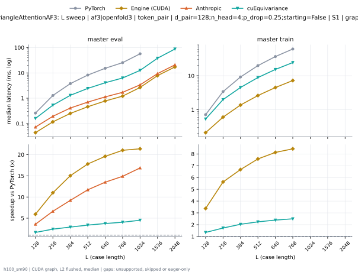
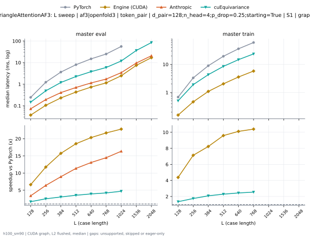
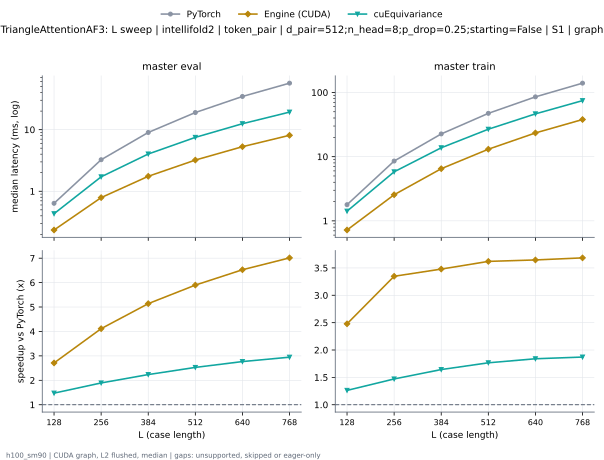
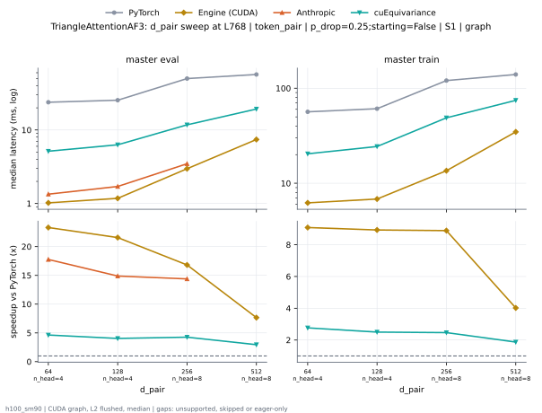
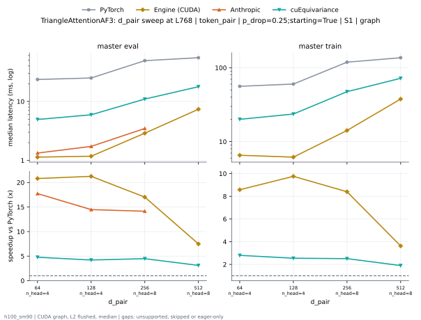

# TriangleAttentionAF3 on h100_sm90

Generated by `python -m miniworld_engine.measure.plot` from speed tokens `judge/tokens/h100_sm90/`; do not edit.

### L sweep: af3|openfold3 | token_pair | d_pair=128;n_head=4;p_drop=0.25;starting=False | S1 | graph

**master eval** (median ms; x = speedup vs PyTorch)

| L | PyTorch | Engine (Triton) | Engine (CUDA) | Anthropic | cuEquivariance |
|---|---|---|---|---|---|
| 128 | 0.2581 | 0.1231 (2.10x) | 0.04346 (5.94x) | 0.07213 (3.58x) | 0.1584 (1.63x) |
| 256 | 1.279 | 0.3922 (3.26x) | 0.1162 (11.01x) | 0.1928 (6.63x) | 0.53 (2.41x) |
| 384 | 3.759 | 0.9483 (3.96x) | 0.25 (15.03x) | 0.4082 (9.21x) | 1.298 (2.90x) |
| 512 | 8.184 | 1.734 (4.72x) | 0.4597 (17.80x) | 0.6995 (11.70x) | 2.434 (3.36x) |
| 640 | 15.2 | 2.826 (5.38x) | 0.7753 (19.60x) | 1.126 (13.50x) | 4.071 (3.73x) |
| 768 | 25.4 | 4.292 (5.92x) | 1.207 (21.04x) | 1.706 (14.89x) | 6.288 (4.04x) |
| 1024 | 56.74 | 8.403 (6.75x) | 2.653 (21.38x) | 3.363 (16.87x) | 12.55 (4.52x) |
| 1536 | skipped | 22.83 | 7.784 | 9.326 | 38 |
| 2048 | skipped | 49.53 | 17.14 | 20.76 | 87.71 |

**master train** (median ms; x = speedup vs PyTorch)

| L | PyTorch | Engine (Triton) | Engine (CUDA) | Anthropic | cuEquivariance |
|---|---|---|---|---|---|
| 128 | 0.7161 | 0.4324 (1.66x) | 0.2122 (3.37x) | unsupported | 0.5338 (1.34x) |
| 256 | 3.411 | 1.483 (2.30x) | 0.6065 (5.62x) | unsupported | 1.987 (1.72x) |
| 384 | 9.168 | 3.058 (3.00x) | 1.373 (6.67x) | unsupported | 4.507 (2.03x) |
| 512 | 19.8 | 5.704 (3.47x) | 2.613 (7.58x) | unsupported | 8.836 (2.24x) |
| 640 | 36.52 | 9.448 (3.87x) | 4.493 (8.13x) | unsupported | 15.28 (2.39x) |
| 768 | 60.88 | 14.57 (4.18x) | 7.218 (8.43x) | unsupported | 24.37 (2.50x) |
| 1024 |  |  |  |  |  |
| 1536 |  |  |  |  |  |
| 2048 |  |  |  |  |  |

### L sweep: af3|openfold3 | token_pair | d_pair=128;n_head=4;p_drop=0.25;starting=True | S1 | graph

**master eval** (median ms; x = speedup vs PyTorch)

| L | PyTorch | Engine (Triton) | Engine (CUDA) | Anthropic | cuEquivariance |
|---|---|---|---|---|---|
| 128 | 0.2434 | 0.1104 (2.20x) | 0.03632 (6.70x) | 0.07238 (3.36x) | 0.1471 (1.65x) |
| 256 | 1.231 | 0.3496 (3.52x) | 0.1083 (11.37x) | 0.1929 (6.38x) | 0.4926 (2.50x) |
| 384 | 3.646 | 0.8399 (4.34x) | 0.2367 (15.41x) | 0.4074 (8.95x) | 1.2 (3.04x) |
| 512 | 8.004 | 1.567 (5.11x) | 0.4427 (18.08x) | 0.7041 (11.37x) | 2.262 (3.54x) |
| 640 | 14.92 | 2.55 (5.85x) | 0.7457 (20.00x) | 1.141 (13.08x) | 3.8 (3.93x) |
| 768 | 25 | 3.905 (6.40x) | 1.189 (21.03x) | 1.726 (14.49x) | 5.935 (4.21x) |
| 1024 | 56.11 | 7.809 (7.18x) | 2.601 (21.57x) | 3.426 (16.38x) | 11.91 (4.71x) |
| 1536 | skipped | 21.28 | 7.68 | 9.583 | 36.51 |
| 2048 | skipped | 46.77 | 17.07 | 20.75 | 85.22 |

**master train** (median ms; x = speedup vs PyTorch)

| L | PyTorch | Engine (Triton) | Engine (CUDA) | Anthropic | cuEquivariance |
|---|---|---|---|---|---|
| 128 | 0.6856 | 0.404 (1.70x) | 0.1569 (4.37x) | unsupported | 0.5062 (1.35x) |
| 256 | 3.321 | 1.393 (2.38x) | 0.4639 (7.16x) | unsupported | 1.897 (1.75x) |
| 384 | 8.971 | 2.848 (3.15x) | 1.09 (8.23x) | unsupported | 4.308 (2.08x) |
| 512 | 19.44 | 5.344 (3.64x) | 2.155 (9.02x) | unsupported | 8.503 (2.29x) |
| 640 | 36.02 | 8.929 (4.03x) | 3.804 (9.47x) | unsupported | 14.77 (2.44x) |
| 768 | 60.12 | 13.9 (4.33x) | 6.175 (9.74x) | unsupported | 23.64 (2.54x) |
| 1024 |  |  |  |  |  |
| 1536 |  |  |  |  |  |
| 2048 |  |  |  |  |  |

### L sweep: af3|openfold3 | token_pair | d_pair=64;n_head=4;p_drop=0.25;starting=False | S1 | graph

**master eval** (median ms; x = speedup vs PyTorch)

| L | PyTorch | Engine (Triton) | Engine (CUDA) | Anthropic | cuEquivariance |
|---|---|---|---|---|---|
| 128 | 0.2234 | 0.1031 (2.17x) | 0.03502 (6.38x) | 0.03547 (6.30x) | unsupported |
| 256 | 1.111 | 0.28 (3.97x) | 0.09669 (11.49x) | 0.1032 (10.77x) | 0.3933 (2.82x) |
| 384 | 3.332 | 0.6646 (5.01x) | 0.2259 (14.75x) | 0.2524 (13.20x) | 0.9715 (3.43x) |
| 512 | 7.471 | 1.264 (5.91x) | 0.424 (17.62x) | 0.4682 (15.96x) | 1.892 (3.95x) |
| 640 | 14.11 | 2.081 (6.78x) | 0.735 (19.20x) | 0.8314 (16.98x) | 3.251 (4.34x) |
| 768 | 23.83 | 3.181 (7.49x) | 1.154 (20.64x) | 1.341 (17.77x) | 5.144 (4.63x) |
| 1024 | 54.01 | 6.388 (8.46x) | 2.422 (22.30x) | 2.849 (18.96x) | 10.61 (5.09x) |
| 1536 | skipped | 17.56 | 7.164 | 8.686 | 32.91 |
| 2048 | skipped | 38.22 | 16.78 | 19.65 | 78.06 |

**master train** (median ms; x = speedup vs PyTorch)

| L | PyTorch | Engine (Triton) | Engine (CUDA) | Anthropic | cuEquivariance |
|---|---|---|---|---|---|
| 128 | 0.6225 | 0.357 (1.74x) | 0.1986 (3.14x) | unsupported | unsupported |
| 256 | 2.948 | 1.143 (2.58x) | 0.558 (5.28x) | unsupported | 1.56 (1.89x) |
| 384 | 7.975 | 2.169 (3.68x) | 1.244 (6.41x) | unsupported | 3.421 (2.33x) |
| 512 | 17.79 | 4.201 (4.23x) | 2.37 (7.50x) | unsupported | 7.089 (2.51x) |
| 640 | 33.48 | 7.174 (4.67x) | 4.133 (8.10x) | unsupported | 12.59 (2.66x) |
| 768 | 56.48 | 11.2 (5.04x) | 6.639 (8.51x) | unsupported | 20.43 (2.76x) |
| 1024 |  |  |  |  |  |
| 1536 |  |  |  |  |  |
| 2048 |  |  |  |  |  |

### L sweep: af3|openfold3 | token_pair | d_pair=64;n_head=4;p_drop=0.25;starting=True | S1 | graph

**master eval** (median ms; x = speedup vs PyTorch)

| L | PyTorch | Engine (Triton) | Engine (CUDA) | Anthropic | cuEquivariance |
|---|---|---|---|---|---|
| 128 | 0.213 | 0.09435 (2.26x) | 0.03387 (6.29x) | 0.03582 (5.95x) | unsupported |
| 256 | 1.079 | 0.2579 (4.18x) | 0.09416 (11.46x) | 0.1033 (10.44x) | 0.3715 (2.90x) |
| 384 | 3.276 | 0.6087 (5.38x) | 0.2241 (14.62x) | 0.2509 (13.06x) | 0.9233 (3.55x) |
| 512 | 7.375 | 1.171 (6.30x) | 0.4236 (17.41x) | 0.4661 (15.82x) | 1.801 (4.09x) |
| 640 | 13.96 | 1.934 (7.22x) | 0.7302 (19.12x) | 0.8243 (16.94x) | 3.101 (4.50x) |
| 768 | 23.61 | 2.95 (8.00x) | 1.154 (20.46x) | 1.331 (17.74x) | 4.941 (4.78x) |
| 1024 | 53.63 | 6.016 (8.92x) | 2.427 (22.10x) | 2.859 (18.76x) | 10.21 (5.25x) |
| 1536 | skipped | 16.72 | 7.226 | 8.7 | 32.16 |
| 2048 | skipped | 36.84 | 16.84 | 19.67 | 76.33 |

**master train** (median ms; x = speedup vs PyTorch)

| L | PyTorch | Engine (Triton) | Engine (CUDA) | Anthropic | cuEquivariance |
|---|---|---|---|---|---|
| 128 | 0.5912 | 0.3285 (1.80x) | 0.1858 (3.18x) | unsupported | unsupported |
| 256 | 2.887 | 1.098 (2.63x) | 0.5333 (5.41x) | unsupported | 1.506 (1.92x) |
| 384 | 7.854 | 2.068 (3.80x) | 1.202 (6.53x) | unsupported | 3.328 (2.36x) |
| 512 | 17.6 | 4.04 (4.36x) | 2.314 (7.61x) | unsupported | 6.909 (2.55x) |
| 640 | 33.15 | 6.9 (4.80x) | 4.021 (8.25x) | unsupported | 12.32 (2.69x) |
| 768 | 56.05 | 10.79 (5.19x) | 6.491 (8.64x) | unsupported | 20.05 (2.80x) |
| 1024 |  |  |  |  |  |
| 1536 |  |  |  |  |  |
| 2048 |  |  |  |  |  |

### L sweep: intellifold2 | token_pair | d_pair=256;n_head=8;p_drop=0.25;starting=False | S1 | graph

**master eval** (median ms; x = speedup vs PyTorch)

| L | PyTorch | Engine (Triton) | Engine (CUDA) | Anthropic | cuEquivariance |
|---|---|---|---|---|---|
| 128 | 0.4468 | 0.1795 (2.49x) | 0.07373 (6.06x) | 0.1026 (4.36x) | 0.2423 (1.84x) |
| 256 | 2.469 | 0.7107 (3.47x) | 0.2466 (10.01x) | 0.3394 (7.27x) | 0.9845 (2.51x) |
| 384 | 7.249 | 1.656 (4.38x) | 0.542 (13.38x) | 0.7586 (9.56x) | 2.373 (3.05x) |
| 512 | 15.94 | 3.101 (5.14x) | 1.03 (15.48x) | 1.395 (11.43x) | 4.501 (3.54x) |
| 640 | 29.79 | 5.126 (5.81x) | 1.875 (15.89x) | 2.317 (12.86x) | 7.564 (3.94x) |
| 768 | 50.01 | 7.727 (6.47x) | 2.973 (16.82x) | 3.474 (14.40x) | 11.74 (4.26x) |

**master train** (median ms; x = speedup vs PyTorch)

| L | PyTorch | Engine (Triton) | Engine (CUDA) | Anthropic | cuEquivariance |
|---|---|---|---|---|---|
| 128 | 1.231 | 0.6616 (1.86x) | 0.3458 (3.56x) | unsupported | 0.848 (1.45x) |
| 256 | 6.424 | 2.572 (2.50x) | 1.108 (5.80x) | unsupported | 3.58 (1.79x) |
| 384 | 17.81 | 5.612 (3.17x) | 2.617 (6.81x) | unsupported | 8.481 (2.10x) |
| 512 | 38.83 | 10.64 (3.65x) | 5.123 (7.58x) | unsupported | 16.83 (2.31x) |
| 640 | 72.11 | 18.01 (4.00x) | 8.991 (8.02x) | unsupported | 29.45 (2.45x) |
| 768 | 120.5 | 27.86 (4.32x) | 14.6 (8.25x) | unsupported | 48.83 (2.47x) |

### L sweep: intellifold2 | token_pair | d_pair=256;n_head=8;p_drop=0.25;starting=True | S1 | graph

**master eval** (median ms; x = speedup vs PyTorch)

| L | PyTorch | Engine (Triton) | Engine (CUDA) | Anthropic | cuEquivariance |
|---|---|---|---|---|---|
| 128 | 0.4312 | 0.1597 (2.70x) | 0.06482 (6.65x) | 0.1032 (4.18x) | 0.2244 (1.92x) |
| 256 | 2.372 | 0.6202 (3.82x) | 0.2386 (9.94x) | 0.3376 (7.02x) | 0.8969 (2.64x) |
| 384 | 7.049 | 1.457 (4.84x) | 0.5308 (13.28x) | 0.7564 (9.32x) | 2.173 (3.24x) |
| 512 | 15.58 | 2.742 (5.68x) | 1.028 (15.15x) | 1.384 (11.26x) | 4.154 (3.75x) |
| 640 | 29.23 | 4.567 (6.40x) | 1.716 (17.03x) | 2.334 (12.52x) | 7.023 (4.16x) |
| 768 | 49.22 | 7.002 (7.03x) | 2.88 (17.09x) | 3.477 (14.15x) | 10.97 (4.49x) |

**master train** (median ms; x = speedup vs PyTorch)

| L | PyTorch | Engine (Triton) | Engine (CUDA) | Anthropic | cuEquivariance |
|---|---|---|---|---|---|
| 128 | 1.184 | 0.6156 (1.92x) | 0.3267 (3.63x) | unsupported | 0.8081 (1.47x) |
| 256 | 6.238 | 2.403 (2.60x) | 1.055 (5.91x) | unsupported | 3.421 (1.82x) |
| 384 | 17.45 | 5.229 (3.34x) | 2.525 (6.91x) | unsupported | 8.109 (2.15x) |
| 512 | 38.15 | 9.993 (3.82x) | 4.961 (7.69x) | unsupported | 16.19 (2.36x) |
| 640 | 71.1 | 16.98 (4.19x) | 8.707 (8.17x) | unsupported | 28.41 (2.50x) |
| 768 | 119 | 26.47 (4.50x) | 14.22 (8.37x) | unsupported | 47.43 (2.51x) |

### L sweep: intellifold2 | token_pair | d_pair=512;n_head=8;p_drop=0.25;starting=False | S1 | graph

**master eval** (median ms; x = speedup vs PyTorch)

| L | PyTorch | Engine (Triton) | Engine (CUDA) | Anthropic | cuEquivariance |
|---|---|---|---|---|---|
| 128 | 0.6401 | 0.3145 (2.04x) | 0.2369 (2.70x) | unsupported | 0.433 (1.48x) |
| 256 | 3.251 | 1.232 (2.64x) | 0.7898 (4.12x) | unsupported | 1.718 (1.89x) |
| 384 | 9.002 | 2.822 (3.19x) | 1.755 (5.13x) | unsupported | 4.027 (2.24x) |
| 512 | 18.99 | 5.236 (3.63x) | 3.272 (5.80x) | unsupported | 7.492 (2.53x) |
| 640 | 34.56 | 8.568 (4.03x) | 5.384 (6.42x) | unsupported | 12.48 (2.77x) |
| 768 | 56.77 | 13 (4.37x) | 8.26 (6.87x) | unsupported | 19.26 (2.95x) |

**master train** (median ms; x = speedup vs PyTorch)

| L | PyTorch | Engine (Triton) | Engine (CUDA) | Anthropic | cuEquivariance |
|---|---|---|---|---|---|
| 128 | 1.79 | 1.095 (1.64x) | 0.7205 (2.48x) | unsupported | 1.415 (1.26x) |
| 256 | 8.547 | 4.169 (2.05x) | 2.554 (3.35x) | unsupported | 5.808 (1.47x) |
| 384 | 22.61 | 9.286 (2.44x) | 6.637 (3.41x) | unsupported | 13.76 (1.64x) |
| 512 | 47.27 | 17.56 (2.69x) | 13.34 (3.54x) | unsupported | 26.76 (1.77x) |
| 640 | 85.47 | 29.34 (2.91x) | 23.81 (3.59x) | unsupported | 46.41 (1.84x) |
| 768 | 139.6 | 45.65 (3.06x) | 38.45 (3.63x) | unsupported | 74.6 (1.87x) |

### L sweep: intellifold2 | token_pair | d_pair=512;n_head=8;p_drop=0.25;starting=True | S1 | graph

**master eval** (median ms; x = speedup vs PyTorch)

| L | PyTorch | Engine (Triton) | Engine (CUDA) | Anthropic | cuEquivariance |
|---|---|---|---|---|---|
| 128 | 0.6065 | 0.2749 (2.21x) | 0.2106 (2.88x) | unsupported | 0.3968 (1.53x) |
| 256 | 3.072 | 1.056 (2.91x) | 0.7017 (4.38x) | unsupported | 1.544 (1.99x) |
| 384 | 8.606 | 2.433 (3.54x) | 1.556 (5.53x) | unsupported | 3.629 (2.37x) |
| 512 | 18.25 | 4.548 (4.01x) | 2.931 (6.23x) | unsupported | 6.798 (2.68x) |
| 640 | 33.47 | 7.56 (4.43x) | 4.846 (6.91x) | unsupported | 11.39 (2.94x) |
| 768 | 55.24 | 11.69 (4.72x) | 7.466 (7.40x) | unsupported | 17.77 (3.11x) |

**master train** (median ms; x = speedup vs PyTorch)

| L | PyTorch | Engine (Triton) | Engine (CUDA) | Anthropic | cuEquivariance |
|---|---|---|---|---|---|
| 128 | 1.7 | 1.008 (1.69x) | 0.7046 (2.41x) | unsupported | 1.325 (1.28x) |
| 256 | 8.223 | 3.832 (2.15x) | 2.556 (3.22x) | unsupported | 5.483 (1.50x) |
| 384 | 21.89 | 8.594 (2.55x) | 6.58 (3.33x) | unsupported | 13.02 (1.68x) |
| 512 | 46.03 | 16.35 (2.82x) | 13.26 (3.47x) | unsupported | 25.45 (1.81x) |
| 640 | 83.5 | 27.56 (3.03x) | 23.66 (3.53x) | unsupported | 44.55 (1.87x) |
| 768 | 136.8 | 42.69 (3.20x) | 38.18 (3.58x) | unsupported | 71.99 (1.90x) |

### d_pair sweep at L768: token_pair | p_drop=0.25;starting=False | S1 | graph

**master eval** (median ms; x = speedup vs PyTorch)

| d_pair | PyTorch | Engine (Triton) | Engine (CUDA) | Anthropic | cuEquivariance |
|---|---|---|---|---|---|
| 64 n_head=4 | 23.83 | 3.181 (7.49x) | 1.154 (20.64x) | 1.341 (17.77x) | 5.144 (4.63x) |
| 128 n_head=4 | 25.4 | 4.292 (5.92x) | 1.207 (21.04x) | 1.706 (14.89x) | 6.288 (4.04x) |
| 256 n_head=8 | 50.01 | 7.727 (6.47x) | 2.973 (16.82x) | 3.474 (14.40x) | 11.74 (4.26x) |
| 512 n_head=8 | 56.77 | 13 (4.37x) | 8.26 (6.87x) | unsupported | 19.26 (2.95x) |

**master train** (median ms; x = speedup vs PyTorch)

| d_pair | PyTorch | Engine (Triton) | Engine (CUDA) | Anthropic | cuEquivariance |
|---|---|---|---|---|---|
| 64 n_head=4 | 56.48 | 11.2 (5.04x) | 6.639 (8.51x) | unsupported | 20.43 (2.76x) |
| 128 n_head=4 | 60.88 | 14.57 (4.18x) | 7.218 (8.43x) | unsupported | 24.37 (2.50x) |
| 256 n_head=8 | 120.5 | 27.86 (4.32x) | 14.6 (8.25x) | unsupported | 48.83 (2.47x) |
| 512 n_head=8 | 139.6 | 45.65 (3.06x) | 38.45 (3.63x) | unsupported | 74.6 (1.87x) |

### d_pair sweep at L768: token_pair | p_drop=0.25;starting=True | S1 | graph

**master eval** (median ms; x = speedup vs PyTorch)

| d_pair | PyTorch | Engine (Triton) | Engine (CUDA) | Anthropic | cuEquivariance |
|---|---|---|---|---|---|
| 64 n_head=4 | 23.61 | 2.95 (8.00x) | 1.154 (20.46x) | 1.331 (17.74x) | 4.941 (4.78x) |
| 128 n_head=4 | 25 | 3.905 (6.40x) | 1.189 (21.03x) | 1.726 (14.49x) | 5.935 (4.21x) |
| 256 n_head=8 | 49.22 | 7.002 (7.03x) | 2.88 (17.09x) | 3.477 (14.15x) | 10.97 (4.49x) |
| 512 n_head=8 | 55.24 | 11.69 (4.72x) | 7.466 (7.40x) | unsupported | 17.77 (3.11x) |

**master train** (median ms; x = speedup vs PyTorch)

| d_pair | PyTorch | Engine (Triton) | Engine (CUDA) | Anthropic | cuEquivariance |
|---|---|---|---|---|---|
| 64 n_head=4 | 56.05 | 10.79 (5.19x) | 6.491 (8.64x) | unsupported | 20.05 (2.80x) |
| 128 n_head=4 | 60.12 | 13.9 (4.33x) | 6.175 (9.74x) | unsupported | 23.64 (2.54x) |
| 256 n_head=8 | 119 | 26.47 (4.50x) | 14.22 (8.37x) | unsupported | 47.43 (2.51x) |
| 512 n_head=8 | 136.8 | 42.69 (3.20x) | 38.18 (3.58x) | unsupported | 71.99 (1.90x) |

