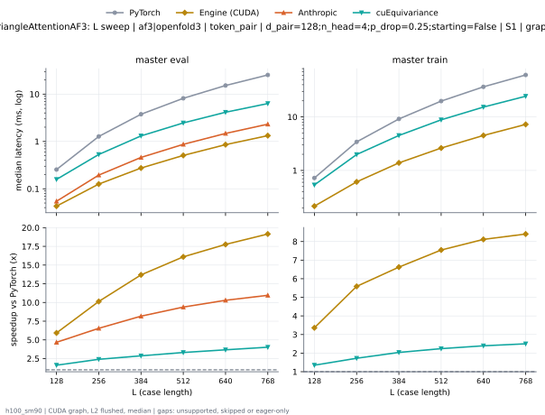
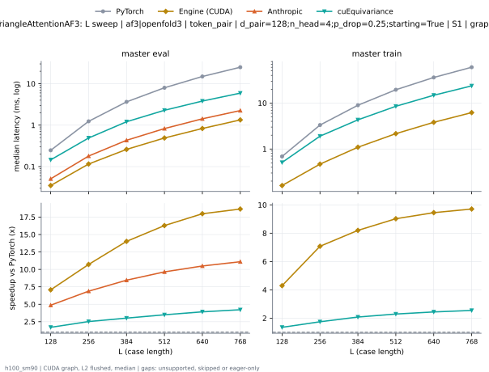
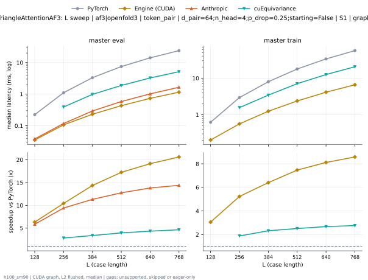
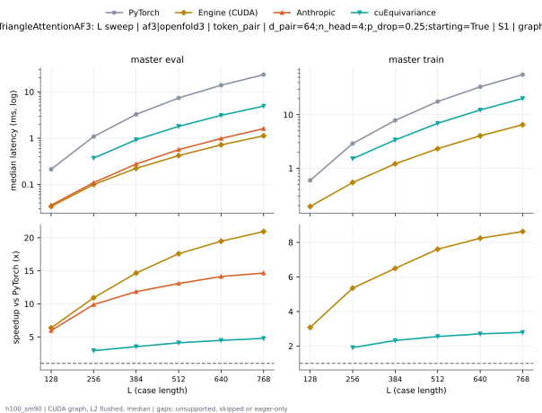
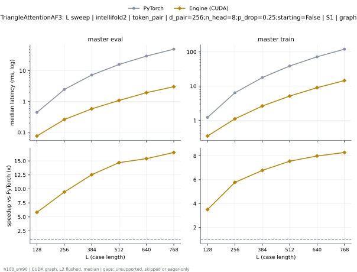
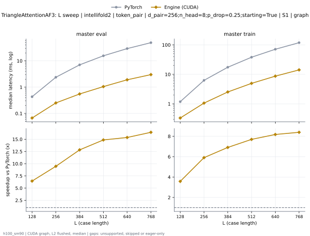
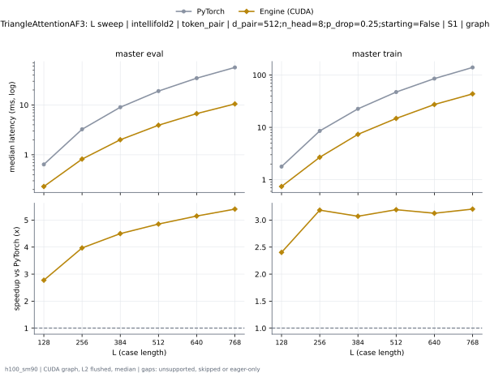
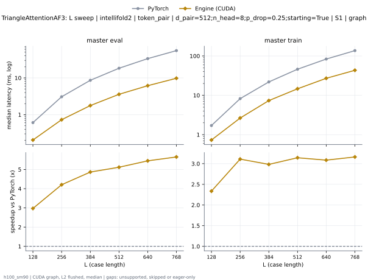
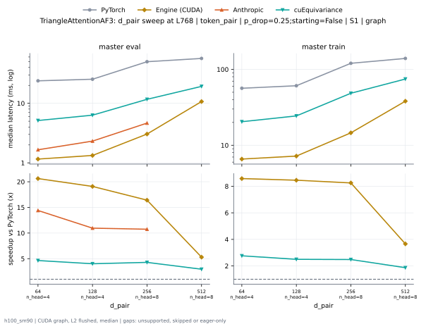
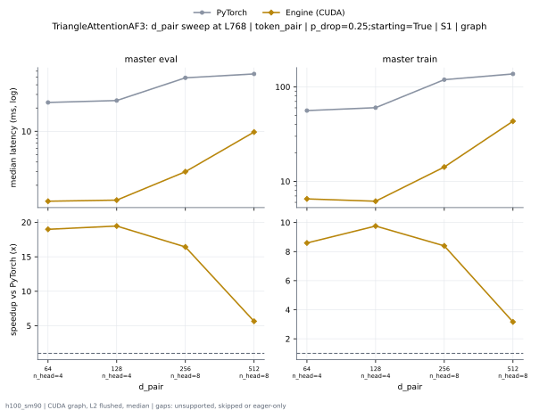

# TriangleAttentionAF3 on h100_sm90

Generated by `python -m miniworld_engine.measure.plot` from speed tokens `judge/tokens/h100_sm90/`; do not edit.

### L sweep: af3|openfold3 | token_pair | d_pair=128;n_head=4;p_drop=0.25;starting=False | S1 | graph

**master eval** (median ms; x = speedup vs PyTorch)

| L | PyTorch | Engine (Triton) | Engine (CUDA) | Anthropic | cuEquivariance |
|---|---|---|---|---|---|
| 128 | 0.2552 | 0.121 (2.11x) | 0.04307 (5.93x) | unsupported | unsupported |
| 256 | 1.275 | 0.3886 (3.28x) | 0.1259 (10.13x) | unsupported | unsupported |
| 384 | 3.748 | 0.9404 (3.99x) | 0.2734 (13.71x) | unsupported | unsupported |
| 512 | 8.17 | 1.741 (4.69x) | 0.5086 (16.06x) | unsupported | unsupported |
| 640 | 15.2 | 2.857 (5.32x) | 0.8568 (17.74x) | unsupported | unsupported |
| 768 | 25.4 | 4.28 (5.94x) | 1.328 (19.13x) | unsupported | unsupported |

**master train** (median ms; x = speedup vs PyTorch)

| L | PyTorch | Engine (Triton) | Engine (CUDA) | Anthropic | cuEquivariance |
|---|---|---|---|---|---|
| 128 | 0.7222 | 0.4358 (1.66x) | 0.2164 (3.34x) | unsupported | unsupported |
| 256 | 3.419 | 1.494 (2.29x) | 0.6138 (5.57x) | unsupported | unsupported |
| 384 | 9.16 | 3.06 (2.99x) | 1.382 (6.63x) | unsupported | unsupported |
| 512 | 19.8 | 5.705 (3.47x) | 2.622 (7.55x) | unsupported | unsupported |
| 640 | 36.55 | 9.455 (3.87x) | 4.512 (8.10x) | unsupported | unsupported |
| 768 | 60.93 | 14.6 (4.17x) | 7.228 (8.43x) | unsupported | unsupported |

### L sweep: af3|openfold3 | token_pair | d_pair=128;n_head=4;p_drop=0.25;starting=True | S1 | graph

**master eval** (median ms; x = speedup vs PyTorch)

| L | PyTorch | Engine (Triton) | Engine (CUDA) | Anthropic | cuEquivariance |
|---|---|---|---|---|---|
| 128 | 0.2418 | 0.1098 (2.20x) | 0.03602 (6.71x) | unsupported | unsupported |
| 256 | 1.232 | 0.3492 (3.53x) | 0.1174 (10.50x) | unsupported | unsupported |
| 384 | 3.647 | 0.8405 (4.34x) | 0.2636 (13.84x) | unsupported | unsupported |
| 512 | 7.989 | 1.563 (5.11x) | 0.4931 (16.20x) | unsupported | unsupported |
| 640 | 14.92 | 2.549 (5.85x) | 0.8306 (17.96x) | unsupported | unsupported |
| 768 | 25 | 3.887 (6.43x) | 1.285 (19.46x) | unsupported | unsupported |

**master train** (median ms; x = speedup vs PyTorch)

| L | PyTorch | Engine (Triton) | Engine (CUDA) | Anthropic | cuEquivariance |
|---|---|---|---|---|---|
| 128 | 0.6844 | 0.4016 (1.70x) | 0.1599 (4.28x) | unsupported | unsupported |
| 256 | 3.327 | 1.396 (2.38x) | 0.4681 (7.11x) | unsupported | unsupported |
| 384 | 8.97 | 2.867 (3.13x) | 1.09 (8.23x) | unsupported | unsupported |
| 512 | 19.46 | 5.369 (3.62x) | 2.15 (9.05x) | unsupported | unsupported |
| 640 | 36.03 | 8.94 (4.03x) | 3.795 (9.49x) | unsupported | unsupported |
| 768 | 60.18 | 13.86 (4.34x) | 6.166 (9.76x) | unsupported | unsupported |

### L sweep: af3|openfold3 | token_pair | d_pair=64;n_head=4;p_drop=0.25;starting=False | S1 | graph

**master eval** (median ms; x = speedup vs PyTorch)

| L | PyTorch | Engine (Triton) | Engine (CUDA) | Anthropic | cuEquivariance |
|---|---|---|---|---|---|
| 128 | 0.2236 | 0.1027 (2.18x) | 0.04547 (4.92x) | unsupported | unsupported |
| 256 | 1.11 | 0.2794 (3.97x) | 0.1264 (8.78x) | unsupported | unsupported |
| 384 | 3.326 | 0.658 (5.06x) | 0.2743 (12.13x) | unsupported | unsupported |
| 512 | 7.471 | 1.257 (5.94x) | 0.4969 (15.03x) | unsupported | unsupported |
| 640 | 14.12 | 2.071 (6.82x) | 0.8304 (17.00x) | unsupported | unsupported |
| 768 | 23.83 | 3.189 (7.47x) | 1.286 (18.53x) | unsupported | unsupported |

**master train** (median ms; x = speedup vs PyTorch)

| L | PyTorch | Engine (Triton) | Engine (CUDA) | Anthropic | cuEquivariance |
|---|---|---|---|---|---|
| 128 | 0.6196 | 0.3544 (1.75x) | 0.2034 (3.05x) | unsupported | unsupported |
| 256 | 2.928 | 1.129 (2.59x) | 0.5623 (5.21x) | unsupported | unsupported |
| 384 | 7.962 | 2.173 (3.66x) | 1.242 (6.41x) | unsupported | unsupported |
| 512 | 17.81 | 4.23 (4.21x) | 2.381 (7.48x) | unsupported | unsupported |
| 640 | 33.54 | 7.183 (4.67x) | 4.14 (8.10x) | unsupported | unsupported |
| 768 | 56.49 | 11.22 (5.04x) | 6.664 (8.48x) | unsupported | unsupported |

### L sweep: af3|openfold3 | token_pair | d_pair=64;n_head=4;p_drop=0.25;starting=True | S1 | graph

**master eval** (median ms; x = speedup vs PyTorch)

| L | PyTorch | Engine (Triton) | Engine (CUDA) | Anthropic | cuEquivariance |
|---|---|---|---|---|---|
| 128 | 0.2124 | 0.0937 (2.27x) | 0.03789 (5.60x) | unsupported | unsupported |
| 256 | 1.086 | 0.2591 (4.19x) | 0.1137 (9.55x) | unsupported | unsupported |
| 384 | 3.273 | 0.6092 (5.37x) | 0.261 (12.54x) | unsupported | unsupported |
| 512 | 7.374 | 1.173 (6.28x) | 0.4771 (15.46x) | unsupported | unsupported |
| 640 | 13.96 | 1.932 (7.23x) | 0.7972 (17.51x) | unsupported | unsupported |
| 768 | 23.61 | 2.963 (7.97x) | 1.243 (18.99x) | unsupported | unsupported |

**master train** (median ms; x = speedup vs PyTorch)

| L | PyTorch | Engine (Triton) | Engine (CUDA) | Anthropic | cuEquivariance |
|---|---|---|---|---|---|
| 128 | 0.5933 | 0.3338 (1.78x) | 0.1902 (3.12x) | unsupported | unsupported |
| 256 | 2.872 | 1.074 (2.68x) | 0.5389 (5.33x) | unsupported | unsupported |
| 384 | 7.856 | 2.059 (3.82x) | 1.206 (6.52x) | unsupported | unsupported |
| 512 | 17.64 | 4.034 (4.37x) | 2.321 (7.60x) | unsupported | unsupported |
| 640 | 33.2 | 6.87 (4.83x) | 4.029 (8.24x) | unsupported | unsupported |
| 768 | 56.06 | 10.83 (5.18x) | 6.524 (8.59x) | unsupported | unsupported |

### L sweep: intellifold2 | token_pair | d_pair=256;n_head=8;p_drop=0.25;starting=False | S1 | graph

**master eval** (median ms; x = speedup vs PyTorch)

| L | PyTorch | Engine (Triton) | Engine (CUDA) | Anthropic | cuEquivariance |
|---|---|---|---|---|---|
| 128 | 0.4428 | 0.1775 (2.49x) | 0.0761 (5.82x) | unsupported | unsupported |
| 256 | 2.462 | 0.7077 (3.48x) | 0.2608 (9.44x) | unsupported | unsupported |
| 384 | 7.25 | 1.653 (4.39x) | 0.5785 (12.53x) | unsupported | unsupported |
| 512 | 15.94 | 3.101 (5.14x) | 1.085 (14.70x) | unsupported | unsupported |
| 640 | 29.84 | 5.127 (5.82x) | 1.937 (15.40x) | unsupported | unsupported |
| 768 | 50.03 | 7.772 (6.44x) | 3.031 (16.50x) | unsupported | unsupported |

**master train** (median ms; x = speedup vs PyTorch)

| L | PyTorch | Engine (Triton) | Engine (CUDA) | Anthropic | cuEquivariance |
|---|---|---|---|---|---|
| 128 | 1.223 | 0.6558 (1.87x) | 0.3497 (3.50x) | unsupported | unsupported |
| 256 | 6.409 | 2.572 (2.49x) | 1.109 (5.78x) | unsupported | unsupported |
| 384 | 17.82 | 5.603 (3.18x) | 2.629 (6.78x) | unsupported | unsupported |
| 512 | 38.78 | 10.65 (3.64x) | 5.135 (7.55x) | unsupported | unsupported |
| 640 | 72.12 | 18.01 (4.00x) | 9.028 (7.99x) | unsupported | unsupported |
| 768 | 120.5 | 27.87 (4.32x) | 14.54 (8.28x) | unsupported | unsupported |

### L sweep: intellifold2 | token_pair | d_pair=256;n_head=8;p_drop=0.25;starting=True | S1 | graph

**master eval** (median ms; x = speedup vs PyTorch)

| L | PyTorch | Engine (Triton) | Engine (CUDA) | Anthropic | cuEquivariance |
|---|---|---|---|---|---|
| 128 | 0.4318 | 0.1597 (2.70x) | 0.06701 (6.44x) | unsupported | unsupported |
| 256 | 2.375 | 0.6263 (3.79x) | 0.2509 (9.47x) | unsupported | unsupported |
| 384 | 7.049 | 1.452 (4.85x) | 0.5495 (12.83x) | unsupported | unsupported |
| 512 | 15.58 | 2.745 (5.67x) | 1.048 (14.86x) | unsupported | unsupported |
| 640 | 29.28 | 4.549 (6.44x) | 1.905 (15.37x) | unsupported | unsupported |
| 768 | 49.23 | 6.959 (7.07x) | 2.997 (16.43x) | unsupported | unsupported |

**master train** (median ms; x = speedup vs PyTorch)

| L | PyTorch | Engine (Triton) | Engine (CUDA) | Anthropic | cuEquivariance |
|---|---|---|---|---|---|
| 128 | 1.182 | 0.6162 (1.92x) | 0.3304 (3.58x) | unsupported | unsupported |
| 256 | 6.256 | 2.41 (2.60x) | 1.059 (5.91x) | unsupported | unsupported |
| 384 | 17.44 | 5.23 (3.33x) | 2.524 (6.91x) | unsupported | unsupported |
| 512 | 38.13 | 9.974 (3.82x) | 4.951 (7.70x) | unsupported | unsupported |
| 640 | 71.11 | 16.94 (4.20x) | 8.691 (8.18x) | unsupported | unsupported |
| 768 | 119 | 26.44 (4.50x) | 14.18 (8.39x) | unsupported | unsupported |

### L sweep: intellifold2 | token_pair | d_pair=512;n_head=8;p_drop=0.25;starting=False | S1 | graph

**master eval** (median ms; x = speedup vs PyTorch)

| L | PyTorch | Engine (Triton) | Engine (CUDA) | Anthropic | cuEquivariance |
|---|---|---|---|---|---|
| 128 | 0.6398 | 0.3153 (2.03x) | 0.2306 (2.77x) | unsupported | unsupported |
| 256 | 3.25 | 1.231 (2.64x) | 0.8188 (3.97x) | unsupported | unsupported |
| 384 | 9.01 | 2.833 (3.18x) | 2.003 (4.50x) | unsupported | unsupported |
| 512 | 19.03 | 5.234 (3.63x) | 3.921 (4.85x) | unsupported | unsupported |
| 640 | 34.57 | 8.546 (4.05x) | 6.714 (5.15x) | unsupported | unsupported |
| 768 | 56.82 | 12.92 (4.40x) | 10.51 (5.41x) | unsupported | unsupported |

**master train** (median ms; x = speedup vs PyTorch)

| L | PyTorch | Engine (Triton) | Engine (CUDA) | Anthropic | cuEquivariance |
|---|---|---|---|---|---|
| 128 | 1.784 | 1.096 (1.63x) | 0.7428 (2.40x) | unsupported | unsupported |
| 256 | 8.558 | 4.176 (2.05x) | 2.688 (3.18x) | unsupported | unsupported |
| 384 | 22.62 | 9.274 (2.44x) | 7.366 (3.07x) | unsupported | unsupported |
| 512 | 47.32 | 17.49 (2.71x) | 14.83 (3.19x) | unsupported | unsupported |
| 640 | 85.52 | 29.23 (2.93x) | 27.35 (3.13x) | unsupported | unsupported |
| 768 | 139.7 | 45.05 (3.10x) | 43.63 (3.20x) | unsupported | unsupported |

### L sweep: intellifold2 | token_pair | d_pair=512;n_head=8;p_drop=0.25;starting=True | S1 | graph

**master eval** (median ms; x = speedup vs PyTorch)

| L | PyTorch | Engine (Triton) | Engine (CUDA) | Anthropic | cuEquivariance |
|---|---|---|---|---|---|
| 128 | 0.6087 | 0.2755 (2.21x) | 0.2047 (2.97x) | unsupported | unsupported |
| 256 | 3.073 | 1.065 (2.89x) | 0.7304 (4.21x) | unsupported | unsupported |
| 384 | 8.613 | 2.43 (3.54x) | 1.77 (4.87x) | unsupported | unsupported |
| 512 | 18.33 | 4.529 (4.05x) | 3.582 (5.12x) | unsupported | unsupported |
| 640 | 33.47 | 7.503 (4.46x) | 6.142 (5.45x) | unsupported | unsupported |
| 768 | 55.26 | 11.48 (4.81x) | 9.779 (5.65x) | unsupported | unsupported |

**master train** (median ms; x = speedup vs PyTorch)

| L | PyTorch | Engine (Triton) | Engine (CUDA) | Anthropic | cuEquivariance |
|---|---|---|---|---|---|
| 128 | 1.708 | 1.012 (1.69x) | 0.7313 (2.34x) | unsupported | unsupported |
| 256 | 8.225 | 3.84 (2.14x) | 2.645 (3.11x) | unsupported | unsupported |
| 384 | 21.9 | 8.564 (2.56x) | 7.342 (2.98x) | unsupported | unsupported |
| 512 | 46.06 | 16.25 (2.84x) | 14.65 (3.14x) | unsupported | unsupported |
| 640 | 83.53 | 27.28 (3.06x) | 27.08 (3.09x) | unsupported | unsupported |
| 768 | 136.9 | 42.4 (3.23x) | 43.29 (3.16x) | unsupported | unsupported |

### d_pair sweep at L768: token_pair | p_drop=0.25;starting=False | S1 | graph

**master eval** (median ms; x = speedup vs PyTorch)

| d_pair | PyTorch | Engine (Triton) | Engine (CUDA) | Anthropic | cuEquivariance |
|---|---|---|---|---|---|
| 64 n_head=4 | 23.83 | 3.189 (7.47x) | 1.286 (18.53x) | unsupported | unsupported |
| 128 n_head=4 | 25.4 | 4.28 (5.94x) | 1.328 (19.13x) | unsupported | unsupported |
| 256 n_head=8 | 50.03 | 7.772 (6.44x) | 3.031 (16.50x) | unsupported | unsupported |
| 512 n_head=8 | 56.82 | 12.92 (4.40x) | 10.51 (5.41x) | unsupported | unsupported |

**master train** (median ms; x = speedup vs PyTorch)

| d_pair | PyTorch | Engine (Triton) | Engine (CUDA) | Anthropic | cuEquivariance |
|---|---|---|---|---|---|
| 64 n_head=4 | 56.49 | 11.22 (5.04x) | 6.664 (8.48x) | unsupported | unsupported |
| 128 n_head=4 | 60.93 | 14.6 (4.17x) | 7.228 (8.43x) | unsupported | unsupported |
| 256 n_head=8 | 120.5 | 27.87 (4.32x) | 14.54 (8.28x) | unsupported | unsupported |
| 512 n_head=8 | 139.7 | 45.05 (3.10x) | 43.63 (3.20x) | unsupported | unsupported |

### d_pair sweep at L768: token_pair | p_drop=0.25;starting=True | S1 | graph

**master eval** (median ms; x = speedup vs PyTorch)

| d_pair | PyTorch | Engine (Triton) | Engine (CUDA) | Anthropic | cuEquivariance |
|---|---|---|---|---|---|
| 64 n_head=4 | 23.61 | 2.963 (7.97x) | 1.243 (18.99x) | unsupported | unsupported |
| 128 n_head=4 | 25 | 3.887 (6.43x) | 1.285 (19.46x) | unsupported | unsupported |
| 256 n_head=8 | 49.23 | 6.959 (7.07x) | 2.997 (16.43x) | unsupported | unsupported |
| 512 n_head=8 | 55.26 | 11.48 (4.81x) | 9.779 (5.65x) | unsupported | unsupported |

**master train** (median ms; x = speedup vs PyTorch)

| d_pair | PyTorch | Engine (Triton) | Engine (CUDA) | Anthropic | cuEquivariance |
|---|---|---|---|---|---|
| 64 n_head=4 | 56.06 | 10.83 (5.18x) | 6.524 (8.59x) | unsupported | unsupported |
| 128 n_head=4 | 60.18 | 13.86 (4.34x) | 6.166 (9.76x) | unsupported | unsupported |
| 256 n_head=8 | 119 | 26.44 (4.50x) | 14.18 (8.39x) | unsupported | unsupported |
| 512 n_head=8 | 136.9 | 42.4 (3.23x) | 43.29 (3.16x) | unsupported | unsupported |

