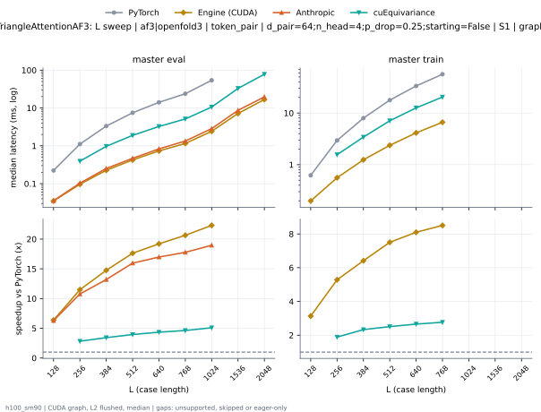
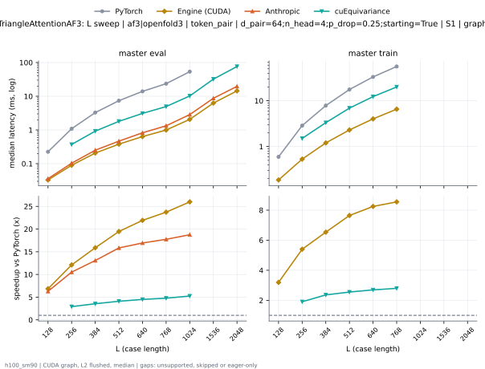
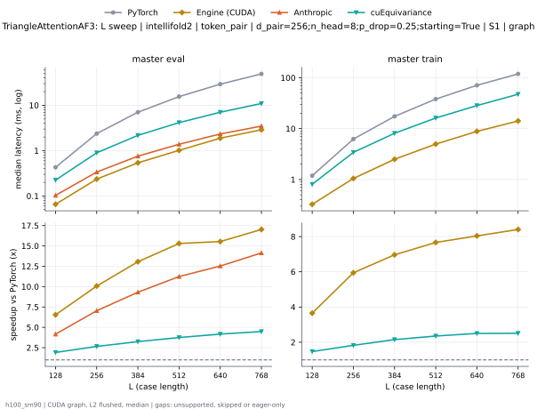

# TriangleAttentionAF3 on h100_sm90

Generated by `python -m miniworld_engine.measure.plot` from speed tokens `judge/tokens/h100_sm90/`; do not edit.

### L sweep: af3|openfold3 | token_pair | d_pair=128;n_head=4;p_drop=0.25;starting=False | S1 | graph

**master eval** (median ms; x = speedup vs PyTorch)

| L | PyTorch | Engine (Triton) | Engine (CUDA) | Anthropic | cuEquivariance |
|---|---|---|---|---|---|
| 128 | 0.2615 | 0.1231 (2.12x) | 0.04467 (5.85x) | 0.07213 (3.62x) | 0.1584 (1.65x) |
| 256 | 1.278 | 0.3922 (3.26x) | 0.1129 (11.32x) | 0.1928 (6.63x) | 0.53 (2.41x) |
| 384 | 3.754 | 0.9483 (3.96x) | 0.2458 (15.27x) | 0.4082 (9.20x) | 1.298 (2.89x) |
| 512 | 8.172 | 1.734 (4.71x) | 0.4528 (18.05x) | 0.6995 (11.68x) | 2.434 (3.36x) |
| 640 | 15.2 | 2.826 (5.38x) | 0.7624 (19.94x) | 1.126 (13.50x) | 4.071 (3.73x) |
| 768 | 25.44 | 4.292 (5.93x) | 1.184 (21.49x) | 1.706 (14.92x) | 6.288 (4.05x) |
| 1024 | 56.77 | 8.403 (6.76x) | 2.599 (21.84x) | 3.363 (16.88x) | 12.55 (4.52x) |
| 1536 | skipped | 22.83 | 7.636 | 9.326 | 38 |
| 2048 | skipped | 49.53 | 17.59 | 20.76 | 87.71 |

**master train** (median ms; x = speedup vs PyTorch)

| L | PyTorch | Engine (Triton) | Engine (CUDA) | Anthropic | cuEquivariance |
|---|---|---|---|---|---|
| 128 | 0.7282 | 0.4324 (1.68x) | 0.2128 (3.42x) | unsupported | 0.5338 (1.36x) |
| 256 | 3.421 | 1.483 (2.31x) | 0.6079 (5.63x) | unsupported | 1.987 (1.72x) |
| 384 | 9.171 | 3.058 (3.00x) | 1.383 (6.63x) | unsupported | 4.507 (2.03x) |
| 512 | 19.82 | 5.704 (3.47x) | 2.623 (7.56x) | unsupported | 8.836 (2.24x) |
| 640 | 36.57 | 9.448 (3.87x) | 4.508 (8.11x) | unsupported | 15.28 (2.39x) |
| 768 | 60.93 | 14.57 (4.18x) | 7.242 (8.41x) | unsupported | 24.37 (2.50x) |
| 1024 |  |  |  |  |  |
| 1536 |  |  |  |  |  |
| 2048 |  |  |  |  |  |

### L sweep: af3|openfold3 | token_pair | d_pair=128;n_head=4;p_drop=0.25;starting=True | S1 | graph

**master eval** (median ms; x = speedup vs PyTorch)

| L | PyTorch | Engine (Triton) | Engine (CUDA) | Anthropic | cuEquivariance |
|---|---|---|---|---|---|
| 128 | 0.2512 | 0.1104 (2.27x) | 0.03685 (6.82x) | 0.07238 (3.47x) | 0.1471 (1.71x) |
| 256 | 1.231 | 0.3496 (3.52x) | 0.1065 (11.56x) | 0.1929 (6.38x) | 0.4926 (2.50x) |
| 384 | 3.652 | 0.8399 (4.35x) | 0.2332 (15.66x) | 0.4074 (8.96x) | 1.2 (3.04x) |
| 512 | 7.992 | 1.567 (5.10x) | 0.4358 (18.34x) | 0.7041 (11.35x) | 2.262 (3.53x) |
| 640 | 14.92 | 2.55 (5.85x) | 0.7322 (20.38x) | 1.141 (13.08x) | 3.8 (3.93x) |
| 768 | 25 | 3.905 (6.40x) | 1.151 (21.72x) | 1.726 (14.49x) | 5.935 (4.21x) |
| 1024 | 56.11 | 7.809 (7.18x) | 2.512 (22.33x) | 3.426 (16.38x) | 11.91 (4.71x) |
| 1536 | skipped | 21.28 | 7.526 | 9.583 | 36.51 |
| 2048 | skipped | 46.77 | 16.83 | 20.75 | 85.22 |

**master train** (median ms; x = speedup vs PyTorch)

| L | PyTorch | Engine (Triton) | Engine (CUDA) | Anthropic | cuEquivariance |
|---|---|---|---|---|---|
| 128 | 0.6921 | 0.404 (1.71x) | 0.1573 (4.40x) | unsupported | 0.5062 (1.37x) |
| 256 | 3.332 | 1.393 (2.39x) | 0.4665 (7.14x) | unsupported | 1.897 (1.76x) |
| 384 | 8.981 | 2.848 (3.15x) | 1.088 (8.25x) | unsupported | 4.308 (2.08x) |
| 512 | 19.49 | 5.344 (3.65x) | 2.148 (9.07x) | unsupported | 8.503 (2.29x) |
| 640 | 36.03 | 8.929 (4.04x) | 3.78 (9.53x) | unsupported | 14.77 (2.44x) |
| 768 | 60.18 | 13.9 (4.33x) | 6.16 (9.77x) | unsupported | 23.64 (2.55x) |
| 1024 |  |  |  |  |  |
| 1536 |  |  |  |  |  |
| 2048 |  |  |  |  |  |

### L sweep: af3|openfold3 | token_pair | d_pair=64;n_head=4;p_drop=0.25;starting=False | S1 | graph

**master eval** (median ms; x = speedup vs PyTorch)

| L | PyTorch | Engine (Triton) | Engine (CUDA) | Anthropic | cuEquivariance |
|---|---|---|---|---|---|
| 128 | 0.2236 | 0.1031 (2.17x) | 0.03299 (6.78x) | 0.03547 (6.30x) | unsupported |
| 256 | 1.112 | 0.28 (3.97x) | 0.09205 (12.08x) | 0.1032 (10.78x) | 0.3933 (2.83x) |
| 384 | 3.326 | 0.6646 (5.00x) | 0.2069 (16.07x) | 0.2524 (13.18x) | 0.9715 (3.42x) |
| 512 | 7.472 | 1.264 (5.91x) | 0.3826 (19.53x) | 0.4682 (15.96x) | 1.892 (3.95x) |
| 640 | 14.14 | 2.081 (6.80x) | 0.6499 (21.76x) | 0.8314 (17.01x) | 3.251 (4.35x) |
| 768 | 23.87 | 3.181 (7.50x) | 1.021 (23.39x) | 1.341 (17.80x) | 5.144 (4.64x) |
| 1024 | 54.01 | 6.388 (8.46x) | 2.135 (25.29x) | 2.849 (18.96x) | 10.61 (5.09x) |
| 1536 | skipped | 17.56 | 6.4 | 8.686 | 32.91 |
| 2048 | skipped | 38.22 | 14.82 | 19.65 | 78.06 |

**master train** (median ms; x = speedup vs PyTorch)

| L | PyTorch | Engine (Triton) | Engine (CUDA) | Anthropic | cuEquivariance |
|---|---|---|---|---|---|
| 128 | 0.6514 | 0.357 (1.82x) | 0.2005 (3.25x) | unsupported | unsupported |
| 256 | 2.937 | 1.143 (2.57x) | 0.5557 (5.29x) | unsupported | 1.56 (1.88x) |
| 384 | 7.965 | 2.169 (3.67x) | 1.24 (6.42x) | unsupported | 3.421 (2.33x) |
| 512 | 17.81 | 4.201 (4.24x) | 2.367 (7.52x) | unsupported | 7.089 (2.51x) |
| 640 | 33.5 | 7.174 (4.67x) | 4.13 (8.11x) | unsupported | 12.59 (2.66x) |
| 768 | 56.49 | 11.2 (5.04x) | 6.669 (8.47x) | unsupported | 20.43 (2.77x) |
| 1024 |  |  |  |  |  |
| 1536 |  |  |  |  |  |
| 2048 |  |  |  |  |  |

### L sweep: af3|openfold3 | token_pair | d_pair=64;n_head=4;p_drop=0.25;starting=True | S1 | graph

**master eval** (median ms; x = speedup vs PyTorch)

| L | PyTorch | Engine (Triton) | Engine (CUDA) | Anthropic | cuEquivariance |
|---|---|---|---|---|---|
| 128 | 0.2253 | 0.09435 (2.39x) | 0.0329 (6.85x) | 0.03582 (6.29x) | unsupported |
| 256 | 1.087 | 0.2579 (4.21x) | 0.08976 (12.11x) | 0.1033 (10.52x) | 0.3715 (2.93x) |
| 384 | 3.281 | 0.6087 (5.39x) | 0.2065 (15.89x) | 0.2509 (13.07x) | 0.9233 (3.55x) |
| 512 | 7.386 | 1.171 (6.31x) | 0.3794 (19.47x) | 0.4661 (15.85x) | 1.801 (4.10x) |
| 640 | 13.96 | 1.934 (7.22x) | 0.637 (21.92x) | 0.8243 (16.94x) | 3.101 (4.50x) |
| 768 | 23.61 | 2.95 (8.00x) | 0.9949 (23.73x) | 1.331 (17.74x) | 4.941 (4.78x) |
| 1024 | 53.63 | 6.016 (8.92x) | 2.063 (25.99x) | 2.859 (18.76x) | 10.21 (5.25x) |
| 1536 | skipped | 16.72 | 6.278 | 8.7 | 32.16 |
| 2048 | skipped | 36.84 | 14.43 | 19.67 | 76.33 |

**master train** (median ms; x = speedup vs PyTorch)

| L | PyTorch | Engine (Triton) | Engine (CUDA) | Anthropic | cuEquivariance |
|---|---|---|---|---|---|
| 128 | 0.5954 | 0.3285 (1.81x) | 0.1865 (3.19x) | unsupported | unsupported |
| 256 | 2.871 | 1.098 (2.61x) | 0.5316 (5.40x) | unsupported | 1.506 (1.91x) |
| 384 | 7.854 | 2.068 (3.80x) | 1.202 (6.54x) | unsupported | 3.328 (2.36x) |
| 512 | 17.62 | 4.04 (4.36x) | 2.304 (7.65x) | unsupported | 6.909 (2.55x) |
| 640 | 33.2 | 6.9 (4.81x) | 4.025 (8.25x) | unsupported | 12.32 (2.69x) |
| 768 | 56.12 | 10.79 (5.20x) | 6.562 (8.55x) | unsupported | 20.05 (2.80x) |
| 1024 |  |  |  |  |  |
| 1536 |  |  |  |  |  |
| 2048 |  |  |  |  |  |

### L sweep: intellifold2 | token_pair | d_pair=256;n_head=8;p_drop=0.25;starting=False | S1 | graph

**master eval** (median ms; x = speedup vs PyTorch)

| L | PyTorch | Engine (Triton) | Engine (CUDA) | Anthropic | cuEquivariance |
|---|---|---|---|---|---|
| 128 | 0.4531 | 0.1795 (2.52x) | 0.0736 (6.16x) | 0.1026 (4.42x) | 0.2423 (1.87x) |
| 256 | 2.467 | 0.7107 (3.47x) | 0.2421 (10.19x) | 0.3394 (7.27x) | 0.9845 (2.51x) |
| 384 | 7.265 | 1.656 (4.39x) | 0.5444 (13.34x) | 0.7586 (9.58x) | 2.373 (3.06x) |
| 512 | 15.94 | 3.101 (5.14x) | 1.019 (15.65x) | 1.395 (11.42x) | 4.501 (3.54x) |
| 640 | 29.84 | 5.126 (5.82x) | 1.858 (16.06x) | 2.317 (12.88x) | 7.564 (3.95x) |
| 768 | 50.02 | 7.727 (6.47x) | 2.925 (17.10x) | 3.474 (14.40x) | 11.74 (4.26x) |

**master train** (median ms; x = speedup vs PyTorch)

| L | PyTorch | Engine (Triton) | Engine (CUDA) | Anthropic | cuEquivariance |
|---|---|---|---|---|---|
| 128 | 1.226 | 0.6616 (1.85x) | 0.3472 (3.53x) | unsupported | 0.848 (1.45x) |
| 256 | 6.422 | 2.572 (2.50x) | 1.11 (5.79x) | unsupported | 3.58 (1.79x) |
| 384 | 17.82 | 5.612 (3.18x) | 2.632 (6.77x) | unsupported | 8.481 (2.10x) |
| 512 | 38.78 | 10.64 (3.65x) | 5.145 (7.54x) | unsupported | 16.83 (2.30x) |
| 640 | 72.12 | 18.01 (4.01x) | 9.052 (7.97x) | unsupported | 29.45 (2.45x) |
| 768 | 120.5 | 27.86 (4.32x) | 14.63 (8.23x) | unsupported | 48.83 (2.47x) |

### L sweep: intellifold2 | token_pair | d_pair=256;n_head=8;p_drop=0.25;starting=True | S1 | graph

**master eval** (median ms; x = speedup vs PyTorch)

| L | PyTorch | Engine (Triton) | Engine (CUDA) | Anthropic | cuEquivariance |
|---|---|---|---|---|---|
| 128 | 0.4318 | 0.1597 (2.70x) | 0.06701 (6.44x) | 0.1032 (4.19x) | 0.2244 (1.92x) |
| 256 | 2.38 | 0.6202 (3.84x) | 0.2342 (10.16x) | 0.3376 (7.05x) | 0.8969 (2.65x) |
| 384 | 7.06 | 1.457 (4.84x) | 0.533 (13.25x) | 0.7564 (9.33x) | 2.173 (3.25x) |
| 512 | 15.57 | 2.742 (5.68x) | 1.017 (15.31x) | 1.384 (11.25x) | 4.154 (3.75x) |
| 640 | 29.28 | 4.567 (6.41x) | 1.856 (15.77x) | 2.334 (12.54x) | 7.023 (4.17x) |
| 768 | 49.2 | 7.002 (7.03x) | 2.936 (16.76x) | 3.477 (14.15x) | 10.97 (4.48x) |

**master train** (median ms; x = speedup vs PyTorch)

| L | PyTorch | Engine (Triton) | Engine (CUDA) | Anthropic | cuEquivariance |
|---|---|---|---|---|---|
| 128 | 1.19 | 0.6156 (1.93x) | 0.3286 (3.62x) | unsupported | 0.8081 (1.47x) |
| 256 | 6.249 | 2.403 (2.60x) | 1.055 (5.92x) | unsupported | 3.421 (1.83x) |
| 384 | 17.45 | 5.229 (3.34x) | 2.516 (6.94x) | unsupported | 8.109 (2.15x) |
| 512 | 38.14 | 9.993 (3.82x) | 4.984 (7.65x) | unsupported | 16.19 (2.36x) |
| 640 | 71.11 | 16.98 (4.19x) | 8.724 (8.15x) | unsupported | 28.41 (2.50x) |
| 768 | 119 | 26.47 (4.50x) | 14.3 (8.32x) | unsupported | 47.43 (2.51x) |

### L sweep: intellifold2 | token_pair | d_pair=512;n_head=8;p_drop=0.25;starting=False | S1 | graph

**master eval** (median ms; x = speedup vs PyTorch)

| L | PyTorch | Engine (Triton) | Engine (CUDA) | Anthropic | cuEquivariance |
|---|---|---|---|---|---|
| 128 | 0.649 | 0.3145 (2.06x) | 0.2381 (2.73x) | unsupported | 0.433 (1.50x) |
| 256 | 3.254 | 1.232 (2.64x) | 0.7464 (4.36x) | unsupported | 1.718 (1.89x) |
| 384 | 9.018 | 2.822 (3.20x) | 1.615 (5.58x) | unsupported | 4.027 (2.24x) |
| 512 | 19.03 | 5.236 (3.63x) | 2.991 (6.36x) | unsupported | 7.492 (2.54x) |
| 640 | 34.57 | 8.568 (4.03x) | 4.89 (7.07x) | unsupported | 12.48 (2.77x) |
| 768 | 56.75 | 13 (4.37x) | 7.347 (7.73x) | unsupported | 19.26 (2.95x) |

**master train** (median ms; x = speedup vs PyTorch)

| L | PyTorch | Engine (Triton) | Engine (CUDA) | Anthropic | cuEquivariance |
|---|---|---|---|---|---|
| 128 | 1.8 | 1.095 (1.64x) | 0.7259 (2.48x) | unsupported | 1.415 (1.27x) |
| 256 | 8.565 | 4.169 (2.05x) | 2.615 (3.28x) | unsupported | 5.808 (1.47x) |
| 384 | 22.63 | 9.286 (2.44x) | 6.602 (3.43x) | unsupported | 13.76 (1.65x) |
| 512 | 47.34 | 17.56 (2.70x) | 13.3 (3.56x) | unsupported | 26.76 (1.77x) |
| 640 | 85.54 | 29.34 (2.91x) | 23.55 (3.63x) | unsupported | 46.41 (1.84x) |
| 768 | 139.7 | 45.65 (3.06x) | 38.2 (3.66x) | unsupported | 74.6 (1.87x) |

### L sweep: intellifold2 | token_pair | d_pair=512;n_head=8;p_drop=0.25;starting=True | S1 | graph

**master eval** (median ms; x = speedup vs PyTorch)

| L | PyTorch | Engine (Triton) | Engine (CUDA) | Anthropic | cuEquivariance |
|---|---|---|---|---|---|
| 128 | 0.6387 | 0.2749 (2.32x) | 0.2144 (2.98x) | unsupported | 0.3968 (1.61x) |
| 256 | 3.076 | 1.056 (2.91x) | 0.6616 (4.65x) | unsupported | 1.544 (1.99x) |
| 384 | 8.621 | 2.433 (3.54x) | 1.432 (6.02x) | unsupported | 3.629 (2.38x) |
| 512 | 18.33 | 4.548 (4.03x) | 2.697 (6.80x) | unsupported | 6.798 (2.70x) |
| 640 | 33.59 | 7.56 (4.44x) | 4.419 (7.60x) | unsupported | 11.39 (2.95x) |
| 768 | 55.19 | 11.69 (4.72x) | 6.668 (8.28x) | unsupported | 17.77 (3.11x) |

**master train** (median ms; x = speedup vs PyTorch)

| L | PyTorch | Engine (Triton) | Engine (CUDA) | Anthropic | cuEquivariance |
|---|---|---|---|---|---|
| 128 | 1.712 | 1.008 (1.70x) | 0.7123 (2.40x) | unsupported | 1.325 (1.29x) |
| 256 | 8.23 | 3.832 (2.15x) | 2.573 (3.20x) | unsupported | 5.483 (1.50x) |
| 384 | 21.91 | 8.594 (2.55x) | 6.532 (3.35x) | unsupported | 13.02 (1.68x) |
| 512 | 46.07 | 16.35 (2.82x) | 13.15 (3.50x) | unsupported | 25.45 (1.81x) |
| 640 | 83.56 | 27.56 (3.03x) | 23.49 (3.56x) | unsupported | 44.55 (1.88x) |
| 768 | 136.9 | 42.69 (3.21x) | 37.81 (3.62x) | unsupported | 71.99 (1.90x) |

### d_pair sweep at L768: token_pair | p_drop=0.25;starting=False | S1 | graph

**master eval** (median ms; x = speedup vs PyTorch)

| d_pair | PyTorch | Engine (Triton) | Engine (CUDA) | Anthropic | cuEquivariance |
|---|---|---|---|---|---|
| 64 n_head=4 | 23.87 | 3.181 (7.50x) | 1.021 (23.39x) | 1.341 (17.80x) | 5.144 (4.64x) |
| 128 n_head=4 | 25.44 | 4.292 (5.93x) | 1.184 (21.49x) | 1.706 (14.92x) | 6.288 (4.05x) |
| 256 n_head=8 | 50.02 | 7.727 (6.47x) | 2.925 (17.10x) | 3.474 (14.40x) | 11.74 (4.26x) |
| 512 n_head=8 | 56.75 | 13 (4.37x) | 7.347 (7.73x) | unsupported | 19.26 (2.95x) |

**master train** (median ms; x = speedup vs PyTorch)

| d_pair | PyTorch | Engine (Triton) | Engine (CUDA) | Anthropic | cuEquivariance |
|---|---|---|---|---|---|
| 64 n_head=4 | 56.49 | 11.2 (5.04x) | 6.669 (8.47x) | unsupported | 20.43 (2.77x) |
| 128 n_head=4 | 60.93 | 14.57 (4.18x) | 7.242 (8.41x) | unsupported | 24.37 (2.50x) |
| 256 n_head=8 | 120.5 | 27.86 (4.32x) | 14.63 (8.23x) | unsupported | 48.83 (2.47x) |
| 512 n_head=8 | 139.7 | 45.65 (3.06x) | 38.2 (3.66x) | unsupported | 74.6 (1.87x) |

### d_pair sweep at L768: token_pair | p_drop=0.25;starting=True | S1 | graph

**master eval** (median ms; x = speedup vs PyTorch)

| d_pair | PyTorch | Engine (Triton) | Engine (CUDA) | Anthropic | cuEquivariance |
|---|---|---|---|---|---|
| 64 n_head=4 | 23.61 | 2.95 (8.00x) | 0.9949 (23.73x) | 1.331 (17.74x) | 4.941 (4.78x) |
| 128 n_head=4 | 25 | 3.905 (6.40x) | 1.151 (21.72x) | 1.726 (14.49x) | 5.935 (4.21x) |
| 256 n_head=8 | 49.2 | 7.002 (7.03x) | 2.936 (16.76x) | 3.477 (14.15x) | 10.97 (4.48x) |
| 512 n_head=8 | 55.19 | 11.69 (4.72x) | 6.668 (8.28x) | unsupported | 17.77 (3.11x) |

**master train** (median ms; x = speedup vs PyTorch)

| d_pair | PyTorch | Engine (Triton) | Engine (CUDA) | Anthropic | cuEquivariance |
|---|---|---|---|---|---|
| 64 n_head=4 | 56.12 | 10.79 (5.20x) | 6.562 (8.55x) | unsupported | 20.05 (2.80x) |
| 128 n_head=4 | 60.18 | 13.9 (4.33x) | 6.16 (9.77x) | unsupported | 23.64 (2.55x) |
| 256 n_head=8 | 119 | 26.47 (4.50x) | 14.3 (8.32x) | unsupported | 47.43 (2.51x) |
| 512 n_head=8 | 136.9 | 42.69 (3.21x) | 37.81 (3.62x) | unsupported | 71.99 (1.90x) |

