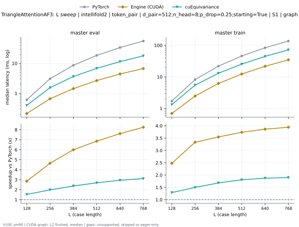

# TriangleAttentionAF3 on h100_sm90

Generated by `python -m miniworld_engine.measure.plot` from speed tokens `judge/tokens/h100_sm90/`; do not edit.

### L sweep: af3|openfold3 | token_pair | d_pair=128;n_head=4;p_drop=0.25;starting=False | S1 | graph

**master eval** (median ms; x = speedup vs PyTorch)

| L | PyTorch | Engine (Triton) | Engine (CUDA) | Anthropic | cuEquivariance |
|---|---|---|---|---|---|
| 128 | 0.2571 | 0.1231 (2.09x) | 0.04349 (5.91x) | 0.07213 (3.56x) | 0.1584 (1.62x) |
| 256 | 1.27 | 0.3922 (3.24x) | 0.1143 (11.11x) | 0.1928 (6.59x) | 0.53 (2.40x) |
| 384 | 3.745 | 0.9483 (3.95x) | 0.2485 (15.07x) | 0.4082 (9.17x) | 1.298 (2.88x) |
| 512 | 8.163 | 1.734 (4.71x) | 0.4583 (17.81x) | 0.6995 (11.67x) | 2.434 (3.35x) |
| 640 | 15.19 | 2.826 (5.37x) | 0.7772 (19.54x) | 1.126 (13.49x) | 4.071 (3.73x) |
| 768 | 25.39 | 4.292 (5.92x) | 1.212 (20.95x) | 1.706 (14.88x) | 6.288 (4.04x) |
| 1024 | 56.74 | 8.403 (6.75x) | 2.597 (21.85x) | 3.363 (16.87x) | 12.55 (4.52x) |
| 1536 | skipped | 22.83 | 7.91 | 9.326 | 38 |
| 2048 | skipped | 49.53 | 17.78 | 20.76 | 87.71 |

**master train** (median ms; x = speedup vs PyTorch)

| L | PyTorch | Engine (Triton) | Engine (CUDA) | Anthropic | cuEquivariance |
|---|---|---|---|---|---|
| 128 | 0.7243 | 0.4324 (1.68x) | 0.2136 (3.39x) | unsupported | 0.5338 (1.36x) |
| 256 | 3.414 | 1.483 (2.30x) | 0.6069 (5.63x) | unsupported | 1.987 (1.72x) |
| 384 | 9.172 | 3.058 (3.00x) | 1.375 (6.67x) | unsupported | 4.507 (2.04x) |
| 512 | 19.81 | 5.704 (3.47x) | 2.618 (7.57x) | unsupported | 8.836 (2.24x) |
| 640 | 36.57 | 9.448 (3.87x) | 4.509 (8.11x) | unsupported | 15.28 (2.39x) |
| 768 | 60.95 | 14.57 (4.18x) | 7.228 (8.43x) | unsupported | 24.37 (2.50x) |
| 1024 |  |  |  |  |  |
| 1536 |  |  |  |  |  |
| 2048 |  |  |  |  |  |

### L sweep: af3|openfold3 | token_pair | d_pair=128;n_head=4;p_drop=0.25;starting=True | S1 | graph

**master eval** (median ms; x = speedup vs PyTorch)

| L | PyTorch | Engine (Triton) | Engine (CUDA) | Anthropic | cuEquivariance |
|---|---|---|---|---|---|
| 128 | 0.2525 | 0.1104 (2.29x) | 0.03674 (6.87x) | 0.07238 (3.49x) | 0.1471 (1.72x) |
| 256 | 1.231 | 0.3496 (3.52x) | 0.1078 (11.42x) | 0.1929 (6.38x) | 0.4926 (2.50x) |
| 384 | 3.65 | 0.8399 (4.35x) | 0.2353 (15.51x) | 0.4074 (8.96x) | 1.2 (3.04x) |
| 512 | 7.987 | 1.567 (5.10x) | 0.4397 (18.17x) | 0.7041 (11.34x) | 2.262 (3.53x) |
| 640 | 14.91 | 2.55 (5.85x) | 0.7626 (19.55x) | 1.141 (13.07x) | 3.8 (3.92x) |
| 768 | 24.98 | 3.905 (6.40x) | 1.175 (21.25x) | 1.726 (14.48x) | 5.935 (4.21x) |
| 1024 | 56.01 | 7.809 (7.17x) | 2.615 (21.42x) | 3.426 (16.35x) | 11.91 (4.70x) |
| 1536 | skipped | 21.28 | 7.741 | 9.583 | 36.51 |
| 2048 | skipped | 46.77 | 17.09 | 20.75 | 85.22 |

**master train** (median ms; x = speedup vs PyTorch)

| L | PyTorch | Engine (Triton) | Engine (CUDA) | Anthropic | cuEquivariance |
|---|---|---|---|---|---|
| 128 | 0.684 | 0.404 (1.69x) | 0.1556 (4.40x) | unsupported | 0.5062 (1.35x) |
| 256 | 3.317 | 1.393 (2.38x) | 0.4622 (7.18x) | unsupported | 1.897 (1.75x) |
| 384 | 8.971 | 2.848 (3.15x) | 1.095 (8.19x) | unsupported | 4.308 (2.08x) |
| 512 | 19.47 | 5.344 (3.64x) | 2.156 (9.03x) | unsupported | 8.503 (2.29x) |
| 640 | 36.05 | 8.929 (4.04x) | 3.812 (9.46x) | unsupported | 14.77 (2.44x) |
| 768 | 60.19 | 13.9 (4.33x) | 6.167 (9.76x) | unsupported | 23.64 (2.55x) |
| 1024 |  |  |  |  |  |
| 1536 |  |  |  |  |  |
| 2048 |  |  |  |  |  |

### L sweep: af3|openfold3 | token_pair | d_pair=64;n_head=4;p_drop=0.25;starting=False | S1 | graph

**master eval** (median ms; x = speedup vs PyTorch)

| L | PyTorch | Engine (Triton) | Engine (CUDA) | Anthropic | cuEquivariance |
|---|---|---|---|---|---|
| 128 | 0.2233 | 0.1031 (2.17x) | 0.03307 (6.75x) | 0.03547 (6.30x) | unsupported |
| 256 | 1.109 | 0.28 (3.96x) | 0.09666 (11.47x) | 0.1032 (10.75x) | 0.3933 (2.82x) |
| 384 | 3.33 | 0.6646 (5.01x) | 0.2257 (14.75x) | 0.2524 (13.19x) | 0.9715 (3.43x) |
| 512 | 7.467 | 1.264 (5.91x) | 0.4262 (17.52x) | 0.4682 (15.95x) | 1.892 (3.95x) |
| 640 | 14.11 | 2.081 (6.78x) | 0.7245 (19.48x) | 0.8314 (16.97x) | 3.251 (4.34x) |
| 768 | 23.82 | 3.181 (7.49x) | 1.153 (20.65x) | 1.341 (17.76x) | 5.144 (4.63x) |
| 1024 | 53.99 | 6.388 (8.45x) | 2.421 (22.30x) | 2.849 (18.95x) | 10.61 (5.09x) |
| 1536 | skipped | 17.56 | 7.129 | 8.686 | 32.91 |
| 2048 | skipped | 38.22 | 15.87 | 19.65 | 78.06 |

**master train** (median ms; x = speedup vs PyTorch)

| L | PyTorch | Engine (Triton) | Engine (CUDA) | Anthropic | cuEquivariance |
|---|---|---|---|---|---|
| 128 | 0.6206 | 0.357 (1.74x) | 0.1969 (3.15x) | unsupported | unsupported |
| 256 | 2.932 | 1.143 (2.57x) | 0.5557 (5.28x) | unsupported | 1.56 (1.88x) |
| 384 | 7.956 | 2.169 (3.67x) | 1.237 (6.43x) | unsupported | 3.421 (2.33x) |
| 512 | 17.81 | 4.201 (4.24x) | 2.377 (7.49x) | unsupported | 7.089 (2.51x) |
| 640 | 33.54 | 7.174 (4.68x) | 4.137 (8.11x) | unsupported | 12.59 (2.66x) |
| 768 | 56.5 | 11.2 (5.04x) | 6.642 (8.51x) | unsupported | 20.43 (2.77x) |
| 1024 |  |  |  |  |  |
| 1536 |  |  |  |  |  |
| 2048 |  |  |  |  |  |

### L sweep: af3|openfold3 | token_pair | d_pair=64;n_head=4;p_drop=0.25;starting=True | S1 | graph

**master eval** (median ms; x = speedup vs PyTorch)

| L | PyTorch | Engine (Triton) | Engine (CUDA) | Anthropic | cuEquivariance |
|---|---|---|---|---|---|
| 128 | 0.2135 | 0.09435 (2.26x) | 0.03256 (6.56x) | 0.03582 (5.96x) | unsupported |
| 256 | 1.079 | 0.2579 (4.18x) | 0.09365 (11.53x) | 0.1033 (10.44x) | 0.3715 (2.91x) |
| 384 | 3.273 | 0.6087 (5.38x) | 0.2203 (14.85x) | 0.2509 (13.04x) | 0.9233 (3.54x) |
| 512 | 7.374 | 1.171 (6.30x) | 0.4196 (17.58x) | 0.4661 (15.82x) | 1.801 (4.09x) |
| 640 | 13.96 | 1.934 (7.22x) | 0.7159 (19.49x) | 0.8243 (16.93x) | 3.101 (4.50x) |
| 768 | 23.6 | 2.95 (8.00x) | 1.134 (20.81x) | 1.331 (17.73x) | 4.941 (4.78x) |
| 1024 | 53.6 | 6.016 (8.91x) | 2.392 (22.41x) | 2.859 (18.75x) | 10.21 (5.25x) |
| 1536 | skipped | 16.72 | 7.098 | 8.7 | 32.16 |
| 2048 | skipped | 36.84 | 15.86 | 19.67 | 76.33 |

**master train** (median ms; x = speedup vs PyTorch)

| L | PyTorch | Engine (Triton) | Engine (CUDA) | Anthropic | cuEquivariance |
|---|---|---|---|---|---|
| 128 | 0.5998 | 0.3285 (1.83x) | 0.1846 (3.25x) | unsupported | unsupported |
| 256 | 2.875 | 1.098 (2.62x) | 0.533 (5.39x) | unsupported | 1.506 (1.91x) |
| 384 | 7.857 | 2.068 (3.80x) | 1.2 (6.55x) | unsupported | 3.328 (2.36x) |
| 512 | 17.62 | 4.04 (4.36x) | 2.317 (7.61x) | unsupported | 6.909 (2.55x) |
| 640 | 33.25 | 6.9 (4.82x) | 4.037 (8.24x) | unsupported | 12.32 (2.70x) |
| 768 | 56.08 | 10.79 (5.20x) | 6.536 (8.58x) | unsupported | 20.05 (2.80x) |
| 1024 |  |  |  |  |  |
| 1536 |  |  |  |  |  |
| 2048 |  |  |  |  |  |

### L sweep: intellifold2 | token_pair | d_pair=256;n_head=8;p_drop=0.25;starting=False | S1 | graph

**master eval** (median ms; x = speedup vs PyTorch)

| L | PyTorch | Engine (Triton) | Engine (CUDA) | Anthropic | cuEquivariance |
|---|---|---|---|---|---|
| 128 | 0.4737 | 0.1795 (2.64x) | 0.07363 (6.43x) | 0.1026 (4.62x) | 0.2423 (1.96x) |
| 256 | 2.468 | 0.7107 (3.47x) | 0.244 (10.11x) | 0.3394 (7.27x) | 0.9845 (2.51x) |
| 384 | 7.26 | 1.656 (4.38x) | 0.5475 (13.26x) | 0.7586 (9.57x) | 2.373 (3.06x) |
| 512 | 15.93 | 3.101 (5.14x) | 1.067 (14.93x) | 1.395 (11.42x) | 4.501 (3.54x) |
| 640 | 29.82 | 5.126 (5.82x) | 1.85 (16.12x) | 2.317 (12.87x) | 7.564 (3.94x) |
| 768 | 49.98 | 7.727 (6.47x) | 3.025 (16.52x) | 3.474 (14.39x) | 11.74 (4.26x) |

**master train** (median ms; x = speedup vs PyTorch)

| L | PyTorch | Engine (Triton) | Engine (CUDA) | Anthropic | cuEquivariance |
|---|---|---|---|---|---|
| 128 | 1.229 | 0.6616 (1.86x) | 0.3463 (3.55x) | unsupported | 0.848 (1.45x) |
| 256 | 6.413 | 2.572 (2.49x) | 1.101 (5.82x) | unsupported | 3.58 (1.79x) |
| 384 | 17.81 | 5.612 (3.17x) | 2.621 (6.80x) | unsupported | 8.481 (2.10x) |
| 512 | 38.77 | 10.64 (3.64x) | 5.16 (7.51x) | unsupported | 16.83 (2.30x) |
| 640 | 72.07 | 18.01 (4.00x) | 9.109 (7.91x) | unsupported | 29.45 (2.45x) |
| 768 | 120.4 | 27.86 (4.32x) | 14.63 (8.23x) | unsupported | 48.83 (2.47x) |

### L sweep: intellifold2 | token_pair | d_pair=256;n_head=8;p_drop=0.25;starting=True | S1 | graph

**master eval** (median ms; x = speedup vs PyTorch)

| L | PyTorch | Engine (Triton) | Engine (CUDA) | Anthropic | cuEquivariance |
|---|---|---|---|---|---|
| 128 | 0.4292 | 0.1597 (2.69x) | 0.06563 (6.54x) | 0.1032 (4.16x) | 0.2244 (1.91x) |
| 256 | 2.378 | 0.6202 (3.83x) | 0.2361 (10.07x) | 0.3376 (7.04x) | 0.8969 (2.65x) |
| 384 | 7.043 | 1.457 (4.83x) | 0.5393 (13.06x) | 0.7564 (9.31x) | 2.173 (3.24x) |
| 512 | 15.55 | 2.742 (5.67x) | 1.016 (15.30x) | 1.384 (11.24x) | 4.154 (3.74x) |
| 640 | 29.26 | 4.567 (6.41x) | 1.883 (15.54x) | 2.334 (12.53x) | 7.023 (4.17x) |
| 768 | 49.18 | 7.002 (7.02x) | 2.889 (17.02x) | 3.477 (14.14x) | 10.97 (4.48x) |

**master train** (median ms; x = speedup vs PyTorch)

| L | PyTorch | Engine (Triton) | Engine (CUDA) | Anthropic | cuEquivariance |
|---|---|---|---|---|---|
| 128 | 1.191 | 0.6156 (1.93x) | 0.3261 (3.65x) | unsupported | 0.8081 (1.47x) |
| 256 | 6.241 | 2.403 (2.60x) | 1.05 (5.94x) | unsupported | 3.421 (1.82x) |
| 384 | 17.44 | 5.229 (3.33x) | 2.504 (6.97x) | unsupported | 8.109 (2.15x) |
| 512 | 38.11 | 9.993 (3.81x) | 4.972 (7.67x) | unsupported | 16.19 (2.35x) |
| 640 | 71.05 | 16.98 (4.18x) | 8.839 (8.04x) | unsupported | 28.41 (2.50x) |
| 768 | 119 | 26.47 (4.49x) | 14.16 (8.40x) | unsupported | 47.43 (2.51x) |

### L sweep: intellifold2 | token_pair | d_pair=512;n_head=8;p_drop=0.25;starting=False | S1 | graph

**master eval** (median ms; x = speedup vs PyTorch)

| L | PyTorch | Engine (Triton) | Engine (CUDA) | Anthropic | cuEquivariance |
|---|---|---|---|---|---|
| 128 | 0.6386 | 0.3145 (2.03x) | 0.2356 (2.71x) | unsupported | 0.433 (1.47x) |
| 256 | 3.25 | 1.232 (2.64x) | 0.79 (4.11x) | unsupported | 1.718 (1.89x) |
| 384 | 8.998 | 2.822 (3.19x) | 1.751 (5.14x) | unsupported | 4.027 (2.23x) |
| 512 | 18.94 | 5.236 (3.62x) | 3.211 (5.90x) | unsupported | 7.492 (2.53x) |
| 640 | 34.53 | 8.568 (4.03x) | 5.291 (6.53x) | unsupported | 12.48 (2.77x) |
| 768 | 56.76 | 13 (4.37x) | 8.094 (7.01x) | unsupported | 19.26 (2.95x) |

**master train** (median ms; x = speedup vs PyTorch)

| L | PyTorch | Engine (Triton) | Engine (CUDA) | Anthropic | cuEquivariance |
|---|---|---|---|---|---|
| 128 | 1.786 | 1.095 (1.63x) | 0.7207 (2.48x) | unsupported | 1.415 (1.26x) |
| 256 | 8.544 | 4.169 (2.05x) | 2.552 (3.35x) | unsupported | 5.808 (1.47x) |
| 384 | 22.6 | 9.286 (2.43x) | 6.495 (3.48x) | unsupported | 13.76 (1.64x) |
| 512 | 47.27 | 17.56 (2.69x) | 13.06 (3.62x) | unsupported | 26.76 (1.77x) |
| 640 | 85.39 | 29.34 (2.91x) | 23.42 (3.65x) | unsupported | 46.41 (1.84x) |
| 768 | 139.6 | 45.65 (3.06x) | 37.89 (3.68x) | unsupported | 74.6 (1.87x) |

### L sweep: intellifold2 | token_pair | d_pair=512;n_head=8;p_drop=0.25;starting=True | S1 | graph

**master eval** (median ms; x = speedup vs PyTorch)

| L | PyTorch | Engine (Triton) | Engine (CUDA) | Anthropic | cuEquivariance |
|---|---|---|---|---|---|
| 128 | 0.6076 | 0.2749 (2.21x) | 0.2135 (2.85x) | unsupported | 0.3968 (1.53x) |
| 256 | 3.07 | 1.056 (2.91x) | 0.7003 (4.38x) | unsupported | 1.544 (1.99x) |
| 384 | 8.604 | 2.433 (3.54x) | 1.548 (5.56x) | unsupported | 3.629 (2.37x) |
| 512 | 18.31 | 4.548 (4.03x) | 2.917 (6.28x) | unsupported | 6.798 (2.69x) |
| 640 | 33.45 | 7.56 (4.42x) | 4.747 (7.05x) | unsupported | 11.39 (2.94x) |
| 768 | 55.2 | 11.69 (4.72x) | 7.375 (7.49x) | unsupported | 17.77 (3.11x) |

**master train** (median ms; x = speedup vs PyTorch)

| L | PyTorch | Engine (Triton) | Engine (CUDA) | Anthropic | cuEquivariance |
|---|---|---|---|---|---|
| 128 | 1.708 | 1.008 (1.69x) | 0.7047 (2.42x) | unsupported | 1.325 (1.29x) |
| 256 | 8.22 | 3.832 (2.15x) | 2.547 (3.23x) | unsupported | 5.483 (1.50x) |
| 384 | 21.89 | 8.594 (2.55x) | 6.521 (3.36x) | unsupported | 13.02 (1.68x) |
| 512 | 46.01 | 16.35 (2.81x) | 13.1 (3.51x) | unsupported | 25.45 (1.81x) |
| 640 | 83.46 | 27.56 (3.03x) | 23.2 (3.60x) | unsupported | 44.55 (1.87x) |
| 768 | 136.8 | 42.69 (3.20x) | 37.71 (3.63x) | unsupported | 71.99 (1.90x) |

### d_pair sweep at L768: token_pair | p_drop=0.25;starting=False | S1 | graph

**master eval** (median ms; x = speedup vs PyTorch)

| d_pair | PyTorch | Engine (Triton) | Engine (CUDA) | Anthropic | cuEquivariance |
|---|---|---|---|---|---|
| 64 n_head=4 | 23.82 | 3.181 (7.49x) | 1.153 (20.65x) | 1.341 (17.76x) | 5.144 (4.63x) |
| 128 n_head=4 | 25.39 | 4.292 (5.92x) | 1.212 (20.95x) | 1.706 (14.88x) | 6.288 (4.04x) |
| 256 n_head=8 | 49.98 | 7.727 (6.47x) | 3.025 (16.52x) | 3.474 (14.39x) | 11.74 (4.26x) |
| 512 n_head=8 | 56.76 | 13 (4.37x) | 8.094 (7.01x) | unsupported | 19.26 (2.95x) |

**master train** (median ms; x = speedup vs PyTorch)

| d_pair | PyTorch | Engine (Triton) | Engine (CUDA) | Anthropic | cuEquivariance |
|---|---|---|---|---|---|
| 64 n_head=4 | 56.5 | 11.2 (5.04x) | 6.642 (8.51x) | unsupported | 20.43 (2.77x) |
| 128 n_head=4 | 60.95 | 14.57 (4.18x) | 7.228 (8.43x) | unsupported | 24.37 (2.50x) |
| 256 n_head=8 | 120.4 | 27.86 (4.32x) | 14.63 (8.23x) | unsupported | 48.83 (2.47x) |
| 512 n_head=8 | 139.6 | 45.65 (3.06x) | 37.89 (3.68x) | unsupported | 74.6 (1.87x) |

### d_pair sweep at L768: token_pair | p_drop=0.25;starting=True | S1 | graph

**master eval** (median ms; x = speedup vs PyTorch)

| d_pair | PyTorch | Engine (Triton) | Engine (CUDA) | Anthropic | cuEquivariance |
|---|---|---|---|---|---|
| 64 n_head=4 | 23.6 | 2.95 (8.00x) | 1.134 (20.81x) | 1.331 (17.73x) | 4.941 (4.78x) |
| 128 n_head=4 | 24.98 | 3.905 (6.40x) | 1.175 (21.25x) | 1.726 (14.48x) | 5.935 (4.21x) |
| 256 n_head=8 | 49.18 | 7.002 (7.02x) | 2.889 (17.02x) | 3.477 (14.14x) | 10.97 (4.48x) |
| 512 n_head=8 | 55.2 | 11.69 (4.72x) | 7.375 (7.49x) | unsupported | 17.77 (3.11x) |

**master train** (median ms; x = speedup vs PyTorch)

| d_pair | PyTorch | Engine (Triton) | Engine (CUDA) | Anthropic | cuEquivariance |
|---|---|---|---|---|---|
| 64 n_head=4 | 56.08 | 10.79 (5.20x) | 6.536 (8.58x) | unsupported | 20.05 (2.80x) |
| 128 n_head=4 | 60.19 | 13.9 (4.33x) | 6.167 (9.76x) | unsupported | 23.64 (2.55x) |
| 256 n_head=8 | 119 | 26.47 (4.49x) | 14.16 (8.40x) | unsupported | 47.43 (2.51x) |
| 512 n_head=8 | 136.8 | 42.69 (3.20x) | 37.71 (3.63x) | unsupported | 71.99 (1.90x) |

