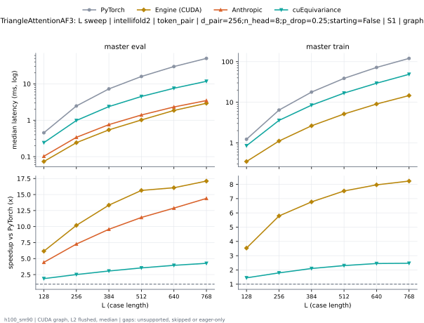

# TriangleAttentionAF3 on h100_sm90

Generated by `python -m miniworld_engine.measure.plot` from speed tokens `judge/tokens/h100_sm90/`; do not edit.

### L sweep: af3|openfold3 | token_pair | d_pair=128;n_head=4;p_drop=0.25;starting=False | S1 | graph

**master eval** (median ms; x = speedup vs PyTorch)

| L | PyTorch | Engine (Triton) | Engine (CUDA) | Anthropic | cuEquivariance |
|---|---|---|---|---|---|
| 128 | 0.2565 | 0.123 (2.08x) | 0.04371 (5.87x) | 0.07213 (3.56x) | 0.1584 (1.62x) |
| 256 | 1.277 | 0.3894 (3.28x) | 0.1118 (11.41x) | 0.1928 (6.62x) | 0.53 (2.41x) |
| 384 | 3.753 | 0.9407 (3.99x) | 0.2436 (15.41x) | 0.4082 (9.19x) | 1.298 (2.89x) |
| 512 | 8.163 | 1.74 (4.69x) | 0.4491 (18.18x) | 0.6995 (11.67x) | 2.434 (3.35x) |
| 640 | 15.19 | 2.874 (5.29x) | 0.7577 (20.05x) | 1.126 (13.50x) | 4.071 (3.73x) |
| 768 | 25.39 | 4.28 (5.93x) | 1.177 (21.57x) | 1.706 (14.88x) | 6.288 (4.04x) |
| 1024 | 56.76 | 8.43 (6.73x) | 2.588 (21.93x) | 3.363 (16.88x) | 12.55 (4.52x) |
| 1536 | skipped | 22.85 | 7.669 | 9.326 | 38 |
| 2048 | skipped | 49.53 | 17.53 | 20.76 | 87.71 |

**master train** (median ms; x = speedup vs PyTorch)

| L | PyTorch | Engine (Triton) | Engine (CUDA) | Anthropic | cuEquivariance |
|---|---|---|---|---|---|
| 128 | 0.7201 | 0.4346 (1.66x) | 0.2113 (3.41x) | unsupported | 0.5338 (1.35x) |
| 256 | 3.409 | 1.475 (2.31x) | 0.6085 (5.60x) | unsupported | 1.987 (1.72x) |
| 384 | 9.153 | 3.052 (3.00x) | 1.374 (6.66x) | unsupported | 4.507 (2.03x) |
| 512 | 19.82 | 5.695 (3.48x) | 2.516 (7.88x) | unsupported | 8.836 (2.24x) |
| 640 | 36.55 | 9.476 (3.86x) | 4.254 (8.59x) | unsupported | 15.28 (2.39x) |
| 768 | 60.92 | 14.64 (4.16x) | 6.823 (8.93x) | unsupported | 24.37 (2.50x) |
| 1024 |  |  |  |  |  |
| 1536 |  |  |  |  |  |
| 2048 |  |  |  |  |  |

### L sweep: af3|openfold3 | token_pair | d_pair=128;n_head=4;p_drop=0.25;starting=True | S1 | graph

**master eval** (median ms; x = speedup vs PyTorch)

| L | PyTorch | Engine (Triton) | Engine (CUDA) | Anthropic | cuEquivariance |
|---|---|---|---|---|---|
| 128 | 0.2448 | 0.1112 (2.20x) | 0.03696 (6.62x) | 0.07238 (3.38x) | 0.1471 (1.66x) |
| 256 | 1.235 | 0.3492 (3.54x) | 0.1052 (11.74x) | 0.1929 (6.40x) | 0.4926 (2.51x) |
| 384 | 3.64 | 0.8392 (4.34x) | 0.2313 (15.74x) | 0.4074 (8.94x) | 1.2 (3.03x) |
| 512 | 7.995 | 1.559 (5.13x) | 0.4311 (18.55x) | 0.7041 (11.35x) | 2.262 (3.53x) |
| 640 | 14.91 | 2.59 (5.76x) | 0.7332 (20.33x) | 1.141 (13.07x) | 3.8 (3.92x) |
| 768 | 24.98 | 3.904 (6.40x) | 1.152 (21.69x) | 1.726 (14.48x) | 5.935 (4.21x) |
| 1024 | 56 | 7.813 (7.17x) | 2.457 (22.80x) | 3.426 (16.35x) | 11.91 (4.70x) |
| 1536 | skipped | 21.31 | 7.48 | 9.583 | 36.51 |
| 2048 | skipped | 46.97 | 16.96 | 20.75 | 85.22 |

**master train** (median ms; x = speedup vs PyTorch)

| L | PyTorch | Engine (Triton) | Engine (CUDA) | Anthropic | cuEquivariance |
|---|---|---|---|---|---|
| 128 | 0.6847 | 0.3992 (1.72x) | 0.1564 (4.38x) | unsupported | 0.5062 (1.35x) |
| 256 | 3.313 | 1.388 (2.39x) | 0.4647 (7.13x) | unsupported | 1.897 (1.75x) |
| 384 | 8.968 | 2.859 (3.14x) | 1.09 (8.23x) | unsupported | 4.308 (2.08x) |
| 512 | 19.47 | 5.363 (3.63x) | 2.03 (9.59x) | unsupported | 8.503 (2.29x) |
| 640 | 36.02 | 8.951 (4.02x) | 3.563 (10.11x) | unsupported | 14.77 (2.44x) |
| 768 | 60.17 | 13.88 (4.33x) | 5.79 (10.39x) | unsupported | 23.64 (2.55x) |
| 1024 |  |  |  |  |  |
| 1536 |  |  |  |  |  |
| 2048 |  |  |  |  |  |

### L sweep: af3|openfold3 | token_pair | d_pair=64;n_head=4;p_drop=0.25;starting=False | S1 | graph

**master eval** (median ms; x = speedup vs PyTorch)

| L | PyTorch | Engine (Triton) | Engine (CUDA) | Anthropic | cuEquivariance |
|---|---|---|---|---|---|
| 128 | 0.2236 | 0.1031 (2.17x) | 0.0328 (6.82x) | 0.03547 (6.30x) | unsupported |
| 256 | 1.111 | 0.2817 (3.94x) | 0.09261 (12.00x) | 0.1032 (10.77x) | 0.3933 (2.82x) |
| 384 | 3.324 | 0.6601 (5.04x) | 0.2068 (16.07x) | 0.2524 (13.17x) | 0.9715 (3.42x) |
| 512 | 7.48 | 1.264 (5.92x) | 0.3821 (19.57x) | 0.4682 (15.98x) | 1.892 (3.95x) |
| 640 | 14.11 | 2.08 (6.78x) | 0.6488 (21.75x) | 0.8314 (16.97x) | 3.251 (4.34x) |
| 768 | 23.81 | 3.161 (7.53x) | 1.021 (23.32x) | 1.341 (17.76x) | 5.144 (4.63x) |
| 1024 | 53.9 | 6.42 (8.40x) | 2.13 (25.30x) | 2.849 (18.92x) | 10.61 (5.08x) |
| 1536 | skipped | 17.64 | 6.401 | 8.686 | 32.91 |
| 2048 | skipped | 38.21 | 15.72 | 19.65 | 78.06 |

**master train** (median ms; x = speedup vs PyTorch)

| L | PyTorch | Engine (Triton) | Engine (CUDA) | Anthropic | cuEquivariance |
|---|---|---|---|---|---|
| 128 | 0.6302 | 0.3541 (1.78x) | 0.2004 (3.14x) | unsupported | unsupported |
| 256 | 2.928 | 1.131 (2.59x) | 0.5556 (5.27x) | unsupported | 1.56 (1.88x) |
| 384 | 7.962 | 2.181 (3.65x) | 1.242 (6.41x) | unsupported | 3.421 (2.33x) |
| 512 | 17.81 | 4.226 (4.21x) | 2.26 (7.88x) | unsupported | 7.089 (2.51x) |
| 640 | 33.49 | 7.193 (4.66x) | 3.87 (8.65x) | unsupported | 12.59 (2.66x) |
| 768 | 56.47 | 11.27 (5.01x) | 6.218 (9.08x) | unsupported | 20.43 (2.76x) |
| 1024 |  |  |  |  |  |
| 1536 |  |  |  |  |  |
| 2048 |  |  |  |  |  |

### L sweep: af3|openfold3 | token_pair | d_pair=64;n_head=4;p_drop=0.25;starting=True | S1 | graph

**master eval** (median ms; x = speedup vs PyTorch)

| L | PyTorch | Engine (Triton) | Engine (CUDA) | Anthropic | cuEquivariance |
|---|---|---|---|---|---|
| 128 | 0.2127 | 0.09416 (2.26x) | 0.03221 (6.61x) | 0.03582 (5.94x) | unsupported |
| 256 | 1.085 | 0.2589 (4.19x) | 0.0892 (12.17x) | 0.1033 (10.50x) | 0.3715 (2.92x) |
| 384 | 3.272 | 0.6083 (5.38x) | 0.2048 (15.98x) | 0.2509 (13.04x) | 0.9233 (3.54x) |
| 512 | 7.373 | 1.167 (6.32x) | 0.3776 (19.53x) | 0.4661 (15.82x) | 1.801 (4.09x) |
| 640 | 13.96 | 1.94 (7.19x) | 0.638 (21.88x) | 0.8243 (16.93x) | 3.101 (4.50x) |
| 768 | 23.6 | 2.962 (7.97x) | 0.9956 (23.70x) | 1.331 (17.73x) | 4.941 (4.78x) |
| 1024 | 53.61 | 6.043 (8.87x) | 2.076 (25.82x) | 2.859 (18.75x) | 10.21 (5.25x) |
| 1536 | skipped | 16.8 | 6.269 | 8.7 | 32.16 |
| 2048 | skipped | 36.69 | 15.08 | 19.67 | 76.33 |

**master train** (median ms; x = speedup vs PyTorch)

| L | PyTorch | Engine (Triton) | Engine (CUDA) | Anthropic | cuEquivariance |
|---|---|---|---|---|---|
| 128 | 0.5892 | 0.3288 (1.79x) | 0.1861 (3.17x) | unsupported | unsupported |
| 256 | 2.872 | 1.078 (2.66x) | 0.5346 (5.37x) | unsupported | 1.506 (1.91x) |
| 384 | 7.85 | 2.07 (3.79x) | 1.2 (6.54x) | unsupported | 3.328 (2.36x) |
| 512 | 17.61 | 4.039 (4.36x) | 2.199 (8.01x) | unsupported | 6.909 (2.55x) |
| 640 | 33.19 | 6.896 (4.81x) | 3.771 (8.80x) | unsupported | 12.32 (2.69x) |
| 768 | 56.04 | 10.85 (5.17x) | 6.067 (9.24x) | unsupported | 20.05 (2.79x) |
| 1024 |  |  |  |  |  |
| 1536 |  |  |  |  |  |
| 2048 |  |  |  |  |  |

### L sweep: intellifold2 | token_pair | d_pair=256;n_head=8;p_drop=0.25;starting=False | S1 | graph

**master eval** (median ms; x = speedup vs PyTorch)

| L | PyTorch | Engine (Triton) | Engine (CUDA) | Anthropic | cuEquivariance |
|---|---|---|---|---|---|
| 128 | 0.4458 | 0.1774 (2.51x) | 0.07293 (6.11x) | 0.1026 (4.35x) | 0.2423 (1.84x) |
| 256 | 2.465 | 0.7088 (3.48x) | 0.2428 (10.15x) | 0.3394 (7.26x) | 0.9845 (2.50x) |
| 384 | 7.258 | 1.66 (4.37x) | 0.5427 (13.37x) | 0.7586 (9.57x) | 2.373 (3.06x) |
| 512 | 15.93 | 3.095 (5.15x) | 1.039 (15.34x) | 1.395 (11.42x) | 4.501 (3.54x) |
| 640 | 29.82 | 5.112 (5.83x) | 1.796 (16.61x) | 2.317 (12.87x) | 7.564 (3.94x) |
| 768 | 49.98 | 7.752 (6.45x) | 2.973 (16.81x) | 3.474 (14.39x) | 11.74 (4.26x) |

**master train** (median ms; x = speedup vs PyTorch)

| L | PyTorch | Engine (Triton) | Engine (CUDA) | Anthropic | cuEquivariance |
|---|---|---|---|---|---|
| 128 | 1.225 | 0.6597 (1.86x) | 0.3433 (3.57x) | unsupported | 0.848 (1.44x) |
| 256 | 6.425 | 2.576 (2.49x) | 1.112 (5.78x) | unsupported | 3.58 (1.79x) |
| 384 | 17.81 | 5.59 (3.19x) | 2.619 (6.80x) | unsupported | 8.481 (2.10x) |
| 512 | 38.77 | 10.63 (3.65x) | 4.905 (7.90x) | unsupported | 16.83 (2.30x) |
| 640 | 72.09 | 17.97 (4.01x) | 8.845 (8.15x) | unsupported | 29.45 (2.45x) |
| 768 | 120.4 | 27.94 (4.31x) | 13.55 (8.89x) | unsupported | 48.83 (2.47x) |

### L sweep: intellifold2 | token_pair | d_pair=256;n_head=8;p_drop=0.25;starting=True | S1 | graph

**master eval** (median ms; x = speedup vs PyTorch)

| L | PyTorch | Engine (Triton) | Engine (CUDA) | Anthropic | cuEquivariance |
|---|---|---|---|---|---|
| 128 | 0.4311 | 0.1605 (2.69x) | 0.06594 (6.54x) | 0.1032 (4.18x) | 0.2244 (1.92x) |
| 256 | 2.371 | 0.6221 (3.81x) | 0.238 (9.96x) | 0.3376 (7.02x) | 0.8969 (2.64x) |
| 384 | 7.053 | 1.458 (4.84x) | 0.5281 (13.36x) | 0.7564 (9.32x) | 2.173 (3.25x) |
| 512 | 15.57 | 2.741 (5.68x) | 1.02 (15.26x) | 1.384 (11.25x) | 4.154 (3.75x) |
| 640 | 29.26 | 4.547 (6.44x) | 1.786 (16.39x) | 2.334 (12.54x) | 7.023 (4.17x) |
| 768 | 49.19 | 7 (7.03x) | 2.94 (16.73x) | 3.477 (14.15x) | 10.97 (4.48x) |

**master train** (median ms; x = speedup vs PyTorch)

| L | PyTorch | Engine (Triton) | Engine (CUDA) | Anthropic | cuEquivariance |
|---|---|---|---|---|---|
| 128 | 1.179 | 0.6149 (1.92x) | 0.3258 (3.62x) | unsupported | 0.8081 (1.46x) |
| 256 | 6.254 | 2.407 (2.60x) | 1.06 (5.90x) | unsupported | 3.421 (1.83x) |
| 384 | 17.43 | 5.221 (3.34x) | 2.525 (6.90x) | unsupported | 8.109 (2.15x) |
| 512 | 38.12 | 9.973 (3.82x) | 4.735 (8.05x) | unsupported | 16.19 (2.35x) |
| 640 | 71.06 | 16.96 (4.19x) | 8.445 (8.41x) | unsupported | 28.41 (2.50x) |
| 768 | 119 | 26.56 (4.48x) | 13.25 (8.98x) | unsupported | 47.43 (2.51x) |

### L sweep: intellifold2 | token_pair | d_pair=512;n_head=8;p_drop=0.25;starting=False | S1 | graph

**master eval** (median ms; x = speedup vs PyTorch)

| L | PyTorch | Engine (Triton) | Engine (CUDA) | Anthropic | cuEquivariance |
|---|---|---|---|---|---|
| 128 | 0.6428 | 0.3153 (2.04x) | 0.2354 (2.73x) | unsupported | 0.433 (1.48x) |
| 256 | 3.25 | 1.237 (2.63x) | 0.7448 (4.36x) | unsupported | 1.718 (1.89x) |
| 384 | 9.008 | 2.834 (3.18x) | 1.616 (5.57x) | unsupported | 4.027 (2.24x) |
| 512 | 19.01 | 5.232 (3.63x) | 2.994 (6.35x) | unsupported | 7.492 (2.54x) |
| 640 | 34.57 | 8.549 (4.04x) | 4.894 (7.06x) | unsupported | 12.48 (2.77x) |
| 768 | 56.79 | 12.98 (4.38x) | 7.42 (7.65x) | unsupported | 19.26 (2.95x) |

**master train** (median ms; x = speedup vs PyTorch)

| L | PyTorch | Engine (Triton) | Engine (CUDA) | Anthropic | cuEquivariance |
|---|---|---|---|---|---|
| 128 | 1.788 | 1.098 (1.63x) | 0.7082 (2.52x) | unsupported | 1.415 (1.26x) |
| 256 | 8.555 | 4.169 (2.05x) | 2.507 (3.41x) | unsupported | 5.808 (1.47x) |
| 384 | 22.62 | 9.283 (2.44x) | 6.19 (3.65x) | unsupported | 13.76 (1.64x) |
| 512 | 47.29 | 17.51 (2.70x) | 12.45 (3.80x) | unsupported | 26.76 (1.77x) |
| 640 | 85.49 | 29.26 (2.92x) | 21.98 (3.89x) | unsupported | 46.41 (1.84x) |
| 768 | 139.6 | 45.07 (3.10x) | 34.73 (4.02x) | unsupported | 74.6 (1.87x) |

### L sweep: intellifold2 | token_pair | d_pair=512;n_head=8;p_drop=0.25;starting=True | S1 | graph

**master eval** (median ms; x = speedup vs PyTorch)

| L | PyTorch | Engine (Triton) | Engine (CUDA) | Anthropic | cuEquivariance |
|---|---|---|---|---|---|
| 128 | 0.607 | 0.2776 (2.19x) | 0.2127 (2.85x) | unsupported | 0.3968 (1.53x) |
| 256 | 3.069 | 1.054 (2.91x) | 0.6596 (4.65x) | unsupported | 1.544 (1.99x) |
| 384 | 8.607 | 2.437 (3.53x) | 1.435 (6.00x) | unsupported | 3.629 (2.37x) |
| 512 | 18.3 | 4.537 (4.03x) | 2.669 (6.86x) | unsupported | 6.798 (2.69x) |
| 640 | 33.58 | 7.478 (4.49x) | 4.412 (7.61x) | unsupported | 11.39 (2.95x) |
| 768 | 55.3 | 11.62 (4.76x) | 6.705 (8.25x) | unsupported | 17.77 (3.11x) |

**master train** (median ms; x = speedup vs PyTorch)

| L | PyTorch | Engine (Triton) | Engine (CUDA) | Anthropic | cuEquivariance |
|---|---|---|---|---|---|
| 128 | 1.71 | 1.011 (1.69x) | 0.6902 (2.48x) | unsupported | 1.325 (1.29x) |
| 256 | 8.221 | 3.854 (2.13x) | 2.466 (3.33x) | unsupported | 5.483 (1.50x) |
| 384 | 21.9 | 8.567 (2.56x) | 6.172 (3.55x) | unsupported | 13.02 (1.68x) |
| 512 | 46.04 | 16.27 (2.83x) | 12.32 (3.74x) | unsupported | 25.45 (1.81x) |
| 640 | 83.55 | 27.3 (3.06x) | 21.62 (3.86x) | unsupported | 44.55 (1.88x) |
| 768 | 136.8 | 42.46 (3.22x) | 34.72 (3.94x) | unsupported | 71.99 (1.90x) |

### d_pair sweep at L768: token_pair | p_drop=0.25;starting=False | S1 | graph

**master eval** (median ms; x = speedup vs PyTorch)

| d_pair | PyTorch | Engine (Triton) | Engine (CUDA) | Anthropic | cuEquivariance |
|---|---|---|---|---|---|
| 64 n_head=4 | 23.81 | 3.161 (7.53x) | 1.021 (23.32x) | 1.341 (17.76x) | 5.144 (4.63x) |
| 128 n_head=4 | 25.39 | 4.28 (5.93x) | 1.177 (21.57x) | 1.706 (14.88x) | 6.288 (4.04x) |
| 256 n_head=8 | 49.98 | 7.752 (6.45x) | 2.973 (16.81x) | 3.474 (14.39x) | 11.74 (4.26x) |
| 512 n_head=8 | 56.79 | 12.98 (4.38x) | 7.42 (7.65x) | unsupported | 19.26 (2.95x) |

**master train** (median ms; x = speedup vs PyTorch)

| d_pair | PyTorch | Engine (Triton) | Engine (CUDA) | Anthropic | cuEquivariance |
|---|---|---|---|---|---|
| 64 n_head=4 | 56.47 | 11.27 (5.01x) | 6.218 (9.08x) | unsupported | 20.43 (2.76x) |
| 128 n_head=4 | 60.92 | 14.64 (4.16x) | 6.823 (8.93x) | unsupported | 24.37 (2.50x) |
| 256 n_head=8 | 120.4 | 27.94 (4.31x) | 13.55 (8.89x) | unsupported | 48.83 (2.47x) |
| 512 n_head=8 | 139.6 | 45.07 (3.10x) | 34.73 (4.02x) | unsupported | 74.6 (1.87x) |

### d_pair sweep at L768: token_pair | p_drop=0.25;starting=True | S1 | graph

**master eval** (median ms; x = speedup vs PyTorch)

| d_pair | PyTorch | Engine (Triton) | Engine (CUDA) | Anthropic | cuEquivariance |
|---|---|---|---|---|---|
| 64 n_head=4 | 23.6 | 2.962 (7.97x) | 0.9956 (23.70x) | 1.331 (17.73x) | 4.941 (4.78x) |
| 128 n_head=4 | 24.98 | 3.904 (6.40x) | 1.152 (21.69x) | 1.726 (14.48x) | 5.935 (4.21x) |
| 256 n_head=8 | 49.19 | 7 (7.03x) | 2.94 (16.73x) | 3.477 (14.15x) | 10.97 (4.48x) |
| 512 n_head=8 | 55.3 | 11.62 (4.76x) | 6.705 (8.25x) | unsupported | 17.77 (3.11x) |

**master train** (median ms; x = speedup vs PyTorch)

| d_pair | PyTorch | Engine (Triton) | Engine (CUDA) | Anthropic | cuEquivariance |
|---|---|---|---|---|---|
| 64 n_head=4 | 56.04 | 10.85 (5.17x) | 6.067 (9.24x) | unsupported | 20.05 (2.79x) |
| 128 n_head=4 | 60.17 | 13.88 (4.33x) | 5.79 (10.39x) | unsupported | 23.64 (2.55x) |
| 256 n_head=8 | 119 | 26.56 (4.48x) | 13.25 (8.98x) | unsupported | 47.43 (2.51x) |
| 512 n_head=8 | 136.8 | 42.46 (3.22x) | 34.72 (3.94x) | unsupported | 71.99 (1.90x) |

