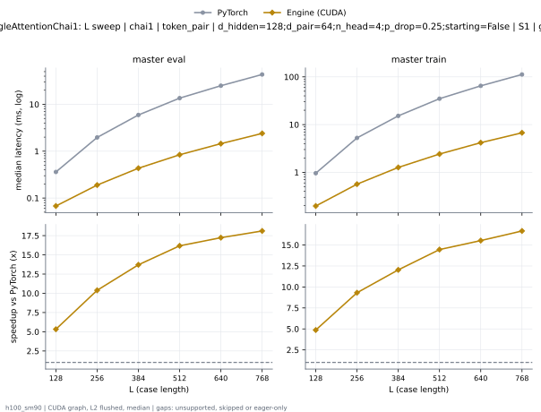
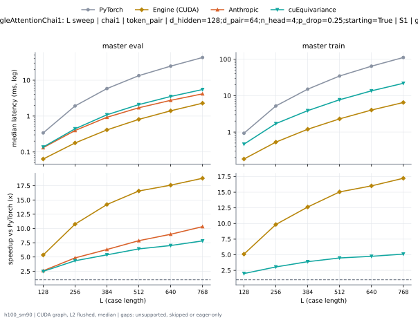
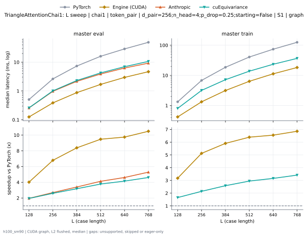
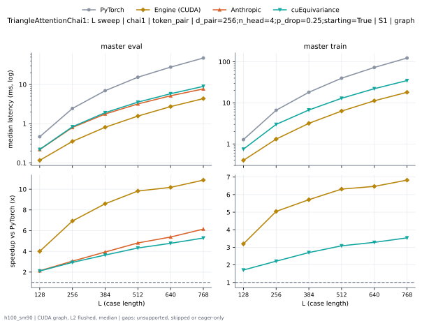

# TriangleAttentionChai1 on h100_sm90

Generated by `python -m miniworld_engine.measure.plot` from speed tokens `judge/tokens/h100_sm90/`; do not edit.

### L sweep: chai1 | token_pair | d_hidden=128;d_pair=64;n_head=4;p_drop=0.25;starting=False | S1 | graph

**master eval** (median ms; x = speedup vs PyTorch)

| L | PyTorch | Engine (Triton) | Engine (CUDA) | Anthropic | cuEquivariance |
|---|---|---|---|---|---|
| 128 | 0.3595 | 0.1183 (3.04x) | 0.0673 (5.34x) | 0.1509 (2.38x) | 0.1553 (2.31x) |
| 256 | 1.964 | 0.3426 (5.73x) | 0.1875 (10.47x) | 0.4419 (4.45x) | 0.4872 (4.03x) |
| 384 | 5.938 | 0.8322 (7.14x) | 0.4297 (13.82x) | 1.025 (5.79x) | 1.196 (4.96x) |
| 512 | 13.59 | 1.549 (8.77x) | 0.839 (16.20x) | 1.881 (7.22x) | 2.274 (5.98x) |
| 640 | 24.99 | 2.536 (9.86x) | 1.449 (17.25x) | 3.021 (8.27x) | 3.806 (6.57x) |
| 768 | 43.44 | 3.814 (11.39x) | 2.351 (18.48x) | 4.561 (9.52x) | 5.871 (7.40x) |

**master train** (median ms; x = speedup vs PyTorch)

| L | PyTorch | Engine (Triton) | Engine (CUDA) | Anthropic | cuEquivariance |
|---|---|---|---|---|---|
| 128 | 0.9531 | 0.3886 (2.45x) | 0.1967 (4.85x) | unsupported | 0.4896 (1.95x) |
| 256 | 5.256 | 1.249 (4.21x) | 0.5637 (9.32x) | unsupported | 1.765 (2.98x) |
| 384 | 15.23 | 2.489 (6.12x) | 1.259 (12.09x) | unsupported | 3.974 (3.83x) |
| 512 | 34.93 | 4.784 (7.30x) | 2.421 (14.42x) | unsupported | 7.891 (4.43x) |
| 640 | 64.83 | 8.077 (8.03x) | 4.183 (15.50x) | unsupported | 13.82 (4.69x) |
| 768 | 112.4 | 12.66 (8.88x) | 6.751 (16.64x) | unsupported | 22.33 (5.03x) |

### L sweep: chai1 | token_pair | d_hidden=128;d_pair=64;n_head=4;p_drop=0.25;starting=True | S1 | graph

**master eval** (median ms; x = speedup vs PyTorch)

| L | PyTorch | Engine (Triton) | Engine (CUDA) | Anthropic | cuEquivariance |
|---|---|---|---|---|---|
| 128 | 0.3389 | 0.1025 (3.31x) | 0.06365 (5.32x) | 0.1315 (2.58x) | 0.137 (2.47x) |
| 256 | 1.918 | 0.2987 (6.42x) | 0.1784 (10.75x) | 0.3958 (4.85x) | 0.4415 (4.34x) |
| 384 | 5.834 | 0.727 (8.03x) | 0.4115 (14.18x) | 0.9259 (6.30x) | 1.087 (5.37x) |
| 512 | 13.41 | 1.369 (9.80x) | 0.8074 (16.61x) | 1.705 (7.87x) | 2.088 (6.42x) |
| 640 | 24.71 | 2.25 (10.99x) | 1.404 (17.60x) | 2.748 (8.99x) | 3.521 (7.02x) |
| 768 | 43.02 | 3.438 (12.51x) | 2.245 (19.16x) | 4.165 (10.33x) | 5.499 (7.82x) |

**master train** (median ms; x = speedup vs PyTorch)

| L | PyTorch | Engine (Triton) | Engine (CUDA) | Anthropic | cuEquivariance |
|---|---|---|---|---|---|
| 128 | 0.9309 | 0.3644 (2.55x) | 0.1803 (5.16x) | unsupported | 0.4652 (2.00x) |
| 256 | 5.191 | 1.191 (4.36x) | 0.5296 (9.80x) | unsupported | 1.707 (3.04x) |
| 384 | 15.1 | 2.38 (6.34x) | 1.198 (12.60x) | unsupported | 3.877 (3.89x) |
| 512 | 34.65 | 4.592 (7.55x) | 2.317 (14.95x) | unsupported | 7.725 (4.49x) |
| 640 | 64.55 | 7.794 (8.28x) | 4.016 (16.07x) | unsupported | 13.58 (4.76x) |
| 768 | 111.9 | 12.2 (9.17x) | 6.54 (17.11x) | unsupported | 21.88 (5.11x) |

### L sweep: chai1 | token_pair | d_pair=256;n_head=4;p_drop=0.25;starting=False | S1 | graph

**master eval** (median ms; x = speedup vs PyTorch)

| L | PyTorch | Engine (Triton) | Engine (CUDA) | Anthropic | cuEquivariance |
|---|---|---|---|---|---|
| 128 | 0.5013 | 0.1971 (2.54x) | 0.1244 (4.03x) | 0.2577 (1.95x) | 0.259 (1.94x) |
| 256 | 2.617 | 0.755 (3.47x) | 0.3844 (6.81x) | 0.9739 (2.69x) | 1.009 (2.59x) |
| 384 | 7.346 | 1.697 (4.33x) | 0.8787 (8.36x) | 2.156 (3.41x) | 2.304 (3.19x) |
| 512 | 16.03 | 3.08 (5.20x) | 1.685 (9.51x) | 3.881 (4.13x) | 4.239 (3.78x) |
| 640 | 28.84 | 4.993 (5.78x) | 2.878 (10.02x) | 6.253 (4.61x) | 6.948 (4.15x) |
| 768 | 48.94 | 7.426 (6.59x) | 4.574 (10.70x) | 9.25 (5.29x) | 10.61 (4.61x) |

**master train** (median ms; x = speedup vs PyTorch)

| L | PyTorch | Engine (Triton) | Engine (CUDA) | Anthropic | cuEquivariance |
|---|---|---|---|---|---|
| 128 | 1.324 | 0.6419 (2.06x) | 0.4207 (3.15x) | unsupported | 0.8029 (1.65x) |
| 256 | 6.805 | 2.386 (2.85x) | 1.386 (4.91x) | unsupported | 3.173 (2.14x) |
| 384 | 18.58 | 4.923 (3.77x) | 3.303 (5.63x) | unsupported | 7.182 (2.59x) |
| 512 | 40.68 | 9.131 (4.46x) | 6.54 (6.22x) | unsupported | 13.79 (2.95x) |
| 640 | 73.93 | 15.03 (4.92x) | 11.6 (6.38x) | unsupported | 23.39 (3.16x) |
| 768 | 125.2 | 22.91 (5.47x) | 18.68 (6.71x) | unsupported | 36.63 (3.42x) |

### L sweep: chai1 | token_pair | d_pair=256;n_head=4;p_drop=0.25;starting=True | S1 | graph

**master eval** (median ms; x = speedup vs PyTorch)

| L | PyTorch | Engine (Triton) | Engine (CUDA) | Anthropic | cuEquivariance |
|---|---|---|---|---|---|
| 128 | 0.4634 | 0.156 (2.97x) | 0.1158 (4.00x) | 0.218 (2.13x) | 0.2201 (2.11x) |
| 256 | 2.447 | 0.5798 (4.22x) | 0.3531 (6.93x) | 0.8007 (3.06x) | 0.833 (2.94x) |
| 384 | 6.955 | 1.303 (5.34x) | 0.8091 (8.60x) | 1.767 (3.94x) | 1.908 (3.64x) |
| 512 | 15.34 | 2.393 (6.41x) | 1.561 (9.82x) | 3.186 (4.81x) | 3.546 (4.33x) |
| 640 | 27.77 | 3.903 (7.11x) | 2.729 (10.18x) | 5.158 (5.38x) | 5.812 (4.78x) |
| 768 | 47.41 | 5.884 (8.06x) | 4.359 (10.88x) | 7.71 (6.15x) | 8.964 (5.29x) |

**master train** (median ms; x = speedup vs PyTorch)

| L | PyTorch | Engine (Triton) | Engine (CUDA) | Anthropic | cuEquivariance |
|---|---|---|---|---|---|
| 128 | 1.275 | 0.5846 (2.18x) | 0.399 (3.20x) | unsupported | 0.7465 (1.71x) |
| 256 | 6.612 | 2.178 (3.04x) | 1.311 (5.04x) | unsupported | 2.992 (2.21x) |
| 384 | 18.13 | 4.441 (4.08x) | 3.174 (5.71x) | unsupported | 6.71 (2.70x) |
| 512 | 39.9 | 8.32 (4.80x) | 6.319 (6.31x) | unsupported | 12.93 (3.08x) |
| 640 | 72.69 | 13.77 (5.28x) | 11.24 (6.47x) | unsupported | 22.14 (3.28x) |
| 768 | 123.4 | 21.13 (5.84x) | 18.09 (6.82x) | unsupported | 34.89 (3.54x) |

