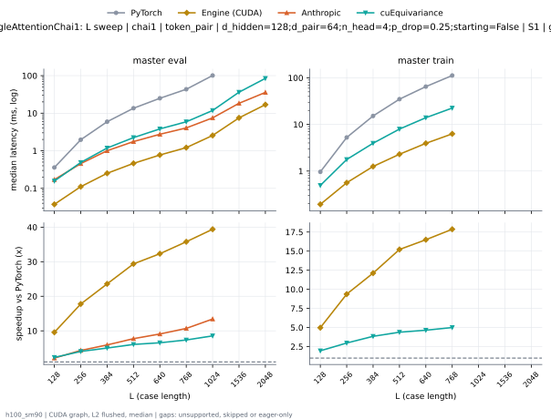
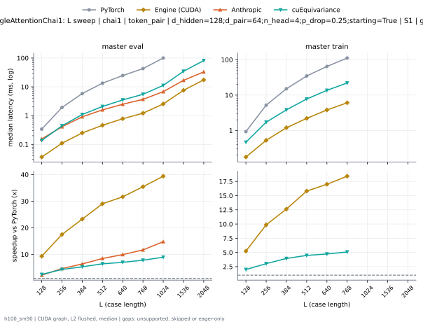
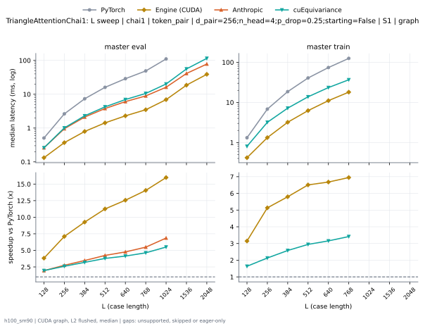
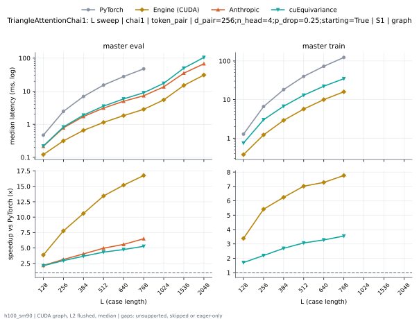

# TriangleAttentionChai1 on h100_sm90

Generated by `python -m miniworld_engine.measure.plot` from speed tokens `judge/tokens/h100_sm90/`; do not edit.

### L sweep: chai1 | token_pair | d_hidden=128;d_pair=64;n_head=4;p_drop=0.25;starting=False | S1 | graph

**master eval** (median ms; x = speedup vs PyTorch)

| L | PyTorch | Engine (Triton) | Engine (CUDA) | Anthropic | cuEquivariance |
|---|---|---|---|---|---|
| 128 | 0.3596 | 0.1188 (3.03x) | 0.0381 (9.44x) | 0.1704 (2.11x) | 0.1566 (2.30x) |
| 256 | 1.971 | 0.3467 (5.68x) | 0.1097 (17.96x) | 0.4553 (4.33x) | 0.4882 (4.04x) |
| 384 | 5.938 | 0.8306 (7.15x) | 0.2572 (23.09x) | 1.004 (5.91x) | 1.184 (5.01x) |
| 512 | 13.58 | 1.556 (8.73x) | 0.4742 (28.63x) | 1.757 (7.73x) | 2.243 (6.05x) |
| 640 | 24.98 | 2.538 (9.85x) | 0.789 (31.66x) | 2.749 (9.09x) | 3.822 (6.54x) |
| 768 | 43.4 | 3.886 (11.17x) | 1.27 (34.17x) | 4.061 (10.69x) | 5.907 (7.35x) |
| 1024 | 100.9 | 7.74 (13.03x) | 2.842 (35.48x) | 7.521 (13.41x) | 11.82 (8.53x) |
| 1536 | skipped | 21.12 | 8.135 | 18.37 | 36.26 |
| 2048 | skipped | 46.58 | 18.08 | 35.74 | 84.67 |

**master train** (median ms; x = speedup vs PyTorch)

| L | PyTorch | Engine (Triton) | Engine (CUDA) | Anthropic | cuEquivariance |
|---|---|---|---|---|---|
| 128 | 0.9555 | 0.3897 (2.45x) | 0.1925 (4.96x) | unsupported | 0.4913 (1.94x) |
| 256 | 5.254 | 1.262 (4.16x) | 0.5597 (9.39x) | unsupported | 1.768 (2.97x) |
| 384 | 15.23 | 2.505 (6.08x) | 1.258 (12.11x) | unsupported | 3.954 (3.85x) |
| 512 | 34.92 | 4.816 (7.25x) | 2.414 (14.47x) | unsupported | 7.955 (4.39x) |
| 640 | 64.81 | 8.109 (7.99x) | 4.182 (15.50x) | unsupported | 13.96 (4.64x) |
| 768 | 112.3 | 12.66 (8.87x) | 6.766 (16.60x) | unsupported | 22.47 (5.00x) |
| 1024 |  |  |  |  |  |
| 1536 |  |  |  |  |  |
| 2048 |  |  |  |  |  |

### L sweep: chai1 | token_pair | d_hidden=128;d_pair=64;n_head=4;p_drop=0.25;starting=True | S1 | graph

**master eval** (median ms; x = speedup vs PyTorch)

| L | PyTorch | Engine (Triton) | Engine (CUDA) | Anthropic | cuEquivariance |
|---|---|---|---|---|---|
| 128 | 0.3401 | 0.1019 (3.34x) | 0.03712 (9.16x) | 0.1548 (2.20x) | 0.1372 (2.48x) |
| 256 | 1.918 | 0.2995 (6.40x) | 0.1107 (17.32x) | 0.4106 (4.67x) | 0.4422 (4.34x) |
| 384 | 5.828 | 0.732 (7.96x) | 0.2566 (22.71x) | 0.9093 (6.41x) | 1.092 (5.34x) |
| 512 | 13.4 | 1.378 (9.72x) | 0.4696 (28.54x) | 1.583 (8.47x) | 2.074 (6.46x) |
| 640 | 24.71 | 2.304 (10.72x) | 0.7895 (31.29x) | 2.483 (9.95x) | 3.511 (7.04x) |
| 768 | 43 | 3.471 (12.39x) | 1.211 (35.52x) | 3.678 (11.69x) | 5.505 (7.81x) |
| 1024 | 100.2 | 7.034 (14.24x) | 2.653 (37.76x) | 6.778 (14.78x) | 11.2 (8.95x) |
| 1536 | skipped | 19.56 | 8.027 | 16.79 | 34.68 |
| 2048 | skipped | 44.06 | 18.42 | 33.04 | 81.68 |

**master train** (median ms; x = speedup vs PyTorch)

| L | PyTorch | Engine (Triton) | Engine (CUDA) | Anthropic | cuEquivariance |
|---|---|---|---|---|---|
| 128 | 0.9264 | 0.364 (2.55x) | 0.1765 (5.25x) | unsupported | 0.4653 (1.99x) |
| 256 | 5.191 | 1.198 (4.34x) | 0.5263 (9.86x) | unsupported | 1.712 (3.03x) |
| 384 | 15.11 | 2.395 (6.31x) | 1.195 (12.64x) | unsupported | 3.831 (3.94x) |
| 512 | 34.71 | 4.615 (7.52x) | 2.308 (15.04x) | unsupported | 7.754 (4.48x) |
| 640 | 64.55 | 7.801 (8.27x) | 4.028 (16.02x) | unsupported | 13.65 (4.73x) |
| 768 | 111.9 | 12.2 (9.17x) | 6.541 (17.10x) | unsupported | 22.02 (5.08x) |
| 1024 |  |  |  |  |  |
| 1536 |  |  |  |  |  |
| 2048 |  |  |  |  |  |

### L sweep: chai1 | token_pair | d_pair=256;n_head=4;p_drop=0.25;starting=False | S1 | graph

**master eval** (median ms; x = speedup vs PyTorch)

| L | PyTorch | Engine (Triton) | Engine (CUDA) | Anthropic | cuEquivariance |
|---|---|---|---|---|---|
| 128 | 0.5071 | 0.201 (2.52x) | 0.1325 (3.83x) | 0.2612 (1.94x) | 0.2599 (1.95x) |
| 256 | 2.626 | 0.7547 (3.48x) | 0.3699 (7.10x) | 0.9544 (2.75x) | 1.008 (2.61x) |
| 384 | 7.344 | 1.696 (4.33x) | 0.7927 (9.26x) | 2.116 (3.47x) | 2.301 (3.19x) |
| 512 | 16.02 | 3.086 (5.19x) | 1.423 (11.25x) | 3.779 (4.24x) | 4.23 (3.79x) |
| 640 | 28.84 | 5.011 (5.76x) | 2.295 (12.56x) | 6.051 (4.77x) | 6.964 (4.14x) |
| 768 | 48.91 | 7.442 (6.57x) | 3.483 (14.04x) | 8.917 (5.49x) | 10.56 (4.63x) |
| 1024 | 110.6 | 14.13 (7.83x) | 6.92 (15.98x) | 16.13 (6.86x) | 20.1 (5.50x) |
| 1536 | skipped | 37.83 | 18.56 | 41.11 | 56.02 |
| 2048 | skipped | 77.36 | 38.87 | 78.15 | 115.1 |

**master train** (median ms; x = speedup vs PyTorch)

| L | PyTorch | Engine (Triton) | Engine (CUDA) | Anthropic | cuEquivariance |
|---|---|---|---|---|---|
| 128 | 1.314 | 0.6415 (2.05x) | 0.4177 (3.15x) | unsupported | 0.803 (1.64x) |
| 256 | 6.798 | 2.389 (2.85x) | 1.324 (5.14x) | unsupported | 3.188 (2.13x) |
| 384 | 18.56 | 4.945 (3.75x) | 3.2 (5.80x) | unsupported | 7.189 (2.58x) |
| 512 | 40.63 | 9.149 (4.44x) | 6.243 (6.51x) | unsupported | 13.79 (2.95x) |
| 640 | 73.93 | 15.07 (4.91x) | 11.07 (6.68x) | unsupported | 23.42 (3.16x) |
| 768 | 125.2 | 22.95 (5.46x) | 18.02 (6.95x) | unsupported | 36.66 (3.42x) |
| 1024 |  |  |  |  |  |
| 1536 |  |  |  |  |  |
| 2048 |  |  |  |  |  |

### L sweep: chai1 | token_pair | d_pair=256;n_head=4;p_drop=0.25;starting=True | S1 | graph

**master eval** (median ms; x = speedup vs PyTorch)

| L | PyTorch | Engine (Triton) | Engine (CUDA) | Anthropic | cuEquivariance |
|---|---|---|---|---|---|
| 128 | 0.4652 | 0.1558 (2.99x) | 0.1203 (3.87x) | 0.2157 (2.16x) | 0.22 (2.11x) |
| 256 | 2.453 | 0.5776 (4.25x) | 0.3404 (7.21x) | 0.7795 (3.15x) | 0.829 (2.96x) |
| 384 | 6.944 | 1.293 (5.37x) | 0.7236 (9.60x) | 1.718 (4.04x) | 1.894 (3.67x) |
| 512 | 15.33 | 2.392 (6.41x) | 1.303 (11.76x) | 3.085 (4.97x) | 3.54 (4.33x) |
| 640 | 27.76 | 3.913 (7.09x) | 2.114 (13.13x) | 4.977 (5.58x) | 5.851 (4.74x) |
| 768 | 47.37 | 5.906 (8.02x) | 3.249 (14.58x) | 7.295 (6.49x) | 8.981 (5.27x) |
| 1024 | skipped | 11.51 | 6.381 | 13.54 | 17.34 |
| 1536 | skipped | 31.95 | 17.55 | 35.08 | 49.85 |
| 2048 | skipped | 66.82 | 37.12 | 67.63 | 105.1 |

**master train** (median ms; x = speedup vs PyTorch)

| L | PyTorch | Engine (Triton) | Engine (CUDA) | Anthropic | cuEquivariance |
|---|---|---|---|---|---|
| 128 | 1.278 | 0.5853 (2.18x) | 0.3923 (3.26x) | unsupported | 0.7495 (1.70x) |
| 256 | 6.601 | 2.168 (3.05x) | 1.256 (5.26x) | unsupported | 3.006 (2.20x) |
| 384 | 18.13 | 4.489 (4.04x) | 3.034 (5.97x) | unsupported | 6.73 (2.69x) |
| 512 | 39.89 | 8.363 (4.77x) | 6.028 (6.62x) | unsupported | 13 (3.07x) |
| 640 | 72.68 | 13.82 (5.26x) | 10.76 (6.76x) | unsupported | 22.17 (3.28x) |
| 768 | 123.4 | 21.19 (5.83x) | 17.41 (7.09x) | unsupported | 34.78 (3.55x) |
| 1024 |  |  |  |  |  |
| 1536 |  |  |  |  |  |
| 2048 |  |  |  |  |  |

