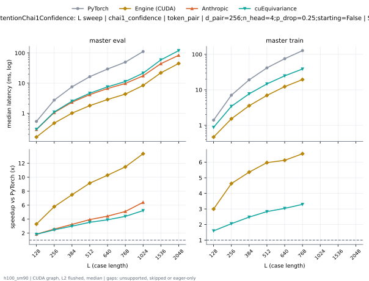

# TriangleAttentionChai1Confidence on h100_sm90

Generated by `python -m foldjet_engine.measure.plot` from speed tokens `judge/tokens/h100_sm90/`; do not edit.

### L sweep: chai1_confidence | token_pair | d_pair=256;n_head=4;p_drop=0.25;starting=False | S1 | graph

**master eval** (median ms; x = speedup vs PyTorch)

| L | PyTorch | Engine (Triton) | Engine (CUDA) | Anthropic | cuEquivariance |
|---|---|---|---|---|---|
| 128 | 0.5377 | 0.2314 (2.32x) | 0.1575 (3.42x) | 0.2895 (1.86x) | 0.293 (1.84x) |
| 256 | 2.728 | 0.8535 (3.20x) | 0.4428 (6.16x) | 1.058 (2.58x) | 1.101 (2.48x) |
| 384 | 7.549 | 1.893 (3.99x) | 0.9201 (8.20x) | 2.329 (3.24x) | 2.522 (2.99x) |
| 512 | 16.39 | 3.475 (4.72x) | 1.61 (10.18x) | 4.163 (3.94x) | 4.616 (3.55x) |
| 640 | 29.4 | 5.599 (5.25x) | 2.573 (11.42x) | 6.641 (4.43x) | 7.527 (3.91x) |
| 768 | 49.72 | 8.276 (6.01x) | 3.821 (13.01x) | 9.752 (5.10x) | 11.31 (4.40x) |
| 1024 | 112.1 | 15.73 (7.13x) | 7.422 (15.11x) | 17.49 (6.41x) | 21.45 (5.23x) |
| 1536 | skipped | 42.09 | 19.98 | 44.29 | 59.11 |
| 2048 | skipped | 87.41 | 38.85 | 83.79 | 119.9 |

**master train** (median ms; x = speedup vs PyTorch)

| L | PyTorch | Engine (Triton) | Engine (CUDA) | Anthropic | cuEquivariance |
|---|---|---|---|---|---|
| 128 | 1.394 | 0.7145 (1.95x) | 0.45 (3.10x) | unsupported | 0.8761 (1.59x) |
| 256 | 7.044 | 2.629 (2.68x) | 1.482 (4.75x) | unsupported | 3.431 (2.05x) |
| 384 | 19.06 | 5.446 (3.50x) | 3.432 (5.55x) | unsupported | 7.7 (2.48x) |
| 512 | 41.55 | 10.04 (4.14x) | 6.7 (6.20x) | unsupported | 14.67 (2.83x) |
| 640 | 75.21 | 16.44 (4.58x) | 11.61 (6.48x) | unsupported | 24.76 (3.04x) |
| 768 | 127.1 | 25.07 (5.07x) | 18.37 (6.92x) | unsupported | 38.58 (3.29x) |
| 1024 |  |  |  |  |  |
| 1536 |  |  |  |  |  |
| 2048 |  |  |  |  |  |

### L sweep: chai1_confidence | token_pair | d_pair=256;n_head=4;p_drop=0.25;starting=True | S1 | graph

**master eval** (median ms; x = speedup vs PyTorch)

| L | PyTorch | Engine (Triton) | Engine (CUDA) | Anthropic | cuEquivariance |
|---|---|---|---|---|---|
| 128 | 0.49 | 0.18 (2.72x) | 0.1438 (3.41x) | 0.2396 (2.05x) | 0.2454 (2.00x) |
| 256 | 2.532 | 0.6598 (3.84x) | 0.3966 (6.38x) | 0.8631 (2.93x) | 0.9086 (2.79x) |
| 384 | 7.125 | 1.472 (4.84x) | 0.8228 (8.66x) | 1.895 (3.76x) | 2.08 (3.43x) |
| 512 | 15.63 | 2.671 (5.85x) | 1.438 (10.87x) | 3.379 (4.63x) | 3.843 (4.07x) |
| 640 | 28.21 | 4.394 (6.42x) | 2.357 (11.97x) | 5.433 (5.19x) | 6.281 (4.49x) |
| 768 | 48.05 | 6.559 (7.32x) | 3.524 (13.63x) | 7.961 (6.04x) | 9.636 (4.99x) |
| 1024 | skipped | 12.79 | 6.728 | 14.7 | 18.5 |
| 1536 | skipped | 36.27 | 18.41 | 37.68 | 52.65 |
| 2048 | skipped | 78.75 | 37.7 | 72.3 | 108.2 |

**master train** (median ms; x = speedup vs PyTorch)

| L | PyTorch | Engine (Triton) | Engine (CUDA) | Anthropic | cuEquivariance |
|---|---|---|---|---|---|
| 128 | 1.349 | 0.6523 (2.07x) | 0.4365 (3.09x) | unsupported | 0.8216 (1.64x) |
| 256 | 6.834 | 2.401 (2.85x) | 1.447 (4.72x) | unsupported | 3.235 (2.11x) |
| 384 | 18.61 | 4.959 (3.75x) | 3.386 (5.49x) | unsupported | 7.188 (2.59x) |
| 512 | 40.7 | 9.242 (4.40x) | 6.582 (6.18x) | unsupported | 13.73 (2.96x) |
| 640 | 73.88 | 15.09 (4.90x) | 11.45 (6.45x) | unsupported | 23.43 (3.15x) |
| 768 | 125.2 | 23.3 (5.37x) | 17.99 (6.96x) | unsupported | 36.65 (3.42x) |
| 1024 |  |  |  |  |  |
| 1536 |  |  |  |  |  |
| 2048 |  |  |  |  |  |

