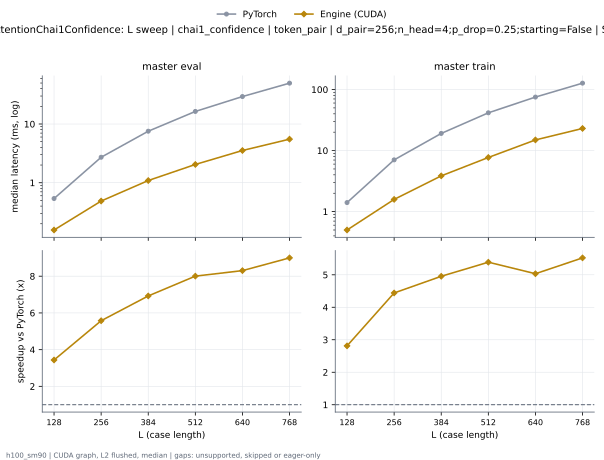
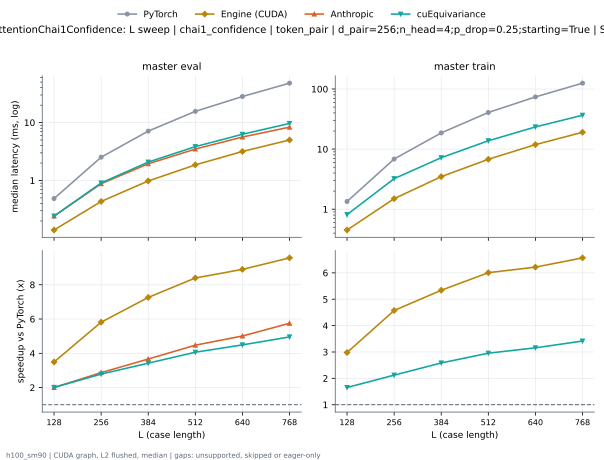

# TriangleAttentionChai1Confidence on h100_sm90

Generated by `python -m miniworld_engine.measure.plot` from speed tokens `judge/tokens/h100_sm90/`; do not edit.

### L sweep: chai1_confidence | token_pair | d_pair=256;n_head=4;p_drop=0.25;starting=False | S1 | graph

**master eval** (median ms; x = speedup vs PyTorch)

| L | PyTorch | Engine (Triton) | Engine (CUDA) | Anthropic | cuEquivariance |
|---|---|---|---|---|---|
| 128 | 0.5353 | 0.2308 (2.32x) | 0.1552 (3.45x) | 0.2926 (1.83x) | 0.2931 (1.83x) |
| 256 | 2.721 | 0.8497 (3.20x) | 0.4862 (5.60x) | 1.073 (2.54x) | 1.1 (2.47x) |
| 384 | 7.562 | 1.91 (3.96x) | 1.098 (6.89x) | 2.377 (3.18x) | 2.515 (3.01x) |
| 512 | 16.4 | 3.456 (4.74x) | 2.051 (7.99x) | 4.268 (3.84x) | 4.597 (3.57x) |
| 640 | 29.43 | 5.576 (5.28x) | 3.449 (8.53x) | 6.832 (4.31x) | 7.528 (3.91x) |
| 768 | 49.76 | 8.254 (6.03x) | 5.39 (9.23x) | 10.08 (4.93x) | 11.41 (4.36x) |

**master train** (median ms; x = speedup vs PyTorch)

| L | PyTorch | Engine (Triton) | Engine (CUDA) | Anthropic | cuEquivariance |
|---|---|---|---|---|---|
| 128 | 1.398 | 0.7114 (1.97x) | 0.4728 (2.96x) | unsupported | 0.872 (1.60x) |
| 256 | 7.042 | 2.613 (2.69x) | 1.568 (4.49x) | unsupported | 3.435 (2.05x) |
| 384 | 19.09 | 5.44 (3.51x) | 3.703 (5.15x) | unsupported | 7.682 (2.48x) |
| 512 | 41.55 | 9.994 (4.16x) | 7.194 (5.78x) | unsupported | 14.66 (2.83x) |
| 640 | 75.27 | 16.35 (4.60x) | 12.63 (5.96x) | unsupported | 24.83 (3.03x) |
| 768 | 127.2 | 24.82 (5.12x) | 20.31 (6.26x) | unsupported | 38.55 (3.30x) |

### L sweep: chai1_confidence | token_pair | d_pair=256;n_head=4;p_drop=0.25;starting=True | S1 | graph

**master eval** (median ms; x = speedup vs PyTorch)

| L | PyTorch | Engine (Triton) | Engine (CUDA) | Anthropic | cuEquivariance |
|---|---|---|---|---|---|
| 128 | 0.4879 | 0.1777 (2.75x) | 0.1397 (3.49x) | 0.2433 (2.01x) | 0.2425 (2.01x) |
| 256 | 2.528 | 0.657 (3.85x) | 0.4348 (5.81x) | 0.8801 (2.87x) | 0.9071 (2.79x) |
| 384 | 7.129 | 1.475 (4.83x) | 0.9818 (7.26x) | 1.944 (3.67x) | 2.081 (3.43x) |
| 512 | 15.63 | 2.691 (5.81x) | 1.862 (8.40x) | 3.494 (4.48x) | 3.847 (4.06x) |
| 640 | 28.23 | 4.372 (6.46x) | 3.173 (8.90x) | 5.634 (5.01x) | 6.285 (4.49x) |
| 768 | 47.99 | 6.56 (7.32x) | 5.016 (9.57x) | 8.344 (5.75x) | 9.683 (4.96x) |

**master train** (median ms; x = speedup vs PyTorch)

| L | PyTorch | Engine (Triton) | Engine (CUDA) | Anthropic | cuEquivariance |
|---|---|---|---|---|---|
| 128 | 1.336 | 0.647 (2.07x) | 0.4554 (2.93x) | unsupported | 0.8115 (1.65x) |
| 256 | 6.828 | 2.4 (2.85x) | 1.537 (4.44x) | unsupported | 3.222 (2.12x) |
| 384 | 18.6 | 4.947 (3.76x) | 3.642 (5.11x) | unsupported | 7.197 (2.58x) |
| 512 | 40.66 | 9.14 (4.45x) | 7.068 (5.75x) | unsupported | 13.77 (2.95x) |
| 640 | 73.87 | 15.01 (4.92x) | 12.48 (5.92x) | unsupported | 23.4 (3.16x) |
| 768 | 125.3 | 22.93 (5.46x) | 19.91 (6.29x) | unsupported | 36.65 (3.42x) |

