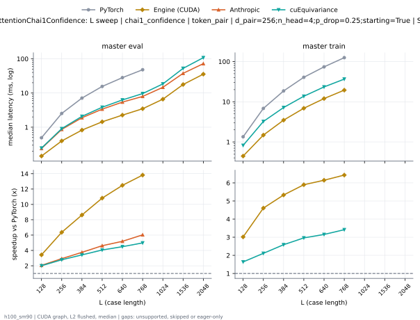

# TriangleAttentionChai1Confidence on h100_sm90

Generated by `python -m miniworld_engine.measure.plot` from speed tokens `judge/tokens/h100_sm90/`; do not edit.

### L sweep: chai1_confidence | token_pair | d_pair=256;n_head=4;p_drop=0.25;starting=False | S1 | graph

**master eval** (median ms; x = speedup vs PyTorch)

| L | PyTorch | Engine (Triton) | Engine (CUDA) | Anthropic | cuEquivariance |
|---|---|---|---|---|---|
| 128 | 0.5371 | 0.2299 (2.34x) | 0.1628 (3.30x) | 0.2895 (1.86x) | 0.293 (1.83x) |
| 256 | 2.73 | 0.8509 (3.21x) | 0.4719 (5.78x) | 1.058 (2.58x) | 1.101 (2.48x) |
| 384 | 7.562 | 1.916 (3.95x) | 1.009 (7.49x) | 2.329 (3.25x) | 2.522 (3.00x) |
| 512 | 16.39 | 3.468 (4.73x) | 1.792 (9.15x) | 4.163 (3.94x) | 4.616 (3.55x) |
| 640 | 29.42 | 5.578 (5.27x) | 2.86 (10.29x) | 6.641 (4.43x) | 7.527 (3.91x) |
| 768 | 49.75 | 8.156 (6.10x) | 4.335 (11.48x) | 9.752 (5.10x) | 11.31 (4.40x) |
| 1024 | 112 | 15.58 (7.19x) | 8.388 (13.36x) | 17.49 (6.41x) | 21.45 (5.22x) |
| 1536 | skipped | 41.15 | 21.98 | 44.29 | 59.11 |
| 2048 | skipped | 83.1 | 44.91 | 83.79 | 119.9 |

**master train** (median ms; x = speedup vs PyTorch)

| L | PyTorch | Engine (Triton) | Engine (CUDA) | Anthropic | cuEquivariance |
|---|---|---|---|---|---|
| 128 | 1.398 | 0.7105 (1.97x) | 0.4667 (3.00x) | unsupported | 0.8761 (1.60x) |
| 256 | 7.052 | 2.621 (2.69x) | 1.523 (4.63x) | unsupported | 3.431 (2.06x) |
| 384 | 19.09 | 5.441 (3.51x) | 3.558 (5.36x) | unsupported | 7.7 (2.48x) |
| 512 | 41.55 | 9.999 (4.16x) | 6.957 (5.97x) | unsupported | 14.67 (2.83x) |
| 640 | 75.24 | 16.39 (4.59x) | 12.29 (6.12x) | unsupported | 24.76 (3.04x) |
| 768 | 127.1 | 24.85 (5.12x) | 19.43 (6.54x) | unsupported | 38.58 (3.30x) |
| 1024 |  |  |  |  |  |
| 1536 |  |  |  |  |  |
| 2048 |  |  |  |  |  |

### L sweep: chai1_confidence | token_pair | d_pair=256;n_head=4;p_drop=0.25;starting=True | S1 | graph

**master eval** (median ms; x = speedup vs PyTorch)

| L | PyTorch | Engine (Triton) | Engine (CUDA) | Anthropic | cuEquivariance |
|---|---|---|---|---|---|
| 128 | 0.5181 | 0.1797 (2.88x) | 0.1458 (3.55x) | 0.2396 (2.16x) | 0.2454 (2.11x) |
| 256 | 2.536 | 0.6576 (3.86x) | 0.4239 (5.98x) | 0.8631 (2.94x) | 0.9086 (2.79x) |
| 384 | 7.128 | 1.475 (4.83x) | 0.9003 (7.92x) | 1.895 (3.76x) | 2.08 (3.43x) |
| 512 | 15.63 | 2.698 (5.79x) | 1.613 (9.69x) | 3.379 (4.63x) | 3.843 (4.07x) |
| 640 | 28.23 | 4.381 (6.44x) | 2.57 (10.98x) | 5.433 (5.20x) | 6.281 (4.49x) |
| 768 | 48.05 | 6.544 (7.34x) | 3.949 (12.17x) | 7.961 (6.04x) | 9.636 (4.99x) |
| 1024 | skipped | 12.62 | 7.668 | 14.7 | 18.5 |
| 1536 | skipped | 34.55 | 20.22 | 37.68 | 52.65 |
| 2048 | skipped | 71.39 | 42.07 | 72.3 | 108.2 |

**master train** (median ms; x = speedup vs PyTorch)

| L | PyTorch | Engine (Triton) | Engine (CUDA) | Anthropic | cuEquivariance |
|---|---|---|---|---|---|
| 128 | 1.341 | 0.6495 (2.06x) | 0.4464 (3.00x) | unsupported | 0.8216 (1.63x) |
| 256 | 6.844 | 2.412 (2.84x) | 1.488 (4.60x) | unsupported | 3.235 (2.12x) |
| 384 | 18.6 | 4.957 (3.75x) | 3.506 (5.31x) | unsupported | 7.188 (2.59x) |
| 512 | 40.7 | 9.157 (4.44x) | 6.887 (5.91x) | unsupported | 13.73 (2.96x) |
| 640 | 73.92 | 15.06 (4.91x) | 12.11 (6.11x) | unsupported | 23.43 (3.16x) |
| 768 | 125.2 | 22.95 (5.46x) | 19.34 (6.48x) | unsupported | 36.65 (3.42x) |
| 1024 |  |  |  |  |  |
| 1536 |  |  |  |  |  |
| 2048 |  |  |  |  |  |

