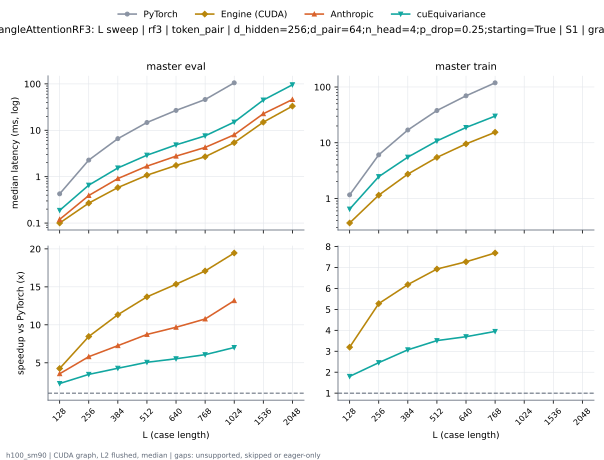
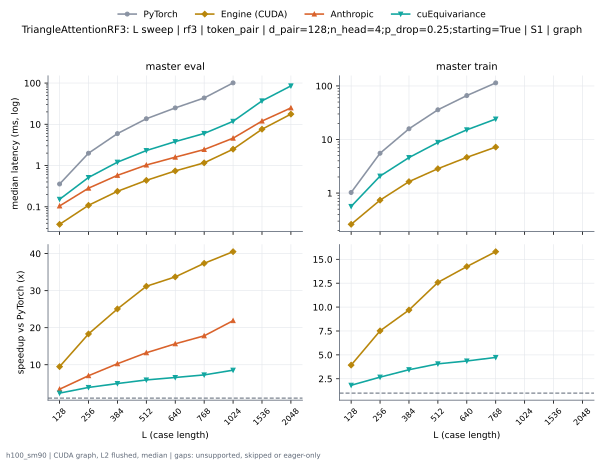

# TriangleAttentionRF3 on h100_sm90

Generated by `python -m miniworld_engine.measure.plot` from speed tokens `judge/tokens/h100_sm90/`; do not edit.

### L sweep: rf3 | token_pair | d_hidden=256;d_pair=64;n_head=4;p_drop=0.25;starting=False | S1 | graph

**master eval** (median ms; x = speedup vs PyTorch)

| L | PyTorch | Engine (Triton) | Engine (CUDA) | Anthropic | cuEquivariance |
|---|---|---|---|---|---|
| 128 | 0.4567 | 0.1531 (2.98x) | 0.1078 (4.24x) | 0.121 (3.77x) | 0.2166 (2.11x) |
| 256 | 2.364 | 0.4981 (4.75x) | 0.286 (8.27x) | 0.3962 (5.97x) | 0.745 (3.17x) |
| 384 | 6.818 | 1.158 (5.89x) | 0.6162 (11.06x) | 0.9139 (7.46x) | 1.757 (3.88x) |
| 512 | 15.1 | 2.168 (6.97x) | 1.125 (13.42x) | 1.697 (8.90x) | 3.272 (4.61x) |
| 640 | 27.42 | 3.537 (7.75x) | 1.818 (15.08x) | 2.802 (9.78x) | 5.435 (5.04x) |
| 768 | 46.9 | 5.325 (8.81x) | 2.809 (16.70x) | 4.296 (10.92x) | 8.503 (5.52x) |
| 1024 | 107.1 | 10.57 (10.13x) | 5.622 (19.05x) | 7.923 (13.52x) | 16.5 (6.49x) |
| 1536 | skipped | 29.7 | 15.41 | 22.86 | 47.91 |
| 2048 | skipped | 62.9 | 33.5 | 45.42 | 100.8 |

**master train** (median ms; x = speedup vs PyTorch)

| L | PyTorch | Engine (Triton) | Engine (CUDA) | Anthropic | cuEquivariance |
|---|---|---|---|---|---|
| 128 | 1.198 | 0.5159 (2.32x) | 0.374 (3.20x) | unsupported | 0.6804 (1.76x) |
| 256 | 6.165 | 1.741 (3.54x) | 1.156 (5.33x) | unsupported | 2.558 (2.41x) |
| 384 | 17.22 | 3.548 (4.85x) | 2.741 (6.28x) | unsupported | 5.78 (2.98x) |
| 512 | 38.3 | 6.709 (5.71x) | 5.482 (6.99x) | unsupported | 11.23 (3.41x) |
| 640 | 70.14 | 11.14 (6.30x) | 9.748 (7.20x) | unsupported | 19.42 (3.61x) |
| 768 | 119.8 | 17.32 (6.92x) | 15.75 (7.61x) | unsupported | 31.07 (3.86x) |
| 1024 |  |  |  |  |  |
| 1536 |  |  |  |  |  |
| 2048 |  |  |  |  |  |

### L sweep: rf3 | token_pair | d_hidden=256;d_pair=64;n_head=4;p_drop=0.25;starting=True | S1 | graph

**master eval** (median ms; x = speedup vs PyTorch)

| L | PyTorch | Engine (Triton) | Engine (CUDA) | Anthropic | cuEquivariance |
|---|---|---|---|---|---|
| 128 | 0.4338 | 0.1249 (3.47x) | 0.1026 (4.23x) | 0.1199 (3.62x) | 0.1879 (2.31x) |
| 256 | 2.279 | 0.4085 (5.58x) | 0.2695 (8.46x) | 0.3927 (5.80x) | 0.6563 (3.47x) |
| 384 | 6.593 | 0.9448 (6.98x) | 0.5816 (11.34x) | 0.9098 (7.25x) | 1.543 (4.27x) |
| 512 | 14.7 | 1.765 (8.33x) | 1.072 (13.72x) | 1.686 (8.72x) | 2.905 (5.06x) |
| 640 | 26.82 | 2.938 (9.13x) | 1.742 (15.39x) | 2.771 (9.68x) | 4.85 (5.53x) |
| 768 | 46.04 | 4.481 (10.28x) | 2.688 (17.13x) | 4.274 (10.77x) | 7.583 (6.07x) |
| 1024 | 105.6 | 9.052 (11.67x) | 5.431 (19.44x) | 7.999 (13.20x) | 15.03 (7.02x) |
| 1536 | skipped | 26.32 | 15.1 | 22.74 | 44.88 |
| 2048 | skipped | 56.92 | 33.32 | 46.02 | 95.67 |

**master train** (median ms; x = speedup vs PyTorch)

| L | PyTorch | Engine (Triton) | Engine (CUDA) | Anthropic | cuEquivariance |
|---|---|---|---|---|---|
| 128 | 1.173 | 0.4763 (2.46x) | 0.3653 (3.21x) | unsupported | 0.6456 (1.82x) |
| 256 | 6.055 | 1.642 (3.69x) | 1.142 (5.30x) | unsupported | 2.468 (2.45x) |
| 384 | 16.94 | 3.313 (5.11x) | 2.712 (6.25x) | unsupported | 5.519 (3.07x) |
| 512 | 37.85 | 6.297 (6.01x) | 5.407 (7.00x) | unsupported | 10.78 (3.51x) |
| 640 | 69.44 | 10.46 (6.64x) | 9.666 (7.18x) | unsupported | 18.79 (3.70x) |
| 768 | 118.8 | 16.34 (7.27x) | 15.79 (7.52x) | unsupported | 30.07 (3.95x) |
| 1024 |  |  |  |  |  |
| 1536 |  |  |  |  |  |
| 2048 |  |  |  |  |  |

### L sweep: rf3 | token_pair | d_pair=128;n_head=4;p_drop=0.25;starting=False | S1 | graph

**master eval** (median ms; x = speedup vs PyTorch)

| L | PyTorch | Engine (Triton) | Engine (CUDA) | Anthropic | cuEquivariance |
|---|---|---|---|---|---|
| 128 | 0.4009 | 0.1501 (2.67x) | 0.04429 (9.05x) | 0.1061 (3.78x) | 0.1842 (2.18x) |
| 256 | 2.107 | 0.481 (4.38x) | 0.1182 (17.83x) | 0.286 (7.36x) | 0.6249 (3.37x) |
| 384 | 6.213 | 1.117 (5.56x) | 0.2536 (24.51x) | 0.5836 (10.65x) | 1.475 (4.21x) |
| 512 | 14.1 | 2.083 (6.77x) | 0.4667 (30.22x) | 1.042 (13.54x) | 2.788 (5.06x) |
| 640 | 25.75 | 3.298 (7.81x) | 0.7851 (32.80x) | 1.607 (16.03x) | 4.568 (5.64x) |
| 768 | 44.55 | 4.988 (8.93x) | 1.239 (35.97x) | 2.454 (18.16x) | 7.037 (6.33x) |
| 1024 | 102.9 | 9.667 (10.64x) | 2.742 (37.52x) | 4.615 (22.29x) | 13.69 (7.52x) |
| 1536 | skipped | 25.42 | 7.977 | 12.04 | 40.91 |
| 2048 | skipped | 54.19 | 18.1 | 25.14 | 93.34 |

**master train** (median ms; x = speedup vs PyTorch)

| L | PyTorch | Engine (Triton) | Engine (CUDA) | Anthropic | cuEquivariance |
|---|---|---|---|---|---|
| 128 | 1.071 | 0.5047 (2.12x) | 0.2728 (3.93x) | unsupported | 0.6144 (1.74x) |
| 256 | 5.697 | 1.703 (3.34x) | 0.7561 (7.53x) | unsupported | 2.201 (2.59x) |
| 384 | 16.18 | 3.486 (4.64x) | 1.662 (9.74x) | unsupported | 4.926 (3.29x) |
| 512 | 36.43 | 6.313 (5.77x) | 3.004 (12.13x) | unsupported | 9.434 (3.86x) |
| 640 | 67.04 | 10.29 (6.51x) | 4.948 (13.55x) | unsupported | 16.06 (4.17x) |
| 768 | 115.4 | 15.71 (7.34x) | 7.647 (15.09x) | unsupported | 25.39 (4.54x) |
| 1024 |  |  |  |  |  |
| 1536 |  |  |  |  |  |
| 2048 |  |  |  |  |  |

### L sweep: rf3 | token_pair | d_pair=128;n_head=4;p_drop=0.25;starting=True | S1 | graph

**master eval** (median ms; x = speedup vs PyTorch)

| L | PyTorch | Engine (Triton) | Engine (CUDA) | Anthropic | cuEquivariance |
|---|---|---|---|---|---|
| 128 | 0.3635 | 0.1148 (3.17x) | 0.03734 (9.73x) | 0.1048 (3.47x) | 0.1519 (2.39x) |
| 256 | 1.992 | 0.3704 (5.38x) | 0.1121 (17.77x) | 0.2828 (7.04x) | 0.5139 (3.88x) |
| 384 | 5.954 | 0.8467 (7.03x) | 0.243 (24.51x) | 0.5787 (10.29x) | 1.207 (4.93x) |
| 512 | 13.64 | 1.61 (8.47x) | 0.4467 (30.54x) | 1.03 (13.25x) | 2.31 (5.91x) |
| 640 | 25 | 2.563 (9.75x) | 0.7561 (33.06x) | 1.596 (15.67x) | 3.806 (6.57x) |
| 768 | 43.52 | 3.985 (10.92x) | 1.207 (36.05x) | 2.444 (17.81x) | 5.996 (7.26x) |
| 1024 | 100.9 | 7.827 (12.89x) | 2.64 (38.21x) | 4.608 (21.89x) | 11.82 (8.54x) |
| 1536 | skipped | 21.39 | 7.848 | 11.98 | 36.95 |
| 2048 | skipped | 46.92 | 18.24 | 24.92 | 85.32 |

**master train** (median ms; x = speedup vs PyTorch)

| L | PyTorch | Engine (Triton) | Engine (CUDA) | Anthropic | cuEquivariance |
|---|---|---|---|---|---|
| 128 | 1.035 | 0.4543 (2.28x) | 0.2619 (3.95x) | unsupported | 0.5627 (1.84x) |
| 256 | 5.553 | 1.57 (3.54x) | 0.741 (7.49x) | unsupported | 2.074 (2.68x) |
| 384 | 15.84 | 3.149 (5.03x) | 1.636 (9.68x) | unsupported | 4.6 (3.44x) |
| 512 | 35.86 | 5.81 (6.17x) | 2.966 (12.09x) | unsupported | 8.832 (4.06x) |
| 640 | 66.11 | 9.377 (7.05x) | 4.896 (13.50x) | unsupported | 15.15 (4.36x) |
| 768 | 114.1 | 14.42 (7.91x) | 7.636 (14.94x) | unsupported | 24.1 (4.73x) |
| 1024 |  |  |  |  |  |
| 1536 |  |  |  |  |  |
| 2048 |  |  |  |  |  |

