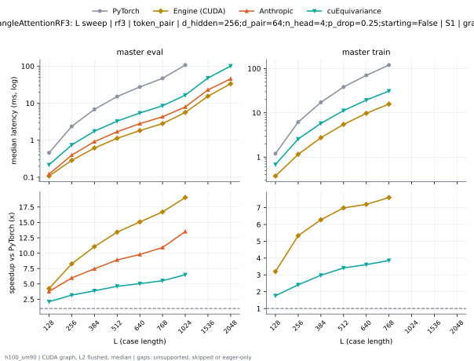

# TriangleAttentionRF3 on h100_sm90

Generated by `python -m foldjet_engine.measure.plot` from speed tokens `judge/tokens/h100_sm90/`; do not edit.

### L sweep: rf3 | token_pair | d_hidden=256;d_pair=64;n_head=4;p_drop=0.25;starting=False | S1 | graph

**master eval** (median ms; x = speedup vs PyTorch)

| L | PyTorch | Engine (Triton) | Engine (CUDA) | Anthropic | cuEquivariance |
|---|---|---|---|---|---|
| 128 | 0.4569 | 0.1519 (3.01x) | 0.1107 (4.13x) | 0.121 (3.78x) | 0.2166 (2.11x) |
| 256 | 2.363 | 0.4942 (4.78x) | 0.268 (8.82x) | 0.3962 (5.96x) | 0.745 (3.17x) |
| 384 | 6.815 | 1.156 (5.90x) | 0.5492 (12.41x) | 0.9139 (7.46x) | 1.757 (3.88x) |
| 512 | 15.07 | 2.14 (7.04x) | 0.9757 (15.45x) | 1.697 (8.88x) | 3.272 (4.60x) |
| 640 | 27.4 | 3.535 (7.75x) | 1.553 (17.64x) | 2.802 (9.78x) | 5.435 (5.04x) |
| 768 | 46.88 | 5.344 (8.77x) | 2.395 (19.58x) | 4.296 (10.91x) | 8.503 (5.51x) |
| 1024 | 107.1 | 10.59 (10.11x) | 4.81 (22.26x) | 7.923 (13.52x) | 16.5 (6.49x) |
| 1536 | skipped | 29.79 | 13.44 | 22.86 | 47.91 |
| 2048 | skipped | 62.86 | 28.54 | 45.42 | 100.8 |

**master train** (median ms; x = speedup vs PyTorch)

| L | PyTorch | Engine (Triton) | Engine (CUDA) | Anthropic | cuEquivariance |
|---|---|---|---|---|---|
| 128 | 1.2 | 0.5145 (2.33x) | 0.3609 (3.32x) | unsupported | 0.6804 (1.76x) |
| 256 | 6.153 | 1.741 (3.54x) | 1.121 (5.49x) | unsupported | 2.558 (2.41x) |
| 384 | 17.21 | 3.554 (4.84x) | 2.632 (6.54x) | unsupported | 5.78 (2.98x) |
| 512 | 38.27 | 6.748 (5.67x) | 5.169 (7.40x) | unsupported | 11.23 (3.41x) |
| 640 | 70.09 | 11.19 (6.26x) | 9.008 (7.78x) | unsupported | 19.42 (3.61x) |
| 768 | 119.7 | 17.35 (6.90x) | 14.19 (8.44x) | unsupported | 31.07 (3.85x) |
| 1024 |  |  |  |  |  |
| 1536 |  |  |  |  |  |
| 2048 |  |  |  |  |  |

### L sweep: rf3 | token_pair | d_hidden=256;d_pair=64;n_head=4;p_drop=0.25;starting=True | S1 | graph

**master eval** (median ms; x = speedup vs PyTorch)

| L | PyTorch | Engine (Triton) | Engine (CUDA) | Anthropic | cuEquivariance |
|---|---|---|---|---|---|
| 128 | 0.4254 | 0.1239 (3.43x) | 0.1043 (4.08x) | 0.1199 (3.55x) | 0.1879 (2.26x) |
| 256 | 2.277 | 0.4086 (5.57x) | 0.2523 (9.02x) | 0.3927 (5.80x) | 0.6563 (3.47x) |
| 384 | 6.589 | 0.9466 (6.96x) | 0.5262 (12.52x) | 0.9098 (7.24x) | 1.543 (4.27x) |
| 512 | 14.71 | 1.766 (8.33x) | 0.9381 (15.68x) | 1.686 (8.73x) | 2.905 (5.06x) |
| 640 | 26.8 | 2.969 (9.03x) | 1.478 (18.13x) | 2.771 (9.67x) | 4.85 (5.53x) |
| 768 | 46.01 | 4.508 (10.21x) | 2.255 (20.40x) | 4.274 (10.77x) | 7.583 (6.07x) |
| 1024 | 105.5 | 9.153 (11.53x) | 4.591 (22.98x) | 7.999 (13.19x) | 15.03 (7.02x) |
| 1536 | skipped | 26.4 | 13.04 | 22.74 | 44.88 |
| 2048 | skipped | 56.94 | 27.2 | 46.02 | 95.67 |

**master train** (median ms; x = speedup vs PyTorch)

| L | PyTorch | Engine (Triton) | Engine (CUDA) | Anthropic | cuEquivariance |
|---|---|---|---|---|---|
| 128 | 1.161 | 0.4766 (2.44x) | 0.3502 (3.32x) | unsupported | 0.6456 (1.80x) |
| 256 | 6.045 | 1.636 (3.69x) | 1.106 (5.47x) | unsupported | 2.468 (2.45x) |
| 384 | 16.95 | 3.29 (5.15x) | 2.61 (6.49x) | unsupported | 5.519 (3.07x) |
| 512 | 37.85 | 6.293 (6.01x) | 5.116 (7.40x) | unsupported | 10.78 (3.51x) |
| 640 | 69.4 | 10.49 (6.61x) | 8.946 (7.76x) | unsupported | 18.79 (3.69x) |
| 768 | 118.7 | 16.38 (7.25x) | 14.08 (8.44x) | unsupported | 30.07 (3.95x) |
| 1024 |  |  |  |  |  |
| 1536 |  |  |  |  |  |
| 2048 |  |  |  |  |  |

### L sweep: rf3 | token_pair | d_pair=128;n_head=4;p_drop=0.25;starting=False | S1 | graph

**master eval** (median ms; x = speedup vs PyTorch)

| L | PyTorch | Engine (Triton) | Engine (CUDA) | Anthropic | cuEquivariance |
|---|---|---|---|---|---|
| 128 | 0.3892 | 0.1487 (2.62x) | 0.04437 (8.77x) | 0.1061 (3.67x) | 0.1842 (2.11x) |
| 256 | 2.099 | 0.4804 (4.37x) | 0.1158 (18.13x) | 0.286 (7.34x) | 0.6249 (3.36x) |
| 384 | 6.221 | 1.113 (5.59x) | 0.2491 (24.98x) | 0.5836 (10.66x) | 1.475 (4.22x) |
| 512 | 14.09 | 2.075 (6.79x) | 0.4556 (30.92x) | 1.042 (13.52x) | 2.788 (5.05x) |
| 640 | 25.74 | 3.308 (7.78x) | 0.7655 (33.62x) | 1.607 (16.02x) | 4.568 (5.63x) |
| 768 | 44.53 | 4.995 (8.91x) | 1.184 (37.60x) | 2.454 (18.15x) | 7.037 (6.33x) |
| 1024 | 103.1 | 9.735 (10.59x) | 2.461 (41.90x) | 4.615 (22.35x) | 13.69 (7.54x) |
| 1536 | skipped | 25.65 | 7.727 | 12.04 | 40.91 |
| 2048 | skipped | 54.4 | 17.98 | 25.14 | 93.34 |

**master train** (median ms; x = speedup vs PyTorch)

| L | PyTorch | Engine (Triton) | Engine (CUDA) | Anthropic | cuEquivariance |
|---|---|---|---|---|---|
| 128 | 1.078 | 0.5062 (2.13x) | 0.272 (3.96x) | unsupported | 0.6144 (1.75x) |
| 256 | 5.699 | 1.709 (3.33x) | 0.7547 (7.55x) | unsupported | 2.201 (2.59x) |
| 384 | 16.18 | 3.484 (4.64x) | 1.661 (9.74x) | unsupported | 4.926 (3.28x) |
| 512 | 36.44 | 6.302 (5.78x) | 2.894 (12.59x) | unsupported | 9.434 (3.86x) |
| 640 | 67.06 | 10.32 (6.50x) | 4.703 (14.26x) | unsupported | 16.06 (4.18x) |
| 768 | 115.4 | 15.72 (7.34x) | 7.278 (15.85x) | unsupported | 25.39 (4.55x) |
| 1024 |  |  |  |  |  |
| 1536 |  |  |  |  |  |
| 2048 |  |  |  |  |  |

### L sweep: rf3 | token_pair | d_pair=128;n_head=4;p_drop=0.25;starting=True | S1 | graph

**master eval** (median ms; x = speedup vs PyTorch)

| L | PyTorch | Engine (Triton) | Engine (CUDA) | Anthropic | cuEquivariance |
|---|---|---|---|---|---|
| 128 | 0.3566 | 0.1147 (3.11x) | 0.03758 (9.49x) | 0.1048 (3.40x) | 0.1519 (2.35x) |
| 256 | 1.992 | 0.3701 (5.38x) | 0.1087 (18.32x) | 0.2828 (7.04x) | 0.5139 (3.88x) |
| 384 | 5.946 | 0.844 (7.04x) | 0.2372 (25.07x) | 0.5787 (10.27x) | 1.207 (4.93x) |
| 512 | 13.63 | 1.603 (8.50x) | 0.4373 (31.18x) | 1.03 (13.24x) | 2.31 (5.90x) |
| 640 | 24.98 | 2.555 (9.78x) | 0.7409 (33.72x) | 1.596 (15.66x) | 3.806 (6.56x) |
| 768 | 43.52 | 3.987 (10.91x) | 1.164 (37.38x) | 2.444 (17.81x) | 5.996 (7.26x) |
| 1024 | 100.9 | 7.849 (12.86x) | 2.491 (40.52x) | 4.608 (21.90x) | 11.82 (8.54x) |
| 1536 | skipped | 21.54 | 7.6 | 11.98 | 36.95 |
| 2048 | skipped | 47.4 | 17.65 | 24.92 | 85.32 |

**master train** (median ms; x = speedup vs PyTorch)

| L | PyTorch | Engine (Triton) | Engine (CUDA) | Anthropic | cuEquivariance |
|---|---|---|---|---|---|
| 128 | 1.025 | 0.4556 (2.25x) | 0.2609 (3.93x) | unsupported | 0.5627 (1.82x) |
| 256 | 5.54 | 1.557 (3.56x) | 0.7372 (7.51x) | unsupported | 2.074 (2.67x) |
| 384 | 15.85 | 3.136 (5.05x) | 1.636 (9.69x) | unsupported | 4.6 (3.45x) |
| 512 | 35.87 | 5.747 (6.24x) | 2.851 (12.58x) | unsupported | 8.832 (4.06x) |
| 640 | 66.09 | 9.374 (7.05x) | 4.642 (14.24x) | unsupported | 15.15 (4.36x) |
| 768 | 114.1 | 14.47 (7.88x) | 7.219 (15.80x) | unsupported | 24.1 (4.73x) |
| 1024 |  |  |  |  |  |
| 1536 |  |  |  |  |  |
| 2048 |  |  |  |  |  |

