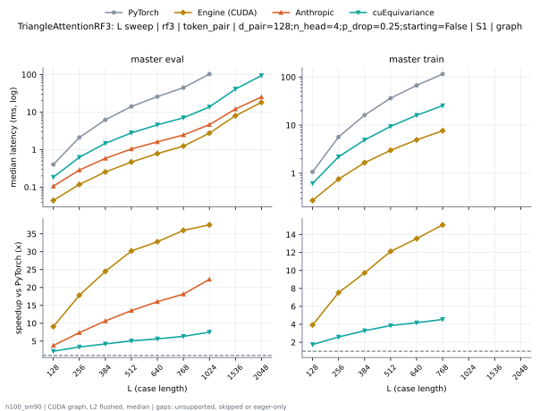

# TriangleAttentionRF3 on h100_sm90

Generated by `python -m miniworld_engine.measure.plot` from speed tokens `judge/tokens/h100_sm90/`; do not edit.

### L sweep: rf3 | token_pair | d_hidden=256;d_pair=64;n_head=4;p_drop=0.25;starting=False | S1 | graph

**master eval** (median ms; x = speedup vs PyTorch)

| L | PyTorch | Engine (Triton) | Engine (CUDA) | Anthropic | cuEquivariance |
|---|---|---|---|---|---|
| 128 | 0.4587 | 0.1531 (3.00x) | 0.1085 (4.23x) | 0.121 (3.79x) | 0.2166 (2.12x) |
| 256 | 2.369 | 0.4981 (4.76x) | 0.2867 (8.26x) | 0.3962 (5.98x) | 0.745 (3.18x) |
| 384 | 6.82 | 1.158 (5.89x) | 0.6178 (11.04x) | 0.9139 (7.46x) | 1.757 (3.88x) |
| 512 | 15.1 | 2.168 (6.97x) | 1.126 (13.41x) | 1.697 (8.90x) | 3.272 (4.61x) |
| 640 | 27.42 | 3.537 (7.75x) | 1.829 (14.99x) | 2.802 (9.79x) | 5.435 (5.04x) |
| 768 | 46.91 | 5.325 (8.81x) | 2.814 (16.67x) | 4.296 (10.92x) | 8.503 (5.52x) |
| 1024 | 107.2 | 10.57 (10.14x) | 5.618 (19.08x) | 7.923 (13.53x) | 16.5 (6.50x) |
| 1536 | skipped | 29.7 | 15.39 | 22.86 | 47.91 |
| 2048 | skipped | 62.9 | 33.88 | 45.42 | 100.8 |

**master train** (median ms; x = speedup vs PyTorch)

| L | PyTorch | Engine (Triton) | Engine (CUDA) | Anthropic | cuEquivariance |
|---|---|---|---|---|---|
| 128 | 1.204 | 0.5159 (2.33x) | 0.3749 (3.21x) | unsupported | 0.6804 (1.77x) |
| 256 | 6.161 | 1.741 (3.54x) | 1.162 (5.30x) | unsupported | 2.558 (2.41x) |
| 384 | 17.2 | 3.548 (4.85x) | 2.75 (6.26x) | unsupported | 5.78 (2.98x) |
| 512 | 38.3 | 6.709 (5.71x) | 5.497 (6.97x) | unsupported | 11.23 (3.41x) |
| 640 | 70.15 | 11.14 (6.30x) | 9.581 (7.32x) | unsupported | 19.42 (3.61x) |
| 768 | 119.8 | 17.32 (6.92x) | 15.37 (7.80x) | unsupported | 31.07 (3.86x) |
| 1024 |  |  |  |  |  |
| 1536 |  |  |  |  |  |
| 2048 |  |  |  |  |  |

### L sweep: rf3 | token_pair | d_hidden=256;d_pair=64;n_head=4;p_drop=0.25;starting=True | S1 | graph

**master eval** (median ms; x = speedup vs PyTorch)

| L | PyTorch | Engine (Triton) | Engine (CUDA) | Anthropic | cuEquivariance |
|---|---|---|---|---|---|
| 128 | 0.4268 | 0.1249 (3.42x) | 0.1004 (4.25x) | 0.1199 (3.56x) | 0.1879 (2.27x) |
| 256 | 2.28 | 0.4085 (5.58x) | 0.2693 (8.46x) | 0.3927 (5.81x) | 0.6563 (3.47x) |
| 384 | 6.602 | 0.9448 (6.99x) | 0.5825 (11.33x) | 0.9098 (7.26x) | 1.543 (4.28x) |
| 512 | 14.72 | 1.765 (8.34x) | 1.076 (13.68x) | 1.686 (8.73x) | 2.905 (5.07x) |
| 640 | 26.82 | 2.938 (9.13x) | 1.747 (15.35x) | 2.771 (9.68x) | 4.85 (5.53x) |
| 768 | 46.03 | 4.481 (10.27x) | 2.693 (17.09x) | 4.274 (10.77x) | 7.583 (6.07x) |
| 1024 | 105.5 | 9.052 (11.65x) | 5.421 (19.46x) | 7.999 (13.19x) | 15.03 (7.02x) |
| 1536 | skipped | 26.32 | 14.97 | 22.74 | 44.88 |
| 2048 | skipped | 56.92 | 33.18 | 46.02 | 95.67 |

**master train** (median ms; x = speedup vs PyTorch)

| L | PyTorch | Engine (Triton) | Engine (CUDA) | Anthropic | cuEquivariance |
|---|---|---|---|---|---|
| 128 | 1.163 | 0.4763 (2.44x) | 0.364 (3.20x) | unsupported | 0.6456 (1.80x) |
| 256 | 6.065 | 1.642 (3.69x) | 1.149 (5.28x) | unsupported | 2.468 (2.46x) |
| 384 | 16.95 | 3.313 (5.12x) | 2.74 (6.18x) | unsupported | 5.519 (3.07x) |
| 512 | 37.84 | 6.297 (6.01x) | 5.462 (6.93x) | unsupported | 10.78 (3.51x) |
| 640 | 69.44 | 10.46 (6.64x) | 9.547 (7.27x) | unsupported | 18.79 (3.70x) |
| 768 | 118.8 | 16.34 (7.27x) | 15.44 (7.69x) | unsupported | 30.07 (3.95x) |
| 1024 |  |  |  |  |  |
| 1536 |  |  |  |  |  |
| 2048 |  |  |  |  |  |

### L sweep: rf3 | token_pair | d_pair=128;n_head=4;p_drop=0.25;starting=False | S1 | graph

**master eval** (median ms; x = speedup vs PyTorch)

| L | PyTorch | Engine (Triton) | Engine (CUDA) | Anthropic | cuEquivariance |
|---|---|---|---|---|---|
| 128 | 0.3916 | 0.1501 (2.61x) | 0.0443 (8.84x) | 0.1061 (3.69x) | 0.1842 (2.13x) |
| 256 | 2.104 | 0.481 (4.38x) | 0.1182 (17.81x) | 0.286 (7.36x) | 0.6249 (3.37x) |
| 384 | 6.224 | 1.117 (5.57x) | 0.2554 (24.37x) | 0.5836 (10.66x) | 1.475 (4.22x) |
| 512 | 14.1 | 2.083 (6.77x) | 0.4678 (30.13x) | 1.042 (13.53x) | 2.788 (5.06x) |
| 640 | 25.75 | 3.298 (7.81x) | 0.7871 (32.71x) | 1.607 (16.03x) | 4.568 (5.64x) |
| 768 | 44.56 | 4.988 (8.93x) | 1.236 (36.04x) | 2.454 (18.16x) | 7.037 (6.33x) |
| 1024 | 102.9 | 9.667 (10.65x) | 2.629 (39.15x) | 4.615 (22.30x) | 13.69 (7.52x) |
| 1536 | skipped | 25.42 | 7.722 | 12.04 | 40.91 |
| 2048 | skipped | 54.19 | 17.82 | 25.14 | 93.34 |

**master train** (median ms; x = speedup vs PyTorch)

| L | PyTorch | Engine (Triton) | Engine (CUDA) | Anthropic | cuEquivariance |
|---|---|---|---|---|---|
| 128 | 1.064 | 0.5047 (2.11x) | 0.2711 (3.92x) | unsupported | 0.6144 (1.73x) |
| 256 | 5.698 | 1.703 (3.35x) | 0.758 (7.52x) | unsupported | 2.201 (2.59x) |
| 384 | 16.18 | 3.486 (4.64x) | 1.667 (9.70x) | unsupported | 4.926 (3.28x) |
| 512 | 36.44 | 6.313 (5.77x) | 3.004 (12.13x) | unsupported | 9.434 (3.86x) |
| 640 | 67.04 | 10.29 (6.51x) | 4.959 (13.52x) | unsupported | 16.06 (4.17x) |
| 768 | 115.4 | 15.71 (7.34x) | 7.711 (14.96x) | unsupported | 25.39 (4.54x) |
| 1024 |  |  |  |  |  |
| 1536 |  |  |  |  |  |
| 2048 |  |  |  |  |  |

### L sweep: rf3 | token_pair | d_pair=128;n_head=4;p_drop=0.25;starting=True | S1 | graph

**master eval** (median ms; x = speedup vs PyTorch)

| L | PyTorch | Engine (Triton) | Engine (CUDA) | Anthropic | cuEquivariance |
|---|---|---|---|---|---|
| 128 | 0.3549 | 0.1148 (3.09x) | 0.03699 (9.59x) | 0.1048 (3.39x) | 0.1519 (2.34x) |
| 256 | 1.99 | 0.3704 (5.37x) | 0.1122 (17.73x) | 0.2828 (7.04x) | 0.5139 (3.87x) |
| 384 | 5.948 | 0.8467 (7.02x) | 0.2433 (24.45x) | 0.5787 (10.28x) | 1.207 (4.93x) |
| 512 | 13.64 | 1.61 (8.47x) | 0.4464 (30.56x) | 1.03 (13.25x) | 2.31 (5.90x) |
| 640 | 24.99 | 2.563 (9.75x) | 0.7596 (32.90x) | 1.596 (15.66x) | 3.806 (6.57x) |
| 768 | 43.47 | 3.985 (10.91x) | 1.178 (36.91x) | 2.444 (17.79x) | 5.996 (7.25x) |
| 1024 | 101.2 | 7.827 (12.93x) | 2.662 (38.02x) | 4.608 (21.96x) | 11.82 (8.56x) |
| 1536 | skipped | 21.39 | 7.671 | 11.98 | 36.95 |
| 2048 | skipped | 46.92 | 17.63 | 24.92 | 85.32 |

**master train** (median ms; x = speedup vs PyTorch)

| L | PyTorch | Engine (Triton) | Engine (CUDA) | Anthropic | cuEquivariance |
|---|---|---|---|---|---|
| 128 | 1.023 | 0.4543 (2.25x) | 0.26 (3.93x) | unsupported | 0.5627 (1.82x) |
| 256 | 5.536 | 1.57 (3.53x) | 0.7393 (7.49x) | unsupported | 2.074 (2.67x) |
| 384 | 15.84 | 3.149 (5.03x) | 1.634 (9.69x) | unsupported | 4.6 (3.44x) |
| 512 | 35.85 | 5.81 (6.17x) | 2.968 (12.08x) | unsupported | 8.832 (4.06x) |
| 640 | 66.09 | 9.377 (7.05x) | 4.905 (13.47x) | unsupported | 15.15 (4.36x) |
| 768 | 114.1 | 14.42 (7.91x) | 7.641 (14.93x) | unsupported | 24.1 (4.73x) |
| 1024 |  |  |  |  |  |
| 1536 |  |  |  |  |  |
| 2048 |  |  |  |  |  |

