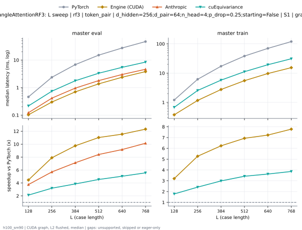
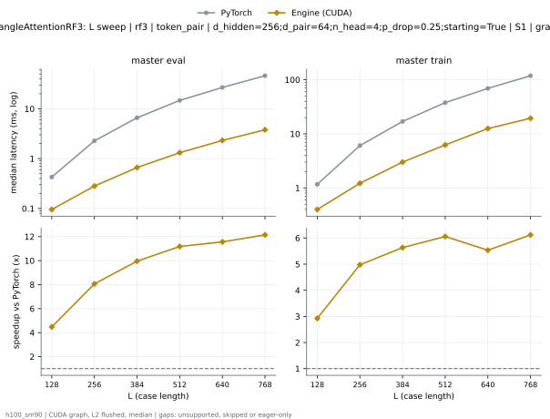
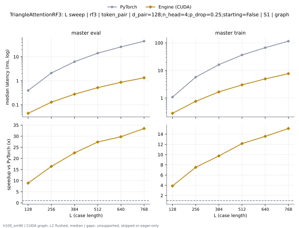
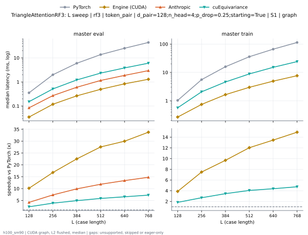

# TriangleAttentionRF3 on h100_sm90

Generated by `python -m miniworld_engine.measure.plot` from speed tokens `judge/tokens/h100_sm90/`; do not edit.

### L sweep: rf3 | token_pair | d_hidden=256;d_pair=64;n_head=4;p_drop=0.25;starting=False | S1 | graph

**master eval** (median ms; x = speedup vs PyTorch)

| L | PyTorch | Engine (Triton) | Engine (CUDA) | Anthropic | cuEquivariance |
|---|---|---|---|---|---|
| 128 | 0.4569 | 0.1525 (3.00x) | 0.1022 (4.47x) | 0.1224 (3.73x) | 0.2162 (2.11x) |
| 256 | 2.357 | 0.4912 (4.80x) | 0.2984 (7.90x) | 0.4142 (5.69x) | 0.7403 (3.18x) |
| 384 | 6.819 | 1.155 (5.90x) | 0.6956 (9.80x) | 0.9575 (7.12x) | 1.771 (3.85x) |
| 512 | 15.1 | 2.152 (7.01x) | 1.367 (11.04x) | 1.796 (8.41x) | 3.324 (4.54x) |
| 640 | 27.41 | 3.501 (7.83x) | 2.373 (11.55x) | 2.991 (9.16x) | 5.438 (5.04x) |
| 768 | 46.87 | 5.295 (8.85x) | 3.838 (12.21x) | 4.625 (10.13x) | 8.427 (5.56x) |

**master train** (median ms; x = speedup vs PyTorch)

| L | PyTorch | Engine (Triton) | Engine (CUDA) | Anthropic | cuEquivariance |
|---|---|---|---|---|---|
| 128 | 1.204 | 0.5117 (2.35x) | 0.3832 (3.14x) | unsupported | 0.6784 (1.78x) |
| 256 | 6.148 | 1.738 (3.54x) | 1.215 (5.06x) | unsupported | 2.554 (2.41x) |
| 384 | 17.2 | 3.51 (4.90x) | 2.907 (5.91x) | unsupported | 5.764 (2.98x) |
| 512 | 38.27 | 6.691 (5.72x) | 5.797 (6.60x) | unsupported | 11.2 (3.42x) |
| 640 | 70.12 | 11.17 (6.28x) | 10.31 (6.80x) | unsupported | 19.36 (3.62x) |
| 768 | 119.7 | 17.36 (6.89x) | 16.91 (7.08x) | unsupported | 31.02 (3.86x) |

### L sweep: rf3 | token_pair | d_hidden=256;d_pair=64;n_head=4;p_drop=0.25;starting=True | S1 | graph

**master eval** (median ms; x = speedup vs PyTorch)

| L | PyTorch | Engine (Triton) | Engine (CUDA) | Anthropic | cuEquivariance |
|---|---|---|---|---|---|
| 128 | 0.4279 | 0.1249 (3.43x) | 0.09574 (4.47x) | 0.1211 (3.53x) | 0.1884 (2.27x) |
| 256 | 2.278 | 0.4073 (5.59x) | 0.2818 (8.08x) | 0.4098 (5.56x) | 0.656 (3.47x) |
| 384 | 6.603 | 0.947 (6.97x) | 0.6626 (9.97x) | 0.9533 (6.93x) | 1.556 (4.24x) |
| 512 | 14.71 | 1.767 (8.32x) | 1.317 (11.17x) | 1.787 (8.23x) | 2.906 (5.06x) |
| 640 | 26.77 | 2.916 (9.18x) | 2.36 (11.34x) | 2.96 (9.04x) | 4.84 (5.53x) |
| 768 | 46 | 4.468 (10.30x) | 3.692 (12.46x) | 4.608 (9.98x) | 7.61 (6.04x) |

**master train** (median ms; x = speedup vs PyTorch)

| L | PyTorch | Engine (Triton) | Engine (CUDA) | Anthropic | cuEquivariance |
|---|---|---|---|---|---|
| 128 | 1.168 | 0.4793 (2.44x) | 0.3725 (3.14x) | unsupported | 0.6421 (1.82x) |
| 256 | 6.055 | 1.629 (3.72x) | 1.204 (5.03x) | unsupported | 2.44 (2.48x) |
| 384 | 16.95 | 3.296 (5.14x) | 2.882 (5.88x) | unsupported | 5.521 (3.07x) |
| 512 | 37.78 | 6.273 (6.02x) | 5.776 (6.54x) | unsupported | 10.81 (3.50x) |
| 640 | 69.39 | 10.48 (6.62x) | 10.26 (6.76x) | unsupported | 18.76 (3.70x) |
| 768 | 118.7 | 16.37 (7.25x) | 16.83 (7.06x) | unsupported | 30 (3.96x) |

### L sweep: rf3 | token_pair | d_pair=128;n_head=4;p_drop=0.25;starting=False | S1 | graph

**master eval** (median ms; x = speedup vs PyTorch)

| L | PyTorch | Engine (Triton) | Engine (CUDA) | Anthropic | cuEquivariance |
|---|---|---|---|---|---|
| 128 | 0.3905 | 0.1496 (2.61x) | 0.04414 (8.85x) | 0.08546 (4.57x) | 0.1862 (2.10x) |
| 256 | 2.102 | 0.4803 (4.38x) | 0.1284 (16.36x) | 0.2736 (7.68x) | 0.6243 (3.37x) |
| 384 | 6.222 | 1.113 (5.59x) | 0.2757 (22.57x) | 0.608 (10.23x) | 1.483 (4.20x) |
| 512 | 14.1 | 2.06 (6.84x) | 0.511 (27.59x) | 1.163 (12.12x) | 2.792 (5.05x) |
| 640 | 25.74 | 3.292 (7.82x) | 0.8637 (29.80x) | 1.877 (13.71x) | 4.564 (5.64x) |
| 768 | 44.53 | 4.996 (8.91x) | 1.337 (33.31x) | 2.96 (15.04x) | 7.017 (6.35x) |

**master train** (median ms; x = speedup vs PyTorch)

| L | PyTorch | Engine (Triton) | Engine (CUDA) | Anthropic | cuEquivariance |
|---|---|---|---|---|---|
| 128 | 1.076 | 0.5063 (2.13x) | 0.2762 (3.90x) | unsupported | 0.6108 (1.76x) |
| 256 | 5.697 | 1.699 (3.35x) | 0.7572 (7.52x) | unsupported | 2.209 (2.58x) |
| 384 | 16.15 | 3.437 (4.70x) | 1.671 (9.67x) | unsupported | 4.916 (3.29x) |
| 512 | 36.4 | 6.25 (5.82x) | 2.999 (12.14x) | unsupported | 9.419 (3.86x) |
| 640 | 67.01 | 10.24 (6.54x) | 4.958 (13.52x) | unsupported | 16.05 (4.18x) |
| 768 | 115.3 | 15.67 (7.36x) | 7.701 (14.97x) | unsupported | 25.35 (4.55x) |

### L sweep: rf3 | token_pair | d_pair=128;n_head=4;p_drop=0.25;starting=True | S1 | graph

**master eval** (median ms; x = speedup vs PyTorch)

| L | PyTorch | Engine (Triton) | Engine (CUDA) | Anthropic | cuEquivariance |
|---|---|---|---|---|---|
| 128 | 0.3522 | 0.1152 (3.06x) | 0.03701 (9.52x) | 0.08424 (4.18x) | 0.1513 (2.33x) |
| 256 | 1.992 | 0.3698 (5.39x) | 0.1205 (16.53x) | 0.2709 (7.35x) | 0.5137 (3.88x) |
| 384 | 5.958 | 0.8499 (7.01x) | 0.2659 (22.41x) | 0.6024 (9.89x) | 1.211 (4.92x) |
| 512 | 13.63 | 1.606 (8.49x) | 0.4947 (27.55x) | 1.153 (11.82x) | 2.329 (5.85x) |
| 640 | 24.99 | 2.549 (9.80x) | 0.8343 (29.95x) | 1.869 (13.37x) | 3.815 (6.55x) |
| 768 | 43.5 | 3.95 (11.01x) | 1.274 (34.14x) | 2.949 (14.75x) | 6.005 (7.24x) |

**master train** (median ms; x = speedup vs PyTorch)

| L | PyTorch | Engine (Triton) | Engine (CUDA) | Anthropic | cuEquivariance |
|---|---|---|---|---|---|
| 128 | 1.029 | 0.4568 (2.25x) | 0.267 (3.85x) | unsupported | 0.5619 (1.83x) |
| 256 | 5.534 | 1.547 (3.58x) | 0.7416 (7.46x) | unsupported | 2.062 (2.68x) |
| 384 | 15.82 | 3.104 (5.10x) | 1.64 (9.65x) | unsupported | 4.592 (3.45x) |
| 512 | 35.82 | 5.688 (6.30x) | 2.985 (12.00x) | unsupported | 8.831 (4.06x) |
| 640 | 66.03 | 9.372 (7.04x) | 4.906 (13.46x) | unsupported | 15.13 (4.36x) |
| 768 | 114 | 14.37 (7.93x) | 7.636 (14.93x) | unsupported | 24.07 (4.74x) |

