# TriangleMultiplication on h100_sm90

Generated by `python -m miniworld_engine.measure.plot` from speed tokens `judge/tokens/h100_sm90/`; do not edit.

### L sweep: af3|boltz2|chai1|opendde|openfold3|openfold3_preview2|protenix | token_pair | d_pair=64;outgoing=False;p_drop=0.25 | S1 | graph

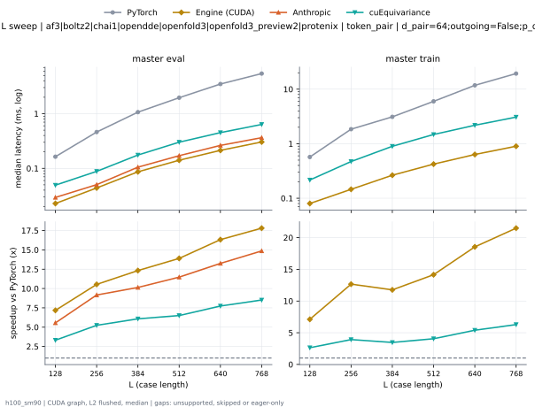

**master eval** (median ms; x = speedup vs PyTorch)

| L | PyTorch | Engine (Triton) | Engine (CUDA) | Anthropic | cuEquivariance |
|---|---|---|---|---|---|
| 128 | 0.1634 | 0.05731 (2.85x) | 0.02278 (7.17x) | 0.02942 (5.55x) | 0.04931 (3.31x) |
| 256 | 0.4617 | 0.08232 (5.61x) | 0.04382 (10.53x) | 0.05038 (9.16x) | 0.08811 (5.24x) |
| 384 | 1.066 | 0.1377 (7.74x) | 0.08653 (12.32x) | 0.1052 (10.14x) | 0.1754 (6.08x) |
| 512 | 1.958 | 0.2129 (9.20x) | 0.1409 (13.90x) | 0.1707 (11.47x) | 0.3012 (6.50x) |
| 640 | 3.485 | 0.3034 (11.49x) | 0.2135 (16.33x) | 0.263 (13.25x) | 0.4504 (7.74x) |
| 768 | 5.413 | 0.4178 (12.96x) | 0.3039 (17.81x) | 0.3641 (14.86x) | 0.6357 (8.51x) |

**master train** (median ms; x = speedup vs PyTorch)

| L | PyTorch | Engine (Triton) | Engine (CUDA) | Anthropic | cuEquivariance |
|---|---|---|---|---|---|
| 128 | 0.5696 | 0.1846 (3.09x) | 0.08005 (7.12x) | unsupported | 0.216 (2.64x) |
| 256 | 1.846 | 0.3308 (5.58x) | 0.1457 (12.67x) | unsupported | 0.471 (3.92x) |
| 384 | 3.109 | 0.6173 (5.04x) | 0.2642 (11.77x) | unsupported | 0.8961 (3.47x) |
| 512 | 5.978 | 0.9911 (6.03x) | 0.4223 (14.15x) | unsupported | 1.475 (4.05x) |
| 640 | 11.76 | 1.461 (8.05x) | 0.6341 (18.55x) | unsupported | 2.179 (5.40x) |
| 768 | 19.32 | 2.037 (9.49x) | 0.8987 (21.50x) | unsupported | 3.074 (6.29x) |

### L sweep: af3|boltz2|chai1|opendde|openfold3|openfold3_preview2|protenix | token_pair | d_pair=64;outgoing=True;p_drop=0.25 | S1 | graph

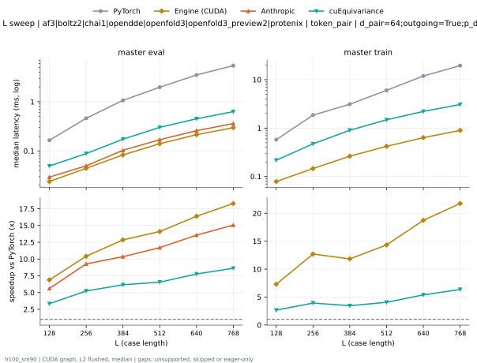

**master eval** (median ms; x = speedup vs PyTorch)

| L | PyTorch | Engine (Triton) | Engine (CUDA) | Anthropic | cuEquivariance |
|---|---|---|---|---|---|
| 128 | 0.1641 | 0.05739 (2.86x) | 0.02398 (6.84x) | 0.02934 (5.59x) | 0.04931 (3.33x) |
| 256 | 0.4613 | 0.08235 (5.60x) | 0.04442 (10.39x) | 0.04978 (9.27x) | 0.08814 (5.23x) |
| 384 | 1.067 | 0.1346 (7.93x) | 0.08285 (12.88x) | 0.103 (10.35x) | 0.1732 (6.16x) |
| 512 | 1.968 | 0.2119 (9.29x) | 0.14 (14.05x) | 0.1689 (11.65x) | 0.3014 (6.53x) |
| 640 | 3.473 | 0.3043 (11.42x) | 0.2152 (16.14x) | 0.2582 (13.45x) | 0.4508 (7.70x) |
| 768 | 5.404 | 0.4114 (13.14x) | 0.2972 (18.18x) | 0.3605 (14.99x) | 0.6298 (8.58x) |

**master train** (median ms; x = speedup vs PyTorch)

| L | PyTorch | Engine (Triton) | Engine (CUDA) | Anthropic | cuEquivariance |
|---|---|---|---|---|---|
| 128 | 0.5727 | 0.1837 (3.12x) | 0.07984 (7.17x) | unsupported | 0.217 (2.64x) |
| 256 | 1.844 | 0.3309 (5.57x) | 0.1468 (12.56x) | unsupported | 0.4724 (3.90x) |
| 384 | 3.106 | 0.6158 (5.04x) | 0.263 (11.81x) | unsupported | 0.9028 (3.44x) |
| 512 | 5.971 | 0.9911 (6.02x) | 0.4211 (14.18x) | unsupported | 1.483 (4.03x) |
| 640 | 11.76 | 1.463 (8.04x) | 0.6327 (18.59x) | unsupported | 2.209 (5.32x) |
| 768 | 19.29 | 2.036 (9.48x) | 0.9003 (21.43x) | unsupported | 3.068 (6.29x) |

### L sweep: af3|boltz2|openfold3|openfold3_preview2|protenix | token_pair | d_pair=128;outgoing=False;p_drop=0.25 | S1 | graph

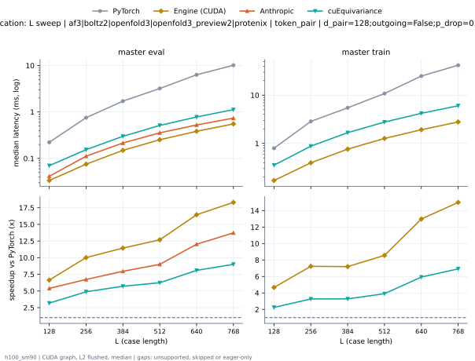

**master eval** (median ms; x = speedup vs PyTorch)

| L | PyTorch | Engine (Triton) | Engine (CUDA) | Anthropic | cuEquivariance |
|---|---|---|---|---|---|
| 128 | 0.2215 | 0.07275 (3.05x) | 0.03366 (6.58x) | 0.04128 (5.37x) | 0.07002 (3.16x) |
| 256 | 0.7523 | 0.153 (4.92x) | 0.07562 (9.95x) | 0.1119 (6.72x) | 0.1544 (4.87x) |
| 384 | 1.709 | 0.2916 (5.86x) | 0.1492 (11.46x) | 0.2149 (7.95x) | 0.2994 (5.71x) |
| 512 | 3.193 | 0.4714 (6.77x) | 0.2523 (12.66x) | 0.3559 (8.97x) | 0.5133 (6.22x) |
| 640 | 6.21 | 0.7022 (8.84x) | 0.3845 (16.15x) | 0.5255 (11.82x) | 0.7803 (7.96x) |
| 768 | 10.04 | 0.9987 (10.06x) | 0.5528 (18.17x) | 0.7374 (13.62x) | 1.124 (8.94x) |

**master train** (median ms; x = speedup vs PyTorch)

| L | PyTorch | Engine (Triton) | Engine (CUDA) | Anthropic | cuEquivariance |
|---|---|---|---|---|---|
| 128 | 0.7906 | 0.2416 (3.27x) | 0.1702 (4.65x) | unsupported | 0.3538 (2.23x) |
| 256 | 2.859 | 0.5774 (4.95x) | 0.3956 (7.23x) | unsupported | 0.8752 (3.27x) |
| 384 | 5.461 | 1.129 (4.84x) | 0.759 (7.19x) | unsupported | 1.668 (3.27x) |
| 512 | 10.76 | 1.841 (5.85x) | 1.261 (8.53x) | unsupported | 2.77 (3.88x) |
| 640 | 24.25 | 2.826 (8.58x) | 1.954 (12.41x) | unsupported | 4.204 (5.77x) |
| 768 | 41.25 | 3.994 (10.33x) | 2.74 (15.05x) | unsupported | 6.031 (6.84x) |

### L sweep: af3|boltz2|openfold3|openfold3_preview2|protenix | token_pair | d_pair=128;outgoing=True;p_drop=0.25 | S1 | graph

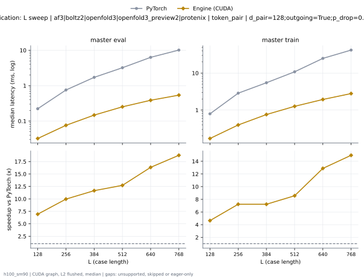

**master eval** (median ms; x = speedup vs PyTorch)

| L | PyTorch | Engine (Triton) | Engine (CUDA) | Anthropic | cuEquivariance |
|---|---|---|---|---|---|
| 128 | 0.2216 | 0.07278 (3.05x) | 0.03213 (6.90x) | 0.04115 (5.39x) | 0.07021 (3.16x) |
| 256 | 0.7532 | 0.1531 (4.92x) | 0.07573 (9.95x) | 0.1116 (6.75x) | 0.1552 (4.85x) |
| 384 | 1.719 | 0.2909 (5.91x) | 0.1474 (11.66x) | 0.2103 (8.17x) | 0.2984 (5.76x) |
| 512 | 3.195 | 0.4717 (6.77x) | 0.2524 (12.66x) | 0.3553 (8.99x) | 0.5132 (6.22x) |
| 640 | 6.206 | 0.7066 (8.78x) | 0.3866 (16.05x) | 0.5264 (11.79x) | 0.7826 (7.93x) |
| 768 | 10.05 | 0.9954 (10.09x) | 0.54 (18.60x) | 0.7397 (13.58x) | 1.108 (9.07x) |

**master train** (median ms; x = speedup vs PyTorch)

| L | PyTorch | Engine (Triton) | Engine (CUDA) | Anthropic | cuEquivariance |
|---|---|---|---|---|---|
| 128 | 0.794 | 0.2424 (3.28x) | 0.1707 (4.65x) | unsupported | 0.3539 (2.24x) |
| 256 | 2.87 | 0.5798 (4.95x) | 0.396 (7.25x) | unsupported | 0.8816 (3.26x) |
| 384 | 5.47 | 1.128 (4.85x) | 0.758 (7.22x) | unsupported | 1.692 (3.23x) |
| 512 | 10.75 | 1.843 (5.83x) | 1.264 (8.51x) | unsupported | 2.819 (3.81x) |
| 640 | 24.26 | 2.834 (8.56x) | 1.935 (12.53x) | unsupported | 4.273 (5.68x) |
| 768 | 41.25 | 3.993 (10.33x) | 2.795 (14.76x) | unsupported | 6.054 (6.81x) |

### L sweep: chai1|esmfold2|intellifold2|protenix | token_pair | d_pair=256;outgoing=False;p_drop=0.25 | S1 | graph

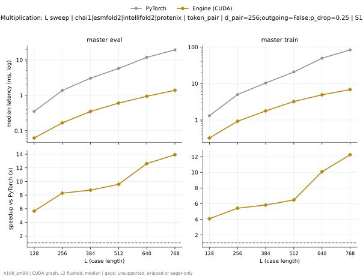

**master eval** (median ms; x = speedup vs PyTorch)

| L | PyTorch | Engine (Triton) | Engine (CUDA) | Anthropic | cuEquivariance |
|---|---|---|---|---|---|
| 128 | 0.3502 | 0.1224 (2.86x) | 0.06205 (5.64x) | 0.0751 (4.66x) | unsupported |
| 256 | 1.378 | 0.3392 (4.06x) | 0.1661 (8.30x) | 0.24 (5.74x) | 0.5699 (2.42x) |
| 384 | 3.045 | 0.6895 (4.42x) | 0.3491 (8.72x) | 0.4871 (6.25x) | 1.335 (2.28x) |
| 512 | 5.753 | 1.162 (4.95x) | 0.6026 (9.55x) | 0.8144 (7.06x) | 2.475 (2.32x) |
| 640 | 11.62 | 1.814 (6.40x) | 0.9397 (12.36x) | 1.302 (8.92x) | 3.774 (3.08x) |
| 768 | 19.04 | 2.635 (7.22x) | 1.385 (13.74x) | 1.89 (10.07x) | 5.605 (3.40x) |

**master train** (median ms; x = speedup vs PyTorch)

| L | PyTorch | Engine (Triton) | Engine (CUDA) | Anthropic | cuEquivariance |
|---|---|---|---|---|---|
| 128 | 1.305 | 0.3784 (3.45x) | 0.3205 (4.07x) | unsupported | unsupported |
| 256 | 5.012 | 1.139 (4.40x) | 0.9213 (5.44x) | unsupported | 2.147 (2.33x) |
| 384 | 10.33 | 2.302 (4.49x) | 1.774 (5.82x) | unsupported | 4.67 (2.21x) |
| 512 | 20.67 | 3.954 (5.23x) | 3.217 (6.42x) | unsupported | 8.056 (2.57x) |
| 640 | 48.09 | 6.362 (7.56x) | 4.906 (9.80x) | unsupported | 12.62 (3.81x) |
| 768 | 82.57 | 9.207 (8.97x) | 6.843 (12.07x) | unsupported | 17.88 (4.62x) |

### L sweep: chai1|esmfold2|intellifold2|protenix | token_pair | d_pair=256;outgoing=True;p_drop=0.25 | S1 | graph

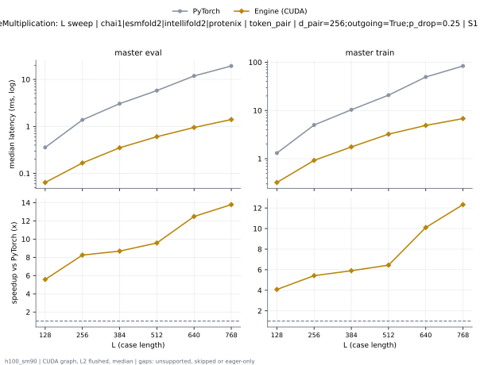

**master eval** (median ms; x = speedup vs PyTorch)

| L | PyTorch | Engine (Triton) | Engine (CUDA) | Anthropic | cuEquivariance |
|---|---|---|---|---|---|
| 128 | 0.3524 | 0.1237 (2.85x) | 0.0641 (5.50x) | 0.07501 (4.70x) | unsupported |
| 256 | 1.379 | 0.3408 (4.05x) | 0.1669 (8.26x) | 0.2401 (5.74x) | 0.5698 (2.42x) |
| 384 | 3.045 | 0.6902 (4.41x) | 0.351 (8.68x) | 0.5068 (6.01x) | 1.336 (2.28x) |
| 512 | 5.753 | 1.165 (4.94x) | 0.6042 (9.52x) | 0.8327 (6.91x) | 2.475 (2.32x) |
| 640 | 11.62 | 1.832 (6.34x) | 0.9493 (12.24x) | 1.312 (8.86x) | 3.776 (3.08x) |
| 768 | 19.03 | 2.59 (7.34x) | 1.4 (13.59x) | 1.865 (10.20x) | 5.584 (3.41x) |

**master train** (median ms; x = speedup vs PyTorch)

| L | PyTorch | Engine (Triton) | Engine (CUDA) | Anthropic | cuEquivariance |
|---|---|---|---|---|---|
| 128 | 1.304 | 0.3796 (3.43x) | 0.3206 (4.07x) | unsupported | unsupported |
| 256 | 5.008 | 1.139 (4.40x) | 0.9214 (5.44x) | unsupported | 2.153 (2.33x) |
| 384 | 10.33 | 2.301 (4.49x) | 1.752 (5.90x) | unsupported | 4.719 (2.19x) |
| 512 | 20.65 | 3.95 (5.23x) | 3.225 (6.40x) | unsupported | 8.151 (2.53x) |
| 640 | 48.11 | 6.364 (7.56x) | 4.897 (9.82x) | unsupported | 12.78 (3.77x) |
| 768 | 82.54 | 9.246 (8.93x) | 6.791 (12.16x) | unsupported | 18 (4.59x) |

### L sweep: intellifold2 | token_pair | d_pair=512;outgoing=False;p_drop=0.25 | S1 | graph

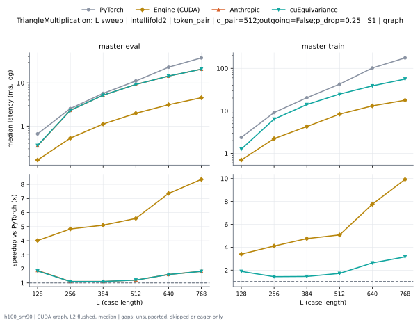

**master eval** (median ms; x = speedup vs PyTorch)

| L | PyTorch | Engine (Triton) | Engine (CUDA) | Anthropic | cuEquivariance |
|---|---|---|---|---|---|
| 128 | 0.6633 | 0.2988 (2.22x) | 0.1652 (4.01x) | 0.3516 (1.89x) | 0.3578 (1.85x) |
| 256 | 2.556 | 1.006 (2.54x) | 0.5286 (4.83x) | 2.318 (1.10x) | 2.322 (1.10x) |
| 384 | 5.722 | 2.244 (2.55x) | 1.121 (5.10x) | 5.196 (1.10x) | 5.201 (1.10x) |
| 512 | 11.08 | 3.955 (2.80x) | 1.984 (5.58x) | 9.201 (1.20x) | 9.205 (1.20x) |
| 640 | 23.05 | 6.162 (3.74x) | 3.132 (7.36x) | 14.38 (1.60x) | 14.4 (1.60x) |
| 768 | 37.94 | 9.127 (4.16x) | 4.54 (8.36x) | 20.77 (1.83x) | 20.77 (1.83x) |

**master train** (median ms; x = speedup vs PyTorch)

| L | PyTorch | Engine (Triton) | Engine (CUDA) | Anthropic | cuEquivariance |
|---|---|---|---|---|---|
| 128 | 2.374 | 0.8247 (2.88x) | 0.6987 (3.40x) | unsupported | 1.257 (1.89x) |
| 256 | 9.122 | 2.674 (3.41x) | 2.223 (4.10x) | unsupported | 6.398 (1.43x) |
| 384 | 20.34 | 5.741 (3.54x) | 4.278 (4.75x) | unsupported | 14.07 (1.45x) |
| 512 | 42.52 | 10.27 (4.14x) | 8.376 (5.08x) | unsupported | 24.82 (1.71x) |
| 640 | 101.8 | 16.87 (6.03x) | 13.12 (7.76x) | unsupported | 38.76 (2.63x) |
| 768 | 176.7 | 24.54 (7.20x) | 17.79 (9.93x) | unsupported | 56 (3.16x) |

### L sweep: intellifold2 | token_pair | d_pair=512;outgoing=True;p_drop=0.25 | S1 | graph

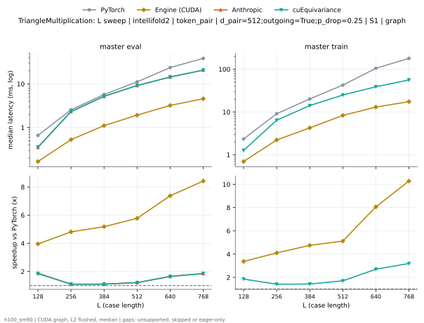

**master eval** (median ms; x = speedup vs PyTorch)

| L | PyTorch | Engine (Triton) | Engine (CUDA) | Anthropic | cuEquivariance |
|---|---|---|---|---|---|
| 128 | 0.6627 | 0.3001 (2.21x) | 0.1661 (3.99x) | 0.3512 (1.89x) | 0.3577 (1.85x) |
| 256 | 2.554 | 1.006 (2.54x) | 0.5285 (4.83x) | 2.318 (1.10x) | 2.322 (1.10x) |
| 384 | 5.747 | 2.247 (2.56x) | 1.123 (5.12x) | 5.197 (1.11x) | 5.202 (1.10x) |
| 512 | 11.07 | 3.959 (2.79x) | 1.949 (5.68x) | 9.201 (1.20x) | 9.205 (1.20x) |
| 640 | 23.06 | 6.172 (3.74x) | 3.199 (7.21x) | 14.39 (1.60x) | 14.4 (1.60x) |
| 768 | 37.89 | 8.887 (4.26x) | 4.566 (8.30x) | 20.73 (1.83x) | 20.73 (1.83x) |

**master train** (median ms; x = speedup vs PyTorch)

| L | PyTorch | Engine (Triton) | Engine (CUDA) | Anthropic | cuEquivariance |
|---|---|---|---|---|---|
| 128 | 2.373 | 0.8247 (2.88x) | 0.6987 (3.40x) | unsupported | 1.266 (1.87x) |
| 256 | 9.115 | 2.67 (3.41x) | 2.214 (4.12x) | unsupported | 6.433 (1.42x) |
| 384 | 20.35 | 5.723 (3.56x) | 4.245 (4.79x) | unsupported | 14.16 (1.44x) |
| 512 | 42.53 | 10.21 (4.16x) | 8.347 (5.10x) | unsupported | 25 (1.70x) |
| 640 | 101.7 | 16.86 (6.03x) | 13.06 (7.79x) | unsupported | 39.03 (2.60x) |
| 768 | 176.7 | 24.36 (7.25x) | 17.51 (10.09x) | unsupported | 56.27 (3.14x) |

### L sweep: opendde | token_pair | d_pair=384;outgoing=False;p_drop=0.25 | S1 | graph

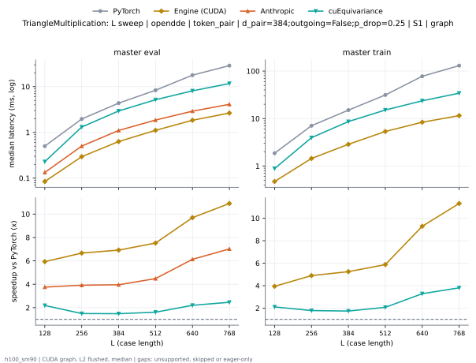

**master eval** (median ms; x = speedup vs PyTorch)

| L | PyTorch | Engine (Triton) | Engine (CUDA) | Anthropic | cuEquivariance |
|---|---|---|---|---|---|
| 128 | 0.5008 | 0.1899 (2.64x) | 0.08445 (5.93x) | 0.1332 (3.76x) | 0.2288 (2.19x) |
| 256 | 1.967 | 0.5728 (3.43x) | 0.2955 (6.66x) | 0.5014 (3.92x) | 1.311 (1.50x) |
| 384 | 4.357 | 1.229 (3.54x) | 0.6331 (6.88x) | 1.103 (3.95x) | 2.939 (1.48x) |
| 512 | 8.319 | 2.096 (3.97x) | 1.127 (7.38x) | 1.862 (4.47x) | 5.18 (1.61x) |
| 640 | 17.46 | 3.334 (5.24x) | 1.831 (9.54x) | 2.912 (5.99x) | 8.104 (2.15x) |
| 768 | 28.47 | 4.907 (5.80x) | 2.696 (10.56x) | 4.109 (6.93x) | 11.72 (2.43x) |

**master train** (median ms; x = speedup vs PyTorch)

| L | PyTorch | Engine (Triton) | Engine (CUDA) | Anthropic | cuEquivariance |
|---|---|---|---|---|---|
| 128 | 1.873 | 0.5926 (3.16x) | 0.472 (3.97x) | unsupported | 0.8819 (2.12x) |
| 256 | 7.077 | 1.824 (3.88x) | 1.448 (4.89x) | unsupported | 3.958 (1.79x) |
| 384 | 15.07 | 3.87 (3.90x) | 2.884 (5.23x) | unsupported | 8.636 (1.75x) |
| 512 | 31.17 | 6.782 (4.60x) | 5.388 (5.79x) | unsupported | 15.13 (2.06x) |
| 640 | 75.28 | 11.16 (6.74x) | 8.42 (8.94x) | unsupported | 23.63 (3.19x) |
| 768 | 128.2 | 15.93 (8.05x) | 11.58 (11.07x) | unsupported | 34.21 (3.75x) |

### L sweep: opendde | token_pair | d_pair=384;outgoing=True;p_drop=0.25 | S1 | graph

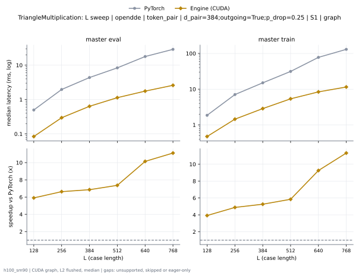

**master eval** (median ms; x = speedup vs PyTorch)

| L | PyTorch | Engine (Triton) | Engine (CUDA) | Anthropic | cuEquivariance |
|---|---|---|---|---|---|
| 128 | 0.5009 | 0.1896 (2.64x) | 0.08422 (5.95x) | 0.1324 (3.78x) | 0.229 (2.19x) |
| 256 | 1.966 | 0.5719 (3.44x) | 0.2963 (6.64x) | 0.492 (4.00x) | 1.311 (1.50x) |
| 384 | 4.359 | 1.228 (3.55x) | 0.6367 (6.85x) | 1.076 (4.05x) | 2.929 (1.49x) |
| 512 | 8.321 | 2.099 (3.96x) | 1.135 (7.33x) | 1.887 (4.41x) | 5.18 (1.61x) |
| 640 | 17.46 | 3.306 (5.28x) | 1.761 (9.92x) | 2.954 (5.91x) | 8.107 (2.15x) |
| 768 | 28.46 | 4.844 (5.88x) | 2.598 (10.95x) | 4.169 (6.83x) | 11.68 (2.44x) |

**master train** (median ms; x = speedup vs PyTorch)

| L | PyTorch | Engine (Triton) | Engine (CUDA) | Anthropic | cuEquivariance |
|---|---|---|---|---|---|
| 128 | 1.872 | 0.5923 (3.16x) | 0.4726 (3.96x) | unsupported | 0.8826 (2.12x) |
| 256 | 7.077 | 1.821 (3.89x) | 1.446 (4.89x) | unsupported | 3.983 (1.78x) |
| 384 | 15.08 | 3.861 (3.90x) | 2.858 (5.27x) | unsupported | 8.703 (1.73x) |
| 512 | 31.21 | 6.768 (4.61x) | 5.363 (5.82x) | unsupported | 15.27 (2.04x) |
| 640 | 75.3 | 11.16 (6.75x) | 8.387 (8.98x) | unsupported | 23.91 (3.15x) |
| 768 | 128.2 | 15.91 (8.06x) | 11.49 (11.16x) | unsupported | 34.47 (3.72x) |

### L sweep: protenix | token_pair | d_hidden=128;d_pair=64;outgoing=False;p_drop=0.25 | S1 | graph

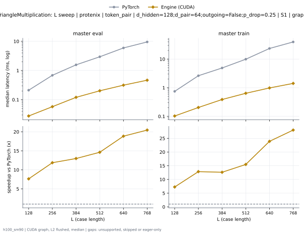

**master eval** (median ms; x = speedup vs PyTorch)

| L | PyTorch | Engine (Triton) | Engine (CUDA) | Anthropic | cuEquivariance |
|---|---|---|---|---|---|
| 128 | 0.2097 | 0.06595 (3.18x) | 0.02768 (7.58x) | 0.2491 (0.84x) | 0.06389 (3.28x) |
| 256 | 0.6846 | 0.1146 (5.97x) | 0.05771 (11.86x) | 0.7766 (0.88x) | 0.1363 (5.02x) |
| 384 | 1.562 | 0.2107 (7.41x) | 0.1206 (12.95x) | 1.736 (0.90x) | 0.2801 (5.57x) |
| 512 | 2.941 | 0.3266 (9.00x) | 0.2023 (14.54x) | 3.244 (0.91x) | 0.5002 (5.88x) |
| 640 | 5.83 | 0.4791 (12.17x) | 0.3151 (18.51x) | 0.3704 (15.74x) | 0.7608 (7.66x) |
| 768 | 9.429 | 0.6738 (13.99x) | 0.4661 (20.23x) | 0.5177 (18.21x) | 1.087 (8.67x) |

**master train** (median ms; x = speedup vs PyTorch)

| L | PyTorch | Engine (Triton) | Engine (CUDA) | Anthropic | cuEquivariance |
|---|---|---|---|---|---|
| 128 | 0.7476 | 0.2121 (3.52x) | 0.103 (7.26x) | unsupported | 0.2781 (2.69x) |
| 256 | 2.622 | 0.4687 (5.59x) | 0.2042 (12.84x) | unsupported | 0.6948 (3.77x) |
| 384 | 4.897 | 0.904 (5.42x) | 0.3878 (12.63x) | unsupported | 1.405 (3.49x) |
| 512 | 9.837 | 1.466 (6.71x) | 0.6401 (15.37x) | unsupported | 2.333 (4.22x) |
| 640 | 22.83 | 2.254 (10.13x) | 0.9828 (23.23x) | unsupported | 3.546 (6.44x) |
| 768 | 39.18 | 3.17 (12.36x) | 1.417 (27.64x) | unsupported | 5.083 (7.71x) |

### L sweep: protenix | token_pair | d_hidden=128;d_pair=64;outgoing=True;p_drop=0.25 | S1 | graph

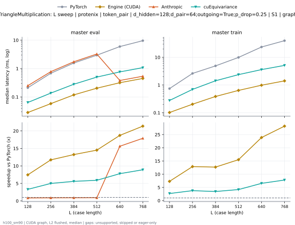

**master eval** (median ms; x = speedup vs PyTorch)

| L | PyTorch | Engine (Triton) | Engine (CUDA) | Anthropic | cuEquivariance |
|---|---|---|---|---|---|
| 128 | 0.2097 | 0.06592 (3.18x) | 0.02845 (7.37x) | 0.2493 (0.84x) | 0.06386 (3.28x) |
| 256 | 0.6851 | 0.1151 (5.95x) | 0.05874 (11.66x) | 0.7766 (0.88x) | 0.1366 (5.02x) |
| 384 | 1.562 | 0.2098 (7.45x) | 0.1188 (13.16x) | 1.735 (0.90x) | 0.2804 (5.57x) |
| 512 | 2.944 | 0.326 (9.03x) | 0.2029 (14.51x) | 3.246 (0.91x) | 0.5003 (5.88x) |
| 640 | 5.827 | 0.4802 (12.13x) | 0.3189 (18.27x) | 0.3801 (15.33x) | 0.7622 (7.64x) |
| 768 | 9.432 | 0.661 (14.27x) | 0.4491 (21.00x) | 0.5353 (17.62x) | 1.076 (8.77x) |

**master train** (median ms; x = speedup vs PyTorch)

| L | PyTorch | Engine (Triton) | Engine (CUDA) | Anthropic | cuEquivariance |
|---|---|---|---|---|---|
| 128 | 0.7448 | 0.2122 (3.51x) | 0.1028 (7.24x) | unsupported | 0.2772 (2.69x) |
| 256 | 2.621 | 0.4698 (5.58x) | 0.2039 (12.85x) | unsupported | 0.6954 (3.77x) |
| 384 | 4.894 | 0.9036 (5.42x) | 0.3869 (12.65x) | unsupported | 1.424 (3.44x) |
| 512 | 9.831 | 1.464 (6.72x) | 0.6403 (15.36x) | unsupported | 2.372 (4.14x) |
| 640 | 22.84 | 2.251 (10.14x) | 0.985 (23.19x) | unsupported | 3.601 (6.34x) |
| 768 | 39.17 | 3.177 (12.33x) | 1.409 (27.80x) | unsupported | 5.105 (7.67x) |

### d_pair sweep at L768: token_pair | outgoing=False;p_drop=0.25 | S1 | graph

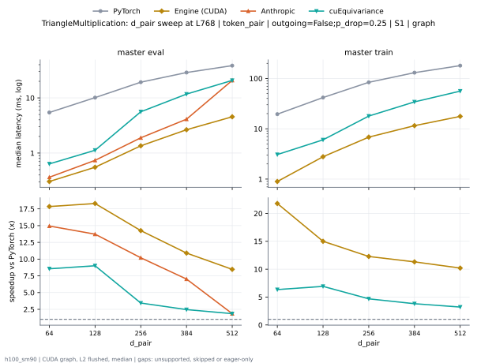

**master eval** (median ms; x = speedup vs PyTorch)

| d_pair | PyTorch | Engine (Triton) | Engine (CUDA) | Anthropic | cuEquivariance |
|---|---|---|---|---|---|
| 64 | 5.413 | 0.4178 (12.96x) | 0.3039 (17.81x) | 0.3641 (14.86x) | 0.6357 (8.51x) |
| 128 | 10.04 | 0.9987 (10.06x) | 0.5528 (18.17x) | 0.7374 (13.62x) | 1.124 (8.94x) |
| 256 | 19.04 | 2.635 (7.22x) | 1.385 (13.74x) | 1.89 (10.07x) | 5.605 (3.40x) |
| 384 | 28.47 | 4.907 (5.80x) | 2.696 (10.56x) | 4.109 (6.93x) | 11.72 (2.43x) |
| 512 | 37.94 | 9.127 (4.16x) | 4.54 (8.36x) | 20.77 (1.83x) | 20.77 (1.83x) |

**master train** (median ms; x = speedup vs PyTorch)

| d_pair | PyTorch | Engine (Triton) | Engine (CUDA) | Anthropic | cuEquivariance |
|---|---|---|---|---|---|
| 64 | 19.32 | 2.037 (9.49x) | 0.8987 (21.50x) | unsupported | 3.074 (6.29x) |
| 128 | 41.25 | 3.994 (10.33x) | 2.74 (15.05x) | unsupported | 6.031 (6.84x) |
| 256 | 82.57 | 9.207 (8.97x) | 6.843 (12.07x) | unsupported | 17.88 (4.62x) |
| 384 | 128.2 | 15.93 (8.05x) | 11.58 (11.07x) | unsupported | 34.21 (3.75x) |
| 512 | 176.7 | 24.54 (7.20x) | 17.79 (9.93x) | unsupported | 56 (3.16x) |

### d_pair sweep at L768: token_pair | outgoing=True;p_drop=0.25 | S1 | graph

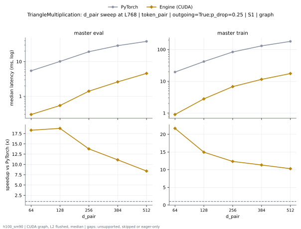

**master eval** (median ms; x = speedup vs PyTorch)

| d_pair | PyTorch | Engine (Triton) | Engine (CUDA) | Anthropic | cuEquivariance |
|---|---|---|---|---|---|
| 64 | 5.404 | 0.4114 (13.14x) | 0.2972 (18.18x) | 0.3605 (14.99x) | 0.6298 (8.58x) |
| 128 | 10.05 | 0.9954 (10.09x) | 0.54 (18.60x) | 0.7397 (13.58x) | 1.108 (9.07x) |
| 256 | 19.03 | 2.59 (7.34x) | 1.4 (13.59x) | 1.865 (10.20x) | 5.584 (3.41x) |
| 384 | 28.46 | 4.844 (5.88x) | 2.598 (10.95x) | 4.169 (6.83x) | 11.68 (2.44x) |
| 512 | 37.89 | 8.887 (4.26x) | 4.566 (8.30x) | 20.73 (1.83x) | 20.73 (1.83x) |

**master train** (median ms; x = speedup vs PyTorch)

| d_pair | PyTorch | Engine (Triton) | Engine (CUDA) | Anthropic | cuEquivariance |
|---|---|---|---|---|---|
| 64 | 19.29 | 2.036 (9.48x) | 0.9003 (21.43x) | unsupported | 3.068 (6.29x) |
| 128 | 41.25 | 3.993 (10.33x) | 2.795 (14.76x) | unsupported | 6.054 (6.81x) |
| 256 | 82.54 | 9.246 (8.93x) | 6.791 (12.16x) | unsupported | 18 (4.59x) |
| 384 | 128.2 | 15.91 (8.06x) | 11.49 (11.16x) | unsupported | 34.47 (3.72x) |
| 512 | 176.7 | 24.36 (7.25x) | 17.51 (10.09x) | unsupported | 56.27 (3.14x) |

