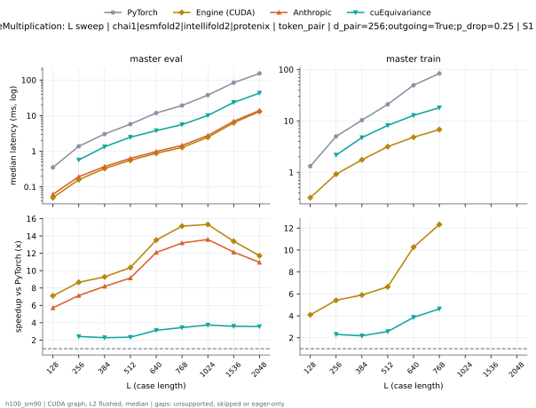
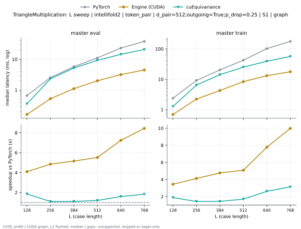
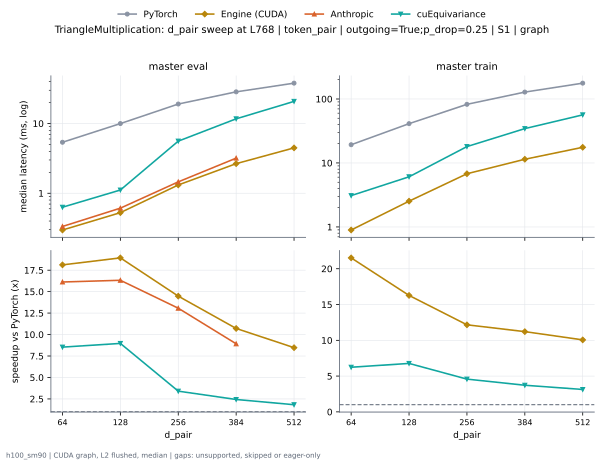

# TriangleMultiplication on h100_sm90

Generated by `python -m miniworld_engine.measure.plot` from speed tokens `judge/tokens/h100_sm90/`; do not edit.

### L sweep: af3|boltz2|chai1|opendde|openfold3|openfold3_preview2|protenix | token_pair | d_pair=64;outgoing=False;p_drop=0.25 | S1 | graph

**master eval** (median ms; x = speedup vs PyTorch)

| L | PyTorch | Engine (Triton) | Engine (CUDA) | Anthropic | cuEquivariance |
|---|---|---|---|---|---|
| 128 | 0.1633 | 0.05666 (2.88x) | 0.0204 (8.01x) | 0.03106 (5.26x) | 0.04934 (3.31x) |
| 256 | 0.4608 | 0.08162 (5.65x) | 0.04134 (11.14x) | 0.05606 (8.22x) | 0.08826 (5.22x) |
| 384 | 1.069 | 0.1385 (7.72x) | 0.0833 (12.83x) | 0.1054 (10.14x) | 0.1746 (6.12x) |
| 512 | 1.971 | 0.2136 (9.23x) | 0.139 (14.18x) | 0.1726 (11.42x) | 0.3011 (6.55x) |
| 640 | 3.485 | 0.3057 (11.40x) | 0.213 (16.36x) | 0.245 (14.22x) | 0.4508 (7.73x) |
| 768 | 5.405 | 0.4192 (12.89x) | 0.3029 (17.85x) | 0.3354 (16.11x) | 0.6363 (8.50x) |
| 1024 | 9.918 | 0.722 (13.74x) | 0.5173 (19.17x) | 0.6056 (16.38x) | 1.123 (8.83x) |
| 1536 | 22.65 | 1.79 (12.65x) | 1.34 (16.91x) | 1.502 (15.09x) | 2.665 (8.50x) |
| 2048 | 40.74 | 3.485 (11.69x) | 2.67 (15.26x) | 3.061 (13.31x) | 4.998 (8.15x) |

**master train** (median ms; x = speedup vs PyTorch)

| L | PyTorch | Engine (Triton) | Engine (CUDA) | Anthropic | cuEquivariance |
|---|---|---|---|---|---|
| 128 | 0.5751 | 0.1837 (3.13x) | 0.07438 (7.73x) | unsupported | 0.2159 (2.66x) |
| 256 | 1.864 | 0.3292 (5.66x) | 0.1418 (13.15x) | unsupported | 0.4719 (3.95x) |
| 384 | 3.101 | 0.6185 (5.01x) | 0.2607 (11.90x) | unsupported | 0.8921 (3.48x) |
| 512 | 6.02 | 0.9938 (6.06x) | 0.418 (14.40x) | unsupported | 1.467 (4.10x) |
| 640 | 11.89 | 1.466 (8.12x) | 0.6311 (18.85x) | unsupported | 2.184 (5.44x) |
| 768 | 19.49 | 2.044 (9.53x) | 0.8931 (21.82x) | unsupported | 3.094 (6.30x) |
| 1024 |  |  |  |  |  |
| 1536 |  |  |  |  |  |
| 2048 |  |  |  |  |  |

### L sweep: af3|boltz2|chai1|opendde|openfold3|openfold3_preview2|protenix | token_pair | d_pair=64;outgoing=True;p_drop=0.25 | S1 | graph

**master eval** (median ms; x = speedup vs PyTorch)

| L | PyTorch | Engine (Triton) | Engine (CUDA) | Anthropic | cuEquivariance |
|---|---|---|---|---|---|
| 128 | 0.1646 | 0.05699 (2.89x) | 0.02027 (8.12x) | 0.02941 (5.60x) | 0.04973 (3.31x) |
| 256 | 0.4587 | 0.08154 (5.63x) | 0.04141 (11.08x) | 0.05003 (9.17x) | 0.08816 (5.20x) |
| 384 | 1.063 | 0.1358 (7.83x) | 0.08086 (13.14x) | 0.1034 (10.28x) | 0.1732 (6.14x) |
| 512 | 1.973 | 0.212 (9.31x) | 0.138 (14.31x) | 0.1703 (11.59x) | 0.3016 (6.54x) |
| 640 | 3.485 | 0.3052 (11.42x) | 0.2119 (16.44x) | 0.244 (14.28x) | 0.4515 (7.72x) |
| 768 | 5.417 | 0.4124 (13.14x) | 0.2954 (18.34x) | 0.3342 (16.21x) | 0.6311 (8.58x) |
| 1024 | 9.926 | 0.7256 (13.68x) | 0.5205 (19.07x) | 0.6091 (16.30x) | 1.127 (8.81x) |
| 1536 | 22.69 | 1.781 (12.74x) | 1.33 (17.05x) | 1.516 (14.97x) | 2.653 (8.55x) |
| 2048 | 40.73 | 3.473 (11.73x) | 2.855 (14.26x) | 3.04 (13.40x) | 4.998 (8.15x) |

**master train** (median ms; x = speedup vs PyTorch)

| L | PyTorch | Engine (Triton) | Engine (CUDA) | Anthropic | cuEquivariance |
|---|---|---|---|---|---|
| 128 | 0.5691 | 0.1817 (3.13x) | 0.07384 (7.71x) | unsupported | 0.2138 (2.66x) |
| 256 | 1.853 | 0.3287 (5.64x) | 0.1421 (13.04x) | unsupported | 0.4745 (3.90x) |
| 384 | 3.097 | 0.6157 (5.03x) | 0.2592 (11.95x) | unsupported | 0.899 (3.45x) |
| 512 | 6.01 | 0.9932 (6.05x) | 0.4169 (14.42x) | unsupported | 1.488 (4.04x) |
| 640 | 11.88 | 1.465 (8.11x) | 0.6297 (18.86x) | unsupported | 2.217 (5.36x) |
| 768 | 19.48 | 2.042 (9.54x) | 0.8941 (21.79x) | unsupported | 3.089 (6.31x) |
| 1024 |  |  |  |  |  |
| 1536 |  |  |  |  |  |
| 2048 |  |  |  |  |  |

### L sweep: af3|boltz2|openfold3|openfold3_preview2|protenix | token_pair | d_pair=128;outgoing=False;p_drop=0.25 | S1 | graph

**master eval** (median ms; x = speedup vs PyTorch)

| L | PyTorch | Engine (Triton) | Engine (CUDA) | Anthropic | cuEquivariance |
|---|---|---|---|---|---|
| 128 | 0.2458 | 0.07229 (3.40x) | 0.02918 (8.42x) | 0.04146 (5.93x) | 0.07008 (3.51x) |
| 256 | 0.7522 | 0.154 (4.88x) | 0.07254 (10.37x) | 0.1079 (6.97x) | 0.1552 (4.84x) |
| 384 | 1.715 | 0.2944 (5.82x) | 0.1472 (11.65x) | 0.2211 (7.76x) | 0.2996 (5.72x) |
| 512 | 3.184 | 0.4771 (6.68x) | 0.2477 (12.85x) | 0.3545 (8.98x) | 0.5139 (6.20x) |
| 640 | 6.296 | 0.7074 (8.90x) | 0.3823 (16.47x) | 0.4413 (14.27x) | 0.7815 (8.06x) |
| 768 | 10.07 | 0.9979 (10.10x) | 0.5382 (18.72x) | 0.6134 (16.42x) | 1.129 (8.92x) |
| 1024 | 19.61 | 1.807 (10.85x) | 1.025 (19.14x) | 1.131 (17.34x) | 2.02 (9.71x) |
| 1536 | 44.64 | 4.444 (10.05x) | 2.917 (15.30x) | 3.057 (14.60x) | 4.922 (9.07x) |
| 2048 | 80.53 | 8.958 (8.99x) | 5.651 (14.25x) | 6.229 (12.93x) | 9.318 (8.64x) |

**master train** (median ms; x = speedup vs PyTorch)

| L | PyTorch | Engine (Triton) | Engine (CUDA) | Anthropic | cuEquivariance |
|---|---|---|---|---|---|
| 128 | 0.7912 | 0.2388 (3.31x) | 0.1662 (4.76x) | unsupported | 0.3531 (2.24x) |
| 256 | 2.857 | 0.5789 (4.93x) | 0.3939 (7.25x) | unsupported | 0.8754 (3.26x) |
| 384 | 5.454 | 1.128 (4.83x) | 0.7564 (7.21x) | unsupported | 1.673 (3.26x) |
| 512 | 10.81 | 1.847 (5.85x) | 1.255 (8.61x) | unsupported | 2.782 (3.89x) |
| 640 | 24.9 | 2.823 (8.82x) | 1.922 (12.95x) | unsupported | 4.217 (5.90x) |
| 768 | 41.79 | 4 (10.45x) | 2.742 (15.24x) | unsupported | 6.046 (6.91x) |
| 1024 |  |  |  |  |  |
| 1536 |  |  |  |  |  |
| 2048 |  |  |  |  |  |

### L sweep: af3|boltz2|openfold3|openfold3_preview2|protenix | token_pair | d_pair=128;outgoing=True;p_drop=0.25 | S1 | graph

**master eval** (median ms; x = speedup vs PyTorch)

| L | PyTorch | Engine (Triton) | Engine (CUDA) | Anthropic | cuEquivariance |
|---|---|---|---|---|---|
| 128 | 0.2476 | 0.07301 (3.39x) | 0.03312 (7.48x) | 0.04171 (5.94x) | 0.07173 (3.45x) |
| 256 | 0.7594 | 0.1545 (4.91x) | 0.07306 (10.39x) | 0.1075 (7.07x) | 0.1563 (4.86x) |
| 384 | 1.719 | 0.2907 (5.91x) | 0.1452 (11.84x) | 0.1739 (9.88x) | 0.2987 (5.75x) |
| 512 | 3.198 | 0.476 (6.72x) | 0.2479 (12.90x) | 0.2894 (11.05x) | 0.5138 (6.22x) |
| 640 | 6.307 | 0.7099 (8.88x) | 0.3844 (16.41x) | 0.4391 (14.37x) | 0.7829 (8.06x) |
| 768 | 10.1 | 0.9847 (10.26x) | 0.5265 (19.18x) | 0.6119 (16.51x) | 1.114 (9.07x) |
| 1024 | 19.61 | 1.833 (10.70x) | 1.004 (19.54x) | 1.182 (16.59x) | 2.026 (9.68x) |
| 1536 | 44.69 | 4.43 (10.09x) | 2.618 (17.07x) | 2.968 (15.06x) | 4.884 (9.15x) |
| 2048 | 80.5 | 8.575 (9.39x) | 5.68 (14.17x) | 6.238 (12.91x) | 9.389 (8.57x) |

**master train** (median ms; x = speedup vs PyTorch)

| L | PyTorch | Engine (Triton) | Engine (CUDA) | Anthropic | cuEquivariance |
|---|---|---|---|---|---|
| 128 | 0.7971 | 0.2381 (3.35x) | 0.1665 (4.79x) | unsupported | 0.355 (2.25x) |
| 256 | 2.857 | 0.5797 (4.93x) | 0.3947 (7.24x) | unsupported | 0.8778 (3.25x) |
| 384 | 5.461 | 1.127 (4.84x) | 0.7545 (7.24x) | unsupported | 1.69 (3.23x) |
| 512 | 10.81 | 1.844 (5.86x) | 1.256 (8.61x) | unsupported | 2.819 (3.84x) |
| 640 | 24.9 | 2.824 (8.82x) | 1.926 (12.93x) | unsupported | 4.285 (5.81x) |
| 768 | 41.79 | 3.997 (10.46x) | 2.814 (14.85x) | unsupported | 6.077 (6.88x) |
| 1024 |  |  |  |  |  |
| 1536 |  |  |  |  |  |
| 2048 |  |  |  |  |  |

### L sweep: chai1|esmfold2|intellifold2|protenix | token_pair | d_pair=256;outgoing=False;p_drop=0.25 | S1 | graph

**master eval** (median ms; x = speedup vs PyTorch)

| L | PyTorch | Engine (Triton) | Engine (CUDA) | Anthropic | cuEquivariance |
|---|---|---|---|---|---|
| 128 | 0.3625 | 0.1199 (3.02x) | 0.04925 (7.36x) | 0.06256 (5.79x) | unsupported |
| 256 | 1.37 | 0.3398 (4.03x) | 0.1592 (8.61x) | 0.1924 (7.12x) | 0.5707 (2.40x) |
| 384 | 3.045 | 0.6881 (4.43x) | 0.3279 (9.29x) | 0.3737 (8.15x) | 1.336 (2.28x) |
| 512 | 5.778 | 1.147 (5.04x) | 0.5589 (10.34x) | 0.6347 (9.10x) | 2.473 (2.34x) |
| 640 | 11.85 | 1.79 (6.62x) | 0.8662 (13.68x) | 1.001 (11.84x) | 3.783 (3.13x) |
| 768 | 19.27 | 2.598 (7.42x) | 1.234 (15.62x) | 1.482 (13.00x) | 5.613 (3.43x) |
| 1024 | 37.81 | 4.757 (7.95x) | 2.631 (14.37x) | 2.786 (13.57x) | 10.1 (3.74x) |
| 1536 | 84.05 | 11.55 (7.28x) | 6.453 (13.02x) | 7.107 (11.83x) | 23.47 (3.58x) |
| 2048 | 152.9 | 21.88 (6.99x) | 12.83 (11.92x) | 13.89 (11.01x) | 42.92 (3.56x) |

**master train** (median ms; x = speedup vs PyTorch)

| L | PyTorch | Engine (Triton) | Engine (CUDA) | Anthropic | cuEquivariance |
|---|---|---|---|---|---|
| 128 | 1.312 | 0.3774 (3.48x) | 0.3194 (4.11x) | unsupported | unsupported |
| 256 | 4.984 | 1.139 (4.37x) | 0.921 (5.41x) | unsupported | 2.143 (2.33x) |
| 384 | 10.29 | 2.274 (4.53x) | 1.768 (5.82x) | unsupported | 4.678 (2.20x) |
| 512 | 21 | 3.927 (5.35x) | 3.15 (6.67x) | unsupported | 8.063 (2.60x) |
| 640 | 49.45 | 6.31 (7.84x) | 4.831 (10.24x) | unsupported | 12.63 (3.91x) |
| 768 | 83.59 | 9.057 (9.23x) | 6.825 (12.25x) | unsupported | 17.91 (4.67x) |
| 1024 |  |  |  |  |  |
| 1536 |  |  |  |  |  |
| 2048 |  |  |  |  |  |

### L sweep: chai1|esmfold2|intellifold2|protenix | token_pair | d_pair=256;outgoing=True;p_drop=0.25 | S1 | graph

**master eval** (median ms; x = speedup vs PyTorch)

| L | PyTorch | Engine (Triton) | Engine (CUDA) | Anthropic | cuEquivariance |
|---|---|---|---|---|---|
| 128 | 0.3521 | 0.1217 (2.89x) | 0.04962 (7.10x) | 0.06163 (5.71x) | unsupported |
| 256 | 1.376 | 0.3424 (4.02x) | 0.1589 (8.66x) | 0.1929 (7.13x) | 0.5703 (2.41x) |
| 384 | 3.037 | 0.6857 (4.43x) | 0.3273 (9.28x) | 0.3709 (8.19x) | 1.337 (2.27x) |
| 512 | 5.771 | 1.158 (4.98x) | 0.557 (10.36x) | 0.6304 (9.15x) | 2.477 (2.33x) |
| 640 | 11.84 | 1.794 (6.60x) | 0.8754 (13.53x) | 0.9795 (12.09x) | 3.789 (3.12x) |
| 768 | 19.23 | 2.586 (7.43x) | 1.271 (15.13x) | 1.457 (13.19x) | 5.592 (3.44x) |
| 1024 | 37.73 | 4.737 (7.96x) | 2.462 (15.32x) | 2.775 (13.59x) | 10.11 (3.73x) |
| 1536 | 84.14 | 11.42 (7.37x) | 6.284 (13.39x) | 6.933 (12.14x) | 23.43 (3.59x) |
| 2048 | 152.7 | 21.97 (6.95x) | 13.03 (11.72x) | 13.94 (10.95x) | 42.95 (3.55x) |

**master train** (median ms; x = speedup vs PyTorch)

| L | PyTorch | Engine (Triton) | Engine (CUDA) | Anthropic | cuEquivariance |
|---|---|---|---|---|---|
| 128 | 1.312 | 0.38 (3.45x) | 0.3206 (4.09x) | unsupported | unsupported |
| 256 | 4.991 | 1.141 (4.37x) | 0.921 (5.42x) | unsupported | 2.16 (2.31x) |
| 384 | 10.31 | 2.299 (4.48x) | 1.747 (5.90x) | unsupported | 4.73 (2.18x) |
| 512 | 20.96 | 3.925 (5.34x) | 3.153 (6.65x) | unsupported | 8.157 (2.57x) |
| 640 | 49.4 | 6.336 (7.80x) | 4.813 (10.26x) | unsupported | 12.79 (3.86x) |
| 768 | 83.62 | 9.097 (9.19x) | 6.781 (12.33x) | unsupported | 18.03 (4.64x) |
| 1024 |  |  |  |  |  |
| 1536 |  |  |  |  |  |
| 2048 |  |  |  |  |  |

### L sweep: intellifold2 | token_pair | d_pair=512;outgoing=False;p_drop=0.25 | S1 | graph

**master eval** (median ms; x = speedup vs PyTorch)

| L | PyTorch | Engine (Triton) | Engine (CUDA) | Anthropic | cuEquivariance |
|---|---|---|---|---|---|
| 128 | 0.6643 | 0.2949 (2.25x) | 0.1623 (4.09x) | failed | 0.3568 (1.86x) |
| 256 | 2.536 | 1 (2.54x) | 0.5211 (4.87x) | failed | 2.332 (1.09x) |
| 384 | 5.741 | 2.237 (2.57x) | 1.123 (5.11x) | failed | 5.199 (1.10x) |
| 512 | 11.1 | 3.903 (2.85x) | 2 (5.55x) | failed | 9.212 (1.21x) |
| 640 | 23.75 | 6.122 (3.88x) | 3.257 (7.29x) | failed | 14.41 (1.65x) |
| 768 | 38.33 | 8.903 (4.31x) | 4.595 (8.34x) | failed | 20.81 (1.84x) |

**master train** (median ms; x = speedup vs PyTorch)

| L | PyTorch | Engine (Triton) | Engine (CUDA) | Anthropic | cuEquivariance |
|---|---|---|---|---|---|
| 128 | 2.353 | 0.8226 (2.86x) | 0.6856 (3.43x) | unsupported | 1.245 (1.89x) |
| 256 | 9.103 | 2.644 (3.44x) | 2.226 (4.09x) | unsupported | 6.412 (1.42x) |
| 384 | 20.27 | 5.704 (3.55x) | 4.296 (4.72x) | unsupported | 14.11 (1.44x) |
| 512 | 42.67 | 10.06 (4.24x) | 8.388 (5.09x) | unsupported | 24.85 (1.72x) |
| 640 | 105.8 | 16.76 (6.31x) | 13.16 (8.04x) | unsupported | 38.75 (2.73x) |
| 768 | 179.6 | 24.15 (7.44x) | 17.94 (10.01x) | unsupported | 56.15 (3.20x) |

### L sweep: intellifold2 | token_pair | d_pair=512;outgoing=True;p_drop=0.25 | S1 | graph

**master eval** (median ms; x = speedup vs PyTorch)

| L | PyTorch | Engine (Triton) | Engine (CUDA) | Anthropic | cuEquivariance |
|---|---|---|---|---|---|
| 128 | 0.6558 | 0.2988 (2.19x) | 0.1603 (4.09x) | failed | 0.3577 (1.83x) |
| 256 | 2.547 | 1.015 (2.51x) | 0.5277 (4.83x) | failed | 2.323 (1.10x) |
| 384 | 5.726 | 2.237 (2.56x) | 1.1 (5.20x) | failed | 5.201 (1.10x) |
| 512 | 11.11 | 3.917 (2.84x) | 2.012 (5.52x) | failed | 9.221 (1.20x) |
| 640 | 23.74 | 6.169 (3.85x) | 3.213 (7.39x) | failed | 14.42 (1.65x) |
| 768 | 38.38 | 8.913 (4.31x) | 4.545 (8.44x) | failed | 20.77 (1.85x) |

**master train** (median ms; x = speedup vs PyTorch)

| L | PyTorch | Engine (Triton) | Engine (CUDA) | Anthropic | cuEquivariance |
|---|---|---|---|---|---|
| 128 | 2.354 | 0.8233 (2.86x) | 0.6881 (3.42x) | unsupported | 1.266 (1.86x) |
| 256 | 9.09 | 2.656 (3.42x) | 2.218 (4.10x) | unsupported | 6.446 (1.41x) |
| 384 | 20.27 | 5.702 (3.55x) | 4.265 (4.75x) | unsupported | 14.19 (1.43x) |
| 512 | 42.68 | 10.1 (4.22x) | 8.364 (5.10x) | unsupported | 25.06 (1.70x) |
| 640 | 105.9 | 16.86 (6.28x) | 13.15 (8.06x) | unsupported | 39.13 (2.71x) |
| 768 | 179.7 | 24.27 (7.40x) | 17.79 (10.10x) | unsupported | 56.45 (3.18x) |

### L sweep: opendde | token_pair | d_pair=384;outgoing=False;p_drop=0.25 | S1 | graph

**master eval** (median ms; x = speedup vs PyTorch)

| L | PyTorch | Engine (Triton) | Engine (CUDA) | Anthropic | cuEquivariance |
|---|---|---|---|---|---|
| 128 | 0.4991 | 0.1883 (2.65x) | 0.08179 (6.10x) | 0.1093 (4.57x) | 0.2284 (2.19x) |
| 256 | 1.965 | 0.5722 (3.43x) | 0.2943 (6.68x) | 0.367 (5.36x) | 1.311 (1.50x) |
| 384 | 4.353 | 1.221 (3.56x) | 0.6292 (6.92x) | 0.7772 (5.60x) | 2.933 (1.48x) |
| 512 | 8.344 | 2.042 (4.09x) | 1.109 (7.53x) | 1.342 (6.22x) | 5.177 (1.61x) |
| 640 | 17.9 | 3.267 (5.48x) | 1.79 (10.00x) | 2.206 (8.11x) | 8.113 (2.21x) |
| 768 | 28.78 | 4.869 (5.91x) | 2.648 (10.87x) | 3.188 (9.03x) | 11.71 (2.46x) |
| 1024 | 56.11 | 8.945 (6.27x) | 4.983 (11.26x) | 5.953 (9.42x) | 20.98 (2.67x) |
| 1536 | 125.5 | 21.25 (5.90x) | 12.31 (10.19x) | 14.62 (8.58x) | 48.33 (2.60x) |
| 2048 | 212.6 | 39.97 (5.32x) | 24.49 (8.68x) | 28.35 (7.50x) | 87.71 (2.42x) |
| 2976 | 447.1 | 97 (4.61x) | 65.94 (6.78x) | 71.05 (6.29x) | 196 (2.28x) |
| 3968 | skipped | 194.1 | 140.9 | skipped | skipped |

**master train** (median ms; x = speedup vs PyTorch)

| L | PyTorch | Engine (Triton) | Engine (CUDA) | Anthropic | cuEquivariance |
|---|---|---|---|---|---|
| 128 | 1.857 | 0.5892 (3.15x) | 0.4603 (4.03x) | unsupported | 0.8817 (2.11x) |
| 256 | 7.056 | 1.82 (3.88x) | 1.437 (4.91x) | unsupported | 3.962 (1.78x) |
| 384 | 15.05 | 3.828 (3.93x) | 2.839 (5.30x) | unsupported | 8.645 (1.74x) |
| 512 | 31.71 | 6.685 (4.74x) | 5.336 (5.94x) | unsupported | 15.15 (2.09x) |
| 640 | 77.67 | 10.91 (7.12x) | 8.369 (9.28x) | unsupported | 23.62 (3.29x) |
| 768 | 130.2 | 15.79 (8.25x) | 11.47 (11.35x) | unsupported | 34.26 (3.80x) |
| 1024 |  |  |  |  |  |
| 1536 |  |  |  |  |  |
| 2048 |  |  |  |  |  |
| 2976 |  |  |  |  |  |
| 3968 |  |  |  |  |  |

### L sweep: opendde | token_pair | d_pair=384;outgoing=True;p_drop=0.25 | S1 | graph

**master eval** (median ms; x = speedup vs PyTorch)

| L | PyTorch | Engine (Triton) | Engine (CUDA) | Anthropic | cuEquivariance |
|---|---|---|---|---|---|
| 128 | 0.5004 | 0.1907 (2.62x) | 0.08214 (6.09x) | 0.1098 (4.56x) | 0.2295 (2.18x) |
| 256 | 1.993 | 0.5729 (3.48x) | 0.2979 (6.69x) | 0.3789 (5.26x) | 1.343 (1.48x) |
| 384 | 4.355 | 1.221 (3.57x) | 0.6311 (6.90x) | 0.7753 (5.62x) | 2.936 (1.48x) |
| 512 | 8.645 | 2.07 (4.18x) | 1.132 (7.64x) | 1.327 (6.52x) | 5.181 (1.67x) |
| 640 | 17.9 | 3.258 (5.49x) | 1.854 (9.65x) | 2.192 (8.17x) | 8.109 (2.21x) |
| 768 | 28.84 | 4.773 (6.04x) | 2.602 (11.09x) | 3.191 (9.04x) | 11.69 (2.47x) |
| 1024 | 55.81 | 8.951 (6.23x) | 4.963 (11.25x) | 5.932 (9.41x) | 21 (2.66x) |
| 1536 | 125.4 | 21.12 (5.94x) | 12.31 (10.19x) | 14.58 (8.60x) | 48.3 (2.60x) |
| 2048 | 212.6 | 39.89 (5.33x) | 24.57 (8.66x) | 28.27 (7.52x) | 87.79 (2.42x) |
| 2976 | 447.2 | 97.17 (4.60x) | 66.21 (6.75x) | 71.09 (6.29x) | 196 (2.28x) |
| 3968 | skipped | 192.9 | 144.9 | skipped | skipped |

**master train** (median ms; x = speedup vs PyTorch)

| L | PyTorch | Engine (Triton) | Engine (CUDA) | Anthropic | cuEquivariance |
|---|---|---|---|---|---|
| 128 | 1.853 | 0.5902 (3.14x) | 0.4619 (4.01x) | unsupported | 0.8912 (2.08x) |
| 256 | 7.056 | 1.822 (3.87x) | 1.44 (4.90x) | unsupported | 3.986 (1.77x) |
| 384 | 15.04 | 3.833 (3.92x) | 2.824 (5.32x) | unsupported | 8.723 (1.72x) |
| 512 | 31.73 | 6.704 (4.73x) | 5.348 (5.93x) | unsupported | 15.28 (2.08x) |
| 640 | 77.59 | 10.94 (7.09x) | 8.376 (9.26x) | unsupported | 23.87 (3.25x) |
| 768 | 130.1 | 15.95 (8.16x) | 11.42 (11.39x) | unsupported | 34.43 (3.78x) |
| 1024 |  |  |  |  |  |
| 1536 |  |  |  |  |  |
| 2048 |  |  |  |  |  |
| 2976 |  |  |  |  |  |
| 3968 |  |  |  |  |  |

### L sweep: protenix | token_pair | d_hidden=128;d_pair=64;outgoing=False;p_drop=0.25 | S1 | graph

**master eval** (median ms; x = speedup vs PyTorch)

| L | PyTorch | Engine (Triton) | Engine (CUDA) | Anthropic | cuEquivariance |
|---|---|---|---|---|---|
| 128 | 0.2245 | 0.0655 (3.43x) | 0.02411 (9.31x) | 0.2563 (0.88x) | 0.06325 (3.55x) |
| 256 | 0.6808 | 0.1142 (5.96x) | 0.0547 (12.45x) | 0.782 (0.87x) | 0.1363 (5.00x) |
| 384 | 1.559 | 0.2123 (7.34x) | 0.117 (13.32x) | 1.733 (0.90x) | 0.2804 (5.56x) |
| 512 | 2.939 | 0.3282 (8.96x) | 0.2005 (14.66x) | 3.23 (0.91x) | 0.5006 (5.87x) |
| 640 | 5.922 | 0.481 (12.31x) | 0.3129 (18.93x) | 0.3717 (15.93x) | 0.7612 (7.78x) |
| 768 | 9.546 | 0.6794 (14.05x) | 0.4653 (20.52x) | 0.5206 (18.34x) | 1.09 (8.76x) |
| 1024 | 18.63 | 1.223 (15.23x) | 0.8603 (21.65x) | 0.9438 (19.74x) | 1.96 (9.50x) |
| 1536 | 42.43 | 3.197 (13.27x) | 2.335 (18.17x) | 2.664 (15.93x) | 4.712 (9.00x) |
| 2048 | 76.61 | 6.379 (12.01x) | 4.969 (15.42x) | 5.228 (14.65x) | 8.917 (8.59x) |

**master train** (median ms; x = speedup vs PyTorch)

| L | PyTorch | Engine (Triton) | Engine (CUDA) | Anthropic | cuEquivariance |
|---|---|---|---|---|---|
| 128 | 0.7505 | 0.2115 (3.55x) | 0.09779 (7.67x) | unsupported | 0.2763 (2.72x) |
| 256 | 2.629 | 0.4657 (5.65x) | 0.1988 (13.22x) | unsupported | 0.6907 (3.81x) |
| 384 | 4.899 | 0.9032 (5.42x) | 0.383 (12.79x) | unsupported | 1.41 (3.47x) |
| 512 | 9.89 | 1.467 (6.74x) | 0.635 (15.58x) | unsupported | 2.342 (4.22x) |
| 640 | 23.51 | 2.255 (10.42x) | 0.9803 (23.98x) | unsupported | 3.562 (6.60x) |
| 768 | 39.71 | 3.181 (12.48x) | 1.424 (27.89x) | unsupported | 5.101 (7.79x) |
| 1024 |  |  |  |  |  |
| 1536 |  |  |  |  |  |
| 2048 |  |  |  |  |  |

### L sweep: protenix | token_pair | d_hidden=128;d_pair=64;outgoing=True;p_drop=0.25 | S1 | graph

**master eval** (median ms; x = speedup vs PyTorch)

| L | PyTorch | Engine (Triton) | Engine (CUDA) | Anthropic | cuEquivariance |
|---|---|---|---|---|---|
| 128 | 0.2088 | 0.06499 (3.21x) | 0.02379 (8.78x) | 0.254 (0.82x) | 0.06365 (3.28x) |
| 256 | 0.6826 | 0.1142 (5.98x) | 0.05522 (12.36x) | 0.7818 (0.87x) | 0.1373 (4.97x) |
| 384 | 1.564 | 0.21 (7.45x) | 0.1155 (13.54x) | 1.736 (0.90x) | 0.2816 (5.55x) |
| 512 | 2.94 | 0.3269 (8.99x) | 0.2008 (14.64x) | 3.231 (0.91x) | 0.5 (5.88x) |
| 640 | 5.917 | 0.484 (12.23x) | 0.316 (18.72x) | 0.3552 (16.66x) | 0.7625 (7.76x) |
| 768 | 9.539 | 0.6677 (14.29x) | 0.4497 (21.21x) | 0.4949 (19.27x) | 1.078 (8.84x) |
| 1024 | 18.63 | 1.217 (15.31x) | 0.8776 (21.23x) | 0.9335 (19.96x) | 1.966 (9.48x) |
| 1536 | 42.34 | 3.112 (13.61x) | 2.309 (18.34x) | 2.474 (17.12x) | 4.687 (9.03x) |
| 2048 | 76.79 | 6.276 (12.23x) | 4.829 (15.90x) | 5.149 (14.91x) | 8.915 (8.61x) |

**master train** (median ms; x = speedup vs PyTorch)

| L | PyTorch | Engine (Triton) | Engine (CUDA) | Anthropic | cuEquivariance |
|---|---|---|---|---|---|
| 128 | 0.7556 | 0.2115 (3.57x) | 0.09774 (7.73x) | unsupported | 0.2751 (2.75x) |
| 256 | 2.627 | 0.4685 (5.61x) | 0.2001 (13.13x) | unsupported | 0.6956 (3.78x) |
| 384 | 4.893 | 0.9043 (5.41x) | 0.3812 (12.84x) | unsupported | 1.423 (3.44x) |
| 512 | 9.881 | 1.468 (6.73x) | 0.6343 (15.58x) | unsupported | 2.387 (4.14x) |
| 640 | 23.5 | 2.255 (10.42x) | 0.9798 (23.99x) | unsupported | 3.597 (6.53x) |
| 768 | 39.7 | 3.18 (12.48x) | 1.447 (27.44x) | unsupported | 5.128 (7.74x) |
| 1024 |  |  |  |  |  |
| 1536 |  |  |  |  |  |
| 2048 |  |  |  |  |  |

### d_pair sweep at L768: token_pair | outgoing=False;p_drop=0.25 | S1 | graph

**master eval** (median ms; x = speedup vs PyTorch)

| d_pair | PyTorch | Engine (Triton) | Engine (CUDA) | Anthropic | cuEquivariance |
|---|---|---|---|---|---|
| 64 | 5.405 | 0.4192 (12.89x) | 0.3029 (17.85x) | 0.3354 (16.11x) | 0.6363 (8.50x) |
| 128 | 10.07 | 0.9979 (10.10x) | 0.5382 (18.72x) | 0.6134 (16.42x) | 1.129 (8.92x) |
| 256 | 19.27 | 2.598 (7.42x) | 1.234 (15.62x) | 1.482 (13.00x) | 5.613 (3.43x) |
| 384 | 28.78 | 4.869 (5.91x) | 2.648 (10.87x) | 3.188 (9.03x) | 11.71 (2.46x) |
| 512 | 38.33 | 8.903 (4.31x) | 4.595 (8.34x) | failed | 20.81 (1.84x) |

**master train** (median ms; x = speedup vs PyTorch)

| d_pair | PyTorch | Engine (Triton) | Engine (CUDA) | Anthropic | cuEquivariance |
|---|---|---|---|---|---|
| 64 | 19.49 | 2.044 (9.53x) | 0.8931 (21.82x) | unsupported | 3.094 (6.30x) |
| 128 | 41.79 | 4 (10.45x) | 2.742 (15.24x) | unsupported | 6.046 (6.91x) |
| 256 | 83.59 | 9.057 (9.23x) | 6.825 (12.25x) | unsupported | 17.91 (4.67x) |
| 384 | 130.2 | 15.79 (8.25x) | 11.47 (11.35x) | unsupported | 34.26 (3.80x) |
| 512 | 179.6 | 24.15 (7.44x) | 17.94 (10.01x) | unsupported | 56.15 (3.20x) |

### d_pair sweep at L768: token_pair | outgoing=True;p_drop=0.25 | S1 | graph

**master eval** (median ms; x = speedup vs PyTorch)

| d_pair | PyTorch | Engine (Triton) | Engine (CUDA) | Anthropic | cuEquivariance |
|---|---|---|---|---|---|
| 64 | 5.417 | 0.4124 (13.14x) | 0.2954 (18.34x) | 0.3342 (16.21x) | 0.6311 (8.58x) |
| 128 | 10.1 | 0.9847 (10.26x) | 0.5265 (19.18x) | 0.6119 (16.51x) | 1.114 (9.07x) |
| 256 | 19.23 | 2.586 (7.43x) | 1.271 (15.13x) | 1.457 (13.19x) | 5.592 (3.44x) |
| 384 | 28.84 | 4.773 (6.04x) | 2.602 (11.09x) | 3.191 (9.04x) | 11.69 (2.47x) |
| 512 | 38.38 | 8.913 (4.31x) | 4.545 (8.44x) | failed | 20.77 (1.85x) |

**master train** (median ms; x = speedup vs PyTorch)

| d_pair | PyTorch | Engine (Triton) | Engine (CUDA) | Anthropic | cuEquivariance |
|---|---|---|---|---|---|
| 64 | 19.48 | 2.042 (9.54x) | 0.8941 (21.79x) | unsupported | 3.089 (6.31x) |
| 128 | 41.79 | 3.997 (10.46x) | 2.814 (14.85x) | unsupported | 6.077 (6.88x) |
| 256 | 83.62 | 9.097 (9.19x) | 6.781 (12.33x) | unsupported | 18.03 (4.64x) |
| 384 | 130.1 | 15.95 (8.16x) | 11.42 (11.39x) | unsupported | 34.43 (3.78x) |
| 512 | 179.7 | 24.27 (7.40x) | 17.79 (10.10x) | unsupported | 56.45 (3.18x) |

