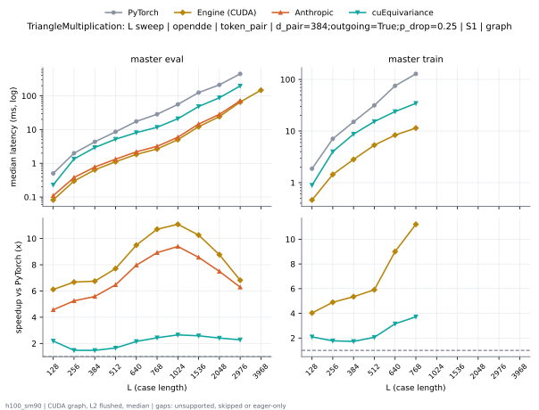
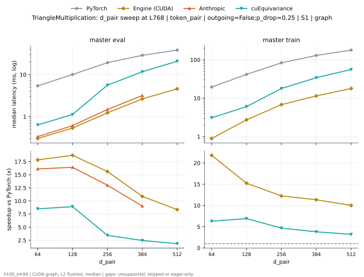

# TriangleMultiplication on h100_sm90

Generated by `python -m miniworld_engine.measure.plot` from speed tokens `judge/tokens/h100_sm90/`; do not edit.

### L sweep: af3|boltz2|chai1|opendde|openfold3|openfold3_preview2|protenix | token_pair | d_pair=64;outgoing=False;p_drop=0.25 | S1 | graph

**master eval** (median ms; x = speedup vs PyTorch)

| L | PyTorch | Engine (Triton) | Engine (CUDA) | Anthropic | cuEquivariance |
|---|---|---|---|---|---|
| 128 | 0.1638 | 0.05666 (2.89x) | 0.02016 (8.13x) | 0.03106 (5.27x) | 0.04934 (3.32x) |
| 256 | 0.4616 | 0.08162 (5.66x) | 0.04152 (11.12x) | 0.05606 (8.23x) | 0.08826 (5.23x) |
| 384 | 1.066 | 0.1385 (7.70x) | 0.08309 (12.83x) | 0.1054 (10.12x) | 0.1746 (6.11x) |
| 512 | 1.953 | 0.2136 (9.14x) | 0.1388 (14.07x) | 0.1726 (11.32x) | 0.3011 (6.48x) |
| 640 | 3.47 | 0.3057 (11.35x) | 0.2121 (16.36x) | 0.245 (14.16x) | 0.4508 (7.70x) |
| 768 | 5.396 | 0.4192 (12.87x) | 0.3032 (17.79x) | 0.3354 (16.09x) | 0.6363 (8.48x) |
| 1024 | 9.921 | 0.722 (13.74x) | 0.5369 (18.48x) | 0.6056 (16.38x) | 1.123 (8.83x) |
| 1536 | 22.74 | 1.79 (12.70x) | 1.386 (16.41x) | 1.502 (15.14x) | 2.665 (8.53x) |
| 2048 | 40.65 | 3.485 (11.66x) | 2.803 (14.51x) | 3.061 (13.28x) | 4.998 (8.13x) |

**master train** (median ms; x = speedup vs PyTorch)

| L | PyTorch | Engine (Triton) | Engine (CUDA) | Anthropic | cuEquivariance |
|---|---|---|---|---|---|
| 128 | 0.5681 | 0.1837 (3.09x) | 0.07554 (7.52x) | unsupported | 0.2159 (2.63x) |
| 256 | 1.838 | 0.3292 (5.58x) | 0.142 (12.95x) | unsupported | 0.4719 (3.89x) |
| 384 | 3.107 | 0.6185 (5.02x) | 0.2609 (11.91x) | unsupported | 0.8921 (3.48x) |
| 512 | 5.949 | 0.9938 (5.99x) | 0.4196 (14.18x) | unsupported | 1.467 (4.05x) |
| 640 | 11.73 | 1.466 (8.00x) | 0.6314 (18.58x) | unsupported | 2.184 (5.37x) |
| 768 | 19.31 | 2.044 (9.45x) | 0.8986 (21.49x) | unsupported | 3.094 (6.24x) |
| 1024 |  |  |  |  |  |
| 1536 |  |  |  |  |  |
| 2048 |  |  |  |  |  |

### L sweep: af3|boltz2|chai1|opendde|openfold3|openfold3_preview2|protenix | token_pair | d_pair=64;outgoing=True;p_drop=0.25 | S1 | graph

**master eval** (median ms; x = speedup vs PyTorch)

| L | PyTorch | Engine (Triton) | Engine (CUDA) | Anthropic | cuEquivariance |
|---|---|---|---|---|---|
| 128 | 0.1724 | 0.05699 (3.02x) | 0.02083 (8.27x) | 0.02941 (5.86x) | 0.04973 (3.47x) |
| 256 | 0.4642 | 0.08154 (5.69x) | 0.04192 (11.07x) | 0.05003 (9.28x) | 0.08816 (5.26x) |
| 384 | 1.067 | 0.1358 (7.86x) | 0.08088 (13.19x) | 0.1034 (10.32x) | 0.1732 (6.16x) |
| 512 | 1.971 | 0.212 (9.29x) | 0.1386 (14.22x) | 0.1703 (11.58x) | 0.3016 (6.53x) |
| 640 | 3.464 | 0.3052 (11.35x) | 0.2128 (16.27x) | 0.244 (14.20x) | 0.4515 (7.67x) |
| 768 | 5.402 | 0.4124 (13.10x) | 0.2959 (18.26x) | 0.3342 (16.17x) | 0.6311 (8.56x) |
| 1024 | 9.928 | 0.7256 (13.68x) | 0.5403 (18.38x) | 0.6091 (16.30x) | 1.127 (8.81x) |
| 1536 | 22.77 | 1.781 (12.79x) | 1.374 (16.57x) | 1.516 (15.02x) | 2.653 (8.58x) |
| 2048 | 40.77 | 3.473 (11.74x) | 2.798 (14.57x) | 3.04 (13.41x) | 4.998 (8.16x) |

**master train** (median ms; x = speedup vs PyTorch)

| L | PyTorch | Engine (Triton) | Engine (CUDA) | Anthropic | cuEquivariance |
|---|---|---|---|---|---|
| 128 | 0.5637 | 0.1817 (3.10x) | 0.07362 (7.66x) | unsupported | 0.2138 (2.64x) |
| 256 | 1.827 | 0.3287 (5.56x) | 0.142 (12.86x) | unsupported | 0.4745 (3.85x) |
| 384 | 3.095 | 0.6157 (5.03x) | 0.2577 (12.01x) | unsupported | 0.899 (3.44x) |
| 512 | 5.972 | 0.9932 (6.01x) | 0.417 (14.32x) | unsupported | 1.488 (4.01x) |
| 640 | 11.74 | 1.465 (8.02x) | 0.6332 (18.54x) | unsupported | 2.217 (5.30x) |
| 768 | 19.29 | 2.042 (9.45x) | 0.8939 (21.58x) | unsupported | 3.089 (6.25x) |
| 1024 |  |  |  |  |  |
| 1536 |  |  |  |  |  |
| 2048 |  |  |  |  |  |

### L sweep: af3|boltz2|openfold3|openfold3_preview2|protenix | token_pair | d_pair=128;outgoing=False;p_drop=0.25 | S1 | graph

**master eval** (median ms; x = speedup vs PyTorch)

| L | PyTorch | Engine (Triton) | Engine (CUDA) | Anthropic | cuEquivariance |
|---|---|---|---|---|---|
| 128 | 0.225 | 0.07229 (3.11x) | 0.02946 (7.64x) | 0.04146 (5.43x) | 0.07008 (3.21x) |
| 256 | 0.7529 | 0.154 (4.89x) | 0.07278 (10.34x) | 0.1079 (6.98x) | 0.1552 (4.85x) |
| 384 | 1.714 | 0.2944 (5.82x) | 0.1466 (11.69x) | 0.2211 (7.75x) | 0.2996 (5.72x) |
| 512 | 3.187 | 0.4771 (6.68x) | 0.2484 (12.83x) | 0.3545 (8.99x) | 0.5139 (6.20x) |
| 640 | 6.198 | 0.7074 (8.76x) | 0.3856 (16.07x) | 0.4413 (14.05x) | 0.7815 (7.93x) |
| 768 | 10.02 | 0.9979 (10.04x) | 0.554 (18.08x) | 0.6134 (16.33x) | 1.129 (8.87x) |
| 1024 | 19.54 | 1.807 (10.81x) | 1.034 (18.90x) | 1.131 (17.28x) | 2.02 (9.68x) |
| 1536 | 44.48 | 4.444 (10.01x) | 2.804 (15.86x) | 3.057 (14.55x) | 4.922 (9.04x) |
| 2048 | 80.44 | 8.958 (8.98x) | 5.842 (13.77x) | 6.229 (12.91x) | 9.318 (8.63x) |

**master train** (median ms; x = speedup vs PyTorch)

| L | PyTorch | Engine (Triton) | Engine (CUDA) | Anthropic | cuEquivariance |
|---|---|---|---|---|---|
| 128 | 0.7921 | 0.2388 (3.32x) | 0.1648 (4.80x) | unsupported | 0.3531 (2.24x) |
| 256 | 2.87 | 0.5789 (4.96x) | 0.3943 (7.28x) | unsupported | 0.8754 (3.28x) |
| 384 | 5.46 | 1.128 (4.84x) | 0.7613 (7.17x) | unsupported | 1.673 (3.26x) |
| 512 | 10.74 | 1.847 (5.82x) | 1.263 (8.50x) | unsupported | 2.782 (3.86x) |
| 640 | 24.24 | 2.823 (8.59x) | 1.923 (12.60x) | unsupported | 4.217 (5.75x) |
| 768 | 41.17 | 4 (10.29x) | 2.798 (14.72x) | unsupported | 6.046 (6.81x) |
| 1024 |  |  |  |  |  |
| 1536 |  |  |  |  |  |
| 2048 |  |  |  |  |  |

### L sweep: af3|boltz2|openfold3|openfold3_preview2|protenix | token_pair | d_pair=128;outgoing=True;p_drop=0.25 | S1 | graph

**master eval** (median ms; x = speedup vs PyTorch)

| L | PyTorch | Engine (Triton) | Engine (CUDA) | Anthropic | cuEquivariance |
|---|---|---|---|---|---|
| 128 | 0.2344 | 0.07301 (3.21x) | 0.03147 (7.45x) | 0.04171 (5.62x) | 0.07173 (3.27x) |
| 256 | 0.755 | 0.1545 (4.89x) | 0.07338 (10.29x) | 0.1075 (7.03x) | 0.1563 (4.83x) |
| 384 | 1.71 | 0.2907 (5.88x) | 0.1446 (11.83x) | 0.1739 (9.83x) | 0.2987 (5.73x) |
| 512 | 3.181 | 0.476 (6.68x) | 0.2492 (12.77x) | 0.2894 (10.99x) | 0.5138 (6.19x) |
| 640 | 6.199 | 0.7099 (8.73x) | 0.3851 (16.10x) | 0.4391 (14.12x) | 0.7829 (7.92x) |
| 768 | 10.03 | 0.9847 (10.19x) | 0.5412 (18.53x) | 0.6119 (16.39x) | 1.114 (9.01x) |
| 1024 | 19.54 | 1.833 (10.66x) | 1.05 (18.60x) | 1.182 (16.53x) | 2.026 (9.65x) |
| 1536 | 44.53 | 4.43 (10.05x) | 2.895 (15.39x) | 2.968 (15.00x) | 4.884 (9.12x) |
| 2048 | 80.24 | 8.575 (9.36x) | 5.92 (13.55x) | 6.238 (12.86x) | 9.389 (8.55x) |

**master train** (median ms; x = speedup vs PyTorch)

| L | PyTorch | Engine (Triton) | Engine (CUDA) | Anthropic | cuEquivariance |
|---|---|---|---|---|---|
| 128 | 0.7944 | 0.2381 (3.34x) | 0.1662 (4.78x) | unsupported | 0.355 (2.24x) |
| 256 | 2.869 | 0.5797 (4.95x) | 0.3948 (7.27x) | unsupported | 0.8778 (3.27x) |
| 384 | 5.464 | 1.127 (4.85x) | 0.7609 (7.18x) | unsupported | 1.69 (3.23x) |
| 512 | 10.75 | 1.844 (5.83x) | 1.26 (8.53x) | unsupported | 2.819 (3.81x) |
| 640 | 24.26 | 2.824 (8.59x) | 1.934 (12.54x) | unsupported | 4.285 (5.66x) |
| 768 | 41.14 | 3.997 (10.29x) | 2.798 (14.70x) | unsupported | 6.077 (6.77x) |
| 1024 |  |  |  |  |  |
| 1536 |  |  |  |  |  |
| 2048 |  |  |  |  |  |

### L sweep: chai1|esmfold2|intellifold2|protenix | token_pair | d_pair=256;outgoing=False;p_drop=0.25 | S1 | graph

**master eval** (median ms; x = speedup vs PyTorch)

| L | PyTorch | Engine (Triton) | Engine (CUDA) | Anthropic | cuEquivariance |
|---|---|---|---|---|---|
| 128 | 0.3479 | 0.1199 (2.90x) | 0.04882 (7.13x) | 0.06256 (5.56x) | unsupported |
| 256 | 1.381 | 0.3398 (4.07x) | 0.1603 (8.62x) | 0.1924 (7.18x) | 0.5707 (2.42x) |
| 384 | 3.042 | 0.6881 (4.42x) | 0.3282 (9.27x) | 0.3737 (8.14x) | 1.336 (2.28x) |
| 512 | 5.741 | 1.147 (5.01x) | 0.5668 (10.13x) | 0.6347 (9.05x) | 2.473 (2.32x) |
| 640 | 11.63 | 1.79 (6.50x) | 0.869 (13.38x) | 1.001 (11.62x) | 3.783 (3.07x) |
| 768 | 19.05 | 2.598 (7.33x) | 1.234 (15.44x) | 1.482 (12.85x) | 5.613 (3.39x) |
| 1024 | 37.53 | 4.757 (7.89x) | 2.451 (15.31x) | 2.786 (13.47x) | 10.1 (3.72x) |
| 1536 | 83.94 | 11.55 (7.27x) | 6.45 (13.01x) | 7.107 (11.81x) | 23.47 (3.58x) |
| 2048 | 151.6 | 21.88 (6.93x) | 12.95 (11.70x) | 13.89 (10.91x) | 42.92 (3.53x) |

**master train** (median ms; x = speedup vs PyTorch)

| L | PyTorch | Engine (Triton) | Engine (CUDA) | Anthropic | cuEquivariance |
|---|---|---|---|---|---|
| 128 | 1.306 | 0.3774 (3.46x) | 0.3212 (4.07x) | unsupported | unsupported |
| 256 | 4.996 | 1.139 (4.38x) | 0.9199 (5.43x) | unsupported | 2.143 (2.33x) |
| 384 | 10.35 | 2.274 (4.55x) | 1.775 (5.83x) | unsupported | 4.678 (2.21x) |
| 512 | 20.69 | 3.927 (5.27x) | 3.165 (6.54x) | unsupported | 8.063 (2.57x) |
| 640 | 48.01 | 6.31 (7.61x) | 4.818 (9.96x) | unsupported | 12.63 (3.80x) |
| 768 | 82.49 | 9.057 (9.11x) | 6.838 (12.06x) | unsupported | 17.91 (4.61x) |
| 1024 |  |  |  |  |  |
| 1536 |  |  |  |  |  |
| 2048 |  |  |  |  |  |

### L sweep: chai1|esmfold2|intellifold2|protenix | token_pair | d_pair=256;outgoing=True;p_drop=0.25 | S1 | graph

**master eval** (median ms; x = speedup vs PyTorch)

| L | PyTorch | Engine (Triton) | Engine (CUDA) | Anthropic | cuEquivariance |
|---|---|---|---|---|---|
| 128 | 0.3522 | 0.1217 (2.89x) | 0.05096 (6.91x) | 0.06163 (5.71x) | unsupported |
| 256 | 1.379 | 0.3424 (4.03x) | 0.1607 (8.58x) | 0.1929 (7.15x) | 0.5703 (2.42x) |
| 384 | 3.051 | 0.6857 (4.45x) | 0.3337 (9.14x) | 0.3709 (8.22x) | 1.337 (2.28x) |
| 512 | 5.74 | 1.158 (4.96x) | 0.5696 (10.08x) | 0.6304 (9.11x) | 2.477 (2.32x) |
| 640 | 11.62 | 1.794 (6.48x) | 0.8587 (13.53x) | 0.9795 (11.86x) | 3.789 (3.07x) |
| 768 | 19.01 | 2.586 (7.35x) | 1.258 (15.11x) | 1.457 (13.04x) | 5.592 (3.40x) |
| 1024 | 37.52 | 4.737 (7.92x) | 2.529 (14.84x) | 2.775 (13.52x) | 10.11 (3.71x) |
| 1536 | 83.73 | 11.42 (7.33x) | 6.302 (13.29x) | 6.933 (12.08x) | 23.43 (3.57x) |
| 2048 | 151.9 | 21.97 (6.91x) | 12.9 (11.78x) | 13.94 (10.90x) | 42.95 (3.54x) |

**master train** (median ms; x = speedup vs PyTorch)

| L | PyTorch | Engine (Triton) | Engine (CUDA) | Anthropic | cuEquivariance |
|---|---|---|---|---|---|
| 128 | 1.308 | 0.38 (3.44x) | 0.322 (4.06x) | unsupported | unsupported |
| 256 | 5 | 1.141 (4.38x) | 0.9193 (5.44x) | unsupported | 2.16 (2.31x) |
| 384 | 10.35 | 2.299 (4.50x) | 1.746 (5.93x) | unsupported | 4.73 (2.19x) |
| 512 | 20.7 | 3.925 (5.27x) | 3.169 (6.53x) | unsupported | 8.157 (2.54x) |
| 640 | 47.96 | 6.336 (7.57x) | 4.8 (9.99x) | unsupported | 12.79 (3.75x) |
| 768 | 82.47 | 9.097 (9.07x) | 6.781 (12.16x) | unsupported | 18.03 (4.57x) |
| 1024 |  |  |  |  |  |
| 1536 |  |  |  |  |  |
| 2048 |  |  |  |  |  |

### L sweep: intellifold2 | token_pair | d_pair=512;outgoing=False;p_drop=0.25 | S1 | graph

**master eval** (median ms; x = speedup vs PyTorch)

| L | PyTorch | Engine (Triton) | Engine (CUDA) | Anthropic | cuEquivariance |
|---|---|---|---|---|---|
| 128 | 0.6594 | 0.2949 (2.24x) | 0.1611 (4.09x) | failed | 0.3568 (1.85x) |
| 256 | 2.553 | 1 (2.55x) | 0.5255 (4.86x) | failed | 2.332 (1.09x) |
| 384 | 5.75 | 2.237 (2.57x) | 1.119 (5.14x) | failed | 5.199 (1.11x) |
| 512 | 11.07 | 3.903 (2.84x) | 1.985 (5.58x) | failed | 9.212 (1.20x) |
| 640 | 23.07 | 6.122 (3.77x) | 3.218 (7.17x) | failed | 14.41 (1.60x) |
| 768 | 37.88 | 8.903 (4.25x) | 4.505 (8.41x) | failed | 20.81 (1.82x) |

**master train** (median ms; x = speedup vs PyTorch)

| L | PyTorch | Engine (Triton) | Engine (CUDA) | Anthropic | cuEquivariance |
|---|---|---|---|---|---|
| 128 | 2.369 | 0.8226 (2.88x) | 0.6886 (3.44x) | unsupported | 1.245 (1.90x) |
| 256 | 9.116 | 2.644 (3.45x) | 2.219 (4.11x) | unsupported | 6.412 (1.42x) |
| 384 | 20.24 | 5.704 (3.55x) | 4.284 (4.73x) | unsupported | 14.11 (1.43x) |
| 512 | 42.41 | 10.06 (4.22x) | 8.322 (5.10x) | unsupported | 24.85 (1.71x) |
| 640 | 102.1 | 16.76 (6.09x) | 13.08 (7.81x) | unsupported | 38.75 (2.64x) |
| 768 | 176.7 | 24.15 (7.31x) | 17.67 (10.00x) | unsupported | 56.15 (3.15x) |

### L sweep: intellifold2 | token_pair | d_pair=512;outgoing=True;p_drop=0.25 | S1 | graph

**master eval** (median ms; x = speedup vs PyTorch)

| L | PyTorch | Engine (Triton) | Engine (CUDA) | Anthropic | cuEquivariance |
|---|---|---|---|---|---|
| 128 | 0.663 | 0.2988 (2.22x) | 0.162 (4.09x) | failed | 0.3577 (1.85x) |
| 256 | 2.553 | 1.015 (2.52x) | 0.5265 (4.85x) | failed | 2.323 (1.10x) |
| 384 | 5.751 | 2.237 (2.57x) | 1.114 (5.16x) | failed | 5.201 (1.11x) |
| 512 | 11.08 | 3.917 (2.83x) | 2.009 (5.51x) | failed | 9.221 (1.20x) |
| 640 | 23.06 | 6.169 (3.74x) | 3.185 (7.24x) | failed | 14.42 (1.60x) |
| 768 | 37.92 | 8.913 (4.26x) | 4.491 (8.44x) | failed | 20.77 (1.83x) |

**master train** (median ms; x = speedup vs PyTorch)

| L | PyTorch | Engine (Triton) | Engine (CUDA) | Anthropic | cuEquivariance |
|---|---|---|---|---|---|
| 128 | 2.373 | 0.8233 (2.88x) | 0.6905 (3.44x) | unsupported | 1.266 (1.87x) |
| 256 | 9.123 | 2.656 (3.43x) | 2.218 (4.11x) | unsupported | 6.446 (1.42x) |
| 384 | 20.27 | 5.702 (3.55x) | 4.256 (4.76x) | unsupported | 14.19 (1.43x) |
| 512 | 42.41 | 10.1 (4.20x) | 8.356 (5.08x) | unsupported | 25.06 (1.69x) |
| 640 | 102 | 16.86 (6.05x) | 13.12 (7.78x) | unsupported | 39.13 (2.61x) |
| 768 | 176.6 | 24.27 (7.28x) | 17.69 (9.99x) | unsupported | 56.45 (3.13x) |

### L sweep: opendde | token_pair | d_pair=384;outgoing=False;p_drop=0.25 | S1 | graph

**master eval** (median ms; x = speedup vs PyTorch)

| L | PyTorch | Engine (Triton) | Engine (CUDA) | Anthropic | cuEquivariance |
|---|---|---|---|---|---|
| 128 | 0.4996 | 0.1883 (2.65x) | 0.08182 (6.11x) | 0.1093 (4.57x) | 0.2284 (2.19x) |
| 256 | 1.96 | 0.5722 (3.43x) | 0.2955 (6.63x) | 0.367 (5.34x) | 1.311 (1.49x) |
| 384 | 4.354 | 1.221 (3.57x) | 0.6298 (6.91x) | 0.7772 (5.60x) | 2.933 (1.48x) |
| 512 | 8.314 | 2.042 (4.07x) | 1.125 (7.39x) | 1.342 (6.19x) | 5.177 (1.61x) |
| 640 | 17.45 | 3.267 (5.34x) | 1.778 (9.82x) | 2.206 (7.91x) | 8.113 (2.15x) |
| 768 | 28.5 | 4.869 (5.85x) | 2.579 (11.05x) | 3.188 (8.94x) | 11.71 (2.43x) |
| 1024 | 55.73 | 8.945 (6.23x) | 4.951 (11.25x) | 5.953 (9.36x) | 20.98 (2.66x) |
| 1536 | 124.9 | 21.25 (5.87x) | 12.34 (10.12x) | 14.62 (8.54x) | 48.33 (2.58x) |
| 2048 | 211.7 | 39.97 (5.30x) | 24.27 (8.72x) | 28.35 (7.47x) | 87.71 (2.41x) |
| 2976 | 446.7 | 97 (4.61x) | 65.07 (6.87x) | 71.05 (6.29x) | 196 (2.28x) |
| 3968 | skipped | 194.1 | 136.4 | skipped | skipped |

**master train** (median ms; x = speedup vs PyTorch)

| L | PyTorch | Engine (Triton) | Engine (CUDA) | Anthropic | cuEquivariance |
|---|---|---|---|---|---|
| 128 | 1.867 | 0.5892 (3.17x) | 0.4617 (4.04x) | unsupported | 0.8817 (2.12x) |
| 256 | 7.076 | 1.82 (3.89x) | 1.443 (4.90x) | unsupported | 3.962 (1.79x) |
| 384 | 15.04 | 3.828 (3.93x) | 2.856 (5.27x) | unsupported | 8.645 (1.74x) |
| 512 | 31.22 | 6.685 (4.67x) | 5.318 (5.87x) | unsupported | 15.15 (2.06x) |
| 640 | 75.32 | 10.91 (6.91x) | 8.367 (9.00x) | unsupported | 23.62 (3.19x) |
| 768 | 128.2 | 15.79 (8.12x) | 11.47 (11.18x) | unsupported | 34.26 (3.74x) |
| 1024 |  |  |  |  |  |
| 1536 |  |  |  |  |  |
| 2048 |  |  |  |  |  |
| 2976 |  |  |  |  |  |
| 3968 |  |  |  |  |  |

### L sweep: opendde | token_pair | d_pair=384;outgoing=True;p_drop=0.25 | S1 | graph

**master eval** (median ms; x = speedup vs PyTorch)

| L | PyTorch | Engine (Triton) | Engine (CUDA) | Anthropic | cuEquivariance |
|---|---|---|---|---|---|
| 128 | 0.5006 | 0.1907 (2.62x) | 0.08218 (6.09x) | 0.1098 (4.56x) | 0.2295 (2.18x) |
| 256 | 1.99 | 0.5729 (3.47x) | 0.2989 (6.66x) | 0.3789 (5.25x) | 1.343 (1.48x) |
| 384 | 4.355 | 1.221 (3.57x) | 0.6403 (6.80x) | 0.7753 (5.62x) | 2.936 (1.48x) |
| 512 | 8.318 | 2.07 (4.02x) | 1.144 (7.27x) | 1.327 (6.27x) | 5.181 (1.61x) |
| 640 | 17.47 | 3.258 (5.36x) | 1.837 (9.51x) | 2.192 (7.97x) | 8.109 (2.15x) |
| 768 | 28.48 | 4.773 (5.97x) | 2.635 (10.81x) | 3.191 (8.93x) | 11.69 (2.44x) |
| 1024 | 55.72 | 8.951 (6.22x) | 5.038 (11.06x) | 5.932 (9.39x) | 21 (2.65x) |
| 1536 | 124.8 | 21.12 (5.91x) | 12.18 (10.25x) | 14.58 (8.56x) | 48.3 (2.58x) |
| 2048 | 211.8 | 39.89 (5.31x) | 24.32 (8.71x) | 28.27 (7.49x) | 87.79 (2.41x) |
| 2976 | 447.5 | 97.17 (4.60x) | 65.52 (6.83x) | 71.09 (6.29x) | 196 (2.28x) |
| 3968 | skipped | 192.9 | 143.3 | skipped | skipped |

**master train** (median ms; x = speedup vs PyTorch)

| L | PyTorch | Engine (Triton) | Engine (CUDA) | Anthropic | cuEquivariance |
|---|---|---|---|---|---|
| 128 | 1.863 | 0.5902 (3.16x) | 0.4632 (4.02x) | unsupported | 0.8912 (2.09x) |
| 256 | 7.077 | 1.822 (3.88x) | 1.444 (4.90x) | unsupported | 3.986 (1.78x) |
| 384 | 15.04 | 3.833 (3.92x) | 2.834 (5.31x) | unsupported | 8.723 (1.72x) |
| 512 | 31.2 | 6.704 (4.65x) | 5.313 (5.87x) | unsupported | 15.28 (2.04x) |
| 640 | 75.29 | 10.94 (6.88x) | 8.345 (9.02x) | unsupported | 23.87 (3.15x) |
| 768 | 128.1 | 15.95 (8.03x) | 11.4 (11.24x) | unsupported | 34.43 (3.72x) |
| 1024 |  |  |  |  |  |
| 1536 |  |  |  |  |  |
| 2048 |  |  |  |  |  |
| 2976 |  |  |  |  |  |
| 3968 |  |  |  |  |  |

### L sweep: protenix | token_pair | d_hidden=128;d_pair=64;outgoing=False;p_drop=0.25 | S1 | graph

**master eval** (median ms; x = speedup vs PyTorch)

| L | PyTorch | Engine (Triton) | Engine (CUDA) | Anthropic | cuEquivariance |
|---|---|---|---|---|---|
| 128 | 0.2096 | 0.0655 (3.20x) | 0.02368 (8.85x) | 0.2563 (0.82x) | 0.06325 (3.31x) |
| 256 | 0.6833 | 0.1142 (5.98x) | 0.05462 (12.51x) | 0.782 (0.87x) | 0.1363 (5.01x) |
| 384 | 1.553 | 0.2123 (7.32x) | 0.1183 (13.13x) | 1.733 (0.90x) | 0.2804 (5.54x) |
| 512 | 2.925 | 0.3282 (8.91x) | 0.2012 (14.54x) | 3.23 (0.91x) | 0.5006 (5.84x) |
| 640 | 5.816 | 0.481 (12.09x) | 0.3146 (18.49x) | 0.3717 (15.64x) | 0.7612 (7.64x) |
| 768 | 9.451 | 0.6794 (13.91x) | 0.4672 (20.23x) | 0.5206 (18.15x) | 1.09 (8.67x) |
| 1024 | 18.55 | 1.223 (15.16x) | 0.864 (21.47x) | 0.9438 (19.66x) | 1.96 (9.47x) |
| 1536 | 42.29 | 3.197 (13.23x) | 2.319 (18.24x) | 2.664 (15.87x) | 4.712 (8.97x) |
| 2048 | 76.41 | 6.379 (11.98x) | 4.733 (16.15x) | 5.228 (14.62x) | 8.917 (8.57x) |

**master train** (median ms; x = speedup vs PyTorch)

| L | PyTorch | Engine (Triton) | Engine (CUDA) | Anthropic | cuEquivariance |
|---|---|---|---|---|---|
| 128 | 0.7525 | 0.2115 (3.56x) | 0.098 (7.68x) | unsupported | 0.2763 (2.72x) |
| 256 | 2.626 | 0.4657 (5.64x) | 0.1985 (13.23x) | unsupported | 0.6907 (3.80x) |
| 384 | 4.888 | 0.9032 (5.41x) | 0.3844 (12.72x) | unsupported | 1.41 (3.47x) |
| 512 | 9.81 | 1.467 (6.69x) | 0.635 (15.45x) | unsupported | 2.342 (4.19x) |
| 640 | 22.84 | 2.255 (10.13x) | 0.9812 (23.27x) | unsupported | 3.562 (6.41x) |
| 768 | 39.2 | 3.181 (12.32x) | 1.461 (26.84x) | unsupported | 5.101 (7.69x) |
| 1024 |  |  |  |  |  |
| 1536 |  |  |  |  |  |
| 2048 |  |  |  |  |  |

### L sweep: protenix | token_pair | d_hidden=128;d_pair=64;outgoing=True;p_drop=0.25 | S1 | graph

**master eval** (median ms; x = speedup vs PyTorch)

| L | PyTorch | Engine (Triton) | Engine (CUDA) | Anthropic | cuEquivariance |
|---|---|---|---|---|---|
| 128 | 0.2186 | 0.06499 (3.36x) | 0.02448 (8.93x) | 0.254 (0.86x) | 0.06365 (3.43x) |
| 256 | 0.6809 | 0.1142 (5.96x) | 0.05571 (12.22x) | 0.7818 (0.87x) | 0.1373 (4.96x) |
| 384 | 1.562 | 0.21 (7.44x) | 0.1164 (13.43x) | 1.736 (0.90x) | 0.2816 (5.55x) |
| 512 | 2.936 | 0.3269 (8.98x) | 0.2025 (14.50x) | 3.231 (0.91x) | 0.5 (5.87x) |
| 640 | 5.812 | 0.484 (12.01x) | 0.3184 (18.25x) | 0.3552 (16.36x) | 0.7625 (7.62x) |
| 768 | 9.421 | 0.6677 (14.11x) | 0.4525 (20.82x) | 0.4949 (19.04x) | 1.078 (8.74x) |
| 1024 | 18.55 | 1.217 (15.25x) | 0.8826 (21.02x) | 0.9335 (19.88x) | 1.966 (9.44x) |
| 1536 | 42.29 | 3.112 (13.59x) | 2.315 (18.27x) | 2.474 (17.10x) | 4.687 (9.02x) |
| 2048 | 76.57 | 6.276 (12.20x) | 5.005 (15.30x) | 5.149 (14.87x) | 8.915 (8.59x) |

**master train** (median ms; x = speedup vs PyTorch)

| L | PyTorch | Engine (Triton) | Engine (CUDA) | Anthropic | cuEquivariance |
|---|---|---|---|---|---|
| 128 | 0.7487 | 0.2115 (3.54x) | 0.09739 (7.69x) | unsupported | 0.2751 (2.72x) |
| 256 | 2.627 | 0.4685 (5.61x) | 0.1994 (13.17x) | unsupported | 0.6956 (3.78x) |
| 384 | 4.899 | 0.9043 (5.42x) | 0.3827 (12.80x) | unsupported | 1.423 (3.44x) |
| 512 | 9.827 | 1.468 (6.69x) | 0.6354 (15.47x) | unsupported | 2.387 (4.12x) |
| 640 | 22.82 | 2.255 (10.12x) | 0.984 (23.19x) | unsupported | 3.597 (6.34x) |
| 768 | 39.2 | 3.18 (12.33x) | 1.425 (27.51x) | unsupported | 5.128 (7.64x) |
| 1024 |  |  |  |  |  |
| 1536 |  |  |  |  |  |
| 2048 |  |  |  |  |  |

### d_pair sweep at L768: token_pair | outgoing=False;p_drop=0.25 | S1 | graph

**master eval** (median ms; x = speedup vs PyTorch)

| d_pair | PyTorch | Engine (Triton) | Engine (CUDA) | Anthropic | cuEquivariance |
|---|---|---|---|---|---|
| 64 | 5.396 | 0.4192 (12.87x) | 0.3032 (17.79x) | 0.3354 (16.09x) | 0.6363 (8.48x) |
| 128 | 10.02 | 0.9979 (10.04x) | 0.554 (18.08x) | 0.6134 (16.33x) | 1.129 (8.87x) |
| 256 | 19.05 | 2.598 (7.33x) | 1.234 (15.44x) | 1.482 (12.85x) | 5.613 (3.39x) |
| 384 | 28.5 | 4.869 (5.85x) | 2.579 (11.05x) | 3.188 (8.94x) | 11.71 (2.43x) |
| 512 | 37.88 | 8.903 (4.25x) | 4.505 (8.41x) | failed | 20.81 (1.82x) |

**master train** (median ms; x = speedup vs PyTorch)

| d_pair | PyTorch | Engine (Triton) | Engine (CUDA) | Anthropic | cuEquivariance |
|---|---|---|---|---|---|
| 64 | 19.31 | 2.044 (9.45x) | 0.8986 (21.49x) | unsupported | 3.094 (6.24x) |
| 128 | 41.17 | 4 (10.29x) | 2.798 (14.72x) | unsupported | 6.046 (6.81x) |
| 256 | 82.49 | 9.057 (9.11x) | 6.838 (12.06x) | unsupported | 17.91 (4.61x) |
| 384 | 128.2 | 15.79 (8.12x) | 11.47 (11.18x) | unsupported | 34.26 (3.74x) |
| 512 | 176.7 | 24.15 (7.31x) | 17.67 (10.00x) | unsupported | 56.15 (3.15x) |

### d_pair sweep at L768: token_pair | outgoing=True;p_drop=0.25 | S1 | graph

**master eval** (median ms; x = speedup vs PyTorch)

| d_pair | PyTorch | Engine (Triton) | Engine (CUDA) | Anthropic | cuEquivariance |
|---|---|---|---|---|---|
| 64 | 5.402 | 0.4124 (13.10x) | 0.2959 (18.26x) | 0.3342 (16.17x) | 0.6311 (8.56x) |
| 128 | 10.03 | 0.9847 (10.19x) | 0.5412 (18.53x) | 0.6119 (16.39x) | 1.114 (9.01x) |
| 256 | 19.01 | 2.586 (7.35x) | 1.258 (15.11x) | 1.457 (13.04x) | 5.592 (3.40x) |
| 384 | 28.48 | 4.773 (5.97x) | 2.635 (10.81x) | 3.191 (8.93x) | 11.69 (2.44x) |
| 512 | 37.92 | 8.913 (4.26x) | 4.491 (8.44x) | failed | 20.77 (1.83x) |

**master train** (median ms; x = speedup vs PyTorch)

| d_pair | PyTorch | Engine (Triton) | Engine (CUDA) | Anthropic | cuEquivariance |
|---|---|---|---|---|---|
| 64 | 19.29 | 2.042 (9.45x) | 0.8939 (21.58x) | unsupported | 3.089 (6.25x) |
| 128 | 41.14 | 3.997 (10.29x) | 2.798 (14.70x) | unsupported | 6.077 (6.77x) |
| 256 | 82.47 | 9.097 (9.07x) | 6.781 (12.16x) | unsupported | 18.03 (4.57x) |
| 384 | 128.1 | 15.95 (8.03x) | 11.4 (11.24x) | unsupported | 34.43 (3.72x) |
| 512 | 176.6 | 24.27 (7.28x) | 17.69 (9.99x) | unsupported | 56.45 (3.13x) |

