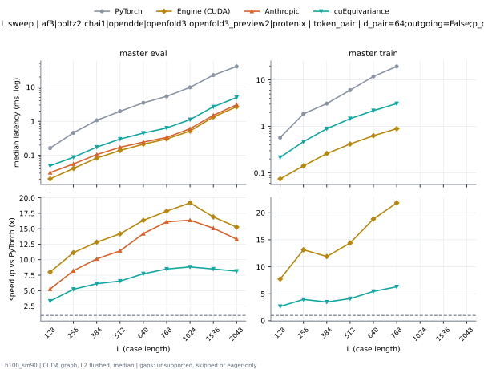
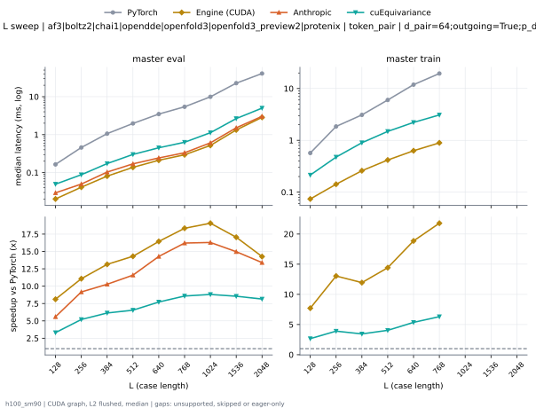
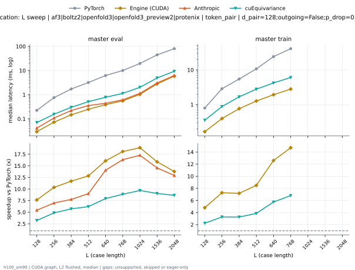
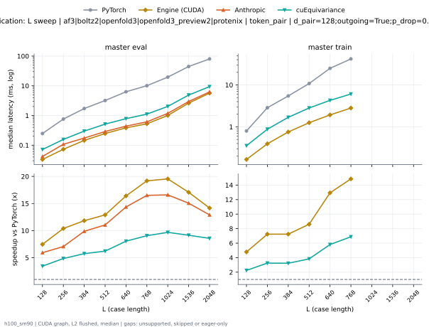
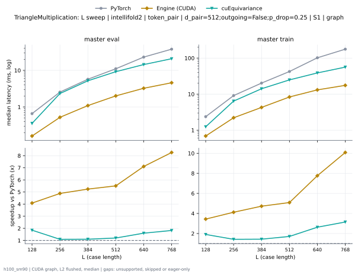
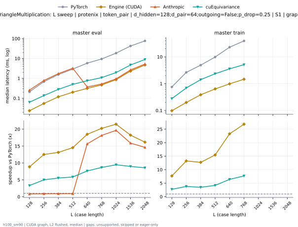

# TriangleMultiplication on h100_sm90

Generated by `python -m miniworld_engine.measure.plot` from speed tokens `judge/tokens/h100_sm90/`; do not edit.

### L sweep: af3|boltz2|chai1|opendde|openfold3|openfold3_preview2|protenix | token_pair | d_pair=64;outgoing=False;p_drop=0.25 | S1 | graph

**master eval** (median ms; x = speedup vs PyTorch)

| L | PyTorch | Engine (Triton) | Engine (CUDA) | Anthropic | cuEquivariance |
|---|---|---|---|---|---|
| 128 | 0.1629 | 0.05638 (2.89x) | 0.02022 (8.05x) | 0.03106 (5.24x) | 0.04934 (3.30x) |
| 256 | 0.4593 | 0.08158 (5.63x) | 0.04163 (11.03x) | 0.05606 (8.19x) | 0.08826 (5.20x) |
| 384 | 1.066 | 0.1384 (7.70x) | 0.08296 (12.85x) | 0.1054 (10.11x) | 0.1746 (6.10x) |
| 512 | 1.96 | 0.2121 (9.24x) | 0.1393 (14.07x) | 0.1726 (11.36x) | 0.3011 (6.51x) |
| 640 | 3.45 | 0.3038 (11.36x) | 0.2103 (16.41x) | 0.245 (14.08x) | 0.4508 (7.65x) |
| 768 | 5.372 | 0.416 (12.91x) | 0.2967 (18.10x) | 0.3354 (16.01x) | 0.6363 (8.44x) |
| 1024 | 9.919 | 0.7206 (13.76x) | 0.5098 (19.46x) | 0.6056 (16.38x) | 1.123 (8.83x) |
| 1536 | 22.73 | 1.775 (12.81x) | 1.363 (16.68x) | 1.502 (15.14x) | 2.665 (8.53x) |
| 2048 | 40.64 | 3.476 (11.69x) | 2.756 (14.75x) | 3.061 (13.28x) | 4.998 (8.13x) |

**master train** (median ms; x = speedup vs PyTorch)

| L | PyTorch | Engine (Triton) | Engine (CUDA) | Anthropic | cuEquivariance |
|---|---|---|---|---|---|
| 128 | 0.5788 | 0.183 (3.16x) | 0.07498 (7.72x) | unsupported | 0.2159 (2.68x) |
| 256 | 1.841 | 0.33 (5.58x) | 0.1414 (13.02x) | unsupported | 0.4719 (3.90x) |
| 384 | 3.108 | 0.6182 (5.03x) | 0.2625 (11.84x) | unsupported | 0.8921 (3.48x) |
| 512 | 5.964 | 0.9921 (6.01x) | 0.4186 (14.25x) | unsupported | 1.467 (4.06x) |
| 640 | 11.74 | 1.465 (8.01x) | 0.633 (18.54x) | unsupported | 2.184 (5.37x) |
| 768 | 19.28 | 2.046 (9.42x) | 0.8992 (21.45x) | unsupported | 3.094 (6.23x) |
| 1024 |  |  |  |  |  |
| 1536 |  |  |  |  |  |
| 2048 |  |  |  |  |  |

### L sweep: af3|boltz2|chai1|opendde|openfold3|openfold3_preview2|protenix | token_pair | d_pair=64;outgoing=True;p_drop=0.25 | S1 | graph

**master eval** (median ms; x = speedup vs PyTorch)

| L | PyTorch | Engine (Triton) | Engine (CUDA) | Anthropic | cuEquivariance |
|---|---|---|---|---|---|
| 128 | 0.1719 | 0.05712 (3.01x) | 0.02106 (8.16x) | 0.02941 (5.84x) | 0.04973 (3.46x) |
| 256 | 0.4666 | 0.08211 (5.68x) | 0.0419 (11.13x) | 0.05003 (9.33x) | 0.08816 (5.29x) |
| 384 | 1.069 | 0.136 (7.86x) | 0.08128 (13.15x) | 0.1034 (10.33x) | 0.1732 (6.17x) |
| 512 | 1.967 | 0.212 (9.28x) | 0.1387 (14.18x) | 0.1703 (11.55x) | 0.3016 (6.52x) |
| 640 | 3.461 | 0.306 (11.31x) | 0.2101 (16.47x) | 0.244 (14.18x) | 0.4515 (7.67x) |
| 768 | 5.387 | 0.4124 (13.06x) | 0.2974 (18.12x) | 0.3342 (16.12x) | 0.6311 (8.54x) |
| 1024 | 9.926 | 0.7249 (13.69x) | 0.5112 (19.42x) | 0.6091 (16.30x) | 1.127 (8.81x) |
| 1536 | 22.76 | 1.745 (13.05x) | 1.31 (17.37x) | 1.516 (15.02x) | 2.653 (8.58x) |
| 2048 | 40.76 | 3.469 (11.75x) | 2.675 (15.24x) | 3.04 (13.41x) | 4.998 (8.16x) |

**master train** (median ms; x = speedup vs PyTorch)

| L | PyTorch | Engine (Triton) | Engine (CUDA) | Anthropic | cuEquivariance |
|---|---|---|---|---|---|
| 128 | 0.5753 | 0.1838 (3.13x) | 0.07474 (7.70x) | unsupported | 0.2138 (2.69x) |
| 256 | 1.834 | 0.3289 (5.58x) | 0.1422 (12.90x) | unsupported | 0.4745 (3.87x) |
| 384 | 3.108 | 0.6169 (5.04x) | 0.2596 (11.97x) | unsupported | 0.899 (3.46x) |
| 512 | 5.967 | 0.993 (6.01x) | 0.4184 (14.26x) | unsupported | 1.488 (4.01x) |
| 640 | 11.73 | 1.461 (8.03x) | 0.6306 (18.60x) | unsupported | 2.217 (5.29x) |
| 768 | 19.27 | 2.046 (9.42x) | 0.8958 (21.52x) | unsupported | 3.089 (6.24x) |
| 1024 |  |  |  |  |  |
| 1536 |  |  |  |  |  |
| 2048 |  |  |  |  |  |

### L sweep: af3|boltz2|openfold3|openfold3_preview2|protenix | token_pair | d_pair=128;outgoing=False;p_drop=0.25 | S1 | graph

**master eval** (median ms; x = speedup vs PyTorch)

| L | PyTorch | Engine (Triton) | Engine (CUDA) | Anthropic | cuEquivariance |
|---|---|---|---|---|---|
| 128 | 0.2267 | 0.07194 (3.15x) | 0.02862 (7.92x) | 0.04146 (5.47x) | 0.07008 (3.23x) |
| 256 | 0.7519 | 0.1531 (4.91x) | 0.07294 (10.31x) | 0.1079 (6.97x) | 0.1552 (4.84x) |
| 384 | 1.71 | 0.2927 (5.84x) | 0.1464 (11.68x) | 0.2211 (7.74x) | 0.2996 (5.71x) |
| 512 | 3.183 | 0.4726 (6.73x) | 0.2481 (12.83x) | 0.3545 (8.98x) | 0.5139 (6.19x) |
| 640 | 6.2 | 0.7084 (8.75x) | 0.3786 (16.37x) | 0.4413 (14.05x) | 0.7815 (7.93x) |
| 768 | 9.992 | 1.002 (9.98x) | 0.5235 (19.08x) | 0.6134 (16.29x) | 1.129 (8.85x) |
| 1024 | 19.54 | 1.839 (10.62x) | 0.9995 (19.55x) | 1.131 (17.28x) | 2.02 (9.67x) |
| 1536 | 44.53 | 4.478 (9.94x) | 2.753 (16.17x) | 3.057 (14.56x) | 4.922 (9.05x) |
| 2048 | 80.25 | 8.715 (9.21x) | 5.691 (14.10x) | 6.229 (12.88x) | 9.318 (8.61x) |

**master train** (median ms; x = speedup vs PyTorch)

| L | PyTorch | Engine (Triton) | Engine (CUDA) | Anthropic | cuEquivariance |
|---|---|---|---|---|---|
| 128 | 0.7965 | 0.2376 (3.35x) | 0.1559 (5.11x) | unsupported | 0.3531 (2.26x) |
| 256 | 2.866 | 0.5794 (4.95x) | 0.3575 (8.02x) | unsupported | 0.8754 (3.27x) |
| 384 | 5.455 | 1.129 (4.83x) | 0.678 (8.05x) | unsupported | 1.673 (3.26x) |
| 512 | 10.75 | 1.84 (5.84x) | 1.123 (9.57x) | unsupported | 2.782 (3.86x) |
| 640 | 24.23 | 2.828 (8.57x) | 1.729 (14.02x) | unsupported | 4.217 (5.75x) |
| 768 | 41.14 | 4.004 (10.28x) | 2.569 (16.01x) | unsupported | 6.046 (6.80x) |
| 1024 |  |  |  |  |  |
| 1536 |  |  |  |  |  |
| 2048 |  |  |  |  |  |

### L sweep: af3|boltz2|openfold3|openfold3_preview2|protenix | token_pair | d_pair=128;outgoing=True;p_drop=0.25 | S1 | graph

**master eval** (median ms; x = speedup vs PyTorch)

| L | PyTorch | Engine (Triton) | Engine (CUDA) | Anthropic | cuEquivariance |
|---|---|---|---|---|---|
| 128 | 0.222 | 0.07272 (3.05x) | 0.02906 (7.64x) | 0.04171 (5.32x) | 0.07173 (3.10x) |
| 256 | 0.754 | 0.1533 (4.92x) | 0.07322 (10.30x) | 0.1075 (7.02x) | 0.1563 (4.82x) |
| 384 | 1.715 | 0.293 (5.85x) | 0.1458 (11.76x) | 0.1739 (9.86x) | 0.2987 (5.74x) |
| 512 | 3.188 | 0.4745 (6.72x) | 0.2493 (12.79x) | 0.2894 (11.02x) | 0.5138 (6.20x) |
| 640 | 6.197 | 0.7123 (8.70x) | 0.3771 (16.43x) | 0.4391 (14.11x) | 0.7829 (7.92x) |
| 768 | 9.987 | 1.001 (9.98x) | 0.5275 (18.93x) | 0.6119 (16.32x) | 1.114 (8.97x) |
| 1024 | 19.54 | 1.831 (10.67x) | 0.9755 (20.03x) | 1.182 (16.53x) | 2.026 (9.65x) |
| 1536 | 44.55 | 4.452 (10.01x) | 2.629 (16.95x) | 2.968 (15.01x) | 4.884 (9.12x) |
| 2048 | 80.24 | 8.745 (9.17x) | 5.659 (14.18x) | 6.238 (12.86x) | 9.389 (8.55x) |

**master train** (median ms; x = speedup vs PyTorch)

| L | PyTorch | Engine (Triton) | Engine (CUDA) | Anthropic | cuEquivariance |
|---|---|---|---|---|---|
| 128 | 0.7937 | 0.2383 (3.33x) | 0.1564 (5.08x) | unsupported | 0.355 (2.24x) |
| 256 | 2.865 | 0.58 (4.94x) | 0.3589 (7.98x) | unsupported | 0.8778 (3.26x) |
| 384 | 5.457 | 1.128 (4.84x) | 0.6785 (8.04x) | unsupported | 1.69 (3.23x) |
| 512 | 10.75 | 1.837 (5.85x) | 1.126 (9.55x) | unsupported | 2.819 (3.81x) |
| 640 | 24.24 | 2.824 (8.58x) | 1.732 (14.00x) | unsupported | 4.285 (5.66x) |
| 768 | 41.14 | 4 (10.28x) | 2.529 (16.27x) | unsupported | 6.077 (6.77x) |
| 1024 |  |  |  |  |  |
| 1536 |  |  |  |  |  |
| 2048 |  |  |  |  |  |

### L sweep: chai1|esmfold2|intellifold2|protenix | token_pair | d_pair=256;outgoing=False;p_drop=0.25 | S1 | graph

**master eval** (median ms; x = speedup vs PyTorch)

| L | PyTorch | Engine (Triton) | Engine (CUDA) | Anthropic | cuEquivariance |
|---|---|---|---|---|---|
| 128 | 0.3521 | 0.1216 (2.89x) | 0.04944 (7.12x) | 0.06256 (5.63x) | unsupported |
| 256 | 1.377 | 0.3426 (4.02x) | 0.1595 (8.63x) | 0.1924 (7.16x) | 0.5707 (2.41x) |
| 384 | 3.051 | 0.6898 (4.42x) | 0.3289 (9.27x) | 0.3737 (8.16x) | 1.336 (2.28x) |
| 512 | 5.741 | 1.192 (4.82x) | 0.5704 (10.06x) | 0.6347 (9.05x) | 2.473 (2.32x) |
| 640 | 11.6 | 1.813 (6.40x) | 0.8695 (13.35x) | 1.001 (11.59x) | 3.783 (3.07x) |
| 768 | 19.05 | 2.612 (7.29x) | 1.263 (15.08x) | 1.482 (12.85x) | 5.613 (3.39x) |
| 1024 | 37.51 | 4.747 (7.90x) | 2.507 (14.96x) | 2.786 (13.47x) | 10.1 (3.71x) |
| 1536 | 83.74 | 11.5 (7.28x) | 6.39 (13.10x) | 7.107 (11.78x) | 23.47 (3.57x) |
| 2048 | 151.8 | 21.72 (6.99x) | 13.07 (11.61x) | 13.89 (10.92x) | 42.92 (3.54x) |

**master train** (median ms; x = speedup vs PyTorch)

| L | PyTorch | Engine (Triton) | Engine (CUDA) | Anthropic | cuEquivariance |
|---|---|---|---|---|---|
| 128 | 1.307 | 0.3784 (3.46x) | 0.3205 (4.08x) | unsupported | unsupported |
| 256 | 4.996 | 1.141 (4.38x) | 0.9177 (5.44x) | unsupported | 2.143 (2.33x) |
| 384 | 10.36 | 2.3 (4.50x) | 1.774 (5.84x) | unsupported | 4.678 (2.21x) |
| 512 | 20.8 | 3.926 (5.30x) | 3.152 (6.60x) | unsupported | 8.063 (2.58x) |
| 640 | 48.1 | 6.327 (7.60x) | 4.837 (9.94x) | unsupported | 12.63 (3.81x) |
| 768 | 82.52 | 9.098 (9.07x) | 6.837 (12.07x) | unsupported | 17.91 (4.61x) |
| 1024 |  |  |  |  |  |
| 1536 |  |  |  |  |  |
| 2048 |  |  |  |  |  |

### L sweep: chai1|esmfold2|intellifold2|protenix | token_pair | d_pair=256;outgoing=True;p_drop=0.25 | S1 | graph

**master eval** (median ms; x = speedup vs PyTorch)

| L | PyTorch | Engine (Triton) | Engine (CUDA) | Anthropic | cuEquivariance |
|---|---|---|---|---|---|
| 128 | 0.3466 | 0.1222 (2.84x) | 0.05045 (6.87x) | 0.06163 (5.62x) | unsupported |
| 256 | 1.378 | 0.3424 (4.02x) | 0.1604 (8.59x) | 0.1929 (7.14x) | 0.5703 (2.42x) |
| 384 | 3.051 | 0.69 (4.42x) | 0.3331 (9.16x) | 0.3709 (8.23x) | 1.337 (2.28x) |
| 512 | 5.74 | 1.153 (4.98x) | 0.5626 (10.20x) | 0.6304 (9.11x) | 2.477 (2.32x) |
| 640 | 11.62 | 1.809 (6.42x) | 0.8652 (13.42x) | 0.9795 (11.86x) | 3.789 (3.07x) |
| 768 | 19.04 | 2.582 (7.37x) | 1.316 (14.47x) | 1.457 (13.07x) | 5.592 (3.41x) |
| 1024 | 37.6 | 4.755 (7.91x) | 2.433 (15.45x) | 2.775 (13.55x) | 10.11 (3.72x) |
| 1536 | 83.76 | 11.5 (7.29x) | 6.31 (13.27x) | 6.933 (12.08x) | 23.43 (3.57x) |
| 2048 | 152 | 21.96 (6.92x) | 12.93 (11.76x) | 13.94 (10.90x) | 42.95 (3.54x) |

**master train** (median ms; x = speedup vs PyTorch)

| L | PyTorch | Engine (Triton) | Engine (CUDA) | Anthropic | cuEquivariance |
|---|---|---|---|---|---|
| 128 | 1.307 | 0.3781 (3.46x) | 0.3215 (4.06x) | unsupported | unsupported |
| 256 | 4.998 | 1.142 (4.37x) | 0.9204 (5.43x) | unsupported | 2.16 (2.31x) |
| 384 | 10.36 | 2.299 (4.51x) | 1.747 (5.93x) | unsupported | 4.73 (2.19x) |
| 512 | 20.8 | 3.927 (5.30x) | 3.153 (6.60x) | unsupported | 8.157 (2.55x) |
| 640 | 48.03 | 6.318 (7.60x) | 4.825 (9.96x) | unsupported | 12.79 (3.75x) |
| 768 | 82.51 | 9.196 (8.97x) | 6.783 (12.16x) | unsupported | 18.03 (4.58x) |
| 1024 |  |  |  |  |  |
| 1536 |  |  |  |  |  |
| 2048 |  |  |  |  |  |

### L sweep: intellifold2 | token_pair | d_pair=512;outgoing=False;p_drop=0.25 | S1 | graph

**master eval** (median ms; x = speedup vs PyTorch)

| L | PyTorch | Engine (Triton) | Engine (CUDA) | Anthropic | cuEquivariance |
|---|---|---|---|---|---|
| 128 | 0.6592 | 0.2964 (2.22x) | 0.1614 (4.09x) | failed | 0.3568 (1.85x) |
| 256 | 2.55 | 1 (2.55x) | 0.5224 (4.88x) | failed | 2.332 (1.09x) |
| 384 | 5.725 | 2.221 (2.58x) | 1.092 (5.24x) | failed | 5.199 (1.10x) |
| 512 | 11.07 | 3.916 (2.83x) | 2.01 (5.51x) | failed | 9.212 (1.20x) |
| 640 | 23.07 | 6.151 (3.75x) | 3.246 (7.11x) | failed | 14.41 (1.60x) |
| 768 | 37.96 | 8.904 (4.26x) | 4.594 (8.26x) | failed | 20.81 (1.82x) |

**master train** (median ms; x = speedup vs PyTorch)

| L | PyTorch | Engine (Triton) | Engine (CUDA) | Anthropic | cuEquivariance |
|---|---|---|---|---|---|
| 128 | 2.373 | 0.8225 (2.89x) | 0.69 (3.44x) | unsupported | 1.245 (1.91x) |
| 256 | 9.114 | 2.662 (3.42x) | 2.211 (4.12x) | unsupported | 6.412 (1.42x) |
| 384 | 20.25 | 5.712 (3.54x) | 4.285 (4.73x) | unsupported | 14.11 (1.44x) |
| 512 | 42.42 | 10.17 (4.17x) | 8.339 (5.09x) | unsupported | 24.85 (1.71x) |
| 640 | 101.9 | 16.77 (6.08x) | 13.12 (7.76x) | unsupported | 38.75 (2.63x) |
| 768 | 176.7 | 24.3 (7.27x) | 17.53 (10.08x) | unsupported | 56.15 (3.15x) |

### L sweep: intellifold2 | token_pair | d_pair=512;outgoing=True;p_drop=0.25 | S1 | graph

**master eval** (median ms; x = speedup vs PyTorch)

| L | PyTorch | Engine (Triton) | Engine (CUDA) | Anthropic | cuEquivariance |
|---|---|---|---|---|---|
| 128 | 0.6607 | 0.2957 (2.23x) | 0.1611 (4.10x) | failed | 0.3577 (1.85x) |
| 256 | 2.544 | 1.003 (2.54x) | 0.5263 (4.83x) | failed | 2.323 (1.10x) |
| 384 | 5.726 | 2.237 (2.56x) | 1.109 (5.16x) | failed | 5.201 (1.10x) |
| 512 | 11.07 | 3.925 (2.82x) | 2.006 (5.52x) | failed | 9.221 (1.20x) |
| 640 | 23.07 | 6.156 (3.75x) | 3.155 (7.31x) | failed | 14.42 (1.60x) |
| 768 | 37.93 | 8.92 (4.25x) | 4.477 (8.47x) | failed | 20.77 (1.83x) |

**master train** (median ms; x = speedup vs PyTorch)

| L | PyTorch | Engine (Triton) | Engine (CUDA) | Anthropic | cuEquivariance |
|---|---|---|---|---|---|
| 128 | 2.376 | 0.8243 (2.88x) | 0.6893 (3.45x) | unsupported | 1.266 (1.88x) |
| 256 | 9.109 | 2.663 (3.42x) | 2.231 (4.08x) | unsupported | 6.446 (1.41x) |
| 384 | 20.24 | 5.724 (3.54x) | 4.281 (4.73x) | unsupported | 14.19 (1.43x) |
| 512 | 42.43 | 10.18 (4.17x) | 8.345 (5.09x) | unsupported | 25.06 (1.69x) |
| 640 | 101.9 | 16.77 (6.08x) | 13.13 (7.76x) | unsupported | 39.13 (2.60x) |
| 768 | 176.7 | 24.28 (7.28x) | 17.57 (10.06x) | unsupported | 56.45 (3.13x) |

### L sweep: opendde | token_pair | d_pair=384;outgoing=False;p_drop=0.25 | S1 | graph

**master eval** (median ms; x = speedup vs PyTorch)

| L | PyTorch | Engine (Triton) | Engine (CUDA) | Anthropic | cuEquivariance |
|---|---|---|---|---|---|
| 128 | 0.499 | 0.1893 (2.64x) | 0.08198 (6.09x) | 0.1093 (4.57x) | 0.2284 (2.19x) |
| 256 | 1.956 | 0.5726 (3.42x) | 0.2952 (6.63x) | 0.367 (5.33x) | 1.311 (1.49x) |
| 384 | 4.355 | 1.224 (3.56x) | 0.6305 (6.91x) | 0.7772 (5.60x) | 2.933 (1.48x) |
| 512 | 8.316 | 2.072 (4.01x) | 1.113 (7.47x) | 1.342 (6.19x) | 5.177 (1.61x) |
| 640 | 17.46 | 3.258 (5.36x) | 1.821 (9.59x) | 2.206 (7.92x) | 8.113 (2.15x) |
| 768 | 28.51 | 4.776 (5.97x) | 2.557 (11.15x) | 3.188 (8.94x) | 11.71 (2.43x) |
| 1024 | 55.77 | 8.781 (6.35x) | 4.928 (11.32x) | 5.953 (9.37x) | 20.98 (2.66x) |
| 1536 | 124.9 | 20.96 (5.96x) | 12.29 (10.16x) | 14.62 (8.54x) | 48.33 (2.58x) |
| 2048 | 211.7 | 39.7 (5.33x) | 24.54 (8.63x) | 28.35 (7.47x) | 87.71 (2.41x) |
| 2976 | 447.1 | 96.82 (4.62x) | 65.38 (6.84x) | 71.05 (6.29x) | 196 (2.28x) |
| 3968 | skipped | 194.5 | 138.4 | skipped | skipped |

**master train** (median ms; x = speedup vs PyTorch)

| L | PyTorch | Engine (Triton) | Engine (CUDA) | Anthropic | cuEquivariance |
|---|---|---|---|---|---|
| 128 | 1.867 | 0.5886 (3.17x) | 0.4623 (4.04x) | unsupported | 0.8817 (2.12x) |
| 256 | 7.072 | 1.822 (3.88x) | 1.444 (4.90x) | unsupported | 3.962 (1.79x) |
| 384 | 15.06 | 3.827 (3.94x) | 2.869 (5.25x) | unsupported | 8.645 (1.74x) |
| 512 | 31.5 | 6.71 (4.69x) | 5.326 (5.91x) | unsupported | 15.15 (2.08x) |
| 640 | 75.25 | 11.02 (6.83x) | 8.373 (8.99x) | unsupported | 23.62 (3.19x) |
| 768 | 128.2 | 15.86 (8.09x) | 11.51 (11.14x) | unsupported | 34.26 (3.74x) |
| 1024 |  |  |  |  |  |
| 1536 |  |  |  |  |  |
| 2048 |  |  |  |  |  |
| 2976 |  |  |  |  |  |
| 3968 |  |  |  |  |  |

### L sweep: opendde | token_pair | d_pair=384;outgoing=True;p_drop=0.25 | S1 | graph

**master eval** (median ms; x = speedup vs PyTorch)

| L | PyTorch | Engine (Triton) | Engine (CUDA) | Anthropic | cuEquivariance |
|---|---|---|---|---|---|
| 128 | 0.5018 | 0.1905 (2.63x) | 0.08203 (6.12x) | 0.1098 (4.57x) | 0.2295 (2.19x) |
| 256 | 1.988 | 0.5787 (3.44x) | 0.2978 (6.68x) | 0.3789 (5.25x) | 1.343 (1.48x) |
| 384 | 4.327 | 1.218 (3.55x) | 0.6411 (6.75x) | 0.7753 (5.58x) | 2.936 (1.47x) |
| 512 | 8.585 | 2.071 (4.14x) | 1.114 (7.71x) | 1.327 (6.47x) | 5.181 (1.66x) |
| 640 | 17.45 | 3.279 (5.32x) | 1.838 (9.49x) | 2.192 (7.96x) | 8.109 (2.15x) |
| 768 | 28.47 | 4.773 (5.96x) | 2.658 (10.71x) | 3.191 (8.92x) | 11.69 (2.44x) |
| 1024 | 55.72 | 8.803 (6.33x) | 5.028 (11.08x) | 5.932 (9.39x) | 21 (2.65x) |
| 1536 | 124.9 | 21.08 (5.92x) | 12.17 (10.26x) | 14.58 (8.56x) | 48.3 (2.59x) |
| 2048 | 211.9 | 39.78 (5.33x) | 24.16 (8.77x) | 28.27 (7.49x) | 87.79 (2.41x) |
| 2976 | 447.3 | 97.2 (4.60x) | 65.6 (6.82x) | 71.09 (6.29x) | 196 (2.28x) |
| 3968 | skipped | 193.3 | 147 | skipped | skipped |

**master train** (median ms; x = speedup vs PyTorch)

| L | PyTorch | Engine (Triton) | Engine (CUDA) | Anthropic | cuEquivariance |
|---|---|---|---|---|---|
| 128 | 1.865 | 0.5893 (3.17x) | 0.463 (4.03x) | unsupported | 0.8912 (2.09x) |
| 256 | 7.069 | 1.819 (3.89x) | 1.444 (4.90x) | unsupported | 3.986 (1.77x) |
| 384 | 15.07 | 3.826 (3.94x) | 2.816 (5.35x) | unsupported | 8.723 (1.73x) |
| 512 | 31.49 | 6.701 (4.70x) | 5.33 (5.91x) | unsupported | 15.28 (2.06x) |
| 640 | 75.25 | 11.01 (6.84x) | 8.356 (9.01x) | unsupported | 23.87 (3.15x) |
| 768 | 128.1 | 15.82 (8.10x) | 11.43 (11.21x) | unsupported | 34.43 (3.72x) |
| 1024 |  |  |  |  |  |
| 1536 |  |  |  |  |  |
| 2048 |  |  |  |  |  |
| 2976 |  |  |  |  |  |
| 3968 |  |  |  |  |  |

### L sweep: protenix | token_pair | d_hidden=128;d_pair=64;outgoing=False;p_drop=0.25 | S1 | graph

**master eval** (median ms; x = speedup vs PyTorch)

| L | PyTorch | Engine (Triton) | Engine (CUDA) | Anthropic | cuEquivariance |
|---|---|---|---|---|---|
| 128 | 0.2097 | 0.06539 (3.21x) | 0.02402 (8.73x) | 0.2563 (0.82x) | 0.06325 (3.32x) |
| 256 | 0.6838 | 0.1146 (5.97x) | 0.05501 (12.43x) | 0.782 (0.87x) | 0.1363 (5.02x) |
| 384 | 1.558 | 0.2115 (7.36x) | 0.1182 (13.17x) | 1.733 (0.90x) | 0.2804 (5.55x) |
| 512 | 2.932 | 0.3272 (8.96x) | 0.1993 (14.72x) | 3.23 (0.91x) | 0.5006 (5.86x) |
| 640 | 5.812 | 0.4806 (12.09x) | 0.3141 (18.50x) | 0.3717 (15.64x) | 0.7612 (7.64x) |
| 768 | 9.452 | 0.678 (13.94x) | 0.4675 (20.22x) | 0.5206 (18.15x) | 1.09 (8.67x) |
| 1024 | 18.55 | 1.204 (15.41x) | 0.8645 (21.46x) | 0.9438 (19.66x) | 1.96 (9.47x) |
| 1536 | 42.33 | 3.139 (13.49x) | 2.313 (18.30x) | 2.664 (15.89x) | 4.712 (8.98x) |
| 2048 | 76.3 | 6.414 (11.90x) | 4.771 (15.99x) | 5.228 (14.59x) | 8.917 (8.56x) |

**master train** (median ms; x = speedup vs PyTorch)

| L | PyTorch | Engine (Triton) | Engine (CUDA) | Anthropic | cuEquivariance |
|---|---|---|---|---|---|
| 128 | 0.7519 | 0.2111 (3.56x) | 0.0979 (7.68x) | unsupported | 0.2763 (2.72x) |
| 256 | 2.618 | 0.4676 (5.60x) | 0.1988 (13.17x) | unsupported | 0.6907 (3.79x) |
| 384 | 4.895 | 0.9058 (5.40x) | 0.3858 (12.69x) | unsupported | 1.41 (3.47x) |
| 512 | 9.835 | 1.467 (6.70x) | 0.6354 (15.48x) | unsupported | 2.342 (4.20x) |
| 640 | 22.84 | 2.26 (10.11x) | 0.9838 (23.22x) | unsupported | 3.562 (6.41x) |
| 768 | 39.16 | 3.189 (12.28x) | 1.44 (27.19x) | unsupported | 5.101 (7.68x) |
| 1024 |  |  |  |  |  |
| 1536 |  |  |  |  |  |
| 2048 |  |  |  |  |  |

### L sweep: protenix | token_pair | d_hidden=128;d_pair=64;outgoing=True;p_drop=0.25 | S1 | graph

**master eval** (median ms; x = speedup vs PyTorch)

| L | PyTorch | Engine (Triton) | Engine (CUDA) | Anthropic | cuEquivariance |
|---|---|---|---|---|---|
| 128 | 0.2192 | 0.06509 (3.37x) | 0.02384 (9.20x) | 0.254 (0.86x) | 0.06365 (3.44x) |
| 256 | 0.6805 | 0.1136 (5.99x) | 0.05526 (12.31x) | 0.7818 (0.87x) | 0.1373 (4.96x) |
| 384 | 1.559 | 0.2084 (7.48x) | 0.1161 (13.43x) | 1.736 (0.90x) | 0.2816 (5.54x) |
| 512 | 2.92 | 0.3266 (8.94x) | 0.2011 (14.52x) | 3.231 (0.90x) | 0.5 (5.84x) |
| 640 | 5.811 | 0.4808 (12.09x) | 0.3169 (18.34x) | 0.3552 (16.36x) | 0.7625 (7.62x) |
| 768 | 9.428 | 0.664 (14.20x) | 0.4522 (20.85x) | 0.4949 (19.05x) | 1.078 (8.74x) |
| 1024 | 18.55 | 1.239 (14.97x) | 0.8819 (21.04x) | 0.9335 (19.87x) | 1.966 (9.44x) |
| 1536 | 42.33 | 3.158 (13.41x) | 2.326 (18.20x) | 2.474 (17.11x) | 4.687 (9.03x) |
| 2048 | 76.29 | 6.341 (12.03x) | 4.894 (15.59x) | 5.149 (14.82x) | 8.915 (8.56x) |

**master train** (median ms; x = speedup vs PyTorch)

| L | PyTorch | Engine (Triton) | Engine (CUDA) | Anthropic | cuEquivariance |
|---|---|---|---|---|---|
| 128 | 0.7503 | 0.2104 (3.57x) | 0.09725 (7.71x) | unsupported | 0.2751 (2.73x) |
| 256 | 2.619 | 0.4669 (5.61x) | 0.1991 (13.16x) | unsupported | 0.6956 (3.77x) |
| 384 | 4.889 | 0.9029 (5.41x) | 0.3824 (12.79x) | unsupported | 1.423 (3.44x) |
| 512 | 9.836 | 1.469 (6.69x) | 0.636 (15.46x) | unsupported | 2.387 (4.12x) |
| 640 | 22.83 | 2.26 (10.10x) | 0.985 (23.18x) | unsupported | 3.597 (6.35x) |
| 768 | 39.14 | 3.187 (12.28x) | 1.443 (27.12x) | unsupported | 5.128 (7.63x) |
| 1024 |  |  |  |  |  |
| 1536 |  |  |  |  |  |
| 2048 |  |  |  |  |  |

### d_pair sweep at L768: token_pair | outgoing=False;p_drop=0.25 | S1 | graph

**master eval** (median ms; x = speedup vs PyTorch)

| d_pair | PyTorch | Engine (Triton) | Engine (CUDA) | Anthropic | cuEquivariance |
|---|---|---|---|---|---|
| 64 | 5.372 | 0.416 (12.91x) | 0.2967 (18.10x) | 0.3354 (16.01x) | 0.6363 (8.44x) |
| 128 | 9.992 | 1.002 (9.98x) | 0.5235 (19.08x) | 0.6134 (16.29x) | 1.129 (8.85x) |
| 256 | 19.05 | 2.612 (7.29x) | 1.263 (15.08x) | 1.482 (12.85x) | 5.613 (3.39x) |
| 384 | 28.51 | 4.776 (5.97x) | 2.557 (11.15x) | 3.188 (8.94x) | 11.71 (2.43x) |
| 512 | 37.96 | 8.904 (4.26x) | 4.594 (8.26x) | failed | 20.81 (1.82x) |

**master train** (median ms; x = speedup vs PyTorch)

| d_pair | PyTorch | Engine (Triton) | Engine (CUDA) | Anthropic | cuEquivariance |
|---|---|---|---|---|---|
| 64 | 19.28 | 2.046 (9.42x) | 0.8992 (21.45x) | unsupported | 3.094 (6.23x) |
| 128 | 41.14 | 4.004 (10.28x) | 2.569 (16.01x) | unsupported | 6.046 (6.80x) |
| 256 | 82.52 | 9.098 (9.07x) | 6.837 (12.07x) | unsupported | 17.91 (4.61x) |
| 384 | 128.2 | 15.86 (8.09x) | 11.51 (11.14x) | unsupported | 34.26 (3.74x) |
| 512 | 176.7 | 24.3 (7.27x) | 17.53 (10.08x) | unsupported | 56.15 (3.15x) |

### d_pair sweep at L768: token_pair | outgoing=True;p_drop=0.25 | S1 | graph

**master eval** (median ms; x = speedup vs PyTorch)

| d_pair | PyTorch | Engine (Triton) | Engine (CUDA) | Anthropic | cuEquivariance |
|---|---|---|---|---|---|
| 64 | 5.387 | 0.4124 (13.06x) | 0.2974 (18.12x) | 0.3342 (16.12x) | 0.6311 (8.54x) |
| 128 | 9.987 | 1.001 (9.98x) | 0.5275 (18.93x) | 0.6119 (16.32x) | 1.114 (8.97x) |
| 256 | 19.04 | 2.582 (7.37x) | 1.316 (14.47x) | 1.457 (13.07x) | 5.592 (3.41x) |
| 384 | 28.47 | 4.773 (5.96x) | 2.658 (10.71x) | 3.191 (8.92x) | 11.69 (2.44x) |
| 512 | 37.93 | 8.92 (4.25x) | 4.477 (8.47x) | failed | 20.77 (1.83x) |

**master train** (median ms; x = speedup vs PyTorch)

| d_pair | PyTorch | Engine (Triton) | Engine (CUDA) | Anthropic | cuEquivariance |
|---|---|---|---|---|---|
| 64 | 19.27 | 2.046 (9.42x) | 0.8958 (21.52x) | unsupported | 3.089 (6.24x) |
| 128 | 41.14 | 4 (10.28x) | 2.529 (16.27x) | unsupported | 6.077 (6.77x) |
| 256 | 82.51 | 9.196 (8.97x) | 6.783 (12.16x) | unsupported | 18.03 (4.58x) |
| 384 | 128.1 | 15.82 (8.10x) | 11.43 (11.21x) | unsupported | 34.43 (3.72x) |
| 512 | 176.7 | 24.28 (7.28x) | 17.57 (10.06x) | unsupported | 56.45 (3.13x) |

