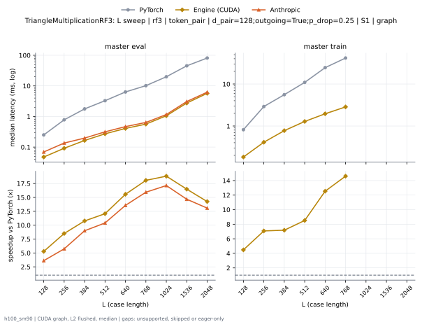

# TriangleMultiplicationRF3 on h100_sm90

Generated by `python -m foldjet_engine.measure.plot` from speed tokens `judge/tokens/h100_sm90/`; do not edit.

### L sweep: rf3 | token_pair | d_pair=128;outgoing=False;p_drop=0.25 | S1 | graph

**master eval** (median ms; x = speedup vs PyTorch)

| L | PyTorch | Engine (Triton) | Engine (CUDA) | Anthropic |
|---|---|---|---|---|
| 128 | 0.251 | 0.08674 (2.89x) | 0.04779 (5.25x) | 0.06946 (3.61x) |
| 256 | 0.7836 | 0.1703 (4.60x) | 0.09229 (8.49x) | 0.1365 (5.74x) |
| 384 | 1.777 | 0.31 (5.73x) | 0.1663 (10.69x) | 0.2493 (7.13x) |
| 512 | 3.279 | 0.4924 (6.66x) | 0.2691 (12.19x) | 0.3866 (8.48x) |
| 640 | 6.338 | 0.7276 (8.71x) | 0.4013 (15.79x) | 0.468 (13.54x) |
| 768 | 10.21 | 1.02 (10.01x) | 0.5427 (18.81x) | 0.6412 (15.92x) |
| 1024 | 19.87 | 1.851 (10.73x) | 1.026 (19.36x) | 1.156 (17.18x) |
| 1536 | 45.12 | 4.541 (9.94x) | 2.898 (15.57x) | 3.043 (14.83x) |
| 2048 | 81.65 | 8.785 (9.29x) | 5.855 (13.94x) | 6.108 (13.37x) |

**master train** (median ms; x = speedup vs PyTorch)

| L | PyTorch | Engine (Triton) | Engine (CUDA) | Anthropic |
|---|---|---|---|---|
| 128 | 0.8173 | 0.2554 (3.20x) | 0.1736 (4.71x) | unsupported |
| 256 | 2.912 | 0.5926 (4.91x) | 0.3772 (7.72x) | unsupported |
| 384 | 5.57 | 1.138 (4.89x) | 0.6977 (7.98x) | unsupported |
| 512 | 10.93 | 1.851 (5.91x) | 1.148 (9.52x) | unsupported |
| 640 | 24.51 | 2.85 (8.60x) | 1.744 (14.05x) | unsupported |
| 768 | 41.64 | 4.024 (10.35x) | 2.546 (16.36x) | unsupported |
| 1024 |  |  |  |  |
| 1536 |  |  |  |  |
| 2048 |  |  |  |  |

### L sweep: rf3 | token_pair | d_pair=128;outgoing=True;p_drop=0.25 | S1 | graph

**master eval** (median ms; x = speedup vs PyTorch)

| L | PyTorch | Engine (Triton) | Engine (CUDA) | Anthropic |
|---|---|---|---|---|
| 128 | 0.246 | 0.08758 (2.81x) | 0.04758 (5.17x) | 0.0692 (3.56x) |
| 256 | 0.7791 | 0.1689 (4.61x) | 0.09179 (8.49x) | 0.1357 (5.74x) |
| 384 | 1.772 | 0.3085 (5.74x) | 0.1643 (10.78x) | 0.197 (8.99x) |
| 512 | 3.277 | 0.4948 (6.62x) | 0.2704 (12.12x) | 0.3153 (10.39x) |
| 640 | 6.34 | 0.7308 (8.68x) | 0.4013 (15.80x) | 0.4671 (13.57x) |
| 768 | 10.21 | 1.017 (10.04x) | 0.5473 (18.65x) | 0.6391 (15.97x) |
| 1024 | 19.87 | 1.849 (10.75x) | 1.037 (19.16x) | 1.16 (17.14x) |
| 1536 | 45.27 | 4.5 (10.06x) | 2.742 (16.51x) | 3.086 (14.67x) |
| 2048 | 81.6 | 8.818 (9.25x) | 5.783 (14.11x) | 6.232 (13.09x) |

**master train** (median ms; x = speedup vs PyTorch)

| L | PyTorch | Engine (Triton) | Engine (CUDA) | Anthropic |
|---|---|---|---|---|
| 128 | 0.8154 | 0.2556 (3.19x) | 0.1732 (4.71x) | unsupported |
| 256 | 2.911 | 0.5929 (4.91x) | 0.3766 (7.73x) | unsupported |
| 384 | 5.569 | 1.137 (4.90x) | 0.6949 (8.01x) | unsupported |
| 512 | 10.93 | 1.85 (5.91x) | 1.148 (9.52x) | unsupported |
| 640 | 24.53 | 2.853 (8.60x) | 1.753 (13.99x) | unsupported |
| 768 | 41.63 | 4.019 (10.36x) | 2.579 (16.15x) | unsupported |
| 1024 |  |  |  |  |
| 1536 |  |  |  |  |
| 2048 |  |  |  |  |

### L sweep: rf3 | token_pair | d_pair=64;outgoing=False;p_drop=0.25 | S1 | graph

**master eval** (median ms; x = speedup vs PyTorch)

| L | PyTorch | Engine (Triton) | Engine (CUDA) | Anthropic |
|---|---|---|---|---|
| 128 | 0.1768 | 0.0699 (2.53x) | 0.03723 (4.75x) | 0.05429 (3.26x) |
| 256 | 0.4818 | 0.09544 (5.05x) | 0.05891 (8.18x) | 0.07906 (6.09x) |
| 384 | 1.101 | 0.154 (7.14x) | 0.1017 (10.82x) | 0.1492 (7.38x) |
| 512 | 2.016 | 0.2284 (8.83x) | 0.1575 (12.80x) | 0.216 (9.33x) |
| 640 | 3.543 | 0.3194 (11.09x) | 0.2288 (15.49x) | 0.2704 (13.10x) |
| 768 | 5.496 | 0.4356 (12.62x) | 0.3148 (17.46x) | 0.3613 (15.21x) |
| 1024 | 10.11 | 0.7408 (13.64x) | 0.5257 (19.23x) | 0.6333 (15.96x) |
| 1536 | 23.11 | 1.793 (12.89x) | 1.398 (16.52x) | 1.529 (15.11x) |
| 2048 | 41.31 | 3.523 (11.73x) | 2.881 (14.34x) | 3.083 (13.40x) |

**master train** (median ms; x = speedup vs PyTorch)

| L | PyTorch | Engine (Triton) | Engine (CUDA) | Anthropic |
|---|---|---|---|---|
| 128 | 0.5893 | 0.1976 (2.98x) | 0.09115 (6.47x) | unsupported |
| 256 | 1.866 | 0.3413 (5.47x) | 0.1582 (11.80x) | unsupported |
| 384 | 3.159 | 0.6228 (5.07x) | 0.2802 (11.27x) | unsupported |
| 512 | 6.056 | 0.9995 (6.06x) | 0.4388 (13.80x) | unsupported |
| 640 | 11.87 | 1.468 (8.09x) | 0.653 (18.18x) | unsupported |
| 768 | 19.48 | 2.052 (9.49x) | 0.9203 (21.16x) | unsupported |
| 1024 |  |  |  |  |
| 1536 |  |  |  |  |
| 2048 |  |  |  |  |

### L sweep: rf3 | token_pair | d_pair=64;outgoing=True;p_drop=0.25 | S1 | graph

**master eval** (median ms; x = speedup vs PyTorch)

| L | PyTorch | Engine (Triton) | Engine (CUDA) | Anthropic |
|---|---|---|---|---|
| 128 | 0.1916 | 0.07224 (2.65x) | 0.0387 (4.95x) | 0.07184 (2.67x) |
| 256 | 0.484 | 0.09648 (5.02x) | 0.05984 (8.09x) | 0.0928 (5.22x) |
| 384 | 1.105 | 0.1521 (7.27x) | 0.09949 (11.11x) | 0.1474 (7.50x) |
| 512 | 2.019 | 0.2276 (8.87x) | 0.1565 (12.90x) | 0.2135 (9.46x) |
| 640 | 3.544 | 0.3198 (11.08x) | 0.2283 (15.52x) | 0.2696 (13.15x) |
| 768 | 5.5 | 0.431 (12.76x) | 0.3163 (17.39x) | 0.3598 (15.29x) |
| 1024 | 10.1 | 0.74 (13.66x) | 0.5281 (19.13x) | 0.6321 (15.99x) |
| 1536 | 23.13 | 1.781 (12.99x) | 1.348 (17.16x) | 1.517 (15.25x) |
| 2048 | 41.3 | 3.533 (11.69x) | 2.845 (14.52x) | 3.082 (13.40x) |

**master train** (median ms; x = speedup vs PyTorch)

| L | PyTorch | Engine (Triton) | Engine (CUDA) | Anthropic |
|---|---|---|---|---|
| 128 | 0.5776 | 0.1947 (2.97x) | 0.08955 (6.45x) | unsupported |
| 256 | 1.87 | 0.3417 (5.47x) | 0.16 (11.68x) | unsupported |
| 384 | 3.159 | 0.6219 (5.08x) | 0.2764 (11.43x) | unsupported |
| 512 | 6.057 | 0.9992 (6.06x) | 0.4381 (13.83x) | unsupported |
| 640 | 11.87 | 1.468 (8.09x) | 0.6527 (18.19x) | unsupported |
| 768 | 19.5 | 2.062 (9.46x) | 0.9171 (21.26x) | unsupported |
| 1024 |  |  |  |  |
| 1536 |  |  |  |  |
| 2048 |  |  |  |  |

