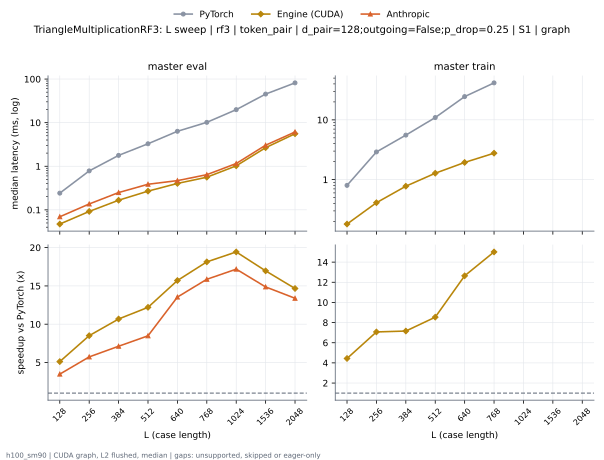
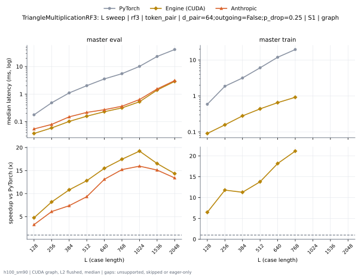
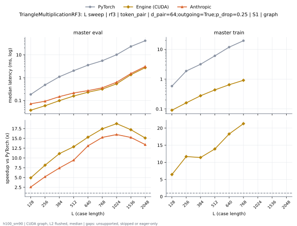

# TriangleMultiplicationRF3 on h100_sm90

Generated by `python -m miniworld_engine.measure.plot` from speed tokens `judge/tokens/h100_sm90/`; do not edit.

### L sweep: rf3 | token_pair | d_pair=128;outgoing=False;p_drop=0.25 | S1 | graph

**master eval** (median ms; x = speedup vs PyTorch)

| L | PyTorch | Engine (Triton) | Engine (CUDA) | Anthropic |
|---|---|---|---|---|
| 128 | 0.2416 | 0.08701 (2.78x) | 0.04723 (5.12x) | 0.06946 (3.48x) |
| 256 | 0.7822 | 0.1702 (4.59x) | 0.09198 (8.50x) | 0.1365 (5.73x) |
| 384 | 1.776 | 0.3101 (5.73x) | 0.1663 (10.68x) | 0.2493 (7.12x) |
| 512 | 3.279 | 0.4922 (6.66x) | 0.2688 (12.20x) | 0.3866 (8.48x) |
| 640 | 6.338 | 0.7243 (8.75x) | 0.4036 (15.70x) | 0.468 (13.54x) |
| 768 | 10.17 | 1.026 (9.91x) | 0.5608 (18.14x) | 0.6412 (15.87x) |
| 1024 | 19.87 | 1.843 (10.78x) | 1.022 (19.44x) | 1.156 (17.19x) |
| 1536 | 45.23 | 4.528 (9.99x) | 2.666 (16.96x) | 3.043 (14.87x) |
| 2048 | 81.76 | 8.859 (9.23x) | 5.576 (14.66x) | 6.108 (13.39x) |

**master train** (median ms; x = speedup vs PyTorch)

| L | PyTorch | Engine (Triton) | Engine (CUDA) | Anthropic |
|---|---|---|---|---|
| 128 | 0.8014 | 0.2563 (3.13x) | 0.1806 (4.44x) | unsupported |
| 256 | 2.906 | 0.5914 (4.91x) | 0.411 (7.07x) | unsupported |
| 384 | 5.557 | 1.139 (4.88x) | 0.7762 (7.16x) | unsupported |
| 512 | 10.93 | 1.849 (5.91x) | 1.28 (8.54x) | unsupported |
| 640 | 24.52 | 2.85 (8.60x) | 1.939 (12.64x) | unsupported |
| 768 | 41.6 | 4.027 (10.33x) | 2.771 (15.01x) | unsupported |
| 1024 |  |  |  |  |
| 1536 |  |  |  |  |
| 2048 |  |  |  |  |

### L sweep: rf3 | token_pair | d_pair=128;outgoing=True;p_drop=0.25 | S1 | graph

**master eval** (median ms; x = speedup vs PyTorch)

| L | PyTorch | Engine (Triton) | Engine (CUDA) | Anthropic |
|---|---|---|---|---|
| 128 | 0.2599 | 0.0863 (3.01x) | 0.04723 (5.50x) | 0.0692 (3.76x) |
| 256 | 0.7804 | 0.1692 (4.61x) | 0.09176 (8.50x) | 0.1357 (5.75x) |
| 384 | 1.776 | 0.3083 (5.76x) | 0.1645 (10.79x) | 0.197 (9.02x) |
| 512 | 3.274 | 0.4934 (6.63x) | 0.2691 (12.17x) | 0.3153 (10.38x) |
| 640 | 6.324 | 0.7256 (8.72x) | 0.4041 (15.65x) | 0.4671 (13.54x) |
| 768 | 10.17 | 1.01 (10.07x) | 0.5463 (18.62x) | 0.6391 (15.92x) |
| 1024 | 19.86 | 1.87 (10.62x) | 1.017 (19.53x) | 1.16 (17.13x) |
| 1536 | 45.27 | 4.516 (10.02x) | 2.66 (17.02x) | 3.086 (14.67x) |
| 2048 | 81.54 | 8.891 (9.17x) | 5.467 (14.91x) | 6.232 (13.08x) |

**master train** (median ms; x = speedup vs PyTorch)

| L | PyTorch | Engine (Triton) | Engine (CUDA) | Anthropic |
|---|---|---|---|---|
| 128 | 0.8215 | 0.2564 (3.20x) | 0.1816 (4.52x) | unsupported |
| 256 | 2.906 | 0.5919 (4.91x) | 0.4105 (7.08x) | unsupported |
| 384 | 5.557 | 1.137 (4.89x) | 0.7746 (7.17x) | unsupported |
| 512 | 10.94 | 1.848 (5.92x) | 1.281 (8.54x) | unsupported |
| 640 | 24.51 | 2.854 (8.59x) | 1.944 (12.61x) | unsupported |
| 768 | 41.59 | 4.024 (10.34x) | 2.769 (15.02x) | unsupported |
| 1024 |  |  |  |  |
| 1536 |  |  |  |  |
| 2048 |  |  |  |  |

### L sweep: rf3 | token_pair | d_pair=64;outgoing=False;p_drop=0.25 | S1 | graph

**master eval** (median ms; x = speedup vs PyTorch)

| L | PyTorch | Engine (Triton) | Engine (CUDA) | Anthropic |
|---|---|---|---|---|
| 128 | 0.1763 | 0.06997 (2.52x) | 0.03704 (4.76x) | 0.05429 (3.25x) |
| 256 | 0.4799 | 0.09525 (5.04x) | 0.05858 (8.19x) | 0.07906 (6.07x) |
| 384 | 1.097 | 0.1537 (7.13x) | 0.1012 (10.84x) | 0.1492 (7.35x) |
| 512 | 2.016 | 0.2287 (8.81x) | 0.1575 (12.80x) | 0.216 (9.33x) |
| 640 | 3.537 | 0.3188 (11.09x) | 0.2303 (15.36x) | 0.2704 (13.08x) |
| 768 | 5.496 | 0.4368 (12.58x) | 0.3212 (17.11x) | 0.3613 (15.21x) |
| 1024 | 10.1 | 0.7358 (13.73x) | 0.534 (18.91x) | 0.6333 (15.95x) |
| 1536 | 23.02 | 1.794 (12.83x) | 1.355 (16.99x) | 1.529 (15.06x) |
| 2048 | 41.23 | 3.51 (11.75x) | 2.734 (15.08x) | 3.083 (13.38x) |

**master train** (median ms; x = speedup vs PyTorch)

| L | PyTorch | Engine (Triton) | Engine (CUDA) | Anthropic |
|---|---|---|---|---|
| 128 | 0.5973 | 0.1969 (3.03x) | 0.09166 (6.52x) | unsupported |
| 256 | 1.873 | 0.3416 (5.48x) | 0.1582 (11.84x) | unsupported |
| 384 | 3.166 | 0.6234 (5.08x) | 0.2788 (11.36x) | unsupported |
| 512 | 6.051 | 0.9969 (6.07x) | 0.4366 (13.86x) | unsupported |
| 640 | 11.86 | 1.468 (8.08x) | 0.6492 (18.27x) | unsupported |
| 768 | 19.47 | 2.064 (9.44x) | 0.9133 (21.32x) | unsupported |
| 1024 |  |  |  |  |
| 1536 |  |  |  |  |
| 2048 |  |  |  |  |

### L sweep: rf3 | token_pair | d_pair=64;outgoing=True;p_drop=0.25 | S1 | graph

**master eval** (median ms; x = speedup vs PyTorch)

| L | PyTorch | Engine (Triton) | Engine (CUDA) | Anthropic |
|---|---|---|---|---|
| 128 | 0.1844 | 0.07062 (2.61x) | 0.03755 (4.91x) | 0.07184 (2.57x) |
| 256 | 0.4816 | 0.09664 (4.98x) | 0.05907 (8.15x) | 0.0928 (5.19x) |
| 384 | 1.095 | 0.1521 (7.20x) | 0.09856 (11.11x) | 0.1474 (7.43x) |
| 512 | 2.016 | 0.2284 (8.83x) | 0.1567 (12.87x) | 0.2135 (9.45x) |
| 640 | 3.53 | 0.32 (11.03x) | 0.2306 (15.31x) | 0.2696 (13.09x) |
| 768 | 5.489 | 0.4307 (12.75x) | 0.3145 (17.45x) | 0.3598 (15.26x) |
| 1024 | 10.1 | 0.7433 (13.59x) | 0.5382 (18.77x) | 0.6321 (15.98x) |
| 1536 | 23.12 | 1.785 (12.95x) | 1.343 (17.22x) | 1.517 (15.24x) |
| 2048 | 41.32 | 3.518 (11.75x) | 2.736 (15.10x) | 3.082 (13.41x) |

**master train** (median ms; x = speedup vs PyTorch)

| L | PyTorch | Engine (Triton) | Engine (CUDA) | Anthropic |
|---|---|---|---|---|
| 128 | 0.5832 | 0.1974 (2.95x) | 0.09059 (6.44x) | unsupported |
| 256 | 1.871 | 0.3405 (5.50x) | 0.1601 (11.69x) | unsupported |
| 384 | 3.156 | 0.6216 (5.08x) | 0.2767 (11.41x) | unsupported |
| 512 | 6.054 | 0.999 (6.06x) | 0.4353 (13.91x) | unsupported |
| 640 | 11.86 | 1.467 (8.08x) | 0.6483 (18.29x) | unsupported |
| 768 | 19.47 | 2.06 (9.45x) | 0.9139 (21.30x) | unsupported |
| 1024 |  |  |  |  |
| 1536 |  |  |  |  |
| 2048 |  |  |  |  |

