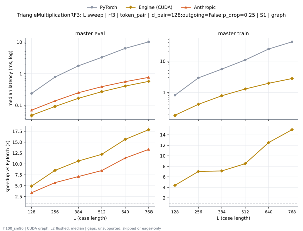
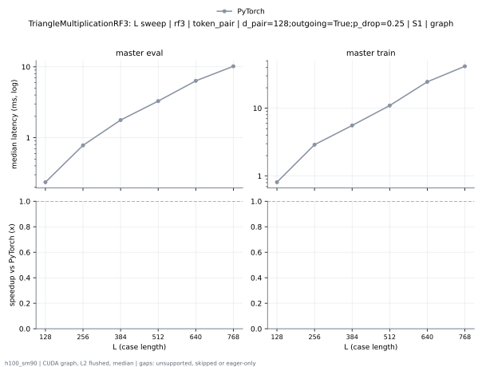
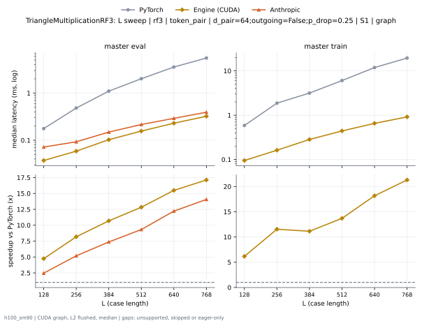
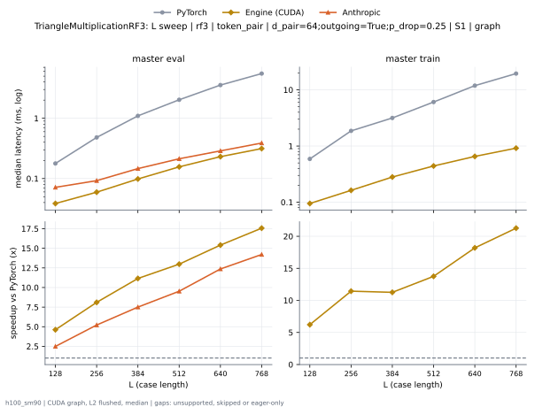

# TriangleMultiplicationRF3 on h100_sm90

Generated by `python -m miniworld_engine.measure.plot` from speed tokens `judge/tokens/h100_sm90/`; do not edit.

### L sweep: rf3 | token_pair | d_pair=128;outgoing=False;p_drop=0.25 | S1 | graph

**master eval** (median ms; x = speedup vs PyTorch)

| L | PyTorch |
|---|---|
| 128 | 0.2352 |
| 256 | 0.7797 |
| 384 | 1.775 |
| 512 | 3.283 |
| 640 | 6.344 |
| 768 | 10.18 |

**master train** (median ms; x = speedup vs PyTorch)

| L | PyTorch |
|---|---|
| 128 | 0.8087 |
| 256 | 2.897 |
| 384 | 5.566 |
| 512 | 10.94 |
| 640 | 24.5 |
| 768 | 41.51 |

### L sweep: rf3 | token_pair | d_pair=128;outgoing=True;p_drop=0.25 | S1 | graph

**master eval** (median ms; x = speedup vs PyTorch)

| L | PyTorch |
|---|---|
| 128 | 0.2354 |
| 256 | 0.7798 |
| 384 | 1.773 |
| 512 | 3.285 |
| 640 | 6.344 |
| 768 | 10.18 |

**master train** (median ms; x = speedup vs PyTorch)

| L | PyTorch |
|---|---|
| 128 | 0.811 |
| 256 | 2.896 |
| 384 | 5.566 |
| 512 | 10.95 |
| 640 | 24.49 |
| 768 | 41.51 |

### L sweep: rf3 | token_pair | d_pair=64;outgoing=False;p_drop=0.25 | S1 | graph

**master eval** (median ms; x = speedup vs PyTorch)

| L | PyTorch |
|---|---|
| 128 | 0.1763 |
| 256 | 0.4804 |
| 384 | 1.097 |
| 512 | 2.022 |
| 640 | 3.55 |
| 768 | 5.503 |

**master train** (median ms; x = speedup vs PyTorch)

| L | PyTorch |
|---|---|
| 128 | 0.5849 |
| 256 | 1.866 |
| 384 | 3.157 |
| 512 | 6.061 |
| 640 | 11.85 |
| 768 | 19.48 |

### L sweep: rf3 | token_pair | d_pair=64;outgoing=True;p_drop=0.25 | S1 | graph

**master eval** (median ms; x = speedup vs PyTorch)

| L | PyTorch |
|---|---|
| 128 | 0.1767 |
| 256 | 0.4805 |
| 384 | 1.095 |
| 512 | 2.025 |
| 640 | 3.549 |
| 768 | 5.503 |

**master train** (median ms; x = speedup vs PyTorch)

| L | PyTorch |
|---|---|
| 128 | 0.5862 |
| 256 | 1.865 |
| 384 | 3.156 |
| 512 | 6.061 |
| 640 | 11.87 |
| 768 | 19.47 |

