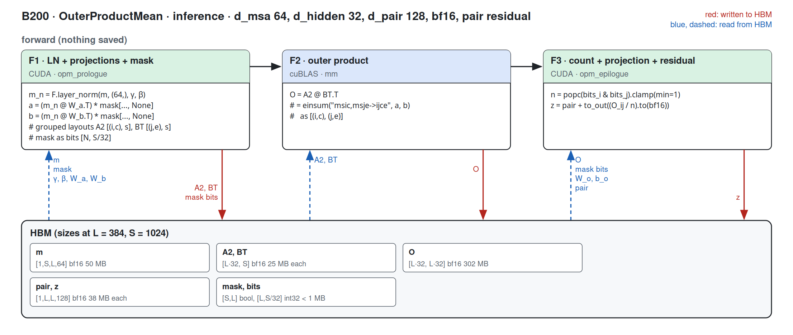
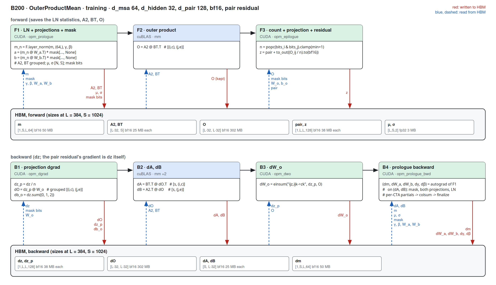
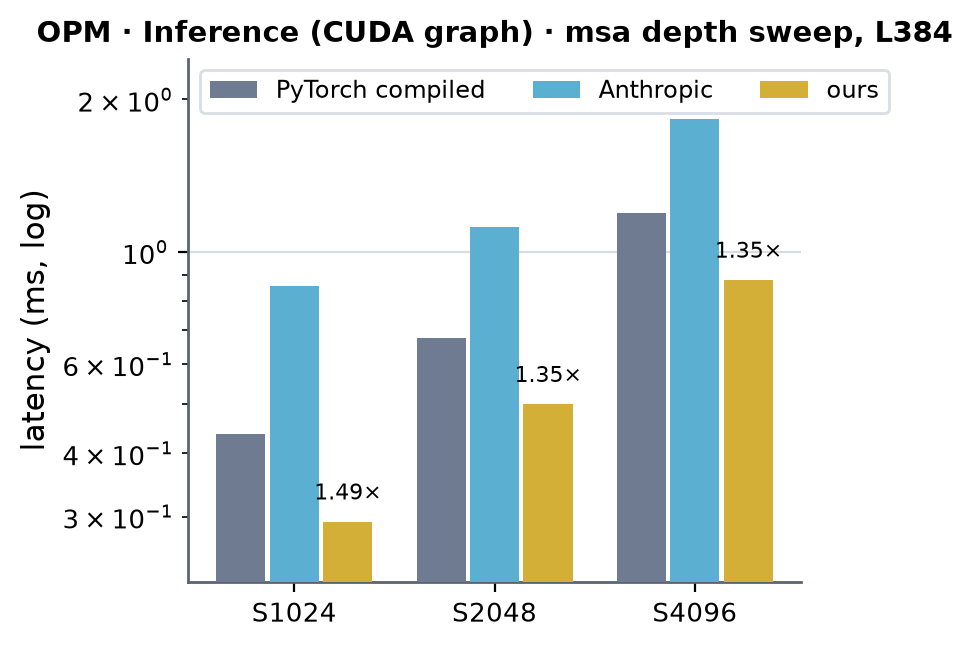
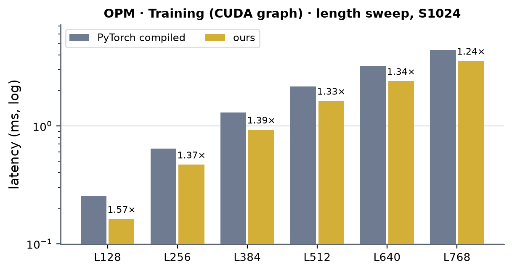
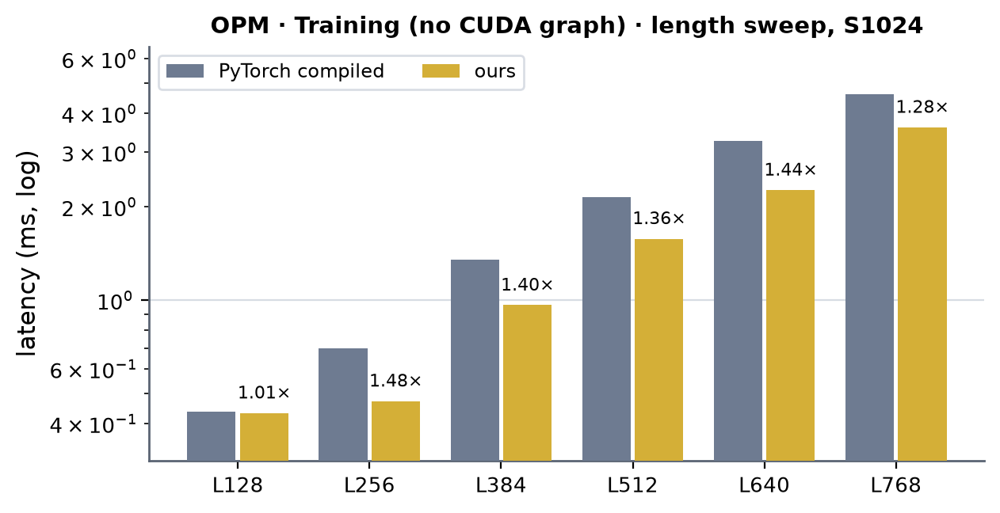

# OuterProductMean on B200 (sm100)

Kernel-level status of `OuterProductMean` on B200; the module-level summary is in [b200.md](../b200.md). bf16; the
module's shape is fixed (d_msa 64, d_hidden 32, d_pair 128), so the columns are (Length, MSA depth). B200 = CUDA where a
hand-written sm_100a kernel runs a step; the outer-product and gradient GEMMs are cuBLAS (figures only, no kernel tables).
Figures: one box per kernel, left to right, HBM reads (blue, left) and writes (red, right); generated from
`figures/opm.json` by `python -m miniworld_engine.viz.kernel_flow`, then converted to PNG (`cairosvg -s 2 -b white`).
Dispatch: `integrations/opm_train.py` (the H100 integration; compute capability (10, 0) selects the sm_100a extension);
kernels: `integrations/csrc/sm100/opm_sm100.cu` (tcgen05 / TMEM / TMA), one extension.

Served when `implementation=miniworld` (or `anthropic`), bf16, batch 1, `normalize_before_proj` (the AF3 order), no
interchain masking, N (length) a multiple of 64 and S (MSA depth) a multiple of 256, inference and training alike. The pair residual is added in
the epilogue (its gradient is `dz` itself). Every other call runs the portable portable path.

## OuterProductMean (`OuterProductMean`)

### Inference

#### Fused path · N a multiple of 64, S a multiple of 256

##### F1 · LN + projections + mask (opm_prologue)

| (Length, MSA depth) | (128, 1024) | (256, 1024) | (384, 1024) | (512, 1024) | (640, 1024) | (768, 1024) | (128, 2048) | (256, 2048) | (384, 2048) | (512, 2048) | (640, 2048) | (768, 2048) | (128, 4096) | (256, 4096) | (384, 4096) | (512, 4096) | (640, 4096) | (768, 4096) |
|---|---|---|---|---|---|---|---|---|---|---|---|---|---|---|---|---|---|---|
| implementation | CUDA | CUDA | CUDA | CUDA | CUDA | CUDA | CUDA | CUDA | CUDA | CUDA | CUDA | CUDA | CUDA | CUDA | CUDA | CUDA | CUDA | CUDA |
| 성능 확인 | ✗ | ✗ | ✗ | ✗ | ✗ | ✗ | ✗ | ✗ | ✗ | ✗ | ✗ | ✗ | ✗ | ✗ | ✗ | ✗ | ✗ | ✗ |
| cache build | ✓ | ✓ | ✓ | ✓ | ✓ | ✓ | ✓ | ✓ | ✓ | ✓ | ✓ | ✓ | ✓ | ✓ | ✓ | ✓ | ✓ | ✓ |

##### F3 · count + projection + residual (opm_epilogue)

| (Length, MSA depth) | (128, 1024) | (256, 1024) | (384, 1024) | (512, 1024) | (640, 1024) | (768, 1024) | (128, 2048) | (256, 2048) | (384, 2048) | (512, 2048) | (640, 2048) | (768, 2048) | (128, 4096) | (256, 4096) | (384, 4096) | (512, 4096) | (640, 4096) | (768, 4096) |
|---|---|---|---|---|---|---|---|---|---|---|---|---|---|---|---|---|---|---|
| implementation | CUDA | CUDA | CUDA | CUDA | CUDA | CUDA | CUDA | CUDA | CUDA | CUDA | CUDA | CUDA | CUDA | CUDA | CUDA | CUDA | CUDA | CUDA |
| 성능 확인 | ✗ | ✗ | ✗ | ✗ | ✗ | ✗ | ✗ | ✗ | ✗ | ✗ | ✗ | ✗ | ✗ | ✗ | ✗ | ✗ | ✗ | ✗ |
| cache build | ✓ | ✓ | ✓ | ✓ | ✓ | ✓ | ✓ | ✓ | ✓ | ✓ | ✓ | ✓ | ✓ | ✓ | ✓ | ✓ | ✓ | ✓ |

### Training

#### Fused path · N a multiple of 64, S a multiple of 256

The forward keeps the LayerNorm statistics, A2 / BT and O (`settings.opm_train_save_o=0` recomputes O in the backward
instead of keeping 302 MB at L384).

##### F1 · LN + projections + mask (opm_prologue)

| (Length, MSA depth) | (128, 1024) | (256, 1024) | (384, 1024) | (512, 1024) | (640, 1024) | (768, 1024) |
|---|---|---|---|---|---|---|
| implementation | CUDA | CUDA | CUDA | CUDA | CUDA | CUDA |
| 성능 확인 | ✗ | ✗ | ✗ | ✗ | ✗ | ✗ |
| cache build | ✓ | ✓ | ✓ | ✓ | ✓ | ✓ |

##### F3 · count + projection + residual (opm_epilogue)

| (Length, MSA depth) | (128, 1024) | (256, 1024) | (384, 1024) | (512, 1024) | (640, 1024) | (768, 1024) |
|---|---|---|---|---|---|---|
| implementation | CUDA | CUDA | CUDA | CUDA | CUDA | CUDA |
| 성능 확인 | ✗ | ✗ | ✗ | ✗ | ✗ | ✗ |
| cache build | ✓ | ✓ | ✓ | ✓ | ✓ | ✓ |

##### B1 · projection dgrad (opm_dgrad)

| (Length, MSA depth) | (128, 1024) | (256, 1024) | (384, 1024) | (512, 1024) | (640, 1024) | (768, 1024) |
|---|---|---|---|---|---|---|
| implementation | CUDA | CUDA | CUDA | CUDA | CUDA | CUDA |
| 성능 확인 | ✗ | ✗ | ✗ | ✗ | ✗ | ✗ |
| cache build | ✓ | ✓ | ✓ | ✓ | ✓ | ✓ |

##### B3 · dW_o (opm_dwo)

| (Length, MSA depth) | (128, 1024) | (256, 1024) | (384, 1024) | (512, 1024) | (640, 1024) | (768, 1024) |
|---|---|---|---|---|---|---|
| implementation | CUDA | CUDA | CUDA | CUDA | CUDA | CUDA |
| 성능 확인 | ✗ | ✗ | ✗ | ✗ | ✗ | ✗ |
| cache build | ✓ | ✓ | ✓ | ✓ | ✓ | ✓ |

##### B4 · prologue backward (opm_prologue_bwd)

| (Length, MSA depth) | (128, 1024) | (256, 1024) | (384, 1024) | (512, 1024) | (640, 1024) | (768, 1024) |
|---|---|---|---|---|---|---|
| implementation | CUDA | CUDA | CUDA | CUDA | CUDA | CUDA |
| 성능 확인 | ✗ | ✗ | ✗ | ✗ | ✗ | ✗ |
| cache build | ✓ | ✓ | ✓ | ✓ | ✓ | ✓ |

## Measurements (2026-09-30; CUDA-graph tables re-measured 2026-10-11 with fp32 master parameters)

- Setup: B200 (148 SMs), torch 2.13.0+cu129, triton 3.7.1, sm_100a kernels built by nvcc 13.1, B = 1, bf16-mixed (the module's LayerNorm parameters stay fp32).
- Harness: `benchmarks/runners/bench.py target=outer_product level=module mode=<inference|training> min_seq_len=128
  max_seq_len=768 seq_len_step=128 +n_msa=<S>`; compiled, inference in a CUDA graph, training with and without one.
- Tables: latency in ms (median); × = ours against the fastest of the others. cuEquivariance ships no OuterProductMean
  kernel (—).
- Anthropic: the harness's `anthropic` row -- `opt_core.ops.msa_opm.forward_mask_norm` as shipped (its fused LN / projection
  / mask prologue and one Triton outer-product / projection kernel with the release's default tile config), on this module's
  weights; the engine adds the residual. Triton, so it runs on sm_100 unmodified; forward-only, so the training tables have no
  Anthropic column (—).
- Accuracy against the harness's fp32 reference, max over every row: ours out 1.7e-3, grad 2.4e-4; PyTorch compiled 1.7e-3 / 2.5e-4; Anthropic 1.7e-3 (inference).
- Where the time goes: the O GEMM and the two gradient GEMMs (dA, dB) are cuBLAS at its sustained rate on this power-capped
  card; in the inference sweep the path runs at 68-88 % of its energy floor. Folding the epilogue into the O GEMM does not fit
  B200: re-streaming W_o per tile exceeds the SM's TMA intake; the dgrad kernel is bound by the same intake (a 2-CTA version
  is what is left).
- Re-verification (2026-10-10, engine v2.2.0 plus unreleased changes, the setup above with the kernels built by nvcc 13.1, driver 580.95.05, one GPU with no other process on it): every cell of the inference table and the CUDA-graph training table (66 cells) was re-measured through the harness command above, one run per width and mode; a cell that moved by more than 8 % against the table was repeated (once, twice if still beyond 8 %) and the median of the runs is reported. Median change 0.9 % (2.7 % for ours), 90th percentile 5.1 %; two cells were replaced ((640, 4096) and (768, 4096) ours inference: 2.364 -> 2.621 and 3.803 -> 3.352 ms; the S4096 inference rows vary by +-12 % between runs). The no-CUDA-graph training tables are host-bound (their cells move by 20-60 % between runs with the load on the host) and keep their 2026-09-30 values. **2026-10-11:** every CUDA-graph cell of these tables was re-measured with fp32 master parameters (`precision=bf16-mixed`, the harness default since that date: fp32 parameters over bf16 activations under `torch.autocast`; one run per cell, `parameter_dtype` = float32 in the CSV, the engine environment's python called directly); the cells above are those values. The no-CUDA-graph training tables are host-bound and keep their earlier values (bf16 parameters).
- Charts: under each table, a length sweep at S1024 and an MSA-depth sweep at L384
  (`python -m miniworld_engine.viz.measure_bars docs/gpus/b200/opm/opm.md --length-d 1024`).

### OPM · Inference (CUDA graph)

| (Length, MSA depth) | PyTorch compiled | cuEquivariance | Anthropic | ours | × |
|---|---|---|---|---|---|
| (128, 1024) | 0.082 | — | 0.137 | 0.055 | 1.49 |
| (256, 1024) | 0.223 | — | 0.401 | 0.143 | 1.56 |
| (384, 1024) | 0.428 | — | 0.861 | 0.295 | 1.45 |
| (512, 1024) | 0.747 | — | 1.474 | 0.471 | 1.59 |
| (640, 1024) | 1.108 | — | 2.278 | 0.732 | 1.51 |
| (768, 1024) | 1.600 | — | 3.357 | 1.032 | 1.55 |
| (128, 2048) | 0.123 | — | 0.182 | 0.082 | 1.50 |
| (256, 2048) | 0.338 | — | 0.520 | 0.235 | 1.44 |
| (384, 2048) | 0.694 | — | 1.133 | 0.512 | 1.36 |
| (512, 2048) | 1.155 | — | 2.102 | 0.816 | 1.42 |
| (640, 2048) | 1.730 | — | 3.231 | 1.298 | 1.33 |
| (768, 2048) | 2.475 | — | 4.593 | 1.800 | 1.38 |
| (128, 4096) | 0.197 | — | 0.274 | 0.139 | 1.42 |
| (256, 4096) | 0.594 | — | 0.878 | 0.469 | 1.27 |
| (384, 4096) | 1.218 | — | 1.832 | 1.010 | 1.21 |
| (512, 4096) | 2.087 | — | 3.137 | 1.613 | 1.29 |
| (640, 4096) | 3.022 | — | 4.850 | 2.560 | 1.18 |
| (768, 4096) | 4.312 | — | 6.901 | 3.636 | 1.19 |

 <!-- measure_bars -->

### OPM · Training (CUDA graph)

| (Length, MSA depth) | PyTorch compiled | cuEquivariance | Anthropic | ours | × |
|---|---|---|---|---|---|
| (128, 1024) | 0.262 | — | — | 0.170 | 1.54 |
| (256, 1024) | 0.651 | — | — | 0.451 | 1.44 |
| (384, 1024) | 1.234 | — | — | 0.946 | 1.30 |
| (512, 1024) | 2.138 | — | — | 1.630 | 1.31 |
| (640, 1024) | 3.114 | — | — | 2.456 | 1.27 |
| (768, 1024) | 4.390 | — | — | 3.442 | 1.28 |

 <!-- measure_bars -->

### OPM · Training (no CUDA graph)

| (Length, MSA depth) | PyTorch compiled | cuEquivariance | Anthropic | ours | × |
|---|---|---|---|---|---|
| (128, 1024) | 0.436 | — | — | 0.432 | 1.01 |
| (256, 1024) | 0.697 | — | — | 0.472 | 1.48 |
| (384, 1024) | 1.349 | — | — | 0.962 | 1.40 |
| (512, 1024) | 2.148 | — | — | 1.575 | 1.36 |
| (640, 1024) | 3.258 | — | — | 2.258 | 1.44 |
| (768, 1024) | 4.602 | — | — | 3.598 | 1.28 |

 <!-- measure_bars -->
