# TriangleAttention on B200 (sm100)

Kernel-level status of `TriangleAttention` (`use_self_attention=True`) on B200; the module-level summary belongs in
[b200.md](../b200.md). bf16 only; columns are (Length, Dimension). B200 = CUDA where a hand-written sm_100a path
exists; a shape without one is 미구현 (it runs the portable path). Figures: one box per kernel, left to right, HBM reads
(blue, left) and writes (red, right); generated from `figures/triattn.json` by `python -m miniworld_engine.viz.kernel_flow`,
then converted to PNG with `cairosvg` (scale 2, white background).

Dispatch: `integrations/triattn_b200.py`, called first in `TriangleAttention.forward`. Kernels:
`kernels/triangle_attention/cuda/b200_triattn.py` (build + autograd) and `b200_sources/` (tcgen05 / TMEM / TMA:
`triattn_sm100.cu` = attention core, `triattn_mod_sm100.cu` = the d_pair 128 kernels around it, `triattn_wide_sm100.cu` = the
other widths' kernels around it, `sm100.cuh` = shared helpers). d_pair 128 / 4 × 32 is covered for inference and training
below; the other registered widths (d_pair 64-512), inference and training, in
[Other widths](#other-widths--d_pair-64-512-2026-09-30).
The kernels were developed for sm_100a on the H100 path's kernel boundaries (LN + projections | attention | gate +
out-projection, and the matching backward); they are not ports of the WGMMA kernels.

The d_pair 128 path is served when all of these hold, otherwise the module runs its PyTorch statements (no Triton fallback on
B200, `modules.dispatch.restricted_card`):

- the module's backend is PORTABLE (`implementation=miniworld`), `module._b200_cuda` is True
  (the default; False keeps the Triton kernels, e.g. as a benchmark baseline) and `(not settings.force_portable_kernels)`;
- `d_pair = d_hidden = 128`, `n_head = 4`, no QK-norm;
- `pair` is a bf16 CUDA tensor `[B, L, L, 128]` with any L >= 16 (a length that is not a multiple of 128 is read and written as it is,
  the kernels' tiles cover the next multiple: [Ragged lengths](#ragged-lengths-without-padded-copies-2026-10-29)) and any B (up to `max_batch` = 48 samples a launch, more in
  chunks: [Batched samples](#batched-samples-b--1-any-length-and-chunking-2026-10-20)), `mask` is None or bool `[B, L]`;
- compute capability (10, 0).

Starting and ending node both run it; the ending node's pair, output, dy and dx are read and written in the caller's layout through
4-D tensor maps (no transposed copies; 0-6 % over the starting node, see
[Ending node without transposed copies](#ending-node-without-transposed-copies-2026-10-20)). Dropout is the
module's own broadcast draw (`_make_drop_scale`, row-broadcast for the starting node, column for the ending node), applied
inside the output kernel and its backward. Parameters may be bf16 or fp32 (master weights): one pack kernel stages them
and the gradients come back in the parameters' dtype. Keys whose bias is masked get `finfo(bf16).min`, as in the
PyTorch module. The forward softmax offset is the row's running maximum, raised lazily (a chunk of 32 keys whose maximum exceeds it
by more than 8 log2 units raises it and rescales l, the tile's P in TMEM and O): no overflow whatever the spread of the logits
(2026-10-28; the earlier offset was fixed at the first 32 keys and overflowed to inf / NaN on trained weights, which H100 fixed in
cad850743). A row with no finite logit keeps offset 0 in its LSE. Cost (2026-10-29, CUDA graph, d_pair 128 inference, B = 1): L128 unchanged, L384 172 -> 177 us (+3 %), L768 901 -> 967 us (+7 %): a chunk raises the offset in place and the P chunks already in TMEM, O_r and the row sum are rescaled once after the four-chunk loop (log2 factors), which cost 989 us inline. The kernel sits at the 128-register cap of 448 threads (4 warps per SM sub-partition), so any code in the unrolled chunk loop costs; a sum-triggered check (1075), an out-of-line rescale (1041) and a branch-free shift (1024) were slower. d_pair 128 inference caches the packed weights while the
parameters are unchanged (`kernels._capture.param_forms`).

## Starting / ending node · d_pair 128, 4 heads × 32

### Inference

#### Fused path · D128, L = 128 k

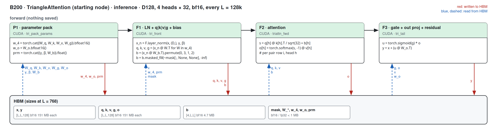

##### P1 · parameter pack

| (Length, Dimension) | (128, 128) | (256, 128) | (384, 128) | (512, 128) | (640, 128) | (768, 128) |
|---|---|---|---|---|---|---|
| implementation | CUDA | CUDA | CUDA | CUDA | CUDA | CUDA |
| 성능 확인 | ✗ | ✗ | ✗ | ✗ | ✗ | ✗ |
| cache build | ✓ | ✓ | ✓ | ✓ | ✓ | ✓ |

##### F1 · LN + q|k|v|g + bias

| (Length, Dimension) | (128, 128) | (256, 128) | (384, 128) | (512, 128) | (640, 128) | (768, 128) |
|---|---|---|---|---|---|---|
| implementation | CUDA | CUDA | CUDA | CUDA | CUDA | CUDA |
| 성능 확인 | ✗ | ✗ | ✗ | ✗ | ✗ | ✗ |
| cache build | ✓ | ✓ | ✓ | ✓ | ✓ | ✓ |

##### F2 · attention

| (Length, Dimension) | (128, 128) | (256, 128) | (384, 128) | (512, 128) | (640, 128) | (768, 128) |
|---|---|---|---|---|---|---|
| implementation | CUDA | CUDA | CUDA | CUDA | CUDA | CUDA |
| 성능 확인 | ✗ | ✗ | ✗ | ✗ | ✗ | ✗ |
| cache build | ✓ | ✓ | ✓ | ✓ | ✓ | ✓ |

##### F3 · gate + out proj + residual

| (Length, Dimension) | (128, 128) | (256, 128) | (384, 128) | (512, 128) | (640, 128) | (768, 128) |
|---|---|---|---|---|---|---|
| implementation | CUDA | CUDA | CUDA | CUDA | CUDA | CUDA |
| 성능 확인 | ✗ | ✗ | ✗ | ✗ | ✗ | ✗ |
| cache build | ✓ | ✓ | ✓ | ✓ | ✓ | ✓ |

### Training

#### Fused path · D128, L = 128 k

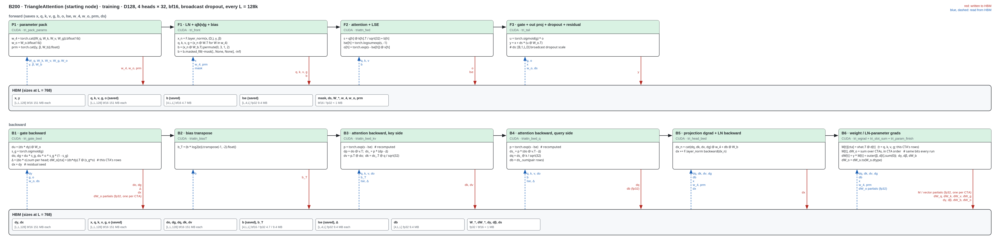

Forward P1, F1, F3 as in inference; F2 also writes the base-2 LSE for the backward.

##### F2 · attention + LSE

| (Length, Dimension) | (128, 128) | (256, 128) | (384, 128) | (512, 128) | (640, 128) | (768, 128) |
|---|---|---|---|---|---|---|
| implementation | CUDA | CUDA | CUDA | CUDA | CUDA | CUDA |
| 성능 확인 | ✗ | ✗ | ✗ | ✗ | ✗ | ✗ |
| cache build | ✓ | ✓ | ✓ | ✓ | ✓ | ✓ |

##### B1 · gate backward

| (Length, Dimension) | (128, 128) | (256, 128) | (384, 128) | (512, 128) | (640, 128) | (768, 128) |
|---|---|---|---|---|---|---|
| implementation | CUDA | CUDA | CUDA | CUDA | CUDA | CUDA |
| 성능 확인 | ✗ | ✗ | ✗ | ✗ | ✗ | ✗ |
| cache build | ✓ | ✓ | ✓ | ✓ | ✓ | ✓ |

##### B2 · bias transpose

| (Length, Dimension) | (128, 128) | (256, 128) | (384, 128) | (512, 128) | (640, 128) | (768, 128) |
|---|---|---|---|---|---|---|
| implementation | CUDA | CUDA | CUDA | CUDA | CUDA | CUDA |
| 성능 확인 | ✗ | ✗ | ✗ | ✗ | ✗ | ✗ |
| cache build | ✓ | ✓ | ✓ | ✓ | ✓ | ✓ |

##### B3 · attention backward, key side (dK, dV)

| (Length, Dimension) | (128, 128) | (256, 128) | (384, 128) | (512, 128) | (640, 128) | (768, 128) |
|---|---|---|---|---|---|---|
| implementation | CUDA | CUDA | CUDA | CUDA | CUDA | CUDA |
| 성능 확인 | ✗ | ✗ | ✗ | ✗ | ✗ | ✗ |
| cache build | ✓ | ✓ | ✓ | ✓ | ✓ | ✓ |

##### B4 · attention backward, query side (dQ, dbias)

| (Length, Dimension) | (128, 128) | (256, 128) | (384, 128) | (512, 128) | (640, 128) | (768, 128) |
|---|---|---|---|---|---|---|
| implementation | CUDA | CUDA | CUDA | CUDA | CUDA | CUDA |
| 성능 확인 | ✗ | ✗ | ✗ | ✗ | ✗ | ✗ |
| cache build | ✓ | ✓ | ✓ | ✓ | ✓ | ✓ |

##### B5 · projection dgrad + LN backward

| (Length, Dimension) | (128, 128) | (256, 128) | (384, 128) | (512, 128) | (640, 128) | (768, 128) |
|---|---|---|---|---|---|---|
| implementation | CUDA | CUDA | CUDA | CUDA | CUDA | CUDA |
| 성능 확인 | ✗ | ✗ | ✗ | ✗ | ✗ | ✗ |
| cache build | ✓ | ✓ | ✓ | ✓ | ✓ | ✓ |

##### B6 · weight / LN-parameter grads

| (Length, Dimension) | (128, 128) | (256, 128) | (384, 128) | (512, 128) | (640, 128) | (768, 128) |
|---|---|---|---|---|---|---|
| implementation | CUDA | CUDA | CUDA | CUDA | CUDA | CUDA |
| 성능 확인 | ✗ | ✗ | ✗ | ✗ | ✗ | ✗ |
| cache build | ✓ | ✓ | ✓ | ✓ | ✓ | ✓ |

## Other widths · d_pair 64-512 (2026-09-30)

The registered model shapes other than d_pair 128 / 4 × 32 (from the models' own code: Protenix-v2 and OpenDDE scale
heads at 32 channels with `hidden_scale_up`, AF3 keeps 4 heads at c_z / 4; ESMFold2 has no triangle attention; d_pair 512
has no model and follows the 32-channel rule):

| d_pair | d_hidden | heads × channels | where |
|---|---|---|---|
| 64 | 64 | 4 × 16 | AF3 template stack |
| 64 | 128 | 4 × 32 | OpenFold3 / Boltz-2 / Protenix-v1 template stack |
| 64 | 64 | 2 × 32 | Protenix-v2 / OpenDDE template stack |
| 256 | 256 | 8 × 32 | Protenix-v2 trunk |
| 384 | 384 | 12 × 32 | OpenDDE trunk |
| 512 | 512 | 16 × 32 | none (benchmark width) |

Served by `integrations/triattn_b200` (`serves_wide`, kind `GENERIC`; the same `forward` as d_pair 128), for inference and for
training with the module's dropout, when `d_pair` is a multiple of 64 in 64 .. 512, heads have 16 or 32 channels (at most 16
heads), and the other conditions of the d_pair 128 path hold. A 16-channel head is zero-padded to 32 in the packed weights (its
padded q / k / v / g channels are 0 and meet zero columns of Wo; the softmax scale stays 1/√16), so every width runs the
head-dim-32 core. The packed weights are cached (keyed by the weight tensors, held weakly) until a parameter changes (version: an
optimizer step re-packs); inside a CUDA-graph capture the cache is scoped to the capture, so every replay re-packs the current
weights unless the caller declares `static_weights()` (inference graphs; the benchmark harness does, see [b200.md](../b200.md)).
Parameters may be bf16 or fp32 and the gradients come back in their dtype.

### Inference

#### Fused path · d_pair 64-512, L = 128 k

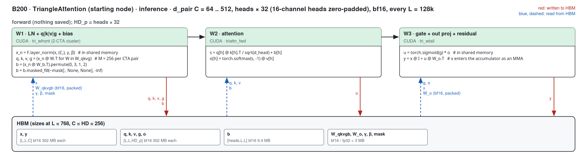

- `tri_wfront<C, ND>` (W1): 2-CTA clusters. The pair works on two 128-row tiles and the leader issues M = 256
  `cta_group::2` products whose B, the output block's rows of the packed `[Wq; Wk; Wv; Wg; Wb]` (≤ 256), is split by N across
  the pair, so each SM streams half of the weights. The LayerNorm runs in shared memory: up to C = 256 on two x buffers, a
  tile's LN under the previous tile's GEMMs; at C ≥ 384 (one buffer) the row statistics are computed a tile ahead from
  global memory and the tile is loaded and normalised in 64-column chunks, each released to the MMA on its own barrier.
  Drain: ND = 8 warps (two a TMEM lane quarter, alternate 64-column rounds) at C ≤ 256 with blocks of ≥ 128 columns, else 4;
  per-warp 32 × 32 staging and TMA stores; the bias block head-major and masked.
- `triattn_fwd` (W2): the head-dim-32 core with the head count as a parameter.
- `tri_wtail<C>` (W3): u = sigmoid(g) ∘ o computed over g in shared memory as the MMA's A operand, Wo streamed in K chunks.
  A work item is a (128-row tile, output-column block); C > 256 runs two blocks per tile so the two TMEM accumulators
  alternate. Without dropout the residual enters the accumulator as an MMA (the item's x chunks against a resident 64 × 64
  identity), so the drain reads nothing from global memory.

##### d_pair 64 (4 × 16, 4 × 32 with d_hidden 128, 2 × 32) · W1–W3

| (Length, Dimension) | (128, 64) | (256, 64) | (384, 64) | (512, 64) | (640, 64) | (768, 64) |
|---|---|---|---|---|---|---|
| implementation | CUDA | CUDA | CUDA | CUDA | CUDA | CUDA |
| 성능 확인 | ✗ | ✗ | ✗ | ✗ | ✗ | ✗ |
| cache build | ✓ | ✓ | ✓ | ✓ | ✓ | ✓ |

##### d_pair 256 (8 × 32) · W1–W3

| (Length, Dimension) | (128, 256) | (256, 256) | (384, 256) | (512, 256) | (640, 256) | (768, 256) |
|---|---|---|---|---|---|---|
| implementation | CUDA | CUDA | CUDA | CUDA | CUDA | CUDA |
| 성능 확인 | ✗ | ✗ | ✗ | ✗ | ✗ | ✗ |
| cache build | ✓ | ✓ | ✓ | ✓ | ✓ | ✓ |

##### d_pair 384 (12 × 32) · W1–W3

| (Length, Dimension) | (128, 384) | (256, 384) | (384, 384) | (512, 384) | (640, 384) | (768, 384) |
|---|---|---|---|---|---|---|
| implementation | CUDA | CUDA | CUDA | CUDA | CUDA | CUDA |
| 성능 확인 | ✗ | ✗ | ✗ | ✗ | ✗ | ✗ |
| cache build | ✓ | ✓ | ✓ | ✓ | ✓ | ✓ |

##### d_pair 512 (16 × 32) · W1–W3

| (Length, Dimension) | (128, 512) | (256, 512) | (384, 512) | (512, 512) | (640, 512) | (768, 512) |
|---|---|---|---|---|---|---|
| implementation | CUDA | CUDA | CUDA | CUDA | CUDA | CUDA |
| 성능 확인 | ✗ | ✗ | ✗ | ✗ | ✗ | ✗ |
| cache build | ✓ | ✓ | ✓ | ✓ | ✓ | ✓ |

### Training

#### Fused path · d_pair 64-512, L = 128 k

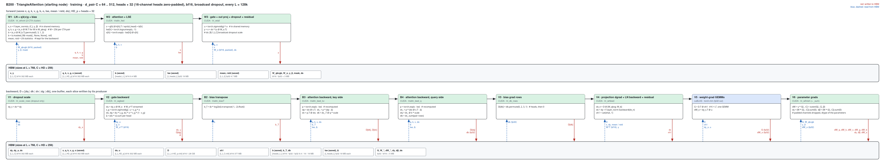

Forward W1–W3 as in inference; W1 also writes each row's (mean, rstd) for the backward, W2 the base-2 LSE, and W3 applies
the dropout scale before adding the residual (its drain then reads x).

- `tri_scale_rows` (V1, dropout only): dy_s = dy ∘ ds, bandwidth-bound (~80 % of HBM). Folding it into V2 (four warps
  scaling each landed dy chunk before the MMA) put an elementwise pass on the MMA's critical path with two stages in flight
  and made V2 1.8–2.6× slower; not kept.
- `tri_wgbwd<C>` (V2): du = dy_s · Wo, dy_s and the Woᵀ rows streaming together in 64-column K chunks per output block of
  ≤ 128 columns. Eight drain warps (two a TMEM lane quarter, alternate 32-column slices, one head each) prefetch their next
  g | o slice by TMA into a three-slot ring and overwrite it in place with do | dg | u; dg lands in D, delta per head.
- B2–B4: the core's backward as for d_pair 128, dq / dk / dv written into D (row-strided output views).
- `tri_db_rows` (V3): the dbias rows into D.
- `tri_whbwd<C>` (V4): g_y = D · [Wq; Wk; Wv; Wg; Wb] on tcgen05, the LayerNorm backward and the residual in the drain from
  the forward's (mean, rstd), with x (first pass: the two row sums) and x | dy (second pass: dx, x̂) arriving as TMA slices;
  writes dx and [x̂ | 1]. C > 256 has one 512-column accumulator (the drain and the next tile's MMAs run in series): eight
  drain warps there, the first pass's row sums combined through shared memory, and stages of one W half.
- cuBLAS (V5): G = Dᵀ [x̂ | 1] (one GEMM, K = L²) and dWo = dy_sᵀ u, fp32 out.
- `tri_wfinish` (V6): dW = γ ∘ G[:, :C] + G[:, C] ⊗ β, dγ = Σ W ∘ G[:, :C], dβ = Σ W G[:, C] (per-chunk partials summed in
  a fixed order), dWb and dWo, padded channels dropped, in the parameters' dtype.

##### d_pair 64 (4 × 16, 4 × 32 with d_hidden 128, 2 × 32) · W1–W3, V1–V6

| (Length, Dimension) | (128, 64) | (256, 64) | (384, 64) | (512, 64) | (640, 64) | (768, 64) |
|---|---|---|---|---|---|---|
| implementation | CUDA | CUDA | CUDA | CUDA | CUDA | CUDA |
| 성능 확인 | ✗ | ✗ | ✗ | ✗ | ✗ | ✗ |
| cache build | ✓ | ✓ | ✓ | ✓ | ✓ | ✓ |

##### d_pair 256 (8 × 32) · W1–W3, V1–V6

| (Length, Dimension) | (128, 256) | (256, 256) | (384, 256) | (512, 256) | (640, 256) | (768, 256) |
|---|---|---|---|---|---|---|
| implementation | CUDA | CUDA | CUDA | CUDA | CUDA | CUDA |
| 성능 확인 | ✗ | ✗ | ✗ | ✗ | ✗ | ✗ |
| cache build | ✓ | ✓ | ✓ | ✓ | ✓ | ✓ |

##### d_pair 384 (12 × 32) · W1–W3, V1–V6

| (Length, Dimension) | (128, 384) | (256, 384) | (384, 384) | (512, 384) | (640, 384) | (768, 384) |
|---|---|---|---|---|---|---|
| implementation | CUDA | CUDA | CUDA | CUDA | CUDA | CUDA |
| 성능 확인 | ✗ | ✗ | ✗ | ✗ | ✗ | ✗ |
| cache build | ✓ | ✓ | ✓ | ✓ | ✓ | ✓ |

##### d_pair 512 (16 × 32) · W1–W3, V1–V6

| (Length, Dimension) | (128, 512) | (256, 512) | (384, 512) | (512, 512) | (640, 512) | (768, 512) |
|---|---|---|---|---|---|---|
| implementation | CUDA | CUDA | CUDA | CUDA | CUDA | CUDA |
| 성능 확인 | ✗ | ✗ | ✗ | ✗ | ✗ | ✗ |
| cache build | ✓ | ✓ | ✓ | ✓ | ✓ | ✓ |

The bias-only variant (`use_self_attention=False`), heads of 96 / 128 channels (the module's default of 4 heads at d_pair 384 / 512)
and `BidirectionalTriangleAttention` are not served; heads of 64 channels: [Model options](#model-options-for-foldforge-2026-10-29).

## Batched samples (B > 1), any length and chunking (2026-10-20)

Both paths take B samples (templates, structures or augments folded into the batch) in one call, inference and training, starting
and ending node, at any length L >= 16. Dispatch and chunking: `integrations/triattn_b200.py` (one entry, `forward`, for both
paths; the launches are opaque custom ops, so the module compiles to one graph). Details, experiments and raw numbers:
[docs/records/triattn_b200_batched_20261020.md](../../../records/triattn_b200_batched_20261020.md).

- **One launch per kernel for B samples:** every kernel walks the B L² rows (b, i, j) or the (sample, head, tile) tasks; the key mask
  `[B, L]` and the dropout scale `[B, L, C]` are read per sample; the parameter gradients are reduced over every sample of the
  launch. The output is bitwise equal to B calls of one sample (every case of the test grid below), and B = 1 runs the same kernels
  on the same bits as before.
- **Samples per launch:** `max_batch(kind, length)` = 48 for both paths (`FUSED` / `GENERIC`, `kind_of(module, pair, mask)`), what
  was validated; the kernels' only index bound is the int32 TMA row coordinate (and the int32 row count of the front / tail
  launches), B Lp² < 2³¹ (fewer than 48 only above L 6656).
- **Chunking:** a call with more samples, or whose working set would not fit, runs in balanced chunks of `plan(kind, B, L, d_pair,
  heads, training, total_memory, ending)` samples one after another: never an out-of-memory error and never the PyTorch statements
  because of B or L. The chunk is a function of the shapes, node, mode and the device's TOTAL memory only (the same split under
  torch.compile and in CUDA graphs). Working set per pair token (`_bytes_per_token`, the tensors each path allocates; against the
  measured peaks of one launch -1.0 / +2.3 % over seven widths x both nodes x padded / whole-tile L x B 1-4 (the ending node now
  allocates what the starting node does), the -1 % at d_pair 512
  B = 1 L256: fixed allocations, under the 1 GiB slack), budget 0.85 of the
  device (179 GiB on B200) minus 1 GiB after the caller's x / y (training also dy / dx). Inference chunks write their rows of the
  output in place (new `out` of `tri_tail` / `tri_wtail`; a padded length, dropout or a traced call copies instead); training chunks
  are one autograd node (`_Chunked`) that keeps every chunk's saved tensors when they fit next to one chunk's backward, else reruns
  each chunk's forward in the backward (`checkpoint`); y and dx are copied into the batch's tensors and the parameter gradients come
  back in fp32 (the chunks get an exact fp32 cast of the parameters) and are summed in chunk order, rounded once.
- **Any length:** L that is not a multiple of 128 runs on the next multiple's tiles without padded copies (pad keys masked per sample,
  pad rows and columns read as zeros and never written; exact in training: the pad tokens' gradient rows are zero; see
  [Ragged lengths](#ragged-lengths-without-padded-copies-2026-10-29)). L < 16 runs the module's PyTorch statements.
  Long crops: L 1536 / 2048 / 2560 (and the ragged 1000) are served for inference and training; at B = 1 a d_pair 128 training step
  at L2560 holds about 24 GB.
- **Attention core forward in sample groups:** with four pair rows a task (L > 384) the persistent kernel's static round robin lets
  the CTAs of a long launch drift apart (they stop sharing K / V rows in L2), so B samples run in launches of ~36 864 tasks
  (`fwd_group`: 8 samples at L768 with 4 heads, 2 at L1536): module inference L768 B48 43.9 -> 41.6 ms, L640 B48 26.7 -> 25.8 ms,
  d_pair 256 L768 B16 29.5 -> 29.0 ms; training +0.5-1.7 %. Measured and not kept: a dynamic task counter (H100's fix) was 4-5 %
  slower per sample at every launch size on B200, and grouping the two backward kernels changed the training step by -0.5 to +0.1 %.
- **Deterministic parameter gradients (fused path, opt-in):** with `settings.triattn_b200_deterministic_wgrad=True`, `tri_gate_bwd`
  (dW_o) and `tri_wgrad` (M_t, the column / dbias vector sums) store one fp32 partial per CTA instead of fp32 atomics / TMA
  reduce-adds, and `tri_slot_sum` (6-7.5 µs) adds the partials in CTA order: dW_q, dW_k, dW_v, dW_g and dW_o are then the same bits
  every run, as on the wide path (always). Cost at B = 1 (kernel time, d_pair 128 training): L128 114.2 -> 115.7 µs, L384 665.4 ->
  669.8 µs, L768 +0.2 %. The default (False) reduces with fp32 atomics as before (the last bits depend on the order; within 1e-3 of
  the fixed-order sum), and the B = 1 training step stays at main's time. dx, dγ, dβ and dW_b carry the query-side kernel's fp32
  reduce-add of dbias in either mode (L2 order; dx within 1e-5 relative run to run).

#### Ending node without transposed copies (2026-10-20)

The ending node used to run the starting-node kernels on a transposed copy of the pair and transpose the result back (and dy / dx in
training): 9-67 % over the starting node. Now the kernels that touch the pair-shaped tensors -- `tri_front` / `tri_wfront` (x),
`tri_tail` / `tri_wtail` (x, y), `tri_gate_bwd` (dy, the dx seed), `tri_head_bwd` (x, the dx reduce-add), `tri_wgrad` (x),
`tri_wgbwd` (dy o drop, u), `tri_whbwd` (x, dy, dx), `tri_scale_rows` -- read and write the caller's `[B, I, J, C]` tensor through 4-D
TMA maps (c, j, i, b) with a box of consecutive i at one j (`make_rows_map` / `load_rows` / `store_rows` / `reduce_rows` in
`sm100.cuh`; the shared-memory image is the 2-D box of the starting node), raw-pointer reads go through `row_at`; the intermediates
(q, k, v, g, bias, o, lse, statistics, the gradient rows) keep the starting-node layout. The wide path's dW_o = (dy o drop)ᵀ u pairs
dy o drop and u in the caller's layout. The output is the same bits as the copying version (96 cases against main: seven widths x
L128 / 384 x B 1 / 2 x both nodes x inference / training x bf16 / fp32 parameters). The starting node runs the same kernels on the same
bits at the same kernel time (d_pair 128: L128 training 113.4-114.4 vs 113.9-114.1 µs, L384 inference 172.6 vs 172.6 µs).

CUDA graph, bf16-mixed, best of 2 interleaved runs, ms: starting node / ending node now / ending node before.

| d_pair, mode | L | B | starting | ending | ending before | ending: before / now |
|---|---|---|---|---|---|---|
| 128 inference | 128 | 1 | 0.0308 | 0.0308 | 0.0410 | 1.33 |
| 128 training | 128 | 1 | 0.1212 | 0.1233 | 0.1430 | 1.16 |
| 128 inference | 384 | 1 | 0.1710 | 0.1769 | 0.2559 | 1.45 |
| 128 training | 384 | 1 | 0.6756 | 0.6836 | 0.8050 | 1.18 |
| 128 inference | 768 | 1 | 0.9050 | 0.9253 | 1.2647 | 1.37 |
| 128 training | 768 | 1 | 3.479 | 3.506 | 4.008 | 1.14 |
| 128 inference | 384 | 48 | 6.790 | 7.004 | 11.33 | 1.62 |
| 128 training | 384 | 48 | 26.00 | 26.30 | 32.83 | 1.25 |
| 128 inference | 768 | 48 | 41.91 | 42.47 | 59.10 | 1.39 |
| 128 training | 768 | 48 | 156.8 | 157.9 | 184.0 | 1.16 |
| 64 (4 × 16) inference | 384 | 1 | 0.2042 | 0.2059 | 0.2358 | 1.15 |
| 64 (4 × 16) training | 384 | 1 | 0.6798 | 0.6902 | 0.7486 | 1.08 |
| 64 (4 × 16) inference | 768 | 48 | 39.35 | 39.56 | 48.49 | 1.23 |
| 64 (4 × 16) training | 768 | 48 | 152.2 | 153.9 | 165.6 | 1.08 |
| 256 inference | 384 | 1 | 0.3485 | 0.3542 | 0.5295 | 1.49 |
| 256 training | 384 | 1 | 1.332 | 1.376 | 1.596 | 1.16 |
| 256 inference | 768 | 16 | 28.63 | 29.10 | 39.66 | 1.36 |
| 256 training | 768 | 16 | 109.0 | 110.9 | 125.0 | 1.13 |

The ending node is now 0-6 % over the starting node (the remaining cost: each 4-D box gathers 128 rows that lie L x C elements
apart instead of one contiguous block).

### Batched samples · measurements (2026-10-20)

B200 (148 SMs, GPU 5 of the shared node, a ~2.3 GB utilisation dummy process resident on it), torch 2.13.0+cu129, cuEquivariance
0.12.0, kernels built by nvcc 13.1. bf16-mixed: fp32 parameters, bf16 pair, the module under `torch.autocast(bfloat16)`. CUDA graph
of one step (inference: forward; training: forward + backward with dropout 0.25, dx and every parameter gradient), median of 5 x
3-50 replays; starting node, every sample its own 20 % key mask. "B calls" = B replays of the one-sample graph (in training each a
forward + backward, which a model's graph cannot do at large B: it holds every sample's saved tensors). cuEquivariance = the
module with `implementation=cuequivariance`, PyTorch = its statements under `torch.compile`, both captured the same way. ms; × =
B calls / one call and best other / one call. Probe harness: `p_bench.py` (outside the checkout, see the record).

| d_pair, mode | L | B | one call | B calls | cuEquivariance | PyTorch compiled | × B calls | × best other |
|---|---|---|---|---|---|---|---|---|
| 128 inference | 128 | 4 | 0.064 | 0.123 | 0.322 | 0.223 | 1.92 | 3.48 |
| 128 inference | 128 | 48 | 0.522 | 1.384 | 3.442 | 2.407 | 2.65 | 4.61 |
| 128 inference | 384 | 4 | 0.601 | 0.693 | 2.715 | 5.059 | 1.15 | 4.52 |
| 128 inference | 384 | 48 | 6.911 | 8.286 | 31.82 | 59.88 | 1.20 | 4.60 |
| 128 inference | 768 | 4 | 3.464 | 3.615 | 11.33 | 38.23 | 1.04 | 3.27 |
| 128 inference | 768 | 48 | 43.56 | 43.53 | 135.0 | OOM | 1.00 | 3.10 |
| 128 training | 128 | 4 | 0.267 | 0.501 | 1.450 | 0.691 | 1.88 | 2.59 |
| 128 training | 128 | 48 | 2.006 | 6.017 | 10.09 | 5.375 | 3.00 | 2.68 |
| 128 training | 384 | 4 | 2.355 | 2.729 | 10.14 | 8.244 | 1.16 | 3.50 |
| 128 training | 384 | 48 | 26.82 | 32.79 | 118.0 | 93.28 | 1.22 | 3.48 |
| 128 training | 768 | 4 | 13.44 | 13.95 | 54.35 | 54.23 | 1.04 | 4.03 |
| 128 training | 768 | 48 | 167.0 | 167.3 | 649.5 | OOM | 1.00 | 3.89 |
| 64 (4 × 16) inference | 128 | 4 | 0.101 | 0.246 | 0.527 | 0.198 | 2.44 | 1.96 |
| 64 (4 × 16) inference | 128 | 48 | 0.514 | 2.991 | 5.708 | 1.995 | 5.82 | 3.88 |
| 64 (4 × 16) inference | 384 | 4 | 0.607 | 0.816 | 2.007 | 4.755 | 1.34 | 3.31 |
| 64 (4 × 16) inference | 384 | 48 | 6.386 | 9.769 | 23.19 | 56.15 | 1.53 | 3.63 |
| 64 (4 × 16) inference | 768 | 4 | 3.350 | 3.636 | 8.447 | 36.94 | 1.09 | 2.52 |
| 64 (4 × 16) inference | 768 | 48 | 39.39 | 43.74 | 100.5 | OOM | 1.11 | 2.55 |
| 64 (4 × 16) training | 128 | 4 | 0.284 | 0.622 | 1.483 | 0.581 | 2.19 | 2.05 |
| 64 (4 × 16) training | 128 | 48 | 1.837 | 7.577 | 12.10 | 4.179 | 4.12 | 2.27 |
| 64 (4 × 16) training | 384 | 4 | 2.257 | 2.722 | 8.100 | 7.369 | 1.21 | 3.26 |
| 64 (4 × 16) training | 384 | 48 | 25.12 | 31.75 | 93.17 | 81.48 | 1.26 | 3.24 |
| 64 (4 × 16) training | 768 | 4 | 12.97 | 13.56 | 46.07 | 50.14 | 1.05 | 3.55 |
| 64 (4 × 16) training | 768 | 48 | 155.2 | 162.8 | 549.0 | OOM | 1.05 | 3.54 |
| 256 inference | 128 | 4 | 0.142 | 0.287 | 0.551 | 0.423 | 2.02 | 2.98 |
| 256 inference | 128 | 48 | 1.064 | 3.422 | 6.030 | 4.563 | 3.22 | 4.29 |
| 256 inference | 384 | 4 | 1.262 | 1.396 | 4.767 | 9.998 | 1.11 | 3.78 |
| 256 inference | 384 | 48 | 15.01 | 16.71 | 56.32 | 120.2 | 1.11 | 3.75 |
| 256 inference | 768 | 4 | 7.340 | 7.175 | 20.17 | 76.16 | 0.98 | 2.75 |
| 256 inference | 768 | 48 | 93.00 | 86.08 | 241.0 | OOM | 0.93 | 2.59 |
| 256 training | 128 | 4 | 0.494 | 0.874 | 2.267 | 1.313 | 1.77 | 2.66 |
| 256 training | 128 | 48 | 4.406 | 10.55 | 18.25 | 13.36 | 2.39 | 3.03 |
| 256 training | 384 | 4 | 5.075 | 5.308 | 18.75 | 26.74 | 1.05 | 3.69 |
| 256 training | 384 | 48 | 59.82 | 63.72 | 221.5 | OOM | 1.07 | 3.70 |
| 256 training | 768 | 4 | 29.03 | 28.97 | 103.7 | 200.1 | 1.00 | 3.57 |
| 256 training | 768 | 48 (9 a launch) | 368.6 | 350.4 | OOM | OOM | 0.95 | - |

Further cases (same protocol): chunked calls -- d_pair 128 training L768 B96 (27 a launch, saved tensors kept) 349.3 ms vs 335.1
(B calls; cuEquivariance refuses the shape: invalid launch configuration), d_pair 256 training L768 B32 (22 a launch) 248.8 vs 231.6,
d_pair 512 inference L768 B40 (37 a launch) 182.5 vs 173.7; ragged L300 (computed at 384), d_pair 128 B16: inference 3.312 vs 3.746
(cuEquivariance 8.578), training 11.46 vs 13.23 (27.04); ending node L384 B48 (with the transposed copies, before the change above:
now 7.00 / 26.30 ms): inference 11.33 vs 12.40 (36.36), training 33.05 vs 39.13 (126.5); long crops, d_pair 128 training L2048 B2 101.6 vs 101.7 (394.4), d_pair 64 (4 × 16) 97.7 vs 97.9 (358.8), d_pair 128
inference L2560 B2 49.3 vs 49.4 (93.0); PyTorch compiled runs out of memory from L2048.

One call is 1.00-5.82x faster than B calls wherever the batch's saved tensors fit and the launches are not long, and 2-4.6x faster
than the best of cuEquivariance and compiled PyTorch in every cell they run (1.96x d_pair 64 inference L128 B4). The cells below 1x
are long: d_pair 256 inference at L768 (0.93-0.98x) and the chunked training cells (0.93-0.96x: the chunks' y / dx copies). Their
kernels are as fast per sample as one sample's (kernel time at L768 B48: 1806 vs 1751 µs per sample); the B one-sample replays get
idle gaps between graph launches, which at the 1000 W power cap keep the clock higher: the same 48 one-sample calls captured in ONE
graph (no gaps) take 89.0 ms against the one call's 88.4 ms (d_pair 256 L768; d_pair 128 43.3 vs 41.8, d_pair 64 41.4 vs 39.3).

B = 1 against main (59d910cf), same harness, CUDA graph, bf16-mixed, ms (inference / training): d_pair 128, the default (atomic)
weight-gradient reduction, best of 3 interleaved runs (2026-10-20, after the deterministic sum became opt-in), starting node L128
0.0287 / 0.1219 -> 0.0287 / 0.1219, L256 0.0758 / 0.3063 -> 0.0758 / 0.3063, L384 0.1739 / 0.6743 -> 0.1731 / 0.6748, L512 0.3284 /
1.2744 -> 0.3275 / 1.2748, L768 0.9042 / 3.4733 -> 0.9032 / 3.4757 (the ending node, which main runs with transposed copies, is
now 1.14-1.45x faster than main, table above); d_pair 64 (4 × 16) and 256, starting node: every cell L128-768 within ±1 % (best of 2). With the deterministic sum d_pair 128 training is +1.3 % at L128 (kernel
time) and +0.7 % at L384. The output is the same bits as main at B = 1 and 2 (96 cases: seven configurations x L128 / 384 x
both nodes x inference / training x bf16 / fp32 parameters).

## Measurements (2026-09-30; CUDA-graph tables re-measured 2026-10-11 with fp32 master parameters)

B200 (148 SMs), torch 2.13.0+cu129, triton 3.7.1, cuEquivariance 0.12.0, sm_100a kernels built by nvcc 13.1, B=1, bf16, starting node, mask all-true,
`benchmarks/runners/bench.py target=triangle_attention level=module min_seq_len=128 max_seq_len=768` (compiled), with
`d_pair=<C> +tri_d_hidden=<HD> +tri_n_head=<heads>`. Latency in ms, median. × = ours vs the fastest of PyTorch compiled /
cuEquivariance / Anthropic; "portable path" is the same module with `+tri_b200_cuda=false` (the repository's Triton kernels, the
B200 default before this path), reported separately. Anthropic: `integrations.anthropic` row `block:triattn_native`,
inference only; on B200 the payload refuses its native cell (measured on sm_90 / sm_80 only) and serves the `k2b` /
cuEquivariance fallbacks for 4-head calls, so this column is not the H100 payload's speed; other head counts are —. No B200
Triton autotune cache exists; none of the columns use one (ours is CUDA end to end). The 32-channel-head rows are one family:
d_pair 64 is 2 × 32, d_pair 128 the fused 4 × 32 path above, 256 / 384 / 512 are 8 / 12 / 16 × 32.

- Re-verification (2026-10-10, engine v2.2.0 plus unreleased changes, the setup above with the kernels built by nvcc 13.1, driver 580.95.05, one GPU with no other process on it): every cell of the CUDA-graph tables of the 32-channel-head family, d_pair 64 4 x 16 and 4 x 32 (portable path included) (335 cells) was re-measured through the harness command above, one run per width and mode; a cell that moved by more than 8 % against the table was repeated (once, twice if still beyond 8 %) and the median of the runs is reported. Median change 0.2 % (0.7 % for ours), 90th percentile 1.8 %; two cells were replaced ((384, 64) PyTorch compiled inference 0.584 -> 0.670 ms; (128, 64) cuEquivariance training, previously refused, 0.179 ms). The no-CUDA-graph training tables are host-bound (their cells move by 20-60 % between runs with the load on the host) and keep their 2026-09-30 values. **2026-10-11:** every CUDA-graph cell of these tables was re-measured with fp32 master parameters (`precision=bf16-mixed`, the harness default since that date: fp32 parameters over bf16 activations under `torch.autocast`; one run per cell, `parameter_dtype` = float32 in the CSV, the engine environment's python called directly); the cells above are those values. The no-CUDA-graph training tables are host-bound and keep their earlier values (bf16 parameters).

### Heads × 32 · Inference (CUDA graph)

| (Length, Dimension) | PyTorch compiled | cuEquivariance | Anthropic | portable path | ours | × | × vs portable path |
|---|---|---|---|---|---|---|---|
| (128, 64) | 0.061 | 0.055 | — | 0.045 | 0.024 | 2.29 | 1.88× |
| (256, 64) | 0.182 | 0.102 | — | 0.098 | 0.053 | 1.92 | 1.85× |
| (384, 64) | 0.678 | 0.184 | — | 0.182 | 0.102 | 1.80 | 1.78× |
| (512, 64) | 1.465 | 0.289 | — | 0.344 | 0.190 | 1.52 | 1.81× |
| (640, 64) | 3.156 | 0.508 | — | 0.586 | 0.319 | 1.59 | 1.84× |
| (768, 64) | 5.024 | 0.743 | — | 0.946 | 0.501 | 1.48 | 1.89× |
| (128, 128) | 0.088 | 0.069 | 0.049 | 0.057 | 0.035 | 1.40 | 1.63× |
| (256, 128) | 0.328 | 0.143 | 0.143 | 0.141 | 0.080 | 1.79 | 1.76× |
| (384, 128) | 1.313 | 0.321 | 0.322 | 0.338 | 0.176 | 1.82 | 1.92× |
| (512, 128) | 2.885 | 0.540 | 0.631 | 0.680 | 0.332 | 1.63 | 2.05× |
| (640, 128) | 6.270 | 0.984 | 1.097 | 1.175 | 0.571 | 1.72 | 2.06× |
| (768, 128) | 9.952 | 1.387 | 1.748 | 1.877 | 0.906 | 1.53 | 2.07× |
| (128, 256) | 0.135 | 0.096 | 0.084 | 0.078 | 0.047 | 1.79 | 1.66× |
| (256, 256) | 0.809 | 0.240 | 0.307 | 0.233 | 0.141 | 1.70 | 1.65× |
| (384, 256) | 2.596 | 0.612 | 0.729 | 0.608 | 0.326 | 1.88 | 1.87× |
| (512, 256) | 5.704 | 1.037 | 1.418 | 1.245 | 0.630 | 1.65 | 1.98× |
| (640, 256) | 12.459 | 1.884 | 2.458 | 2.180 | 1.127 | 1.67 | 1.93× |
| (768, 256) | 19.774 | 2.652 | 3.896 | 3.506 | 1.805 | 1.47 | 1.94× |
| (128, 384) | 0.192 | 0.135 | — | 0.105 | 0.069 | 1.96 | 1.52× |
| (256, 384) | 1.220 | 0.362 | — | 0.356 | 0.235 | 1.54 | 1.51× |
| (384, 384) | 4.287 | 0.965 | — | 0.947 | 0.551 | 1.75 | 1.72× |
| (512, 384) | 8.768 | 1.641 | — | 1.905 | 1.105 | 1.49 | 1.72× |
| (640, 384) | 21.399 | 2.986 | — | 3.342 | 1.955 | 1.53 | 1.71× |
| (768, 384) | 35.078 | 4.295 | — | 5.421 | 3.073 | 1.40 | 1.76× |
| (128, 512) | 0.289 | 0.164 | — | 0.127 | 0.090 | 1.82 | 1.41× |
| (256, 512) | 1.615 | 0.473 | — | 0.475 | 0.327 | 1.45 | 1.45× |
| (384, 512) | 5.676 | 1.244 | — | 1.247 | 0.815 | 1.53 | 1.53× |
| (512, 512) | 11.654 | 2.183 | — | 2.579 | 1.540 | 1.42 | 1.67× |
| (640, 512) | 28.461 | 3.927 | — | 4.542 | 2.689 | 1.46 | 1.69× |
| (768, 512) | 46.700 | 5.740 | — | 7.302 | 4.313 | 1.33 | 1.69× |

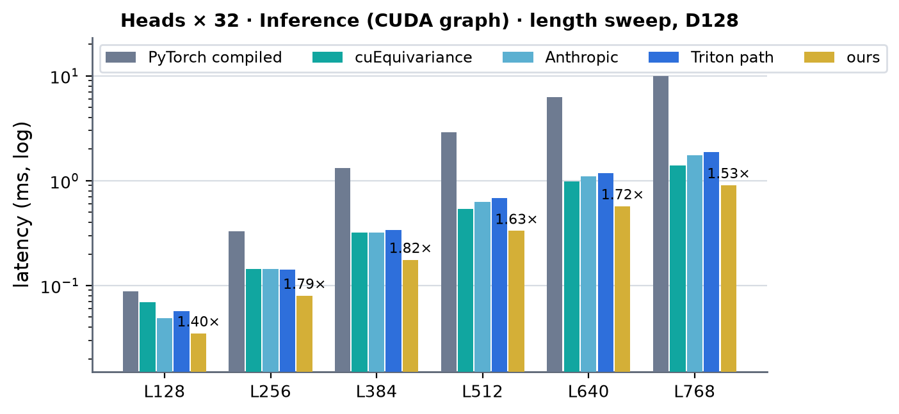 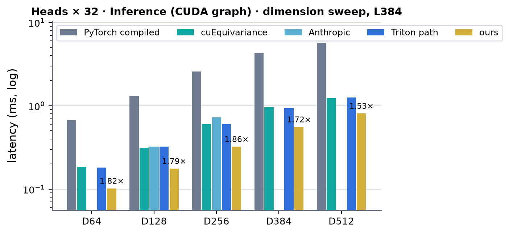 <!-- measure_bars -->

### Heads × 32 · Training, dropout 0.25 (CUDA graph)

| (Length, Dimension) | PyTorch compiled | cuEquivariance | Anthropic | portable path | ours | × | × vs portable path |
|---|---|---|---|---|---|---|---|
| (128, 64) | 0.196 | 0.179 | — | 0.161 | 0.103 | 1.74 | 1.56× |
| (256, 64) | 0.548 | 0.458 | — | 0.372 | 0.199 | 2.30 | 1.87× |
| (384, 64) | 1.187 | 1.023 | — | 0.761 | 0.400 | 2.56 | 1.90× |
| (512, 64) | 2.084 | 1.940 | — | 1.420 | 0.733 | 2.65 | 1.94× |
| (640, 64) | 4.699 | 3.428 | — | 2.469 | 1.210 | 2.83 | 2.04× |
| (768, 64) | 7.073 | 5.470 | — | 3.946 | 1.895 | 2.89 | 2.08× |
| (128, 128) | 0.269 | 0.245 | — | 0.206 | 0.116 | 2.11 | 1.78× |
| (256, 128) | 0.968 | 0.747 | — | 0.591 | 0.300 | 2.49 | 1.97× |
| (384, 128) | 2.190 | 1.842 | — | 1.369 | 0.665 | 2.77 | 2.06× |
| (512, 128) | 3.944 | 3.669 | — | 2.745 | 1.265 | 2.90 | 2.17× |
| (640, 128) | 9.153 | 6.628 | — | 4.823 | 2.172 | 3.05 | 2.22× |
| (768, 128) | 13.783 | 10.636 | — | 7.760 | 3.452 | 3.08 | 2.25× |
| (128, 256) | 0.440 | 0.361 | — | 0.296 | 0.189 | 1.91 | 1.57× |
| (256, 256) | 2.022 | 1.331 | — | 1.015 | 0.556 | 2.39 | 1.83× |
| (384, 256) | 6.278 | 3.535 | — | 2.575 | 1.279 | 2.76 | 2.01× |
| (512, 256) | 12.943 | 7.146 | — | 5.218 | 2.497 | 2.86 | 2.09× |
| (640, 256) | 29.655 | 13.025 | — | 9.298 | 4.533 | 2.87 | 2.05× |
| (768, 256) | 45.725 | 20.889 | — | 15.056 | 7.202 | 2.90 | 2.09× |
| (128, 384) | 0.595 | 0.514 | — | 0.409 | 0.265 | 1.94 | 1.54× |
| (256, 384) | 1.992 | 2.003 | — | 1.512 | 0.879 | 2.27 | 1.72× |
| (384, 384) | 6.346 | 5.320 | — | 3.946 | 2.166 | 2.46 | 1.82× |
| (512, 384) | 11.637 | 10.819 | — | 7.968 | 4.336 | 2.50 | 1.84× |
| (640, 384) | 26.954 | 19.594 | — | 14.286 | 7.404 | 2.65 | 1.93× |
| (768, 384) | 41.032 | 31.694 | — | 23.065 | 11.854 | 2.67 | 1.95× |
| (128, 512) | 0.953 | 0.640 | — | 0.506 | 0.339 | 1.89 | 1.49× |
| (256, 512) | 5.299 | 2.614 | — | 1.963 | 1.238 | 2.11 | 1.59× |
| (384, 512) | 16.695 | 6.983 | — | 5.189 | 3.059 | 2.28 | 1.70× |
| (512, 512) | 36.846 | 14.327 | — | 10.604 | 5.998 | 2.39 | 1.77× |
| (640, 512) | 79.286 | 26.262 | — | 19.052 | 10.466 | 2.51 | 1.82× |
| (768, 512) | 130.499 | 42.463 | — | 30.819 | 16.565 | 2.56 | 1.86× |

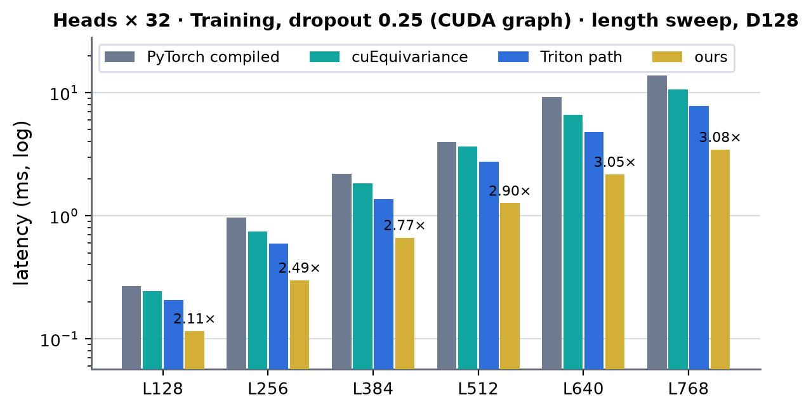 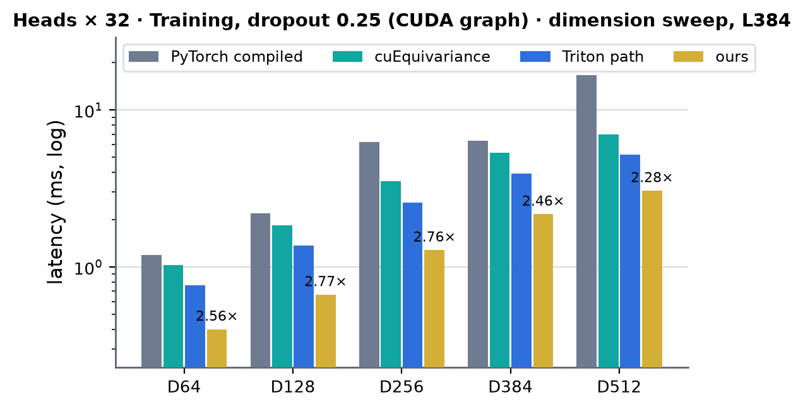 <!-- measure_bars -->

cuEquivariance at (128, 64): the harness's repeat check sits on this row -- its graph-replayed gradients differ between timed runs
by about 1.2e-4 relative (the check is 1e-4). It refused the row (—) on 2026-09-30 and in one of two 2026-10-10 runs, and measured
0.179 ms in the other; without a graph it measures normally.

### Heads × 32 · Training, dropout 0.25 (no CUDA graph)

| (Length, Dimension) | PyTorch compiled | cuEquivariance | Anthropic | portable path | ours | × | × vs portable path |
|---|---|---|---|---|---|---|---|
| (128, 64) | 0.528 | 0.816 | — | 0.779 | 0.382 | 1.38 | 2.04× |
| (256, 64) | 0.560 | 0.818 | — | 0.689 | 0.471 | 1.19 | 1.46× |
| (384, 64) | 1.344 | 1.129 | — | 1.137 | 0.477 | 2.37 | 2.38× |
| (512, 64) | 2.824 | 2.051 | — | 1.496 | 0.763 | 2.69 | 1.96× |
| (640, 64) | 5.502 | 3.543 | — | 2.553 | 1.246 | 2.84 | 2.05× |
| (768, 64) | 8.731 | 5.589 | — | 4.032 | 1.934 | 2.89 | 2.08× |
| (128, 128) | 0.502 | 0.799 | — | 0.843 | 0.445 | 1.13 | 1.89× |
| (256, 128) | 0.912 | 0.851 | — | 0.720 | 0.384 | 2.22 | 1.88× |
| (384, 128) | 2.588 | 1.958 | — | 1.461 | 0.708 | 2.77 | 2.07× |
| (512, 128) | 5.351 | 3.783 | — | 2.831 | 1.303 | 2.90 | 2.17× |
| (640, 128) | 10.651 | 6.753 | — | 4.912 | 2.217 | 3.05 | 2.22× |
| (768, 128) | 17.013 | 10.726 | — | 7.851 | 3.502 | 3.06 | 2.24× |
| (128, 256) | 0.583 | 0.890 | — | 0.660 | 0.475 | 1.23 | 1.39× |
| (256, 256) | 1.754 | 1.440 | — | 1.079 | 0.586 | 2.46 | 1.84× |
| (384, 256) | 4.928 | 3.641 | — | 2.704 | 1.318 | 2.76 | 2.05× |
| (512, 256) | 10.366 | 7.228 | — | 5.281 | 2.629 | 2.75 | 2.01× |
| (640, 256) | 20.903 | 13.124 | — | 9.356 | 4.567 | 2.87 | 2.05× |
| (768, 256) | 33.567 | 20.999 | — | 15.110 | 7.245 | 2.90 | 2.09× |
| (128, 384) | 0.587 | 0.714 | — | 0.937 | 0.486 | 1.21 | 1.93× |
| (256, 384) | 2.563 | 2.082 | — | 1.574 | 0.907 | 2.29 | 1.73× |
| (384, 384) | 7.693 | 5.431 | — | 4.007 | 2.190 | 2.48 | 1.83× |
| (512, 384) | 15.724 | 10.931 | — | 8.016 | 4.362 | 2.51 | 1.84× |
| (640, 384) | 34.046 | 19.763 | — | 14.246 | 7.492 | 2.64 | 1.90× |
| (768, 384) | 55.801 | 31.819 | — | 23.043 | 11.886 | 2.68 | 1.94× |
| (128, 512) | 0.745 | 0.751 | — | 0.915 | 0.383 | 1.95 | 2.39× |
| (256, 512) | 3.335 | 2.695 | — | 2.024 | 1.241 | 2.17 | 1.63× |
| (384, 512) | 10.104 | 7.088 | — | 5.226 | 3.005 | 2.36 | 1.74× |
| (512, 512) | 20.860 | 14.409 | — | 10.634 | 6.215 | 2.32 | 1.71× |
| (640, 512) | 45.344 | 26.308 | — | 19.072 | 10.479 | 2.51 | 1.82× |
| (768, 512) | 76.020 | 42.532 | — | 31.159 | 16.670 | 2.55 | 1.87× |

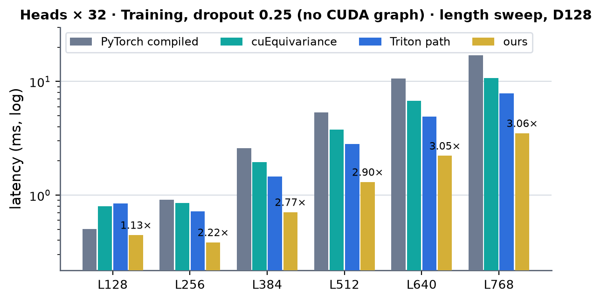 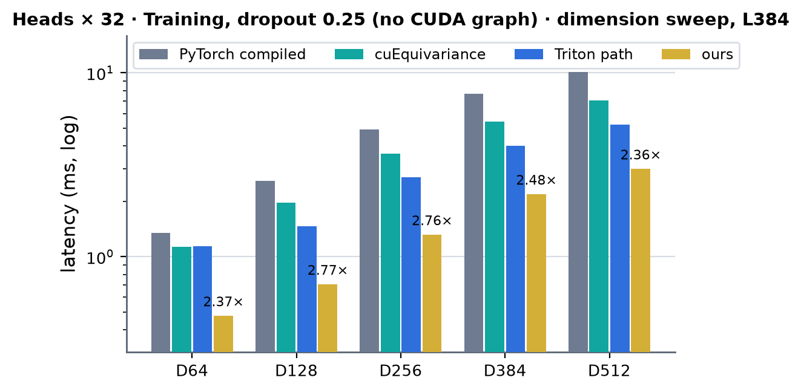 <!-- measure_bars -->

Without a graph ours pays host-side time (tensor-map encoding, the autograd function, a dozen launches, ~0.4–0.5 ms a step)
above the GPU work at L128 / L256, so its lead is smallest there (1.13–1.95× at L128); these host-bound rows also move with
other load on the host.

### d_pair 64, 4 × 16 · Inference (CUDA graph)

| (Length, Dimension) | PyTorch compiled | cuEquivariance | Anthropic | portable path | ours | × | × vs portable path |
|---|---|---|---|---|---|---|---|
| (128, 64) | 0.080 | 0.080 | 0.037 | 0.047 | 0.029 | 1.28 | 1.62× |
| (256, 64) | 0.301 | 0.119 | 0.096 | 0.121 | 0.072 | 1.33 | 1.68× |
| (384, 64) | 1.236 | 0.253 | 0.231 | 0.250 | 0.162 | 1.43 | 1.54× |
| (512, 64) | 2.725 | 0.408 | 0.475 | 0.506 | 0.313 | 1.30 | 1.62× |
| (640, 64) | 6.036 | 0.764 | 0.863 | 0.895 | 0.541 | 1.41 | 1.65× |
| (768, 64) | 9.660 | 1.092 | 1.408 | 1.475 | 0.868 | 1.26 | 1.70× |

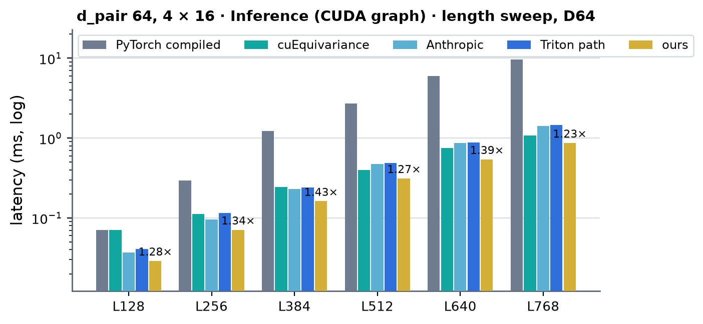 <!-- measure_bars -->

### d_pair 64, 4 × 16 · Training, dropout 0.25 (CUDA graph)

| (Length, Dimension) | PyTorch compiled | cuEquivariance | Anthropic | portable path | ours | × | × vs portable path |
|---|---|---|---|---|---|---|---|
| (128, 64) | 0.240 | 0.240 | — | 0.172 | 0.119 | 2.02 | 1.45× |
| (256, 64) | 0.852 | 0.614 | — | 0.469 | 0.289 | 2.12 | 1.62× |
| (384, 64) | 1.958 | 1.568 | — | 1.063 | 0.636 | 2.47 | 1.67× |
| (512, 64) | 3.506 | 3.169 | — | 2.160 | 1.218 | 2.60 | 1.77× |
| (640, 64) | 8.480 | 5.822 | — | 3.879 | 2.094 | 2.78 | 1.85× |
| (768, 64) | 12.892 | 9.527 | — | 6.350 | 3.334 | 2.86 | 1.90× |

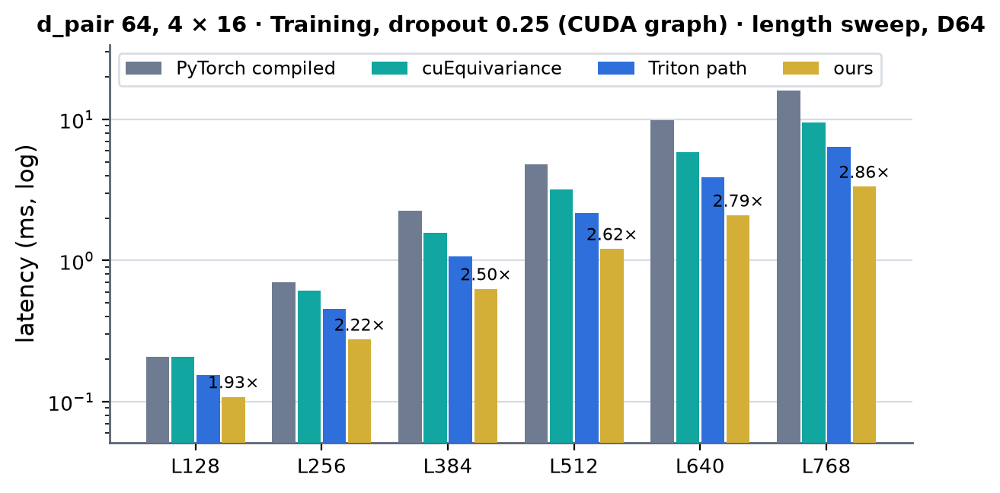 <!-- measure_bars -->

### d_pair 64, 4 × 32 (d_hidden 128) · Inference (CUDA graph)

| (Length, Dimension) | PyTorch compiled | cuEquivariance | Anthropic | portable path | ours | × | × vs portable path |
|---|---|---|---|---|---|---|---|
| (128, 64) | 0.084 | 0.065 | 0.047 | 0.053 | 0.028 | 1.68 | 1.89× |
| (256, 64) | 0.316 | 0.133 | 0.141 | 0.131 | 0.071 | 1.87 | 1.85× |
| (384, 64) | 1.285 | 0.299 | 0.323 | 0.293 | 0.164 | 1.82 | 1.79× |
| (512, 64) | 2.828 | 0.485 | 0.633 | 0.587 | 0.314 | 1.54 | 1.87× |
| (640, 64) | 6.175 | 0.889 | 1.100 | 1.031 | 0.545 | 1.63 | 1.89× |
| (768, 64) | 9.830 | 1.261 | 1.748 | 1.678 | 0.870 | 1.45 | 1.93× |

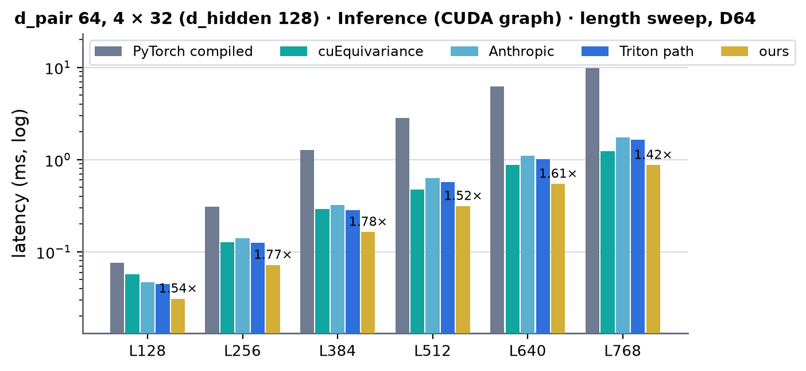 <!-- measure_bars -->

### d_pair 64, 4 × 32 (d_hidden 128) · Training, dropout 0.25 (CUDA graph)

| (Length, Dimension) | PyTorch compiled | cuEquivariance | Anthropic | portable path | ours | × | × vs portable path |
|---|---|---|---|---|---|---|---|
| (128, 64) | 0.255 | 0.243 | — | 0.192 | 0.116 | 2.09 | 1.66× |
| (256, 64) | 0.904 | 0.699 | — | 0.534 | 0.288 | 2.43 | 1.85× |
| (384, 64) | 2.090 | 1.740 | — | 1.229 | 0.640 | 2.72 | 1.92× |
| (512, 64) | 3.741 | 3.465 | — | 2.473 | 1.221 | 2.84 | 2.03× |
| (640, 64) | 8.793 | 6.299 | — | 4.395 | 2.103 | 3.00 | 2.09× |
| (768, 64) | 13.325 | 10.190 | — | 7.169 | 3.336 | 3.05 | 2.15× |

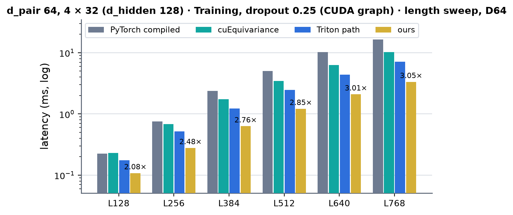 <!-- measure_bars -->

Range of × over these tables: 32-channel heads inference 1.32–1.86×, training 1.84–3.05×; 4 × 16 inference
1.23–1.43×, training 1.93–2.86×; 4 × 32 at d_pair 64 inference 1.42–1.78×, training 2.08–3.05×.

Accuracy (`tests/gpu/sm100/test_triattn_b200_gpu.py`, 57 cases. d_pair 128: L128–768 inference and training, ending node,
B=2, mask layouts, dropout on both nodes, fp32 master parameters, CUDA-graph capture. Other widths: the six shapes at L128 /
L256 for inference and training (output, input and every parameter gradient), dropout at 4 × 16 and 8 × 32 on both nodes,
fp32 master parameters, ending node with the first keys masked, re-packing after a weight update): against an fp32 autograd
reference, the output and every gradient stay within 1.25× the bf16 PyTorch module's own error (+1e-3 output, +2e-3
gradients). Outside the harness, at (384, 128): worst parameter / input gradient rel. Frobenius 6.4e-3 (PyTorch bf16
1.0e-2, cuEquivariance 6.7e-3); at (768, 128) 6.5e-3 (1.1e-2, 6.8e-3).

Batched samples (`tests/gpu/sm100/test_triattn_b200_batched_gpu.py`, 539 passed, 3 not run: the test's own tensors above 64 GB): B in
{1, 2, 4, 8, 16, 32, 48} x L in {128, 300 (ragged), 384, 768} x the seven registered width layouts x inference / training, every sample
its own key mask and dropout scale: y bitwise equal to B one-sample calls in every case, dx within 5e-3 and the parameter gradients
within 5e-3 of the fp32 sum of the per-sample ones (relative), against the fp32 PyTorch statements (all samples where the
[B, H, L, L, L] logits fit, then also every parameter gradient; else the first and last sample) within 1.25x the bf16 statements'
own error. Also: ending node (B 4 / 48 x L128 / 300 / 384), ragged L 16-520, L < 16 not served, run-to-run bitwise determinism
under a NaN-poisoned allocator on both nodes (y always; dW_q|k|v|g|o on the wide path, and on the fused path with
`triattn_b200_deterministic_wgrad`), forced chunks (kept / rerun / inference, both nodes, L256 and padded L208: y
bitwise to one launch), six calls that do not fit in one launch (peak under 0.95 of the device), L 1000 / 1536 / 2048 / 2560 (pair
rows against the fp32 statements of those rows, within 1.25x the bf16 statements' error), CUDA-graph capture and torch.compile
(fullgraph) with one launch and with chunks. `tests/cpu/kernels/test_triattn_b200_batch_plan.py` (23) checks `plan` / `max_batch`
without a GPU.

## d_pair 128 · schedule per length (2026-09-29)

Every kernel keeps one schedule for all L except the attention forward, whose pair rows per CTA task (`TA_R`) are chosen
by L in `b200_triattn.py` (two builds of `triattn_sm100.cu`). The knobs were swept at every registered L with each kernel
alone (CUDA graph, µs; differences under ~3 % are within run-to-run noise):

| knob | (128, 128) | (256, 128) | (384, 128) | (512, 128) | (640, 128) | (768, 128) | chosen |
|---|---|---|---|---|---|---|---|
| forward, rows / task 4 → 2 | 10.6 → 10.3 | 38.2 → 32.5 | 98.7 → 96.3 | 208.5 → 212.4 | 389.4 → 392.6 | 655.4 → 654.1 | 2 for L ≤ 384, else 4 |
| forward, K / V ring 5 → 6 / 7 (rows 2) | 10.3 / 10.3 | 32.7 / 32.8 | 96.3 / 96.5 | 212.2 / 213.2 | 392.9 / 394.9 | 654.3 / 655.8 | 5 |
| backward query side, rows / task 4 → 2 | 10.6 → 12.7 | 51.1 → 54.7 | 138.8 → 162.4 | 313.1 → 347.4 | 584.8 → 695.9 | 988.0 → 1156.5 | 4 |

The backward key side has two rows per task by construction (one per gradient group); the module kernels (front, tail,
gate backward, head backward, weight grads) have 128-row tiles fixed by the tensor-core M and no length-dependent knob.
Small L stays furthest from the floors (inference 3.3× at L128, 2.0× at L256 against 1.5× at L768): at L128 the
forward has 256 tasks and every row-tile kernel 128 tiles for 148 SMs, one or two per CTA, so each CTA's pipeline
latency and each kernel's fixed cost are exposed. Closing that needs smaller tiles (M = 64) or fewer, fused launches at
small L, not a different setting of these knobs. "cache build ✓" above means only that the path needs no autotune cache.

## d_pair 128 · kernel times and floors (2026-09-29)

Per-kernel device time of one module call (dropout 0, CUDA-graph step profiled with `torch.profiler` outside the
repository's harness, before the per-length schedule, i.e. four rows per forward task at every L), against each kernel's
floor: the larger of max(HBM bytes / 6.9 TB/s, FLOPs / 1.73 PF/s, ex2 count / MUFU rate) and the power-capped energy
floor (reads 115 pJ/B, writes 72 pJ/B, MMA 0.47 pJ/FLOP at 750 W dynamic). The MUFU term is optimistic for the attention
kernels: their softmax warps are bound by FMA-pipe issue, not by ex2 (moving half the exponentials to an FMA polynomial
made them 6–16 % slower).

| kernel | (384, 128) µs | floor | (768, 128) µs | floor |
|---|---|---|---|---|
| F1 · tri_front | 39.8 | 32.6 | 148.7 | 130.4 |
| F2 · triattn_fwd | 100.8 | 50.3 | 679.8 | 402.7 |
| F3 · tri_tail | 28.7 | 24.0 | 98.4 | 96.1 |
| B1 · tri_gate_bwd | 46.8 | 34.5 | 167.3 | 138.1 |
| B3 · triattn_bwd_kv | 140.0 | 67.8 | 937.3 | 416.6 |
| B4 · triattn_bwd_q | 136.0 | 55.2 | 946.8 | 402.7 |
| B5 · tri_head_bwd | 56.1 | 50.9 | 204.1 | 203.7 |
| B6 · tri_wgrad (+ finish) | 60.0 | 41.5 | 180.5 | 166.0 |
| module, inference (graph) | 174.6 | | 906.8 | |
| module, training (graph) | 624.5 | | 3449.8 | |

The attention core (F2, B3, B4) is 60 % of the training step at L384 and 74 % at L768. Measured facts that shape it:

- The backward keeps the H100 split (key-owned dK/dV kernel, query-owned dQ/dbias kernel, each recomputing P). Removing
  the softmax math from B3 only saves 17–19 %; the rest is the MMA / TMEM / hand-off skeleton. A single-pass backward
  would have to send the dbias partials (a sum over pair rows) and the dQ partials through L2: injecting that traffic into
  B3 raised it from 138 to 182 µs (L384) and 965 to 1342 µs (L768), so the estimated gain is at most 8–14 % of the
  training step for a new TMEM layout; not pursued.
- F2 reads q / k / v in the projection layout `[B, N, S, H, 32]`, which costs 6.8 % against a head-major layout at L384
  (2.3 % at L768) but removes three `[L, L, 128]` transposes around the kernel.
- L2 bulk reduce-add (`cp.reduce.async.bulk .add.f32`) sustains 5.8 TB/s into an L2-resident target (≤ 150 MB) and
  2.9 TB/s beyond it.

What the module kernels changed on 2026-09-29 (each A/B'd alone at L384 / L768, accuracy tests unchanged):

- B6 weight grads 90 → 60 µs (L384), 262 → 181 µs (L768): the column sums (Σd_t, B_h, Σdb) had run on 2-byte scalar
  shared loads, a channel per thread; now 16-byte loads, an (8-column, 8-row) block per thread with register
  accumulation, the four warps' partials summed in shared memory before one atomic per address, and the per-CTA M_t
  leaves through 128B-swizzled staging and TMA reduce-adds instead of per-row `red.global.add.v4`.
- F1 front 53 → 43 µs, 188 → 150 µs: the drain passed two 128-thread barriers per 32-column chunk; each drain warp now
  stages its own 32 rows in a 3-deep ring and issues its own TMA store.
- B1 gate backward 56 → 51.5 µs, 184 → 169 µs: dy and o double-buffered (224 KiB), so the next tile's pair loads during
  this one.
- Host glue: one pack launch for all parameters (was a concat and several small casts per call), one zero-fill for every gradient
  accumulator (was four), the overflow counter accumulates instead of a memset per call, and fp32 master parameters get
  fp32 gradients straight from the finish kernel.

## Other widths · kernel times (2026-09-30)

Per-kernel device time of one module call (`torch.profiler`, µs, dropout 0.25 in training; the columns are (Length,
Dimension) and heads), module = the CUDA-graph time of the same call.

Inference:

| kernel | (384, 64) 4 × 16 | (384, 256) 8 × 32 | (384, 512) 16 × 32 | (768, 256) 8 × 32 | (768, 512) 16 × 32 |
|---|---|---|---|---|---|
| W1 · tri_wfront | 38.4 | 83.3 | 284.0 | 310.8 | 1128.3 |
| W2 · triattn_fwd | 101.9 | 195.1 | 387.5 | 1370.6 | 2697.7 |
| W3 · tri_wtail | 21.1 | 51.7 | 133.8 | 182.0 | 488.0 |
| module (CUDA graph) | 158.2 | 323.2 | 800.8 | 1866.6 | 4375.3 |

Training step:

| kernel | (384, 64) 4 × 16 | (384, 256) 8 × 32 | (384, 512) 16 × 32 | (768, 256) 8 × 32 | (768, 512) 16 × 32 |
|---|---|---|---|---|---|
| W1 · tri_wfront | 37.4 | 80.1 | 271.4 | 299.4 | 1080.4 |
| W2 · triattn_fwd | 101.1 | 191.4 | 371.4 | 1293.3 | 2532.9 |
| W3 · tri_wtail | 28.7 | 88.8 | 190.0 | 322.1 | 710.2 |
| V1 · tri_scale_rows | 9.4 | 30.8 | 60.2 | 116.7 | 231.8 |
| V2 · tri_wgbwd | 35.3 | 82.2 | 227.5 | 310.5 | 897.4 |
| B2 · triattn_biasT | 2.7 | 3.2 | 5.2 | 8.9 | 15.9 |
| B3 · triattn_bwd_kv | 140.8 | 266.0 | 526.8 | 1801.7 | 3615.7 |
| B4 · triattn_bwd_q | 135.9 | 262.1 | 511.3 | 1807.4 | 3574.5 |
| V3 · tri_db_rows | 16.5 | 13.4 | 15.2 | 36.7 | 41.7 |
| V4 · tri_whbwd | 45.5 | 117.1 | 382.4 | 427.1 | 1500.5 |
| V5 · cuBLAS (G, dWo) | 55.4 | 128.4 | 287.2 | 450.2 | 1073.1 |
| V6 · tri_wfinish | 6.7 | 7.8 | 13.8 | 8.0 | 15.6 |
| other (dropout draw, casts, copies) | 16.5 | 20.2 | 28.5 | 25.6 | 34.5 |
| module (CUDA graph) | 635.9 | 1296.3 | 2861.6 | 6908.0 | 15432.6 |

What shaped these kernels (each change A/B'd alone; accuracy tests unchanged):

- First find the pacing stage, with probe builds that remove one part (the weight TMA loads, the drain's global loads, the
  whole drain). Removing the weight loads left W3 unchanged and W1 8–18 % faster before the changes below; the drains paced
  W1, W3, V2 and V4.
- W3: the drain read the residual row-per-thread from global and, at C > 256, one accumulator put the drain and the next
  tile's MMAs in series. The residual now enters through the MMA and C > 256 runs two column blocks per tile (d_pair 512,
  L384: 168 → 131 µs, 70–87 % of the HBM floor across widths).
- W1: the next tile's x prefetch waited for the previous tile's GEMMs before this tile's LayerNorm (the LN ran in series with
  the MMAs: 18 % of a tile); a lane-0 MMA loop with a descriptor build per call spent 400–700 clk issuing four MMAs (a
  converged loop, one elected lane, precomputed descriptors: 70–110 clk); the drain indexed a local array of map pointers
  (local memory). With those fixed the weight inflow paced it (removing the weight loads: −18 % at d_pair 256, −40 % at 512),
  hence the 2-CTA products; then the drain at C ≤ 256 (8 drain warps) and the one-buffer LN at C ≥ 384 (23 % of a tile at
  d_pair 512; chunked). d_pair 256 L384 126 → 85 µs, d_pair 512 436 → 279 µs.
- Folding the LayerNorm into the weights (γ ∘ W with per-column terms applied in the drain) takes the LN off the MMA path
  but adds two FMAs per element to the drain, the pacing stage: 1.4× slower at d_pair 256; not kept.
- V2 / V4: the drains' row-per-thread global loads (g, o; x, dy and a statistics pass over x) were about half of each
  kernel. TMA slices, the forward's statistics and eight drain warps: V2 d_pair 256 L384 121 → 87 µs, V4 172 → 122 µs,
  d_pair 512 501 → 387 µs.
- Weight gradients: dq / dk / dv / dg / db written by their producers into one buffer D, one cuBLAS GEMM for G and one finish
  kernel (was five GEMMs and a dozen torch elementwise / reduce launches): d_pair 64 / 4 × 16 L128 training step 247 → 99 µs.

## Model options for FoldForge (2026-10-29)

The options FoldForge's families set on `TriangleAttention` ran the module's PyTorch statements on B200; they now run on the B200
kernels (`integrations/triattn_b200.py` `_options` / `_kind`):

| option | families | path | inference | training |
|---|---|---|---|---|
| `transposed_bias=False` (ending node, the bias of the pair as it is) | AF3, Boltz-2, OpenBind, IntelliFold-2, RF3, Chai-1 | fused (d_pair 128) / wide | yes | wide path |
| `gate_bias` / `out_bias` | RoseTTAFold3 | wide | yes | yes |
| 64-channel heads | Chai-1 (256, 4 × 64), RF3 templates (64, 4 × 64), IntelliFold-2 (512, 8 × 64) | wide + `triattn_dh64_sm100.cu` | yes | yes |
| `untransposed_output`, `dual_output` | Chai-1 trunk / templates, confidence head | wide | yes | yes |
| 96- / 128-channel heads | none (see below) | wide + `triattn_dh128_sm100.cu` | yes | yes |

- Bias orientation: the front's bias drain (`tri_front` / `tri_wfront`, flag `BT`) writes row (b, j, k)'s bias at [b, h, k, j] (its key j for
  the mask); the backward's `tri_db_rows` reads the gradient in the same orientation. The fused backward reads dbias tile-contiguously, so
  training on this orientation takes the wide path.
- Biases: the gate bias is added to g in fp32 in the front's drain (template `GBIAS`, four-warp drain: the eight-warp drain spilled at 96
  registers), the out bias to the update in the tail's drain before the one rounding of pair + update. Their gradients: d bg from the ones
  column of G = D^T [xhat | 1], d bo = dy_s^T 1 (cuBLAS).
- 64-channel heads: `triattn_dh64_sm100.cu`, the head-dim-32 core's schedule on [128][64] 128B-swizzled Q / K / V (QK^T K = 64, PV N = 64),
  two pair rows a task (TMEM 3 × 128 S/P + 2 × 64 O), three K|V stages, 226.5 KiB shared memory; 128 registers, no spills. In training
  the softmax warps write the base-2 LSE at the task's end.
- Their backward (2026-10-29), the head-dim-32 core's two kernels on 64-channel operands, recomputing P from the LSE: `triattn_bwd64_kv`
  (dK, dV) takes ONE pair row a task, because a 64-channel accumulator row takes 64 TMEM columns: S^T | dP^T of the two gradient groups
  (2 × 128) + their P^T | dS^T (2 × 64) + dV | dK (128) = 512; the groups alternate the row's 64-query stages, each stage with its own
  fp32 bias^T tile (three stages in flight, 211.5 KiB); the drain stores dV (group 0) and dK (group 1) from registers. `triattn_bwd64_q`
  (dQ, dbias) takes two pair rows a task (S | dP 2 × 128, dQ 2 × 64, Q | dO 2 × 2 × 32 bf16 columns), dbias summed over the task's rows
  in registers and TMA reduce-added as on the head-dim-32 path. Delta comes from the gate backward per 32-channel half ([B, L, 2H, L]) and
  the two halves are added where they are read. ptxas: 165 / 143 registers (352 / 320 threads), no spills. The rest of the backward is
  the wide path's (`tri_wgbwd`, `tri_whbwd`, cuBLAS, `tri_wfinish` with 64-channel slots).
- Chai-1's outputs are tail compositions: untransposed = the tail writes the starting-node layout; dual = a second tail (`to_out_t`) adds
  its update transposed into the first one's output in place. With dropout the scale stays on the caller's broadcast axis, which for those
  tails lies across the kernel rows (`tri_wtail` `dfirst`: the row's first position). Backward: untransposed runs `tri_wgbwd` in the
  starting-node orientation; dual runs it once over K = 2C, du = dy_s · Wo + dy_sᵀ · Wo_t (the second half of the K loop reads dy_s
  through the other orientation's tensor map against Wo_tᵀ) and stores u in both orientations, so dWo_t = dy_sᵀ u_t pairs them as dWo
  does; d bo_t = d bo (the same rows of dy_s). The gate backward's next-slice loads now derive their coordinates from the current slice's
  (a separate load cursor spilled 12 B in the ending-node instances; all `tri_wgbwd` instances: 0 spills).

Inference, CUDA graph, bf16, a padded crop (L real = 347 / 731, 11 keys masked), the module's PyTorch statements before:

| case (d_pair, heads) | B | L 347 B200 | PyTorch | × | L 731 B200 | PyTorch | × |
|---|---|---|---|---|---|---|---|
| AF3 trunk ending, `transposed_bias=False` (128, 4 × 32) | 1 | 0.267 | 1.730 | 6.5 | 1.371 | 12.94 | 9.4 |
| same, `transposed_bias=True` (reference) | 1 | 0.259 | — | — | 1.328 | — | — |
| AF3 template ending (64, 4 × 16) | 4 | 0.808 | 5.99 | 7.4 | 4.362 | 46.89 | 10.8 |
| RF3 trunk ending, biases (128, 4 × 32) | 1 | 0.293 | 3.55 | 12.1 | 1.408 | 28.61 | 20.3 |
| RF3 template ending, biases (64, 4 × 64) | 4 | 1.325 | 17.16 | 13.0 | 7.365 | 133.1 | 18.1 |
| Chai-1 trunk starting (256, 4 × 64) | 1 | 0.466 | 2.17 | 4.7 | 2.307 | 15.44 | 6.7 |
| Chai-1 trunk ending, untransposed | 1 | 0.470 | 4.59 | 9.8 | 2.318 | 34.57 | 14.9 |
| Chai-1 confidence ending, dual | 1 | 0.527 | 4.75 | 9.0 | 2.523 | 35.27 | 14.0 |
| Chai-1 template ending, untransposed (64, 4 × 32) | 4 | 0.779 | 13.65 | 17.5 | 4.327 | 111.4 | 25.8 |
| IntelliFold-2 trunk ending (512, 8 × 64) | 1 | 1.060 | 4.47 | 4.2 | 5.287 | 31.66 | 6.0 |

The `transposed_bias=False` bias stores are strided by L (32 sectors a warp store, merged in L2): +3 % on the fused d_pair-128 module at
L 731. Training (fp32 master parameters, dropout 0.25, CUDA graph, L 768): AF3 ending `transposed_bias=False` 3.79 ms on the wide path
(fused `True` 3.54 ms, PyTorch 36.5 ms), RF3 trunk with biases 3.93 ms (PyTorch 73.0 ms). Tests: `tests/gpu/sm100/test_triattn_b200_variants_gpu.py`.

Training of the 64-channel heads and Chai-1's outputs (2026-10-29): one training step (forward + backward, dropout 0.25, dx and every
parameter gradient), bf16-mixed (fp32 parameters, bf16 pair under autocast), one CUDA graph per step, median of 5 × 3-50 replays, the
last 11 keys masked, GPU 0 of node 2 (a utilisation filler resident); "before" = the same harness on d879e180, where these calls ran the
module's PyTorch statements (`_attention`, or `_biased_reference` for the biases / Chai-1's outputs). ms:

| case (d_pair, heads) | B | L 384 before | after | × | L 731 before | after | × |
|---|---|---|---|---|---|---|---|
| Chai-1 trunk starting (256, 4 × 64) | 1 | 6.78 | 1.22 | 5.5 | 49.2 | 7.53 | 6.5 |
| Chai-1 trunk ending, untransposed (256, 4 × 64) | 1 | 11.57 | 1.25 | 9.2 | 83.9 | 7.59 | 11.0 |
| Chai-1 confidence ending, dual (256, 4 × 64) | 1 | 11.95 | 1.43 | 8.3 | 85.2 | 8.27 | 10.3 |
| Chai-1 template ending, untransposed (64, 4 × 32) | 4 | 39.95 | 2.24 | 17.9 | 287.0 | 14.62 | 19.6 |
| RF3 template ending, biases (64, 4 × 64) | 4 | 44.89 | 3.87 | 11.6 | 323.9 | 23.14 | 14.0 |
| IntelliFold-2 trunk ending (512, 8 × 64) | 1 | 13.78 | 2.93 | 4.7 | 100.9 | 17.13 | 5.9 |

Peak memory at L 731: 5.6-15.6 GiB after, 26-99 GiB before. Accuracy (`test_variant_training`, every option × dropout 0 / 0.25, L 256
with 26 keys masked, output, dx and every parameter gradient against fp32 autograd): the worst gradient sits at 0.50-0.68 of the bar
(1.25 × the bf16 module's error + 2e-3). Determinism as on the rest of the wide path: dW_q|k|v|g|o, the gate / out biases and Wo_t are
the same bits run to run; dx, dγ, dβ and dW_b carry the query-side kernel's fp32 reduce-add of dbias.

## Heads of 96 / 128 channels (2026-10-29)

No FoldForge family has them: every `DenseSpec` row (`modules/dense/spec.py`, origin/main 04ee5c0) gives its pair attentions 16, 32
or 64 channels a head (AF3 / Boltz-2 / OpenBind / RF3 trunks 4 × 32, Protenix-v2 8 × 32, OpenDDE 12 × 32, Chai-1 / IntelliFold-2 / RF3
templates × 64, AF3 templates 4 × 16; `pair_qkv_dim` is never set, ESMFold2 has no pair attention). They are what the module builds with
its defaults (`d_hidden = d_pair`) at AF3's four heads for d_pair 384 (4 × 96) and 512 (4 × 128). Until now they ran the module's
PyTorch statements on B200; they now run the wide path (`serves_wide`, inference and training, every model option: bias orientation,
gate / out biases, Chai-1's outputs) with the head-dim-128 core `triattn_dh128_sm100.cu` (heads × 128 ≤ 512 packed channels: up to four
heads). A 96-channel head is zero-padded to 128 in the packed weights, as 16 is padded to 32 (padded q / k / v / g channels are 0 and meet
zero columns of Wo; scale 1/√96); the front, tail, gate backward, head backward and finish kernels are the wide path's, slot-agnostic
(the finish kernel takes 128-channel slots; delta comes per 32-channel quarter, [B, L, 4H, L], and the core adds a head's quarters).

TMEM plan (512 columns; an accumulator row of a 128-channel head takes 128):

| kernel | task | TMEM | shared memory | warps / ptxas |
|---|---|---|---|---|
| `triattn_fwd128` | (b, h, 128 queries) × 2 pair rows, keys in 64-wide sub-tiles | S / P 4 × 64 + O 2 × 128 | Q 2 × 32 KiB (a row refilled when its last QK^T retired), K \| V 4 × 32 KiB, bias 2 × 16 KiB: 226.5 KiB | 448 (TMA, MMA, 2 softmax groups, epilogue); 128 regs, 0 spills |
| `triattn_bwd128_kv` (dK, dV) | (b, h, 128 keys, pair row), queries in 32-wide stages, the two groups alternating | S^T \| dP^T 2 × 64 + P^T \| dS^T 2 × 32 + dV \| dK 2 × 128 | K \| V of two tasks 2 × 64 KiB, Q \| dO 3 × 16 KiB, bias^T fp32 3 × 16 KiB: 226.1 KiB | 352; 153 regs, 0 spills |
| `triattn_bwd128_q` (dQ, dbias) | (b, h, 128 queries, pair row), keys in 64-wide sub-tiles | S \| dP 2 × 128 + dQ 128 + Q \| dO 2 × 64 (bf16, the A operands) | Q \| dO staging 64 KiB, K \| V 3 × 32 KiB, bias 2 × 16 KiB, dbias pieces 2 × 16 KiB: 226.8 KiB | 320; 120 regs, 0 spills |

QK^T steps through the two 128-byte-swizzled 64-column halves (K = 128); PV and the gradient products take N = 128 as one MN-major operand
whose halves are LBO apart. dbias leaves per (pair row, key sub-tile) by TMA fp32 reduce-add (one row a task: twice the reduce traffic of
the head-dim-64 query side); dW_q|k|v|g|o and the biases are the same bits run to run, dx / dγ / dβ / dW_b carry the reduce-add (as on the
rest of the wide path). Shared buffers that the softmax / gradient warps read with ordinary loads (bias tiles, the query side's Q / dO / lse / delta staging)
are released through `fence.proxy.async.shared::cta` before the releasing `mbarrier.arrive` (see
[Releasing shared buffers read by threads](#releasing-shared-buffers-read-by-threads-2026-10-29)).

Measured 2026-10-29, node 2 GPU 0 (a utilisation filler resident), B = 1, the last 11 keys masked, bf16-mixed (fp32 parameters, bf16
pair, autocast bf16), one CUDA graph per call (inference: `static_weights`) or per training step (forward + backward, dropout 0.25, dx and
every parameter gradient), median of 5 rounds of 3-50 replays, ms; before = the same harness on 6fb200f9 (the PyTorch statements):

| case (d_pair, heads) | mode | L 384 before | after | × | L 731 before | after | × |
|---|---|---|---|---|---|---|---|
| 512, 4 × 128, starting | inference | 3.855 | 0.736 | 5.2 | 25.79 | 5.154 | 5.0 |
| 512, 4 × 128, ending, `transposed_bias=False` | inference | 4.209 | 0.755 | 5.6 | 27.08 | 5.215 | 5.2 |
| 384, 4 × 96, starting | inference | 3.377 | 0.642 | 5.3 | 23.28 | 4.470 | 5.2 |
| 256, 2 × 128, ending, gate / out biases | inference | 3.503 | 0.342 | 10.2 | 21.89 | 2.391 | 9.2 |
| 512, 4 × 128, starting | training | 9.426 | 2.735 | 3.4 | 66.13 | 15.98 | 4.1 |
| 512, 4 × 128, ending, `transposed_bias=False` | training | 10.19 | 2.806 | 3.6 | 68.51 | 16.28 | 4.2 |
| 384, 4 × 96, starting | training | 8.090 | 2.412 | 3.4 | 58.11 | 14.01 | 4.1 |
| 256, 2 × 128, ending, gate / out biases | training | 8.222 | 1.276 | 6.4 | 53.45 | 7.476 | 7.2 |

Peak memory at L 731: 5.0 / 10.9 GiB (inference / training, d_pair 512) after, 17.7 / 28.6 GiB before. Kernel times at L 731, d_pair 512
4 × 128 (`torch.profiler`, eager, µs): inference `triattn_fwd128` 2231, `tri_wfront` 1059, `tri_wtail` 472, the pad of the 731 crop to 768
and the cut of the result 1233 + 156 (torch elementwise copies of the wide path's padding; absent at L 768; removed since, see
[Ragged lengths](#ragged-lengths-without-padded-copies-2026-10-29): L 731 inference 5.13 -> 3.83 ms, training 15.65 -> 12.89 ms); training `triattn_bwd128_kv` 2775,
`triattn_bwd128_q` 2014, `triattn_fwd128` 2234, `tri_whbwd` 1522, `tri_wfront` 1069, cuBLAS 1062, `tri_wgbwd` 892, `tri_wtail` 740, the
pad / cut copies 2468 + 720. (The 16 × 32 core at the same width, L 768: forward 2698, key side 3616, query side 3575.)
Tests: `tests/gpu/sm100/test_triattn_b200_variants_gpu.py` (seven 96 / 128 cases with the options, inference at three shapes, training
with dropout 0 / 0.25 against fp32 autograd at the bf16 module's bar, CUDA-graph capture).

## Releasing shared buffers read by threads (2026-10-29)

A warp that reads a TMA-filled shared buffer with ordinary loads and then arrives on the buffer's "empty" barrier must order those
generic-proxy reads before the next TMA (async-proxy) write: `fence.proxy.async.shared::cta` ahead of the arrive (SASS: `MEMBAR.ALL.CTA` +
`FENCE.VIEW.ASYNC.S`). Without it ptxas issued the `SYNCS.ARRIVE` with LDS still outstanding (no scoreboard wait: the loaded registers
were consumed only after it), the producer's next load overwrote the tile, and the slowest warp (TMEM sub-partition 0, beside the spinning
TMA thread) read the new tile's rows. Seen on the head-dim-128 key side: dK / dV of one 32-key quarter differed in 10-19 of 300 calls
(0 of 300 with the fence; a consumer-driven late release also fixed it but cost 5-16 % on the kernels below).
The same pattern (release right after the loads, before their use) was in:

| kernel | buffer | used by |
|---|---|---|
| `triattn_bwd_kv_sm100` (`triattn_sm100.cu`), `triattn_bwd64_kv`, `triattn_bwd128_kv` | bias^T stage (`be`) | key side, every d_pair / head dim |
| `triattn_bwd_q_sm100`, `triattn_bwd64_q`, `triattn_bwd128_q` | Q / dO / lse / delta staging (`ae`), bias tile (`be`) | query side |
| `tri_tail_sm100` (`triattn_mod_sm100.cu`) | residual x tile (`xe`) | the fused d_pair 128 path, inference and training |

All now take the fence (and the key sides a `tcgen05.fence::after_thread_sync` after the gradient-GEMM wait before their TMEM stores).
The forward cores consume their bias tiles before releasing them (the released values have fed the P stores), the wide kernels release
their rings after in-place rewrites and `cp.async.bulk.wait_group.read`, and `tri_wgrad`'s `he` / `de` releases follow the loads'
consumers in the same thread; those were left as they are. 500 reruns of each core (head dim 32 / 64 / 128: forward o / lse, dQ, dK,
dV) and 100-300 of the fused module (y; dW_q|k|v|g|o with `triattn_b200_deterministic_wgrad`) are bitwise equal.

## Ragged lengths without padded copies (2026-10-29)

A length that is not a multiple of 128 (FoldForge's crops, e.g. L 731) used to run on a zero-padded copy of the pair (`F.pad` to the next
multiple, a padded key mask, the result and dx cut back, dy padded in training): 0.35 ms of copies at d_pair 128 L 731 inference and
1.3 ms at d_pair 512. Now no copy is made, on both paths, both nodes, inference and training: the kernels that touch the caller's
pair-shaped tensors read and write them unpadded, and only the intermediates (q, k, v, g, bias, o, lse, the LN statistics, the gradient
rows) have the padded length, so the attention cores are unchanged.

- Geometry (`sm100.cuh`, `load_rows` / `store_rows` / `reduce_rows` / `row_at`): a kernel's row tiles still cover [B, Lp, Lp] (Lp the next
  multiple of 128); a ragged call's caller tensors (x, y, dy, dx, and the wide path's dy_s and u) go through 4-D maps (c, j, i, b) whose
  bounds are the caller's L, with a box of consecutive j at one i for the starting node (the ending node's box runs along i, as before).
  TMA fills the rows and columns beyond L with zeros (the old zero padding) and drops their stores and reduce-adds (the old cut); raw
  per-thread reads of x (the wide tail's residual with dropout, the wide front's row statistics at C >= 384) read zeros there. A whole-tile
  length keeps the 2-D map of the starting node (the same code path as before). The front masks the keys beyond L itself (`tri_front`:
  the caller's length is a kernel parameter -- derived from the geometry word it spilled 12 B; `tri_wfront`), the mask stays [B, L]; the
  dropout scale [B, L, C] is read at the clamped position (the pad rows' updates are dropped, their dy is zero).
- Bits: y is the same bits as the explicitly padded call (every case of the test below); dW_q|k|v|g on the wide path too; dx and dW_b /
  dγ / dβ within the run-to-run spread of the dbias reduce-add (the padded call against itself: up to 3.8e-5 relative at L 731); dW_o on
  the wide path within 2e-5 measured (test bound 5e-5): dy_s^T u now runs over the caller's B L² rows instead of B Lp² (cuBLAS). A reduction length that is not a
  multiple of 8 runs as K - K % 8 on cuBLAS plus the last rows in fp32 (`_mm32`): cuBLAS 12.9 (torch's default
  `allow_bf16_reduced_precision_reduction`) returned the [256, K] x [K, 256] product with 0.7-1.4 % relative error at K = 16641 / 16643
  (4.5e-6 at 16640 / 16644), which the batched test caught at L 129 (d_pair 256).
- `plan` / `_bytes_per_token`: no padded copies to count (the working set is per padded token as before).
- Registers (ptxas, nvcc 13.1): no new spills (`tri_front` 128 / 0, `tri_wtail`, `tri_wgbwd`, `tri_whbwd` unchanged or ±1 register);
  the eight-drain-warp `tri_wfront` is no longer instantiated for C > 256, where it was never launched (four of those instances
  spilled 28 B). `tri_wgrad`'s 72 B spill is unchanged (before this change too).

CUDA graph, B = 1, the last 11 keys masked, bf16-mixed (fp32 parameters, bf16 pair, autocast), inference with `static_weights`, training =
forward + backward with dropout 0.25, dx and every parameter gradient; median of 5 rounds of 3-50 replays, mean of two interleaved runs
(before, after, before, after), node 2 GPU 1 (a utilisation filler resident); before = b98cd541, ms:

| case (d_pair, heads) | mode | L 731 before | after | × | L 768 before | after |
|---|---|---|---|---|---|---|
| 128, 4 × 32, starting (fused) | inference | 1.256 | 0.916 | 1.37 | 0.908 | 0.909 |
| 128, 4 × 32, starting (fused) | training | 4.276 | 3.492 | 1.22 | 3.497 | 3.500 |
| 128, 4 × 32, ending (fused) | inference | 1.278 | 0.924 | 1.38 | 0.928 | 0.929 |
| 128, 4 × 32, ending (fused) | training | 4.309 | 3.505 | 1.23 | 3.526 | 3.527 |
| 64, 4 × 16, starting | inference | 1.048 | 0.870 | 1.20 | 0.868 | 0.869 |
| 64, 4 × 16, starting | training | 3.820 | 3.426 | 1.11 | 3.415 | 3.416 |
| 256, 8 × 32, starting | inference | 2.457 | 1.783 | 1.38 | 1.808 | 1.796 |
| 256, 8 × 32, starting | training | 8.544 | 7.093 | 1.20 | 6.988 | 6.989 |
| 256, 4 × 64, starting (Chai-1) | inference | 2.304 | 1.622 | 1.42 | 1.618 | 1.613 |
| 256, 4 × 64, starting (Chai-1) | training | 7.486 | 6.058 | 1.24 | 5.940 | 5.944 |
| 512, 4 × 128, starting | inference | 5.125 | 3.826 | 1.34 | 3.766 | 3.774 |
| 512, 4 × 128, starting | training | 15.65 | 12.89 | 1.22 | 12.62 | 12.65 |

L 731 now costs what L 768 costs (the kernels run the padded tiles' work: 1.10× the work of 731²; -0.7 / +1.9 % against L 768); L 768 is unchanged
(-0.7 / +0.2 %). The earlier tables of this page at L 347 / 731 (model options, heads of 96 / 128) were measured with the copies.

Tests: `tests/gpu/sm100/test_triattn_b200_ragged_gpu.py` (100): L 333 / 517 / 700 / 731 × the fused path (both nodes) and the wide cores
(4 × 16 ending with B = 2, 8 × 32, 4 × 64 ending, 4 × 96) × inference / training (dropout 0.25, a fixed draw, fp32 master parameters):
against the explicitly padded call (the bits above), and against the module's PyTorch statements in fp64 within 1.25× the bf16
statements' error (+1e-3 output, +2e-3 gradients); CUDA-graph replay of a ragged call (inference and a training step) against eager.
`test_triattn_b200_batch_plan.py`: the padded length no longer adds copies to the working set (that assertion changed: padded == whole-tile
bytes per token).

Heads of 96 channels still run zero-padded to 128 (4/3 of the head-dim-128 core's QK^T / PV work): a native 96 needs the three head-dim-128
kernels re-planned (K = 96 in QK^T as one 64-column half and one 32-column half, N = 96 in PV and in the gradient products, the TMEM column
plan and the delta quarters), not a change that falls out of this one; not done.

## d_pair 128 training step · dropout and the core's backward (2026-10-30)

Per-kernel time of the training step at L 768 (dropout 0.25, `torch.profiler`, node 2 GPU 6 with the utilisation filler), µs, before ->
after: `tri_gate_bwd` 259.4 -> 171.5, `tri_tail` 158.6 -> 134.5, `triattn_bwd_q` 941.8 -> 906-922; the rest unchanged (`triattn_bwd_kv`
915, `triattn_fwd` 657-671, `tri_head_bwd` 201, `tri_wgrad` 173, `tri_front` 147). L 384: 69.8 -> 50.7, 46.9 -> 40.6, 138.1 -> 134.6.

- `tri_gate_bwd` scaled dy by the dropout at the start of its own tile, after the seed store had read it: the per-thread scale loads,
  the in-place scale and the du GEMM ran in series with every tile (1.55x the dropout-free kernel). dy | o now load a tile ahead of
  g, and the grad warps scale the next tile's dy (scale rows loaded at the top of the previous tile) while this tile's do / dg stores
  drain, so its du GEMM follows this tile's dWo GEMM: within 3 % of the dropout-free time.
- `tri_tail` loads the dropout scale a 32-channel chunk ahead (the first chunk before the wait for the tile's GEMM). Issuing the next
  chunk's loads at the top of each chunk (a register copy of the current one, 128 registers) was 1.4x slower; the remaining ~35 µs at
  L 768 over the dropout-free tail is the L2 latency of those loads in a four-warp drain (a TMA copy of the scale tile does not fit next
  to the g | o ring, x and the staging: 209 of 227 KiB).
- `triattn_bwd_q`'s MMA warp now runs converged with predicated tcgen05 ops and incremental slot / phase counters (an `if (elect_one())`
  block per MMA group took ~400 clk to issue a stage's dQ GEMMs). The same change in the forward added local-memory traffic at the
  128-register cap and gained nothing: not kept.

Module training step, CUDA graph, bf16-mixed, last 11 keys masked, two interleaved runs against 50cb977e, ms:

| case | before | after | × |
|---|---|---|---|
| L 384 starting | 0.682 | 0.654 | 1.04 |
| L 731 starting | 3.499 | 3.371 | 1.04 |
| L 768 starting | 3.501 | 3.365 | 1.04 |
| L 768 ending | 3.530 | 3.400 | 1.04 |

Inference is unchanged (L 384 0.171, L 768 0.909 ms). What the profiling showed about the core's backward (where 1.8 of the 3.4 ms are;
Nsight Compute is not available on these nodes now: `gcsudo` refuses `ncu`, so these come from probe builds and clock64 timelines):

- `triattn_bwd_kv` (L 768, 915 µs, the ex2 floor ~400): removing the softmax math leaves 746 µs; removing the TMEM loads, the TMEM stores
  or the bias^T reads alone changes nothing; all four removed 678, without the bias^T loads 650, without the Q / dO loads too 422. The
  grad groups are busy ~1800 clk a 64-query stage, the S^T issue waits for the group's release, and the MMA skeleton alone (ss S^T /
  dP^T with K_r / V_r read from shared memory each stage) is already ~the ex2 floor: a faster key side needs fewer shared-memory operand
  bytes per stage (K_r / V_r as TMEM operands, for which the 512 columns have no room in this plan), not cheaper math.
- `triattn_bwd_q` (L 768): a stage is ~650 clk of grad-warp work, and the two S buffers make the chain grad(y) -> dQ(y) GEMM -> S / dP
  (y + 2) -> sf ~850 clk, so each buffer turns in ~1550 clk; the pass between key sub-tiles (dbias partial to shared memory, the reduce,
  the bias copy to registers) was ~800-1500 clk and the task boundary (dQ drain, the next task's Q / dO copy into TMEM) ~5000 clk.
  Moving the dbias reduce-adds to a dedicated warp with two slots per group, and reading the bias per stage instead of per sub-tile,
  shortened that pass but not the kernel (941 / 907 µs): the S-buffer round trip paces it. A third S buffer needs 128 TMEM columns
  (Q / dO A operands or two dQ rows); not done.
- dbias stays a fp32 reduce-add (dx / dγ / dβ / dW_b run-to-run within 1e-5 relative); a deterministic dbias would need the partials of
  every row group stored and summed in order (1.8 GB at L 768), not pursued.

## d_pair 128 core backward · what bounds it, and the TMEM re-layout that was not built (2026-10-30)

The question: re-plan TMEM so that `triattn_bwd_kv` can read K_r / V_r as TMEM operands and `triattn_bwd_q` can turn a third S buffer
(the two limits named in the section above). Before building it, each limit was lifted in a timing-only probe build of
`triattn_sm100.cu` (results wrong, timing representative) and the kernels were timed alone (`torch.profiler`, mean of 10-20 calls, B 1,
L 768, random q / k / v / bias / dO, node 2 GPU 6 with the utilisation filler; base 36c0d4ad: `bwd_kv` 915, `bwd_q` 922 µs, run to run
±0.5 %):

| probe (what it removes or adds) | `bwd_kv` µs | `bwd_q` µs |
|---|---|---|
| base | 915 | 922 |
| S^T / dP^T read A from TMEM (the K / V-as-TMEM-operand limit lifted; A aliased on the dK / dV columns) | 899.5 | |
| a third S buffer (aliased on the dQ columns) | | 935 |
| no dbias reduce-adds | | 891 |
| no ex2 (`x * 0.75`) / half of the ex2 on the FMA polynomial (`TB_POLY`) | 886 / 981 | 840 / 1014 |
| packs as a truncating PRMT instead of F2FP / lse, delta from registers / no bias^T loads / no TMEM loads | 915 / 920 / 908 / 915 | 928 / - / - / - |
| no -lse, -delta terms in the math (x = S scl + b, dS = P dP) / with S^T from TMEM too | 860 / 843 | 907 |
| S^T(y + 2) only after the gradient GEMMs of y retired (what P^T written in place over S^T costs) / with both rows above | 1000 / 858 | |
| Q / dO ring 6 -> 7 slots / the dK / dV drain skipped | 921 / 894 | |

So neither limit binds the kernel as it runs: K / V from TMEM is worth 1.7 % of `bwd_kv`, and a third S buffer makes `bwd_q` slower. What
binds both is the grad warps' arithmetic, two warps per SM sub-partition (one per group). Measured per warp instruction on one SMSP
(microbenchmark, nvcc 13.1): MUFU.EX2 8 clk (16 / clk / SM), FFMA2 / FMUL2 2 clk, F2FP ~2 clk on the same FMA pipe, MUFU and FMA pipes
overlapping fully; `ex2.approx.f16x2` / `.bf16x2` issue as two MUFU ops (16 clk: no packed exponential). A pair of scores costs the key
side 16 clk of MUFU and 13 clk of FMA pipe (3 FFMA2 + FMUL2 + 2 F2FP), the query side 16 and 12: two pipes each ~80 % of the other's
load, so neither the ex2 nor the FMA work alone moves the kernel and only removing both does (`NOMATH`: 746 µs). The SM clock under the
power cap is ~1.53 GHz here (clock64 against wall time), so each backward kernel's ex2 floor at L 768 is ~500 µs, not 400.

clock64 timelines (one CTA, L 768):
- `bwd_kv`: a group spends ~1550-1900 clk of math per 64-query stage (two TMEM loads ~120-165 clk each, the rest arithmetic), so a stage
  costs ~935-1125 clk against the MUFU's 512; at each task boundary (24 stages) both groups drain dK / dV at once and the next task's first
  S^T waits for its Q / dO, ~1800 clk of the task's ~27 000.
- `bwd_q`: a 64-key sub-tile is ~4250 clk: four stages of ~700, the dbias pass ~720 (two group barriers, the 16 KiB partial, the proxy
  fence, the reduce) and the next bias row ~390; at each task boundary (48 stages) the dQ drain and the Q / dO copy take ~3400 clk, and
  the next task's staging (68 KiB of cold Q / dO, issued at stage 5 after the copy's release) queues ahead of the K / V tiles and holds an
  S issue ~2200 clk.

The re-layout that would move the arithmetic (not built): in `bwd_kv`, fold -lse / (scale log2 e) and -delta into the MMA as a 16-wide
K slice (ones x T^T, T = the row terms as three bf16 terms each, exact to ~2^-24), so a pair costs one FFMA2 and one FMUL2. TMEM for it:
P^T | dS^T in place over S^T | dP^T (frees 128 columns), K_r / V_r of both rows (64) and the two ones slices (16) in TMEM, one MMA issuer
(so S^T(y + 2) follows the gradient GEMMs of y in pipe order and the K / V tcgen05.cp sits between tasks): 0-255 S^T | dP^T of the two
groups, 256-319 K / V, 320-335 the ones slices, 384-511 dK / dV. The probes bound it at ~858 µs (-6 %). It was tried with the ones
slices in shared memory instead (TMEM unchanged, T written per Q / dO slot by a twelfth warp, Q / dO ring 5 slots for the shared
memory): 970 µs, of which the in-kernel T chain cost ~68 µs (the S^T issue waits for the slot's lse / delta to land and be converted)
and the two shared-memory K-slice MMAs ~21 µs; with T off the critical path (a racy timing build) 902. A fold that pays needs T
delivered like Q / dO (a [B, N, H, S, 8] bf16 tensor, 38 MB at L 768, from the delta kernel, or a deeper lse / delta ring ahead of the
Q / dO ring) as well as the TMEM operands; not done in this round.

Also tried on `bwd_q` and not kept: the next task's staging spread one pair row at a time over the task (no change: 924 against 923.7
µs, alternating processes); dbias reduce-adds per warp (32 rows each, no group barrier): +3-4 % (four times the TMA operations); the next
bias row read during the pass under the partial's fence, and dQ stored per warp: `bwd_q` already sits at the 168-register cap (320
threads allocate as 384) and the 16 extra live registers spilled 44-56 B, +1-3 %. A deterministic dbias was not attempted: the
reduce-adds cost 3.4 % of `bwd_q`, and ordered partials are 1.8 GB at L 768.

Module training step unchanged (CUDA graph, bf16-mixed, starting node, last 11 keys masked, dropout 0.25, two runs): L 384 0.653,
L 731 3.370, L 768 3.366 ms.
