# TriangleMultiplication on B200 (sm100)

Kernel-level status of the TriMul modules on B200; the module-level summary is in
[b200.md](../b200.md). bf16 only; columns are (Length, Dimension). B200 = CUDA where a
hand-written sm_100a path exists; a shape without one is 미구현 (portable path). Figures: one box
per kernel, left to right, HBM reads (blue, left) and writes (red, right); generated from
`figures/trimul.json` by `python -m miniworld_engine.viz.kernel_flow`,
then converted to PNG (`cairosvg -s 2 -b white`; `rsvg-convert` was not installed in the environment that generated the figures).
Dispatch: `integrations/trimul_b200.py`; kernels: `kernels/trimul_inproj/cuda/`
(`b200_infer.py`, `b200_train.py`) and `b200_sources/` (tcgen05 / TMEM / TMA), one extension.

Both modules share one kernel family: the bidirectional module is the one-direction module at twice
the hidden width (planes P = 4D, contraction output H = 2D), its two contractions taking one half of
the planes each; one direction has P = 2D, H = D.

Served when `implementation=miniworld`, bf16 contiguous `[B, L, L, D]` input (any B: see "Batched samples"), `d_hidden = D` (or, one direction at D64 / D128,
`d_hidden = 2D`: see below), LayerNorm eps 1e-5, compute capability (10, 0), and:
- inference: L a multiple of 16 (with a dropout scale at D <= 128: a multiple of 128);
- training: D64 / D128 either direction: L a multiple of 128 (L <= 10240); D256 / D384 / D512: L a multiple of 16.
Every other shape runs the portable path.

Inference takes any L: a length that is not a multiple of 16 is padded on the host to the next multiple (zero pair entries on
masked pad tokens; `k1w` forms the pair mask from the token mask, so pad tokens contribute nothing and the pad rows are dropped),
as H100 does (2026-10-28). Training keeps L % 16 == 0.

## Batched samples (B <= 48 per launch, any B per call, every width)

Every width takes B samples in one call, inference and training, bidirectional and either single direction (and one direction at
hidden 2D): tokens b-major (sample s, row i, column j is token (s L + i) L + j), one launch per stage instead of B calls, a token mask
and a row-dropout scale per sample. MiniWorld folds samples into the batch of one pair stack (the template embedder's templates at
D64; structures / augments at D128 and wider). The MiniWorld-facing limit is `integrations.trimul_b200.max_batch(width)`
(`MAX_BATCH_BY_WIDTH`, 48 at D64 / 128 / 256 / 384 / 512; until this change D64 took B <= 8 and the wider widths one sample);
`MAX_BATCH` keeps its D64 meaning (= `max_batch(64)`, the same names as on H100). `max_batch` is the most ONE LAUNCH takes; a call
with more samples, with more pair tokens than one launch runs fastest, or with more than fit in memory, runs in several launches
(`trimul_b200._plan`, below), so any B is served and nothing falls back to the PyTorch statements because of size. A length / width no CUDA path takes runs the PyTorch statements, as before.

**Design.** Every B200 TriMul kernel but the contraction is token-flat over M = B L^2 tokens; the batch changes only what is indexed
by the sample: the token mask (pair (i, j) of sample s is kept when tokens s L + i and s L + j are), the row-dropout scale (`[B L, D]`,
row s L + j) and the contraction's batch. So the kernels keep their tiles, warp roles and pipelines; per kernel:

| kernel | change |
|---|---|
| `k1w` (front, every width) | none: it took a `[B L]` token mask since the D64 batch (planes `[P, B, L, L]`) |
| `k3g` (D64 / D128 output, inference and saving) | none: training CTAs own one j class and reload their dropout-scale rows when a tile's sample changes (since the D64 batch) |
| `b1s` (D64 output-side backward) | none (as `k3g`) |
| `b1g` (D128 output-side backward) | the `b1s` scheme: a front CTA reloads its dropout-scale rows when its tile's sample changes (once for B = 1); host check M % L^2 |
| `b7m` / `b7g` (input-side backward) | none: the fp32 pair mask `[B L L]` is built per sample on the host side of the launch |
| `k3w` (D256+ output) | dropout-scale row `s L + j` (`s = tok / L^2`; 0 for one sample) |
| `k1wb` (D256+ front backward) | token mask `m[s L + i] & m[s L + j]` (s L once per tile; the epilogue's mask, the same for every 64-channel chunk, is now formed once per tile instead of per chunk); takes the plane gradient `[P, B, L, L]` |
| `wide_gate_bwd` | none (row `s L + j` since the H100 batch commit, shared) |
| `k1w_stats`, `wide_ln_stats`, `wide_fold_prep`, `wide_lnout_bwd`, `wide_ln_apply`, `wide_lnin_bwd` | none (token-flat) |
| contraction (cuBLAS `bmm`, forward and backward) | channels x B in the batch dim, one call per product |
| token-flat cuBLAS GEMMs of the D256+ backward | M = B L^2 rows |

y and dx are bitwise equal to B one-sample calls because every per-token reduction keeps its order and cuBLAS returns bitwise the
same per-sample products whether the samples are folded into the batch (`bmm`, channels x B up to 48 x 512 matrices) or into M
(`mm`, the D256+ backward), checked on B200 at L128-L1536. The parameter gradients sum over B L^2 tokens instead of L^2 per call, so
they match the sum of the per-sample gradients to the fp32 summation order.

**Chunking** (`_plan`, `b200_train._Chunked`). The chunk is a deterministic function of the call's shapes, width, plane count and
mode and of the device's *total* memory (never of live free memory), so torch.compile and CUDA-graph capture see the same split
every time. Three bounds:

- `max_batch` (48) samples;
- `_LAUNCH_TOKENS` pair tokens (B L^2), for speed: inference 589824 (one sample at L768, four at L384, 36 at L128), training at D128+
  786432 (48 at L128, five at L384, one at L768), D64 training none. The channel-major kernels slow down as their channel stride --
  the launch's token count -- grows, also for one sample: per pair token, `k1w` (D64) 0.13 ns at 0.59 M tokens, 0.19 at 1.05 M and
  0.24 at 2.36 M (L768 B4, L384 B16 and one sample of L1536 alike), `k3w` (D512) 1.5 ns at 0.15 M, 2.5-2.6 at 2.4 M; the other
  kernels are flat. Forcing the launch size over B 4-48 x L128-768 (CUDA graph): inference is fastest at 0.44-0.59 M tokens per
  launch at every width (13-21 % over one launch at L256-768, within 2 % at L128); D128+ training gains 2-5 % at L256-768 up to
  0.79 M; D64 training is fastest in one launch (one sample per launch at L384 is 37 % slower). Without this bound one call was
  0.83-0.98x of B one-sample calls in inference at L768 (bidirectional 0.83-0.91x);
- memory: one launch's working set is a measured coefficient x D bytes per pair token (one batched call's peak plus 5 %, B200
  2026-10-20: inference 18.1 / 16.1 with 4 D planes at D <= 128 / D256+, 10.1 with 2 D planes; training 36.2 / 53.3 with 4 D planes,
  21.7 / 33.3 with 2 D planes), which must fit `CHUNK_MEMORY_FRACTION` = 0.85 of the device (163 GB of 192 GB). Chunked inference writes
each chunk into the output in place (`b200_infer.inference_into`, a mutating custom op). Chunked training is one autograd node
(`_Chunked`): y and dx are allocated once and each chunk's launches write their rows of them in place (`forward_into` /
`backward_into` and the D64 / D128 `*_small_into`: the same launches as the one-launch ops, fixed-arity returns so that they
functionalize under torch.compile), so the batch holds only the caller's x / y / dy / dx (8 D bytes per pair token) next to the chunk
being run; the parameter gradients are the chunks' fp32 sums in chunk order. Plain chunks keep their saved tensors from the forward
to the backward when every chunk's saved state (measured 9.3-17.2 D bytes per pair token) fits next to one chunk's backward
workspace; otherwise each chunk is checkpointed (forward without saves, again in the backward). Where x / y / dy / dx alone exceed the
device no split helps: 8 B L^2 D bytes, e.g. B > 79 at D512 L768 on 192 GB.

**torch.compile.** The inference path's cached bf16 weight forms (`kernels._capture.param_forms`) query the CUDA-graph capture id, a
graph break under `fullgraph=True` (also on main); while Dynamo traces, the casts are now graph ops instead (`_inference_params`).
The batched and chunked paths compile with `fullgraph=True` and give the eager bits.

Tests: `tests/gpu/sm100/test_b200_trimul_batch_gpu.py` (one call vs B calls with a mask and a dropout scale per sample, so an index
mix-up between samples is a large error; y / dx bitwise; the FP32 statement; bitwise run to run; CUDA-graph replay with live inputs,
masks, dropout scales and weights; torch.compile fullgraph; chunked inference / plain and checkpointed training chunks, eager and in a
CUDA graph; the D64 B48 limit), `tests/cpu/kernels/test_trimul_b200_batch_limit.py` (`max_batch`, the plan's bounds).

**Correctness**, measured 2026-10-20 on one B200 (sm_100a, 1000 W cap), torch 2.13.0+cu129, bf16 pair, fp32 parameters, a token mask and
a row-dropout scale drawn per sample, the module (`BidirectionalTriangleMultiplication(D)` / `TriangleMultiplication(D)`, hidden = D).
Grid: B 2 / 4 / 8 / 16 / 32 / 48 x L128 / 384 / 768 x five widths x three directions x inference / training (540 cells) plus L1536
(B 2 / 4 at every width, B 8 / 16 at D64: 72 cells); every cell against B one-sample calls of the same module, against the fp32
statement on its first and last sample, and run twice (the first run's outputs parked in host memory and compared exactly). Record:
[records/trimul_b200_batched_20261020.md](../../../records/trimul_b200_batched_20261020.md).

| D | mode | cells | y bitwise = B calls | dx bitwise = B calls | bitwise run to run | weight gradients vs per-sample sum (max rel) | vs fp32 (max rel) | chunked (checkpointed) | peak GB |
|---|---|---|---|---|---|---|---|---|---|
| 64 | inference | 66 | 66 | - | 66 | - | y 3.0e-3 | 45 (0) | 11.5 |
| 64 | training | 66 | 66 | 66 | 66 | 5.8e-4 | y 3.1e-3, dx 4.7e-3 | 0 (0) | 82.5 |
| 128 | inference | 60 | 60 | - | 60 | - | y 3.0e-3 | 39 (0) | 15.8 |
| 128 | training | 60 | 60 | 60 | 60 | 7.0e-5 | y 3.1e-3, dx 4.8e-3 | 36 (0) | 81.4 |
| 256 | inference | 60 | 60 | - | 60 | - | y 3.0e-3 | 39 (0) | 31.1 |
| 256 | training | 60 | 60 | 60 | 60 | 7.3e-5 | y 3.1e-3, dx 4.6e-3 | 36 (1) | 133.9 |
| 384 | inference | 60 | 60 | - | 60 | - | y 2.9e-3 | 39 (0) | 46.5 |
| 384 | training | 60 | 60 | 60 | 60 | 1.7e-4 | y 3.1e-3, dx 4.6e-3 | 36 (4) | 135.1 |
| 512 | inference | 60 | 60 | - | 60 | - | y 3.0e-3 | 39 (0) | 62.1 |
| 512 | training | 60 | 60 | 60 | 60 | 2.9e-4 | y 3.2e-3, dx 4.7e-3 | 36 (6) | 155.0 |

The D256-512 training cells were re-run after the last `k1wb` change (81 cells at B 2 / 16 / 48, all bitwise). "Run to run" is y and
dx; the weight gradients differ run to run by <= 3.1e-7 relative, as for one sample (atomic flushes). Peak includes the harness's own
allocations (it holds a clone of x). The weight-gradient column is fp32 summation order, larger where one fp32 accumulator sums more
tokens: the D64 / D128 input-side backward (`b7m` / `b7g`) keeps dW1 in TMEM over all its tiles, so one launch of D128 L768 B48
(before the launch cap) put ~20 k tiles into one accumulator and its front-weight gradients were 2.3e-3 off the per-sample sum
(D64 L768 B48, still one launch, 5.8e-4); capped launches stay <= 3e-4.

**B = 1 is unchanged.** Bitwise against main (same inputs, separate processes): y, dx and the LN_in gradients in all 69 cells (five
widths, every direction, hidden 2D; L128-768 at D <= 128, L128-384 at D256+; inference, no-grad dropout, training). The other parameter
gradients differ only by their atomic flush order, which main shows between two of its own processes (same 1e-7 magnitudes). Time,
CUDA graph, six interleaved rounds of main and branch over 60 cells (five widths x bidirectional / outgoing x L128 / 384 / 768 x
inference / training): median ratio 1.001 (0.978-1.086 per cell; the seven cells above 1.01 alternate between the same discrete levels
in main's own rounds, e.g. D256 outgoing L128 inference 0.049-0.062 ms in main, 0.051-0.062 in the branch). Per kernel (torch.profiler,
20 steps x 2 rounds, the final sources): every kernel within 1 % of main except `k1wb`, 3.5-6 % faster in four of five cells (its token
mask is formed once per tile; 1.024 at D512 bidirectional L384); step totals 0.987-1.012.

**Performance.** CUDA graph (median of 5 rounds), bf16-mixed (fp32 parameters, bf16 pair), a token mask (last L/8 tokens masked);
training = forward + backward of x and every parameter, row dropout on. "B calls" = B one-sample calls of the same module in one graph,
each training call differentiated right after its forward (`torch.autograd.grad`). cuEquivariance = `implementation="cuequivariance"`,
PyTorch = the module's statements, both under bf16 autocast, run only up to B L^2 D = 1.2e9 elements (-). Launches = how many launches
`_plan` gives the call (ckpt: checkpointed chunks, forced by memory). One call and B calls were measured back to back after the launch
cap; cuEquivariance / PyTorch come from the first run of the same harness the same day.

| D | module | L | B | mode | launches | one call (ms) | B calls (ms) | cuEquivariance (ms) | PyTorch (ms) | × vs B calls | × vs cuEquivariance | × vs PyTorch |
|---|---|---|---|---|---|---|---|---|---|---|---|---|
| 64 | bidirectional | 128 | 4 | inference | 1 | 0.047 | 0.094 | 0.117 | 0.471 | 1.99 | 2.47 | 9.95 |
| 64 | bidirectional | 128 | 4 | training | 1 | 0.192 | 0.434 | 0.584 | 1.832 | 2.26 | 3.04 | 9.54 |
| 64 | bidirectional | 128 | 48 | inference | 2 | 0.339 | 1.029 | 1.036 | 5.132 | 3.04 | 3.06 | 15.15 |
| 64 | bidirectional | 128 | 48 | training | 1 | 1.183 | 5.226 | 4.922 | 11.513 | 4.42 | 4.16 | 9.73 |
| 64 | bidirectional | 384 | 4 | inference | 1 | 0.253 | 0.306 | 0.793 | 3.903 | 1.21 | 3.14 | 15.42 |
| 64 | bidirectional | 384 | 4 | training | 1 | 0.909 | 1.229 | 3.781 | 8.788 | 1.35 | 4.16 | 9.66 |
| 64 | bidirectional | 384 | 48 | inference | 12 | 2.958 | 3.519 | 8.998 | 45.975 | 1.19 | 3.04 | 15.54 |
| 64 | bidirectional | 384 | 48 | training | 1 | 10.925 | 14.652 | 42.590 | 101.733 | 1.34 | 3.90 | 9.31 |
| 64 | bidirectional | 768 | 4 | inference | 4 | 1.015 | 1.042 | 3.065 | 15.921 | 1.03 | 3.02 | 15.68 |
| 64 | bidirectional | 768 | 4 | training | 1 | 3.929 | 3.978 | 14.466 | 34.990 | 1.01 | 3.68 | 8.91 |
| 64 | bidirectional | 768 | 48 | inference | 48 | 13.297 | 13.187 | - | - | 0.99 | - | - |
| 64 | bidirectional | 768 | 48 | training | 1 | 48.401 | 47.867 | - | - | 0.99 | - | - |
| 64 | outgoing | 128 | 4 | inference | 1 | 0.039 | 0.076 | 0.072 | 0.349 | 1.95 | 1.86 | 8.96 |
| 64 | outgoing | 128 | 4 | training | 1 | 0.149 | 0.364 | 0.419 | 1.526 | 2.44 | 2.81 | 10.24 |
| 64 | outgoing | 128 | 48 | inference | 2 | 0.233 | 0.798 | 0.601 | 3.570 | 3.43 | 2.58 | 15.34 |
| 64 | outgoing | 128 | 48 | training | 1 | 0.853 | 4.331 | 2.943 | 9.509 | 5.08 | 3.45 | 11.15 |
| 64 | outgoing | 384 | 4 | inference | 1 | 0.172 | 0.210 | 0.462 | 2.755 | 1.22 | 2.69 | 16.06 |
| 64 | outgoing | 384 | 4 | training | 1 | 0.659 | 0.894 | 2.262 | 7.395 | 1.36 | 3.43 | 11.21 |
| 64 | outgoing | 384 | 48 | inference | 12 | 1.880 | 2.365 | 5.118 | 32.073 | 1.26 | 2.72 | 17.06 |
| 64 | outgoing | 384 | 48 | training | 1 | 7.104 | 10.661 | 25.313 | 84.366 | 1.50 | 3.56 | 11.88 |
| 64 | outgoing | 768 | 4 | inference | 4 | 0.661 | 0.659 | 1.751 | 10.898 | 1.00 | 2.65 | 16.50 |
| 64 | outgoing | 768 | 4 | training | 1 | 2.547 | 2.687 | 8.569 | 29.495 | 1.05 | 3.36 | 11.58 |
| 64 | outgoing | 768 | 48 | inference | 48 | 8.237 | 8.219 | - | - | 1.00 | - | - |
| 64 | outgoing | 768 | 48 | training | 1 | 29.858 | 31.984 | - | - | 1.07 | - | - |
| 128 | bidirectional | 128 | 4 | inference | 1 | 0.086 | 0.133 | 0.210 | 0.754 | 1.56 | 2.45 | 8.80 |
| 128 | bidirectional | 128 | 4 | training | 1 | 0.342 | 0.705 | 0.995 | 2.767 | 2.06 | 2.91 | 8.08 |
| 128 | bidirectional | 128 | 48 | inference | 2 | 0.649 | 1.487 | 2.122 | 8.692 | 2.29 | 3.27 | 13.39 |
| 128 | bidirectional | 128 | 48 | training | 1 | 2.744 | 8.444 | 9.931 | 19.960 | 3.08 | 3.62 | 7.27 |
| 128 | bidirectional | 384 | 4 | inference | 1 | 0.491 | 0.589 | 1.615 | 6.595 | 1.20 | 3.29 | 13.44 |
| 128 | bidirectional | 384 | 4 | training | 1 | 1.990 | 2.336 | 7.550 | 15.129 | 1.17 | 3.79 | 7.60 |
| 128 | bidirectional | 384 | 48 | inference | 12 | 6.413 | 6.939 | 19.451 | 78.408 | 1.08 | 3.03 | 12.23 |
| 128 | bidirectional | 384 | 48 | training | 10 | 25.956 | 28.373 | 91.992 | 177.681 | 1.09 | 3.54 | 6.85 |
| 128 | bidirectional | 768 | 4 | inference | 4 | 2.252 | 2.255 | 6.552 | 28.178 | 1.00 | 2.91 | 12.51 |
| 128 | bidirectional | 768 | 4 | training | 4 | 8.972 | 8.938 | 29.692 | 62.958 | 1.00 | 3.31 | 7.02 |
| 128 | bidirectional | 768 | 48 | inference | 48 | 27.874 | 27.843 | - | - | 1.00 | - | - |
| 128 | bidirectional | 768 | 48 | training | 48 | 108.409 | 107.647 | - | - | 0.99 | - | - |
| 128 | outgoing | 128 | 4 | inference | 1 | 0.060 | 0.099 | 0.102 | 0.473 | 1.64 | 1.70 | 7.85 |
| 128 | outgoing | 128 | 4 | training | 1 | 0.238 | 0.489 | 0.633 | 2.327 | 2.06 | 2.66 | 9.78 |
| 128 | outgoing | 128 | 48 | inference | 2 | 0.440 | 1.090 | 0.876 | 5.413 | 2.48 | 1.99 | 12.31 |
| 128 | outgoing | 128 | 48 | training | 1 | 1.726 | 5.970 | 5.832 | 15.855 | 3.46 | 3.38 | 9.19 |
| 128 | outgoing | 384 | 4 | inference | 1 | 0.324 | 0.369 | 0.672 | 4.122 | 1.14 | 2.07 | 12.72 |
| 128 | outgoing | 384 | 4 | training | 1 | 1.342 | 1.624 | 4.408 | 12.109 | 1.21 | 3.29 | 9.02 |
| 128 | outgoing | 384 | 48 | inference | 12 | 4.023 | 4.256 | 7.637 | 48.670 | 1.06 | 1.90 | 12.10 |
| 128 | outgoing | 384 | 48 | training | 10 | 16.611 | 19.380 | 51.059 | 141.268 | 1.17 | 3.07 | 8.50 |
| 128 | outgoing | 768 | 4 | inference | 4 | 1.425 | 1.354 | 2.626 | 18.017 | 0.95 | 1.84 | 12.64 |
| 128 | outgoing | 768 | 4 | training | 4 | 5.661 | 5.612 | 17.170 | 53.228 | 0.99 | 3.03 | 9.40 |
| 128 | outgoing | 768 | 48 | inference | 48 | 17.474 | 17.481 | - | - | 1.00 | - | - |
| 128 | outgoing | 768 | 48 | training | 48 | 68.769 | 68.444 | - | - | 1.00 | - | - |
| 256 | bidirectional | 128 | 4 | inference | 1 | 0.171 | 0.234 | 0.450 | 1.394 | 1.36 | 2.62 | 8.14 |
| 256 | bidirectional | 128 | 4 | training | 1 | 0.781 | 1.264 | 1.949 | 4.351 | 1.62 | 2.50 | 5.57 |
| 256 | bidirectional | 128 | 48 | inference | 2 | 1.667 | 2.632 | 5.172 | 16.046 | 1.58 | 3.10 | 9.62 |
| 256 | bidirectional | 128 | 48 | training | 1 | 7.531 | 15.103 | 21.088 | 37.126 | 2.01 | 2.80 | 4.93 |
| 256 | bidirectional | 384 | 4 | inference | 1 | 1.334 | 1.366 | 3.941 | 12.143 | 1.02 | 2.95 | 9.10 |
| 256 | bidirectional | 384 | 4 | training | 1 | 5.711 | 6.225 | 15.944 | 28.079 | 1.09 | 2.79 | 4.92 |
| 256 | bidirectional | 384 | 48 | inference | 12 | 16.727 | 17.269 | - | - | 1.03 | - | - |
| 256 | bidirectional | 384 | 48 | training | 10 | 69.607 | 75.813 | - | - | 1.09 | - | - |
| 256 | bidirectional | 768 | 4 | inference | 4 | 5.780 | 5.838 | 16.618 | 58.291 | 1.01 | 2.88 | 10.09 |
| 256 | bidirectional | 768 | 4 | training | 4 | 24.235 | 24.293 | 67.721 | 134.311 | 1.00 | 2.79 | 5.54 |
| 256 | bidirectional | 768 | 48 | inference | 48 | 71.163 | 71.119 | - | - | 1.00 | - | - |
| 256 | bidirectional | 768 | 48 | training | 48 ckpt | 373.341 | 292.110 | - | - | 0.78 | - | - |
| 256 | outgoing | 128 | 4 | inference | 1 | 0.119 | 0.168 | 0.290 | 0.823 | 1.41 | 2.44 | 6.92 |
| 256 | outgoing | 128 | 4 | training | 1 | 0.554 | 1.007 | 1.324 | 3.662 | 1.82 | 2.39 | 6.61 |
| 256 | outgoing | 128 | 48 | inference | 2 | 1.159 | 1.953 | 3.497 | 9.410 | 1.69 | 3.02 | 8.12 |
| 256 | outgoing | 128 | 48 | training | 1 | 4.880 | 12.047 | 14.111 | 28.766 | 2.47 | 2.89 | 5.90 |
| 256 | outgoing | 384 | 4 | inference | 1 | 0.889 | 0.913 | 2.574 | 7.137 | 1.03 | 2.90 | 8.03 |
| 256 | outgoing | 384 | 4 | training | 1 | 3.719 | 4.181 | 10.530 | 21.902 | 1.12 | 2.83 | 5.89 |
| 256 | outgoing | 384 | 48 | inference | 12 | 11.137 | 11.300 | - | - | 1.01 | - | - |
| 256 | outgoing | 384 | 48 | training | 10 | 45.486 | 50.745 | - | - | 1.12 | - | - |
| 256 | outgoing | 768 | 4 | inference | 4 | 3.855 | 3.794 | 10.959 | 34.450 | 0.98 | 2.84 | 8.94 |
| 256 | outgoing | 768 | 4 | training | 4 | 15.767 | 15.697 | 43.136 | 115.255 | 1.00 | 2.74 | 7.31 |
| 256 | outgoing | 768 | 48 | inference | 48 | 46.533 | 46.569 | - | - | 1.00 | - | - |
| 256 | outgoing | 768 | 48 | training | 48 | 190.028 | 188.879 | - | - | 0.99 | - | - |
| 384 | bidirectional | 128 | 4 | inference | 1 | 0.280 | 0.344 | 0.783 | 2.052 | 1.23 | 2.79 | 7.32 |
| 384 | bidirectional | 128 | 4 | training | 1 | 1.239 | 1.773 | 3.171 | 5.953 | 1.43 | 2.56 | 4.81 |
| 384 | bidirectional | 128 | 48 | inference | 2 | 3.079 | 3.962 | 10.352 | 23.899 | 1.29 | 3.36 | 7.76 |
| 384 | bidirectional | 128 | 48 | training | 1 | 13.353 | 21.210 | 36.966 | 55.731 | 1.59 | 2.77 | 4.17 |
| 384 | bidirectional | 384 | 4 | inference | 1 | 2.373 | 2.413 | 7.772 | 18.594 | 1.02 | 3.28 | 7.84 |
| 384 | bidirectional | 384 | 4 | training | 1 | 10.216 | 10.814 | 28.099 | 42.611 | 1.06 | 2.75 | 4.17 |
| 384 | bidirectional | 384 | 48 | inference | 12 | 29.172 | 29.873 | - | - | 1.02 | - | - |
| 384 | bidirectional | 384 | 48 | training | 10 | 121.563 | 129.433 | - | - | 1.06 | - | - |
| 384 | bidirectional | 768 | 4 | inference | 4 | 10.136 | 10.241 | 32.862 | 97.332 | 1.01 | 3.24 | 9.60 |
| 384 | bidirectional | 768 | 4 | training | 4 | 42.632 | 42.440 | 119.345 | 216.688 | 1.00 | 2.80 | 5.08 |
| 384 | bidirectional | 768 | 48 | inference | 48 | 124.586 | 124.588 | - | - | 1.00 | - | - |
| 384 | bidirectional | 768 | 48 | training | 48 ckpt | 651.228 | 511.832 | - | - | 0.79 | - | - |
| 384 | outgoing | 128 | 4 | inference | 1 | 0.195 | 0.244 | 0.551 | 1.216 | 1.25 | 2.83 | 6.25 |
| 384 | outgoing | 128 | 4 | training | 1 | 0.839 | 1.334 | 2.221 | 4.869 | 1.59 | 2.65 | 5.81 |
| 384 | outgoing | 128 | 48 | inference | 2 | 2.031 | 2.819 | 6.957 | 13.802 | 1.39 | 3.43 | 6.80 |
| 384 | outgoing | 128 | 48 | training | 1 | 8.443 | 15.966 | 24.991 | 42.707 | 1.89 | 2.96 | 5.06 |
| 384 | outgoing | 384 | 4 | inference | 1 | 1.483 | 1.567 | 5.256 | 10.498 | 1.06 | 3.54 | 7.08 |
| 384 | outgoing | 384 | 4 | training | 1 | 6.419 | 6.940 | 18.956 | 32.443 | 1.08 | 2.95 | 5.05 |
| 384 | outgoing | 384 | 48 | inference | 12 | 19.112 | 19.737 | - | - | 1.03 | - | - |
| 384 | outgoing | 384 | 48 | training | 10 | 78.474 | 84.065 | - | - | 1.07 | - | - |
| 384 | outgoing | 768 | 4 | inference | 4 | 6.497 | 6.460 | 21.970 | 51.324 | 0.99 | 3.38 | 7.90 |
| 384 | outgoing | 768 | 4 | training | 4 | 26.941 | 27.110 | 78.441 | 176.819 | 1.01 | 2.91 | 6.56 |
| 384 | outgoing | 768 | 48 | inference | 48 | 79.370 | 79.583 | - | - | 1.00 | - | - |
| 384 | outgoing | 768 | 48 | training | 48 ckpt | 418.713 | 325.003 | - | - | 0.78 | - | - |
| 512 | bidirectional | 128 | 4 | inference | 1 | 0.404 | 0.491 | 1.166 | 2.673 | 1.21 | 2.88 | 6.61 |
| 512 | bidirectional | 128 | 4 | training | 1 | 1.750 | 2.254 | 4.484 | 7.404 | 1.29 | 2.56 | 4.23 |
| 512 | bidirectional | 128 | 48 | inference | 2 | 4.699 | 5.590 | 16.070 | 31.624 | 1.19 | 3.42 | 6.73 |
| 512 | bidirectional | 128 | 48 | training | 1 | 19.780 | 26.921 | 55.443 | 74.825 | 1.36 | 2.80 | 3.78 |
| 512 | bidirectional | 384 | 4 | inference | 1 | 3.608 | 3.683 | 12.061 | 25.475 | 1.02 | 3.34 | 7.06 |
| 512 | bidirectional | 384 | 4 | training | 1 | 15.089 | 15.651 | 41.768 | 57.822 | 1.04 | 2.77 | 3.83 |
| 512 | bidirectional | 384 | 48 | inference | 12 | 44.356 | 44.973 | - | - | 1.01 | - | - |
| 512 | bidirectional | 384 | 48 | training | 10 | 181.114 | 187.269 | - | - | 1.03 | - | - |
| 512 | bidirectional | 768 | 4 | inference | 4 | 15.579 | 15.567 | 52.372 | 126.065 | 1.00 | 3.36 | 8.09 |
| 512 | bidirectional | 768 | 4 | training | 4 | 62.977 | 62.734 | 181.077 | 293.030 | 1.00 | 2.88 | 4.65 |
| 512 | bidirectional | 768 | 48 | inference | 48 | 186.714 | 186.225 | - | - | 1.00 | - | - |
| 512 | bidirectional | 768 | 48 | training | 48 ckpt | 961.347 | 755.487 | - | - | 0.79 | - | - |
| 512 | outgoing | 128 | 4 | inference | 1 | 0.264 | 0.328 | 0.868 | 1.562 | 1.24 | 3.29 | 5.92 |
| 512 | outgoing | 128 | 4 | training | 1 | 1.140 | 1.647 | 3.177 | 5.935 | 1.45 | 2.79 | 5.21 |
| 512 | outgoing | 128 | 48 | inference | 2 | 3.015 | 3.747 | 11.406 | 17.942 | 1.24 | 3.78 | 5.95 |
| 512 | outgoing | 128 | 48 | training | 1 | 12.363 | 19.690 | 38.178 | 55.681 | 1.59 | 3.09 | 4.50 |
| 512 | outgoing | 384 | 4 | inference | 1 | 2.295 | 2.355 | 8.585 | 13.695 | 1.03 | 3.74 | 5.97 |
| 512 | outgoing | 384 | 4 | training | 1 | 9.302 | 9.736 | 28.749 | 42.628 | 1.05 | 3.09 | 4.58 |
| 512 | outgoing | 384 | 48 | inference | 12 | 28.062 | 28.684 | - | - | 1.02 | - | - |
| 512 | outgoing | 384 | 48 | training | 10 | 112.458 | 118.126 | - | - | 1.05 | - | - |
| 512 | outgoing | 768 | 4 | inference | 4 | 9.640 | 9.708 | 35.050 | 69.305 | 1.01 | 3.64 | 7.19 |
| 512 | outgoing | 768 | 4 | training | 4 | 38.539 | 38.462 | 112.106 | 244.026 | 1.00 | 2.91 | 6.33 |
| 512 | outgoing | 768 | 48 | inference | 48 | 116.200 | 116.642 | - | - | 1.00 | - | - |
| 512 | outgoing | 768 | 48 | training | 48 ckpt | 597.601 | 462.307 | - | - | 0.77 | - | - |

One call against B calls: 1.19-3.43x (inference) / 1.29-5.08x (training) at L128, 1.01-1.26x / 1.03-1.50x at L384, 0.95-1.03x /
0.99-1.07x at L768 where the saved tensors fit. Memory-forced checkpointed chunks (D256-512 L768 B48 training: x / y / dy / dx alone are
58-116 GB) are 0.77-0.79x of the B calls, which hold one sample's activations at a time (a model that runs B calls and then one
backward holds all of them, beyond 192 GB at these sizes). Against cuEquivariance 1.7-4.2x, against the PyTorch statements 3.8-17.1x.
Without a CUDA graph (B = 4, bidirectional, D64 / 128 / 256, L128 / 384; host-bound): one call 1.07-3.62x faster than four calls.

### D64 (2026-10-02, the first batched width, B <= 8)

The D64 native path took B samples in one call first: `k3g` / `b1s` take a per-sample token mask and a per-sample row-dropout scale (a
tile reloads it when its sample changes), `k1w` the per-sample mask, and the plane bmm batches over d x B.

Measured 2026-10-02 on one B200 (sm_100a, 1000 W cap), torch 2.13.0+cu129, bf16, D64, a mask and a dropout scale per sample, CUDA-graph
timing (30 replays after warm-up); the incoming direction matches the outgoing one to within 2 %:

| L | B | direction | inference: one call / B calls (ms) | × | training fwd + bwd: one call / B calls (ms) | × |
|---|---|---|---|---|---|---|
| 128 | 2 | bidirectional | 0.031 / 0.048 | 1.54 | 0.145 / 0.234 | 1.61 |
| 128 | 2 | outgoing | 0.026 / 0.037 | 1.44 | 0.115 / 0.198 | 1.73 |
| 128 | 4 | bidirectional | 0.045 / 0.093 | 2.06 | 0.208 / 0.465 | 2.23 |
| 128 | 4 | outgoing | 0.036 / 0.073 | 2.02 | 0.152 / 0.393 | 2.58 |
| 256 | 2 | bidirectional | 0.072 / 0.091 | 1.26 | 0.292 / 0.412 | 1.41 |
| 256 | 2 | outgoing | 0.052 / 0.065 | 1.26 | 0.222 / 0.306 | 1.37 |
| 256 | 4 | bidirectional | 0.127 / 0.180 | 1.41 | 0.483 / 0.827 | 1.71 |
| 256 | 4 | outgoing | 0.089 / 0.130 | 1.45 | 0.355 / 0.615 | 1.73 |
| 384 | 2 | bidirectional | 0.145 / 0.164 | 1.13 | 0.538 / 0.656 | 1.22 |
| 384 | 2 | outgoing | 0.101 / 0.113 | 1.12 | 0.394 / 0.480 | 1.22 |
| 384 | 4 | bidirectional | 0.261 / 0.325 | 1.24 | 0.952 / 1.308 | 1.37 |
| 384 | 4 | outgoing | 0.184 / 0.224 | 1.22 | 0.701 / 0.957 | 1.37 |

## Hidden twice the width (one direction, D64 / D128)

`TriangleMultiplication(D, d_hidden=2D)` -- the AF3 / Protenix template block (pair 64, hidden 128) -- runs the D64 / D128 kernels
as they are. Per token it is the bidirectional block: k1w writes 4D planes (`a` then `b`, 2D each), k3g normalises a 2D-channel
contraction output and projects it back to D, and the backward is the same b1s / b1g -> contraction gradients -> b7m / b7g chain
with the bidirectional front-CTA count. The only difference is the cuBLAS contraction between the kernels: all 2D channels of `a`
and `b` in the module's one direction (`t = a b^T` outgoing, `a^T b` incoming) instead of D channels per direction
(`b200_infer.planes_of` / `contracted`). Batched samples (B <= 48 per launch), the row-dropout scale and CUDA graphs work as for the other
shapes; other hidden widths keep the module's other paths (`b200_infer.hidden_ok`). Tests: `tests/gpu/sm100/test_trimul_b200_gpu.py`
(`-k hidden`: every gradient against an fp32 PyTorch reference, B = 4 at D64, dropout, graph capture).

Measured 2026-10-04 on one B200 (sm_100a, 1000 W cap), torch 2.13.0+cu129, bf16, outgoing, a token mask, row dropout 0.25 in
training, CUDA-graph timing (30 replays after warm-up), ms; cuEquivariance 0.12 and the PyTorch reference are the same module with
`implementation=cuequivariance` / `pytorch`:

| D | hidden | B | L | inference: ours / cuEq / PyTorch | × cuEq | training fwd + bwd: ours / cuEq / PyTorch | × cuEq |
|---|---|---|---|---|---|---|---|
| 64 | 128 | 1 | 128 | 0.021 / 0.047 / 0.148 | 2.24 | 0.112 / 0.232 / 0.630 | 2.07 |
| 64 | 128 | 1 | 256 | 0.039 / 0.107 / 0.442 | 2.74 | 0.186 / 0.558 / 2.084 | 3.00 |
| 64 | 128 | 1 | 384 | 0.072 / 0.203 / 0.956 | 2.82 | 0.304 / 1.042 / 2.968 | 3.43 |
| 64 | 128 | 1 | 512 | 0.117 / 0.341 / 1.710 | 2.91 | 0.459 / 1.742 / 5.132 | 3.80 |
| 64 | 128 | 1 | 768 | 0.249 / 0.749 / 4.231 | 3.01 | 0.932 / 3.787 / 12.787 | 4.06 |
| 64 | 128 | 4 | 128 | 0.039 / 0.107 / 0.441 | 2.74 | 0.187 / 0.562 / 2.057 | 3.01 |
| 64 | 128 | 4 | 256 | 0.112 / 0.339 / 1.698 | 3.03 | 0.454 / 1.739 / 4.961 | 3.83 |
| 64 | 128 | 4 | 384 | 0.235 / 0.736 / 3.803 | 3.13 | 0.914 / 3.783 / 10.974 | 4.14 |
| 64 | 128 | 4 | 512 | 0.476 / 1.280 / 6.730 | 2.69 | 1.590 / 6.551 / 19.356 | 4.12 |
| 64 | 128 | 4 | 768 | 1.242 / 2.918 / 16.800 | 2.35 | 3.827 / 14.601 / 48.832 | 3.82 |
| 128 | 256 | 1 | 128 | 0.029 / 0.066 / 0.223 | 2.28 | 0.159 / 0.353 / 0.862 | 2.22 |
| 128 | 256 | 1 | 256 | 0.068 / 0.193 / 0.720 | 2.84 | 0.311 / 0.969 / 3.280 | 3.12 |
| 128 | 256 | 1 | 384 | 0.132 / 0.407 / 1.652 | 3.08 | 0.559 / 2.025 / 5.224 | 3.62 |
| 128 | 256 | 1 | 512 | 0.222 / 0.696 / 3.061 | 3.14 | 0.896 / 3.504 / 9.441 | 3.91 |
| 128 | 256 | 1 | 768 | 0.513 / 1.555 / 7.922 | 3.03 | 1.912 / 7.607 / 26.747 | 3.98 |

## Bidirectional (`BidirectionalTriangleMultiplication`)

### Inference

#### Fused path · D64 / D128, every L

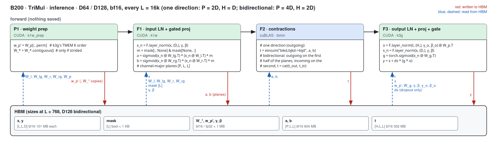

##### P1 · weight prep (k1w_prep)

| (Length, Dimension) | (128, 64) | (256, 64) | (384, 64) | (512, 64) | (640, 64) | (768, 64) | (128, 128) | (256, 128) | (384, 128) | (512, 128) | (640, 128) | (768, 128) |
|---|---|---|---|---|---|---|---|---|---|---|---|---|
| implementation | CUDA | CUDA | CUDA | CUDA | CUDA | CUDA | CUDA | CUDA | CUDA | CUDA | CUDA | CUDA |
| 성능 확인 | ✓ | ✓ | ✓ | ✓ | ✓ | ✓ | ✓ | ✓ | ✓ | ✓ | ✓ | ✓ |
| cache build | ✓ | ✓ | ✓ | ✓ | ✓ | ✓ | ✓ | ✓ | ✓ | ✓ | ✓ | ✓ |

##### F1 · input LN + gated proj (k1w)

| (Length, Dimension) | (128, 64) | (256, 64) | (384, 64) | (512, 64) | (640, 64) | (768, 64) | (128, 128) | (256, 128) | (384, 128) | (512, 128) | (640, 128) | (768, 128) |
|---|---|---|---|---|---|---|---|---|---|---|---|---|
| implementation | CUDA | CUDA | CUDA | CUDA | CUDA | CUDA | CUDA | CUDA | CUDA | CUDA | CUDA | CUDA |
| 성능 확인 | △ | △ | △ | ✓ | ✓ | ✓ | △ | △ | ✓ | ✓ | ✓ | ✓ |
| cache build | ✓ | ✓ | ✓ | ✓ | ✓ | ✓ | ✓ | ✓ | ✓ | ✓ | ✓ | ✓ |

##### F3 · output LN + proj + gate (k3g)

| (Length, Dimension) | (128, 64) | (256, 64) | (384, 64) | (512, 64) | (640, 64) | (768, 64) | (128, 128) | (256, 128) | (384, 128) | (512, 128) | (640, 128) | (768, 128) |
|---|---|---|---|---|---|---|---|---|---|---|---|---|
| implementation | CUDA | CUDA | CUDA | CUDA | CUDA | CUDA | CUDA | CUDA | CUDA | CUDA | CUDA | CUDA |
| 성능 확인 | △ | △ | △ | △ | △ | △ | △ | △ | △ | △ | △ | △ |
| cache build | ✓ | ✓ | ✓ | ✓ | ✓ | ✓ | ✓ | ✓ | ✓ | ✓ | ✓ | ✓ |

#### Wide path · D256 / D384 / D512, every L

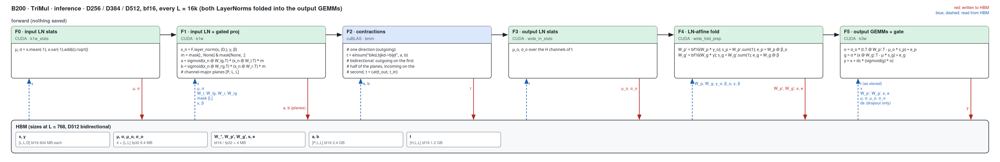

##### F0 · input LN stats (k1w_stats)

| (Length, Dimension) | (128, 256) | (256, 256) | (384, 256) | (512, 256) | (640, 256) | (768, 256) | (128, 384) | (256, 384) | (384, 384) | (512, 384) | (640, 384) | (768, 384) | (128, 512) | (256, 512) | (384, 512) | (512, 512) | (640, 512) | (768, 512) |
|---|---|---|---|---|---|---|---|---|---|---|---|---|---|---|---|---|---|---|
| implementation | CUDA | CUDA | CUDA | CUDA | CUDA | CUDA | CUDA | CUDA | CUDA | CUDA | CUDA | CUDA | CUDA | CUDA | CUDA | CUDA | CUDA | CUDA |
| 성능 확인 | △ | △ | △ | △ | △ | △ | △ | △ | △ | △ | △ | △ | △ | △ | ✓ | ✓ | ✓ | ✓ |
| cache build | ✓ | ✓ | ✓ | ✓ | ✓ | ✓ | ✓ | ✓ | ✓ | ✓ | ✓ | ✓ | ✓ | ✓ | ✓ | ✓ | ✓ | ✓ |

##### F1 · input LN + gated proj (k1w)

| (Length, Dimension) | (128, 256) | (256, 256) | (384, 256) | (512, 256) | (640, 256) | (768, 256) | (128, 384) | (256, 384) | (384, 384) | (512, 384) | (640, 384) | (768, 384) | (128, 512) | (256, 512) | (384, 512) | (512, 512) | (640, 512) | (768, 512) |
|---|---|---|---|---|---|---|---|---|---|---|---|---|---|---|---|---|---|---|
| implementation | CUDA | CUDA | CUDA | CUDA | CUDA | CUDA | CUDA | CUDA | CUDA | CUDA | CUDA | CUDA | CUDA | CUDA | CUDA | CUDA | CUDA | CUDA |
| 성능 확인 | △ | △ | ✓ | ✓ | ✓ | ✓ | △ | △ | ✓ | ✓ | ✓ | ✓ | △ | ✓ | ✓ | ✓ | ✓ | ✓ |
| cache build | ✓ | ✓ | ✓ | ✓ | ✓ | ✓ | ✓ | ✓ | ✓ | ✓ | ✓ | ✓ | ✓ | ✓ | ✓ | ✓ | ✓ | ✓ |

##### F3 · output LN stats (wide_ln_stats)

| (Length, Dimension) | (128, 256) | (256, 256) | (384, 256) | (512, 256) | (640, 256) | (768, 256) | (128, 384) | (256, 384) | (384, 384) | (512, 384) | (640, 384) | (768, 384) | (128, 512) | (256, 512) | (384, 512) | (512, 512) | (640, 512) | (768, 512) |
|---|---|---|---|---|---|---|---|---|---|---|---|---|---|---|---|---|---|---|
| implementation | CUDA | CUDA | CUDA | CUDA | CUDA | CUDA | CUDA | CUDA | CUDA | CUDA | CUDA | CUDA | CUDA | CUDA | CUDA | CUDA | CUDA | CUDA |
| 성능 확인 | △ | ✓ | ✓ | ✓ | ✓ | ✓ | △ | ✓ | ✓ | ✓ | ✓ | ✓ | △ | ✓ | ✓ | ✓ | ✓ | ✓ |
| cache build | ✓ | ✓ | ✓ | ✓ | ✓ | ✓ | ✓ | ✓ | ✓ | ✓ | ✓ | ✓ | ✓ | ✓ | ✓ | ✓ | ✓ | ✓ |

##### F4 · LN-affine fold (wide_fold_prep)

| (Length, Dimension) | (128, 256) | (256, 256) | (384, 256) | (512, 256) | (640, 256) | (768, 256) | (128, 384) | (256, 384) | (384, 384) | (512, 384) | (640, 384) | (768, 384) | (128, 512) | (256, 512) | (384, 512) | (512, 512) | (640, 512) | (768, 512) |
|---|---|---|---|---|---|---|---|---|---|---|---|---|---|---|---|---|---|---|
| implementation | CUDA | CUDA | CUDA | CUDA | CUDA | CUDA | CUDA | CUDA | CUDA | CUDA | CUDA | CUDA | CUDA | CUDA | CUDA | CUDA | CUDA | CUDA |
| 성능 확인 | ✓ | ✓ | ✓ | ✓ | ✓ | ✓ | ✓ | ✓ | ✓ | ✓ | ✓ | ✓ | ✓ | ✓ | ✓ | ✓ | ✓ | ✓ |
| cache build | ✓ | ✓ | ✓ | ✓ | ✓ | ✓ | ✓ | ✓ | ✓ | ✓ | ✓ | ✓ | ✓ | ✓ | ✓ | ✓ | ✓ | ✓ |

##### F5 · output GEMMs + gate (k3w)

| (Length, Dimension) | (128, 256) | (256, 256) | (384, 256) | (512, 256) | (640, 256) | (768, 256) | (128, 384) | (256, 384) | (384, 384) | (512, 384) | (640, 384) | (768, 384) | (128, 512) | (256, 512) | (384, 512) | (512, 512) | (640, 512) | (768, 512) |
|---|---|---|---|---|---|---|---|---|---|---|---|---|---|---|---|---|---|---|
| implementation | CUDA | CUDA | CUDA | CUDA | CUDA | CUDA | CUDA | CUDA | CUDA | CUDA | CUDA | CUDA | CUDA | CUDA | CUDA | CUDA | CUDA | CUDA |
| 성능 확인 | △ | △ | △ | △ | △ | △ | △ | △ | △ | △ | △ | △ | △ | △ | △ | △ | △ | △ |
| cache build | ✓ | ✓ | ✓ | ✓ | ✓ | ✓ | ✓ | ✓ | ✓ | ✓ | ✓ | ✓ | ✓ | ✓ | ✓ | ✓ | ✓ | ✓ |

### Training

#### Fused path · D64 / D128, L = 128 k

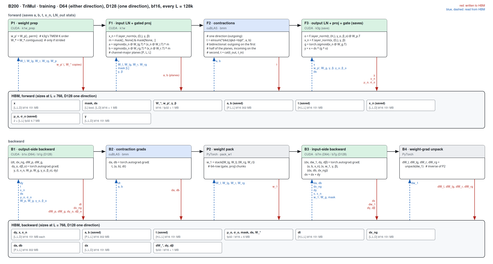

##### P1 · weight prep (k1w_prep)

| (Length, Dimension) | (128, 64) | (256, 64) | (384, 64) | (512, 64) | (640, 64) | (768, 64) | (128, 128) | (256, 128) | (384, 128) | (512, 128) | (640, 128) | (768, 128) |
|---|---|---|---|---|---|---|---|---|---|---|---|---|
| implementation | CUDA | CUDA | CUDA | CUDA | CUDA | CUDA | CUDA | CUDA | CUDA | CUDA | CUDA | CUDA |
| 성능 확인 | ✓ | ✓ | ✓ | ✓ | ✓ | ✓ | ✓ | ✓ | ✓ | ✓ | ✓ | ✓ |
| cache build | ✓ | ✓ | ✓ | ✓ | ✓ | ✓ | ✓ | ✓ | ✓ | ✓ | ✓ | ✓ |

##### F1 · input LN + gated proj (k1w)

| (Length, Dimension) | (128, 64) | (256, 64) | (384, 64) | (512, 64) | (640, 64) | (768, 64) | (128, 128) | (256, 128) | (384, 128) | (512, 128) | (640, 128) | (768, 128) |
|---|---|---|---|---|---|---|---|---|---|---|---|---|
| implementation | CUDA | CUDA | CUDA | CUDA | CUDA | CUDA | CUDA | CUDA | CUDA | CUDA | CUDA | CUDA |
| 성능 확인 | △ | △ | △ | ✓ | ✓ | ✓ | △ | △ | △ | ✓ | ✓ | ✓ |
| cache build | ✓ | ✓ | ✓ | ✓ | ✓ | ✓ | ✓ | ✓ | ✓ | ✓ | ✓ | ✓ |

##### F3 · output LN + proj + gate, saving (k3g)

| (Length, Dimension) | (128, 64) | (256, 64) | (384, 64) | (512, 64) | (640, 64) | (768, 64) | (128, 128) | (256, 128) | (384, 128) | (512, 128) | (640, 128) | (768, 128) |
|---|---|---|---|---|---|---|---|---|---|---|---|---|
| implementation | CUDA | CUDA | CUDA | CUDA | CUDA | CUDA | CUDA | CUDA | CUDA | CUDA | CUDA | CUDA |
| 성능 확인 | △ | △ | △ | △ | △ | △ | △ | △ | △ | △ | △ | △ |
| cache build | ✓ | ✓ | ✓ | ✓ | ✓ | ✓ | ✓ | ✓ | ✓ | ✓ | ✓ | ✓ |

##### B1 · output-side backward (b1s D64 / b1g D128)

| (Length, Dimension) | (128, 64) | (256, 64) | (384, 64) | (512, 64) | (640, 64) | (768, 64) | (128, 128) | (256, 128) | (384, 128) | (512, 128) | (640, 128) | (768, 128) |
|---|---|---|---|---|---|---|---|---|---|---|---|---|
| implementation | CUDA | CUDA | CUDA | CUDA | CUDA | CUDA | CUDA | CUDA | CUDA | CUDA | CUDA | CUDA |
| 성능 확인 | △ | △ | △ | △ | △ | △ | △ | △ | △ | △ | △ | △ |
| cache build | ✓ | ✓ | ✓ | ✓ | ✓ | ✓ | ✓ | ✓ | ✓ | ✓ | ✓ | ✓ |

##### B3 · input-side backward (b7m D64 / b7g D128)

| (Length, Dimension) | (128, 64) | (256, 64) | (384, 64) | (512, 64) | (640, 64) | (768, 64) | (128, 128) | (256, 128) | (384, 128) | (512, 128) | (640, 128) | (768, 128) |
|---|---|---|---|---|---|---|---|---|---|---|---|---|
| implementation | CUDA | CUDA | CUDA | CUDA | CUDA | CUDA | CUDA | CUDA | CUDA | CUDA | CUDA | CUDA |
| 성능 확인 | △ | △ | △ | △ | △ | △ | △ | △ | △ | △ | △ | △ |
| cache build | ✓ | ✓ | ✓ | ✓ | ✓ | ✓ | ✓ | ✓ | ✓ | ✓ | ✓ | ✓ |

#### Wide path · D256 / D384 / D512, every L

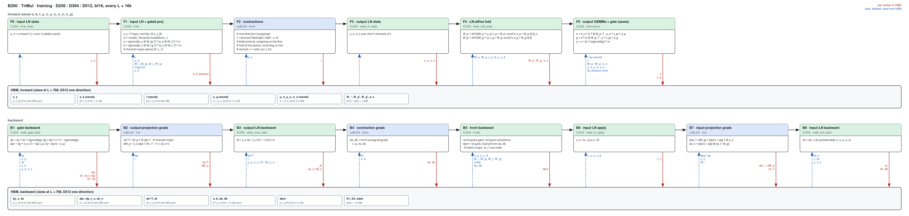

##### F0 · input LN stats (k1w_stats)

| (Length, Dimension) | (128, 256) | (256, 256) | (384, 256) | (512, 256) | (640, 256) | (768, 256) | (128, 384) | (256, 384) | (384, 384) | (512, 384) | (640, 384) | (768, 384) | (128, 512) | (256, 512) | (384, 512) | (512, 512) | (640, 512) | (768, 512) |
|---|---|---|---|---|---|---|---|---|---|---|---|---|---|---|---|---|---|---|
| implementation | CUDA | CUDA | CUDA | CUDA | CUDA | CUDA | CUDA | CUDA | CUDA | CUDA | CUDA | CUDA | CUDA | CUDA | CUDA | CUDA | CUDA | CUDA |
| 성능 확인 | △ | △ | △ | △ | △ | △ | △ | △ | △ | △ | △ | △ | △ | △ | ✓ | ✓ | ✓ | ✓ |
| cache build | ✓ | ✓ | ✓ | ✓ | ✓ | ✓ | ✓ | ✓ | ✓ | ✓ | ✓ | ✓ | ✓ | ✓ | ✓ | ✓ | ✓ | ✓ |

##### F1 · input LN + gated proj (k1w)

| (Length, Dimension) | (128, 256) | (256, 256) | (384, 256) | (512, 256) | (640, 256) | (768, 256) | (128, 384) | (256, 384) | (384, 384) | (512, 384) | (640, 384) | (768, 384) | (128, 512) | (256, 512) | (384, 512) | (512, 512) | (640, 512) | (768, 512) |
|---|---|---|---|---|---|---|---|---|---|---|---|---|---|---|---|---|---|---|
| implementation | CUDA | CUDA | CUDA | CUDA | CUDA | CUDA | CUDA | CUDA | CUDA | CUDA | CUDA | CUDA | CUDA | CUDA | CUDA | CUDA | CUDA | CUDA |
| 성능 확인 | △ | △ | ✓ | ✓ | ✓ | ✓ | △ | △ | ✓ | ✓ | ✓ | ✓ | △ | △ | ✓ | ✓ | ✓ | ✓ |
| cache build | ✓ | ✓ | ✓ | ✓ | ✓ | ✓ | ✓ | ✓ | ✓ | ✓ | ✓ | ✓ | ✓ | ✓ | ✓ | ✓ | ✓ | ✓ |

##### F3 · output LN stats (wide_ln_stats)

| (Length, Dimension) | (128, 256) | (256, 256) | (384, 256) | (512, 256) | (640, 256) | (768, 256) | (128, 384) | (256, 384) | (384, 384) | (512, 384) | (640, 384) | (768, 384) | (128, 512) | (256, 512) | (384, 512) | (512, 512) | (640, 512) | (768, 512) |
|---|---|---|---|---|---|---|---|---|---|---|---|---|---|---|---|---|---|---|
| implementation | CUDA | CUDA | CUDA | CUDA | CUDA | CUDA | CUDA | CUDA | CUDA | CUDA | CUDA | CUDA | CUDA | CUDA | CUDA | CUDA | CUDA | CUDA |
| 성능 확인 | △ | ✓ | ✓ | ✓ | ✓ | ✓ | △ | ✓ | ✓ | ✓ | ✓ | ✓ | △ | ✓ | ✓ | ✓ | ✓ | ✓ |
| cache build | ✓ | ✓ | ✓ | ✓ | ✓ | ✓ | ✓ | ✓ | ✓ | ✓ | ✓ | ✓ | ✓ | ✓ | ✓ | ✓ | ✓ | ✓ |

##### F4 · LN-affine fold (wide_fold_prep)

| (Length, Dimension) | (128, 256) | (256, 256) | (384, 256) | (512, 256) | (640, 256) | (768, 256) | (128, 384) | (256, 384) | (384, 384) | (512, 384) | (640, 384) | (768, 384) | (128, 512) | (256, 512) | (384, 512) | (512, 512) | (640, 512) | (768, 512) |
|---|---|---|---|---|---|---|---|---|---|---|---|---|---|---|---|---|---|---|
| implementation | CUDA | CUDA | CUDA | CUDA | CUDA | CUDA | CUDA | CUDA | CUDA | CUDA | CUDA | CUDA | CUDA | CUDA | CUDA | CUDA | CUDA | CUDA |
| 성능 확인 | ✓ | ✓ | ✓ | ✓ | ✓ | ✓ | ✓ | ✓ | ✓ | ✓ | ✓ | ✓ | ✓ | ✓ | ✓ | ✓ | ✓ | ✓ |
| cache build | ✓ | ✓ | ✓ | ✓ | ✓ | ✓ | ✓ | ✓ | ✓ | ✓ | ✓ | ✓ | ✓ | ✓ | ✓ | ✓ | ✓ | ✓ |

##### F5 · output GEMMs + gate, saving (k3w)

| (Length, Dimension) | (128, 256) | (256, 256) | (384, 256) | (512, 256) | (640, 256) | (768, 256) | (128, 384) | (256, 384) | (384, 384) | (512, 384) | (640, 384) | (768, 384) | (128, 512) | (256, 512) | (384, 512) | (512, 512) | (640, 512) | (768, 512) |
|---|---|---|---|---|---|---|---|---|---|---|---|---|---|---|---|---|---|---|
| implementation | CUDA | CUDA | CUDA | CUDA | CUDA | CUDA | CUDA | CUDA | CUDA | CUDA | CUDA | CUDA | CUDA | CUDA | CUDA | CUDA | CUDA | CUDA |
| 성능 확인 | △ | △ | △ | △ | △ | △ | △ | △ | △ | △ | △ | △ | △ | △ | △ | △ | △ | △ |
| cache build | ✓ | ✓ | ✓ | ✓ | ✓ | ✓ | ✓ | ✓ | ✓ | ✓ | ✓ | ✓ | ✓ | ✓ | ✓ | ✓ | ✓ | ✓ |

##### B1 · gate backward (wide_gate_bwd)

| (Length, Dimension) | (128, 256) | (256, 256) | (384, 256) | (512, 256) | (640, 256) | (768, 256) | (128, 384) | (256, 384) | (384, 384) | (512, 384) | (640, 384) | (768, 384) | (128, 512) | (256, 512) | (384, 512) | (512, 512) | (640, 512) | (768, 512) |
|---|---|---|---|---|---|---|---|---|---|---|---|---|---|---|---|---|---|---|
| implementation | CUDA | CUDA | CUDA | CUDA | CUDA | CUDA | CUDA | CUDA | CUDA | CUDA | CUDA | CUDA | CUDA | CUDA | CUDA | CUDA | CUDA | CUDA |
| 성능 확인 | △ | △ | △ | △ | △ | △ | △ | △ | △ | △ | △ | △ | △ | △ | △ | △ | △ | △ |
| cache build | ✓ | ✓ | ✓ | ✓ | ✓ | ✓ | ✓ | ✓ | ✓ | ✓ | ✓ | ✓ | ✓ | ✓ | ✓ | ✓ | ✓ | ✓ |

##### B3 · output-LN backward (wide_lnout_bwd)

| (Length, Dimension) | (128, 256) | (256, 256) | (384, 256) | (512, 256) | (640, 256) | (768, 256) | (128, 384) | (256, 384) | (384, 384) | (512, 384) | (640, 384) | (768, 384) | (128, 512) | (256, 512) | (384, 512) | (512, 512) | (640, 512) | (768, 512) |
|---|---|---|---|---|---|---|---|---|---|---|---|---|---|---|---|---|---|---|
| implementation | CUDA | CUDA | CUDA | CUDA | CUDA | CUDA | CUDA | CUDA | CUDA | CUDA | CUDA | CUDA | CUDA | CUDA | CUDA | CUDA | CUDA | CUDA |
| 성능 확인 | △ | △ | △ | △ | △ | △ | △ | △ | △ | △ | △ | △ | △ | △ | △ | △ | △ | △ |
| cache build | ✓ | ✓ | ✓ | ✓ | ✓ | ✓ | ✓ | ✓ | ✓ | ✓ | ✓ | ✓ | ✓ | ✓ | ✓ | ✓ | ✓ | ✓ |

##### B5 · front backward (k1wb)

| (Length, Dimension) | (128, 256) | (256, 256) | (384, 256) | (512, 256) | (640, 256) | (768, 256) | (128, 384) | (256, 384) | (384, 384) | (512, 384) | (640, 384) | (768, 384) | (128, 512) | (256, 512) | (384, 512) | (512, 512) | (640, 512) | (768, 512) |
|---|---|---|---|---|---|---|---|---|---|---|---|---|---|---|---|---|---|---|
| implementation | CUDA | CUDA | CUDA | CUDA | CUDA | CUDA | CUDA | CUDA | CUDA | CUDA | CUDA | CUDA | CUDA | CUDA | CUDA | CUDA | CUDA | CUDA |
| 성능 확인 | △ | △ | △ | △ | △ | △ | △ | △ | △ | △ | △ | △ | △ | △ | △ | △ | △ | △ |
| cache build | ✓ | ✓ | ✓ | ✓ | ✓ | ✓ | ✓ | ✓ | ✓ | ✓ | ✓ | ✓ | ✓ | ✓ | ✓ | ✓ | ✓ | ✓ |

##### B6 · input LN apply (wide_ln_apply)

| (Length, Dimension) | (128, 256) | (256, 256) | (384, 256) | (512, 256) | (640, 256) | (768, 256) | (128, 384) | (256, 384) | (384, 384) | (512, 384) | (640, 384) | (768, 384) | (128, 512) | (256, 512) | (384, 512) | (512, 512) | (640, 512) | (768, 512) |
|---|---|---|---|---|---|---|---|---|---|---|---|---|---|---|---|---|---|---|
| implementation | CUDA | CUDA | CUDA | CUDA | CUDA | CUDA | CUDA | CUDA | CUDA | CUDA | CUDA | CUDA | CUDA | CUDA | CUDA | CUDA | CUDA | CUDA |
| 성능 확인 | △ | △ | ✓ | ✓ | ✓ | ✓ | △ | ✓ | ✓ | ✓ | ✓ | ✓ | △ | ✓ | ✓ | ✓ | ✓ | ✓ |
| cache build | ✓ | ✓ | ✓ | ✓ | ✓ | ✓ | ✓ | ✓ | ✓ | ✓ | ✓ | ✓ | ✓ | ✓ | ✓ | ✓ | ✓ | ✓ |

##### B8 · input-LN backward (wide_lnin_bwd)

| (Length, Dimension) | (128, 256) | (256, 256) | (384, 256) | (512, 256) | (640, 256) | (768, 256) | (128, 384) | (256, 384) | (384, 384) | (512, 384) | (640, 384) | (768, 384) | (128, 512) | (256, 512) | (384, 512) | (512, 512) | (640, 512) | (768, 512) |
|---|---|---|---|---|---|---|---|---|---|---|---|---|---|---|---|---|---|---|
| implementation | CUDA | CUDA | CUDA | CUDA | CUDA | CUDA | CUDA | CUDA | CUDA | CUDA | CUDA | CUDA | CUDA | CUDA | CUDA | CUDA | CUDA | CUDA |
| 성능 확인 | △ | △ | ✓ | ✓ | ✓ | ✓ | △ | △ | △ | △ | △ | △ | △ | △ | ✓ | ✓ | ✓ | ✓ |
| cache build | ✓ | ✓ | ✓ | ✓ | ✓ | ✓ | ✓ | ✓ | ✓ | ✓ | ✓ | ✓ | ✓ | ✓ | ✓ | ✓ | ✓ | ✓ |

## Single direction (`TriangleMultiplication`)

Outgoing and incoming run the same kernels (the contraction's operand order differs); the tables
cover both.

### Inference

#### Fused path · D64 / D128, every L

##### P1 · weight prep (k1w_prep)

| (Length, Dimension) | (128, 64) | (256, 64) | (384, 64) | (512, 64) | (640, 64) | (768, 64) | (128, 128) | (256, 128) | (384, 128) | (512, 128) | (640, 128) | (768, 128) |
|---|---|---|---|---|---|---|---|---|---|---|---|---|
| implementation | CUDA | CUDA | CUDA | CUDA | CUDA | CUDA | CUDA | CUDA | CUDA | CUDA | CUDA | CUDA |
| 성능 확인 | ✓ | ✓ | ✓ | ✓ | ✓ | ✓ | ✓ | ✓ | ✓ | ✓ | ✓ | ✓ |
| cache build | ✓ | ✓ | ✓ | ✓ | ✓ | ✓ | ✓ | ✓ | ✓ | ✓ | ✓ | ✓ |

##### F1 · input LN + gated proj (k1w)

| (Length, Dimension) | (128, 64) | (256, 64) | (384, 64) | (512, 64) | (640, 64) | (768, 64) | (128, 128) | (256, 128) | (384, 128) | (512, 128) | (640, 128) | (768, 128) |
|---|---|---|---|---|---|---|---|---|---|---|---|---|
| implementation | CUDA | CUDA | CUDA | CUDA | CUDA | CUDA | CUDA | CUDA | CUDA | CUDA | CUDA | CUDA |
| 성능 확인 | △ | △ | △ | △ | ✓ | ✓ | △ | △ | △ | ✓ | ✓ | ✓ |
| cache build | ✓ | ✓ | ✓ | ✓ | ✓ | ✓ | ✓ | ✓ | ✓ | ✓ | ✓ | ✓ |

##### F3 · output LN + proj + gate (k3g)

| (Length, Dimension) | (128, 64) | (256, 64) | (384, 64) | (512, 64) | (640, 64) | (768, 64) | (128, 128) | (256, 128) | (384, 128) | (512, 128) | (640, 128) | (768, 128) |
|---|---|---|---|---|---|---|---|---|---|---|---|---|
| implementation | CUDA | CUDA | CUDA | CUDA | CUDA | CUDA | CUDA | CUDA | CUDA | CUDA | CUDA | CUDA |
| 성능 확인 | △ | △ | △ | △ | △ | △ | △ | △ | △ | △ | △ | △ |
| cache build | ✓ | ✓ | ✓ | ✓ | ✓ | ✓ | ✓ | ✓ | ✓ | ✓ | ✓ | ✓ |

#### Wide path · D256 / D384 / D512, every L

D512 is not a registered single-direction shape; the path serves it anyway.

##### F0 · input LN stats (k1w_stats)

| (Length, Dimension) | (128, 256) | (256, 256) | (384, 256) | (512, 256) | (640, 256) | (768, 256) | (128, 384) | (256, 384) | (384, 384) | (512, 384) | (640, 384) | (768, 384) | (128, 512) | (256, 512) | (384, 512) | (512, 512) | (640, 512) | (768, 512) |
|---|---|---|---|---|---|---|---|---|---|---|---|---|---|---|---|---|---|---|
| implementation | CUDA | CUDA | CUDA | CUDA | CUDA | CUDA | CUDA | CUDA | CUDA | CUDA | CUDA | CUDA | CUDA | CUDA | CUDA | CUDA | CUDA | CUDA |
| 성능 확인 | △ | △ | △ | △ | △ | △ | △ | △ | △ | △ | △ | △ | △ | △ | ✓ | ✓ | ✓ | ✓ |
| cache build | ✓ | ✓ | ✓ | ✓ | ✓ | ✓ | ✓ | ✓ | ✓ | ✓ | ✓ | ✓ | ✓ | ✓ | ✓ | ✓ | ✓ | ✓ |

##### F1 · input LN + gated proj (k1w)

| (Length, Dimension) | (128, 256) | (256, 256) | (384, 256) | (512, 256) | (640, 256) | (768, 256) | (128, 384) | (256, 384) | (384, 384) | (512, 384) | (640, 384) | (768, 384) | (128, 512) | (256, 512) | (384, 512) | (512, 512) | (640, 512) | (768, 512) |
|---|---|---|---|---|---|---|---|---|---|---|---|---|---|---|---|---|---|---|
| implementation | CUDA | CUDA | CUDA | CUDA | CUDA | CUDA | CUDA | CUDA | CUDA | CUDA | CUDA | CUDA | CUDA | CUDA | CUDA | CUDA | CUDA | CUDA |
| 성능 확인 | △ | △ | △ | ✓ | ✓ | △ | △ | △ | △ | ✓ | ✓ | △ | △ | △ | ✓ | ✓ | ✓ | ✓ |
| cache build | ✓ | ✓ | ✓ | ✓ | ✓ | ✓ | ✓ | ✓ | ✓ | ✓ | ✓ | ✓ | ✓ | ✓ | ✓ | ✓ | ✓ | ✓ |

##### F3 · output LN stats (wide_ln_stats)

| (Length, Dimension) | (128, 256) | (256, 256) | (384, 256) | (512, 256) | (640, 256) | (768, 256) | (128, 384) | (256, 384) | (384, 384) | (512, 384) | (640, 384) | (768, 384) | (128, 512) | (256, 512) | (384, 512) | (512, 512) | (640, 512) | (768, 512) |
|---|---|---|---|---|---|---|---|---|---|---|---|---|---|---|---|---|---|---|
| implementation | CUDA | CUDA | CUDA | CUDA | CUDA | CUDA | CUDA | CUDA | CUDA | CUDA | CUDA | CUDA | CUDA | CUDA | CUDA | CUDA | CUDA | CUDA |
| 성능 확인 | △ | ✓ | ✓ | ✓ | ✓ | ✓ | △ | ✓ | ✓ | ✓ | ✓ | ✓ | △ | ✓ | ✓ | ✓ | ✓ | ✓ |
| cache build | ✓ | ✓ | ✓ | ✓ | ✓ | ✓ | ✓ | ✓ | ✓ | ✓ | ✓ | ✓ | ✓ | ✓ | ✓ | ✓ | ✓ | ✓ |

##### F4 · LN-affine fold (wide_fold_prep)

| (Length, Dimension) | (128, 256) | (256, 256) | (384, 256) | (512, 256) | (640, 256) | (768, 256) | (128, 384) | (256, 384) | (384, 384) | (512, 384) | (640, 384) | (768, 384) | (128, 512) | (256, 512) | (384, 512) | (512, 512) | (640, 512) | (768, 512) |
|---|---|---|---|---|---|---|---|---|---|---|---|---|---|---|---|---|---|---|
| implementation | CUDA | CUDA | CUDA | CUDA | CUDA | CUDA | CUDA | CUDA | CUDA | CUDA | CUDA | CUDA | CUDA | CUDA | CUDA | CUDA | CUDA | CUDA |
| 성능 확인 | ✓ | ✓ | ✓ | ✓ | ✓ | ✓ | ✓ | ✓ | ✓ | ✓ | ✓ | ✓ | ✓ | ✓ | ✓ | ✓ | ✓ | ✓ |
| cache build | ✓ | ✓ | ✓ | ✓ | ✓ | ✓ | ✓ | ✓ | ✓ | ✓ | ✓ | ✓ | ✓ | ✓ | ✓ | ✓ | ✓ | ✓ |

##### F5 · output GEMMs + gate (k3w)

| (Length, Dimension) | (128, 256) | (256, 256) | (384, 256) | (512, 256) | (640, 256) | (768, 256) | (128, 384) | (256, 384) | (384, 384) | (512, 384) | (640, 384) | (768, 384) | (128, 512) | (256, 512) | (384, 512) | (512, 512) | (640, 512) | (768, 512) |
|---|---|---|---|---|---|---|---|---|---|---|---|---|---|---|---|---|---|---|
| implementation | CUDA | CUDA | CUDA | CUDA | CUDA | CUDA | CUDA | CUDA | CUDA | CUDA | CUDA | CUDA | CUDA | CUDA | CUDA | CUDA | CUDA | CUDA |
| 성능 확인 | △ | △ | △ | △ | △ | △ | △ | △ | △ | △ | △ | △ | △ | △ | △ | △ | △ | △ |
| cache build | ✓ | ✓ | ✓ | ✓ | ✓ | ✓ | ✓ | ✓ | ✓ | ✓ | ✓ | ✓ | ✓ | ✓ | ✓ | ✓ | ✓ | ✓ |

### Training

#### Fused path · D64 / D128, L = 128 k

##### P1 · weight prep (k1w_prep)

| (Length, Dimension) | (128, 64) | (256, 64) | (384, 64) | (512, 64) | (640, 64) | (768, 64) | (128, 128) | (256, 128) | (384, 128) | (512, 128) | (640, 128) | (768, 128) |
|---|---|---|---|---|---|---|---|---|---|---|---|---|
| implementation | CUDA | CUDA | CUDA | CUDA | CUDA | CUDA | CUDA | CUDA | CUDA | CUDA | CUDA | CUDA |
| 성능 확인 | ✓ | ✓ | ✓ | ✓ | ✓ | ✓ | ✓ | ✓ | ✓ | ✓ | ✓ | ✓ |
| cache build | ✓ | ✓ | ✓ | ✓ | ✓ | ✓ | ✓ | ✓ | ✓ | ✓ | ✓ | ✓ |

##### F1 · input LN + gated proj (k1w)

| (Length, Dimension) | (128, 64) | (256, 64) | (384, 64) | (512, 64) | (640, 64) | (768, 64) | (128, 128) | (256, 128) | (384, 128) | (512, 128) | (640, 128) | (768, 128) |
|---|---|---|---|---|---|---|---|---|---|---|---|---|
| implementation | CUDA | CUDA | CUDA | CUDA | CUDA | CUDA | CUDA | CUDA | CUDA | CUDA | CUDA | CUDA |
| 성능 확인 | △ | △ | △ | △ | ✓ | ✓ | △ | △ | △ | ✓ | ✓ | ✓ |
| cache build | ✓ | ✓ | ✓ | ✓ | ✓ | ✓ | ✓ | ✓ | ✓ | ✓ | ✓ | ✓ |

##### F3 · output LN + proj + gate, saving (k3g)

| (Length, Dimension) | (128, 64) | (256, 64) | (384, 64) | (512, 64) | (640, 64) | (768, 64) | (128, 128) | (256, 128) | (384, 128) | (512, 128) | (640, 128) | (768, 128) |
|---|---|---|---|---|---|---|---|---|---|---|---|---|
| implementation | CUDA | CUDA | CUDA | CUDA | CUDA | CUDA | CUDA | CUDA | CUDA | CUDA | CUDA | CUDA |
| 성능 확인 | △ | △ | △ | △ | △ | △ | △ | △ | △ | △ | △ | △ |
| cache build | ✓ | ✓ | ✓ | ✓ | ✓ | ✓ | ✓ | ✓ | ✓ | ✓ | ✓ | ✓ |

##### B1 · output-side backward (b1s D64 / b1g D128)

| (Length, Dimension) | (128, 64) | (256, 64) | (384, 64) | (512, 64) | (640, 64) | (768, 64) | (128, 128) | (256, 128) | (384, 128) | (512, 128) | (640, 128) | (768, 128) |
|---|---|---|---|---|---|---|---|---|---|---|---|---|
| implementation | CUDA | CUDA | CUDA | CUDA | CUDA | CUDA | CUDA | CUDA | CUDA | CUDA | CUDA | CUDA |
| 성능 확인 | △ | △ | △ | △ | △ | △ | △ | △ | △ | △ | △ | △ |
| cache build | ✓ | ✓ | ✓ | ✓ | ✓ | ✓ | ✓ | ✓ | ✓ | ✓ | ✓ | ✓ |

##### B3 · input-side backward (b7m D64 / b7g D128)

| (Length, Dimension) | (128, 64) | (256, 64) | (384, 64) | (512, 64) | (640, 64) | (768, 64) | (128, 128) | (256, 128) | (384, 128) | (512, 128) | (640, 128) | (768, 128) |
|---|---|---|---|---|---|---|---|---|---|---|---|---|
| implementation | CUDA | CUDA | CUDA | CUDA | CUDA | CUDA | CUDA | CUDA | CUDA | CUDA | CUDA | CUDA |
| 성능 확인 | △ | △ | △ | △ | △ | △ | △ | △ | △ | △ | △ | △ |
| cache build | ✓ | ✓ | ✓ | ✓ | ✓ | ✓ | ✓ | ✓ | ✓ | ✓ | ✓ | ✓ |

#### Wide path · D256 / D384 / D512, every L

##### F0 · input LN stats (k1w_stats)

| (Length, Dimension) | (128, 256) | (256, 256) | (384, 256) | (512, 256) | (640, 256) | (768, 256) | (128, 384) | (256, 384) | (384, 384) | (512, 384) | (640, 384) | (768, 384) | (128, 512) | (256, 512) | (384, 512) | (512, 512) | (640, 512) | (768, 512) |
|---|---|---|---|---|---|---|---|---|---|---|---|---|---|---|---|---|---|---|
| implementation | CUDA | CUDA | CUDA | CUDA | CUDA | CUDA | CUDA | CUDA | CUDA | CUDA | CUDA | CUDA | CUDA | CUDA | CUDA | CUDA | CUDA | CUDA |
| 성능 확인 | △ | △ | △ | △ | △ | △ | △ | △ | △ | △ | △ | △ | △ | △ | ✓ | ✓ | ✓ | ✓ |
| cache build | ✓ | ✓ | ✓ | ✓ | ✓ | ✓ | ✓ | ✓ | ✓ | ✓ | ✓ | ✓ | ✓ | ✓ | ✓ | ✓ | ✓ | ✓ |

##### F1 · input LN + gated proj (k1w)

| (Length, Dimension) | (128, 256) | (256, 256) | (384, 256) | (512, 256) | (640, 256) | (768, 256) | (128, 384) | (256, 384) | (384, 384) | (512, 384) | (640, 384) | (768, 384) | (128, 512) | (256, 512) | (384, 512) | (512, 512) | (640, 512) | (768, 512) |
|---|---|---|---|---|---|---|---|---|---|---|---|---|---|---|---|---|---|---|
| implementation | CUDA | CUDA | CUDA | CUDA | CUDA | CUDA | CUDA | CUDA | CUDA | CUDA | CUDA | CUDA | CUDA | CUDA | CUDA | CUDA | CUDA | CUDA |
| 성능 확인 | △ | △ | △ | △ | △ | △ | △ | △ | △ | △ | △ | △ | △ | △ | ✓ | ✓ | ✓ | ✓ |
| cache build | ✓ | ✓ | ✓ | ✓ | ✓ | ✓ | ✓ | ✓ | ✓ | ✓ | ✓ | ✓ | ✓ | ✓ | ✓ | ✓ | ✓ | ✓ |

##### F3 · output LN stats (wide_ln_stats)

| (Length, Dimension) | (128, 256) | (256, 256) | (384, 256) | (512, 256) | (640, 256) | (768, 256) | (128, 384) | (256, 384) | (384, 384) | (512, 384) | (640, 384) | (768, 384) | (128, 512) | (256, 512) | (384, 512) | (512, 512) | (640, 512) | (768, 512) |
|---|---|---|---|---|---|---|---|---|---|---|---|---|---|---|---|---|---|---|
| implementation | CUDA | CUDA | CUDA | CUDA | CUDA | CUDA | CUDA | CUDA | CUDA | CUDA | CUDA | CUDA | CUDA | CUDA | CUDA | CUDA | CUDA | CUDA |
| 성능 확인 | △ | ✓ | ✓ | ✓ | ✓ | ✓ | △ | ✓ | ✓ | ✓ | ✓ | ✓ | △ | ✓ | ✓ | ✓ | ✓ | ✓ |
| cache build | ✓ | ✓ | ✓ | ✓ | ✓ | ✓ | ✓ | ✓ | ✓ | ✓ | ✓ | ✓ | ✓ | ✓ | ✓ | ✓ | ✓ | ✓ |

##### F4 · LN-affine fold (wide_fold_prep)

| (Length, Dimension) | (128, 256) | (256, 256) | (384, 256) | (512, 256) | (640, 256) | (768, 256) | (128, 384) | (256, 384) | (384, 384) | (512, 384) | (640, 384) | (768, 384) | (128, 512) | (256, 512) | (384, 512) | (512, 512) | (640, 512) | (768, 512) |
|---|---|---|---|---|---|---|---|---|---|---|---|---|---|---|---|---|---|---|
| implementation | CUDA | CUDA | CUDA | CUDA | CUDA | CUDA | CUDA | CUDA | CUDA | CUDA | CUDA | CUDA | CUDA | CUDA | CUDA | CUDA | CUDA | CUDA |
| 성능 확인 | ✓ | ✓ | ✓ | ✓ | ✓ | ✓ | ✓ | ✓ | ✓ | ✓ | ✓ | ✓ | ✓ | ✓ | ✓ | ✓ | ✓ | ✓ |
| cache build | ✓ | ✓ | ✓ | ✓ | ✓ | ✓ | ✓ | ✓ | ✓ | ✓ | ✓ | ✓ | ✓ | ✓ | ✓ | ✓ | ✓ | ✓ |

##### F5 · output GEMMs + gate, saving (k3w)

| (Length, Dimension) | (128, 256) | (256, 256) | (384, 256) | (512, 256) | (640, 256) | (768, 256) | (128, 384) | (256, 384) | (384, 384) | (512, 384) | (640, 384) | (768, 384) | (128, 512) | (256, 512) | (384, 512) | (512, 512) | (640, 512) | (768, 512) |
|---|---|---|---|---|---|---|---|---|---|---|---|---|---|---|---|---|---|---|
| implementation | CUDA | CUDA | CUDA | CUDA | CUDA | CUDA | CUDA | CUDA | CUDA | CUDA | CUDA | CUDA | CUDA | CUDA | CUDA | CUDA | CUDA | CUDA |
| 성능 확인 | △ | △ | △ | △ | △ | △ | △ | △ | △ | △ | △ | △ | △ | △ | △ | △ | △ | △ |
| cache build | ✓ | ✓ | ✓ | ✓ | ✓ | ✓ | ✓ | ✓ | ✓ | ✓ | ✓ | ✓ | ✓ | ✓ | ✓ | ✓ | ✓ | ✓ |

##### B1 · gate backward (wide_gate_bwd)

| (Length, Dimension) | (128, 256) | (256, 256) | (384, 256) | (512, 256) | (640, 256) | (768, 256) | (128, 384) | (256, 384) | (384, 384) | (512, 384) | (640, 384) | (768, 384) | (128, 512) | (256, 512) | (384, 512) | (512, 512) | (640, 512) | (768, 512) |
|---|---|---|---|---|---|---|---|---|---|---|---|---|---|---|---|---|---|---|
| implementation | CUDA | CUDA | CUDA | CUDA | CUDA | CUDA | CUDA | CUDA | CUDA | CUDA | CUDA | CUDA | CUDA | CUDA | CUDA | CUDA | CUDA | CUDA |
| 성능 확인 | △ | △ | △ | △ | △ | △ | △ | △ | △ | △ | △ | △ | △ | △ | △ | △ | △ | △ |
| cache build | ✓ | ✓ | ✓ | ✓ | ✓ | ✓ | ✓ | ✓ | ✓ | ✓ | ✓ | ✓ | ✓ | ✓ | ✓ | ✓ | ✓ | ✓ |

##### B3 · output-LN backward (wide_lnout_bwd)

| (Length, Dimension) | (128, 256) | (256, 256) | (384, 256) | (512, 256) | (640, 256) | (768, 256) | (128, 384) | (256, 384) | (384, 384) | (512, 384) | (640, 384) | (768, 384) | (128, 512) | (256, 512) | (384, 512) | (512, 512) | (640, 512) | (768, 512) |
|---|---|---|---|---|---|---|---|---|---|---|---|---|---|---|---|---|---|---|
| implementation | CUDA | CUDA | CUDA | CUDA | CUDA | CUDA | CUDA | CUDA | CUDA | CUDA | CUDA | CUDA | CUDA | CUDA | CUDA | CUDA | CUDA | CUDA |
| 성능 확인 | △ | △ | △ | △ | △ | △ | △ | △ | △ | △ | △ | △ | △ | △ | △ | △ | △ | △ |
| cache build | ✓ | ✓ | ✓ | ✓ | ✓ | ✓ | ✓ | ✓ | ✓ | ✓ | ✓ | ✓ | ✓ | ✓ | ✓ | ✓ | ✓ | ✓ |

##### B5 · front backward (k1wb)

| (Length, Dimension) | (128, 256) | (256, 256) | (384, 256) | (512, 256) | (640, 256) | (768, 256) | (128, 384) | (256, 384) | (384, 384) | (512, 384) | (640, 384) | (768, 384) | (128, 512) | (256, 512) | (384, 512) | (512, 512) | (640, 512) | (768, 512) |
|---|---|---|---|---|---|---|---|---|---|---|---|---|---|---|---|---|---|---|
| implementation | CUDA | CUDA | CUDA | CUDA | CUDA | CUDA | CUDA | CUDA | CUDA | CUDA | CUDA | CUDA | CUDA | CUDA | CUDA | CUDA | CUDA | CUDA |
| 성능 확인 | △ | △ | △ | △ | △ | △ | △ | △ | △ | △ | △ | △ | △ | △ | △ | △ | △ | △ |
| cache build | ✓ | ✓ | ✓ | ✓ | ✓ | ✓ | ✓ | ✓ | ✓ | ✓ | ✓ | ✓ | ✓ | ✓ | ✓ | ✓ | ✓ | ✓ |

##### B6 · input LN apply (wide_ln_apply)

| (Length, Dimension) | (128, 256) | (256, 256) | (384, 256) | (512, 256) | (640, 256) | (768, 256) | (128, 384) | (256, 384) | (384, 384) | (512, 384) | (640, 384) | (768, 384) | (128, 512) | (256, 512) | (384, 512) | (512, 512) | (640, 512) | (768, 512) |
|---|---|---|---|---|---|---|---|---|---|---|---|---|---|---|---|---|---|---|
| implementation | CUDA | CUDA | CUDA | CUDA | CUDA | CUDA | CUDA | CUDA | CUDA | CUDA | CUDA | CUDA | CUDA | CUDA | CUDA | CUDA | CUDA | CUDA |
| 성능 확인 | △ | ✓ | ✓ | ✓ | ✓ | ✓ | △ | ✓ | ✓ | ✓ | ✓ | ✓ | △ | ✓ | ✓ | ✓ | ✓ | ✓ |
| cache build | ✓ | ✓ | ✓ | ✓ | ✓ | ✓ | ✓ | ✓ | ✓ | ✓ | ✓ | ✓ | ✓ | ✓ | ✓ | ✓ | ✓ | ✓ |

##### B8 · input-LN backward (wide_lnin_bwd)

| (Length, Dimension) | (128, 256) | (256, 256) | (384, 256) | (512, 256) | (640, 256) | (768, 256) | (128, 384) | (256, 384) | (384, 384) | (512, 384) | (640, 384) | (768, 384) | (128, 512) | (256, 512) | (384, 512) | (512, 512) | (640, 512) | (768, 512) |
|---|---|---|---|---|---|---|---|---|---|---|---|---|---|---|---|---|---|---|
| implementation | CUDA | CUDA | CUDA | CUDA | CUDA | CUDA | CUDA | CUDA | CUDA | CUDA | CUDA | CUDA | CUDA | CUDA | CUDA | CUDA | CUDA | CUDA |
| 성능 확인 | △ | △ | ✓ | ✓ | ✓ | ✓ | △ | △ | △ | △ | △ | △ | △ | △ | ✓ | ✓ | ✓ | ✓ |
| cache build | ✓ | ✓ | ✓ | ✓ | ✓ | ✓ | ✓ | ✓ | ✓ | ✓ | ✓ | ✓ | ✓ | ✓ | ✓ | ✓ | ✓ | ✓ |

## Measurements

2026-09-29. Re-measured 2026-09-30: the D128 bidirectional training rows (its training moved to the shared D64 / D128
kernels) and both inference tables, all four implementations in one harness run per width. Re-verified 2026-10-10 (below).

- Setup: B200 (148 SMs), torch 2.13.0+cu129, triton 3.7.1, cuEquivariance 0.12.0, sm_100a kernels built by nvcc 13.1, B = 1, bf16-mixed (the module's
  LayerNorm parameters stay fp32).
- Harness: `benchmarks/runners/bench.py target=<module> level=module mode=<inference|training> d_pair=<D>
  min_seq_len=128 max_seq_len=768 seq_len_step=128`; compiled, inference in a CUDA graph, training with and without one.
- Tables: latency in ms (median); × = ours against the fastest of the others. Single direction = outgoing (incoming
  runs the same kernels).
- Anthropic: the harness's `anthropic` row -- Anthropic's trimul_native v5 from its unmodified sources. No binary for sm_100
  ships with the release, so the payload named by `ANTHROPIC_TRIMUL_BUILD_DIR` carries the release's sm_80 member built for
  sm_100a (`miniworld-engine dev build-anthropic-sm100a`, [anthropic-trimul-payload.md](../../../kernels/anthropic-trimul-payload.md#b200-sm_100)).
  Served where the release has a unit: one direction D64-D384, bidirectional D64 / D128 (one unit at twice the hidden width);
  bidirectional D256+ and D512 have none (—). Forward-only, so the training tables have no Anthropic column (—).
- Accuracy against the harness's fp32 reference, max over every row: inference output rel. Frobenius 3.8e-3
  (PyTorch compiled 4.1e-3, cuEquivariance 3.8e-3, Anthropic 3.8e-3); training output 4.0e-3, gradients 5.4e-3 (PyTorch compiled
  4.3e-3 / 5.4e-3, cuEquivariance 4.0e-3 / 5.5e-3).
- Re-verification (2026-10-10, engine v2.2.0 plus unreleased changes, the setup above with the kernels built by nvcc 13.1, driver 580.95.05, one GPU with no other process on it): every cell of the CUDA-graph inference and training tables of both modules (360 cells) was re-measured through the harness command above, one run per width and mode; a cell that moved by more than 8 % against the table was repeated (once, twice if still beyond 8 %) and the median of the runs is reported. Median change 0.5 % (2.0 % for ours), 90th percentile 3.3 %; one cell was replaced ((640, 512) bidirectional inference, 2.608 -> 2.896 ms). The no-CUDA-graph training tables are host-bound (their cells move by 20-60 % between runs with the load on the host) and keep their 2026-09-30 values. **2026-10-11:** every CUDA-graph cell of these tables was re-measured with fp32 master parameters (`precision=bf16-mixed`, the harness default since that date: fp32 parameters over bf16 activations under `torch.autocast`; one run per cell, `parameter_dtype` = float32 in the CSV, the engine environment's python called directly); the cells above are those values. The no-CUDA-graph training tables are host-bound and keep their earlier values (bf16 parameters).
- Charts: under each table, a length sweep at D128 and a dimension sweep at L384, drawn from the table
  (`python -m miniworld_engine.viz.measure_bars docs/gpus/b200/trimul/trimul.md`).

### Bidirectional · Inference (CUDA graph)

| (Length, Dimension) | PyTorch compiled | cuEquivariance | Anthropic | ours | × |
|---|---|---|---|---|---|
| (128, 64) | 0.076 | 0.049 | 0.031 | 0.027 | 1.15 |
| (256, 64) | 0.182 | 0.104 | 0.061 | 0.047 | 1.30 |
| (384, 64) | 0.338 | 0.203 | 0.117 | 0.078 | 1.50 |
| (512, 64) | 0.633 | 0.344 | 0.201 | 0.125 | 1.61 |
| (640, 64) | 0.986 | 0.534 | 0.313 | 0.195 | 1.61 |
| (768, 64) | 1.632 | 0.741 | 0.424 | 0.276 | 1.54 |
| (128, 128) | 0.111 | 0.070 | 0.068 | 0.039 | 1.74 |
| (256, 128) | 0.297 | 0.193 | 0.158 | 0.078 | 2.03 |
| (384, 128) | 0.698 | 0.408 | 0.307 | 0.143 | 2.15 |
| (512, 128) | 1.090 | 0.685 | 0.517 | 0.247 | 2.09 |
| (640, 128) | 1.795 | 1.133 | 0.823 | 0.387 | 2.13 |
| (768, 128) | 2.960 | 1.590 | 1.145 | 0.549 | 2.09 |
| (128, 256) | 0.182 | 0.125 | — | 0.059 | 2.12 |
| (256, 256) | 0.628 | 0.416 | — | 0.164 | 2.54 |
| (384, 256) | 1.237 | 0.889 | — | 0.337 | 2.64 |
| (512, 256) | 2.163 | 1.645 | — | 0.622 | 2.64 |
| (640, 256) | 3.849 | 2.612 | — | 1.051 | 2.49 |
| (768, 256) | 6.433 | 3.694 | — | 1.413 | 2.61 |
| (128, 384) | 0.270 | 0.207 | — | 0.086 | 2.41 |
| (256, 384) | 0.970 | 0.735 | — | 0.280 | 2.62 |
| (384, 384) | 2.043 | 1.780 | — | 0.567 | 3.14 |
| (512, 384) | 3.852 | 3.092 | — | 1.025 | 3.02 |
| (640, 384) | 6.693 | 5.303 | — | 1.787 | 2.97 |
| (768, 384) | 11.275 | 7.442 | — | 2.508 | 2.97 |
| (128, 512) | 0.354 | 0.305 | — | 0.121 | 2.52 |
| (256, 512) | 1.181 | 1.106 | — | 0.430 | 2.57 |
| (384, 512) | 2.909 | 2.884 | — | 0.964 | 2.99 |
| (512, 512) | 5.619 | 5.165 | — | 1.707 | 3.03 |
| (640, 512) | 9.446 | 8.118 | — | 2.813 | 2.89 |
| (768, 512) | 15.450 | 11.816 | — | 4.255 | 2.78 |

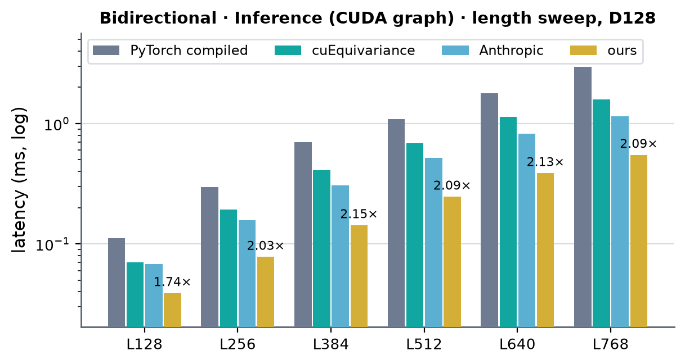 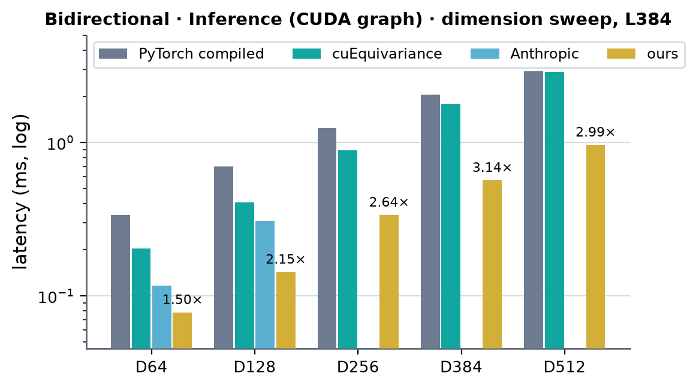 <!-- measure_bars -->

### Bidirectional · Training, dropout 0.25 (CUDA graph)

| (Length, Dimension) | PyTorch compiled | cuEquivariance | Anthropic | ours | × |
|---|---|---|---|---|---|
| (128, 64) | 0.249 | 0.187 | — | 0.120 | 1.56 |
| (256, 64) | 0.601 | 0.411 | — | 0.194 | 2.12 |
| (384, 64) | 1.109 | 0.792 | — | 0.298 | 2.66 |
| (512, 64) | 1.857 | 1.326 | — | 0.459 | 2.89 |
| (640, 64) | 2.833 | 2.053 | — | 0.710 | 2.89 |
| (768, 64) | 4.145 | 2.854 | — | 0.955 | 2.99 |
| (128, 128) | 0.373 | 0.267 | — | 0.175 | 1.53 |
| (256, 128) | 0.994 | 0.736 | — | 0.329 | 2.24 |
| (384, 128) | 2.074 | 1.551 | — | 0.583 | 2.66 |
| (512, 128) | 3.533 | 2.641 | — | 0.963 | 2.74 |
| (640, 128) | 5.592 | 4.178 | — | 1.476 | 2.83 |
| (768, 128) | 9.106 | 5.813 | — | 2.162 | 2.69 |
| (128, 256) | 0.601 | 0.470 | — | 0.311 | 1.51 |
| (256, 256) | 1.883 | 1.497 | — | 0.781 | 1.92 |
| (384, 256) | 3.980 | 3.249 | — | 1.585 | 2.05 |
| (512, 256) | 6.989 | 5.765 | — | 2.670 | 2.16 |
| (640, 256) | 11.874 | 9.069 | — | 4.311 | 2.10 |
| (768, 256) | 20.369 | 13.053 | — | 6.142 | 2.13 |
| (128, 384) | 0.894 | 0.732 | — | 0.439 | 1.67 |
| (256, 384) | 2.983 | 2.514 | — | 1.282 | 1.96 |
| (384, 384) | 6.657 | 5.798 | — | 2.734 | 2.12 |
| (512, 384) | 13.829 | 10.450 | — | 4.730 | 2.21 |
| (640, 384) | 22.924 | 16.534 | — | 7.738 | 2.14 |
| (768, 384) | 40.627 | 23.969 | — | 10.898 | 2.20 |
| (128, 512) | 1.132 | 1.028 | — | 0.558 | 1.84 |
| (256, 512) | 3.874 | 3.664 | — | 1.824 | 2.01 |
| (384, 512) | 9.194 | 8.548 | — | 3.900 | 2.19 |
| (512, 512) | 19.480 | 15.409 | — | 6.785 | 2.27 |
| (640, 512) | 31.857 | 24.461 | — | 11.168 | 2.19 |
| (768, 512) | 53.085 | 36.718 | — | 16.478 | 2.23 |

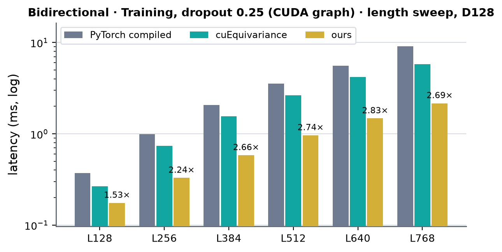 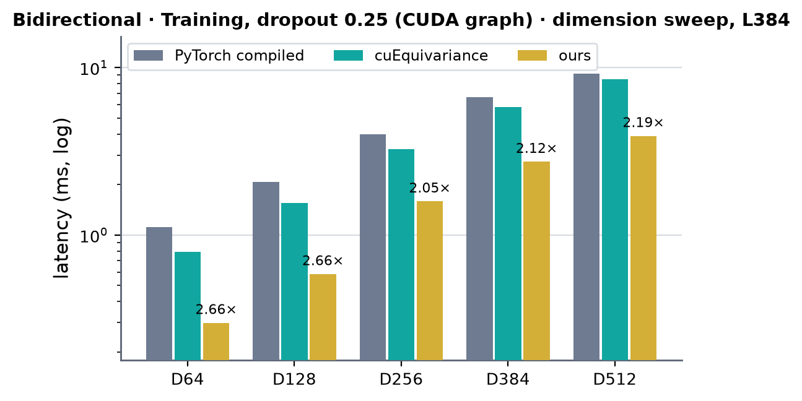 <!-- measure_bars -->

### Bidirectional · Training, dropout 0.25 (no CUDA graph)

| (Length, Dimension) | PyTorch compiled | cuEquivariance | Anthropic | ours | × |
|---|---|---|---|---|---|
| (128, 64) | 0.586 | 0.829 | — | 0.758 | 0.77 |
| (256, 64) | 0.697 | 1.027 | — | 0.625 | 1.12 |
| (384, 64) | 1.211 | 0.887 | — | 0.607 | 1.46 |
| (512, 64) | 1.957 | 1.427 | — | 0.775 | 1.84 |
| (640, 64) | 2.934 | 2.145 | — | 0.759 | 2.83 |
| (768, 64) | 4.280 | 2.949 | — | 1.001 | 2.95 |
| (128, 128) | 0.585 | 1.011 | — | 0.639 | 0.92 |
| (256, 128) | 1.090 | 0.836 | — | 0.774 | 1.08 |
| (384, 128) | 2.172 | 1.647 | — | 0.803 | 2.05 |
| (512, 128) | 3.625 | 2.737 | — | 1.045 | 2.62 |
| (640, 128) | 5.696 | 4.241 | — | 1.606 | 2.64 |
| (768, 128) | 9.157 | 5.929 | — | 2.302 | 2.58 |
| (128, 256) | 0.690 | 0.843 | — | 0.870 | 0.79 |
| (256, 256) | 1.984 | 1.591 | — | 0.876 | 1.82 |
| (384, 256) | 4.089 | 3.329 | — | 1.621 | 2.05 |
| (512, 256) | 7.097 | 5.729 | — | 2.747 | 2.09 |
| (640, 256) | 11.922 | 9.175 | — | 4.320 | 2.12 |
| (768, 256) | 20.287 | 13.294 | — | 6.182 | 2.15 |
| (128, 384) | 0.995 | 1.061 | — | 0.892 | 1.12 |
| (256, 384) | 3.080 | 2.605 | — | 1.334 | 1.95 |
| (384, 384) | 6.721 | 5.957 | — | 2.664 | 2.24 |
| (512, 384) | 14.039 | 10.370 | — | 4.762 | 2.18 |
| (640, 384) | 23.129 | 16.697 | — | 7.780 | 2.15 |
| (768, 384) | 39.144 | 24.135 | — | 11.161 | 2.16 |
| (128, 512) | 1.219 | 1.113 | — | 0.876 | 1.27 |
| (256, 512) | 3.987 | 3.771 | — | 1.939 | 1.95 |
| (384, 512) | 9.280 | 8.819 | — | 3.791 | 2.33 |
| (512, 512) | 19.756 | 15.581 | — | 7.225 | 2.16 |
| (640, 512) | 32.228 | 25.294 | — | 11.586 | 2.18 |
| (768, 512) | 53.520 | 35.464 | — | 16.116 | 2.20 |

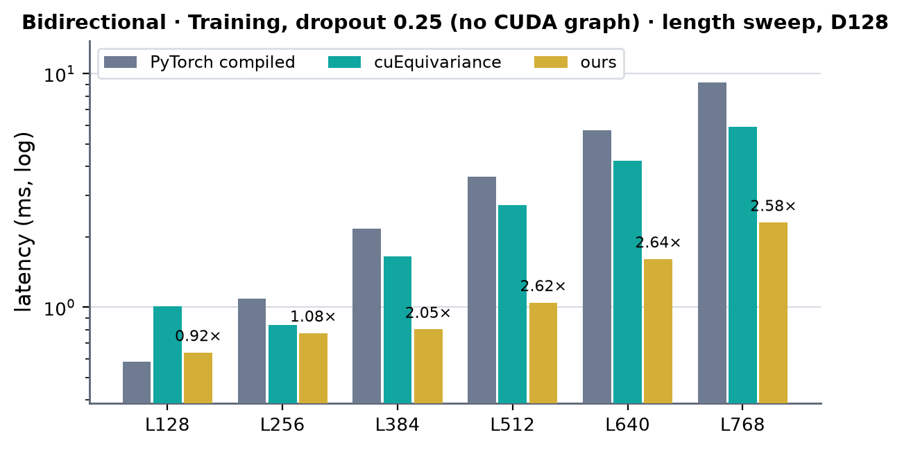 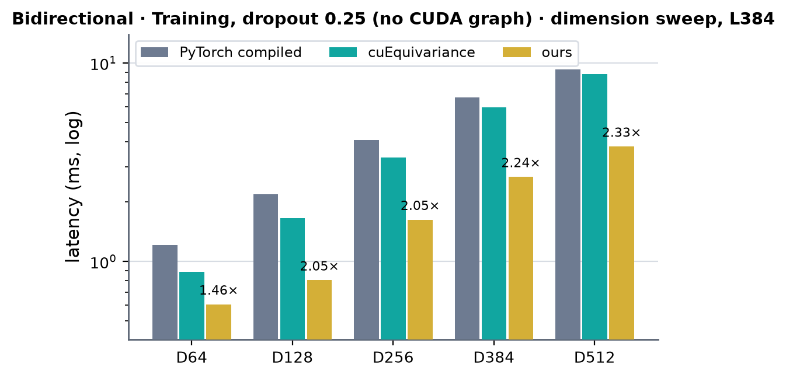 <!-- measure_bars -->

### Single direction (outgoing) · Inference (CUDA graph)

| (Length, Dimension) | PyTorch compiled | cuEquivariance | Anthropic | ours | × |
|---|---|---|---|---|---|
| (128, 64) | 0.057 | 0.037 | 0.022 | 0.022 | 1.00 |
| (256, 64) | 0.125 | 0.072 | 0.041 | 0.035 | 1.17 |
| (384, 64) | 0.207 | 0.129 | 0.070 | 0.054 | 1.30 |
| (512, 64) | 0.344 | 0.215 | 0.119 | 0.084 | 1.42 |
| (640, 64) | 0.536 | 0.332 | 0.188 | 0.127 | 1.48 |
| (768, 64) | 0.792 | 0.457 | 0.254 | 0.166 | 1.53 |
| (128, 128) | 0.078 | 0.047 | 0.039 | 0.030 | 1.30 |
| (256, 128) | 0.176 | 0.092 | 0.088 | 0.053 | 1.66 |
| (384, 128) | 0.391 | 0.180 | 0.170 | 0.094 | 1.81 |
| (512, 128) | 0.613 | 0.313 | 0.294 | 0.153 | 1.92 |
| (640, 128) | 1.060 | 0.487 | 0.467 | 0.248 | 1.88 |
| (768, 128) | 1.690 | 0.673 | 0.647 | 0.358 | 1.81 |
| (128, 256) | 0.117 | 0.063 | 0.082 | 0.045 | 1.40 |
| (256, 256) | 0.342 | 0.166 | 0.254 | 0.110 | 1.51 |
| (384, 256) | 0.739 | 0.268 | 0.512 | 0.231 | 1.16 |
| (512, 256) | 1.183 | 0.459 | 0.878 | 0.399 | 1.15 |
| (640, 256) | 1.928 | 0.716 | 1.391 | 0.665 | 1.08 |
| (768, 256) | 3.163 | 1.021 | 1.957 | 0.911 | 1.12 |
| (128, 384) | 0.158 | 0.151 | 0.180 | 0.063 | 2.40 |
| (256, 384) | 0.534 | 0.540 | 0.579 | 0.184 | 2.90 |
| (384, 384) | 1.171 | 1.254 | 1.260 | 0.403 | 2.91 |
| (512, 384) | 1.922 | 2.285 | 2.180 | 0.706 | 2.72 |
| (640, 384) | 3.201 | 3.692 | 3.437 | 1.197 | 2.67 |
| (768, 384) | 5.190 | 5.341 | 4.868 | 1.752 | 2.78 |
| (128, 512) | 0.199 | 0.219 | — | 0.084 | 2.37 |
| (256, 512) | 0.694 | 0.854 | — | 0.258 | 2.69 |
| (384, 512) | 1.413 | 2.086 | — | 0.571 | 2.47 |
| (512, 512) | 2.534 | 3.646 | — | 1.022 | 2.48 |
| (640, 512) | 4.418 | 5.619 | — | 1.728 | 2.56 |
| (768, 512) | 7.290 | 8.368 | — | 2.423 | 3.01 |

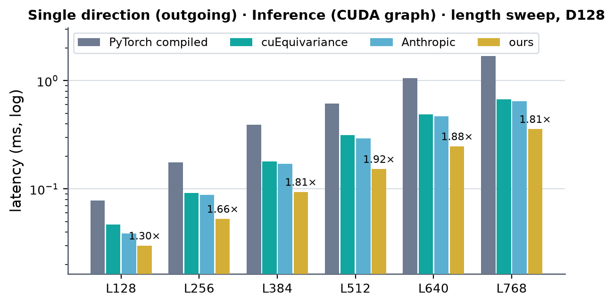 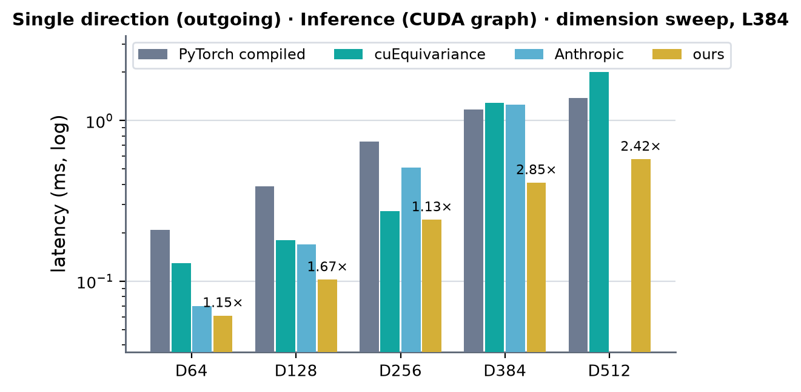 <!-- measure_bars -->

### Single direction (outgoing) · Training, dropout 0.25 (CUDA graph)

| (Length, Dimension) | PyTorch compiled | cuEquivariance | Anthropic | ours | × |
|---|---|---|---|---|---|
| (128, 64) | 0.189 | 0.148 | — | 0.099 | 1.49 |
| (256, 64) | 0.401 | 0.300 | — | 0.142 | 2.11 |
| (384, 64) | 0.708 | 0.533 | — | 0.218 | 2.44 |
| (512, 64) | 1.166 | 0.870 | — | 0.358 | 2.43 |
| (640, 64) | 1.775 | 1.310 | — | 0.494 | 2.65 |
| (768, 64) | 2.547 | 1.813 | — | 0.648 | 2.80 |
| (128, 128) | 0.257 | 0.200 | — | 0.132 | 1.52 |
| (256, 128) | 0.617 | 0.458 | — | 0.235 | 1.95 |
| (384, 128) | 1.236 | 0.979 | — | 0.407 | 2.41 |
| (512, 128) | 2.082 | 1.649 | — | 0.647 | 2.55 |
| (640, 128) | 3.342 | 2.581 | — | 1.070 | 2.41 |
| (768, 128) | 5.067 | 3.570 | — | 1.445 | 2.47 |
| (128, 256) | 0.374 | 0.302 | — | 0.247 | 1.22 |
| (256, 256) | 1.085 | 0.812 | — | 0.554 | 1.47 |
| (384, 256) | 2.270 | 1.654 | — | 1.055 | 1.57 |
| (512, 256) | 3.885 | 2.801 | — | 1.730 | 1.62 |
| (640, 256) | 6.239 | 4.475 | — | 2.794 | 1.60 |
| (768, 256) | 10.179 | 6.758 | — | 3.867 | 1.75 |
| (128, 384) | 0.511 | 0.536 | — | 0.329 | 1.55 |
| (256, 384) | 1.638 | 1.891 | — | 0.842 | 1.95 |
| (384, 384) | 3.476 | 4.196 | — | 1.741 | 2.00 |
| (512, 384) | 6.170 | 7.440 | — | 2.987 | 2.07 |
| (640, 384) | 9.780 | 11.647 | — | 4.793 | 2.04 |
| (768, 384) | 16.388 | 16.410 | — | 6.752 | 2.43 |
| (128, 512) | 0.644 | 0.740 | — | 0.409 | 1.57 |
| (256, 512) | 2.119 | 2.786 | — | 1.179 | 1.80 |
| (384, 512) | 4.600 | 6.326 | — | 2.437 | 1.89 |
| (512, 512) | 8.314 | 11.416 | — | 4.320 | 1.92 |
| (640, 512) | 13.911 | 18.321 | — | 6.815 | 2.04 |
| (768, 512) | 23.424 | 26.455 | — | 9.959 | 2.35 |

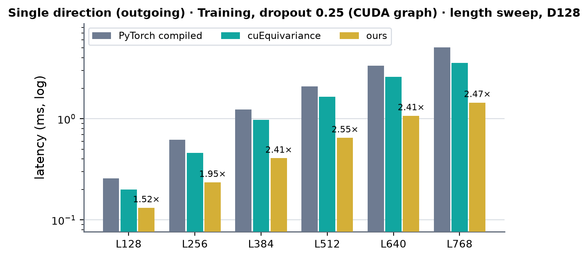 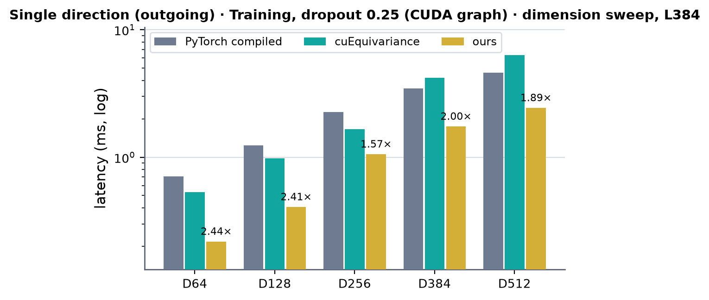 <!-- measure_bars -->

### Single direction (outgoing) · Training, dropout 0.25 (no CUDA graph)

| (Length, Dimension) | PyTorch compiled | cuEquivariance | Anthropic | ours | × |
|---|---|---|---|---|---|
| (128, 64) | 0.549 | 0.907 | — | 0.589 | 0.93 |
| (256, 64) | 0.494 | 0.911 | — | 0.583 | 0.85 |
| (384, 64) | 0.792 | 1.131 | — | 0.713 | 1.11 |
| (512, 64) | 1.252 | 1.110 | — | 0.703 | 1.58 |
| (640, 64) | 1.861 | 1.402 | — | 0.731 | 1.92 |
| (768, 64) | 2.657 | 1.902 | — | 0.753 | 2.53 |
| (128, 128) | 0.460 | 1.161 | — | 0.600 | 0.77 |
| (256, 128) | 0.702 | 1.132 | — | 0.740 | 0.95 |
| (384, 128) | 1.323 | 1.324 | — | 0.847 | 1.56 |
| (512, 128) | 2.163 | 1.728 | — | 0.887 | 1.95 |
| (640, 128) | 3.437 | 2.659 | — | 1.034 | 2.57 |
| (768, 128) | 5.147 | 3.653 | — | 1.421 | 2.57 |
| (128, 256) | 0.612 | 0.598 | — | 0.877 | 0.68 |
| (256, 256) | 1.167 | 0.910 | — | 0.866 | 1.05 |
| (384, 256) | 2.350 | 1.748 | — | 1.125 | 1.55 |
| (512, 256) | 3.977 | 2.906 | — | 1.815 | 1.60 |
| (640, 256) | 6.344 | 4.563 | — | 2.895 | 1.58 |
| (768, 256) | 10.245 | 6.958 | — | 3.875 | 1.80 |
| (128, 384) | 0.603 | 1.102 | — | 0.835 | 0.72 |
| (256, 384) | 1.719 | 1.971 | — | 1.007 | 1.71 |
| (384, 384) | 3.560 | 4.286 | — | 1.797 | 1.98 |
| (512, 384) | 6.233 | 7.386 | — | 3.069 | 2.03 |
| (640, 384) | 9.977 | 12.010 | — | 4.848 | 2.06 |
| (768, 384) | 16.378 | 16.555 | — | 6.851 | 2.39 |
| (128, 512) | 0.734 | 1.135 | — | 0.826 | 0.89 |
| (256, 512) | 2.215 | 2.850 | — | 1.220 | 1.82 |
| (384, 512) | 4.609 | 6.391 | — | 2.572 | 1.79 |
| (512, 512) | 8.283 | 11.480 | — | 4.045 | 2.05 |
| (640, 512) | 14.046 | 18.193 | — | 7.052 | 1.99 |
| (768, 512) | 22.818 | 25.956 | — | 9.548 | 2.39 |

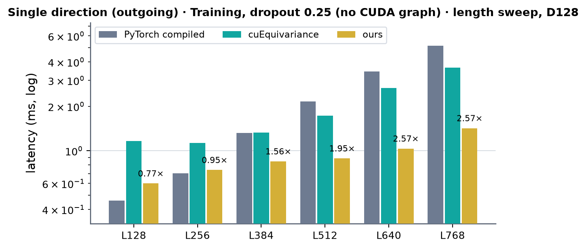 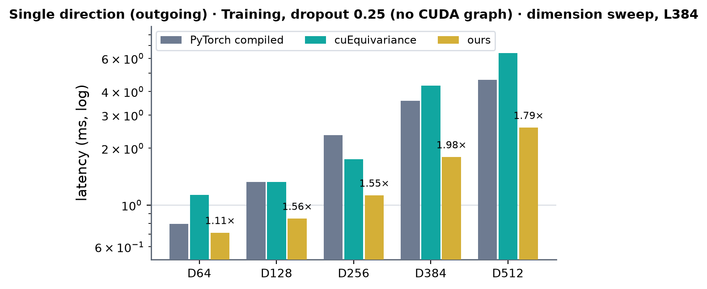 <!-- measure_bars -->

Without a graph, ours costs about 0.6-0.9 ms per training step at L128 (and D64 / D128 one
direction at L256) whatever the width: host-side time (tensor-map encoding, custom-op dispatch,
weight packs, small launches) above the GPU work. Those are the rows where ours loses (× < 1, to
PyTorch compiled or cuEquivariance); from L256-L384 on the GPU work dominates. Reducing the host
path is open.

### Hardware limit (SoL) per kernel

2026-09-30, time roofline (no power readings). Ceilings: HBM 6.75 TB/s (the highest of an elementwise read + write kernel
measured next to every run; 5.8-6.75 run to run) and tensor 2.23 PF/s (resident-operand bf16 MMA; spec 2.25). The sustained
cuBLAS 8192^3 GEMM reaches only 1.42-1.47 PF/s under the card's 1000 W cap and is not the limit: k1w runs above it. Floor =
max(minimum HBM bytes / BW, FLOPs / tensor rate) from each kernel's inputs, outputs and GEMM work; SoL = floor / measured, the
median over 40 CUDA-graph replays of the module step (bf16, masked, dropout 0.25 in training), both modules, every width of the
path. The weight-side kernels (k1w_prep, wide_fold_prep: 2-3 µs, fixed) have no data floor. Computed by a script that is not shipped.

| path | kernel | bound | L128 | L256 | L384-L768 |
|---|---|---|---|---|---|
| D64 / D128 | k1w | HBM | 18-33 % | 38-55 % | 53-81 % |
| D64 / D128 | k3g (inference / saving) | HBM | 15-23 % | 30-35 % | 39-53 % |
| D64 / D128 | b1s (D64) | HBM | 14-16 % | 29-29 % | 33-40 % |
| D64 / D128 | b1g (D128) | HBM | 17-17 % | 29-32 % | 35-42 % |
| D64 / D128 | b7m (D64) | HBM | 15-17 % | 33-39 % | 44-57 % |
| D64 / D128 | b7g (D128) | HBM | 18-21 % | 26-32 % | 28-43 % |
| D256-D512 | k1w_stats | HBM | 36-59 % | 44-68 % | 48-89 % |
| D256-D512 | k1w | tensor | 34-66 % | 53-70 % | 65-80 % |
| D256-D512 | wide_ln_stats | HBM | 38-56 % | 71-82 % | 73-92 % |
| D256-D512 | k3w (inference / saving) | HBM / tensor | 26-37 % | 32-47 % | 34-50 % |
| D256-D512 | wide_gate_bwd | HBM | 13-24 % | 33-45 % | 45-65 % |
| D256-D512 | wide_lnout_bwd | HBM | 44-55 % | 53-61 % | 56-65 % |
| D256-D512 | k1wb | HBM | 46-53 % | 44-56 % | 52-64 % |
| D256-D512 | wide_ln_apply | HBM | 46-57 % | 68-79 % | 81-93 % |
| D256-D512 | wide_lnin_bwd | HBM | 39-53 % | 51-68 % | 56-87 % |

성능 확인 (kernel tables above, 2026-09-30): ✓ = the fastest measured and SoL >= 70 % (the weight-side prep kernels: ✓);
△ = the fastest measured, SoL below 70 %; ✗ = slower than another implementation (none in the current tables; one direction,
D64, L128 inference ties Anthropic v5 at 22.46 µs, 1.00×). A module cell in [../b200.md](../b200.md) takes the lowest of its
kernels.
