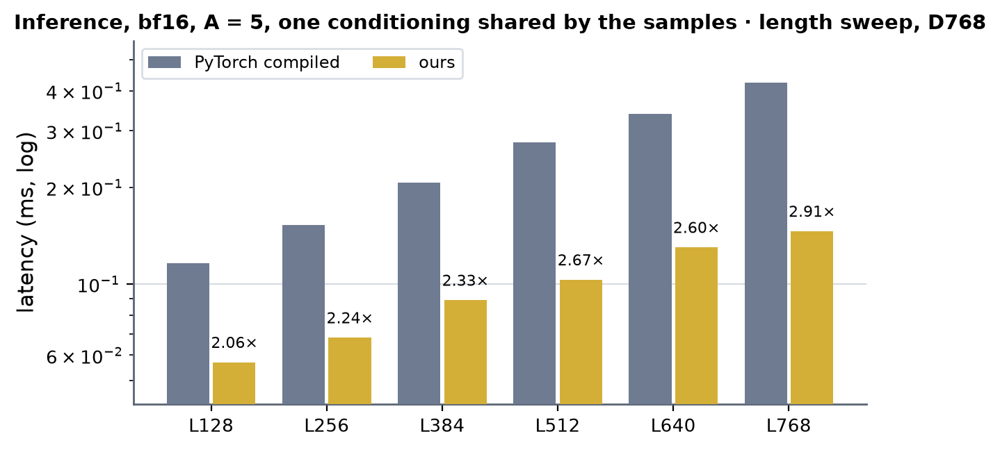
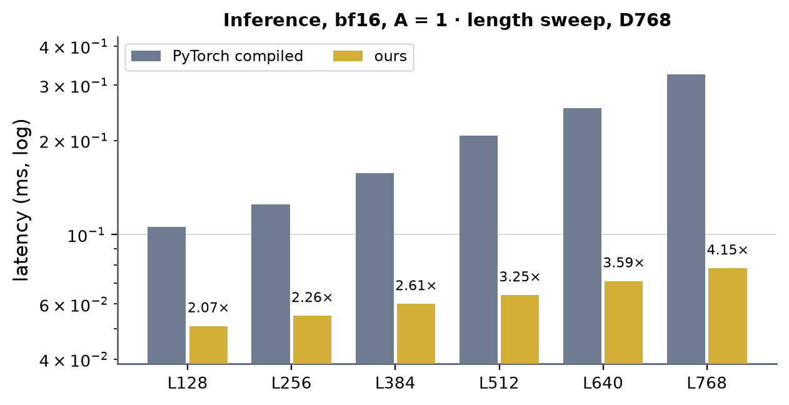
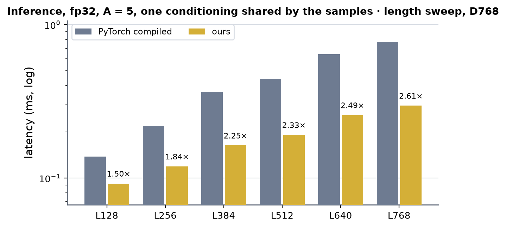
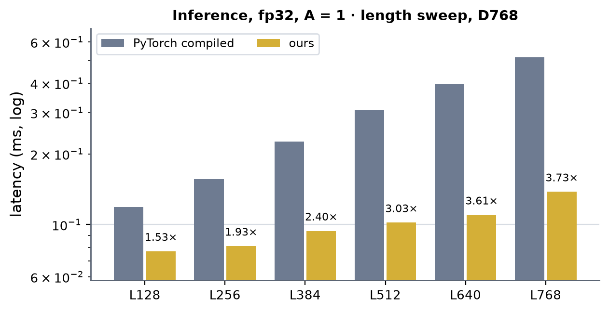
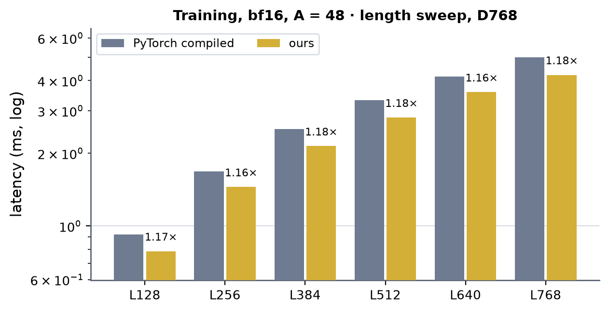
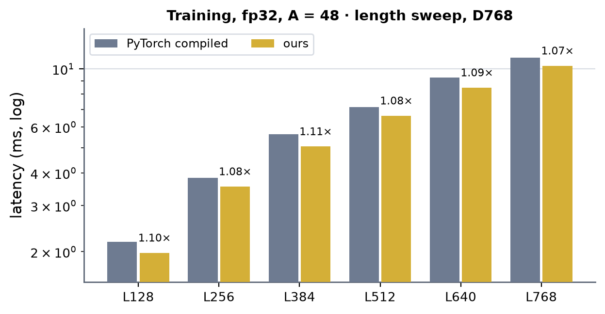

# Bias-only token DiT on H100 (sm90)

Kernel-level status of the bias-only token DiT block (`modules/bias_only_dit`, `BiasOnlyDiTBlock`) on H100: AdaLN +
**bias-only attention** (the logits are the pair bias, `softmax(to_bias(LN(pair))) v`, gated by `sigmoid(g)` and the conditioning
scale) + the conditioned SwiGLU transition. d_single 768, d_cond 384, d_pair 128, 16 heads x 48, transition n = 2; the
module-level summary is in [h100.md](../h100.md), the same block on B200 is
[../../b200/bias_only_dit/bias_only_dit.md](../../b200/bias_only_dit/bias_only_dit.md). Columns are (Length, Dimension, dtype)
with the token width 768 (`token_single`).

With no query and no key, `P = softmax(bias)` depends on neither the sample nor the solver step, only on the pair: one `P` per
block serves every sample. The fast path is therefore a different algorithm from the token DiT's: `P` is made once per pair and
the per-sample attention is a GEMM per head (`P_h [L, L] x v_h [L, 48]`) with the gate in its epilogue -- no online softmax.

**No other implementation of this block exists** (Anthropic's kit has no bias-only block -- the bench row is
`UnsupportedBenchmark` -- and cuEquivariance has only the triangle ops), so every measurement is against the PyTorch module.

## Scope and dispatch

Hand-written CUDA and cuBLAS only (no Triton), bf16 and fp32 (TF32 tensor cores, fp32 softmax / norm statistics / residual),
16 x 48 heads, B == 1, L a multiple of 128 up to 3072 (inference: the sampler's token rungs reach 2560) or 768 (training), a key mask
[1, L] or none. Everything else keeps the module's PyTorch composition. `settings.bias_only_dit_h100` (default on) switches the Hopper paths.

- **Inference** (`integrations/bias_only_dit.py` -> `kernels/bias_only_dit/cuda/runner.py`, `FusedBiasOnlyDiT`): one conditioning
  per sample or one shared by the samples. Per call: the conditioning tables (LN rows + two cuBLAS GEMMs; bf16 up to 384 table rows:
  LN rows + ONE sm_90a GEMM for both, `bo_gemm_sm90.cu cond_tables`), then per block `adaln_in_rows` (no fp32 copy of the input:
  the first residual pass, `resgate_adaln_rows_in`, reads the input itself) -> cuBLAS v | g -> **`pvx`** (bf16) / **`pvx32`** (fp32)
  -> cuBLAS out -> `resgate_adaln_rows` -> expand (bf16: `gemm_swiglu_sm90`, SwiGLU in the epilogue, or cuBLAS + `swiglu_rows` where
  its 128 x 256 tiles fill at most half a wave or just over one; fp32: cuBLAS + `swiglu_cuda`) -> cuBLAS squeeze -> `resgate_out_rows`.
  `P` is made once per pair and mask (`runner.hoist`: pair LayerNorm + projection + softmax rows) and served from the
  capture-scoped cache. The private switches `runner._H100_NOCOPY` / `_H100_EXPAND_ROWS` / `_H100_COND1` (all on) keep the
  previous forms for A/B. The B200 three-kernel step was ported (`inf3_h100.py`, `bo_inf3_sm90.cu`) and is slower here: off
  (`inf3_h100._ON`), [below](#the-b200-three-kernel-step-and-fused-backward-on-h100-2026-10-19).
- **Training** (`integrations/bias_only_dit_train.py`): one autograd Function per block, forward and backward each one opaque op.
  bf16: pair bias + `softmax_t` (P and P^T), v | g GEMM, `pvx` (a = sigmoid(g) P v), out GEMM, the AdaLN / residual rows, expand
  GEMM + `swiglu_rows` (a | b saved), squeeze GEMM; backward `res_c_bwd`, dh GEMM + `swiglu_bwd`, dxt, `res_adaln_b_bwd`, dog,
  `gate_bwd_rows`, **`pvx` ungated** (dV = P^T dO), **`dpb2`** (dbias = P o (sum_a dO v^T - D)), dxa, `adaln_a_bwd`, the conditioning
  backward, `pair_bias_bwd`, the weight gradients as one cuBLAS GEMM each (no row split on Hopper). fp32: the same steps on TF32
  GEMMs; the attention core is `pvx32`, dV and dbias are two batched cuBLAS GEMMs over the heads with the samples folded into
  the columns (`[H, L, A 48]` is one regular matrix per head).

## Kernels (`kernels/bias_only_dit/cuda/pv_gate_inf.cu`, namespace `bo90`)

### `pvx` · sigmoid(g) (P v) per head and sample, bf16

CTA = (head, 64 x WGS query rows, a group of up to 5 samples). One or two consumer warpgroups keep the accumulators of the whole
group and a producer thread streams `[P rows | v of every sample]` k-blocks (64 keys) through a TMA ring, so P is read once per
(head, rows, group) and v once per (head, rows). The samples of a group form the N dimension of ONE wgmma per k step
(`m64n192` + `m64n128` for 5 samples; 25 % of each 64-column v tile is padding). The gate rows arrive by TMA into shared memory
before the epilogue, the bf16 result is staged and leaves as one TMA store per sample: no per-thread global access in the
epilogue. `(WGS, samples per CTA)` come from a cost model so that small L still fills the SMs. The same kernel without the gate
is dV = P^T dO of the backward.

| (Length, Dimension, dtype) | (128, 768, bf16) | (256, 768, bf16) | (384, 768, bf16) | (512, 768, bf16) | (640, 768, bf16) | (768, 768, bf16) |
|---|---|---|---|---|---|---|
| implementation | CUDA | CUDA | CUDA | CUDA | CUDA | CUDA |
| 성능 확인 | ✗ | ✗ | ✗ | ✗ | ✗ | ✗ |
| cache build | ✓ | ✓ | ✓ | ✓ | ✓ | ✓ |

Core alone (CUDA events, S = 5 / S = 48), previous kernel `pv_grouped` -> `pvx`: L768 96.8 -> 23.2 us / 704 -> 152 us; L384
29.2 -> 10.6 us / 187 -> 55 us.

### `pvx32` · the same in fp32 on TF32 wgmma

TF32 wgmma takes K-major operands only, so v arrives transposed (`v^T [768, S L]`, a second cuBLAS GEMM `Wv xa^T`; g is a third).
Sample j of a group is rows `48 j .. 48 j + 47` of the B tile (a multiple of 8 rows, 128-B-swizzle aligned), so the whole group is
one `m64n(48 x samples)k8` wgmma with no padding. L768 S5 36.8 us, S48 264 us; error against fp64 7.7e-4.

| (Length, Dimension, dtype) | (128, 768, fp32) | (256, 768, fp32) | (384, 768, fp32) | (512, 768, fp32) | (640, 768, fp32) | (768, 768, fp32) |
|---|---|---|---|---|---|---|
| implementation | CUDA | CUDA | CUDA | CUDA | CUDA | CUDA |
| 성능 확인 | ✗ | ✗ | ✗ | ✗ | ✗ | ✗ |
| cache build | ✓ | ✓ | ✓ | ✓ | ✓ | ✓ |

### `dpb2` · dbias = P o (sum_a dO_a v_a^T - D), bf16

A 128 x TN (TN = 256 at L % 256 == 0, else 128) output tile per CTA, two consumer warpgroups, both operands K-major, three
m64nTNk16 steps per sample over the A samples; P is read and the result written in 64-column chunks through TMA with a
128-B-swizzled staging tile. The 64 x 64-tile kernel it replaces re-read ~1.8 GB of operands from L2 at A = 48. L768 A48
269 -> 128 us, L384 87 -> 58 us (L256 keeps the old kernel: 64 CTAs).

| (Length, Dimension, dtype) | (128, 768, bf16) | (256, 768, bf16) | (384, 768, bf16) | (512, 768, bf16) | (640, 768, bf16) | (768, 768, bf16) |
|---|---|---|---|---|---|---|
| implementation | CUDA | CUDA | CUDA | CUDA | CUDA | CUDA |
| 성능 확인 | ✗ | ✗ | ✗ | ✗ | ✗ | ✗ |
| cache build | ✓ | ✓ | ✓ | ✓ | ✓ | ✓ |

### Row kernels and the rest

The row passes (`adaln_in_rows`, `resgate_adaln_rows`, `resgate_out_rows`, `swiglu_rows`, the training rows) are shared with the
token DiT (`conditioned_transition/cuda/token_dit_rows.cu`, `bias_only_dit/cuda/bias_only_dit_train_rows.cu`,
`bias_only_dit_f32_rows.cu`); every GEMM is cuBLAS (fp32: TF32), except the bf16 inference expand GEMM (`gemm_swiglu_sm90`).

The 2026-10-14 measurements (L384 / L768 with output errors, per-sample conditioning, and the ncu breakdown of the bf16 training step:
GEMMs 52 %, row passes 39 %, the attention-side kernels 9 %, ~75 % of the time-weighted roofline):
[docs/records/h100_bias_only_dit_20261014.md](../../../records/h100_bias_only_dit_20261014.md). Current numbers: the length sweep below.

## The B200 three-kernel step and fused backward on H100 (2026-10-19)

Full numbers, traces and probes: [docs/records/h100_bias_only_dit_inf3_20261019.md](../../../records/h100_bias_only_dit_inf3_20261019.md).

**Three-kernel inference step** (`kernels/bias_only_dit/cuda/inf3_h100.py`, `bo_inf3_sm90.cu`; off: `inf3_h100._ON = False`). B200's
I0 design on wgmma: `bo90_front` (LN + AdaLN + v|g GEMM) -> `pvx` launched with PDL (`pv_cta_pdl`) -> `bo90_tail` (out GEMM, residual
+ gate, LN + AdaLN, a|b GEMM, SwiGLU, squeeze GEMM, residual + gate), a cluster of 8 (or 16, non-portable) CTAs per 128-row tile,
LayerNorm statistics through DSMEM, xa / xt / h through L2 with one release per exchange, activation k-blocks multicast by TMA, the
weights streamed before the PDL wait. Correct (2.96e-3 against the fp32 module chain; the 12-launch step 3.06e-3) and bitwise
repeatable, but slower at every measured shape:

| (L, A) | 12-launch front / core / tail (us) | three-kernel, best cluster: front / core / tail / chain (us) |
|---|---|---|
| 128, 1 | 5.8 / 3.5 / 22.5 | 13.2 / 3.4 / 32.3 / 49.3 (CL 16) |
| 384, 5 shared | 13.5 / 8.9 / 42.8 | 25.1 / 9.1 / 51.8 / 91.6 (CL 8) |
| 768, 5 shared | 23.1 / 20.0 / 65.8 | 50.2 / 20.6 / 103.9 / 177.4 (CL 8) |
| 2560, 5 shared | 81.7 / 160.5 / 234.2 | 175.4 / 161.7 / 370.1 / 721.6 (CL 8) |

Why (`%globaltimer` trace of the tail at L128): a CTA takes in 64-73 GB/s per k-block -- the TMA intake per SM -- so the column-split
cluster's per-CTA tiles (128 x 96 for the out / squeeze GEMMs, 128 x 192 per a|b pass: 55 / 77 FLOP per byte) run at 47-76 % of the
tensor rate (0.38 / 0.55 / 0.44 us per k-block), multicast saves L2 reads but not that intake, and the exchanges and epilogues (~13
of 42 us) idle the tensor core. B200 recovers both with M 256 CTA-pair MMAs and TMEM accumulators; on H100 the accumulators are
registers (n <= 256 per warpgroup with the residual live), so the per-CTA tile cannot grow, and cuBLAS's 128 x 192-256 tiles (77-85
FLOP / byte) win. A slot release as `mbarrier.arrive.release.cluster` cost ~0.5 us each (the first build: 330 us a round); the kept
form is the default `.release.cta` remote arrive.

**Fewer launches instead** (shipped): the 12-launch step without the fp32 input copy, with cuBLAS + SwiGLU rows for the expand GEMM at
few rows, and with one GEMM launch for both conditioning tables up to 384 rows ([dispatch above](#scope-and-dispatch)); per block,
runner level, one process: L128 A1 41.8 -> 35.4 us (1.18x), L384 A1 51.1 -> 47.9, L768 A5 141.9 -> 136.9, L2560 A5 531.9 -> 512.0;
module level in the table below. A wgmma GEMM with the row pass in its epilogue (`bo_gemm_sm90.cu`: squeeze + last residual) runs its
mainloop at cuBLAS's rate (M3840 squeeze 13.9 vs 15.3 us) but adds the epilogue serially: 26.2 vs 22.4 us with cuBLAS + `resgate_out`
at M3840 -- not dispatched.

**Fused bf16 backward** (B200 T6): not shipped, the H100 backward keeps its 23 launches. The bf16 step at L768 A48 is cuBLAS GEMMs 54 %
(weight gradients at ~72 % of the tensor peak), row passes 30 %, attention side 15 %. B200's fused tail moves the row passes into GEMM
epilogues; its G4 piece (dog = dy Wo with the gate backward in the epilogue) built on H100 (`bo_gemm_sm90.cu dog_gatebwd`,
`dog_gatebwd_tma`: g / ao in and do / dg out by TMA, own loader thread) is correct (do / dg bit-identical, dd 4.5e-8) and bitwise
repeatable, but 104-110 vs 90 us (L384) and 185-198 vs 170 us (L768) against cuBLAS + `gate_bwd_rows`: the mainloop alone is faster
than cuBLAS (71 vs 83 us at L768), the epilogue runs with both warpgroups off the tensor core and its 96 KB buffer leaves a 3-stage
ring. The CTA-pair bias gradient (`dpbx2_sm100`) has no H100 form (no 2-CTA MMA; a cluster can only multicast the key tile, which
does not lower the per-SM intake that bounds `dpb2`).

## Per-augmentation pair bias (training, 2026-10-20)

`block(single [1, A, L, d], cond, pair [A, L, L, 128])` (A > 1) or `bias=` [A, H, L, L]: every sample attends with its own
`softmax(bias_a)`, so nothing is shared across the samples (`pvx` / `dpb2` assume one P per block and are not used). Served by
`bias_only_dit_train.block_psb` (bf16 and fp32/TF32, H100, L a multiple of 128 up to 768, key mask [1, L] or [A, L], every head layout);
other calls keep the module's PyTorch composition. The inference runner is unchanged.

**Layout.** Bias, P and dbias are head-major `[H, A, L, L]`, natural logits (the token DiT's `pair_biases` uses the same layout but
log2 units). `pair_bias_all(blocks, pair)` with `pair` [A, L, L, 128] returns `[A, H, L, L]` permuted views of one head-major buffer per
block (one LayerNorm + one GEMM for all blocks, bf16 and fp32); the block reads that buffer without a copy and writes its bias gradient into
the same slot of the hoist's gradient buffer.

| piece | file | note |
|---|---|---|
| softmax with per-sample mask / scale | `bias_only_dit_rows.cu`, `bias_only_dit_f32_rows.cu` `softmax_t` | `samples`, `scale`, optional P^T; the shared path is bit-identical |
| attention core bf16 | `bo_psb.cu` `psb_fwd` / `psb_bwd` | mma.sync, bias tiles by cp.async; recompute (default): the forward keeps (mc, 1/sum) per row, the backward rebuilds P with the forward's arithmetic; `bias_only_dit_psb_core="stored"` writes P, `"cublas"` is the v0 core |
| attention core fp32 | `bo_psb32.cu` | TF32 mma.sync, recompute form, forward up to L 512 |
| hoist backward | `bo_hoist_bwd.cu` | d LN0, LN backward and dW' in one pass (bf16, <= 192 bias rows); `bias_only_dit_hoist_bwd_fused` |

Numbers, memory, ncu and the rejected list: [h100_bias_only_dit_per_aug_bias_20261020.md](../../../records/h100_bias_only_dit_per_aug_bias_20261020.md)
(bf16 A = 48, L 384, 12 blocks: PyTorch compiled 102.1 ms, v1 36.9 ms; fp32 106.0 vs 82.7 ms). The attention kernels reach 34 % (forward) and
58 % (backward) of DRAM peak, the fused hoist backward 32 %: not SoL90. Tests: `tests/gpu/sm90/test_bias_only_dit_psb_gpu.py`.
The conditioning width is read off the block's weights; the training row kernels (cond LayerNorm and its backward, unfold, finalize) are templated on it and serve 384 and 768 on H100 (`KERNEL_D_CONDS`), another width keeps the PyTorch composition.

## What was tried and not kept

| attempt | result |
|---|---|
| TMA multicast of the v tiles across a cluster of row tiles (`pvx`) | no change at L768 / S5 (45.3 vs 43.4 us): the kernel was latency bound, not L2-byte bound |
| `pvx` with the samples as 64-column wgmma per sample | 25 % of peak tensor rate; the wide-N form removed the instruction-shape limit but the epilogue was the real cost |
| dV and dbias as two batched cuBLAS GEMMs (samples folded into columns) for bf16 | +25 us a step: the permute copies cost what the GEMMs save (kept for fp32, where it is the only core) |
| dh GEMM with the SwiGLU backward in its epilogue (`dswi`, 128 x 128 tiles, a / b fragments in registers) | 509 vs 318 us at M = 36864 (re-reads ~1.4 GB from L2) |
| expand GEMM + SwiGLU epilogue storing a | b (`expand_pipe`) in training | 813 us vs 380 for cuBLAS + `swiglu_rows` |
| the pair part (pair bias, softmax) on a side stream beside the GEMM chain | +30 us: GEMM CTAs hold the shared memory of every SM |
| weight-gradient GEMMs split over the rows (B200's default split 4) | +750 us a step on H100 (TF32 `nt` kernels: 157-210 TFLOP/s one GEMM, 135-190 split) |
| K-major (explicitly transposed) operands for the TF32 weight gradients | GEMMs 784 us faster, transposes cost 800+ us |
| fp32 expand + SwiGLU on `gemm_swiglu_sm90`'s TF32 build | -16 us but output error 2.9e-4 -> 4.6e-4 (its TMA-fed operands are truncated, not rounded) |
| a custom TF32 weight-gradient kernel | net 1-3 % after the transposes and partial-sum reduce (computed, not built) |
| the B200 three-kernel step (cluster-split front / tail, DSMEM statistics, TMA multicast, PDL; 2026-10-19) | 1.4-1.6x slower than the 12-launch step's same launches at L128-2560 (section above); opt-in `inf3_h100._ON` |
| squeeze GEMM + the last residual in one wgmma kernel (`sq_resout`, 2026-10-19) | 1.1-1.5x slower than cuBLAS + `resgate_out_rows` (M 128-36864) |
| dog GEMM + gate backward in one kernel, register or TMA epilogue (`dog_gatebwd`, `_tma`; 2026-10-19) | 1.1-2.4x slower than cuBLAS + `gate_bwd_rows` |
| both conditioning tables in one GEMM launch above 384 rows | L768 A1 72.0 -> 78.4 us, 1920 rows 98.0 -> 115.5 (kept below 384 rows) |

## Limits and next

- bf16 training is at ~75 % of the roofline (2026-10-14 breakdown, record above) and 1.16-1.18x PyTorch compiled (2026-10-15 sweep); B200's best (fused backward tails) is 1.26x, and its
  fused tail measured neutral against separate launches. The remaining headroom is `pvx` (an epilogue that overlaps the next
  item's MMAs) and the GEMM epilogue fusions above.
- fp32 training is bound by cuBLAS's TF32 `nt` weight-gradient kernels (3.3 ms of 10.3).
- All four layouts (16 x 48, 24 x 32, 12 x 64, 16 x 64) are served on H100: bf16 through the generic `pv_grouped` / `pvx` cores, fp32 through
  `pvx32` templated on the head width (32 / 48 / 64; N = width x samples <= 256, so at most 4 samples per group at width 64).

## Verification (2026-10-14)

`tests/gpu/sm90/test_h100_bias_only_dit_gpu.py`, 37 tests, all pass on H100 (cssb node01):

| test | cells | check |
|---|---|---|
| `pvx` gate / no gate | L128-768, S 1-48 | fp64 oracle, rel. error < 4e-3, bitwise repeat |
| `pvx32` | L256-768, S 3-48 | fp64 oracle, rel. error < 2e-3 (TF32 operands) |
| `dpb2` (dbias) | L256-768, A 5-48 | fp64 oracle < 4e-3, bitwise repeat |
| block inference | L 128 / 256 / 384 / 512 / 640 / 768, bf16 and fp32, shared and per-sample cond | fp32-IEEE block, < 6e-3 (bf16) / 1.5e-3 (fp32) |
| block training | L 128 / 256 / 512 / 640, A4, bf16 and fp32 | output, input and every parameter gradient vs the fp32 block, bitwise repeatable step |

2026-10-19 additions (same file): `test_block_inference_long_rungs` (L1024 / 1536 / 2560, bf16 and fp32, shared and per-sample
conditioning: the fused path serves them, against the fp32-IEEE block < 6e-3 / 1.5e-3) and
`test_inf3_h100_matches_the_oracle_and_is_bitwise_repeatable` (the opt-in three-kernel step, clusters of 8 and 16, one and two
blocks: fp32 module chain < 6e-3, the 12-launch step < 4e-3, three bitwise-identical reruns). The file: 84 passed, 36 skipped (2026-10-19). The B200 hoist file
(`tests/gpu/sm100/test_b200_bias_only_dit_hoist_gpu.py`) passes on H100 unchanged (77 passed, 20 skipped).

L384 / L768 training and the benchmarks run in the regression job (`bench.py target=bias_only_dit`, accuracy line per cell).
Token DiT training (`tests/gpu/any/test_token_dit_train_gpu.py`, 60 tests) covers L 128 / 200 / 256 / 512 / 640.

## Hoisted pair bias (`pair_bias_all`, 2026-10-15)

`integrations/bias_only_dit_hoist.py` makes every block's pair bias from ONE LayerNorm (`LN0(pair)`, shared by the blocks) and ONE
GEMM (`W'_all = [W_b diag(g_b)]`, cuBLAS bf16 / TF32), and its backward from one dLN0 GEMM, one `ln0_bwd_rows` and one dW' GEMM
(the blocks write their dbias into slices of one buffer). It was B200-only (`serves()` required sm_100); the gate now also admits
sm_90. The LN0 rows are the same CUDA kernels (built for sm_90 already); the block functions already took `bias=`.

Tests: the B200 hoist file runs unchanged on H100 (`tests/gpu/sm100/test_b200_bias_only_dit_hoist_gpu.py`, 77 passed, 20 skipped:
fp32 blocks at layouts other than 16 x 48 take the module path on Hopper, so the fused-only assertions are skipped there).
fp64 oracle for every gradient, hoisted-vs-per-pair inference, checkpointing bit-identity, poisoned-allocator bit-identity, no pair
kernels in a hoisted block, CUDA-graph capture and steady memory all pass.

Training step, nb blocks, A = 48 (eager CUDA events, one GPU; per-block pair bias vs hoisted):

| dtype | L | nb | per-block (ms) | hoisted (ms) | x | saved per block |
|---|---|---|---|---|---|---|
| bf16 | 384 | 8 | 17.55 | 17.23 | 1.018 | 0.04 ms |
| bf16 | 768 | 4 | 17.64 | 16.96 | 1.040 | 0.17 ms |
| fp32 | 384 | 8 | 41.95 | 41.01 | 1.023 | 0.12 ms |
| fp32 | 768 | 4 | 42.19 | 40.77 | 1.035 | 0.36 ms |

The saving is per block and independent of A, so it grows with the stack depth (24 blocks: ~4 ms bf16 / ~8.5 ms fp32 at L768 by
extrapolation, not measured). The token DiT has no fused hoist; its `architecture/blocks/pair_bias_hoist.py` stays the PyTorch fold.

## Measurements, length sweep (2026-10-15)

H100 80GB HBM3 (cssb), the v2.2.0 pixi env (torch 2.13.0+cu129), `benchmarks/runners/bench.py target=bias_only_dit level=module
min_seq_len=128 max_seq_len=768 seq_len_step=128 cudagraph=manual`, ms per block, median, key mask 20 % (inference) / 12.5 %
(training). Inference at A = 5 (one conditioning shared by the samples, `+shared_cond=true`) and A = 1; training at A = 48.
No Anthropic or cuEquivariance block exists for this module: the only comparison is the PyTorch module.
× = other / ours, so larger is faster.

### Inference, bf16, A = 5, one conditioning shared by the samples

| (Length, Dimension, dtype) | PyTorch compiled | ours | × PyTorch |
|---|---|---|---|
| (128, 768, bf16) | 0.116 | **0.057** | 2.06 |
| (256, 768, bf16) | 0.153 | **0.068** | 2.24 |
| (384, 768, bf16) | 0.207 | **0.089** | 2.33 |
| (512, 768, bf16) | 0.276 | **0.103** | 2.67 |
| (640, 768, bf16) | 0.339 | **0.130** | 2.60 |
| (768, 768, bf16) | 0.424 | **0.146** | 2.91 |

 <!-- measure_bars -->

### Inference, bf16, A = 1

| (Length, Dimension, dtype) | PyTorch compiled | ours | × PyTorch |
|---|---|---|---|
| (128, 768, bf16) | 0.106 | **0.051** | 2.07 |
| (256, 768, bf16) | 0.125 | **0.055** | 2.26 |
| (384, 768, bf16) | 0.157 | **0.060** | 2.61 |
| (512, 768, bf16) | 0.207 | **0.064** | 3.25 |
| (640, 768, bf16) | 0.253 | **0.071** | 3.59 |
| (768, 768, bf16) | 0.325 | **0.078** | 4.15 |

 <!-- measure_bars -->

### Inference, fp32, A = 5, one conditioning shared by the samples

| (Length, Dimension, dtype) | PyTorch compiled | ours | × PyTorch |
|---|---|---|---|
| (128, 768, fp32) | 0.138 | **0.092** | 1.50 |
| (256, 768, fp32) | 0.218 | **0.119** | 1.84 |
| (384, 768, fp32) | 0.365 | **0.163** | 2.25 |
| (512, 768, fp32) | 0.444 | **0.191** | 2.33 |
| (640, 768, fp32) | 0.641 | **0.257** | 2.49 |
| (768, 768, fp32) | 0.772 | **0.296** | 2.61 |

 <!-- measure_bars -->

### Inference, fp32, A = 1

| (Length, Dimension, dtype) | PyTorch compiled | ours | × PyTorch |
|---|---|---|---|
| (128, 768, fp32) | 0.119 | **0.077** | 1.53 |
| (256, 768, fp32) | 0.156 | **0.081** | 1.93 |
| (384, 768, fp32) | 0.226 | **0.094** | 2.40 |
| (512, 768, fp32) | 0.309 | **0.102** | 3.03 |
| (640, 768, fp32) | 0.397 | **0.110** | 3.61 |
| (768, 768, fp32) | 0.516 | **0.138** | 3.73 |

 <!-- measure_bars -->

### Training, bf16, A = 48

| (Length, Dimension, dtype) | PyTorch compiled | ours | × PyTorch |
|---|---|---|---|
| (128, 768, bf16) | 0.921 | **0.786** | 1.17 |
| (256, 768, bf16) | 1.68 | **1.45** | 1.16 |
| (384, 768, bf16) | 2.52 | **2.14** | 1.18 |
| (512, 768, bf16) | 3.31 | **2.81** | 1.18 |
| (640, 768, bf16) | 4.16 | **3.58** | 1.16 |
| (768, 768, bf16) | 4.99 | **4.22** | 1.18 |

 <!-- measure_bars -->

### Training, fp32, A = 48

| (Length, Dimension, dtype) | PyTorch compiled | ours | × PyTorch |
|---|---|---|---|
| (128, 768, fp32) | 2.18 | **1.98** | 1.10 |
| (256, 768, fp32) | 3.84 | **3.55** | 1.08 |
| (384, 768, fp32) | 5.63 | **5.05** | 1.11 |
| (512, 768, fp32) | 7.15 | **6.62** | 1.08 |
| (640, 768, fp32) | 9.26 | **8.48** | 1.09 |
| (768, 768, fp32) | 11.04 | **10.28** | 1.07 |

 <!-- measure_bars -->

## Measurements, inference with the long rungs (2026-10-19)

H100 80GB HBM3 (cssb node02), the repo pixi env (torch 2.13.0+cu129), `benchmarks/runners/bench.py target=bias_only_dit level=module
mode=inference precision=bf16-mixed cudagraph=manual mask_prob=0.2` (`+shared_cond=true` at A = 5, `n_augment=1` at A = 1), ms per
block, median. This branch's step: the length bound lifted to 3072 and the 12-launch step without the input copy, with cuBLAS + SwiGLU
rows for the expand GEMM at few rows and one launch for both conditioning tables up to 384 rows. Before it, L1536 / L2560 ran the
PyTorch module (6.30 / 17.3 ms at A = 1, 6.82 / 18.2 ms at A = 5 shared, CUDA graph, uncompiled). × = PyTorch / ours.

| (Length, Dimension, dtype), A = 5 shared | PyTorch compiled | ours | × PyTorch | ours on 2026-10-15 |
|---|---|---|---|---|
| (128, 768, bf16) | 0.116 | **0.055** | 2.13 | 0.057 |
| (256, 768, bf16) | 0.154 | **0.068** | 2.26 | 0.068 |
| (384, 768, bf16) | 0.208 | **0.088** | 2.35 | 0.089 |
| (512, 768, bf16) | 0.276 | **0.100** | 2.75 | 0.103 |
| (640, 768, bf16) | 0.338 | **0.126** | 2.69 | 0.130 |
| (768, 768, bf16) | 0.426 | **0.140** | 3.04 | 0.146 |
| (1536, 768, bf16) | 1.153 | **0.283** | 4.07 | PyTorch module |
| (2560, 768, bf16) | 2.701 | **0.510** | 5.30 | PyTorch module |

| (Length, Dimension, dtype), A = 1 | PyTorch compiled | ours | × PyTorch | ours on 2026-10-15 |
|---|---|---|---|---|
| (128, 768, bf16) | 0.104 | **0.046** | 2.29 | 0.051 |
| (256, 768, bf16) | 0.123 | **0.053** | 2.32 | 0.055 |
| (384, 768, bf16) | 0.157 | **0.058** | 2.71 | 0.060 |
| (512, 768, bf16) | 0.205 | **0.061** | 3.38 | 0.064 |
| (640, 768, bf16) | 0.252 | **0.069** | 3.65 | 0.071 |
| (768, 768, bf16) | 0.323 | **0.077** | 4.19 | 0.078 |
| (1536, 768, bf16) | 0.922 | **0.130** | 7.12 | PyTorch module |
| (2560, 768, bf16) | 2.282 | **0.212** | 10.78 | PyTorch module |

Same process, main's switches against this branch's (eight chained blocks, per block, us): L128 A1 45.1 -> 39.4, L768 A5 139.4 ->
134.5, L2560 A5 535.8 -> 520.9 ([record](../../../records/h100_bias_only_dit_inf3_20261019.md)). No figure was regenerated for these
rows. fp32 serves the same lengths (tests below); its long rungs were not benchmarked.

## Head layouts other than 16 x 48 (2026-10-15)

`pvx32` is templated on the head width (`DHT` 32 / 48 / 64: the wgmma N = DHT x samples, new n32 / n64 / n128 / n160 / n256 forms,
accumulator `DHT x SGM / 2` registers), and the fp32 training gate admits every `LAYOUTS` entry. Before this change fp32 at the
other layouts ran the PyTorch module (1.00x). Tests: `tests/gpu/sm90/test_h100_bias_only_dit_gpu.py` (fp32 / bf16 x 4 layouts,
inference and training gradients, bitwise-repeatable steps).

PyTorch compiled / ours (ms), CUDA graph, A = 5 shared cond (inference), A = 48 (training), fp32:

| layout | mode | L384 PyTorch | L384 ours | x | L768 PyTorch | L768 ours | x |
|---|---|---|---|---|---|---|---|
| 24 x 32 | inference | 0.354 | 0.164 | 2.16 | 0.794 | 0.313 | 2.54 |
| 24 x 32 | training | 5.67 | 5.15 | 1.10 | 11.23 | 10.46 | 1.07 |
| 12 x 64 | inference | 0.359 | 0.162 | 2.22 | 0.756 | 0.306 | 2.47 |
| 12 x 64 | training | 5.66 | 5.09 | 1.11 | 11.01 | 10.07 | 1.09 |
| 16 x 64 | inference | 0.373 | 0.171 | 2.18 | 0.784 | 0.315 | 2.49 |
| 16 x 64 | training | 5.96 | 5.44 | 1.10 | 11.86 | 11.15 | 1.06 |

bf16 at the same layouts (same run family): inference 2.26-2.38x at L384 / 2.74-2.82x at L768 over PyTorch, training 1.09-1.16x.
