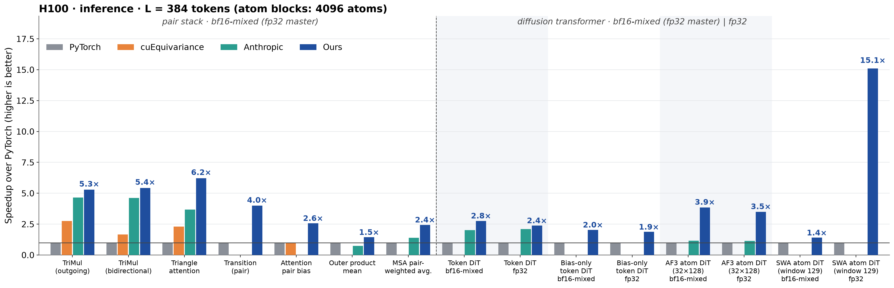
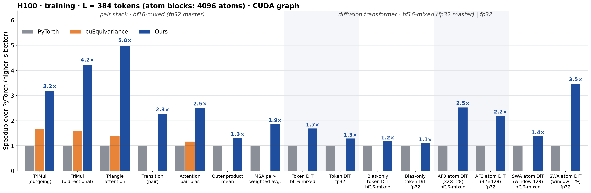

# H100 (sm90)

Cluster: cssb, partition `h100`, account `cssb`. Nodes `node01`/`node02`, 8× H100 80GB HBM3
(132 SMs) each. Driver 575, so CUDA ≤ 12.9 (cu130 wheels do not load). QoS `normal_h100`
(priority 100, preemptible) or `cssb_h100` (priority 1000); use `normal_h100` unless told
otherwise and at most 4 GPUs at a time.

> **No Triton fallback on H100, on purpose.** H100 runs hand-written CUDA (plus cuBLAS); a call no CUDA path serves runs the PyTorch reference -- never an untuned Triton kernel, never an error (`settings.triton_on_hopper_blackwell=True` or `engine_backend="triton"` bring Triton back on request). Details: [dispatch.md](dispatch.md#no-triton-fallback-pytorch-where-no-cuda-path-serves-the-call-intentional).

```sh
sinfo -p h100 && squeue -u "$USER"
# CPU-only (install, lint, CPU tests, derive of the plan without GPU work)
srun -p h100 -A cssb --qos=normal_h100 --gres=none -c 8 --mem=32G --time=01:00:00 <cmd>
# one GPU
srun -p h100 -A cssb --qos=normal_h100 --gres=gpu:h100:1 -c 8 --mem=64G --time=00:30:00 \
  bash -c 'pixi run bash -c "export LD_LIBRARY_PATH=\$CONDA_PREFIX/lib:\$LD_LIBRARY_PATH; <cmd>"'
```

- `/home` is NFSv3 on compute nodes; JIT build locks are NFS-safe since 2.2.0. Where the JIT artifacts are cached, what
  rebuilds them and how to prebuild after an install or pin bump: [jit-cache.md](../../kernels/jit-cache.md).
- Nsight Compute needs counter permission; `ERR_NVGPUCTRPERM` means use nsys / CUDA events.
- Prebuilt TriangleAttention `.so` (in `src/miniworld_engine/kernels/triangle_attention/cuda/`, the CUDA pieces outside the sm_90a
  path) must match the env's torch and python; rebuild them with the in-repo builders
  `python -m miniworld_engine.kernels.triangle_attention.cuda.build_{native,bias,dq,gate,ln,wgrad}` on a CPU allocation with
  `CUTLASS_PATH` set (CUTLASS 4.2 headers).
- Module dispatch on H100 (which op takes which CUDA path, contracts, saved tensors):
  [dispatch.md](dispatch.md). Completion per shape: [below](#completion-status). Open work: the **Open** / **Left** / **Limits**
  section of each module page (the 2026-09-30 status snapshot is a record: [h100_status_20260930.md](../../records/h100_status_20260930.md)).
- Smooth lDDT (AF3 auxiliary loss, same CUDA source as B200, CUDA-core only): [smooth_lddt/smooth_lddt.md](smooth_lddt/smooth_lddt.md).
- FP32 master/BF16 compute training: qualification of 2026-10-05 with per-shape F+B latency and validation in
  [h100_master_weights_20261005.md](../../records/h100_master_weights_20261005.md).
- Historical rented-H100 (Vast) workflow: `archive/records-20260928:docs/records/vast-h100-20260927.md`.


## Overview: every module against the other implementations

One H100 80GB HBM3 per run, torch 2.13 / cu129, CUDA-graph (training) or compiled (inference) timing, L = 384 tokens (atom blocks 4096 atoms),
bf16-mixed with fp32 master parameters (the pair stack and the diffusion transformers) and plain fp32 (the diffusion transformers). Speed-up over
PyTorch (compiled) per implementation; Anthropic rows are inference only and exist where the kit has the block. Raw numbers:
[figures/summary_L384.csv](figures/summary_L384.csv); drawn by `benchmarks/runners/main_figure_plot.py` from `main_figure_campaign.py`
(`MAIN_FIGURE_GPU=H100`).





Module-level reading (speed-up over PyTorch; **Ours / Anthropic** is the inference latency ratio against the Anthropic kit's own block, the
fairer comparison: > 1 means ours is faster; each Anthropic row is its faster of `compile=false` / `compile=true`, which differ only for MSAPairWeightedAveraging (1.02 vs 0.70 ms)):

| module | inference vs PyTorch | training vs PyTorch | Ours / Anthropic (inference) |
|---|---|---|---|
| TriMul (outgoing / bidirectional) | 5.3x / 5.4x | 3.2x / 4.2x | 1.14x / 1.18x |
| Triangle attention | 6.2x | 5.0x | 1.69x |
| Transition (pair) | 4.0x | 2.3x | not measured in this run |
| Attention pair bias | 2.6x | 2.5x | no Anthropic row (cuEquivariance 1.0x) |
| OuterProductMean | 1.5x | 1.3x | 1.94x |
| MSAPairWeightedAveraging | 2.4x | 1.9x | 1.74x |
| Token DiT bf16 / fp32 | 2.8x / 2.4x | 1.7x / 1.3x | 1.37x / 1.13x |
| Bias-only token DiT bf16 / fp32 | 2.0x / 1.9x | 1.2x / 1.1x | no Anthropic block |
| AF3 atom DiT bf16 / fp32 | 3.9x / 3.5x | 2.5x / 2.2x | 3.30x / 3.07x |
| SWA atom DiT bf16 / fp32 | 1.4x / 15.1x | 1.4x / 3.5x | no Anthropic row |

The compiled PyTorch of the fp32 SWA block is the slow reference there (the 15x); against the bf16 block the margin is 1.4x. Training is
timed in a CUDA graph; the compiled cuEquivariance TriangleAttention backward is timed without a graph (it fails the harness's repeatability
check under one).

## Completion status

Module level; kernel-level tables, flow figures and measurements are on each module's page.
torch 2.13 / triton 3.7. H100 = CUDA; a shape without a CUDA path is 미구현 and runs the PyTorch reference (no Triton
fallback, [dispatch.md](dispatch.md)). TriMul / TriAttn: bf16 only, columns are (Length, Dimension). 성능 확인 = maintainer.
cache build ✓ = usable on this toolchain (fixed schedules included); the CUDA paths need no autotune cache, and committed H100
Triton caches are not maintained (they matter only for explicit Triton A/B runs).

### TriangleMultiplication (bidirectional) — [trimul/trimul.md](trimul/trimul.md)

Every length of 128 ... 1024 runs CUDA (the B200-style port at the lengths the preserved K1 / K3 does not cover); the columns list L128 ... 768.
Beyond L1024 and at ragged L (2026-10-19): D64 / D128 inference at any L >= 16, training at any multiple of 128 up to 10240 (memory
binds first: D128 bidirectional training ends near L4300 on 80 GB); D256 / D384 / D512 at multiples of 128 (B200-style port). At
MiniWorld's L1536 / 2048 / 2560 rungs: 7.5-12.5x over the PyTorch statements H100 ran there before and 1.8-3.2x over cuEquivariance
(D64 B = 4 and D128; tables below, [trimul/trimul.md](trimul/trimul.md#long-and-ragged-lengths-miniworlds-l1536--2048--2560-rungs)).
Every width takes B <= 48 samples in one launch (`integrations.trimul_h100.max_batch(width)`, any B per call; both directions and the single-direction
modules, inference and training; MiniWorld folds templates / structures / augments into the batch): D64 / D128 on the native kernels,
D256 / D384 / D512 on the B200-style port; y and dx bitwise equal to B one-sample calls (B 16 / 32 / 48 also checked against the
FP32 statement). A call beyond one launch's memory or `max_batch` runs in chunks (`trimul_h100._plan`, deterministic from shapes and
total memory; training chunks in one autograd node writing y / dx in place, checkpointed when the batch's saved state does not
fit; D256 L768 B48 training runs). One call vs B calls 1.13-2.25x at L128, inference 0.99-1.10x at L384 / 768, D128 training
1.02-1.17x; at the preserved D256+ training cells per-cell routing (port or per-sample preserved launches) 0.994-1.03x (1.02-1.16x
of B calls that accumulate gradients); checkpointed chunks 0.73-0.80x of a per-sample fwd + bwd loop; 2.0-5.2x over cuEquivariance and 3.1-19.6x over the PyTorch statements
H100 ran for B > 1 before (H100 80GB, CUDA graph; D64: 1.13-2.21x / 4.1-11.5x,
[trimul/trimul.md](trimul/trimul.md#batched-samples-b--48-per-launch-any-b-per-call-every-width)).

#### Inference

| (Length, Dimension) | (128, 64) | (256, 64) | (384, 64) | (512, 64) | (640, 64) | (768, 64) |
|---|---|---|---|---|---|---|
| implementation | CUDA | CUDA | CUDA | CUDA | CUDA | CUDA |
| 성능 확인 | ✗ | ✗ | ✗ | ✗ | ✗ | ✗ |
| cache build | ✗ | ✗ | ✗ | ✗ | ✗ | ✗ |

| (Length, Dimension) | (128, 128) | (256, 128) | (384, 128) | (512, 128) | (640, 128) | (768, 128) |
|---|---|---|---|---|---|---|
| implementation | CUDA | CUDA | CUDA | CUDA | CUDA | CUDA |
| 성능 확인 | ✗ | ✗ | ✗ | ✗ | ✗ | ✗ |
| cache build | ✗ | ✗ | ✗ | ✗ | ✗ | ✗ |

| (Length, Dimension) | (128, 256) | (256, 256) | (384, 256) | (512, 256) | (640, 256) | (768, 256) |
|---|---|---|---|---|---|---|
| implementation | CUDA | CUDA | CUDA | CUDA | CUDA | CUDA |
| 성능 확인 | ✗ | ✗ | ✗ | ✗ | ✗ | ✗ |
| cache build | ✓ | ✓ | ✓ | ✓ | ✓ | ✓ |

| (Length, Dimension) | (128, 384) | (256, 384) | (384, 384) | (512, 384) | (640, 384) | (768, 384) |
|---|---|---|---|---|---|---|
| implementation | CUDA | CUDA | CUDA | CUDA | CUDA | CUDA |
| 성능 확인 | ✗ | ✗ | ✗ | ✗ | ✗ | ✗ |
| cache build | ✓ | ✓ | ✓ | ✓ | ✓ | ✓ |

| (Length, Dimension) | (128, 512) | (256, 512) | (384, 512) | (512, 512) | (640, 512) | (768, 512) |
|---|---|---|---|---|---|---|
| implementation | CUDA | CUDA | CUDA | CUDA | CUDA | CUDA |
| 성능 확인 | ✗ | ✗ | ✗ | ✗ | ✗ | ✗ |
| cache build | ✓ | ✓ | ✓ | ✓ | ✓ | ✓ |

#### Training

| (Length, Dimension) | (128, 64) | (256, 64) | (384, 64) | (512, 64) | (640, 64) | (768, 64) |
|---|---|---|---|---|---|---|
| implementation | CUDA | CUDA | CUDA | CUDA | CUDA | CUDA |
| 성능 확인 | ✗ | ✗ | ✗ | ✗ | ✗ | ✗ |
| cache build | ✗ | ✗ | ✓ | ✗ | ✗ | ✓ |

| (Length, Dimension) | (128, 128) | (256, 128) | (384, 128) | (512, 128) | (640, 128) | (768, 128) |
|---|---|---|---|---|---|---|
| implementation | CUDA | CUDA | CUDA | CUDA | CUDA | CUDA |
| 성능 확인 | ✗ | ✗ | ✗ | ✗ | ✗ | ✗ |
| cache build | ✗ | ✗ | ✓ | ✗ | ✗ | ✓ |

| (Length, Dimension) | (128, 256) | (256, 256) | (384, 256) | (512, 256) | (640, 256) | (768, 256) |
|---|---|---|---|---|---|---|
| implementation | CUDA | CUDA | CUDA | CUDA | CUDA | CUDA |
| 성능 확인 | ✗ | ✗ | ✗ | ✗ | ✗ | ✗ |
| cache build | ✓ | ✓ | ✓ | ✓ | ✓ | ✓ |

| (Length, Dimension) | (128, 384) | (256, 384) | (384, 384) | (512, 384) | (640, 384) | (768, 384) |
|---|---|---|---|---|---|---|
| implementation | CUDA | CUDA | CUDA | CUDA | CUDA | CUDA |
| 성능 확인 | ✗ | ✗ | ✗ | ✗ | ✗ | ✗ |
| cache build | ✓ | ✓ | ✓ | ✓ | ✓ | ✓ |

| (Length, Dimension) | (128, 512) | (256, 512) | (384, 512) | (512, 512) | (640, 512) | (768, 512) |
|---|---|---|---|---|---|---|
| implementation | CUDA | CUDA | CUDA | CUDA | CUDA | CUDA |
| 성능 확인 | ✗ | ✗ | ✗ | ✗ | ✗ | ✗ |
| cache build | ✓ | ✓ | ✓ | ✓ | ✓ | ✓ |

#### Long lengths (MiniWorld's L1536 / 2048 / 2560 rungs; inference also any ragged L)

| (Length, Dimension) | (1536, 64) | (2048, 64) | (2560, 64) | (1536, 128) | (2048, 128) | (2560, 128) |
|---|---|---|---|---|---|---|
| implementation (inference) | CUDA | CUDA | CUDA | CUDA | CUDA | CUDA |
| implementation (training) | CUDA | CUDA | CUDA | CUDA | CUDA | CUDA |
| 성능 확인 | ✗ | ✗ | ✗ | ✗ | ✗ | ✗ |
| cache build | ✗ | ✗ | ✗ | ✗ | ✗ | ✗ |

| (Length, Dimension) | (1152, 256) | (1536, 256) | (1152, 384) | (1152, 512) |
|---|---|---|---|---|
| implementation (inference) | CUDA | CUDA | CUDA | CUDA |
| implementation (training) | CUDA | CUDA | CUDA | CUDA |
| 성능 확인 | ✗ | ✗ | ✗ | ✗ |
| cache build | ✓ | ✓ | ✓ | ✓ |

### TriangleMultiplication (single direction, outgoing / incoming) — [trimul/trimul.md](trimul/trimul.md)

One contraction per module (hidden = D); both directions share every row below. D64 / D128: the packaged K1 / K3 path and, in
training, the fused B1 / B7 path; D256 / D384 / D512: the wide path (`h100_uni_wide_training`, B200-style port at the other lengths).
Comparison matrix: [records/trimul_h100_comparison_20261015.md](../../records/trimul_h100_comparison_20261015.md).

A hidden width twice the pair width (D64 hidden 128, as AF3 / Protenix template blocks; D128 hidden 256) runs the bidirectional D64 /
D128 CUDA kernels with a one-direction contraction, inference and training:
[trimul.md](trimul/trimul.md#hidden-twice-the-width-one-direction-d64--d128).

#### Inference

| (Length, Dimension) | (128, 64) | (256, 64) | (384, 64) | (512, 64) | (640, 64) | (768, 64) |
|---|---|---|---|---|---|---|
| implementation | CUDA | CUDA | CUDA | CUDA | CUDA | CUDA |
| 성능 확인 | ✗ | ✗ | ✗ | ✗ | ✗ | ✗ |
| cache build | ✗ | ✗ | ✗ | ✗ | ✗ | ✗ |

| (Length, Dimension) | (128, 128) | (256, 128) | (384, 128) | (512, 128) | (640, 128) | (768, 128) |
|---|---|---|---|---|---|---|
| implementation | CUDA | CUDA | CUDA | CUDA | CUDA | CUDA |
| 성능 확인 | ✗ | ✗ | ✗ | ✗ | ✗ | ✗ |
| cache build | ✗ | ✗ | ✗ | ✗ | ✗ | ✗ |

| (Length, Dimension) | (128, 256) | (256, 256) | (384, 256) | (512, 256) | (640, 256) | (768, 256) |
|---|---|---|---|---|---|---|
| implementation | CUDA | CUDA | CUDA | CUDA | CUDA | CUDA |
| 성능 확인 | ✗ | ✗ | ✗ | ✗ | ✗ | ✗ |
| cache build | ✓ | ✓ | ✓ | ✓ | ✓ | ✓ |

| (Length, Dimension) | (128, 384) | (256, 384) | (384, 384) | (512, 384) | (640, 384) | (768, 384) |
|---|---|---|---|---|---|---|
| implementation | CUDA | CUDA | CUDA | CUDA | CUDA | CUDA |
| 성능 확인 | ✗ | ✗ | ✗ | ✗ | ✗ | ✗ |
| cache build | ✓ | ✓ | ✓ | ✓ | ✓ | ✓ |

| (Length, Dimension) | (128, 512) | (256, 512) | (384, 512) | (512, 512) | (640, 512) | (768, 512) |
|---|---|---|---|---|---|---|
| implementation | CUDA | CUDA | CUDA | CUDA | CUDA | CUDA |
| 성능 확인 | ✗ | ✗ | ✗ | ✗ | ✗ | ✗ |
| cache build | ✓ | ✓ | ✓ | ✓ | ✓ | ✓ |

#### Training

| (Length, Dimension) | (128, 64) | (256, 64) | (384, 64) | (512, 64) | (640, 64) | (768, 64) |
|---|---|---|---|---|---|---|
| implementation | CUDA | CUDA | CUDA | CUDA | CUDA | CUDA |
| 성능 확인 | ✗ | ✗ | ✗ | ✗ | ✗ | ✗ |
| cache build | ✗ | ✗ | ✗ | ✗ | ✗ | ✗ |

| (Length, Dimension) | (128, 128) | (256, 128) | (384, 128) | (512, 128) | (640, 128) | (768, 128) |
|---|---|---|---|---|---|---|
| implementation | CUDA | CUDA | CUDA | CUDA | CUDA | CUDA |
| 성능 확인 | ✗ | ✗ | ✗ | ✗ | ✗ | ✗ |
| cache build | ✗ | ✗ | ✗ | ✗ | ✗ | ✗ |

| (Length, Dimension) | (128, 256) | (256, 256) | (384, 256) | (512, 256) | (640, 256) | (768, 256) |
|---|---|---|---|---|---|---|
| implementation | CUDA | CUDA | CUDA | CUDA | CUDA | CUDA |
| 성능 확인 | ✗ | ✗ | ✗ | ✗ | ✗ | ✗ |
| cache build | ✓ | ✓ | ✓ | ✓ | ✓ | ✓ |

| (Length, Dimension) | (128, 384) | (256, 384) | (384, 384) | (512, 384) | (640, 384) | (768, 384) |
|---|---|---|---|---|---|---|
| implementation | CUDA | CUDA | CUDA | CUDA | CUDA | CUDA |
| 성능 확인 | ✗ | ✗ | ✗ | ✗ | ✗ | ✗ |
| cache build | ✓ | ✓ | ✓ | ✓ | ✓ | ✓ |

| (Length, Dimension) | (128, 512) | (256, 512) | (384, 512) | (512, 512) | (640, 512) | (768, 512) |
|---|---|---|---|---|---|---|
| implementation | CUDA | CUDA | CUDA | CUDA | CUDA | CUDA |
| 성능 확인 | ✗ | ✗ | ✗ | ✗ | ✗ | ✗ |
| cache build | ✓ | ✓ | ✓ | ✓ | ✓ | ✓ |


#### Long lengths (L1536 / 2048 / 2560; inference also any ragged L)

Same contract as the bidirectional module (D64 / D128 inference any L >= 16, training any multiple of 128 up to 10240; D256 / D384
inference keeps the packaged K1 / K3 at any L, D512 and wide training the B200-style port at multiples of 128).

| (Length, Dimension) | (1536, 64) | (2048, 64) | (2560, 64) | (1536, 128) | (2048, 128) | (2560, 128) |
|---|---|---|---|---|---|---|
| implementation (inference) | CUDA | CUDA | CUDA | CUDA | CUDA | CUDA |
| implementation (training) | CUDA | CUDA | CUDA | CUDA | CUDA | CUDA |
| 성능 확인 | ✗ | ✗ | ✗ | ✗ | ✗ | ✗ |
| cache build | ✗ | ✗ | ✗ | ✗ | ✗ | ✗ |

### Token DiT (`DiTBlock`: adaLN + AugmentedAttention with pair bias + conditioned transition) — [token_dit/token_dit.md](token_dit/token_dit.md)

d_single 768, d_cond 384, d_pair 128, 16 heads x 48 (also 24 x 32, 12 x 64 at d 768 and 16 x 64 at d 1024, bf16 and fp32, inference and training), n = 2; QK-norm on or off, key mask [1, L]. CUDA row kernels, CUDA
attention cores (bf16 wgmma; fp32 TF32 wgmma) and cuBLAS GEMMs, no Triton. Inference serves shared or per-sample conditioning.
Weight packs and pair bias use the upstream capture-scoped caches: a replay rebuilds them from current inputs and weights.
2026-10-15 status: inference is faster than Anthropic's block in 94 of 96 measured cells (bf16 >= 1.19x, fp32 >= 1.05x except 24 x 32 fp32
A = 5 at L640 / L768), training faster than PyTorch compiled in every cell; summary table at the top of [token_dit/token_dit.md](token_dit/token_dit.md).

#### Inference

| (Length, Dimension, dtype) | (128, 768, bf16) | (256, 768, bf16) | (384, 768, bf16) | (512, 768, bf16) | (640, 768, bf16) | (768, 768, bf16) |
|---|---|---|---|---|---|---|
| implementation | CUDA 미검증 | CUDA 미검증 | CUDA | CUDA 미검증 | CUDA 미검증 | CUDA |
| 성능 확인 | ✗ | ✗ | ✗ | ✗ | ✗ | ✗ |
| cache build | ✓ | ✓ | ✓ | ✓ | ✓ | ✓ |

| (Length, Dimension, dtype) | (128, 768, fp32) | (256, 768, fp32) | (384, 768, fp32) | (512, 768, fp32) | (640, 768, fp32) | (768, 768, fp32) |
|---|---|---|---|---|---|---|
| implementation | CUDA 미검증 | CUDA 미검증 | CUDA | CUDA 미검증 | CUDA 미검증 | CUDA |
| 성능 확인 | ✗ | ✗ | ✗ | ✗ | ✗ | ✗ |
| cache build | ✓ | ✓ | ✓ | ✓ | ✓ | ✓ |

#### Training

| (Length, Dimension, dtype) | (128, 768, bf16) | (256, 768, bf16) | (384, 768, bf16) | (512, 768, bf16) | (640, 768, bf16) | (768, 768, bf16) |
|---|---|---|---|---|---|---|
| implementation | CUDA | CUDA | CUDA | CUDA | CUDA | CUDA |
| 성능 확인 | ✗ | ✗ | ✗ | ✗ | ✗ | ✗ |
| cache build | ✓ | ✓ | ✓ | ✓ | ✓ | ✓ |

| (Length, Dimension, dtype) | (128, 768, fp32) | (256, 768, fp32) | (384, 768, fp32) | (512, 768, fp32) | (640, 768, fp32) | (768, 768, fp32) |
|---|---|---|---|---|---|---|
| implementation | CUDA | CUDA | CUDA | CUDA | CUDA | CUDA |
| 성능 확인 | ✗ | ✗ | ✗ | ✗ | ✗ | ✗ |
| cache build | ✓ | ✓ | ✓ | ✓ | ✓ | ✓ |

### Bias-only token DiT (`BiasOnlyDiTBlock`: adaLN + bias-only attention + conditioned transition) — [bias_only_dit/bias_only_dit.md](bias_only_dit/bias_only_dit.md)

d_single 768, d_cond 384, d_pair 128, 16 heads x 48, n = 2, key mask [1, L]. CUDA row kernels, CUDA PV + gate cores (`pvx` bf16
wgmma, `pvx32` TF32 wgmma), `dpb2` bias gradient and cuBLAS GEMMs, no Triton. No Anthropic / cuEquivariance block exists.
Inference also serves the sampler's long token rungs, L up to 3072 (2026-10-19; before, L > 768 ran the PyTorch module: L2560 A5
18.2 -> 0.52 ms per block, 5.3x PyTorch compiled). The B200 three-kernel step and fused backward were ported and measured slower on
H100 (off; [bias_only_dit/bias_only_dit.md](bias_only_dit/bias_only_dit.md)).

| (Length, Dimension, dtype) | (128, 768, bf16) | (256, 768, bf16) | (384, 768, bf16) | (512, 768, bf16) | (640, 768, bf16) | (768, 768, bf16) |
|---|---|---|---|---|---|---|
| implementation (inference, training) | CUDA | CUDA | CUDA | CUDA | CUDA | CUDA |
| 성능 확인 | ✗ | ✗ | ✗ | ✗ | ✗ | ✗ |
| cache build | ✓ | ✓ | ✓ | ✓ | ✓ | ✓ |

| (Length, Dimension, dtype) | (128, 768, fp32) | (256, 768, fp32) | (384, 768, fp32) | (512, 768, fp32) | (640, 768, fp32) | (768, 768, fp32) |
|---|---|---|---|---|---|---|
| implementation (inference, training) | CUDA | CUDA | CUDA | CUDA | CUDA | CUDA |
| 성능 확인 | ✗ | ✗ | ✗ | ✗ | ✗ | ✗ |
| cache build | ✓ | ✓ | ✓ | ✓ | ✓ | ✓ |

### Local atom DiT (AF3 block-local attention, cross-attention mode: `LocalDiTBlock`) — [local_dit/local_dit.md](local_dit/local_dit.md)

d_single = d_cond 128, d_pair 16, 4 x 32 heads, 32 x 128 windows, SwiGLU 256; any N (padded to 128 inside), any A. Warp-level tensor-core
row kernels (wgmma with the A operand in registers, TF32 or bf16) and `mma.sync` window attention; cuBLAS only for the weight gradients.
fp32 activations with fp32 parameters run the TF32 kernels (operands rounded to nearest, everything else fp32). A conditioning passed
as an expanded view (stride 0 over the samples) is tabulated once per atom. Measured against PyTorch eager, `torch.compile`, Anthropic
(inference) and the previous Triton path in 336 cells (A 1-48, N 64-4096): the page's wide matrix. 성능 확인 is the maintainer's column.

| (Length, Dimension, dtype) | (1024, 128, bf16) | (2048, 128, bf16) | (4096, 128, bf16) | (8192, 128, bf16) |
|---|---|---|---|---|
| implementation (inference, training) | CUDA | CUDA | CUDA | CUDA |
| 성능 확인 | ✗ | ✗ | ✗ | ✗ |
| cache build | ✓ | ✓ | ✓ | ✓ |

| (Length, Dimension, dtype) | (1024, 128, fp32) | (2048, 128, fp32) | (4096, 128, fp32) | (8192, 128, fp32) |
|---|---|---|---|---|
| implementation (inference, training) | CUDA | CUDA | CUDA | CUDA |
| 성능 확인 | ✗ | ✗ | ✗ | ✗ |
| cache build | ✓ | ✓ | ✓ | ✓ |

ESMFold2 variant (`LocalDiTBlock(**ESMFOLD2)`: RMS / SiLU AdaLNs, raw gates, q / k RMSNorm + rotary, 192-key subset with the +/- 64 rank window;
2026-10-21): CUDA for inference (bf16 and fp32/TF32, A = 5 at 12-28x the composed PyTorch path, 3.4-5.5x `torch.compile`), training on the
composed PyTorch path. Page section: [local_dit.md](local_dit/local_dit.md#esmfold2-variant-localditblockesmfold2-inference).

| (Length, Dimension, dtype) | (1024, 128, bf16) | (4096, 128, bf16) | (24576, 128, bf16) | (1024, 128, fp32) | (4096, 128, fp32) | (24576, 128, fp32) |
|---|---|---|---|---|---|---|
| implementation (inference, training) | CUDA, PyTorch | CUDA, PyTorch | CUDA, PyTorch | CUDA, PyTorch | CUDA, PyTorch | CUDA, PyTorch |
| 성능 확인 |  |  |  |  |  |  |
| cache build | ✓ | ✓ | ✓ | ✓ | ✓ | ✓ |

### Transition (`modules.Transition`, hidden n·D) — [transition/transition.md](transition/transition.md)

bf16 and fp32 (TF32 tensor cores); inference and training. Columns are (Length, Dimension) of the pair stream (`L²` rows, whole 128-row tiles at every
registry length); the same kernels serve the MSA and single streams and, in the generic path, any row count (ragged rows without a PyTorch fallback) and
every width a multiple of 64 up to 1024 (D768, n = 3, ...). D64 / 128 / 256 (both n) and D384 / 512 (n = 4) are the tuned fused kernels; D384 / 512
at n = 2, D768 and every ragged or fp32 call run the generic wgmma kernels. 2026-10-05, torch 2.13 / triton 3.7. 성능 확인 = maintainer.
cache build ✓ = built and run on this toolchain (the schedules are fixed; no committed autotune cache for the n = 2 builds yet).
2026-10-15: the D128 fused inference forward (fragment LayerNorm, x tile first, warpgroup ping-pong) is verified against float64 at every row count (1.66e-3)
and is 7 - 37 % ahead of the best loadable anthropic row at n = 2 / 4 (record: `docs/records/2026-10-15-h100-transition-vs-anthropic.md`).

#### n = 4, inference and training

| (Length, Dimension) | (384, 64) | (768, 64) | (384, 128) | (768, 128) | (384, 256) | (768, 256) | (384, 384) | (768, 384) | (384, 512) | (768, 512) | (384, 768) | (768, 768) |
|---|---|---|---|---|---|---|---|---|---|---|---|---|
| implementation | CUDA | CUDA | CUDA | CUDA | CUDA | CUDA | CUDA | CUDA | CUDA | CUDA | CUDA | CUDA |
| 성능 확인 | ✗ | ✗ | ✗ | ✗ | ✗ | ✗ | ✗ | ✗ | ✗ | ✗ | ✗ | ✗ |
| cache build | ✓ | ✓ | ✓ | ✓ | ✓ | ✓ | ✓ | ✓ | ✓ | ✓ | ✓ | ✓ |

#### n = 2 (hidden 2 D), inference and training

| (Length, Dimension) | (384, 64) | (768, 64) | (384, 128) | (768, 128) | (384, 256) | (768, 256) | (384, 384) | (768, 384) | (384, 512) | (768, 512) | (384, 768) | (768, 768) |
|---|---|---|---|---|---|---|---|---|---|---|---|---|
| implementation | CUDA | CUDA | CUDA | CUDA | CUDA | CUDA | CUDA | CUDA | CUDA | CUDA | CUDA | CUDA |
| 성능 확인 | ✗ | ✗ | ✗ | ✗ | ✗ | ✗ | ✗ | ✗ | ✗ | ✗ | ✗ | ✗ |
| cache build | ✓ | ✓ | ✓ | ✓ | ✓ | ✓ | ✓ | ✓ | ✓ | ✓ | ✓ | ✓ |

#### fp32 (TF32), n = 2 and 4, inference and training

| (Length, Dimension) | (384, 64) | (384, 128) | (384, 256) | (384, 384) | (384, 512) | (384, 768) |
|---|---|---|---|---|---|---|
| implementation | CUDA | CUDA | CUDA | CUDA | CUDA | CUDA |
| 성능 확인 | ✗ | ✗ | ✗ | ✗ | ✗ | ✗ |
| cache build | ✓ | ✓ | ✓ | ✓ | ✓ | ✓ |


### SWA atom DiT (`SWADiTBlock`, team-gm `SWAAtomTransformer` fused path, `kernels/swa_dit`) — [swa_atom_dit/swa_atom_dit.md](swa_atom_dit/swa_atom_dit.md)

Training and inference share the table (the forward kernels serve both). d_atom 128, 4 heads, window 128,
SwiGLU hidden 256. Every stage is hand-CUDA (sm_90a) in bf16 and in fp32 (TF32 tensor cores): fixed tiles, no autotune
dependence; the Triton kernels are the reference (and the path on other cards). The weight-gradient GEMMs and the bf16 hoisted modulation are hand-CUDA too
at the row counts where they beat cuBLAS (above ~16k rows the weight gradients are cuBLAS). Details and measurements:
[swa_atom_dit/swa_atom_dit.md](swa_atom_dit/swa_atom_dit.md).

| (Length, Dimension, dtype) | (1024, 128, bf16) | (2048, 128, bf16) | (4096, 128, bf16) | (8192, 128, bf16) |
|---|---|---|---|---|
| implementation | CUDA | CUDA | CUDA | CUDA |
| 성능 확인 | ✗ | ✗ | ✗ | ✗ |
| cache build | ✓ | ✓ | ✓ | ✓ |

| (Length, Dimension, dtype) | (1024, 128, fp32) | (2048, 128, fp32) | (4096, 128, fp32) | (8192, 128, fp32) |
|---|---|---|---|---|
| implementation | CUDA | CUDA | CUDA | CUDA |
| 성능 확인 | ✗ | ✗ | ✗ | ✗ |
| cache build | ✓ | ✓ | ✓ | ✓ |

### AttentionPairBias (Pairformer single track, d_pair 128, bf16, B = 1) — [attention_pair_bias/attention_pair_bias.md](attention_pair_bias/attention_pair_bias.md)

Columns are (Length, heads x head dim at d_single 384). CUDA + cuBLAS only: inference L % 16 == 0, training L % 128 == 0, fp32 master
parameters rounded to bf16 inside the packing pass. Also served: 12 x 32, 16 x 24, 24 x 16 at 384 and 16 x 32 at d_single 512 (same
page). No QK-norm, no fp32 activations (PyTorch path). 성능 확인 is the maintainer's column.

#### Inference

| (Length, heads x dim) | (128, 8x48) | (256, 8x48) | (384, 8x48) | (512, 8x48) | (640, 8x48) | (768, 8x48) |
|---|---|---|---|---|---|---|
| implementation | CUDA | CUDA | CUDA | CUDA | CUDA | CUDA |
| 성능 확인 | ✗ | ✗ | ✗ | ✗ | ✗ | ✗ |
| cache build | ✓ | ✓ | ✓ | ✓ | ✓ | ✓ |

#### Training

| (Length, heads x dim) | (128, 8x48) | (256, 8x48) | (384, 8x48) | (512, 8x48) | (640, 8x48) | (768, 8x48) |
|---|---|---|---|---|---|---|
| implementation | CUDA | CUDA | CUDA | CUDA | CUDA | CUDA |
| 성능 확인 | ✗ | ✗ | ✗ | ✗ | ✗ | ✗ |
| cache build | ✓ | ✓ | ✓ | ✓ | ✓ | ✓ |

### OuterProductMean (MSA 64 / 128, hidden 32, pair 128 / 256 / 384, bf16) — [opm/opm.md](opm/opm.md)

Columns are (Length, MSA depth); any length and depth (padded to 64 / 256 with masked rows), both normalisation orders. Widths
(d_msa, d_pair): 64 / 128 MiniWorld, 128 / 256 Protenix-v2 and ESMFold2, 128 / 384 OpenDDE. Training and inference: CUDA + cuBLAS at
every cell (the persistent TMA prologue at d_msa 64 and 128; the former Triton-prologue inference cells run the CUDA prologue since
2026-10-13); per-cell rows, dispatch and speed of light on the module page. 성능 확인 is the maintainer's column.

| | (128..768, 1024) | (128..768, 2048) | (128..768, 4096) |
|---|---|---|---|
| inference | CUDA | CUDA | CUDA |
| training | CUDA | CUDA | CUDA |
| 성능 확인 | ✗ | ✗ | ✗ |

### MSAPairWeightedAveraging (MSA 64 / 128, pair 128 / 256 / 384, 8 heads x 8 / 16 / 32, bf16) — [pwa/pwa.md](pwa/pwa.md)

Columns are (Length, MSA depth). MiniWorld width (64 / 128 / 8 x 32): L a multiple of 128, even S. Wide widths (ESMFold2 128 / 256 / 8 x 16,
Protenix-v2 128 / 256 / 8 x 8, OpenDDE 128 / 384 / 8 x 8): any L <= 1024 and any S through `pwa_wide`. CUDA + cuBLAS at every cell, training
and inference; per-width tables and speed of light on the module page.

| | (128..768, 1024) | (128..768, 2048) | (128..768, 4096) |
|---|---|---|---|
| inference | CUDA | CUDA | CUDA |
| training | CUDA | CUDA | CUDA |
| 성능 확인 | ✗ | ✗ | ✗ |

### InputFeatureEmbedder (ESMFold2-style atom encoder, `modules.InputFeatureEmbedder`)

A composition, not a new kernel: atom reference features -> `Linear` -> the SWA atom DiT's fused block -> terminal RMSNorm -> `Linear + ReLU`
-> token mean (one scatter-add). On H100 the atom transformer runs the native sm_90a stages for both attention modes: window 128 with the
native window kernel, and global attention (MiniWorld's input embedder) with FlashAttention-4 between the same native stages
(`kernels/swa_dit/dispatch.py`, new 2026-10-18). Contract of the fused block: d_atom 128, 4 heads, SwiGLU hidden 256; anything else runs the
per-op blocks (PyTorch on H100, no Triton). Parameter names match MiniWorld's `ESMFold2InputAtomAttentionEncoder`, which now subclasses it.
The O(L_atom^2) atom-pair features the old encoder built and discarded are not built.

### TriangleAttention — [triattn/triattn.md](triattn/triattn.md)

The self-attention variant (`use_self_attention=True`), bf16, starting and ending node, any B, L a multiple of 16 (zero-padded to a multiple
of 128 with the pad keys masked), the module's broadcast dropout. d_pair 128 with 4 heads × 32 is the fused wgmma path (front, tail
and backward kernels); every other served shape runs the width-generic path (hand-written attention core, LayerNorm, gate, residual
kernels around cuBLAS projections): d_pair 64 covers its registered head layouts (4 × 16, 4 × 32 with d_hidden 128, 2 × 32), 256 /
384 / 512 are 8 / 12 / 16 heads of 32 channels. Heads of 64 / 96 / 128 channels, QK-norm, the bias-only variant and
`BidirectionalTriangleAttention` run the PyTorch reference (no Triton fallback). `module._h100_cuda = False` falls through to the
b200style path (`integrations/triattn_h100.py`) where it serves, else the PyTorch reference.

Measured (2026-10-15, CUDA graph, details and protocols in [triattn/triattn.md](triattn/triattn.md#current-measurements-2026-10-15-c9583b43)):
faster than PyTorch compiled and cuEquivariance in all 60 `bench.py` cells (d_pair 64-512 x L128-768, inference and training; smallest
1.69x) and in 160 further cells with the ending node, a key mask and B = 2; faster than Anthropic's native cell in all 48 cells it
serves (d_pair 128 / 256, inference, four cases; smallest 1.07x at (768, 256)); that cell does not run d_pair 64 / 384 / 512 and has no
training path.  Not measured: fp32 activations, L not a multiple of 128.

Batched samples (2026-10-20, [triattn/triattn.md](triattn/triattn.md#batched-samples-b--1-and-chunking)): B samples in one call on both
paths, up to `max_batch` = 48 per launch, more (or more than fit in memory) in deterministic chunks (`plan`: shapes, mode and the device's
total memory; never an OOM or a PyTorch fallback because of B); y bitwise equal to B one-sample calls. The attention core takes its
tasks from a global counter and the query-side backward runs in one-wave launches of a few samples (a long launch was 1.07-1.55x slower
per sample); B = 1 unchanged in bits, same or faster (L768 inference 1.37 -> 1.34 ms). One call vs B calls 1.01-2.22x where the saved tensors fit (chunked training at L768 B48
0.79-0.99x), 1.51-4.53x over cuEquivariance and the compiled PyTorch statements wherever they run.

#### Inference

| (Length, Dimension) | (128, 64) | (256, 64) | (384, 64) | (512, 64) | (640, 64) | (768, 64) |
|---|---|---|---|---|---|---|
| implementation | CUDA | CUDA | CUDA | CUDA | CUDA | CUDA |
| 성능 확인 | ✗ | ✗ | ✗ | ✗ | ✗ | ✗ |
| cache build | ✓ | ✓ | ✓ | ✓ | ✓ | ✓ |

| (Length, Dimension) | (128, 128) | (256, 128) | (384, 128) | (512, 128) | (640, 128) | (768, 128) |
|---|---|---|---|---|---|---|
| implementation | CUDA | CUDA | CUDA | CUDA | CUDA | CUDA |
| 성능 확인 | ✗ | ✗ | ✗ | ✗ | ✗ | ✗ |
| cache build | ✓ | ✓ | ✓ | ✓ | ✓ | ✓ |

| (Length, Dimension) | (128, 256) | (256, 256) | (384, 256) | (512, 256) | (640, 256) | (768, 256) |
|---|---|---|---|---|---|---|
| implementation | CUDA | CUDA | CUDA | CUDA | CUDA | CUDA |
| 성능 확인 | ✗ | ✗ | ✗ | ✗ | ✗ | ✗ |
| cache build | ✓ | ✓ | ✓ | ✓ | ✓ | ✓ |

| (Length, Dimension) | (128, 384) | (256, 384) | (384, 384) | (512, 384) | (640, 384) | (768, 384) |
|---|---|---|---|---|---|---|
| implementation | CUDA | CUDA | CUDA | CUDA | CUDA | CUDA |
| 성능 확인 | ✗ | ✗ | ✗ | ✗ | ✗ | ✗ |
| cache build | ✓ | ✓ | ✓ | ✓ | ✓ | ✓ |

| (Length, Dimension) | (128, 512) | (256, 512) | (384, 512) | (512, 512) | (640, 512) | (768, 512) |
|---|---|---|---|---|---|---|
| implementation | CUDA | CUDA | CUDA | CUDA | CUDA | CUDA |
| 성능 확인 | ✗ | ✗ | ✗ | ✗ | ✗ | ✗ |
| cache build | ✓ | ✓ | ✓ | ✓ | ✓ | ✓ |

#### Training

With the module's dropout; bf16 or fp32 parameters.

| (Length, Dimension) | (128, 64) | (256, 64) | (384, 64) | (512, 64) | (640, 64) | (768, 64) |
|---|---|---|---|---|---|---|
| implementation | CUDA | CUDA | CUDA | CUDA | CUDA | CUDA |
| 성능 확인 | ✗ | ✗ | ✗ | ✗ | ✗ | ✗ |
| cache build | ✓ | ✓ | ✓ | ✓ | ✓ | ✓ |

| (Length, Dimension) | (128, 128) | (256, 128) | (384, 128) | (512, 128) | (640, 128) | (768, 128) |
|---|---|---|---|---|---|---|
| implementation | CUDA | CUDA | CUDA | CUDA | CUDA | CUDA |
| 성능 확인 | ✗ | ✗ | ✗ | ✗ | ✗ | ✗ |
| cache build | ✓ | ✓ | ✓ | ✓ | ✓ | ✓ |

| (Length, Dimension) | (128, 256) | (256, 256) | (384, 256) | (512, 256) | (640, 256) | (768, 256) |
|---|---|---|---|---|---|---|
| implementation | CUDA | CUDA | CUDA | CUDA | CUDA | CUDA |
| 성능 확인 | ✗ | ✗ | ✗ | ✗ | ✗ | ✗ |
| cache build | ✓ | ✓ | ✓ | ✓ | ✓ | ✓ |

| (Length, Dimension) | (128, 384) | (256, 384) | (384, 384) | (512, 384) | (640, 384) | (768, 384) |
|---|---|---|---|---|---|---|
| implementation | CUDA | CUDA | CUDA | CUDA | CUDA | CUDA |
| 성능 확인 | ✗ | ✗ | ✗ | ✗ | ✗ | ✗ |
| cache build | ✓ | ✓ | ✓ | ✓ | ✓ | ✓ |

| (Length, Dimension) | (128, 512) | (256, 512) | (384, 512) | (512, 512) | (640, 512) | (768, 512) |
|---|---|---|---|---|---|---|
| implementation | CUDA | CUDA | CUDA | CUDA | CUDA | CUDA |
| 성능 확인 | ✗ | ✗ | ✗ | ✗ | ✗ | ✗ |
| cache build | ✓ | ✓ | ✓ | ✓ | ✓ | ✓ |

### Normalisation and conditioning primitives (`modules.LayerNorm`, `architecture.primitives.LayerNorm`, `modules.RMSNorm`, `AdaptiveLayerNorm`, `ConditionedTransition`)

LayerNorm (`modules.LayerNorm` MINIWORLD, `architecture.primitives.LayerNorm` MINIWORLD_ENGINE) runs the general CUDA LayerNorm
`kernels/layernorm/cuda/general`: last-dimension widths 1 .. 64K (bf16 / fp16) or 32K (fp32), any row count, fp32 statistics, optional fp32
affine, forward and backward, bit-identical replays (dw / db without atomics). RMSNorm (`modules.RMSNorm` MINIWORLD: the q / k norms of
AttentionPairBias and AugmentedAttention, the SWA atom block norms) runs `kernels/rmsnorm/cuda`, the same kernel without the mean and the
bias. A multi-dimension `normalized_shape` or a CPU tensor runs the PyTorch statements. Measurements against the former PyTorch leg and
`torch.compile`: [layernorm_general_cuda_h100_20261018.md](../../records/layernorm_general_cuda_h100_20261018.md),
[rmsnorm_general_cuda_h100_20261018.md](../../records/rmsnorm_general_cuda_h100_20261018.md). AdaptiveLayerNorm and ConditionedTransition have
no CUDA path as standalone modules: on H100 they run the PyTorch reference (`dispatch._torch_on_hopper_blackwell`; open work). Inside the
token, bias-only and local DiT blocks their work runs in those blocks' CUDA kernels (sections above).

| module | inference | training | 성능 확인 |
|---|---|---|---|
| LayerNorm (any width, any rows) | CUDA | CUDA | ✗ |
| RMSNorm (any width, any rows) | CUDA | CUDA | ✗ |
| AdaptiveLayerNorm | 미구현 (PyTorch) | 미구현 (PyTorch) | ✗ |
| ConditionedTransition | 미구현 (PyTorch) | 미구현 (PyTorch) | ✗ |
