# Local atom DiT (AF3 block-local attention) on H100 (sm90)

Kernel-level status of the AF3 atom transformer block with **block-local attention** (engine `modules/local_dit.LocalDiTBlock`, AF3 Alg. 23
with the 32 x 128 trunking of Alg. 24, cross-attention mode: keys and values from a second AdaLN of x1) on H100: AdaLN -> q | gate -> K / V AdaLN
-> k | v -> attention in which atom `i` of query window `w = i // 32` sees the 128 atoms `[32 w - 48, 32 w + 80)` with the per-window pair
bias `LN(z) Wb^T` of the *trunked* atom pair `[nwin, 32, 128, 16]` -> gated out-projection + residual -> AdaLN + SwiGLU (hidden 256) +
residual; d_single = d_cond = 128, d_pair = 16, 4 heads x 32. Module summary: [h100.md](../h100.md); the B200 page is
[local_dit](../../b200/local_dit/local_dit.md) (tcgen05; the kernels here are a different design for the same stage boundaries).

**Contract** (`integrations/local_dit_h100.matches`): H100, cross-attention, with or without QK-norm, B = 1, any A, any N (padded to a multiple of 128
inside, the padded atoms masked as keys), a `[1, N]` bool key mask or none, contiguous `single` / `cond` `[A, 1, N, 128]` and pair
`[1, nwin, 32, 128, 16]`; **fp32** activations with fp32 parameters (no autocast) run the TF32 kernels, **bf16** activations (fp32 master or
bf16 parameters, autocast allowed) the bf16 ones; inference and training. Anything else runs the module composition (on H100 its PyTorch
statements: no Triton fallback, see [dispatch.md](../dispatch.md));
`settings.local_dit_h100_mma{,_fp32,_bf16}` switch the path off.

**QK-norm** (`use_qk_norm=True`: a per-head RMSNorm of q and k over the head width, one weight each, as the token DiT): two row kernels around the
fused stages, `kernels/augmented_attention/cuda/qknorm_local.cu` -- the forward normalises `pre90`'s q and k into the tensors the attention reads (the raw ones
are kept for the backward; fp32 outputs are rounded to tf32 as `pre90` rounds them), the backward rewrites the attention's dq / dk in place into the
gradients of the raw projections before `pre_bwd90` and leaves the weight gradients as per-block partial rows summed in order (bitwise repeatable). The
eps is torch's float32 one for bf16 and fp32 alike, as the engine's RMSNorm. Tests: the `qknorm` cases of `tests/gpu/sm90/test_h100_local_dit_mma_gpu.py`.
Fusing the two passes into `pre90` / `pre_bwd90` is open work (the extra traffic is q and k once each way). Two opaque ops (`local_dit_h100_fwd` / `_bwd`): eager, CUDA graphs and
`torch.compile`.

## Path

CUDA + cuBLAS only (cuBLAS: the weight-gradient GEMMs). No Triton, no tcgen05 / TMEM.

- Row kernels (`kernels/augmented_attention/cuda/sm90_atom/`, one source for both dtypes, `-DTF32=1` builds the fp32 twins): a warpgroup =
  64 rows, a warp owns a 16 x 128 tile as MMA C fragments; **wgmma with the A operand in registers** (the previous GEMM's accumulators are
  the next GEMM's A fragments, no data movement) and the weights streamed as swizzled K-major shared tiles (cp.async, 2 stages).
  Forward `cond90` (conditioning tables) -> `pre90` (AdaLN 1, q | gate, K / V AdaLN, k | v) -> attention -> `post90` (gate, out-projection,
  residual, AdaLN 2, SwiGLU, squeeze, residual). Backward `tr_bwd90` -> `post_bwd90` -> attention bwd -> `pre_bwd90` -> `cond_bwd90`, then
  cuBLAS for the weight gradients; bias gradients are per-CTA column sums finished by a fixed-order sum.
- Attention (`sm100_atom_local/lattn90.cu`, `lattn90_tf32.cu`): `mma.sync` (m16n8k16 bf16 / m16n8k8 TF32), a CTA = 64 queries (or 64 keys)
  x one head x a chunk of up to 16 samples (`_chunk(A, tiles)`: fewer when the grid would have under one CTA per SM), 4 warps of 16 rows; the pair bias (log2 domain, key mask folded in as -inf) is staged in shared
  memory once per CTA and reused by every sample; K / V / Q / dO tiles double-buffered with cp.async; dbias accumulates in registers over the
  chunk (one fp32 partial per chunk, summed in fixed order). The 16 keys of a warp see exactly 4 query windows (128 queries), no masked waste.
- Lane layout: every access of a tile to memory is one 16-byte vector per row (4 fp32 / 8 bf16 columns per lane); the weights' row and K
  axes are permuted the same way when packed (`sm90_atom._lperm`, cached per weight version and CUDA-graph capture, view arithmetic only).
  The LayerNorm weights of the conditioning are folded into the weights (`W' = W diag(gamma)`; `dgamma` = sum of `dW' * W`, no per-row work).
- TF32: operands rounded to nearest (cvt.rna) -- weights once per version on the host, activations when they feed an MMA; residual stream,
  LayerNorms, softmax, saved activations and every gradient stay fp32. TF32 `wgmma` takes K-major operands only: the K slots of a k8 step
  are permuted (slot t -> column 2t, slot t + 4 -> 2t + 1) so the C fragment is the A fragment in place.
- Inference hoists the conditioning tables and the windowed bias per (tensor, version, weights) like the B200 path (`static_inputs()` removes
  them from a replay); training computes them every call.

## Shared conditioning

AF3 / Protenix repeat one atom conditioning over the samples (`c.expand(A, ...)`). Passed as the expanded view (stride 0 over the samples,
`cond.shape[0] > 1`), the block tabulates the conditioning once per atom (`cond90` on N rows) and the row kernels read the tables modulo N
(`nmod`: the tables stay L2-resident). In the backward a CTA is four samples x 16 atoms (warp = sample, `put_grp` / `grp_put` /
`grp_flush` in `row90.cuh`): the four samples' modulation gradients are staged through shared memory, summed in fp32 and stored once
([A / 4, N, 768 | 256] of the activation dtype, a quarter of the per-sample bytes; A a multiple of four, else per-sample rows). One kernel
(`cond_bwd_sh90`) then sums the partials in fp32, runs the six products and the LayerNorm backward on the N rows and writes the fp32
sums that the weight-gradient GEMMs read (it replaced a `sum(0)` and 13 small torch GEMMs / elementwise launches; `dcond` comes back
as 1 / A of the sum per copy, which the expand's autograd sums). A contiguous
`cond` (materialised copies) takes the per-sample path; there is no value comparison (a host sync). Output and gradients equal the
materialised call (`test_shared_conditioning_matches_materialised`). Harness `+shared_cond=true`, A48 / 4096 atoms: bf16 training
3.59 -> 3.09 ms, fp32 6.02 -> 4.79 ms (A12: 1.26 / 1.71 ms); inference bf16 0.615 -> 0.560 ms, fp32 0.966 -> 0.905 ms. A caller that materialises
(`.contiguous()`) before the engine does not get this path.

## Small row counts

A call with few 64-row tiles (A x N <= about 16k rows) is latency-bound, not bandwidth-bound: one tile is one CTA that walks every weight
unit, and the per-step weight packing is a fixed cost. Measured on A1 N128 fp32 training (graph): 0.538 ms, of which 230 us was the
packing (about 150 tiny kernels per step) and 8 row kernels of 20-30 us. What is in place:

- `pack90.cu`: the forward and backward weight forms (cast, gamma fold, transpose, lane / slot permutation, concatenation, TF32 rounding)
  of the 27 parameters in one launch; equal bit for bit to the torch expression (`test_h100_local_dit_pack_gpu.py`). 8 us.
- Split launches (`grid.y`, `_split_for` aims at about 264 CTAs): `cond90_split` and `pre90_split` by weight unit, `tr_bwd90` by hidden
  chunk (disjoint outputs), `post_bwd90` / `cond_bwd90` split-K with a last-CTA finish (fp32 partials in a fixed order, per-tile counter,
  so the result is run-to-run identical; the finishing CTA writes the column sums to a fixed slot, `colpart` indexed by tile). The
  split-K code is a separate build (`-DSPLITK=1`): with the split state as runtime values in the shared build post_bwd went 436 -> 740 us
  at A48.
- Window attention: `_chunk(A, tiles)` shrinks the 16-sample chunk until the grid has about one CTA per SM (N = 64: 4 CTAs became 48);
  `finalize90` launches 16 x 27 blocks.
- Not split (open): `post90` forward (hidden chunks, needs a partial-sum finish), `pre_bwd90` (two reduction points).

The matrix: [records/h100_local_dit_small_rows_20261015.md](../../../records/h100_local_dit_small_rows_20261015.md): every cell of
inference and training is the fastest column against Anthropic, PyTorch eager, `torch.compile` and the previous Triton path.

## Accuracy

Relative Frobenius error against an fp64 PyTorch block (random parameters +0.1 N, 10 % key mask, A 3, N 512; `tests/gpu/sm90/test_h100_local_dit_mma_gpu.py`):

| tensor | fp32 ours | fp32 PyTorch (TF32) | bf16 ours | bf16 native (previous) |
|---|---|---|---|---|
| output | 2.96e-4 | 1.59e-3 | 4.4e-3 | 4.2e-3 |
| dsingle | 2.5e-4 | 3.8e-4 | 4.0e-3 | |
| dcond | 6.9e-4 | 1.5e-3 | 7.5e-3 | |
| dpair | 1.1e-3 | 1.1e-3 | 1.1e-2 | |
| parameters (all 27) | 0.6-1.9e-3 | 0.6-1.7e-3 | 0.7-1.3e-2 | |

The whole training step is bitwise repeatable (partials in fixed order, no atomics). Padded N (70, 200, 1000), masks, A = 1 / 2 / 3 / 4 / 5 / 48
checked.

## Measurements (2026-10-15)

H100 SXM, CUDA graph, `python benchmarks/runners/bench.py target=local_dit level=module compile=false implementations=[...]
mode=<inference|training> n_augment=<A> sweep_axis=seq_len min_seq_len=<atoms / 8> max_seq_len=<atoms / 8> precision=<bf16-mixed|32>`
(training with `cudagraph=manual`; atoms = 8 x seq_len; cross-attention block, one random conditioning row per atom and sample), ms.
bf16 rows are `bf16-mixed` (fp32 master parameters under autocast), fp32 rows `precision=32`. Anthropic = `opt_core`'s atom block
(composed from their windowed attention and row kernels; inference only). PyTorch compiled = `torch.compile` of the module's reference
composition; PyTorch eager = the same composition without it (training under a CUDA graph). Triton path = this tree with
`local_dit_h100_mma=False`: the Triton + CUDA-piece path that served H100 before the kernels of this page. × = the fastest other column /
ours. The Length is the atom count (Length, Dimension) = (atoms, d_single). — : not measured (the bf16 `torch.compile` training step
fails the harness's run-to-run check, 3e-3 against 1e-4; its numbers under the CUDA-graph measurement are in the wide matrix below).

### Inference A1 bf16

| (Length, Dimension) | Anthropic | PyTorch compiled | Triton path | ours | × |
|---|---|---|---|---|---|
| (128, 128) | 0.0849 | 0.1028 | 0.1591 | 0.0347 | 2.45 |
| (1024, 128) | 0.0930 | 0.1226 | 0.3079 | 0.0357 | 2.61 |
| (4096, 128) | 0.1263 | 0.1818 | 0.0934 | 0.0468 | 2.00 |
| (8192, 128) | 0.1730 | 0.2651 | 1.5614 | 0.0582 | 2.97 |

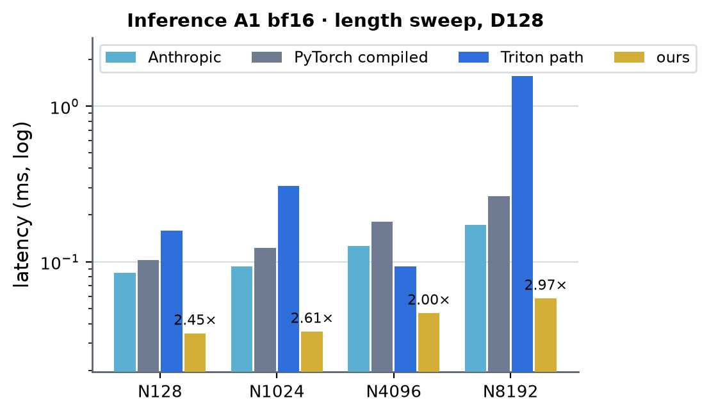 <!-- measure_bars -->

### Inference A1 fp32

| (Length, Dimension) | Anthropic | PyTorch compiled | Triton path | ours | × |
|---|---|---|---|---|---|
| (128, 128) | 0.0901 | 0.0951 | 0.1536 | 0.0349 | 2.58 |
| (1024, 128) | 0.0975 | 0.1188 | 0.3489 | 0.0379 | 2.58 |
| (4096, 128) | 0.1397 | 0.2114 | 1.0116 | 0.0538 | 2.60 |
| (8192, 128) | 0.2124 | 0.3509 | 1.9614 | 0.0756 | 2.81 |

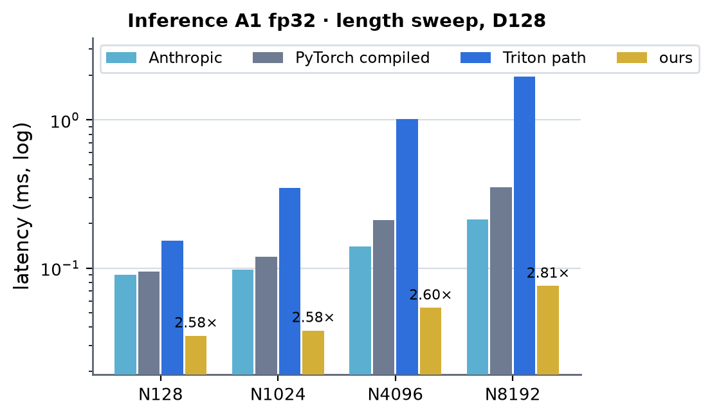 <!-- measure_bars -->

### Inference A5 bf16

| (Length, Dimension) | Anthropic | PyTorch compiled | Triton path | ours | × |
|---|---|---|---|---|---|
| (256, 128) | 0.0939 | 0.1117 | 0.1975 | 0.0432 | 2.17 |
| (1024, 128) | 0.1356 | 0.1649 | 0.4024 | 0.0489 | 2.78 |
| (2048, 128) | 0.1933 | 0.2332 | 0.1077 | 0.0585 | 1.84 |
| (4096, 128) | 0.3214 | 0.3791 | 0.1654 | 0.0976 | 1.69 |
| (8192, 128) | 0.6046 | 0.6732 | 2.6101 | 0.1654 | 3.66 |

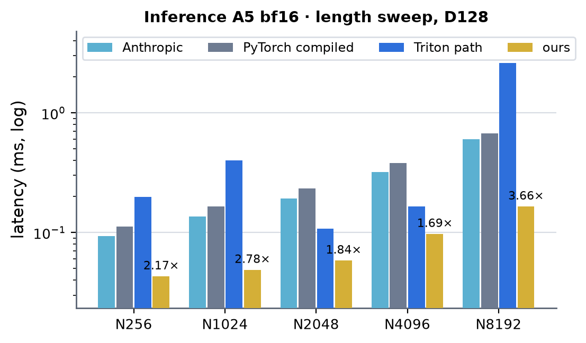 <!-- measure_bars -->

### Inference A5 fp32

| (Length, Dimension) | Anthropic | PyTorch compiled | Triton path | ours | × |
|---|---|---|---|---|---|
| (256, 128) | 0.0996 | 0.1098 | 0.2016 | 0.0494 | 2.01 |
| (1024, 128) | 0.1632 | 0.1875 | 0.4378 | 0.0612 | 2.66 |
| (2048, 128) | 0.2542 | 0.3147 | 0.8150 | 0.0898 | 2.83 |
| (4096, 128) | 0.4653 | 0.5340 | 1.5673 | 0.1531 | 3.04 |
| (8192, 128) | 0.8679 | 1.0223 | 3.0469 | 0.2572 | 3.37 |

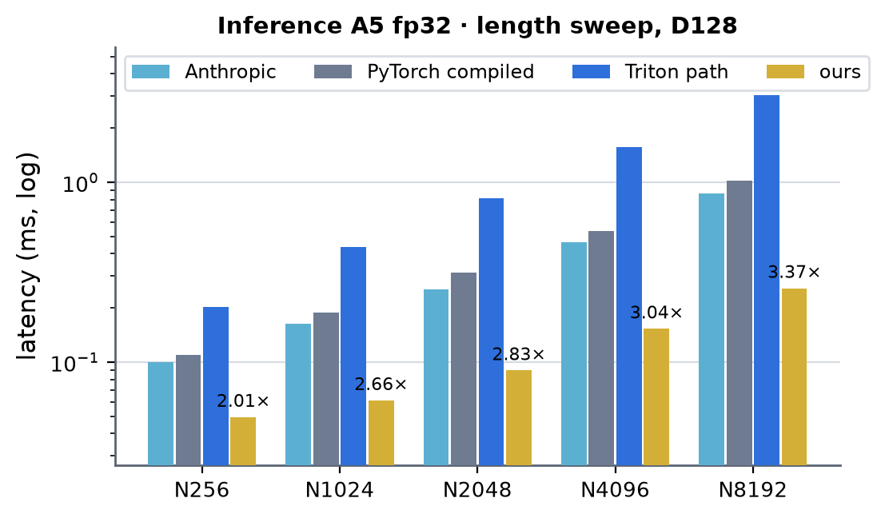 <!-- measure_bars -->

### Inference A48 bf16

| (Length, Dimension) | Anthropic | PyTorch compiled | Triton path | ours | × |
|---|---|---|---|---|---|
| (1024, 128) | 0.7582 | 0.7381 | 1.7787 | 0.1820 | 4.06 |
| (2048, 128) | 1.5644 | 1.4836 | 3.4924 | 0.3456 | 4.29 |
| (4096, 128) | 3.0368 | 2.8039 | 1.2565 | 0.6168 | 2.04 |

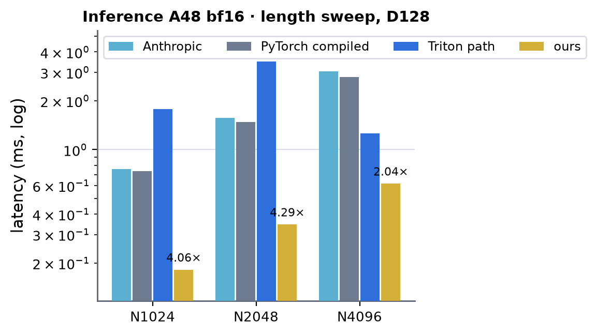 <!-- measure_bars -->

### Inference A48 fp32

| (Length, Dimension) | Anthropic | PyTorch compiled | Triton path | ours | × |
|---|---|---|---|---|---|
| (1024, 128) | 1.0141 | 1.0550 | 1.8432 | 0.2888 | 3.51 |
| (2048, 128) | 2.0018 | 1.9873 | 3.5940 | 0.5386 | 3.69 |
| (4096, 128) | 3.8747 | 3.8495 | 7.0220 | 0.9629 | 4.00 |

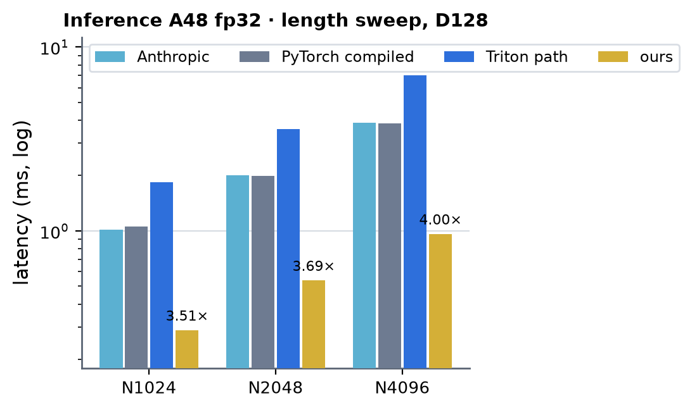 <!-- measure_bars -->

### Training A1 bf16

| (Length, Dimension) | PyTorch eager | PyTorch compiled | Triton path | ours | × |
|---|---|---|---|---|---|
| (128, 128) | 0.6379 | — | 0.4132 | 0.2251 | 1.84 |
| (1024, 128) | 0.9679 | — | 0.6977 | 0.2516 | 2.77 |
| (4096, 128) | 2.1258 | — | 0.4784 | 0.3715 | 1.29 |

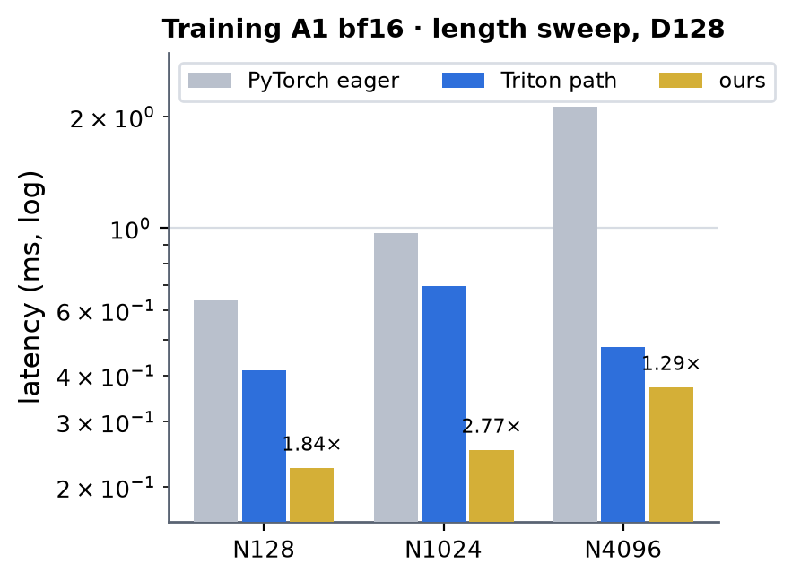 <!-- measure_bars -->

### Training A1 fp32

| (Length, Dimension) | PyTorch eager | PyTorch compiled | Triton path | ours | × |
|---|---|---|---|---|---|
| (128, 128) | 0.5207 | 0.2774 | 0.4862 | 0.2444 | 1.14 |
| (1024, 128) | 0.9129 | 0.3809 | 0.8368 | 0.2958 | 1.29 |
| (4096, 128) | 2.2382 | 0.6798 | 2.0882 | 0.4521 | 1.50 |

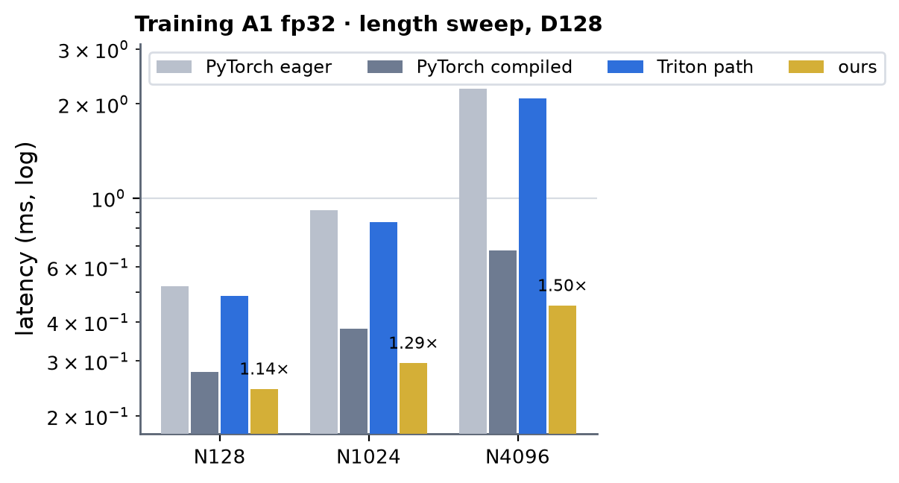 <!-- measure_bars -->

### Training A5 bf16

| (Length, Dimension) | PyTorch eager | PyTorch compiled | Triton path | ours | × |
|---|---|---|---|---|---|
| (512, 128) | 1.2085 | — | 0.8872 | 0.3219 | 2.76 |
| (2048, 128) | 2.3044 | — | 1.6967 | 0.4410 | 3.85 |
| (4096, 128) | 4.1257 | — | 1.1421 | 0.6579 | 1.74 |

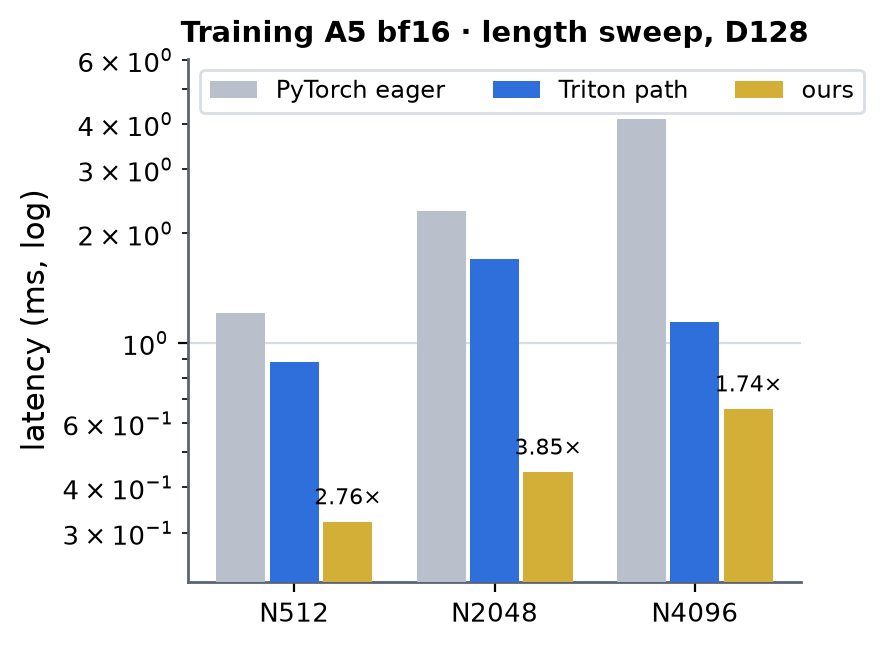 <!-- measure_bars -->

### Training A5 fp32

| (Length, Dimension) | PyTorch eager | PyTorch compiled | Triton path | ours | × |
|---|---|---|---|---|---|
| (512, 128) | 1.0943 | 0.4505 | 0.9993 | 0.3754 | 1.20 |
| (2048, 128) | 2.3384 | 0.9740 | 2.0331 | 0.6148 | 1.58 |
| (4096, 128) | 4.4103 | 1.6982 | 3.8258 | 1.0310 | 1.65 |

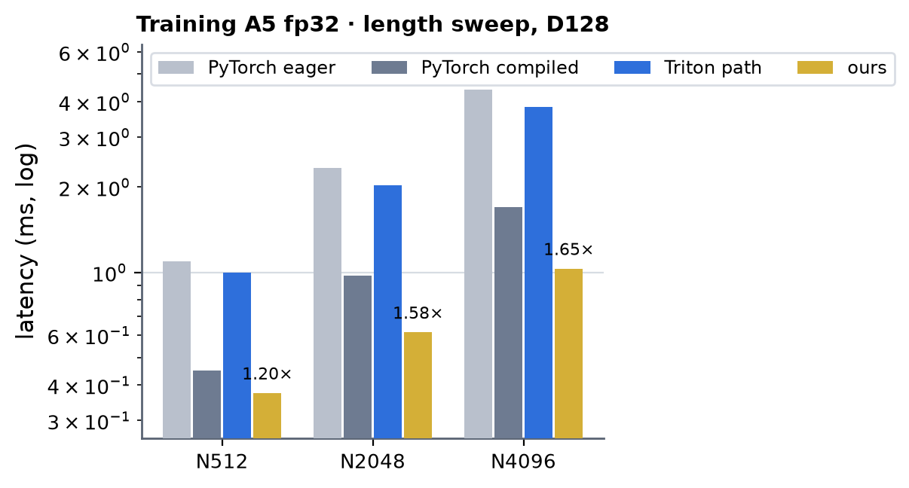 <!-- measure_bars -->

### Training A48 bf16

| (Length, Dimension) | PyTorch eager | PyTorch compiled | Triton path | ours | × |
|---|---|---|---|---|---|
| (1024, 128) | 7.1396 | — | 4.6719 | 1.1472 | 4.07 |
| (2048, 128) | 13.0445 | — | 9.1404 | 1.9227 | 4.75 |
| (4096, 128) | 25.2565 | — | 7.7564 | 3.5016 | 2.22 |
| (8192, 128) | 49.2224 | — | 15.2518 | 6.6166 | 2.31 |

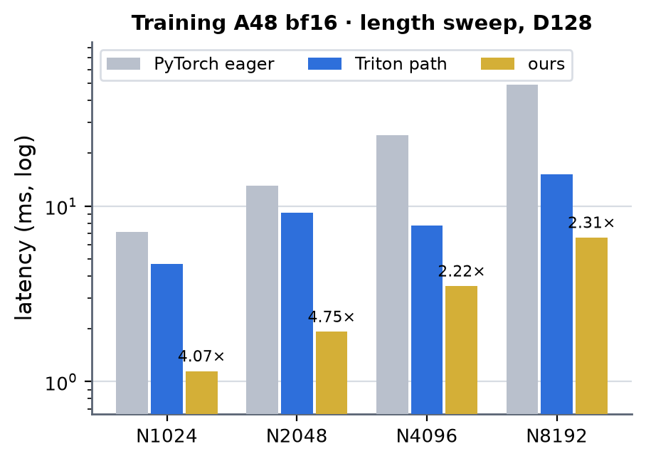 <!-- measure_bars -->

### Training A48 fp32

| (Length, Dimension) | PyTorch eager | PyTorch compiled | Triton path | ours | × |
|---|---|---|---|---|---|
| (1024, 128) | 7.4115 | 3.3872 | 5.7199 | 1.7834 | 1.90 |
| (2048, 128) | 13.3456 | 6.3472 | 11.0729 | 3.1963 | 1.99 |
| (4096, 128) | 26.1892 | 12.4396 | 21.7684 | 5.8052 | 2.14 |
| (8192, 128) | 50.3333 | 24.3405 | 42.2642 | 11.0817 | 2.20 |

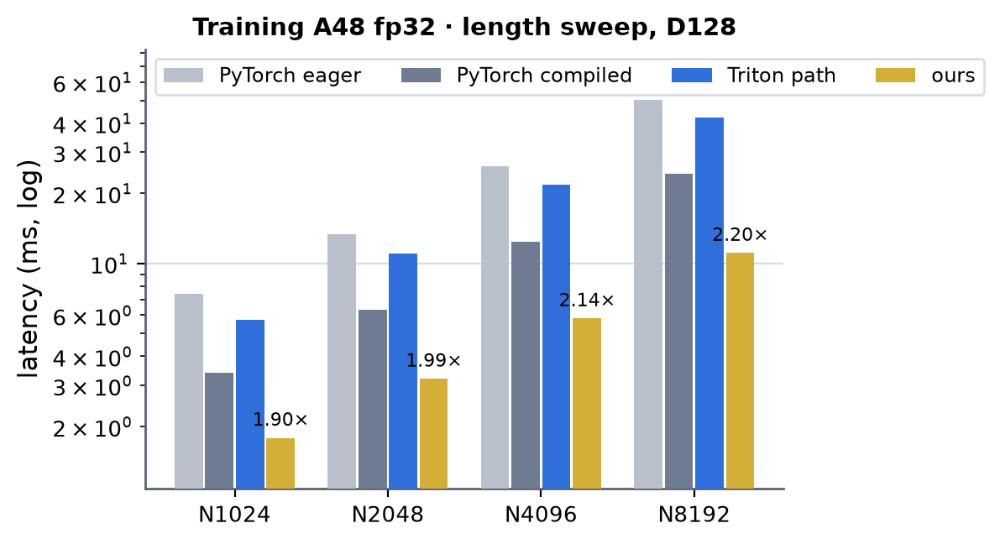 <!-- measure_bars -->

### Wide matrix (CUDA-graph timing of the module, ours vs PyTorch eager vs `torch.compile`)

336 cells: A in {1, 2, 3, 5, 12, 24, 48} x N in {64, 100, 300, 1000, 2048, 4096} (N not a multiple of 32 included) x {fp32, bf16} x
{per-sample conditioning, shared (expanded) conditioning} x {inference, training}, one CUDA graph per (implementation, cell)
(a scratch harness, not in the repository; the compiled module has `torch.autocast` inside the compiled function). Ours is the fastest
column in every cell. Speed-up over the faster of eager / compiled:

| mode / precision / conditioning | cells | smallest (cell) | mean |
|---|---|---|---|
| infer bf16 per-sample cond | 42 | 1.83x (A2 N64) | 4.19x |
| infer bf16 shared cond | 42 | 2.01x (A1 N64) | 8.59x |
| infer fp32 per-sample cond | 42 | 1.41x (A24 N64) | 2.14x |
| infer fp32 shared cond | 42 | 1.69x (A5 N64) | 2.69x |
| train bf16 per-sample cond | 42 | 2.40x (A24 N64) | 4.26x |
| train bf16 shared cond | 42 | 2.16x (A24 N64) | 4.22x |
| train fp32 per-sample cond | 42 | 1.09x (A5 N64) | 1.76x |
| train fp32 shared cond | 42 | 1.27x (A1 N300) | 3.05x |

Per-cell rows and the first-pass losses (fp32 training at N = 64, fixed by the attention chunk and `finalize90` launch changes):
[records/h100_local_dit_small_rows_20261015.md](../../../records/h100_local_dit_small_rows_20261015.md). Before the kernels of this page
(same harness): bf16 training (48, 4096) 11.7 ms, bf16 inference (5, 4096) 0.217 ms; fp32 had no native path (inference (5, 4096) 1.57 ms,
training (48, 4096) 21.8 ms).

## Per-kernel (profiler, H100 clocks, us; 2026-10-14, per-sample conditioning, before the small-row work)

| kernel | bf16 A48 N4096 | fp32 A48 N4096 | bytes floor bf16 / fp32 | note |
|---|---|---|---|---|
| cond90 | 278 | 433 | 150 / 300 | writes mod [M, 768] + mkv; sigmoid-bound |
| pre90 | 213 | 409 | 183 / 370 | |
| attn fwd | 140 | 216 | 67 / 135 | |
| post90 | 330 | 481 | 200 / 400 | |
| tr_bwd90 | 299 | 565 | 183 / 370 | |
| post_bwd90 | 417 | 764 | 316 / 630 | |
| attn dq + dkv | 513 | 720 | 183 / 370 | latency / instruction bound (~1300 instructions per warp-sample for 128 MMAs) |
| pre_bwd90 | 330 | 606 | 233 / 470 | |
| cond_bwd90 | 292 | 503 | 183 / 370 | |
| weight-gradient GEMMs (cuBLAS) | 610 | 1000 | 483 / 970 | HBM-bound (operands read once) |
| step | 3.6 ms | 6.0 ms | 2.4 / 4.4 ms | |

Inference (A5, 4096 atoms): bf16 post90 49 us, pre90 24 us, attention 19 us; fp32 60 / 56 / 35 us (single wave of 320 tiles over 132 SMs).

## What did not work / limits

- One warp per 16 rows with `mma.sync` and shared-memory B fragments (first version of the row kernels): smem-bandwidth and bank-conflict bound
  (4-way on fp32 float2 loads), 175 us for fp32 (5, 4096) against 151 us with wgmma and 16-byte lane vectors.
- 128-row CTAs (two warpgroups): wave quantisation at 20480 rows (160 tiles on 132 SMs); 64-row CTAs two per SM gave 114 -> 91 us (bf16 inference).
- Register arrays indexed by a run-time loop variable spill to local memory (`hf ? acc1 : acc0`): 255 registers + 256 B lmem made the three
  backward row kernels 4x slower; every accumulator loop is `#pragma unroll`.
- 128 registers (`launch_bounds(.., 2)`) for `pre90` fp32: spills, slower. The fp32 `post90` / backward row kernels need ~250 registers: one
  warpgroup per CTA, two CTAs per SM is the occupancy limit; the remaining gap to the byte floor is latency between phases.
- TMA weight ring (mbarrier full / empty, one producing thread, no CTA barriers) with persistent CTAs on `post90`: correct but slower
  (bf16 332 -> 377 us, fp32 478 -> 565 us at A48 / 4096 atoms): the persistent grid (2 CTAs per SM) loses the hardware's tile-level
  load balancing and the activation loads are not overlapped across tiles; a dedicated producer warp (160 threads) halves the CTAs per SM
  (255 registers x 160 threads) and `setmaxnreg` with a producer warpgroup caps the compile at 128 registers (spills). Kept: cp.async ring.
- Programmatic dependent launch between the kernels (`settings.local_dit_h100_pdl`, wait at the top of every kernel): +-1 us on the
  inference chains (the launch gaps inside a CUDA graph are already small); on by default, harmless. An early `launch_dependents` made
  the next kernel's CTAs sit resident while the previous one still had CTAs to run (96 vs 92 us).
- The same TMA ring without persistence (grid = tiles, thread 0 producing, mbarriers instead of CTA barriers): bf16 332 -> 328 us
  (inference 49.6 -> 47.5), fp32 478 -> 596 us (the 64-row K-major TF32 boxes), so not kept: one code path, cp.async.
- Shared conditioning, modulation gradients summed in fp32 over a CTA's samples by a sample loop (first build, replaced by the
  grouped-sample CTAs above): a CTA walked spc samples of its 64 atoms and accumulated dmod / dmkv in fp32 rows it owned; slower than per-sample bf16 rows
  plus one `sum(0)` at every SP (bf16 step 3.12 -> 3.7 ms at SP 8, 3.67 at 24 and 48; fp32 4.99 -> 5.4 / 5.1 ms): the fp32 partials
  are twice the bytes, the read-modify-write per sample is latency-exposed and the sample loop loses the CTA-level overlap. The
  replacement puts the samples in the warps of the CTA instead (no loop, no read-modify-write, one reduction through shared memory):
  kernel sum A48 bf16 3.27 -> 3.15 ms, fp32 5.21 -> 4.83 ms (per-pass slabs of 64 / 32 columns with two barriers each measured only
  bf16 3.52 -> 3.47: the 128-column slabs with one barrier per flush are the version kept).
- Fusing dQ into the key-centric dK / dV kernel: with the dbias sum over the samples kept in registers (samples outer, one key block per
  CTA) the dQ partials of a query block come from three key blocks and must leave the CTA (302 MB fp32 slots at A48 + a reduce, no gain
  over the 158 us dQ kernel); walking a run of key blocks keeps dQ in shared memory (the B200 design) but makes dbias per sample (400 MB)
  or needs spc x 24 KB of dQ windows. Structurally closed on H100 as long as dbias is summed over the samples in the kernel.
- Fusing dQ into the key-centric dK / dV kernel (first estimate) (the B200 `attn_dkvq`): a query's 128 keys span 2-3 key tiles, so the dQ partials need a
  cross-CTA sum (fp32 atomics: ~300 MB of reductions plus a zero / convert pass at A48, or a deterministic run-walk with carried smem
  windows). Estimated 100-130 us of traffic plus ~30 % more dKV work against the 158 us dQ kernel it replaces: not built.
- 128-row CTAs (two warpgroups) per kernel: only the fp32 `tr_bwd90` wins (565 -> 491 us, `_NWARP`); all other kernels lose 5-15 %.
- Thread-block clusters / TMA multicast of the weights: not tried; the backward row kernels are at 70-80 % of L2 and DRAM throughput already.
- Ablations (A48, 4096 atoms, bf16; `ABL_*` ablation builds through the former `ATTN_DEFS` / `ROW_DEFS` compile hooks, since removed): removing the dbias accumulation saves 22 us of the
  476 us attention backward, the pair-bias reads 0, the exponentials and PV products ~0 (they hide behind loads), the activation loads
  66 us, the bias-band prologue 40 us, the stores ~120 us (dK / dV through 16-byte vector stores staged in the warp's own shared rows: dkv
  295 -> 274 us). Removing every weight load from the row kernels saves 0.2 ms of the 3.6 ms step (cond90 267 -> 164 us, the others
  5-12 %), so a cluster TMA multicast of the weights could recover at most ~0.1 ms. The kernels are bound by activation traffic and
  phase latency, not by ALU: packed bf16x2 elementwise math would not move them.
- Conditioning tables fused into pre / post (per-sample cond, no table in memory; designed, not built): inference calls hoist the tables
  once per conditioning tensor (`local_dit_hoist`, default on), so the steady-state step already pays no table kernel and a fused
  recompute per call would only add GEMM work; training needs mod / mkv again in the three backward kernels, so the write stays.
  Gain: none in either mode.
- Grouped weight-gradient kernel: the cuBLAS GEMMs read each operand once (29 T bf16 = 435 us at HBM rate against 490 us measured); a
  fused accumulation inside the row kernels would need a [512, 128] fp32 accumulator per CTA (256 KB) and MN-major operands: not built.
- Open: the bf16 attention backward at B200's ~60 % of floor (needs fewer instructions per element or more warps); the `post90` forward and
  `pre_bwd90` are not split over CTAs (small row counts); a shared conditioning with A not a multiple of four takes per-sample rows (about
  0.05 ms slower than the grouped path at A5 / 4096 atoms, still faster than every other column); kernel sums sit at 65-75 % of the byte
  floor, not at 90 %.

## AlphaFold 3 variant (`kv_norm="parallel"`, `key_window="slide"`)

AF3 normalises the keys and values with a second AdaLN of the *raw* atoms and gives every query window the 128 keys `[32 w - 48, 32 w + 80)` slid back inside the real atoms. The H100 mma kernels serve both options for inference (fp32/TF32 and bf16): `pre90` takes a `par` flag for the K/V AdaLN input, the slid window is the clipped one except for windows 0 and 1 and the last three real windows, recomputed in torch from the kernels' q/k/v and written over the attention output. Not served (composed path): a call with grad. The real atom count is a device tensor, so a slide runs under CUDA graph capture and below 128 real atoms (keys past the last atom are masked). Checked against the fp64 PyTorch module for real atom counts 140 to 512 (`tests/gpu/sm90/test_h100_local_dit_af3_variant_gpu.py`); speed not measured.

## ESMFold2 variant (`LocalDiTBlock(**ESMFOLD2)`, inference)

ESMFold2's three atom stacks (FoldForge `spec.ESMFOLD2` / `ESMFOLD2_FAST`: the trunk-input encoder, the diffusion encoder and decoder,
`DiffusionCrossAttTransformer`) are the AF3 block above -- parallel K/V AdaLN, slid window, per-window pair bias, gating query, output
projection, transition n = 2 -- with four changes, all options of `LocalDiTBlock` (`modules.local_dit.ESMFOLD2` holds the set):

- **Conditioning** (`conditioning="rms_silu"`): every AdaLN is `AdaptiveRMSNorm`, `(1 + W_s silu(c)) * x / sqrt(mean(x^2) + eps) + W_b silu(c)`
  with eps = float32's epsilon whatever the dtype (no conditioning LayerNorm, no biases), and the attention's and the transition's output gates are
  raw `W silu(c)` (no sigmoid, no bias). Parameters: `ada_ln_*.{to_scale,to_bias}.weight`, `{attention,transition}.to_scale.weight`.
- **q / k** (`use_qk_norm=True`, `rope=True`): a per-head RMSNorm (float32 eps; ESMFold2's is affine-free, so its weights stay 1), then a rotary
  split into halves (channel `c < 16` of a head pairs with `c + 16`, `(a, b) -> (a cos - b sin, b cos + a sin)`) with per-atom tables
  `forward(..., rope=(cos, sin))`, each `[B, N, 16]`; FoldForge builds them from the reference conformer (`build_atom_rope`: 3 axes x 2 spatial
  frequencies, base 20, then 10 space-uid frequencies, base 1e4). The keys take their own atoms' rows.
- **Keys** (`keys=192`, `window_half=64`): every window's subset is 192 keys slid as AF3 slides its 128 (`[32 w - 80, 32 w + 112)`; a window short
  of atom 0 starts at 0, otherwise it ends at the last real atom at the latest, so below 192 real atoms it starts before atom 0, on AF3's padding),
  and query `i` sees key `j` only when `|i - j| <= 64` by rank among the real atoms (the position: the real atoms come first). The pair is the
  trunked `[1, nwin, 32, 192, 16]`, read from each window's first key as laid out by the featuriser.

**Kernels** (inference, fp32/TF32 and bf16):

    cond90 (-DRMS=1, hoisted) -> pre90 (-DRMS=1) -> qknorm_rope -> pair_bias_esm (hoisted) -> attn_esm -> post90 (-DRMS=1)

- Row kernels: the AF3 ones built with `-DRMS=1` (`sm90_atom/rms90.cuh`: `norm_stats` = RMSNorm statistics, `cond_act` = no sigmoid); the
  27-parameter weight pack takes constants where ESMFold2 has none (LN weights 1, scale biases 1, gate biases 0), so the tables come out as
  `1 + s`, `b` and the raw gates. The backward row kernels are untouched (their cubins keep their keys).
- `qknorm_local.cu::qknorm_rope_fwd`: the QK-norm forward with the rotary after it (the partner channel is lane ^ 4), fp32 outputs rounded to tf32.
- `sm100_atom_local/lattn90_esm.cu`: `h_pair_bias_esm` re-indexes the bias by *position* once per pair tensor -- `[4, nwin, 32, 160]` for the
  positions `32 w - 64 + c`, read from the subset slot that holds them, -inf outside the band, the real keys or the subset (the AF3 slide from the
  real atom count on the device, so no host read and the call captures) -- since for a real query the band cut to the real atoms always lies inside
  its window's subset. `h_attn_esm` / `h_attn_esm_tf32`: a CTA = 64 queries x 1 head x a chunk of samples stages the 192 positions
  `[q0 - 64, q0 + 128)`; a warp walks the 144 positions its 16 queries can see (18 key tiles against the AF3 kernel's 16).
- Contract (`local_dit_h100._esm_matches`): exactly the `ESMFOLD2` set at the atom widths, no gradient recorded, the rotary tables `[1, N, 16]`,
  otherwise as the AF3 block (bf16 or fp32, any A, any N, a `[1, N]` real-first key mask). A call with grad runs the composed PyTorch path.
  Bitwise deterministic; runs inside a CUDA graph capture. Tests: `tests/cpu/compile/test_local_dit_esmfold2_variant.py` (the module against a
  per-window definition, fp64), `tests/gpu/sm90/test_h100_local_dit_esmfold2_gpu.py`.

**Parity with FoldForge** (2026-10-21, fp32, the engine's PyTorch path against FoldForge's dense `DiffusionCrossAttTransformer(spec=ESMFOLD2)`
with its weights copied, gathers from AF3's own featuriser at 192 keys, ragged token layouts, real atoms 150-24 500, A 1 and 5): relative error
2.1e-7 - 7.4e-7 over the random-weight stack and the three trained stacks of the converted ESMFold2 checkpoint, below either side's own error
against the fp64 engine module (0.67 of it at worst). Script: `~/miniworld-engine-scratch/esm-atom/parity.py` (outside the repo).

**Accuracy** (relative error of the valid rows against the fp64 module; the same weights and inputs):

| A | N | real | fp32 kernels (TF32) | bf16 kernels | bf16 PyTorch module | fp32 PyTorch module |
|---|---|---|---|---|---|---|
| 1 | 256 | 256 | 3.72e-04 | 5.43e-03 | 5.35e-03 | 2.67e-07 |
| 2 | 512 | 400 | 3.68e-04 | 5.38e-03 | 5.29e-03 | 2.63e-07 |
| 5 | 1024 | 1000 | 3.73e-04 | 5.39e-03 | 5.28e-03 | 2.95e-07 |
| 1 | 384 | 150 | 3.78e-04 | 5.42e-03 | 5.35e-03 | 3.03e-07 |
| 3 | 640 | 193 | 3.78e-04 | 5.38e-03 | 5.32e-03 | 2.99e-07 |
| 5 | 4096 | 4000 | 3.72e-04 | 5.35e-03 | 5.24e-03 | 2.95e-07 |
| 5 | 24576 | 24500 | 3.72e-04 | 5.35e-03 | 5.25e-03 | 2.96e-07 |

**Timing** (2026-10-21, H100 SXM, CUDA graph of one block call replayed, A = 5 samples sharing one conditioning, all atoms real, ms; record
[local_dit_h100_esmfold2_20261021](../../../records/local_dit_h100_esmfold2_20261021.md)). *kernels*: every stage recomputed each replay;
*static*: under `kernels._capture.static_inputs()` (the conditioning tables and the pair bias made once, as a sampler's steps over one item
see them). PyTorch = the same module on `ImplementationType.PYTORCH` (fp32 matmuls without TF32), compiled = `torch.compile` of it; both
graph-captured. × = PyTorch (compiled) / kernels.

| (Length, Dimension) | fp32 kernels | fp32 static | fp32 PyTorch | fp32 compiled | × | bf16 kernels | bf16 static | bf16 PyTorch | bf16 compiled | × |
|---|---|---|---|---|---|---|---|---|---|---|
| (1024, 128) | 0.078 | 0.060 | 0.935 | 0.319 | 12.0 (4.1) | 0.058 | 0.046 | 0.812 | 0.195 | 14.0 (3.4) |
| (2048, 128) | 0.121 | 0.093 | 1.673 | 0.524 | 13.8 (4.3) | 0.082 | 0.061 | 1.424 | 0.308 | 17.5 (3.8) |
| (4096, 128) | 0.209 | 0.166 | 3.204 | 0.971 | 15.3 (4.6) | 0.130 | 0.099 | 2.623 | 0.519 | 20.2 (4.0) |
| (8192, 128) | 0.362 | 0.293 | 6.268 | 1.850 | 17.3 (5.1) | 0.218 | 0.172 | 5.124 | 0.989 | 23.5 (4.5) |
| (16384, 128) | 0.647 | 0.528 | 12.303 | 3.415 | 19.0 (5.3) | 0.397 | 0.319 | 10.356 | 1.969 | 26.1 (5.0) |
| (24576, 128) | 0.918 | 0.760 | 18.242 | 5.040 | 19.9 (5.5) | 0.563 | 0.457 | 15.485 | 2.917 | 27.5 (5.2) |

Per kernel (torch profiler, eager, hoist off, A = 5, us; N = 8192 / 24576): bf16 `post90` 66 / 185, `pre90` 44 / 122, `h_attn_esm` 40 / 102,
`h_pair_bias_esm` 25 / 66, `qknorm_rope` 18 / 49, `cond90` 15 / 28; fp32 `pre90` 98 / 265, `post90` 92 / 233, `h_attn_esm_tf32` 68 / 162,
`h_pair_bias_esm` 39 / 100, `qknorm_rope` 31 / 92, `cond90` 25 / 48. Against the AF3 block at the same A (the tables above, per-sample
conditioning there) the variant is about 1.3x slower: 25 % more keys per query, the wider pair (192 keys), and the separate q / k pass.

**Not done**: training (the backward row kernels know neither the RMS conditioning nor the raw gates, and the attention backward neither the band
nor the position-indexed bias; a call with grad runs the composed path); fusing `qknorm_rope` into `pre90`'s epilogue (8-10 % of the block);
a B200 path (the sm100 kernels decline the variant).
