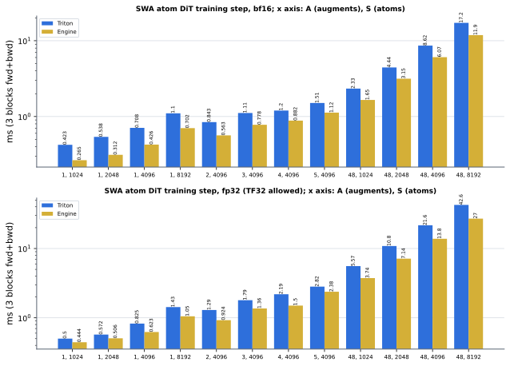
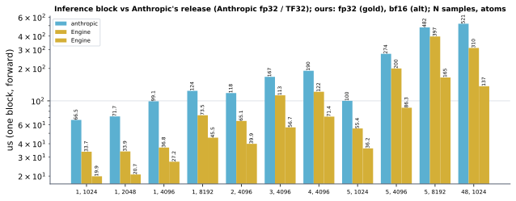
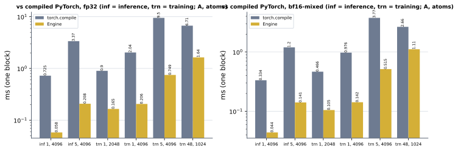

# SWA atom DiT on H100 (sm90)

Kernel-level status of the ESMFold2-style SWA atom DiT block (MiniWorld `block_style: esmfold2`, engine `modules/swa_dit`) on
H100: adaLN (RMSNorm, shift / scale / gate from the conditioning) -> q | k | v | gate projection with per-head RMS norm and RoPE ->
sliding-window attention (|i - j| <= 64, 4 heads x 32) -> gated out-projection + residual -> adaLN + SwiGLU (hidden 256) + residual;
d_single = d_cond = 128. The module-level summary is in [h100.md](../h100.md); the B200 counterpart is
[../../b200/swa_atom_dit/swa_atom_dit.md](../../b200/swa_atom_dit/swa_atom_dit.md).

**Every stage of the block is hand-written CUDA on H100, in bf16 and in fp32, for inference and training.** The weight-gradient
GEMMs of the backward and the hoisted adaLN modulation (`swa_dit_hoist_modulation`, outside the block) have their own hand-written
kernels too (see "Weight gradients and modulation" below): the bf16 weight gradients on TMA + wgmma at every row count, the fp32
ones up to 65536 rows (cuBLAS's TF32 GEMMs are faster above), the bf16 modulation on mma.sync / wgmma; the fp32 modulation stays on
torch's GEMMs. Nothing autotunes: tiles and launch shapes are fixed, so there is no
dependence on an H100 autotune cache. The Triton kernels (`triton/forward*.py`, `backward*.py`) remain the non-H100 path, the
fallback when an extension does not build, and the accuracy reference the tests compare against.

## Where the code is

| stage | bf16 | fp32 (TF32 tensor cores) |
|---|---|---|
| qkvg forward (RMS-adaLN + 4 projections + head RMS + RoPE) | `swa_slab.cu` (16-row slabs) or `swa_qkvg_fwd.cu` (64-row wgmma) | `swa_fp32.cu` |
| window attention forward | `swa_attn.cu` (mma.sync, one pass over the <= 144 keys a warp reaches) | the same bf16 attention kernel (FlashAttention-4's precision in the per-op fp32 path) |
| gated out-projection + residual + RMS-adaLN + SwiGLU + residual | `swa_slab.cu` or `swa_ffn_fwd.cu` | `swa_fp32.cu` |
| FFN backward | `swa_slab.cu` or `swa_ffn_bwd.cu` | `swa_fp32.cu` |
| out-projection backward | `swa_slab.cu` | `swa_fp32.cu` |
| window attention backward (dq, dk, dv in ONE kernel) | `swa_attn.cu` | `swa_attn.cu` |
| qkvg backward | `swa_slab.cu` | `swa_fp32.cu` |
| hoisted modulation, silu(c) Wmod^T and its backward | forward `swa_mod_wg.cu` (TMA + wgmma) else `swa_mod.cu` (mma.sync); backward `swa_mod.cu`, exact products | torch GEMMs (TF32 cuBLAS) |
| wgmma FFN kernels' weight layouts (A % 8 == 0, large rows) | `swa_pack.cu`, one launch, cached per step | - |
| weight gradients (dWqkv, dWg, dWo, dWu, dWd), M = N S rows | `swa_wgrad_wg.cu` (TMA + wgmma, every M); `swa_wgrad.cu` `wgrad` (mma.sync) up to 16384 rows if that does not build | `swa_wgrad_wg_f32.cu` (TMA + wgmma on bf16 planes) up to 65536 rows; `swa_wgrad.cu` `wgrad_f32` up to 8192 rows if that does not build; else cuBLAS TF32 |

- bf16: the slab kernels (4-warp groups, weights resident in shared memory, built for the small row counts the block mostly runs at)
  or team-gm's wgmma kernels serve the qkvg forward / out-projection + FFN forward / FFN backward; `swa_dit_rows_impl="auto"`
  picks the wgmma kernels when A % 8 == 0 and rows >= 5120 / 5120 / 20480 (measured crossover), else the slab kernels. On the CUDA
  backward the attention side shares one [M, 4C] buffer.
- fp32: `swa_fp32.cu` is one `fwd` and one `bwd` call; tf32 wgmma with round-to-nearest operands, the FFN weights split in two
  tf32 passes (hi + lo), residual stream / norms / modulation / gates / RoPE / SwiGLU / every saved tensor in fp32, the window
  attention on bf16 operands. It is served while TF32 is allowed (`torch.set_float32_matmul_precision("high"/"medium")`) and
  `swa_dit_fp32_cuda` is on; under "highest" the Triton fp32 kernels serve.
- Dispatch is gated on compute capability 9.0 (`cuda/loader.py:is_sm90`); other GPUs take the Triton path. Switches:
  `swa_dit_qkvg_fwd_cuda`, `swa_dit_ffn_fwd_cuda`, `swa_dit_ffn_bwd_cuda`, `swa_dit_attn_cuda`, `swa_dit_oproj_bwd_cuda`,
  `swa_dit_qkvg_bwd_cuda`, `swa_dit_rows_impl`, `swa_dit_fp32_cuda`, `swa_dit_mod_cuda`, `swa_dit_wgrad_cuda` (all default on);
  `engine_backend="triton"` turns them all off.

## Weight gradients and modulation (2026-10-14)

The backward's four weight-gradient GEMMs (dWqkv | dWg = dP^T x, dWo = datt^T gated, dWu = dab^T y, dWd = dffn^T h) and the
hoisted adaLN modulation used to be cuBLAS / torch calls around the block kernels: 40 % of the A = 1, S = 4096 bf16 step (0.30 ms
of 0.66 ms, SIMT fp32 GEMMs plus splitK reductions plus eager casts). They are kernels of their own now:

- `swa_wgrad.cu`: all of one block's weight gradients in ONE launch, as 11 output tiles of 128 x 128; a cluster of 8 CTAs owns a tile
  and splits K = M rows 8 ways through a 3-stage cp.async ring, parks its fp32 tile in shared memory, and after a cluster barrier each
  CTA sums 16 rows over the eight partials in rank order (distributed shared memory) and stores them: deterministic, no workspace.
  bf16 `wgrad`: mma.sync m16n8k16 on the saved bf16 operands, bf16 gradients, the cuBLAS GEMM's up to summation order (relative
  difference 1e-4 = the bf16 rounding of the result). fp32 `wgrad_f32`: every staged operand element is split into hi + lo bf16 and
  a x b = hi hi + hi lo + lo hi (~2^-16): against an fp64 reference **4.8e-6 at M = 4096 against 3.0e-4 for cuBLAS's TF32 GEMMs**, fp32
  gradients. These mma.sync kernels are the fallbacks since the TMA + wgmma kernels below (they serve every row count in bf16). Against
  cuBLAS, measured standalone, graph replay, the five GEMMs they replace:

  | M = N S | bf16 ours / cuBLAS (us) | fp32 ours / cuBLAS (us) |
  |---|---|---|
  | 2048 | 15.2 / 25.5 | 21.6 / 34.3 |
  | 4096 | 19.5 / 30.5 | 33.4 / 45.6 |
  | 8192 | 27.7 / 38.3 | 57.7 / 61.5 |
  | 16384 | 44.1 / 49.2 | 103.8 / 84.8 |
  | 49152 | 110.8 / 111.5 | - |

- `swa_mod_wg.cu` (the modulation forward on TMA + wgmma, bit-identical to the mma.sync kernel): a 64-row tile and two 128-channel
  Wmod chunks arrive in one TMA wave, silu is applied in place on the swizzled tile, 8 wgmma m64n128k16 per chunk; 10.4 -> 8.3 us at
  R = 4096. The backward stays on `swa_mod.cu`.
- `swa_mod.cu` (bf16, any matmul precision): `mod_fwd` is a persistent mma.sync kernel (Wmod chunk resident, silu(c) built in
  registers, the bf16 silu(c) kept for the backward); `mod_bwd` is one launch with two roles -- dc (32 rows x 128 channels, K = 768,
  Wmod chunks through cp.async, silu' in the epilogue) and dW (channel tile x row range, dmod and silu(c) through a cp.async ring,
  partials reduced in order by `mod_dw_reduce_kernel`). dmod (fp32) is split into THREE bf16 planes (exact), so dc and dWmod are the
  fp32 GEMMs of the torch path up to summation order; silu is rounded to bf16 as `F.silu` on a bf16 tensor. Against an fp64
  reference (R = 4096): output 1.65e-3 (torch 1.65e-3), dc 1.66e-3 (torch 2.36e-3), dW 2.35e-3 (torch 2.36e-3). fp32 c / Wmod stay
  on torch's TF32 GEMMs: a bf16-plane fp32 variant was more accurate (4e-6 against 3e-4) but not faster than cuBLAS.
- The dmod buffer is `torch.empty` instead of a zero fill when every backward kernel stores its columns plainly (the slab kernels at
  A in 1, 2, 4, 8, 16): one 4.4 us fill kernel per block less.

- `swa_wgrad_wg.cu` (2026-10-14, evening): the same bf16 weight gradients on Hopper's asynchronous units -- a TMA producer warp, a
  4-stage mbarrier ring (64 rows x (A 128 + B 128) bf16), two consumer warpgroups issuing wgmma m64n128k16 with both operands
  MN-major from 128 B-swizzled shared memory (transpose bits), the same 8-CTA cluster K split and in-order DSMEM reduction. Output
  bit-identical to the mma.sync kernel; M = 4096 / 16384 / 49152 / 196608: 14.6 / 32.2 / 73.9 / 266 us against mma.sync 19.7 / 44.6 /
  109 / 399 and cuBLAS 30.5 / 49.4 / 111 / 311 (2.55-2.84 TB/s at the large sizes). It serves every row count, so the A = 48 steps
  take it too: bf16 A = 48, S = 1024 1.800 -> 1.686 ms, S = 4096 6.252 -> 6.152 ms, A = 1, S = 4096 0.444 -> 0.433 ms.

- `swa_wgrad_wg_f32.cu`: the fp32 weight gradients on the same machinery -- fp32 operands arrive by TMA (32-row stages, 128 B
  swizzle), the 256 consumer threads split them into hi / lo bf16 planes in MN-major swizzled shared memory, two warpgroups run
  hi hi + hi lo + lo hi on wgmma. Error against fp64 4.7e-6 (M = 4096; cuBLAS TF32 3.0e-4). M = 2048 / 4096 / 8192 / 49152 / 196608:
  18.4 / 25.5 / 40.4 / 178.6 / 664 us against cuBLAS TF32 34.6 / 46.8 / 61.8 / 185.4 / 572 (mma.sync planes: 21.9 / 33.8 / 58.2 /
  289 / 1112). Served up to 65536 rows; above, cuBLAS's TF32 GEMMs stay (faster, 15-60x less accurate). fp32 A = 1, S = 4096
  0.652 -> 0.623 ms, A = 5 2.415 -> 2.377 ms; A = 48, S = 1024 unchanged (tie) with the more accurate gradients.

- Programmatic dependent launch (`cuda/pdl.cuh`): every kernel of the chain after the two heads (`mod_fwd`, `qkvg_fwd`, whose weights
  may be cast by a torch op right before) is launched with `cudaLaunchAttributeProgrammaticStreamSerialization` -- also under CUDA-graph
  capture -- and calls `griddepcontrol.wait` after its weight prologue, so its launch and weight copies run under the previous kernel's
  tail; the gate comes before any read of a predecessor's output or write to a buffer a predecessor reads. bf16 3 blocks fwd + bwd:
  A = 1, S = 1024 0.296 -> 0.261 ms, S = 4096 0.433 -> 0.427, S = 8192 0.718 -> 0.702; A = 48, S = 1024 1.686 -> 1.646, S = 4096
  6.252 -> 6.133 (with the wgmma weight gradients; 6.071 after the weight-layout pack). The gain is small because the launch gaps were 5 % of the step and the kernels
  run one CTA per SM, so the next kernel's CTAs can only start their copies when shared memory is free.
- The graph-replay test's noise is not from these kernels: replay-vs-replay, replay-vs-eager and eager-vs-eager differences of
  c_base / w_adaln are 1e-7 .. 2e-5 with `swa_dit_mod_cuda`, `swa_dit_wgrad_cuda` or both off as well (fp32 atomic order in dmod, then
  bf16 rounding flips); the weight gradients from the new kernels are bit-identical run to run.

## Measured (H100, CUDA-graph replay, 3 blocks, fwd + bwd, N = 1 sample, B = 1; 2026-10-14)

"Triton fused" is the fused block with `engine_backend="triton"` (every CUDA stage off, no H100 autotune cache: the heuristic
fallback config, which is how a fresh install runs); "CUDA" is the default. bf16 under `torch.set_float32_matmul_precision("highest")`,
fp32 under "medium" (TF32 allowed: the only precision the fp32 CUDA stages serve). Harness: `bench.py` of the 2026-10-14 record.

| dtype | A | S (atoms) | Triton fused (ms) | CUDA (ms) | CUDA vs Triton |
|---|---|---|---|---|---|
| bf16 | 1 | 1024 | 0.423 | 0.265 | 1.60x |
| bf16 | 1 | 4096 | 0.708 | 0.426 | 1.66x |
| bf16 | 1 | 8192 | 1.101 | 0.702 | 1.57x |
| bf16 | 5 | 4096 | 1.507 | 1.124 | 1.34x |
| bf16 | 48 | 1024 | 2.334 | 1.653 | 1.41x |
| bf16 | 48 | 4096 | 8.624 | 6.071 | 1.42x |
| fp32 | 1 | 1024 | 0.500 | 0.444 | 1.13x |
| fp32 | 1 | 4096 | 0.825 | 0.623 | 1.32x |
| fp32 | 1 | 8192 | 1.427 | 1.050 | 1.36x |
| fp32 | 5 | 4096 | 2.817 | 2.377 | 1.19x |
| fp32 | 48 | 1024 | 5.566 | 3.742 | 1.49x |
| fp32 | 48 | 4096 | 21.647 | 13.806 | 1.57x |

(bf16 A = 1, S = 2048 was not re-measured after the wgmma / PDL changes.)

The module's per-op path (FlashAttention-4 + separate ops; measured 2026-10-04, unchanged by this work) took 1.654 ms (fp32, A = 1,
S = 4096) and 10.328 ms (fp32, A = 48, S = 1024): the fused CUDA block is 2.5x and 2.8x ahead of it. Before this work the same
bf16 A = 1, S = 4096 step took 0.656 ms (2026-10-04: 0.657) and the fp32 one 0.700 ms; bf16 A = 48, S = 1024 took 1.869 ms.
Against the compiled PyTorch module (harness, one block, bf16-mixed, shared conditioning, CUDA graph): inference A = 1 / 5 at 4096
atoms 0.334 / 1.19 ms against 0.046 / 0.142 ms here; training fwd + bwd A = 1 / 48 (4096 / 1024 atoms) 0.97 / 2.67 ms against
0.146 / 1.14 ms. Neither Anthropic's package nor cuEquivariance has a SWA atom block (the protocol record marks it unsupported).

## Fusion boundaries

What one kernel does, and what stays outside (checked in the sources, 2026-10-15):

| kernel | inside |
|---|---|
| qkvg forward | RMSNorm + adaLN shift / scale, the four projections, per-head RMSNorm, RoPE |
| window attention | sliding window |i - j| <= 64, key mask j < seqused, zero output for padded queries, softmax, lse |
| out-projection | sigmoid(g) o gating, Wo, gate_a, the attention residual (q1) |
| FFN forward | adaLN, SwiGLU, Wd, gate_f, the FFN residual (fp32: one kernel with the out-projection) |
| each backward | gate / residual / adaLN backward, RoPE and RMSNorm backward, dmod accumulation (row statistics, sum over augments) |

Padded rows still run the FFN (as the module); only their attention output is zero. The forward is four kernels with no torch
elementwise op between them. Outside the block kernels: the hoisted modulation (once per atom, shared by the augments, read by three
consumers), the weight gradients (a K = rows reduction), the `dmod` zero fill where the accumulation is atomic (A not in 1, 2, 4,
8, 16), the autograd sum of the blocks' `dc` into the shared conditioning, and the 13 saved tensors the backward reads back (saved,
not recomputed). The wgmma FFN kernels' weight layouts (`wab`, `Wd^T`, `wab^T`) are one launch (`swa_pack.cu`) instead of four torch
copies, cached for the backward of the same step: A = 48 bf16 1.665 -> 1.653 ms (S = 1024), 6.133 -> 6.071 ms (S = 4096).

## Against Anthropic's release and cuEquivariance (inference forward, 2026-10-14)

The release (`uplifting-biomolecular-modeling` f4f62fa, Triton) has no fused SWA atom block and no backward (its low-level kernels
run under `no_grad`); cuEquivariance 0.12 has no atom attention at all, only triangle attention / multiplication. So the baselines are
built from what each provides, at this block's widths (C 128, 4 heads x 32, SwiGLU 256), forward only, CUDA-graph replay, one H100:

- **Anthropic block**: `atom_window.ln_qkvg` + `window_attn` (LayerNorm + both adaLN modulations + q|k|v|g + 32 x 128 shifted-window
  attention with pair bias + sigmoid gate + W_o + residual; fp32 interface, `tf32rn`) followed by the FFN half from `dtk_kernels.ln_modulate`
  + cuBLAS (TF32) + `dtk_kernels.swiglu` + cuBLAS + gated residual. Its window is the AF3 32-query x 128-key block window with a pair
  bias, ours the sliding |i - j| <= 64 without a bias: same shape class, not the same mask.
- **cuEquivariance**: `triangle_attention` run dense over the atoms with the window as a -1e9 bias (bf16): the only way its op expresses
  this attention; it measures the attention core only.
- Ours is the block forward without the hoisted modulation (computed once outside); Anthropic's rows take their conditioning as given.

| samples N | atoms | ours bf16 block (us) | ours fp32 block (us) | Anthropic block (us) | Anthropic attention half | ours bf16 attention half | cuEq dense attention core | ours attention core |
|---|---|---|---|---|---|---|---|---|
| 1 | 1024 | 19.9 | 33.7 | 66.5 | 50.9 | 22.3 | 22.2 | 8.9 |
| 1 | 4096 | 27.2 | 36.8 | 99.1 | 60.2 | 31.3 | 161.4 | 12.4 |
| 5 | 1024 | 36.2 | 55.4 | 100.0 | 57.1 | 37.0 | 43.1 | 12.9 |
| 5 | 4096 | 86.3 | 200.2 | 273.8 | 175.2 | 68.9 | 618.6 | 23.4 |

Whole block: 3.3 / 3.6 / 2.8 / 3.2x ahead of Anthropic's in bf16, 2.0 / 2.7 / 1.8 / 1.4x in fp32 (TF32). The fp32 block at N = 5, 4096
atoms is the weakest cell (200 us; the tf32 out-projection + FFN kernel). The attention core is 2.5-26x ahead of the dense cuEquivariance
kernel. Training cannot be compared: neither package has a backward for this block.

### Coverage of the comparisons (2026-10-14, evening)

Training, 3 blocks fwd + bwd, graph replay, Triton fused -> CUDA (ms):

| dtype | A, S | Triton fused | CUDA | x |
|---|---|---|---|---|
| bf16 | 1, 2048 | 0.538 | 0.312 | 1.72 |
| bf16 | 2, 4096 | 0.843 | 0.563 | 1.50 |
| bf16 | 3, 4096 | 1.112 | 0.778 | 1.43 |
| bf16 | 4, 4096 | 1.198 | 0.882 | 1.36 |
| bf16 | 48, 2048 | 4.438 | 3.154 | 1.41 |
| bf16 | 48, 8192 | 17.21 | 11.86 | 1.45 |
| fp32 | 1, 2048 | 0.572 | 0.506 | 1.13 |
| fp32 | 2, 4096 | 1.295 | 0.924 | 1.40 |
| fp32 | 3, 4096 | 1.795 | 1.363 | 1.32 |
| fp32 | 4, 4096 | 2.189 | 1.501 | 1.46 |
| fp32 | 48, 2048 | 10.85 | 7.139 | 1.52 |
| fp32 | 48, 8192 | 42.62 | 27.00 | 1.58 |

Inference forward against Anthropic's assembled block (us; ours bf16 / ours fp32 / Anthropic): N = 1, 2048 atoms 20.7 / 33.9 / 71.7;
N = 2, 4096 39.9 / 65.1 / 118.3; N = 3, 4096 56.7 / 112.6 / 167.3; N = 4, 4096 71.4 / 121.5 / 190.4; N = 1, 8192 45.5 / 73.5 / 124.0;
N = 5, 8192 165.0 / 396.8 / 482.2; N = 48, 1024 136.9 / 310.4 / 521.0. Smallest margin: fp32, N = 5, 8192 atoms, 1.22x.

The cuEquivariance dense kernel does not run at 8192 atoms (N x S x S bias) and is 4-26x behind elsewhere.

Compiled PyTorch module against ours (harness, one block, `+shared_cond`, CUDA graph, ms; PyTorch `compile=true`, ours `compile=false`
because the fused ops are opaque to Dynamo):

| precision | mode | A, atoms | PyTorch | ours | x |
|---|---|---|---|---|---|
| fp32 | inference | 1, 4096 | 0.725 | 0.058 | 12.4 |
| fp32 | inference | 5, 4096 | 3.368 | 0.208 | 16.2 |
| fp32 | training | 1, 2048 | 0.900 | 0.165 | 5.5 |
| fp32 | training | 1, 4096 | 2.035 | 0.206 | 9.9 |
| fp32 | training | 5, 4096 | 9.497 | 0.749 | 12.7 |
| fp32 | training | 48, 1024 | 6.708 | 1.638 | 4.1 |
| bf16-mixed | inference | 1, 4096 | 0.334 | 0.044 | 7.6 |
| bf16-mixed | inference | 5, 4096 | 1.197 | 0.141 | 8.5 |
| bf16-mixed | training | 1, 2048 | 0.466 | 0.105 | 4.4 |
| bf16-mixed | training | 1, 4096 | 0.976 | 0.142 | 6.9 |
| bf16-mixed | training | 5, 4096 | 3.766 | 0.515 | 7.3 |
| bf16-mixed | training | 48, 1024 | 2.657 | 1.113 | 2.4 |

No measured cell has any of these baselines ahead of the CUDA block. Cells where the block itself calls cuBLAS TF32 (fp32 weight
gradients above 65536 rows, the fp32 modulation) run at cuBLAS's speed by construction.

## Where the time goes (A = 1, S = 4096, one block, forward + backward, device us; taken before the wgmma weight gradients and PDL)

Kernel durations from one graph replay (`timeline.py` of the record; launch gaps are 0.4-0.8 us each, 5 % of the step):

| stage | bf16 | fp32 |
|---|---|---|
| modulation forward | 12 | 14 (cuBLAS + silu) |
| qkvg forward | 11 | 11 + weight prep 4 |
| window attention forward | 5 | 5 |
| out-projection + FFN forward | 15 | 26 |
| FFN backward (+ dmod fill in fp32) | 17 | 39 (+4) |
| out-projection backward | 8 | 12 |
| window attention backward | 10 | 9 |
| qkvg backward | 12 | 20 |
| weight gradients | 20 | 34 |
| modulation backward | 26 | 33 (cuBLAS + silu') |
| total per block | 140 | 215 |

Against the compulsory-traffic floor (HBM at 3 TB/s over the bytes each kernel must read and write, or the MMA work at the
mma.sync rate, whichever is larger) the A = 1 step is at ~30 % per kernel and ~60 % of a latency-adjusted floor that charges every
kernel ~4 us for launch, weight prologue and one slab's dependency chain (11 kernels per block). ncu on these kernels: one CTA per SM
with 4-8 warps (occupancy 6-12 %), issue slots 10-25 % busy, top stall `long_scoreboard` (the loads at the top of every slab
iteration are consumed before the next one is issued); no kernel is bandwidth- or tensor-bound at A = 1. At A = 48, S = 1024 the same
kernels sit at 36-47 % of HBM peak (ffn_bwd 104 us, qkvg_bwd 94, weight gradients 111 per block against ~60 us of traffic). 90 % of
speed of light is not reached anywhere in this decomposition; what stands in the way is structural (single CTA per SM, loads not
software-pipelined across slabs, 11 kernel boundaries), not a tuning knob.

## Tried and not kept (2026-10-14)

| attempt | result |
|---|---|
| modulation backward dW on TMA + wgmma (cluster 8, dmod in three planes, MN-major) | correct, 21.2 us against 22.1 us for mma.sync: not kept |
| dW row-range count 8 / 12 / 16 / 24 / 32 / 48 | 16-24 best; 32 and 48 worse (workspace traffic) |
| plane split by bit masks instead of round-to-nearest | exact either way, no speed change (kept: fewer instructions) |
| fp32 modulation on bf16 planes | 4e-6 error against 3e-4, but 19 / 47 us against cuBLAS TF32 12 / 40 us |
| fp32 weight gradients on TF32 mma.sync, truncated operands | 7.8e-4 against cuBLAS 2.9e-4: less accurate; rounding operands in place made it as accurate and slower |
| qkvg backward at A = 48: L2 prefetch of the next slab(s) | 0.311 -> 0.328 / 0.378 ms (3 blocks): worse |
| qkvg backward at A = 48: coalesced cp.async staging of dP / q / dq1 (L1 sectors 3x -> ~1.5x of DRAM bytes) | 0.311 -> 0.328 ms: worse; the chain is not bound by L1 bandwidth |
| qkvg backward ablations (3 blocks, A = 48, S = 1024) | no GEMM 0.280, no head backward 0.298, no dmod atomics 0.304, none of the three 0.242 ms (of 0.311): the loads and the serial slab chain are the bulk |
| mod / weight-gradient kernels on a side stream | not tried: the slab kernels hold 224 KB of shared memory per SM, nothing co-resides |

Reference point for the "not bound by a missing wgmma" reading: team-gm's FFN backward (TMA + wgmma + warp specialisation) sits at
38.7 % of HBM peak (1.5 TB/s) at A = 48; the weight-gradient kernels, pure GEMMs, reach 2.5-2.8 TB/s. The blocks' row kernels carry
RMSNorm / RoPE / modulation-gradient arithmetic and atomics per row, and that, not the instruction set, sets their rate.

## Correctness

- `tests/numerics/test_swa_dit_fused_gpu.py` (112 passed, 1 skipped -- the team-gm comparison, team-gm is not installed -- on
  merged main ce7fd93b, H100): output and every gradient (q, the five block weights, and conditioning / adaLN weight through the
  hoisted modulation) against the fp32 reference, no worse than the Triton path; each CUDA kernel alone next to Triton; the attention
  side kernels launched directly against the Triton kernels; CUDA-graph replay; `torch.compile(fullgraph)`; the fp32 extension against
  the fp32 Triton kernels and the module's per-op fp32 path. After the 2026-10-14 kernels: 89 passed, 1 skipped on this branch (H100);
  `tests/numerics/test_numerical.py -k swa_dit` (the registry checkers, bf16 and fp32 processes) passes, including the four new
  rows `swa_dit_gemm_{fwd,bwd}_sm90_cuda`, `swa_dit_dw_sm90_cuda`, `swa_dit_dw_fp32_sm90_cuda`, `swa_dit_transpose_sm90_cuda`.
- `test_a_cuda_graph_replays_the_training_step` is statistical: it holds the replay to 4x the eager-vs-eager difference of the
  atomically accumulated modulation gradient (floor 1e-5), and that difference is a few bf16 rounding flips of dWmod / dc caused by
  fp32 atomic-order noise. It failed in 1 of 16 isolated runs with the new modulation kernels and in 0 of 16 with
  `swa_dit_mod_cuda` off (not a significant difference), and more often inside a full-file run.
- Determinism (`test_the_cuda_block_is_bitwise_repeatable`, bf16 and fp32, A = 1 / 5 / 8): the output, dq and all block-weight
  gradients are bit-identical across repeats. The modulation gradient (conditioning and `w_adaln` gradients) is bit-identical at A = 1
  and not at A > 1: where one atom is served by several slabs of augments, their fp32 partial sums meet in `red.global` in a run-dependent
  order (as on the Triton path and the B200 kernels). A fixed-order reduction would need per-slab dmod buffers; not done. The new
  modulation and weight-gradient kernels add no run-to-run difference of their own (fixed-order reductions).

## 성능 확인

| (Length, Dimension, dtype) | (4096, 128, bf16) | (4096, 128, fp32) |
|---|---|---|
| implementation | CUDA | CUDA |
| 성능 확인 | ✗ | ✗ |
| cache build | ✓ | ✓ |

(The 성능 확인 row is the maintainer's.)
