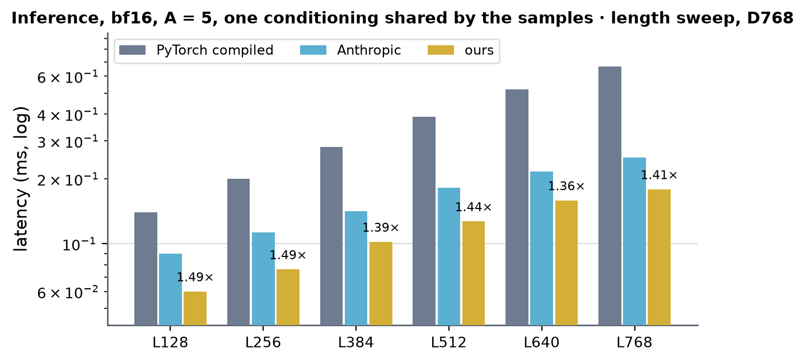
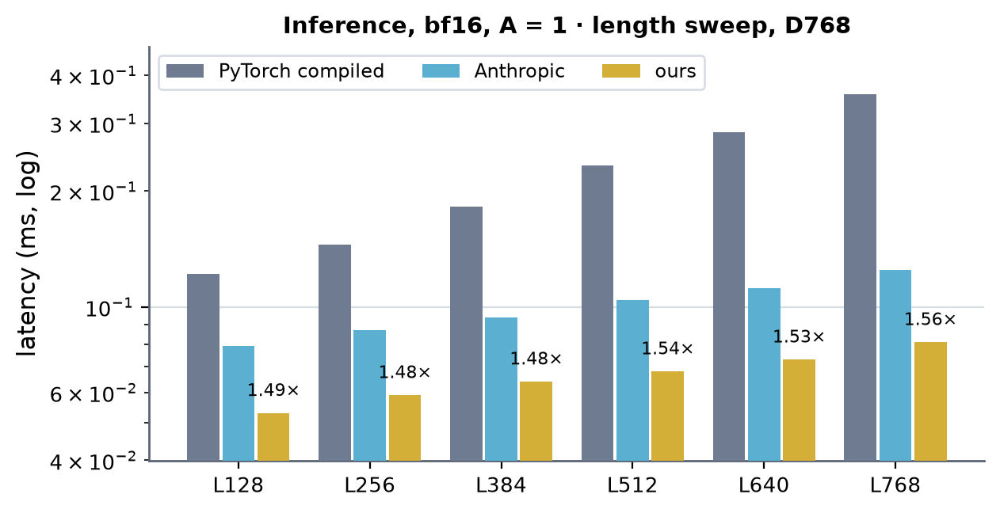
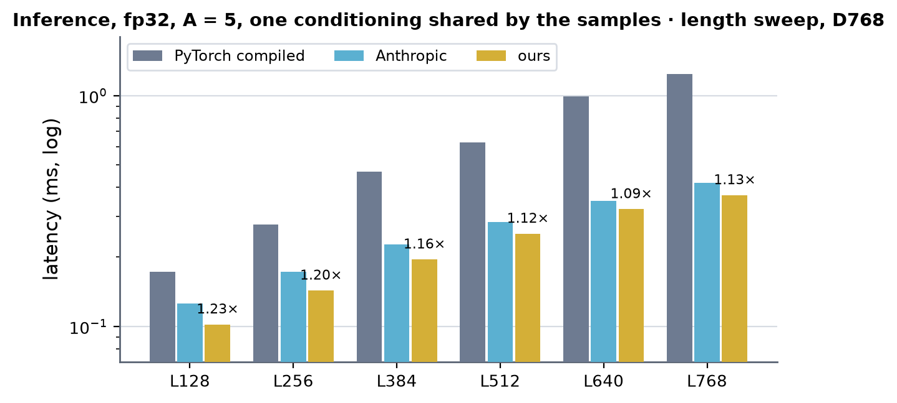
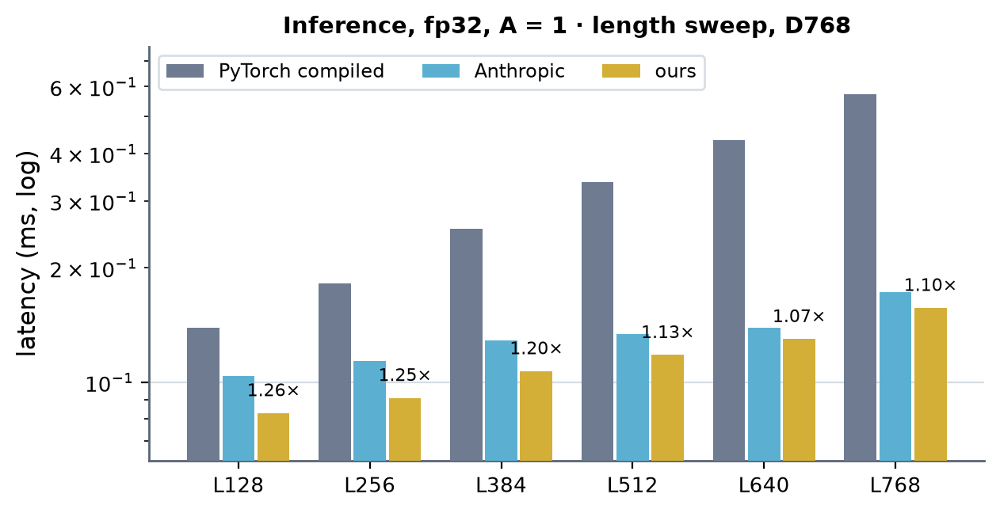
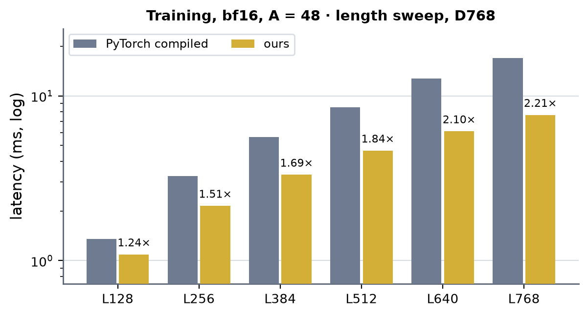
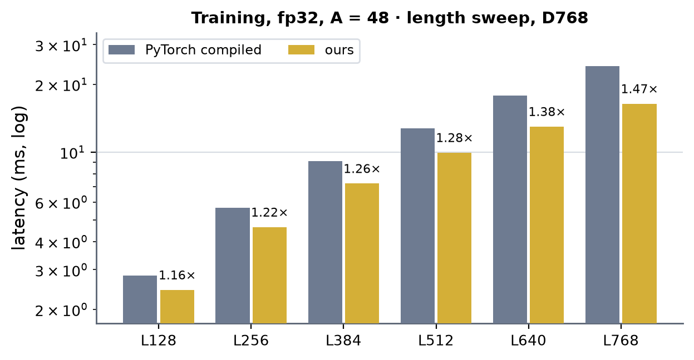

# Token DiT on H100 (sm90)

Kernel-level status of the token DiT block (AF3 Alg. 23: AdaLN + AugmentedAttention with pair bias + conditioned SwiGLU
transition; d_single 768, d_cond 384, d_pair 128, 16 heads x 48, transition n = 2) on H100; the module-level summary is in
[h100.md](../h100.md). Columns are (Length, Dimension, dtype) from the shape registry (`token_single`, d_hidden 768).

## Status, 2026-10-15 (read this first)

| | bf16 | fp32 (TF32 wgmma) |
|---|---|---|
| layouts served natively | 16 x 48, 24 x 32, 12 x 64 (d 768), 16 x 64 (d 1024) | the same four |
| inference vs PyTorch compiled | 2.4-4.4x | 1.7-3.9x |
| inference vs Anthropic (48 cells each: L128-768 x A 5 / 1 x 4 layouts) | **all >= 1.19x** | 46 of 48 >= 1.05x; 24 x 32 A = 5: L640 1.00x, L768 1.04x |
| training (A = 48) vs PyTorch compiled | 1.10-2.87x | 1.16-1.70x |
| accuracy vs the fp32 IEEE block | 3.6e-3 (the bf16 recipe's own) | 2.9e-4 |

Anthropic has no backward, so training has no faster-than comparison. Where each number lives: the length sweeps (tables + charts)
under "Measurements, length sweep (2026-10-15)"; head layouts under "Head layouts other than 16 x 48"; against Anthropic after the
2026-10-15 changes under "fp32 inference after the fused expand" and "bf16 after the 2026-10-15 changes"; the studies of the fp32 cells
under 5 % are in the record linked above "What was tried and not kept"; tests: `tests/gpu/sm90/test_h100_token_dit_layouts_gpu.py` (40: inference bf16 / fp32, fp32 and bf16 training gradients,
bitwise-repeatable steps, at the four layouts) and `tests/gpu/any/test_token_dit_train_gpu.py` (60). Not at SoL90 (fp32 attention
~20-25 % of the TF32 tensor peak; cuBLAS GEMMs 60-68 %).

On H100 the token DiT runs **hand-written CUDA and cuBLAS only** -- no Triton -- in bf16 and fp32, QK-norm on or off, on
two paths that `modules/dit` dispatches to (the same two integrations as on B200):

- **Inference** (`integrations/token_dit.py` -> `kernels/conditioned_transition/triton/token_dit_runner.py`): `DiTBlock`
  calls with no autograd and the engine's kernel backend, shared or per-sample conditioning. Weight pack and pair bias
  use the upstream capture-scoped caches: eager entries stay outside captures; each capture records their construction
  once and each replay recomputes them from the current weights / pair. A shared conditioning needs L rows, per-sample S L.
  - row passes: `kernels/conditioned_transition/cuda/token_dit_rows.cu` (the first AdaLN pass reads the step's input and
    writes the fp32 residual; the last residual pass writes the output in its dtype -- no conversion kernels; `cond_rows`:
    the step's conditioning LayerNorm and its GEMM-dtype copy in one warp-per-row pass);
  - QK-norm: `qknorm_rows`, in place on the q | k columns of the q|k|v|g GEMM output (sm_scale log2 e folds into the query
    norm's weight instead of Wq);
  - attention core, **bf16**: `kernels/augmented_attention/cuda/attn_fwd.cu` built GATED (`attn_inf`): q | k | v | g read
    as column views of the GEMM output through TMA, sigmoid(g) o written over q;
  - attention core, **fp32**: `kernels/augmented_attention/cuda/attn_tf32.cu` (`attn_tf32_inf`, TF32 wgmma): q | k | g from
    one GEMM, v^T from a second (TF32 wgmma takes v K-major), the hoisted pair bias written key-permuted (below);
  - expand + SwiGLU, **bf16**: `kernels/conditioned_transition/cuda/gemm_swiglu_sm90.cu`, one sm_90a GEMM (128 x 256 tiles
    whose B rows are 128 of Wa then the same 128 of Wb, wgmma m64n256, SwiGLU in the epilogue): [a | b] never reaches HBM.
    Its TF32 build serves the fp32 inference expand at M >= 768 rows since 2026-10-15 (the row kernel hands it a TF32-rounded
    `xa`; accuracy equals the cuBLAS path's; see "fp32 inference after the fused expand" below);
  - the other GEMMs cuBLAS (fp32: TF32 under the caller's `allow_tf32`).
- **Training** (`integrations/token_dit_train.py`): `DiTBlock` calls under autograd, B == 1, L % 128 == 0, key mask [B, L]
  or none. One autograd Function per block whose forward and backward are each one opaque op (torch.compile keeps them
  as nodes). Row kernels `kernels/conditioned_transition/cuda/token_dit_train_rows.cu` (16 kernels, the B200 set; built
  a second time with fp32 GEMM operands, `-DTDT_OP_F32`, for the fp32 block), cuBLAS GEMMs, and the attention core:
  - **bf16**: `attn_fwd.cu`, `attn_dqb.cu` + `attn_dkv.cu` (or `attn_dq.cu` + `attn_dkv.cu` when A is not a multiple of 3);
    the qk-norm row pass writes q pre-scaled by log2 e / sqrt 48, the bias projection carries log2 e, the key mask is an
    additive row. The forward writes og = sigmoid(g) o itself (MODE 2; its g tile TMA-loaded up front), so the block keeps
    no O (113 MB a block at L768, A48) and runs no gate pass: the backward takes D = rowsum(dO O) = rowsum(d og * og).
    `attn_dqb` sums dbias over its three samples in shared memory, then adds the tile with one TMA bulk reduce;
  - **fp32**: `attn_tf32.cu` forward (og, fp32), `attn_tf32_dqb` (dQ; dbias as one TMA bulk reduce-add per 64 x 64 dS tile) and
    `attn_tf32_dkv` (dK, dV); q, k, dO transposed by a tiled CUDA transpose for the products that contract over tokens.

Switch: the `Settings` field `token_dit_train` (training block, default on; set with `settings.configure(...)`). The fp32 inference core has no switch.
The fp32 training block has no switch any more (it is always served when the training block is).
The fused expand GEMM + SwiGLU serves bf16 wherever it applies (no switch).

Every attention kernel here is bitwise deterministic run to run (6 runs, `torch.equal`, every output without atomics);
the bf16 kernels now issue `fence.proxy.async` before releasing a TMA stage (or the parked q tile) they read with
ldmatrix: a generic-proxy read of a stage the async proxy refills is not ordered by the mbarrier release alone.

### Per-sample pair bias (training, bf16)

For a diffusion module whose pair is re-folded per augmentation (a pair of its own for each of the A samples, so each sample has its own
attention bias), the attention cores above -- which share one bias across the A samples -- are built a second time with
`PSB=1` (`attn_fwd.cu`, `attn_dq.cu`, `attn_dkv.cu`): bias [H, A, L, L], TMA row `(head A + sample) L + query tile`. Entry points:

- `token_dit_train.block_psb` / `serves_psb`: the same block as above with the bias an input. Any L (padded to the 128-row tile inside,
  the padded keys masked), any A, one batch row, cond width 384 or 768 (`TD_DC` build define), bf16 operands; no autograd needed to run.
  The block returns d bias in the bias's layout and units and none for its own `ln_pair` / `to_bias` weights (the producer's).
- `integrations/token_dit_pair_bias.pair_biases`: the biases of every block of a stack from one pair [A, L, L, 128] in one pass -- one
  CUDA pair LayerNorm, one GEMM against the blocks' stacked `to_bias.weight diag(ln_pair.weight) log2 e` -- as views of one
  [blocks H, A L L] buffer; the backward is two GEMMs and the LayerNorm backward. Reading the pair once instead of once per block
  is what the per-block LayerNorm + projection cost twelve times.
- Backward: the dQ pass (`attn_dq`, `PSB_DB=1`) writes each sample's dbias from its dS registers, bf16, natural layout, times ln 2;
  the dK / dV pass keeps no dbias. Every element has one writer: bitwise repeatable, no atomics, no reduction.

A = 48, L = 384, 12 blocks + bias, forward + backward (CUDA events): 63.6 ms (forward 20.2, backward 43.4), 29.2 GB, against 242.6 ms
(39.4 GB) for the engine's Triton attention core with the same bias read off the pair by the fused LayerNorm + projection.
ncu (SpeedOfLight, cuBLAS excluded): `pair_ln` / `pair_ln_bwd` 92 % DRAM (at their traffic), the row kernels 69-87 %, `attn_fwd` / `attn_dq`
/ `attn_dkv` 66 / 58 / 62 % -- the open work (bias tile read and dbias write are the necessary traffic, ~1.4x more moves today).
Tests: `tests/gpu/sm90/test_augmented_attention_psb_gpu.py` (cores against an fp64 truth at the bf16 input floor, per-sample ownership,
bitwise repeatability), `tests/gpu/sm90/test_token_dit_psb_gpu.py` (block against the module path, cond 384 / 768, L not a multiple of 128;
`pair_biases` against the per-block LayerNorm + projection).

### The TF32 core's layouts

TF32 wgmma reads both operands K-major only (no transpose bit), which fixes three things:

- P V needs v K-major, i.e. v^T [768, tokens]; so do the backward's products over tokens (dV = P^T dO, dK = dS^T q,
  dQ = dS k), which take q^T, dO^T, k^T.
- P goes to the A operand from registers. The TF32 A fragment holds k-indices (t, t + 4) of an 8-wide k-step, the
  accumulator columns (2t, 2t + 1). Loading the key rows permuted within each group of 8 -- shared-memory row 2j + i is
  key 4i + j, a 4-D TMA box (head columns, i with a 4-row stride, j with a 1-row stride, 8-row groups) -- makes S column
  2t + i key t + 4i, so the accumulator IS the A fragment, no shuffle. The bias and key mask are read in that key order:
  the inference hoist writes the pair LayerNorm's rows permuted (free), training gathers the bias once per call.
- The head dim 48 is two 128-B-swizzled chunks, 32 + 16 columns.

## Inference

bf16 and fp32, QK-norm on / off, shared conditioning, S = 5 (the sampler's diffusion batch).

### I1 · attention core (bf16 `attn_inf` / fp32 `attn_tf32_inf`)

| (Length, Dimension, dtype) | (128, 768, bf16) | (256, 768, bf16) | (384, 768, bf16) | (512, 768, bf16) | (640, 768, bf16) | (768, 768, bf16) |
|---|---|---|---|---|---|---|
| implementation | CUDA 미검증 | CUDA 미검증 | CUDA | CUDA 미검증 | CUDA 미검증 | CUDA |
| 성능 확인 | ✗ | ✗ | ✗ | ✗ | ✗ | ✗ |
| cache build | ✓ | ✓ | ✓ | ✓ | ✓ | ✓ |

| (Length, Dimension, dtype) | (128, 768, fp32) | (256, 768, fp32) | (384, 768, fp32) | (512, 768, fp32) | (640, 768, fp32) | (768, 768, fp32) |
|---|---|---|---|---|---|---|
| implementation | CUDA 미검증 | CUDA | CUDA | CUDA 미검증 | CUDA 미검증 | CUDA |
| 성능 확인 | ✗ | ✗ | ✗ | ✗ | ✗ | ✗ |
| cache build | ✓ | ✓ | ✓ | ✓ | ✓ | ✓ |

### I2 · row kernels (`adaln_rows`, `resgate_adaln_rows`, `swiglu_rows`, `qknorm_rows`, pair LayerNorm) + cuBLAS

| (Length, Dimension, dtype) | (128, 768, bf16/fp32) | (256, 768, bf16/fp32) | (384, 768, bf16/fp32) | (512, 768, bf16/fp32) | (640, 768, bf16/fp32) | (768, 768, bf16/fp32) |
|---|---|---|---|---|---|---|
| implementation | CUDA 미검증 | CUDA | CUDA | CUDA 미검증 | CUDA 미검증 | CUDA |
| 성능 확인 | ✗ | ✗ | ✗ | ✗ | ✗ | ✗ |
| cache build | ✓ | ✓ | ✓ | ✓ | ✓ | ✓ |

## Training

### T1 · attention core, bf16 (`attn_fwd`, `attn_dqb` + `attn_dkv`) and fp32 (`attn_tf32_fwd`, `attn_tf32_dqb` + `attn_tf32_dkv`)

| (Length, Dimension, dtype) | (128, 768, bf16) | (256, 768, bf16) | (384, 768, bf16) | (512, 768, bf16) | (640, 768, bf16) | (768, 768, bf16) |
|---|---|---|---|---|---|---|
| implementation | CUDA 미검증 | CUDA | CUDA | CUDA 미검증 | CUDA 미검증 | CUDA |
| 성능 확인 | ✗ | ✗ | ✗ | ✗ | ✗ | ✗ |
| cache build | ✓ | ✓ | ✓ | ✓ | ✓ | ✓ |

| (Length, Dimension, dtype) | (128, 768, fp32) | (256, 768, fp32) | (384, 768, fp32) | (512, 768, fp32) | (640, 768, fp32) | (768, 768, fp32) |
|---|---|---|---|---|---|---|
| implementation | CUDA 미검증 | CUDA | CUDA | CUDA 미검증 | CUDA 미검증 | CUDA |
| 성능 확인 | ✗ | ✗ | ✗ | ✗ | ✗ | ✗ |
| cache build | ✓ | ✓ | ✓ | ✓ | ✓ | ✓ |

### T2 · row kernels (`token_dit_train_rows.cu`, 16 kernels + transpose; bf16 and fp32 builds)

| (Length, Dimension, dtype) | (128, 768, bf16/fp32) | (256, 768, bf16/fp32) | (384, 768, bf16/fp32) | (512, 768, bf16/fp32) | (640, 768, bf16/fp32) | (768, 768, bf16/fp32) |
|---|---|---|---|---|---|---|
| implementation | CUDA 미검증 | CUDA | CUDA | CUDA 미검증 | CUDA 미검증 | CUDA |
| 성능 확인 | ✗ | ✗ | ✗ | ✗ | ✗ | ✗ |
| cache build | ✓ | ✓ | ✓ | ✓ | ✓ | ✓ |

"미검증" = the kernels accept the shape (L % 128 == 0) but no test or measurement has run there. cache build ✓: nothing on
these paths autotunes (fixed launch shapes; the CUDA extensions build on first use into `settings.engine_jit_root()`).

Tests: `tests/gpu/any/test_token_dit_train_gpu.py` (bf16 and fp32 blocks against the fp32 PyTorch block, qk-norm and
mask on / off, A = 4 and 6, torch.compile), `tests/gpu/sm90/test_h100_module_wiring_gpu.py` (inference: live inputs /
weights / mask, CUDA graphs, the bf16 and fp32 cores against the Triton cores they replace, qk-norm on / off),
`tests/gpu/any/test_token_dit_rows_cuda_gpu.py`, `tests/gpu/sm90/test_augmented_attention_bf16_sm90_gpu.py`.

Earlier measurements and studies (2026-10-01 module comparison and kernel breakdown, the 2026-10-05 fp32 backward-layout experiment, the
2026-10-14 update with its fp32 attention-forward flags, the first head-layout table against Anthropic and the fp32 cells under 5 %
with the Anthropic core comparison): [docs/records/h100_token_dit_20261001_20261015.md](../../../records/h100_token_dit_20261001_20261015.md).

## What was tried and not kept

| attempt | result |
|---|---|
| fp32 core on mma.sync m16n8k8 TF32 (FA2 layout, every fragment loaded by the threads) | numerics fine (5.6e-4) but 170 us at L768 against Triton's 114: K / V re-read per 64-row CTA in fp32 is ~465 MB of L2 traffic a call; the wgmma + TMA version reads each tile once per 128 rows and wins (89 us) |
| rounding k / v to TF32 at load (cvt.rna) in that kernel | not the bottleneck (166 vs 170 us) |
| one-pass pair bias (LayerNorm + the 16 projections, a warp per pair row, a 5-step reduce-scatter; and its backward with dWf in registers), training | 620 / 675 us at L768 against 113 + 63 (LN + cuBLAS) / ~300: a latency-bound shuffle chain per row (B200 found the same); LN + cuBLAS kept |
| bf16 dbias: every warpgroup TMA-reduce-adds its own sample's dS tile (no exchange) | 1185 us at L768 against 1019: three times the reduce traffic into L2; the exchange + one reduce per three samples (kept) is 998 |
| og epilogue with the g rows read from global (+ an L2 prefetch) | 496 us at L768 against 472 for O + the gate pass; the g tile TMA-loaded up front made it 474 (151 vs 169 at L384) |
| SwiGLU GEMM also storing [a \| b] for the training backward (through the same staging tile) | 731 us at M = 36864 against 380 for cuBLAS + the row pass: the epilogue serialises; the training block keeps cuBLAS + `swiglu_rows` |
| SwiGLU GEMM in TF32 for the fp32 block | relative error 1.6e-3 against 4.2e-4 (its TMA-fed operands are truncated where cuBLAS rounds) and faster only at M = 3840 (70.9 vs 85.5 us; 47.6 vs 45.9 at 1920, 759 vs 725 at 36864): opt-in |

## Limits and next

- Training bf16: GEMMs run at ~630 TFLOP/s and every row kernel at the HBM roof; what is left is `attn_dqb` (1.0 ms at
  L768: dbias is ~400 us of it, bound by the reduce traffic into L2 -- A / 3 x 16 x L^2 fp32 -- with shared memory too
  full to sum more than three samples on chip) and fusions across GEMM boundaries, which need GEMM epilogues that keep
  cuBLAS's mainloop speed and do not serialise (the [a | b]-storing SwiGLU GEMM did).
- fp32: the TF32 cores truncate their TMA-fed operands to TF32 (~1.4e-3 at the core against ~4e-4 for a rounding TF32
  GEMM); the inference v^T GEMM costs ~16 us a block at L768; the training bias transposes / gathers (~0.5 ms) are torch
  ops.
- Inference bf16: 177 us a block at L768, of which ~16 us is the conditioning (LayerNorm + two small GEMMs) a DiTBlock call
  cannot share with the other blocks of a step; the research stack runner, which hoisted it, measured 155 us.
- Per-sample conditioning at inference is now served by the merged fused step. The older module-path timings (2026-10-01, record)
  do not describe its current performance; a paired benchmark remains to be run.
- B200 shares the row kernels, the integrations and the qk-norm / I/O conventions changed here; its token DiT tests were
  not re-run on B200.

## Measurements, length sweep (2026-10-15)

H100 80GB HBM3 (cssb), the v2.2.0 pixi env (torch 2.13.0+cu129), `benchmarks/runners/bench.py target=dit level=module
min_seq_len=128 max_seq_len=768 seq_len_step=128 cudagraph=manual`, ms per block, median, key mask 20 % (inference) / 12.5 %
(training). Inference at A = 5 (one conditioning shared by the samples, `+shared_cond=true`) and A = 1; training at A = 48.
Anthropic is its inference release (separate invocation, `compile=false`; no backward). No cuEquivariance block exists for this module.
× = other / ours, so larger is faster.

### Inference, bf16, A = 5, one conditioning shared by the samples

| (Length, Dimension, dtype) | PyTorch compiled | Anthropic | ours | × PyTorch | × Anthropic |
|---|---|---|---|---|---|
| (128, 768, bf16) | 0.140 | 0.090 | **0.060** | 2.32 | 1.49 |
| (256, 768, bf16) | 0.200 | 0.113 | **0.076** | 2.63 | 1.49 |
| (384, 768, bf16) | 0.282 | 0.142 | **0.102** | 2.76 | 1.39 |
| (512, 768, bf16) | 0.389 | 0.182 | **0.127** | 3.07 | 1.44 |
| (640, 768, bf16) | 0.520 | 0.217 | **0.159** | 3.28 | 1.36 |
| (768, 768, bf16) | 0.666 | 0.252 | **0.179** | 3.73 | 1.41 |

 <!-- measure_bars -->

### Inference, bf16, A = 1

| (Length, Dimension, dtype) | PyTorch compiled | Anthropic | ours | × PyTorch | × Anthropic |
|---|---|---|---|---|---|
| (128, 768, bf16) | 0.122 | 0.079 | **0.053** | 2.29 | 1.49 |
| (256, 768, bf16) | 0.145 | 0.087 | **0.059** | 2.47 | 1.48 |
| (384, 768, bf16) | 0.182 | 0.094 | **0.064** | 2.86 | 1.48 |
| (512, 768, bf16) | 0.233 | 0.104 | **0.068** | 3.45 | 1.54 |
| (640, 768, bf16) | 0.285 | 0.112 | **0.073** | 3.90 | 1.53 |
| (768, 768, bf16) | 0.357 | 0.125 | **0.081** | 4.44 | 1.56 |

 <!-- measure_bars -->

### Inference, fp32, A = 5, one conditioning shared by the samples

| (Length, Dimension, dtype) | PyTorch compiled | Anthropic | ours | × PyTorch | × Anthropic |
|---|---|---|---|---|---|
| (128, 768, fp32) | 0.172 | 0.126 | **0.102** | 1.69 | 1.23 |
| (256, 768, fp32) | 0.277 | 0.172 | **0.143** | 1.94 | 1.20 |
| (384, 768, fp32) | 0.469 | 0.226 | **0.195** | 2.40 | 1.16 |
| (512, 768, fp32) | 0.627 | 0.284 | **0.252** | 2.48 | 1.12 |
| (640, 768, fp32) | 0.989 | 0.349 | **0.322** | 3.08 | 1.09 |
| (768, 768, fp32) | 1.24 | 0.419 | **0.370** | 3.36 | 1.13 |

 <!-- measure_bars -->

### Inference, fp32, A = 1

| (Length, Dimension, dtype) | PyTorch compiled | Anthropic | ours | × PyTorch | × Anthropic |
|---|---|---|---|---|---|
| (128, 768, fp32) | 0.139 | 0.104 | **0.083** | 1.67 | 1.26 |
| (256, 768, fp32) | 0.182 | 0.114 | **0.091** | 2.01 | 1.25 |
| (384, 768, fp32) | 0.254 | 0.129 | **0.107** | 2.36 | 1.20 |
| (512, 768, fp32) | 0.336 | 0.134 | **0.118** | 2.84 | 1.13 |
| (640, 768, fp32) | 0.433 | 0.139 | **0.130** | 3.34 | 1.07 |
| (768, 768, fp32) | 0.573 | 0.173 | **0.157** | 3.65 | 1.10 |

 <!-- measure_bars -->

### Training, bf16, A = 48

| (Length, Dimension, dtype) | PyTorch compiled | ours | × PyTorch |
|---|---|---|---|
| (128, 768, bf16) | 1.35 | **1.09** | 1.24 |
| (256, 768, bf16) | 3.25 | **2.15** | 1.51 |
| (384, 768, bf16) | 5.63 | **3.32** | 1.69 |
| (512, 768, bf16) | 8.55 | **4.65** | 1.84 |
| (640, 768, bf16) | 12.76 | **6.09** | 2.10 |
| (768, 768, bf16) | 16.97 | **7.66** | 2.21 |

 <!-- measure_bars -->

### Training, fp32, A = 48

| (Length, Dimension, dtype) | PyTorch compiled | ours | × PyTorch |
|---|---|---|---|
| (128, 768, fp32) | 2.83 | **2.44** | 1.16 |
| (256, 768, fp32) | 5.66 | **4.64** | 1.22 |
| (384, 768, fp32) | 9.12 | **7.25** | 1.26 |
| (512, 768, fp32) | 12.74 | **9.95** | 1.28 |
| (640, 768, fp32) | 17.87 | **12.99** | 1.38 |
| (768, 768, fp32) | 24.10 | **16.41** | 1.47 |

 <!-- measure_bars -->

## Head layouts other than 16 x 48 (2026-10-15)

`attn_tf32.cu` is built per layout (`NHP`, `DHP`: heads 12 / 16 / 24, width 32 / 48 / 64; `DM = NHP x DHP`; the head width sets the
number of 128-B chunks of a q / k row, the PV accumulator size and the wgmma N), the weight-pack kernels take d_single 768 or 1024
and 12 / 16 / 24 heads, and the fp32 inference gate admits the four `LAYOUTS` entries (24 x 32, 12 x 64 at d 768; 16 x 64 at d 1024).
Before this the fp32 inference of those layouts either raised (`ValueError: requires 16x48 heads`) or ran at PyTorch speed.

fp32 inference, A = 5 shared cond, PyTorch compiled / ours (ms), CUDA graph, key mask 20 %:

| layout | L384 PyTorch | L384 ours | x | L768 PyTorch | L768 ours | x |
|---|---|---|---|---|---|---|
| 24 x 32 | 0.511 | 0.208 | 2.45 | 1.547 | 0.395 | 3.92 |
| 12 x 64 | 0.445 | 0.197 | 2.26 | 1.111 | 0.375 | 2.96 |
| 16 x 64 (d 1024) | 0.503 | 0.268 | 1.88 | 1.353 | 0.501 | 2.70 |

Accuracy against the fp32 IEEE block: 2.9e-4 at every layout and length (same as 16 x 48). The TF32 attention forward alone:
5.9e-4 to 7.3e-4 against fp64 at every layout.

bf16 inference at the same layouts (`attn_fwd.cu` built per layout: `DHP` 32 / 48 / 64 -- a new `m64n64k16` PV form for width 64 --
and `ROW_WIDTH`; the H100 serving gate admits `LAYOUTS`), PyTorch compiled / ours (ms), A = 5 shared cond:

| layout | L384 PyTorch | L384 ours | x | L768 PyTorch | L768 ours | x |
|---|---|---|---|---|---|---|
| 16 x 48 (reference) | 0.283 | 0.103 | 2.75 | 0.666 | 0.178 | 3.74 |
| 24 x 32 | 0.308 | 0.106 | 2.90 | 0.813 | 0.191 | 4.26 |
| 12 x 64 | 0.271 | 0.109 | 2.48 | 0.613 | 0.191 | 3.20 |
| 16 x 64 (d 1024) | 0.334 | 0.139 | 2.41 | 0.769 | 0.272 | 2.83 |

Accuracy against the fp32 IEEE block: 3.6e-3 at every layout (the bf16 recipe's own error, same as 16 x 48).

fp32 **training** at the same layouts (the native H100 path with the row / pack / final kernels built per layout, `attn_tf32.cu`
dqb + dkv per layout; the serving gate admits `LAYOUTS` for fp32), PyTorch compiled / ours (ms), A = 48:

| layout | L384 PyTorch | L384 ours | x | L768 PyTorch | L768 ours | x |
|---|---|---|---|---|---|---|
| 16 x 48 (reference) | 9.08 | 7.15 | 1.26 | 24.10 | 16.36 | 1.47 |
| 24 x 32 | 10.34 | 7.49 | 1.38 | 30.36 | 17.84 | 1.70 |
| 12 x 64 | 8.41 | 6.88 | 1.22 | 20.63 | 15.47 | 1.33 |
| 16 x 64 (d 1024) | 11.40 | 9.61 | 1.19 | 29.44 | 21.71 | 1.36 |

Tests: `tests/gpu/sm90/test_h100_token_dit_layouts_gpu.py` -- inference (bf16 and fp32, three length / sample-count / conditioning cells)
and fp32 training gradients (output, inputs and every parameter against the fp32 IEEE module, bitwise-repeatable step) at all four
layouts: 32 pass. Bugs found on the way (d 1024 only): `_native_final90` sliced the weight gradients with the module-level D = 768, and
the cond-LN weight gradient's hierarchical reduction hard-coded 12 groups / 6 per branch (D / 64, D / 128 now).

bf16 **training** at the same layouts (`attn_fwd.cu`, `attn_dq.cu`, `attn_dkv.cu` and `attn_dqb.cu` built per layout: `DHP` 32 / 48 / 64
-- the width-64 `m64n64k16` PV form is new in the first three, `attn_dqb.cu`'s `DH` / `DM` / `RSQD` / `mma_o` are now macro-driven),
PyTorch compiled / ours (ms), A = 48:

| layout | L384 PyTorch | L384 ours | x | L768 PyTorch | L768 ours | x |
|---|---|---|---|---|---|---|
| 16 x 48 (reference) | 5.63 | 3.32 | 1.69 | 16.97 | 7.66 | 2.21 |
| 24 x 32 | 7.05 | 3.56 | 1.98 | 23.77 | 8.27 | 2.87 |
| 12 x 64 | 4.62 | 3.44 | 1.34 | 11.23 | 7.71 | 1.46 |
| 16 x 64 (d 1024) | 6.72 | 4.71 | 1.43 | 18.66 | 10.67 | 1.75 |

The test file also carries the bf16 training gradients (output / inputs / every parameter against the fp32 IEEE module within
8e-3 / 1.6e-2 / 3.2e-2, bitwise-repeatable step) at all four layouts, L 256 and 384, A = 6: 8 more tests.

All four head layouts are now served natively on H100 for the token DiT in both dtypes, inference and training.

## fp32 inference after the fused expand (2026-10-15)

Two changes, both accuracy-neutral (block error 2.92e-4 at 16 / 24 / 12 heads, as before):

- `resgate_adaln_rows` rounds `xa` to TF32 the way `cvt.rna.tf32.f32` does (`rna_tf32`: add half an ulp of the kept bits, clear the rest)
  when the fused expand will read it, and the weights are rounded once per pack (`_tf32_wab`). The TMA-fed wgmma operands truncate, so the
  earlier fused-expand attempt (error 2.9e-4 -> 4.6e-4) had read an unrounded `xa`; with rounded operands the products are the ones
  cuBLAS forms. `_FP32_SWIGLU_GEMM` is on: expand + SwiGLU as one GEMM, `[a | b]` never reaches HBM, for M >= 768 rows
  (below it cuBLAS + the SwiGLU rows wins: 128 x 256 tiles leave SMs idle). -16 us a block at A = 5, L768.
- the forward's instruction mix (R2UR descriptors made warp-uniform, `tf32_pos` for the probabilities) is 32 % shorter (37.9 -> 25.6 M
  warp instructions at 24 x 32) -- and not faster: the kernel is bound by latency, not by issue slots.

Ours against Anthropic's block, fp32 inference, 20 % key mask, x = Anthropic / ours (higher is faster):

| layout | A | L128 | L256 | L384 | L512 | L640 | L768 |
|---|---|---|---|---|---|---|---|
| 16 x 48 | 5 shared | 1.24 | 1.26 | 1.14 | 1.18 | 1.10 | 1.17 |
| 16 x 48 | 1 | 1.26 | 1.27 | 1.21 | 1.13 | 1.09 | 1.17 |
| 24 x 32 | 5 shared | 1.23 | 1.20 | 1.06 | 1.12 | **1.00** | **1.04** |
| 24 x 32 | 1 | 1.24 | 1.27 | 1.21 | 1.14 | 1.08 | 1.15 |
| 12 x 64 | 5 shared | 1.21 | 1.19 | 1.11 | 1.18 | 1.05 | 1.11 |
| 12 x 64 | 1 | 1.23 | 1.24 | 1.19 | 1.12 | 1.05 | 1.14 |
| 16 x 64 (d 1024) | 5 shared | 1.21 | 1.15 | 1.22 | 1.09 | 1.09 | 1.13 |
| 16 x 64 (d 1024) | 1 | 1.23 | 1.21 | 1.11 | 1.08 | 1.07 | 1.09 |

Everything is >= 1.05 except 24 x 32, A = 5, L640 (1.00) and L768 (1.04). There the attention core is 110 us against Anthropic's 94 us;
at L640 the grid (600 CTAs on 264 slots) also fills its third wave to 27 %.
Tried and not kept (all measured): `FWD_BN=128` (wrong: spilled accumulators, now blocked), `BIAS_AFTER` (the bias added after the QK
wgmma: same time, the stall moves to the add), `BIAS_L1PF` (prefetch.global.L1: 0.85x), `PREFETCH_BIAS` + `INPLACE_P` (0.93x), `HT = 64`
fused tiles (more tiles, 91 % last wave, but 24 x 32 L384 1.07 -> 1.04 and L640 1.00 -> 0.96).

## bf16 after the 2026-10-15 changes (re-measured)

Inference, x = Anthropic / ours (CUDA graph; Anthropic `compile=false`), 20 % key mask; every one of the 48 cells >= 1.19x:

| layout | A | L128 | L256 | L384 | L512 | L640 | L768 |
|---|---|---|---|---|---|---|---|
| 16 x 48 | 5 shared | 1.48 | 1.48 | 1.39 | 1.44 | 1.36 | 1.39 |
| 16 x 48 | 1 | 1.47 | 1.48 | 1.49 | 1.55 | 1.53 | 1.57 |
| 24 x 32 | 5 shared | 1.48 | 1.49 | 1.39 | 1.42 | 1.36 | 1.41 |
| 24 x 32 | 1 | 1.46 | 1.47 | 1.50 | 1.54 | 1.52 | 1.52 |
| 12 x 64 | 5 shared | 1.46 | 1.47 | 1.27 | 1.37 | 1.23 | 1.26 |
| 12 x 64 | 1 | 1.46 | 1.46 | 1.43 | 1.47 | 1.47 | 1.48 |
| 16 x 64 (d 1024) | 5 shared | 1.44 | 1.23 | 1.32 | 1.20 | 1.19 | 1.22 |
| 16 x 64 (d 1024) | 1 | 1.41 | 1.41 | 1.41 | 1.43 | 1.44 | 1.43 |

Training (A = 48), x = PyTorch compiled / ours (no Anthropic backward exists):

| layout | L128 | L256 | L384 | L512 | L640 | L768 |
|---|---|---|---|---|---|---|
| 16 x 48 | 1.24 | 1.51 | 1.70 | 1.85 | 2.09 | 2.13 |
| 24 x 32 | 1.33 | 1.75 | 2.00 | 2.24 | 2.59 | 2.87 |
| 12 x 64 | 1.11 | 1.26 | 1.33 | 1.44 | 1.40 | 1.45 |
| 16 x 64 (d 1024) | 1.10 | 1.30 | 1.42 | 1.51 | 1.69 | 1.74 |
