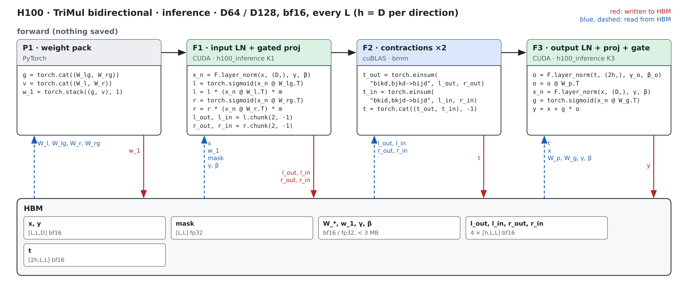
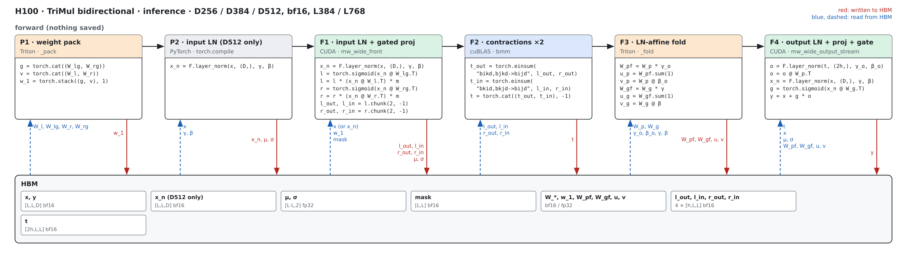
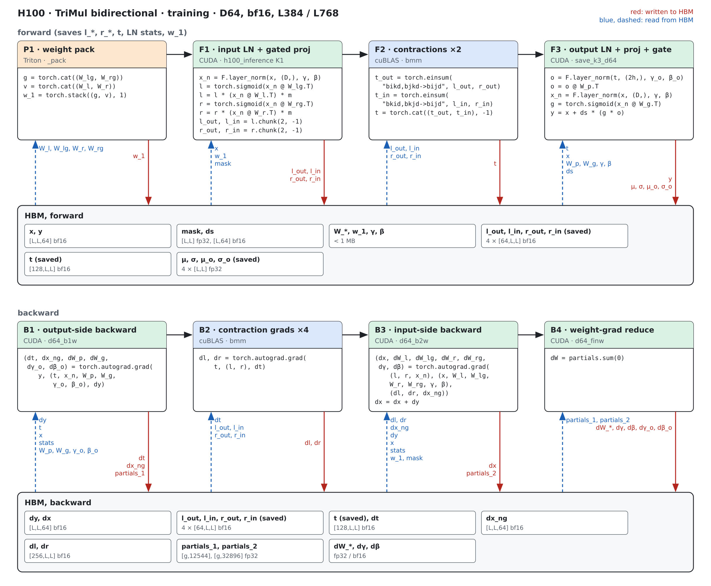
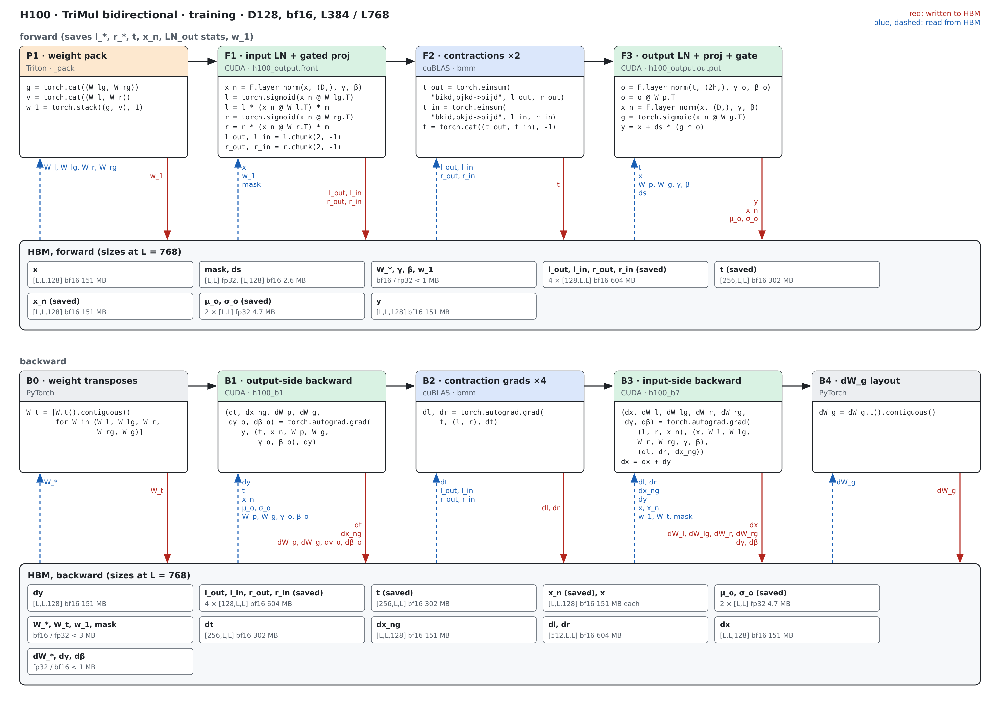
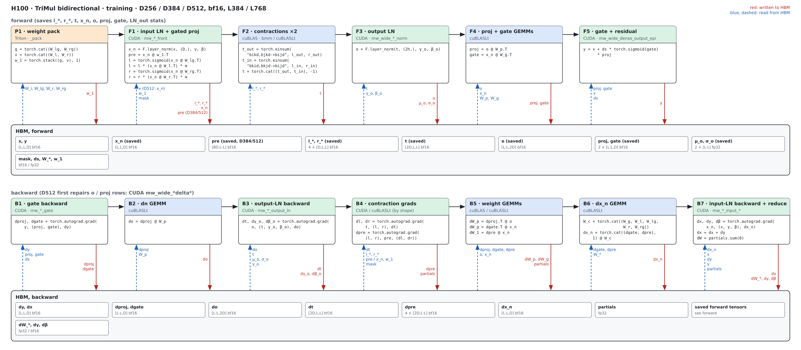

# TriangleMultiplication on H100 (sm90)

Kernel-level status of the TriMul modules on H100; the module-level summary is in
[h100.md](../h100.md). bf16 only; columns are (Length, Dimension). H100 = CUDA; a shape
without a CUDA path is 미구현 (it runs the PyTorch reference: no Triton fallback on H100, see [dispatch.md](../dispatch.md)). Figures: one box per kernel, left to right, HBM reads (blue,
left) and writes (red, right); generated from `figures/trimul_bidir.json` by
`python -m miniworld_engine.viz.kernel_flow`, then `rsvg-convert -z 2 -b white` to PNG.
Dispatch: `integrations/trimul_h100.py`.

## Batched samples (D64, B <= 48)

The D64 path takes B samples in one call, inference and training, bidirectional and either single direction: tokens b-major, one
launch per stage instead of B calls (MiniWorld's template embedder runs its templates as the B samples of one pair stack). K1 / K3
(packaged inference K1 / K3, the training front K1 and `save_k3_d64`) take the samples stacked along the slow token axis
(`K1Params.rows` / `K3Params.rows` / `RecomputeParams.rows` = B L, 0 = one sample), so a tile may straddle two samples: every row
reads its own sample's token mask (K1: `m[i] & m[s L + j]`), and K3 / B1 read the row-dropout scale `[B L, 64]` at row `s L + j`.
The training preparation builds the FP32 pair mask `[B L, L]` per sample (`mw_aux_d64_training_prepare` / `mw_aux_train_mask`,
`samples`), B2 reads it per row, the planes are `[c, B L, L]` and the contraction batches over c x B (one cuBLAS call per product),
and the B1 / B2 weight partials sum over every sample in a fixed order (deterministic). Wider D keeps one sample per call
(`serves*` refuse B > 1 there) and B > `MAX_BATCH` runs the module's PyTorch statements.

`integrations.trimul_h100.MAX_BATCH = 48` is the largest batch validated, not a kernel limit: B in {1, 2, 4, 8, 16, 32, 48} x
L in {128, 256, 384, 768} x the three directions, inference and training, all pass with y and dx **bitwise equal** to B calls of
one sample (the weight gradients differ only by the FP32 order of the per-sample sum, <= 2.1e-4 relative at L768 B48) and bitwise
run to run. The only index bound in the kernels is the int32 token index (B L^2 < 2^31); memory is the practical one (training
L768 B48 peaks at 68 GB). Tests: `tests/gpu/sm90/test_h100_trimul_batch_gpu.py` (one call vs B calls with a mask and a dropout
scale per sample, so an index mix-up between samples is a large error; the FP32 PyTorch reference, every gradient; bitwise
determinism; CUDA-graph capture with live inputs, masks, dropout scales and weights).

Measured 2026-10-19 on one H100 80GB HBM3, torch 2.13.0+cu129, bf16 pair, FP32 parameters, a token mask per sample, CUDA-graph
timing (median of 5 x 20 replays), B = 4: the MiniPairformer block (`BidirectionalTriangleMultiplication(64)` + `Transition(64)`,
the template stack's block; training = forward + backward of every gradient, row dropout on). "PyTorch" = one call of 4 samples
as H100 ran it before (TriMul's PyTorch statements for B > 1, Transition already CUDA on the flattened rows). Record:
[records/trimul_h100_batched_samples_20261019.md](../../../records/trimul_h100_batched_samples_20261019.md).

| L | mode | one call (ms) | 4 calls (ms) | PyTorch (ms) | × vs 4 calls | × vs PyTorch |
|---|---|---|---|---|---|---|
| 128 | inference | 0.079 | 0.135 | 0.436 | 1.72 | 5.54 |
| 128 | training | 0.309 | 0.681 | 1.255 | 2.21 | 4.07 |
| 384 | inference | 0.601 | 0.695 | 3.832 | 1.16 | 6.37 |
| 384 | training | 2.130 | 2.922 | 10.228 | 1.37 | 4.80 |
| 768 | inference | 2.467 | 2.776 | 28.452 | 1.13 | 11.53 |
| 768 | training | 9.045 | 10.712 | 60.315 | 1.18 | 6.67 |

## Long and ragged lengths (MiniWorld's L1536 / 2048 / 2560 rungs)

Contract (`integrations.trimul_h100`), both modules, every direction:

| width | inference | training |
|---|---|---|
| D64 (B <= 48) / D128 | any L >= 16 (`MIN_INFERENCE_LENGTH`) | L a multiple of 128 up to 10240 (`TRAINING_GRANULE`, `MAX_TRAINING_LENGTH`, B200's bound) |
| D256 / D384 / D512 | as before up to L1024; above: L a multiple of 128 (B200-style port; single-direction D256 / D384 keep the packaged K1 / K3 at any L) | as before up to L1024; above: L a multiple of 128 (B200-style port) |

Bound common to both: the int32 token index, B L^2 < 2^31 (L rounded up to 16). Memory binds first on an 80 GB card: training at
L2560 peaks at 28 GB (D128 bidirectional), 13.5 GB (D64, one sample), 54 GB (D64, B = 4); at L4096 D64 bidirectional fits, D128
bidirectional training ends near L4300. Before this change every H100 TriMul call outside L128 ... 1024 (multiples of 128) ran the
module's PyTorch statements.

What it took, per kernel:

| stage | change |
|---|---|
| inference K1 / K3 (packaged, D64 / D128) | none: the tile table already has length buckets to N 4096 (`by_n`), plane offsets are 64-bit and one sample pads the planes to `Np` = L rounded up to 16 (zero pad rows written by K1). One sample with L % 16 != 0 failed since the batched-samples change (it passed `rows = Np` to K1, which the batched check rejects); B = 1 now leaves `rows` unset |
| B samples at L % 16 != 0 (inference) | the K1 / K3 sample stacking (`rows = B L`) has no pad, so `update_inference` pads each sample to the next multiple of 16 on the host: zero pair entries on masked pad tokens (K1's `m[i] & m[j]` zeroes their left / right rows and columns, so a real pair contracts the same terms), output sliced back |
| training front / `save_k3` / B1 / B7 (D128), `save_k3_d64` / B1 / B2 (D64), `single_b1` / `single_b7` | none: B1 is built per L (`TRAIN_L`), B7 runs the `b7_768` source (two-part weight partial) at every L but 384, the B1 / B7 / single-direction configurations take their 768 entries above L768; the length guards (`n in (128, ..., 1024)`) became `n % 128 == 0` |
| B200-style port (D256 / D384 / D512) | the length guard only (`n % 128 == 0`); its backward sums LN / gate partials with global atomics (`b200_sources/wide_bwd.cu`), so its gradients agree run to run only up to the FP32 summation order (y is bitwise), as at L <= 1024 |

Per-kernel time per pair token (torch profiler, `prof_longl.py`) against L768: the contraction (cuBLAS) runs at 730 TFLOP/s at
L2048 / 2560; inference K1 / K3 and B7 cost 12-14 % more per token, the D64 `b2w` 21 %, the D128 B1 38 % and `save_k3` 50 % (both
read and write the channel-strided `[c, L, L]` planes, `L^2` apart). The B1 builds with the extended dropout-fragment cache
(`B1_EXT_MASK`), another dTri store tile or gate demotion move the step by +-1 % (L1536-2560): not adopted.

Measured 2026-10-19, one H100 80GB HBM3, torch 2.13.0+cu129, bf16 pair, FP32 parameters, a token mask, CUDA-graph timing (median of
5 x 20 replays); training = forward + backward of x and every parameter, row dropout on. "PyTorch" = the module's PyTorch statements,
which H100 ran at these lengths before (under bf16 autocast, CUDA graph); cuEquivariance = `implementation="cuequivariance"` under bf16
autocast. Record: [records/trimul_h100_long_l_20261019.md](../../../records/trimul_h100_long_l_20261019.md).

| module | L | mode | ours (ms) | PyTorch (ms) | cuEquivariance (ms) | × vs PyTorch | × vs cuEquivariance |
|---|---|---|---|---|---|---|---|
| bidirectional D64, B = 4 | 1536 | inference | 9.50 | 119.04 | 20.13 | 12.5 | 2.12 |
| bidirectional D64, B = 4 | 1536 | training | 30.47 | 248.36 | 97.56 | 8.15 | 3.20 |
| bidirectional D64, B = 4 | 2048 | inference | 20.09 | 214.76 | 39.03 | 10.7 | 1.94 |
| bidirectional D64, B = 4 | 2048 | training | 62.27 | 468.93 | 181.60 | 7.53 | 2.92 |
| bidirectional D64, B = 4 | 2560 | inference | 36.71 | 351.62 | 65.95 | 9.58 | 1.80 |
| bidirectional D64, B = 4 | 2560 | training | 112.54 | OOM | OOM | - | - |
| bidirectional D128 | 1536 | inference | 5.19 | 60.96 | 14.51 | 11.7 | 2.79 |
| bidirectional D128 | 1536 | training | 19.72 | 191.54 | 55.33 | 9.71 | 2.81 |
| bidirectional D128 | 2048 | inference | 10.59 | 111.18 | 26.95 | 10.5 | 2.54 |
| bidirectional D128 | 2048 | training | 40.06 | 355.27 | 102.82 | 8.87 | 2.57 |
| bidirectional D128 | 2560 | inference | 19.26 | 175.94 | 44.57 | 9.14 | 2.31 |
| bidirectional D128 | 2560 | training | 69.47 | 563.60 | 159.07 | 8.11 | 2.29 |
| bidirectional D64, B = 1 | 1536 / 2048 / 2560 | inference | 2.39 / 4.98 / 9.14 | 29.89 / 53.69 / 87.81 | | 12.5 / 10.8 / 9.61 | |
| bidirectional D64, B = 1 | 1536 / 2048 / 2560 | training | 7.63 / 15.74 / 28.19 | 91.50 / 169.05 / 273.29 | | 12.0 / 10.7 / 9.69 | |
| outgoing D128 | 1536 / 2048 / 2560 | inference | 2.96 / 6.06 / 10.61 | 44.59 / 80.38 / 119.37 | | 15.0 / 13.3 / 11.3 | |
| outgoing D128 | 1536 / 2048 / 2560 | training | 12.89 / 25.30 / 43.77 | 183.86 / 337.61 / 524.41 | | 14.3 / 13.3 / 12.0 | |

OOM: the PyTorch statements and the cuEquivariance composition need more than 80 GB for D64 B = 4 training at L2560; ours peaks at 54 GB.
The served lengths are unchanged: L384 / L768, D64 (B = 1 and 4, every direction) and D128 (every direction), inference and training,
worktree / main 0.994-1.009 (two interleaved rounds on two GPUs, the record has every cell).

Tests: `tests/gpu/sm90/test_trimul_h100_long_l_gpu.py` (inference L 48 / 200 / 520 / 1040 / 1536 / 2048 / 2560, D64 B = 1 and 4,
D128, every direction, with and without a mask, against the FP32 PyTorch statement computed in row chunks; training L 1152 / 1536 /
2048 / 2560 (D64 and D128, every direction), 2816 / 3584 (D128) and 4096 (D64), every gradient, and D64 B = 4 at L1152 against the
reference and at L2560 against four one-sample calls; the B200-style port at D256 / D384 / D512 L1152 / 1536; bitwise run-to-run
determinism; CUDA-graph capture with live inputs, masks, dropout scales and weights).

## Bidirectional (`BidirectionalTriangleMultiplication`)

Outgoing + incoming in one module (h = D per direction), one output LayerNorm over 2h.

### Inference

#### K1/K3 path · D64 / D128, every L

##### F1 · input LN + gated proj

| (Length, Dimension) | (128, 64) | (256, 64) | (384, 64) | (512, 64) | (640, 64) | (768, 64) | (128, 128) | (256, 128) | (384, 128) | (512, 128) | (640, 128) | (768, 128) |
|---|---|---|---|---|---|---|---|---|---|---|---|---|
| implementation | CUDA | CUDA | CUDA | CUDA | CUDA | CUDA | CUDA | CUDA | CUDA | CUDA | CUDA | CUDA |
| 성능 확인 | ✗ | ✗ | ✗ | ✗ | ✗ | ✗ | ✗ | ✗ | ✗ | ✗ | ✗ | ✗ |
| cache build | ✗ | ✗ | ✗ | ✗ | ✗ | ✗ | ✗ | ✗ | ✗ | ✗ | ✗ | ✗ |

##### F3 · output LN + proj + gate

| (Length, Dimension) | (128, 64) | (256, 64) | (384, 64) | (512, 64) | (640, 64) | (768, 64) | (128, 128) | (256, 128) | (384, 128) | (512, 128) | (640, 128) | (768, 128) |
|---|---|---|---|---|---|---|---|---|---|---|---|---|
| implementation | CUDA | CUDA | CUDA | CUDA | CUDA | CUDA | CUDA | CUDA | CUDA | CUDA | CUDA | CUDA |
| 성능 확인 | ✗ | ✗ | ✗ | ✗ | ✗ | ✗ | ✗ | ✗ | ✗ | ✗ | ✗ | ✗ |
| cache build | ✗ | ✗ | ✗ | ✗ | ✗ | ✗ | ✗ | ✗ | ✗ | ✗ | ✗ | ✗ |

#### Wide path · D256 / D384 / D512, L384 / L768

##### P1 · weight pack

| (Length, Dimension) | (384, 256) | (768, 256) | (384, 384) | (768, 384) | (384, 512) | (768, 512) |
|---|---|---|---|---|---|---|
| implementation | CUDA | CUDA | CUDA | CUDA | CUDA | CUDA |
| 성능 확인 | ✗ | ✗ | ✗ | ✗ | ✗ | ✗ |
| cache build | ✓ | ✓ | ✓ | ✓ | ✓ | ✓ |

##### F1 · input LN + gated proj

| (Length, Dimension) | (384, 256) | (768, 256) | (384, 384) | (768, 384) | (384, 512) | (768, 512) |
|---|---|---|---|---|---|---|
| implementation | CUDA | CUDA | CUDA | CUDA | CUDA | CUDA |
| 성능 확인 | ✗ | ✗ | ✗ | ✗ | ✗ | ✗ |
| cache build | ✓ | ✓ | ✓ | ✓ | ✓ | ✓ |

##### F3 · LN-affine fold

| (Length, Dimension) | (384, 256) | (768, 256) | (384, 384) | (768, 384) | (384, 512) | (768, 512) |
|---|---|---|---|---|---|---|
| implementation | CUDA | CUDA | CUDA | CUDA | CUDA | CUDA |
| 성능 확인 | ✗ | ✗ | ✗ | ✗ | ✗ | ✗ |
| cache build | ✓ | ✓ | ✓ | ✓ | ✓ | ✓ |

##### F4 · output LN + proj + gate

| (Length, Dimension) | (384, 256) | (768, 256) | (384, 384) | (768, 384) | (384, 512) | (768, 512) |
|---|---|---|---|---|---|---|
| implementation | CUDA | CUDA | CUDA | CUDA | CUDA | CUDA |
| 성능 확인 | ✗ | ✗ | ✗ | ✗ | ✗ | ✗ |
| cache build | ✓ | ✓ | ✓ | ✓ | ✓ | ✓ |

### Training

#### D64 path · L384 / L768

##### P1 · weight pack

| (Length, Dimension) | (384, 64) | (768, 64) |
|---|---|---|
| implementation | CUDA | CUDA |
| 성능 확인 | ✗ | ✗ |
| cache build | ✓ | ✓ |

##### F1 · input LN + gated proj

| (Length, Dimension) | (384, 64) | (768, 64) |
|---|---|---|
| implementation | CUDA | CUDA |
| 성능 확인 | ✗ | ✗ |
| cache build | ✓ | ✓ |

##### F3 · output LN + proj + gate

| (Length, Dimension) | (384, 64) | (768, 64) |
|---|---|---|
| implementation | CUDA | CUDA |
| 성능 확인 | ✗ | ✗ |
| cache build | ✓ | ✓ |

##### B1 · output-side backward

| (Length, Dimension) | (384, 64) | (768, 64) |
|---|---|---|
| implementation | CUDA | CUDA |
| 성능 확인 | ✗ | ✗ |
| cache build | ✓ | ✓ |

##### B3 · input-side backward

| (Length, Dimension) | (384, 64) | (768, 64) |
|---|---|---|
| implementation | CUDA | CUDA |
| 성능 확인 | ✗ | ✗ |
| cache build | ✓ | ✓ |

##### B4 · weight-grad reduce

| (Length, Dimension) | (384, 64) | (768, 64) |
|---|---|---|
| implementation | CUDA | CUDA |
| 성능 확인 | ✗ | ✗ |
| cache build | ✓ | ✓ |

#### D128 path · L384 / L768

##### P1 · weight pack

| (Length, Dimension) | (384, 128) | (768, 128) |
|---|---|---|
| implementation | CUDA | CUDA |
| 성능 확인 | ✗ | ✗ |
| cache build | ✓ | ✓ |

##### F1 · input LN + gated proj

| (Length, Dimension) | (384, 128) | (768, 128) |
|---|---|---|
| implementation | CUDA | CUDA |
| 성능 확인 | ✗ | ✗ |
| cache build | ✓ | ✓ |

##### F3 · output LN + proj + gate

| (Length, Dimension) | (384, 128) | (768, 128) |
|---|---|---|
| implementation | CUDA | CUDA |
| 성능 확인 | ✗ | ✗ |
| cache build | ✓ | ✓ |

##### B1 · output-side backward

| (Length, Dimension) | (384, 128) | (768, 128) |
|---|---|---|
| implementation | CUDA | CUDA |
| 성능 확인 | ✗ | ✗ |
| cache build | ✓ | ✓ |

##### B3 · input-side backward

| (Length, Dimension) | (384, 128) | (768, 128) |
|---|---|---|
| implementation | CUDA | CUDA |
| 성능 확인 | ✗ | ✗ |
| cache build | ✓ | ✓ |

#### Wide path · D256 / D384 / D512, L384 / L768

##### P1 · weight pack

| (Length, Dimension) | (384, 256) | (768, 256) | (384, 384) | (768, 384) | (384, 512) | (768, 512) |
|---|---|---|---|---|---|---|
| implementation | CUDA | CUDA | CUDA | CUDA | CUDA | CUDA |
| 성능 확인 | ✗ | ✗ | ✗ | ✗ | ✗ | ✗ |
| cache build | ✓ | ✓ | ✓ | ✓ | ✓ | ✓ |

##### F1 · input LN + gated proj

| (Length, Dimension) | (384, 256) | (768, 256) | (384, 384) | (768, 384) | (384, 512) | (768, 512) |
|---|---|---|---|---|---|---|
| implementation | CUDA | CUDA | CUDA | CUDA | CUDA | CUDA |
| 성능 확인 | ✗ | ✗ | ✗ | ✗ | ✗ | ✗ |
| cache build | ✓ | ✓ | ✓ | ✓ | ✓ | ✓ |

##### F3 · output LN

| (Length, Dimension) | (384, 256) | (768, 256) | (384, 384) | (768, 384) | (384, 512) | (768, 512) |
|---|---|---|---|---|---|---|
| implementation | CUDA | CUDA | CUDA | CUDA | CUDA | CUDA |
| 성능 확인 | ✗ | ✗ | ✗ | ✗ | ✗ | ✗ |
| cache build | ✓ | ✓ | ✓ | ✓ | ✓ | ✓ |

##### F5 · gate + residual

| (Length, Dimension) | (384, 256) | (768, 256) | (384, 384) | (768, 384) | (384, 512) | (768, 512) |
|---|---|---|---|---|---|---|
| implementation | CUDA | CUDA | CUDA | CUDA | CUDA | CUDA |
| 성능 확인 | ✗ | ✗ | ✗ | ✗ | ✗ | ✗ |
| cache build | ✓ | ✓ | ✓ | ✓ | ✓ | ✓ |

##### B1 · gate backward

| (Length, Dimension) | (384, 256) | (768, 256) | (384, 384) | (768, 384) | (384, 512) | (768, 512) |
|---|---|---|---|---|---|---|
| implementation | CUDA | CUDA | CUDA | CUDA | CUDA | CUDA |
| 성능 확인 | ✗ | ✗ | ✗ | ✗ | ✗ | ✗ |
| cache build | ✓ | ✓ | ✓ | ✓ | ✓ | ✓ |

##### B3 · output-LN backward

| (Length, Dimension) | (384, 256) | (768, 256) | (384, 384) | (768, 384) | (384, 512) | (768, 512) |
|---|---|---|---|---|---|---|
| implementation | CUDA | CUDA | CUDA | CUDA | CUDA | CUDA |
| 성능 확인 | ✗ | ✗ | ✗ | ✗ | ✗ | ✗ |
| cache build | ✓ | ✓ | ✓ | ✓ | ✓ | ✓ |

##### B4 · contraction grads

| (Length, Dimension) | (384, 256) | (768, 256) | (384, 384) | (768, 384) | (384, 512) | (768, 512) |
|---|---|---|---|---|---|---|
| implementation | CUDA | cuBLAS + CUDA | CUDA | CUDA | CUDA | CUDA |
| 성능 확인 | ✗ | ✗ | ✗ | ✗ | ✗ | ✗ |
| cache build | ✓ | ✓ | ✓ | ✓ | ✓ | ✓ |

##### B7 · input-LN backward + reduce

| (Length, Dimension) | (384, 256) | (768, 256) | (384, 384) | (768, 384) | (384, 512) | (768, 512) |
|---|---|---|---|---|---|---|
| implementation | CUDA | CUDA | CUDA | CUDA | CUDA | CUDA |
| 성능 확인 | ✗ | ✗ | ✗ | ✗ | ✗ | ✗ |
| cache build | ✓ | ✓ | ✓ | ✓ | ✓ | ✓ |

## Single direction (`TriangleMultiplication`, outgoing / incoming)

One contraction, hidden = D, bf16 only. Both directions run the same kernels (`GP_DIR` / the transposed contraction operand selects the
direction). Kernel level, per width:

| Width | Inference | Training |
|---|---|---|
| D64 | K1 → cuBLAS contraction → K3 (`h100_inference`, packaged tile table) | `h100_uni_d64_b200gate` |
| D128 | K1 → cuBLAS → K3 (tile table) | fused B1, two cuBLAS gradient contractions, streamed producer-consumer B7 (`h100_single*`) |
| D256 | tmn K1 / K3 tiles at every L except 384; B200-style port at L384 | `h100_uni_wide_training` (L384 / L768), B200-style port at the other L |
| D384 | B200-style port (`mw_b200style_k1_direct`, cuBLAS, `mw_b200style_k3_static`) | `h100_uni_wide_training` (L384 / L768), B200-style port at the other L |
| D512 | B200-style port; D512 L384 / L768 may use `h100_uni_wide_inference` | `h100_uni_wide_training`: `ln_in_d512` → `front_pre_ss` (wgmma A / B from shared memory) → cuBLAS contraction → output LN → projection / gate GEMMs → output epilogue; backward gate → dn GEMM → output-LN backward → `contract_gp` → weight GEMMs → input-LN backward |

D512 training at L768 (outgoing, ms per kernel): front 2.74 + LN 0.43, `contract_gp` 2.50 (78 % of DRAM), two weight / dgrad GEMMs
1.74 + 1.76 (cuBLAS, about 70 % of the tensor peak), output-LN backward 1.24, gate 1.09, input-LN backward 0.84, output epilogue 0.82,
forward LN-out 0.47: 17.1 ms in total. Kernel flow figures for the single direction are not generated yet.

Weight pack, LN-affine fold and input LN use the CUDA aux kernels whenever the call runs eagerly, and every caller sits inside an
opaque custom op, so the P1 / F3-fold rows above are CUDA; their Triton versions only serve a `torch.compile` region that traces the
caller. No Triton kernel remains in any D256 / D384 / D512 cell at L384 / L768.

## Open

- Single direction in fp32 (bf16 only today); kernel flow figures for the single direction.
- D512 single-direction training at L768 (17.1 ms): front 2.7 ms (latency bound; multicast, N-split and BI=2 variants measured and
  not faster), `contract_gp` 2.5 ms (at its DRAM traffic), output-LN backward 1.2 ms (reads 0.7 GB more than needed). Each remaining
  item is 1 - 3 % of the step.
- Wide single-direction training towards 90 % of speed of light: at D384 L768 the step is at 86.5 % of the design SoL; the worst
  kernels are the front (69.6 %), the output-LN backward (65.3 %) and `contract_gp` (88 %).
- Bidirectional D512 L128 training is the thinnest cell against the other implementations (1.10x).

(Carried over from the 2026-09-30 status snapshot, [docs/records/h100_status_20260930.md](../../../records/h100_status_20260930.md).)

## Measurements (2026-10-15)

H100 80GB HBM3 (132 SMs), torch 2.13.0+cu129, `benchmarks/runners/bench.py` (compiled, manual CUDA graph), default dispatch; B=1, bf16
activations, FP32 master parameters, training = forward + backward with dropout 0.25, inference dropout 0, mask probability 0.1;
L = 128 ... 1024 in steps of 128, D = 64 ... 512. Cells show
× = fastest other implementation / ours, with that implementation in parentheses; the others are PyTorch, cuEquivariance and DTv1. Absolute
latencies, the Anthropic payload (same-process alternating A/B, D64 ... D384 single direction and D64 / D128 bidirectional, ours faster in
all 48 cells, thinnest 1.006x at D256 L768) and the Triton rows are in
[the record](../../../records/trimul_h100_comparison_20261015.md). **Ours is the fastest in all 240 cells** (smallest 1.10x).
The D256 single-direction inference cells were measured before the 2026-10-15 selection change (0.7 - 2.5 % faster now).
The 2026-10-13 tables (absolute latencies of the bidirectional module against Triton, DTv1 and cuEquivariance):
[docs/records/h100_trimul_20261013.md](../../../records/h100_trimul_20261013.md).

### Single direction, outgoing · Training

| L \ D | D64 | D128 | D256 | D384 | D512 |
|---|---|---|---|---|---|
| 128 | 1.89 (DTv1) | 1.21 (DTv1) | 1.18 (DTv1) | 1.23 (DTv1) | 1.13 (DTv1) |
| 256 | 2.26 (DTv1) | 1.66 (DTv1) | 1.43 (DTv1) | 1.38 (DTv1) | 1.27 (DTv1) |
| 384 | 2.60 (DTv1) | 1.81 (DTv1) | 1.55 (DTv1) | 1.52 (DTv1) | 1.41 (DTv1) |
| 512 | 2.69 (DTv1) | 1.84 (DTv1) | 1.47 (DTv1) | 1.41 (DTv1) | 1.27 (DTv1) |
| 640 | 2.68 (DTv1) | 1.85 (DTv1) | 1.49 (DTv1) | 1.41 (DTv1) | 1.27 (DTv1) |
| 768 | 2.65 (DTv1) | 1.85 (DTv1) | 1.54 (DTv1) | 1.48 (DTv1) | 1.36 (DTv1) |
| 896 | 2.64 (DTv1) | 1.78 (DTv1) | 1.49 (DTv1) | 1.39 (DTv1) | 1.28 (DTv1) |
| 1024 | 2.47 (DTv1) | 1.80 (DTv1) | 1.49 (DTv1) | 1.40 (DTv1) | 1.27 (DTv1) |

### Single direction, outgoing · Inference

| L \ D | D64 | D128 | D256 | D384 | D512 |
|---|---|---|---|---|---|
| 128 | 1.61 (cuEquivariance) | 1.64 (DTv1) | 1.77 (cuEquivariance) | 2.02 (DTv1) | 1.49 (DTv1) |
| 256 | 1.66 (cuEquivariance) | 1.85 (cuEquivariance) | 1.96 (cuEquivariance) | 2.11 (DTv1) | 1.75 (DTv1) |
| 384 | 1.94 (cuEquivariance) | 1.92 (cuEquivariance) | 2.06 (cuEquivariance) | 2.16 (DTv1) | 1.80 (DTv1) |
| 512 | 2.05 (cuEquivariance) | 1.98 (cuEquivariance) | 2.01 (cuEquivariance) | 2.07 (DTv1) | 1.84 (DTv1) |
| 640 | 2.03 (cuEquivariance) | 1.99 (cuEquivariance) | 2.05 (cuEquivariance) | 2.19 (DTv1) | 1.78 (DTv1) |
| 768 | 2.06 (cuEquivariance) | 1.97 (cuEquivariance) | 2.05 (cuEquivariance) | 2.25 (DTv1) | 1.81 (DTv1) |
| 896 | 2.09 (cuEquivariance) | 1.96 (cuEquivariance) | 1.97 (cuEquivariance) | 2.01 (DTv1) | 1.75 (DTv1) |
| 1024 | 1.98 (cuEquivariance) | 1.92 (cuEquivariance) | 1.96 (cuEquivariance) | 1.97 (DTv1) | 1.74 (DTv1) |

### Single direction, incoming · Training

| L \ D | D64 | D128 | D256 | D384 | D512 |
|---|---|---|---|---|---|
| 128 | 1.88 (DTv1) | 1.21 (DTv1) | 1.18 (DTv1) | 1.23 (DTv1) | 1.13 (DTv1) |
| 256 | 2.28 (DTv1) | 1.66 (DTv1) | 1.42 (DTv1) | 1.38 (DTv1) | 1.26 (DTv1) |
| 384 | 2.59 (DTv1) | 1.80 (DTv1) | 1.55 (DTv1) | 1.51 (DTv1) | 1.42 (DTv1) |
| 512 | 2.69 (DTv1) | 1.85 (DTv1) | 1.47 (DTv1) | 1.39 (DTv1) | 1.28 (DTv1) |
| 640 | 2.68 (DTv1) | 1.84 (DTv1) | 1.50 (DTv1) | 1.41 (DTv1) | 1.28 (DTv1) |
| 768 | 2.65 (DTv1) | 1.85 (DTv1) | 1.53 (DTv1) | 1.46 (DTv1) | 1.35 (DTv1) |
| 896 | 2.61 (DTv1) | 1.82 (DTv1) | 1.48 (DTv1) | 1.40 (DTv1) | 1.26 (DTv1) |
| 1024 | 2.51 (DTv1) | 1.80 (DTv1) | 1.50 (DTv1) | 1.40 (DTv1) | 1.27 (DTv1) |

### Single direction, incoming · Inference

| L \ D | D64 | D128 | D256 | D384 | D512 |
|---|---|---|---|---|---|
| 128 | 1.63 (cuEquivariance) | 1.61 (DTv1) | 1.79 (cuEquivariance) | 2.00 (DTv1) | 1.49 (DTv1) |
| 256 | 1.67 (cuEquivariance) | 1.83 (cuEquivariance) | 1.97 (cuEquivariance) | 2.09 (DTv1) | 1.76 (DTv1) |
| 384 | 1.90 (cuEquivariance) | 1.92 (cuEquivariance) | 2.05 (cuEquivariance) | 2.16 (DTv1) | 1.78 (DTv1) |
| 512 | 2.04 (cuEquivariance) | 1.99 (cuEquivariance) | 2.03 (cuEquivariance) | 2.08 (DTv1) | 1.78 (DTv1) |
| 640 | 2.03 (cuEquivariance) | 2.00 (cuEquivariance) | 2.01 (cuEquivariance) | 2.11 (DTv1) | 1.83 (DTv1) |
| 768 | 2.03 (cuEquivariance) | 1.95 (cuEquivariance) | 1.98 (cuEquivariance) | 2.04 (DTv1) | 1.83 (DTv1) |
| 896 | 2.07 (cuEquivariance) | 1.92 (cuEquivariance) | 1.96 (cuEquivariance) | 2.01 (DTv1) | 1.75 (DTv1) |
| 1024 | 2.00 (cuEquivariance) | 1.91 (cuEquivariance) | 2.04 (cuEquivariance) | 2.01 (DTv1) | 1.76 (DTv1) |

### Bidirectional · Training

| L \ D | D64 | D128 | D256 | D384 | D512 |
|---|---|---|---|---|---|
| 128 | 1.72 (DTv1) | 1.45 (DTv1) | 1.24 (DTv1) | 1.23 (DTv1) | 1.10 (DTv1) |
| 256 | 2.46 (DTv1) | 2.05 (DTv1) | 1.43 (DTv1) | 1.34 (DTv1) | 1.22 (DTv1) |
| 384 | 2.73 (DTv1) | 2.24 (DTv1) | 1.59 (DTv1) | 1.47 (DTv1) | 1.39 (DTv1) |
| 512 | 2.85 (DTv1) | 2.19 (DTv1) | 1.49 (DTv1) | 1.37 (DTv1) | 1.23 (DTv1) |
| 640 | 2.82 (DTv1) | 2.17 (DTv1) | 1.49 (DTv1) | 1.36 (DTv1) | 1.22 (DTv1) |
| 768 | 2.73 (DTv1) | 2.10 (DTv1) | 1.52 (DTv1) | 1.44 (DTv1) | 1.38 (DTv1) |
| 896 | 2.77 (DTv1) | 1.95 (DTv1) | 1.48 (DTv1) | 1.36 (DTv1) | 1.21 (DTv1) |
| 1024 | 2.69 (DTv1) | 1.94 (DTv1) | 1.49 (DTv1) | 1.23 (DTv1) | 1.24 (DTv1) |

### Bidirectional · Inference

| L \ D | D64 | D128 | D256 | D384 | D512 |
|---|---|---|---|---|---|
| 128 | 1.68 (cuEquivariance) | 1.90 (cuEquivariance) | 2.01 (DTv1) | 1.87 (DTv1) | 1.34 (DTv1) |
| 256 | 1.94 (cuEquivariance) | 2.38 (DTv1) | 2.16 (DTv1) | 1.95 (DTv1) | 1.67 (DTv1) |
| 384 | 2.23 (cuEquivariance) | 2.19 (cuEquivariance) | 2.21 (DTv1) | 1.98 (DTv1) | 1.72 (DTv1) |
| 512 | 2.37 (cuEquivariance) | 2.16 (cuEquivariance) | 2.21 (DTv1) | 1.88 (DTv1) | 1.66 (DTv1) |
| 640 | 2.32 (cuEquivariance) | 2.13 (cuEquivariance) | 2.31 (DTv1) | 1.96 (DTv1) | 1.67 (DTv1) |
| 768 | 2.31 (cuEquivariance) | 2.00 (cuEquivariance) | 2.20 (DTv1) | 1.96 (DTv1) | 1.61 (DTv1) |
| 896 | 2.33 (cuEquivariance) | 1.96 (cuEquivariance) | 2.02 (DTv1) | 1.81 (DTv1) | 1.58 (DTv1) |
| 1024 | 2.19 (cuEquivariance) | 1.93 (cuEquivariance) | 2.06 (DTv1) | 1.86 (DTv1) | 1.64 (DTv1) |
