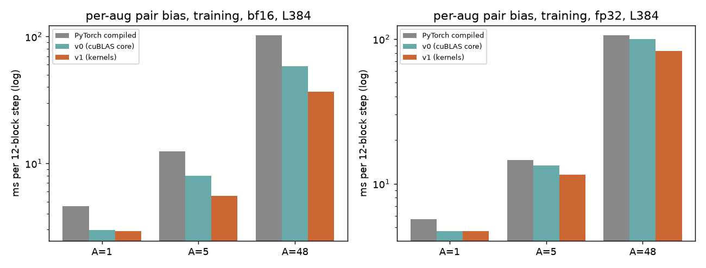

# Bias-only token DiT on H100: a pair bias of its own per augmentation (2026-10-20)

Training, `BiasOnlyDiTBlock` with `single [1, A, L, 768]`, `pair [A, L, L, 128]` (the samples ride the batch axis; each sample attends with
its own `softmax(bias_a)`), or the blocks' hoisted biases from `pair_bias_all`. H100 80GB HBM3 (cssb node02), torch 2.13.0+cu129,
`benchmarks/runners/bench.py target=bias_only_dit level=module mode=training cudagraph=manual mask_prob=0.125 per_sample_pair=true
min_seq_len=384 max_seq_len=384`, key mask [A, L], ms, median. Raw logs: `~/miniworld-engine-scratch/bo-psb/b5.*.log`.

* **PyTorch compiled**: the reference module, biases from the PyTorch fold of `pair_bias_all`.
* **v0**: correctness first -- `softmax_t` per sample, P v / dV / dP as cuBLAS batched GEMMs over (head, sample), torch elementwise ops,
  P stored; hoist backward = two cuBLAS GEMMs around `ln0_bwd_rows` (`settings.bias_only_dit_psb_core="cublas"`,
  `bias_only_dit_hoist_bwd_fused=False`).
* **v1**: `bo_psb.cu` (bf16) / `bo_psb32.cu` (TF32) single-pass kernels, P *recomputed* in the backward (no P in HBM), fused hoist
  backward `bo_hoist_bwd.cu` (bf16).

## Step time, L = 384, 12 blocks sharing one hoist (ms per step; per block = / 12)

| dtype | A | PyTorch compiled | v0 | v1 | v1 x PyTorch |
|---|---|---|---|---|---|
| bf16 | 1 (shared-pair path) | 4.62 | 2.99 | 2.93 | 1.58 |
| bf16 | 5 | 12.45 | 7.97 | 5.53 | 2.25 |
| bf16 | 48 | 102.1 | 58.2 | **36.9** | 2.77 |
| fp32 | 1 (shared-pair path) | 5.69 | 4.71 | 4.72 | 1.21 |
| fp32 | 5 | 14.61 | 13.41 | 11.50 | 1.27 |
| fp32 | 48 | 106.0 | 99.6 | **82.7** | 1.28 |

One block with its own pair bias (`n_layers=1`, pair LayerNorm + projection + backward not amortised):

| dtype | A | PyTorch compiled | v0 | v1 |
|---|---|---|---|---|
| bf16 | 1 | 0.409 | 0.436 | 0.352 |
| bf16 | 5 | 1.186 | 1.465 | 0.909 |
| bf16 | 48 | 9.40 | 12.22 | 7.10 |
| fp32 | 1 | 0.684 | 0.647 | 0.647 |
| fp32 | 5 | 2.276 | 2.213 | 2.057 |
| fp32 | 48 | 18.52 | 18.60 | 16.91 |

A = 1 is the existing shared-pair call (one sample); it is in the table for the reference.

## Correctness (tests/gpu/sm90/test_bias_only_dit_psb_gpu.py, 71 tests; fp32 IEEE PyTorch module as oracle, perturbed weights)

| dtype | A, L, mask | loss rel. | output rel. | whole-gradient cosine | worst parameter cosine | bitwise repeat |
|---|---|---|---|---|---|---|
| bf16 | 2..48, 384, none / per sample | 5e-4 .. 1.3e-2 (random sum) | 2.4e-3 | 0.999983 | 0.999970 (`ln_pair.weight`) | yes |
| bf16 | 5, 768, per sample | 1.2e-2 | 2.4e-3 | 0.999983 | 0.999975 | yes |
| fp32 | 2..48, 384, none / per sample | 6e-7 .. 8e-5 | 1.0e-5 | 0.99999985 | 1.000000 | yes |

d single / d cond / d pair cosines: 0.999997 / 0.99998 / 0.99998 (bf16), 1.000000 (fp32). Kernel tests against fp64 (all head layouts,
L 128..768, shared / per-sample / no mask), recompute == stored-P bit for bit, fused hoist backward against fp64 and the cuBLAS path.
Existing suites: `test_h100_bias_only_dit_gpu.py` (shared-pair path, unchanged bits), the B200 hoist file on H100 (77 passed), 294 passed
in a joint run with the module-wiring and no-Triton tests.

## Memory (12 blocks, A = 48, L = 384, GiB above the live inputs and parameters, eager)

| dtype | step | PyTorch | v0 | v1 stored-P kernels | v1 recompute (default) |
|---|---|---|---|---|---|
| bf16 | after forward (saved for backward) | 25.9 | 11.6 | 11.6 | **9.05** |
| bf16 | whole-step peak | 26.4 | 15.1 | 14.8 | **13.9** |
| fp32 | after forward | 29.4 | 23.1 | -- | **18.1** |
| fp32 | whole-step peak | 29.8 | 29.7 | -- | **24.3** |

P (226 MB per block in bf16) is not stored by the default core: 2.5 GiB less saved per 12 blocks, and the peak moves to the hoist
backward. Choice P stored vs recomputed (measured, A = 48, L = 384, bf16, kernel only): forward 237 us (recompute, reads 226 MB) vs
287 us (stored, reads 226 MB, writes 226 MB); backward 226 vs 212 us; the 12-block step 41.3 (recompute) vs 41.6 ms (stored), both with the unfused hoist backward. Equal time, 2.5 GiB less
memory. P^T is not stored in either (dV reads P transposed in the kernel; cuBLAS in v0 takes the transposed operand).

## Where the time goes, bf16 A = 48 L = 384, 12 blocks (kernel time)

v0 attention core, one block: softmax 165 us, P v bmm + permutes 408 us, dV 98 us, dP 196 us, dbias elementwise **1060 us** (v0 2.05 ms
of 4.2 ms kernel time). v1 core: 237 + 226 us. Stack, v1 (before the fused hoist): cuBLAS GEMMs 49 %, attention core 13 %, hoist rows
12 %, row kernels 19 %. Fused hoist backward (`bo_hoist_bwd.cu`): 8.05 -> 4.75 ms at 192 rows (R = A L^2).

## Roofline (ncu, `--profile-from-start off`, A = 48, L = 384, cuBLAS kernels skipped; copy ceiling 3.0 TB/s)

| kernel | us (ncu clocks) | DRAM % of peak | SM % | bound | proximity to SoL90 |
|---|---|---|---|---|---|
| `psb_fwd_k` (bf16, recompute) | 277 | 34 | 32 | latency (issue 0.34 / SMSP, 16 warps) | far (copy ceiling 152 us at equal bytes: 2.4x) |
| `psb_bwd_k` (bf16, recompute) | 275 | 58 | 52 | memory / latency | far (1.8x) |
| `psb32_fwd_k` (TF32) | 637 | 29 | 26 | latency (12 % warps) | far |
| `psb32_bwd_k` (TF32) | 543 | 58 | 46 | memory / latency | far |
| `hoist_bwd_k` | 5998 | 32 | 37 | latency (1 CTA / SM, 8 warps) | far (floor 2.1 ms) |

**SoL90 is not reached by any of them.** Phase times from `clock64` (forward, one 32-row tile): softmax ~5000 cycles, product +
epilogue ~5500, the load already hidden: the kernel is latency bound at 16 warps, not instruction bound (softmax is ~9 instructions
per element in SASS).

## Measured and rejected

| attempt | result |
|---|---|
| v0 core (cuBLAS batched GEMMs + torch elementwise) | correct; dbias elementwise 1.06 ms, dP in fp32 0.2 ms: replaced |
| forward tile of 64 rows instead of 32 | 279 vs 237 us |
| 3 CTAs / SM for the forward (BM 16 + double buffer) | not built: v of the (head, sample) (43 KB) stays resident, the L2 traffic of v would be 4x the bias |
| softmax with one row per warp / full-row shuffles | 17 instructions per element before the half-warp-per-row form |
| two rows interleaved, 8 warps K-split product | 259 -> 237 us only; 255 registers at first (1 CTA / SM) until `__launch_bounds__(256, 2)` |
| flash-style online-softmax forward (bias chunks, P in registers) | designed, not built; the likely next step for the forward |
| hoist backward: Y operand without the hi / lo split | rejected (the split is the d gamma accuracy fix of 2026-10-15) |
| fused hoist backward as warp-specialised kernel (LN rows overlapped with the products) | not built; LN phase is 2700 of 10200 cycles per item |

## Next

Forward and backward attention kernels at 34 % / 58 % of DRAM peak (latency bound; flash-style forward, more warps per SM); the fused
hoist backward at 32 % (warp specialisation, 2 CTAs / SM); fp32 hoist backward still cuBLAS + `ln0_bwd_rows`; fp32 per-sample forward
limited to L <= 512 (v resident), longer L takes the cuBLAS core.
