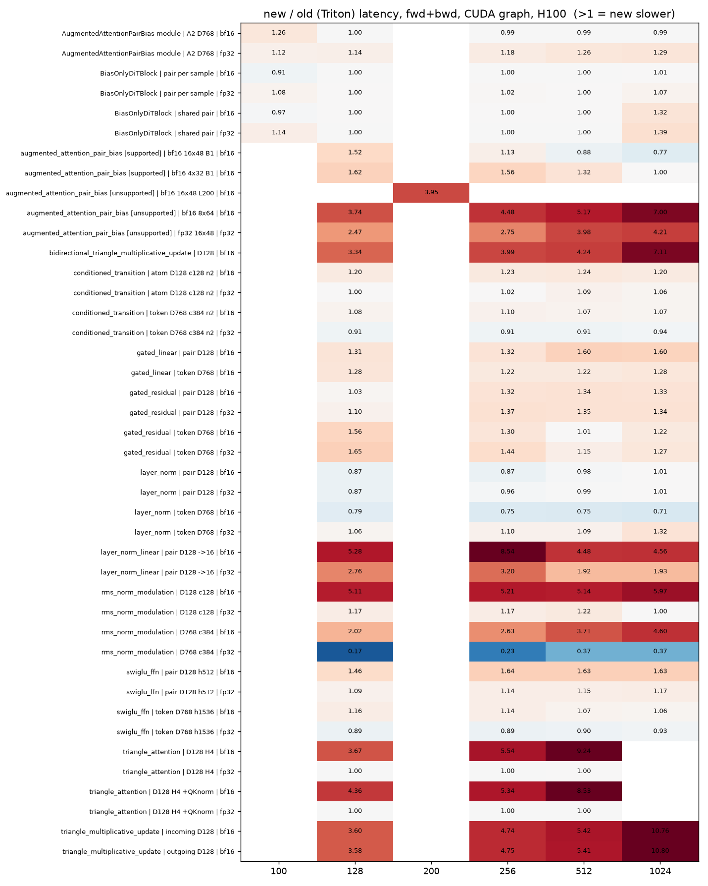

# H100 ops gate: performance of the new routing against the previous Triton path (2026-11-01)

Branch `fix/h100-ops-gate` (8eea3f6d7). Follow-up to [h100_ops_gate_20261101.md](h100_ops_gate_20261101.md), whose **Performance** section said "not measured".

## Method

* One H100 80GB HBM3 per case (node01, 8 GPUs, one Slurm job as a work queue: job **41372**, 171 cases, 20 min), torch 2.13 / cu129, same checkout for both sides.
* **new** = default settings (H100: no Triton through `ops.*` / the fallbacks). **old** = `settings.portable_on_hopper_blackwell=True` (the Triton path the branch replaced), same inputs,
  modules rebuilt per side (the module routing is resolved at build).
* CUDA-graph timing, warm (3 eager warm-ups, 10 replay warm-ups, median of 5 batches of replays, each side run twice, the better kept). Never eager.
* `infer` = `no_grad` forward; `fwd+bwd` = forward with autograd plus `autograd.grad` over every floating input (and the module parameters). Backward alone = fwd+bwd minus a graph-timed grad-mode forward;
  it is in the raw data, not tabled (`bwd` ratios follow the fwd+bwd ones).
* Shapes: pair ops on `(1, L, L, 128)`, token ops on `(4, L, D)` with D = 768 (cond 384), atom-style `D = 128`; trimul / triangle attention D128 (4 heads); augmented-attention op on `(2, 1, H, L, D)`;
  `BiasOnlyDiTBlock(16 x 48)` with 3 samples (shared pair / pair per sample), bf16 = autocast over fp32 masters, fp32 = plain; `AugmentedAttentionPairBias(768, 384, 128, 16)` with 2 samples. L = 128 / 256 / 512 / 1024 (plus L100 / L200
  for the shapes the CUDA core refuses: the paths the branch changed). Weights random, the same on both sides.
* `new/old` > 1 means the new path is slower. Latencies below ~0.02 ms are within graph-timing noise (about +-10%).
* Harness and logs outside the checkout: `~/miniworld-engine-scratch/h100-ops-gate-logs/perf/` (`bench_gate.py`, `run.sh`, `agg.py`, `out_41372/`).
* `dev code-graph --diff main` ran first as its own job (**41370**, same result as the record of 2026-11-01: no CUDA source changed, nothing rebuilt).

## Result in one picture

new / old latency of fwd+bwd per op and L (blue < 1, new faster; red > 1, new slower; fp32 cases with no old Triton path read 1.00).

## Slower than the previous Triton path by more than 5% (list, not fixed)

Ratio ranges over L = 128 ... 1024 (fwd+bwd; infer in brackets where it differs); every row is in the full table below.

| op / path | shapes | new/old fwd+bwd | new/old infer |
|---|---|---|---|
| `ops.layer_norm` | token D768 fp32 | 1.06 - 1.32 | within noise |
| `ops.swiglu_ffn` | pair D128 h512 bf16 | 1.46 - 1.64 | 1.96 - 2.28 |
| `ops.swiglu_ffn` | pair D128 h512 fp32 | 1.09 - 1.17 | not slower |
| `ops.swiglu_ffn` | token D768 h1536 bf16 | 1.06 - 1.16 | 1.13 - 1.23 |
| `ops.conditioned_transition` | token D768 bf16 | 1.07 - 1.10 | 1.10 - 1.20 |
| `ops.conditioned_transition` | atom D128 bf16 | 1.20 - 1.24 | 1.29 - 1.36 |
| `ops.conditioned_transition` | atom D128 fp32 | 1.00 - 1.09 | not slower |
| `ops.rms_norm_modulation` | D768 c384 bf16 | 2.0 - 4.6 | 1.9 - 6.7 |
| `ops.rms_norm_modulation` | D128 c128 bf16 | 5.1 - 6.0 | 6.9 - 8.6 |
| `ops.rms_norm_modulation` | D128 c128 fp32 | 1.0 - 1.22 | not slower |
| `ops.layer_norm_linear` | pair D128 -> 16, bf16 | 4.5 - 8.5 | 5.6 - 10.5 |
| `ops.layer_norm_linear` | same, fp32 | 1.9 - 3.2 | 1.9 - 2.3 |
| `ops.gated_residual` | pair D128 and token D768, bf16 / fp32 | 1.0 - 1.65 (pair 1.32 - 1.37 from L256) | 1.25 - 1.68 |
| `ops.gated_linear` | pair D128 / token D768, bf16 | 1.22 - 1.60 | 1.33 - 2.23 |
| `ops.triangle_attention` (QK norm or not) | bf16, L128 / 256 / 512 | 3.7 - 9.2 | 4.8 - 12.4 |
| `ops.triangle_attention` | bf16 and fp32, **L1024: out of memory on the new path** (PyTorch core materialises the L^3 x heads scores; 16 GiB per tensor); the old Triton core ran 28 ms (QK norm, bf16) | - | - |
| `ops.triangle_multiplicative_update` (outgoing / incoming) | bf16 | 3.6 - 10.8 | 3.1 - 8.9 |
| `ops.bidirectional_triangle_multiplicative_update` | bf16 | 3.3 - 7.1 | 3.0 - 8.9 |
| `ops.augmented_attention_pair_bias`, supported, 16x48 | bf16, L128 / 256 | 1.52 / 1.13 (L512 / 1024: 0.88 / 0.77, new faster) | 1.07 - 1.35 up to L512 |
| `ops.augmented_attention_pair_bias`, supported, 4x32 | bf16, L128 / 256 / 512 | 1.62 / 1.56 / 1.32 (L1024: 1.00) | 1.24 - 1.41 |
| `ops.augmented_attention_pair_bias`, unsupported | fp32 16x48 | 2.5 - 4.2 | |
| `ops.augmented_attention_pair_bias`, unsupported | bf16 8x64 / bf16 16x48 L200 | 3.7 - 7.0 / 3.95 | |
| `BiasOnlyDiTBlock` | L1024, shared pair, bf16 / fp32 | 1.32 / 1.39 | |
| `BiasOnlyDiTBlock` | L100 (the CUDA block cannot take it), fp32, both layouts | 1.14 / 1.08 | |
| `BiasOnlyDiTBlock` | L1024, pair per sample, fp32 | 1.07 | |
| `AugmentedAttentionPairBias` module (helper replacement) | fp32, L100 ... 1024 | 1.12 - 1.29 (grows with L) | |
| `AugmentedAttentionPairBias` module | bf16 L100 | 1.26 | |

Faster or equal on the new path: `ops.layer_norm` (pair D128 and token D768 bf16: 0.71 - 1.01), `ops.rms_norm_modulation` D768 fp32 (0.17 - 0.37: the old Triton fp32 unit was slow), `ops.swiglu_ffn` token D768 fp32 (0.89 - 0.93),
`ops.conditioned_transition` token D768 fp32 (0.91 - 0.94), `ops.augmented_attention_pair_bias` supported 16x48 at L512 / 1024 (0.88 / 0.77), `BiasOnlyDiTBlock` L128 ... 512 (1.00, same CUDA block),
`BiasOnlyDiTBlock` L100 bf16 (0.91 - 0.97), `AugmentedAttentionPairBias` module bf16 L128 ... 1024 (0.99 - 1.00). `ops.triangle_attention` fp32 reads 1.00 (both sides were already the PyTorch statements).

Reading: the bare `ops.*` facades that were a fused Triton pass and are now several PyTorch kernels are the large losses (layer_norm_linear, rms_norm_modulation bf16, triangle attention and TriMul facades at 3 - 12x, no CUDA kernel is bound to them);
the modules are unchanged where the CUDA block takes the shape (ratio 1.00). Not measured: B200 (no node), the `integrations/*` Triton paths the record lists as not reached.

## Full table (infer and fwd+bwd, every case)

| op | variant | L | dtype | mode | new ms | old (Triton) ms | new/old | note |
|---|---|---|---|---|---|---|---|---|
| ops.layer_norm | pair D128 | 128 | bf16 | infer | 0.004 | 0.004 | 1.00 | |
| ops.layer_norm | pair D128 | 128 | bf16 | fwd+bwd | 0.012 | 0.014 | 0.87 | |
| ops.layer_norm | pair D128 | 128 | fp32 | infer | 0.006 | 0.006 | 1.01 | |
| ops.layer_norm | pair D128 | 128 | fp32 | fwd+bwd | 0.016 | 0.018 | 0.87 | |
| ops.layer_norm | pair D128 | 256 | bf16 | infer | 0.010 | 0.009 | 1.09 | |
| ops.layer_norm | pair D128 | 256 | bf16 | fwd+bwd | 0.037 | 0.042 | 0.87 | |
| ops.layer_norm | pair D128 | 256 | fp32 | infer | 0.024 | 0.025 | 0.95 | |
| ops.layer_norm | pair D128 | 256 | fp32 | fwd+bwd | 0.065 | 0.068 | 0.96 | |
| ops.layer_norm | pair D128 | 512 | bf16 | infer | 0.049 | 0.049 | 1.00 | |
| ops.layer_norm | pair D128 | 512 | bf16 | fwd+bwd | 0.124 | 0.126 | 0.98 | |
| ops.layer_norm | pair D128 | 512 | fp32 | infer | 0.091 | 0.092 | 0.99 | |
| ops.layer_norm | pair D128 | 512 | fp32 | fwd+bwd | 0.233 | 0.235 | 0.99 | |
| ops.layer_norm | pair D128 | 1024 | bf16 | infer | 0.182 | 0.182 | 1.00 | |
| ops.layer_norm | pair D128 | 1024 | bf16 | fwd+bwd | 0.462 | 0.459 | 1.01 | |
| ops.layer_norm | pair D128 | 1024 | fp32 | infer | 0.356 | 0.359 | 0.99 | |
| ops.layer_norm | pair D128 | 1024 | fp32 | fwd+bwd | 0.908 | 0.900 | 1.01 | |
| ops.layer_norm | token D768 | 128 | bf16 | infer | 0.003 | 0.004 | 0.91 | |
| ops.layer_norm | token D768 | 128 | bf16 | fwd+bwd | 0.010 | 0.012 | 0.79 | |
| ops.layer_norm | token D768 | 128 | fp32 | infer | 0.003 | 0.005 | 0.65 | |
| ops.layer_norm | token D768 | 128 | fp32 | fwd+bwd | 0.013 | 0.012 | 1.06 | |
| ops.layer_norm | token D768 | 256 | bf16 | infer | 0.004 | 0.004 | 0.91 | |
| ops.layer_norm | token D768 | 256 | bf16 | fwd+bwd | 0.011 | 0.015 | 0.75 | |
| ops.layer_norm | token D768 | 256 | fp32 | infer | 0.004 | 0.005 | 0.71 | |
| ops.layer_norm | token D768 | 256 | fp32 | fwd+bwd | 0.015 | 0.014 | 1.10 | |
| ops.layer_norm | token D768 | 512 | bf16 | infer | 0.005 | 0.004 | 1.11 | |
| ops.layer_norm | token D768 | 512 | bf16 | fwd+bwd | 0.013 | 0.018 | 0.75 | |
| ops.layer_norm | token D768 | 512 | fp32 | infer | 0.005 | 0.006 | 0.82 | |
| ops.layer_norm | token D768 | 512 | fp32 | fwd+bwd | 0.019 | 0.018 | 1.09 | |
| ops.layer_norm | token D768 | 1024 | bf16 | infer | 0.006 | 0.006 | 0.98 | |
| ops.layer_norm | token D768 | 1024 | bf16 | fwd+bwd | 0.016 | 0.022 | 0.71 | |
| ops.layer_norm | token D768 | 1024 | fp32 | infer | 0.008 | 0.008 | 0.96 | |
| ops.layer_norm | token D768 | 1024 | fp32 | fwd+bwd | 0.041 | 0.031 | 1.32 | |
| ops.swiglu_ffn | pair D128 h512 | 128 | bf16 | infer | 0.052 | 0.026 | 1.96 | |
| ops.swiglu_ffn | pair D128 h512 | 128 | bf16 | fwd+bwd | 0.169 | 0.116 | 1.46 | |
| ops.swiglu_ffn | pair D128 h512 | 128 | fp32 | infer | 0.225 | 0.242 | 0.93 | |
| ops.swiglu_ffn | pair D128 h512 | 128 | fp32 | fwd+bwd | 0.653 | 0.599 | 1.09 | |
| ops.swiglu_ffn | pair D128 h512 | 256 | bf16 | infer | 0.217 | 0.099 | 2.21 | |
| ops.swiglu_ffn | pair D128 h512 | 256 | bf16 | fwd+bwd | 0.651 | 0.398 | 1.64 | |
| ops.swiglu_ffn | pair D128 h512 | 256 | fp32 | infer | 0.850 | 0.835 | 1.02 | |
| ops.swiglu_ffn | pair D128 h512 | 256 | fp32 | fwd+bwd | 2.420 | 2.116 | 1.14 | |
| ops.swiglu_ffn | pair D128 h512 | 512 | bf16 | infer | 0.807 | 0.361 | 2.24 | |
| ops.swiglu_ffn | pair D128 h512 | 512 | bf16 | fwd+bwd | 2.375 | 1.458 | 1.63 | |
| ops.swiglu_ffn | pair D128 h512 | 512 | fp32 | infer | 3.273 | 3.219 | 1.02 | |
| ops.swiglu_ffn | pair D128 h512 | 512 | fp32 | fwd+bwd | 9.313 | 8.096 | 1.15 | |
| ops.swiglu_ffn | pair D128 h512 | 1024 | bf16 | infer | 3.193 | 1.398 | 2.28 | |
| ops.swiglu_ffn | pair D128 h512 | 1024 | bf16 | fwd+bwd | 9.330 | 5.726 | 1.63 | |
| ops.swiglu_ffn | pair D128 h512 | 1024 | fp32 | infer | 12.818 | 12.668 | 1.01 | |
| ops.swiglu_ffn | pair D128 h512 | 1024 | fp32 | fwd+bwd | 37.775 | 32.237 | 1.17 | |
| ops.swiglu_ffn | token D768 h1536 | 128 | bf16 | infer | 0.020 | 0.018 | 1.13 | |
| ops.swiglu_ffn | token D768 h1536 | 128 | bf16 | fwd+bwd | 0.061 | 0.053 | 1.16 | |
| ops.swiglu_ffn | token D768 h1536 | 128 | fp32 | infer | 0.119 | 0.191 | 0.62 | |
| ops.swiglu_ffn | token D768 h1536 | 128 | fp32 | fwd+bwd | 0.377 | 0.426 | 0.89 | |
| ops.swiglu_ffn | token D768 h1536 | 256 | bf16 | infer | 0.026 | 0.022 | 1.18 | |
| ops.swiglu_ffn | token D768 h1536 | 256 | bf16 | fwd+bwd | 0.080 | 0.070 | 1.14 | |
| ops.swiglu_ffn | token D768 h1536 | 256 | fp32 | infer | 0.204 | 0.287 | 0.71 | |
| ops.swiglu_ffn | token D768 h1536 | 256 | fp32 | fwd+bwd | 0.625 | 0.704 | 0.89 | |
| ops.swiglu_ffn | token D768 h1536 | 512 | bf16 | infer | 0.039 | 0.032 | 1.23 | |
| ops.swiglu_ffn | token D768 h1536 | 512 | bf16 | fwd+bwd | 0.120 | 0.112 | 1.07 | |
| ops.swiglu_ffn | token D768 h1536 | 512 | fp32 | infer | 0.397 | 0.552 | 0.72 | |
| ops.swiglu_ffn | token D768 h1536 | 512 | fp32 | fwd+bwd | 1.165 | 1.291 | 0.90 | |
| ops.swiglu_ffn | token D768 h1536 | 1024 | bf16 | infer | 0.069 | 0.058 | 1.18 | |
| ops.swiglu_ffn | token D768 h1536 | 1024 | bf16 | fwd+bwd | 0.215 | 0.203 | 1.06 | |
| ops.swiglu_ffn | token D768 h1536 | 1024 | fp32 | infer | 0.732 | 0.941 | 0.78 | |
| ops.swiglu_ffn | token D768 h1536 | 1024 | fp32 | fwd+bwd | 2.158 | 2.319 | 0.93 | |
| ops.conditioned_transition | token D768 c384 n2 | 128 | bf16 | infer | 0.028 | 0.025 | 1.10 | |
| ops.conditioned_transition | token D768 c384 n2 | 128 | bf16 | fwd+bwd | 0.093 | 0.086 | 1.08 | |
| ops.conditioned_transition | token D768 c384 n2 | 128 | fp32 | infer | 0.142 | 0.211 | 0.67 | |
| ops.conditioned_transition | token D768 c384 n2 | 128 | fp32 | fwd+bwd | 0.448 | 0.493 | 0.91 | |
| ops.conditioned_transition | token D768 c384 n2 | 256 | bf16 | infer | 0.035 | 0.031 | 1.14 | |
| ops.conditioned_transition | token D768 c384 n2 | 256 | bf16 | fwd+bwd | 0.121 | 0.110 | 1.10 | |
| ops.conditioned_transition | token D768 c384 n2 | 256 | fp32 | infer | 0.236 | 0.320 | 0.74 | |
| ops.conditioned_transition | token D768 c384 n2 | 256 | fp32 | fwd+bwd | 0.726 | 0.800 | 0.91 | |
| ops.conditioned_transition | token D768 c384 n2 | 512 | bf16 | infer | 0.052 | 0.043 | 1.20 | |
| ops.conditioned_transition | token D768 c384 n2 | 512 | bf16 | fwd+bwd | 0.170 | 0.159 | 1.07 | |
| ops.conditioned_transition | token D768 c384 n2 | 512 | fp32 | infer | 0.440 | 0.597 | 0.74 | |
| ops.conditioned_transition | token D768 c384 n2 | 512 | fp32 | fwd+bwd | 1.317 | 1.448 | 0.91 | |
| ops.conditioned_transition | token D768 c384 n2 | 1024 | bf16 | infer | 0.085 | 0.075 | 1.13 | |
| ops.conditioned_transition | token D768 c384 n2 | 1024 | bf16 | fwd+bwd | 0.278 | 0.260 | 1.07 | |
| ops.conditioned_transition | token D768 c384 n2 | 1024 | fp32 | infer | 0.818 | 1.033 | 0.79 | |
| ops.conditioned_transition | token D768 c384 n2 | 1024 | fp32 | fwd+bwd | 2.405 | 2.565 | 0.94 | |
| ops.conditioned_transition | atom D128 c128 n2 | 128 | bf16 | infer | 0.019 | 0.014 | 1.29 | |
| ops.conditioned_transition | atom D128 c128 n2 | 128 | bf16 | fwd+bwd | 0.060 | 0.050 | 1.20 | |
| ops.conditioned_transition | atom D128 c128 n2 | 128 | fp32 | infer | 0.029 | 0.038 | 0.77 | |
| ops.conditioned_transition | atom D128 c128 n2 | 128 | fp32 | fwd+bwd | 0.101 | 0.100 | 1.00 | |
| ops.conditioned_transition | atom D128 c128 n2 | 256 | bf16 | infer | 0.020 | 0.015 | 1.31 | |
| ops.conditioned_transition | atom D128 c128 n2 | 256 | bf16 | fwd+bwd | 0.066 | 0.053 | 1.23 | |
| ops.conditioned_transition | atom D128 c128 n2 | 256 | fp32 | infer | 0.033 | 0.040 | 0.83 | |
| ops.conditioned_transition | atom D128 c128 n2 | 256 | fp32 | fwd+bwd | 0.109 | 0.108 | 1.02 | |
| ops.conditioned_transition | atom D128 c128 n2 | 512 | bf16 | infer | 0.021 | 0.016 | 1.30 | |
| ops.conditioned_transition | atom D128 c128 n2 | 512 | bf16 | fwd+bwd | 0.076 | 0.061 | 1.24 | |
| ops.conditioned_transition | atom D128 c128 n2 | 512 | fp32 | infer | 0.039 | 0.041 | 0.93 | |
| ops.conditioned_transition | atom D128 c128 n2 | 512 | fp32 | fwd+bwd | 0.135 | 0.124 | 1.09 | |
| ops.conditioned_transition | atom D128 c128 n2 | 1024 | bf16 | infer | 0.023 | 0.017 | 1.36 | |
| ops.conditioned_transition | atom D128 c128 n2 | 1024 | bf16 | fwd+bwd | 0.088 | 0.073 | 1.20 | |
| ops.conditioned_transition | atom D128 c128 n2 | 1024 | fp32 | infer | 0.052 | 0.056 | 0.93 | |
| ops.conditioned_transition | atom D128 c128 n2 | 1024 | fp32 | fwd+bwd | 0.191 | 0.179 | 1.06 | |
| ops.rms_norm_modulation | D768 c384 | 128 | bf16 | infer | 0.085 | 0.046 | 1.85 | |
| ops.rms_norm_modulation | D768 c384 | 128 | bf16 | fwd+bwd | 0.239 | 0.118 | 2.02 | |
| ops.rms_norm_modulation | D768 c384 | 128 | fp32 | infer | 0.062 | 0.529 | 0.12 | |
| ops.rms_norm_modulation | D768 c384 | 128 | fp32 | fwd+bwd | 0.191 | 1.108 | 0.17 | |
| ops.rms_norm_modulation | D768 c384 | 256 | bf16 | infer | 0.126 | 0.046 | 2.71 | |
| ops.rms_norm_modulation | D768 c384 | 256 | bf16 | fwd+bwd | 0.326 | 0.124 | 2.63 | |
| ops.rms_norm_modulation | D768 c384 | 256 | fp32 | infer | 0.092 | 0.529 | 0.17 | |
| ops.rms_norm_modulation | D768 c384 | 256 | fp32 | fwd+bwd | 0.273 | 1.163 | 0.23 | |
| ops.rms_norm_modulation | D768 c384 | 512 | bf16 | infer | 0.190 | 0.046 | 4.10 | |
| ops.rms_norm_modulation | D768 c384 | 512 | bf16 | fwd+bwd | 0.540 | 0.145 | 3.71 | |
| ops.rms_norm_modulation | D768 c384 | 512 | fp32 | infer | 0.153 | 0.526 | 0.29 | |
| ops.rms_norm_modulation | D768 c384 | 512 | fp32 | fwd+bwd | 0.478 | 1.289 | 0.37 | |
| ops.rms_norm_modulation | D768 c384 | 1024 | bf16 | infer | 0.312 | 0.047 | 6.65 | |
| ops.rms_norm_modulation | D768 c384 | 1024 | bf16 | fwd+bwd | 0.827 | 0.180 | 4.60 | |
| ops.rms_norm_modulation | D768 c384 | 1024 | fp32 | infer | 0.261 | 0.996 | 0.26 | |
| ops.rms_norm_modulation | D768 c384 | 1024 | fp32 | fwd+bwd | 0.747 | 2.042 | 0.37 | |
| ops.rms_norm_modulation | D128 c128 | 128 | bf16 | infer | 0.049 | 0.007 | 6.91 | |
| ops.rms_norm_modulation | D128 c128 | 128 | bf16 | fwd+bwd | 0.122 | 0.024 | 5.11 | |
| ops.rms_norm_modulation | D128 c128 | 128 | fp32 | infer | 0.027 | 0.032 | 0.85 | |
| ops.rms_norm_modulation | D128 c128 | 128 | fp32 | fwd+bwd | 0.085 | 0.072 | 1.17 | |
| ops.rms_norm_modulation | D128 c128 | 256 | bf16 | infer | 0.050 | 0.007 | 7.27 | |
| ops.rms_norm_modulation | D128 c128 | 256 | bf16 | fwd+bwd | 0.126 | 0.024 | 5.21 | |
| ops.rms_norm_modulation | D128 c128 | 256 | fp32 | infer | 0.028 | 0.032 | 0.87 | |
| ops.rms_norm_modulation | D128 c128 | 256 | fp32 | fwd+bwd | 0.088 | 0.076 | 1.17 | |
| ops.rms_norm_modulation | D128 c128 | 512 | bf16 | infer | 0.054 | 0.007 | 7.70 | |
| ops.rms_norm_modulation | D128 c128 | 512 | bf16 | fwd+bwd | 0.136 | 0.027 | 5.14 | |
| ops.rms_norm_modulation | D128 c128 | 512 | fp32 | infer | 0.033 | 0.032 | 1.03 | |
| ops.rms_norm_modulation | D128 c128 | 512 | fp32 | fwd+bwd | 0.100 | 0.082 | 1.22 | |
| ops.rms_norm_modulation | D128 c128 | 1024 | bf16 | infer | 0.062 | 0.007 | 8.63 | |
| ops.rms_norm_modulation | D128 c128 | 1024 | bf16 | fwd+bwd | 0.170 | 0.028 | 5.97 | |
| ops.rms_norm_modulation | D128 c128 | 1024 | fp32 | infer | 0.038 | 0.058 | 0.65 | |
| ops.rms_norm_modulation | D128 c128 | 1024 | fp32 | fwd+bwd | 0.120 | 0.120 | 1.00 | |
| ops.layer_norm_linear | pair D128 ->16 | 128 | bf16 | infer | 0.025 | 0.004 | 5.64 | |
| ops.layer_norm_linear | pair D128 ->16 | 128 | bf16 | fwd+bwd | 0.102 | 0.019 | 5.28 | |
| ops.layer_norm_linear | pair D128 ->16 | 128 | fp32 | infer | 0.033 | 0.017 | 1.94 | |
| ops.layer_norm_linear | pair D128 ->16 | 128 | fp32 | fwd+bwd | 0.115 | 0.042 | 2.76 | |
| ops.layer_norm_linear | pair D128 ->16 | 256 | bf16 | infer | 0.079 | 0.009 | 8.69 | |
| ops.layer_norm_linear | pair D128 ->16 | 256 | bf16 | fwd+bwd | 0.417 | 0.049 | 8.54 | |
| ops.layer_norm_linear | pair D128 ->16 | 256 | fp32 | infer | 0.123 | 0.064 | 1.91 | |
| ops.layer_norm_linear | pair D128 ->16 | 256 | fp32 | fwd+bwd | 0.502 | 0.157 | 3.20 | |
| ops.layer_norm_linear | pair D128 ->16 | 512 | bf16 | infer | 0.313 | 0.033 | 9.40 | |
| ops.layer_norm_linear | pair D128 ->16 | 512 | bf16 | fwd+bwd | 0.707 | 0.158 | 4.48 | |
| ops.layer_norm_linear | pair D128 ->16 | 512 | fp32 | infer | 0.469 | 0.215 | 2.18 | |
| ops.layer_norm_linear | pair D128 ->16 | 512 | fp32 | fwd+bwd | 0.998 | 0.519 | 1.92 | |
| ops.layer_norm_linear | pair D128 ->16 | 1024 | bf16 | infer | 1.215 | 0.116 | 10.49 | |
| ops.layer_norm_linear | pair D128 ->16 | 1024 | bf16 | fwd+bwd | 2.670 | 0.586 | 4.56 | |
| ops.layer_norm_linear | pair D128 ->16 | 1024 | fp32 | infer | 1.821 | 0.802 | 2.27 | |
| ops.layer_norm_linear | pair D128 ->16 | 1024 | fp32 | fwd+bwd | 3.794 | 1.967 | 1.93 | |
| ops.gated_residual | pair D128 | 128 | bf16 | infer | 0.007 | 0.007 | 0.97 | |
| ops.gated_residual | pair D128 | 128 | bf16 | fwd+bwd | 0.014 | 0.013 | 1.03 | |
| ops.gated_residual | pair D128 | 128 | fp32 | infer | 0.014 | 0.008 | 1.68 | |
| ops.gated_residual | pair D128 | 128 | fp32 | fwd+bwd | 0.030 | 0.027 | 1.10 | |
| ops.gated_residual | pair D128 | 256 | bf16 | infer | 0.034 | 0.025 | 1.39 | |
| ops.gated_residual | pair D128 | 256 | bf16 | fwd+bwd | 0.071 | 0.054 | 1.32 | |
| ops.gated_residual | pair D128 | 256 | fp32 | infer | 0.071 | 0.046 | 1.55 | |
| ops.gated_residual | pair D128 | 256 | fp32 | fwd+bwd | 0.140 | 0.103 | 1.37 | |
| ops.gated_residual | pair D128 | 512 | bf16 | infer | 0.135 | 0.089 | 1.51 | |
| ops.gated_residual | pair D128 | 512 | bf16 | fwd+bwd | 0.270 | 0.201 | 1.34 | |
| ops.gated_residual | pair D128 | 512 | fp32 | infer | 0.265 | 0.173 | 1.54 | |
| ops.gated_residual | pair D128 | 512 | fp32 | fwd+bwd | 0.530 | 0.393 | 1.35 | |
| ops.gated_residual | pair D128 | 1024 | bf16 | infer | 0.522 | 0.348 | 1.50 | |
| ops.gated_residual | pair D128 | 1024 | bf16 | fwd+bwd | 1.044 | 0.785 | 1.33 | |
| ops.gated_residual | pair D128 | 1024 | fp32 | infer | 1.043 | 0.682 | 1.53 | |
| ops.gated_residual | pair D128 | 1024 | fp32 | fwd+bwd | 2.085 | 1.555 | 1.34 | |
| ops.gated_residual | token D768 | 128 | bf16 | infer | 0.004 | 0.003 | 1.34 | |
| ops.gated_residual | token D768 | 128 | bf16 | fwd+bwd | 0.008 | 0.005 | 1.56 | |
| ops.gated_residual | token D768 | 128 | fp32 | infer | 0.005 | 0.003 | 1.50 | |
| ops.gated_residual | token D768 | 128 | fp32 | fwd+bwd | 0.009 | 0.005 | 1.65 | |
| ops.gated_residual | token D768 | 256 | bf16 | infer | 0.005 | 0.004 | 1.25 | |
| ops.gated_residual | token D768 | 256 | bf16 | fwd+bwd | 0.009 | 0.007 | 1.30 | |
| ops.gated_residual | token D768 | 256 | fp32 | infer | 0.005 | 0.004 | 1.38 | |
| ops.gated_residual | token D768 | 256 | fp32 | fwd+bwd | 0.010 | 0.007 | 1.44 | |
| ops.gated_residual | token D768 | 512 | bf16 | infer | 0.006 | 0.006 | 1.01 | |
| ops.gated_residual | token D768 | 512 | bf16 | fwd+bwd | 0.011 | 0.010 | 1.01 | |
| ops.gated_residual | token D768 | 512 | fp32 | infer | 0.008 | 0.006 | 1.43 | |
| ops.gated_residual | token D768 | 512 | fp32 | fwd+bwd | 0.019 | 0.017 | 1.15 | |
| ops.gated_residual | token D768 | 1024 | bf16 | infer | 0.010 | 0.010 | 1.05 | |
| ops.gated_residual | token D768 | 1024 | bf16 | fwd+bwd | 0.023 | 0.019 | 1.22 | |
| ops.gated_residual | token D768 | 1024 | fp32 | infer | 0.026 | 0.019 | 1.38 | |
| ops.gated_residual | token D768 | 1024 | fp32 | fwd+bwd | 0.054 | 0.042 | 1.27 | |
| ops.gated_linear | pair D128 | 128 | bf16 | infer | 0.011 | 0.007 | 1.54 | |
| ops.gated_linear | pair D128 | 128 | bf16 | fwd+bwd | 0.036 | 0.027 | 1.31 | |
| ops.gated_linear | pair D128 | 256 | bf16 | infer | 0.038 | 0.024 | 1.54 | |
| ops.gated_linear | pair D128 | 256 | bf16 | fwd+bwd | 0.118 | 0.089 | 1.32 | |
| ops.gated_linear | pair D128 | 512 | bf16 | infer | 0.167 | 0.077 | 2.17 | |
| ops.gated_linear | pair D128 | 512 | bf16 | fwd+bwd | 0.476 | 0.297 | 1.60 | |
| ops.gated_linear | pair D128 | 1024 | bf16 | infer | 0.632 | 0.283 | 2.23 | |
| ops.gated_linear | pair D128 | 1024 | bf16 | fwd+bwd | 1.790 | 1.122 | 1.60 | |
| ops.gated_linear | token D768 | 128 | bf16 | infer | 0.009 | 0.007 | 1.34 | |
| ops.gated_linear | token D768 | 128 | bf16 | fwd+bwd | 0.023 | 0.018 | 1.28 | |
| ops.gated_linear | token D768 | 256 | bf16 | infer | 0.010 | 0.007 | 1.35 | |
| ops.gated_linear | token D768 | 256 | bf16 | fwd+bwd | 0.026 | 0.021 | 1.22 | |
| ops.gated_linear | token D768 | 512 | bf16 | infer | 0.012 | 0.009 | 1.33 | |
| ops.gated_linear | token D768 | 512 | bf16 | fwd+bwd | 0.034 | 0.028 | 1.22 | |
| ops.gated_linear | token D768 | 1024 | bf16 | infer | 0.019 | 0.014 | 1.35 | |
| ops.gated_linear | token D768 | 1024 | bf16 | fwd+bwd | 0.060 | 0.047 | 1.28 | |
| ops.triangle_attention | D128 H4 | 128 | bf16 | infer | 0.382 | 0.076 | 5.03 | |
| ops.triangle_attention | D128 H4 | 128 | bf16 | fwd+bwd | 1.109 | 0.302 | 3.67 | |
| ops.triangle_attention | D128 H4 | 128 | fp32 | infer | 0.398 | 0.398 | 1.00 | |
| ops.triangle_attention | D128 H4 | 128 | fp32 | fwd+bwd | 1.239 | 1.239 | 1.00 | |
| ops.triangle_attention | D128 H4 | 256 | bf16 | infer | 2.157 | 0.252 | 8.55 | |
| ops.triangle_attention | D128 H4 | 256 | bf16 | fwd+bwd | 6.324 | 1.142 | 5.54 | |
| ops.triangle_attention | D128 H4 | 256 | fp32 | infer | 2.054 | 2.054 | 1.00 | |
| ops.triangle_attention | D128 H4 | 256 | fp32 | fwd+bwd | 6.449 | 6.454 | 1.00 | |
| ops.triangle_attention | D128 H4 | 512 | bf16 | infer | 14.870 | 1.201 | 12.38 | |
| ops.triangle_attention | D128 H4 | 512 | bf16 | fwd+bwd | 41.682 | 4.511 | 9.24 | |
| ops.triangle_attention | D128 H4 | 512 | fp32 | infer | 12.990 | 12.986 | 1.00 | |
| ops.triangle_attention | D128 H4 | 512 | fp32 | fwd+bwd | 39.062 | 39.050 | 1.00 | |
| ops.triangle_attention | D128 H4 | 1024 | bf16 | infer | - | - | - | {'new': 'OutOfMemoryError: CUDA out of memory. Tried to allocate 16.00 GiB. GPU 0 has a total capacity of 79.18 GiB of which 1.91 GiB is free. Including non-PyTorch memory, this process h'} |
| ops.triangle_attention | D128 H4 | 1024 | bf16 | fwd+bwd | - | - | - | {'new': 'OutOfMemoryError: CUDA out of memory. Tried to allocate 16.00 GiB. GPU 0 has a total capacity of 79.18 GiB of which 1.91 GiB is free. Including non-PyTorch memory, this process h'} |
| ops.triangle_attention | D128 H4 | 1024 | fp32 | infer | - | - | - | {'new': 'OutOfMemoryError: CUDA out of memory. Tried to allocate 16.00 GiB. GPU 0 has a total capacity of 79.18 GiB of which 164.94 MiB is free. Including non-PyTorch memory, this process', 'old': 'OutOfMemoryError: CUDA out of memory. Tried to allocate 16.00 GiB. GPU 0 has a total capacity of 79.18 GiB of which 196.94 MiB is free. Including non-PyTorch memory, this process'} |
| ops.triangle_attention | D128 H4 | 1024 | fp32 | fwd+bwd | - | - | - | {'new': 'OutOfMemoryError: CUDA out of memory. Tried to allocate 16.00 GiB. GPU 0 has a total capacity of 79.18 GiB of which 164.94 MiB is free. Including non-PyTorch memory, this process', 'old': 'OutOfMemoryError: CUDA out of memory. Tried to allocate 16.00 GiB. GPU 0 has a total capacity of 79.18 GiB of which 196.94 MiB is free. Including non-PyTorch memory, this process'} |
| ops.triangle_attention | D128 H4 +QKnorm | 128 | bf16 | infer | 0.456 | 0.096 | 4.75 | |
| ops.triangle_attention | D128 H4 +QKnorm | 128 | bf16 | fwd+bwd | 1.591 | 0.365 | 4.36 | |
| ops.triangle_attention | D128 H4 +QKnorm | 128 | fp32 | infer | 0.485 | 0.485 | 1.00 | |
| ops.triangle_attention | D128 H4 +QKnorm | 128 | fp32 | fwd+bwd | 1.737 | 1.737 | 1.00 | |
| ops.triangle_attention | D128 H4 +QKnorm | 256 | bf16 | infer | 2.439 | 0.311 | 7.84 | |
| ops.triangle_attention | D128 H4 +QKnorm | 256 | bf16 | fwd+bwd | 7.053 | 1.321 | 5.34 | |
| ops.triangle_attention | D128 H4 +QKnorm | 256 | fp32 | infer | 2.417 | 2.416 | 1.00 | |
| ops.triangle_attention | D128 H4 +QKnorm | 256 | fp32 | fwd+bwd | 7.339 | 7.340 | 1.00 | |
| ops.triangle_attention | D128 H4 +QKnorm | 512 | bf16 | infer | 15.822 | 1.455 | 10.87 | |
| ops.triangle_attention | D128 H4 +QKnorm | 512 | bf16 | fwd+bwd | 44.306 | 5.195 | 8.53 | |
| ops.triangle_attention | D128 H4 +QKnorm | 512 | fp32 | infer | 14.279 | 14.276 | 1.00 | |
| ops.triangle_attention | D128 H4 +QKnorm | 512 | fp32 | fwd+bwd | 42.428 | 42.435 | 1.00 | |
| ops.triangle_attention | D128 H4 +QKnorm | 1024 | bf16 | infer | - | - | - | {'new': 'OutOfMemoryError: CUDA out of memory. Tried to allocate 16.00 GiB. GPU 0 has a total capacity of 79.18 GiB of which 1.11 GiB is free. Including non-PyTorch memory, this process h'} |
| ops.triangle_attention | D128 H4 +QKnorm | 1024 | bf16 | fwd+bwd | - | - | - | {'new': 'OutOfMemoryError: CUDA out of memory. Tried to allocate 16.00 GiB. GPU 0 has a total capacity of 79.18 GiB of which 1.11 GiB is free. Including non-PyTorch memory, this process h'} |
| ops.triangle_attention | D128 H4 +QKnorm | 1024 | fp32 | infer | - | - | - | {'new': 'OutOfMemoryError: CUDA out of memory. Tried to allocate 16.00 GiB. GPU 0 has a total capacity of 79.18 GiB of which 15.98 GiB is free. Including non-PyTorch memory, this process ', 'old': 'OutOfMemoryError: CUDA out of memory. Tried to allocate 16.00 GiB. GPU 0 has a total capacity of 79.18 GiB of which 15.98 GiB is free. Including non-PyTorch memory, this process '} |
| ops.triangle_attention | D128 H4 +QKnorm | 1024 | fp32 | fwd+bwd | - | - | - | {'new': 'OutOfMemoryError: CUDA out of memory. Tried to allocate 16.00 GiB. GPU 0 has a total capacity of 79.18 GiB of which 15.98 GiB is free. Including non-PyTorch memory, this process ', 'old': 'OutOfMemoryError: CUDA out of memory. Tried to allocate 16.00 GiB. GPU 0 has a total capacity of 79.18 GiB of which 15.98 GiB is free. Including non-PyTorch memory, this process '} |
| ops.triangle_multiplicative_update | outgoing D128 | 128 | bf16 | infer | 0.171 | 0.055 | 3.12 | |
| ops.triangle_multiplicative_update | outgoing D128 | 128 | bf16 | fwd+bwd | 0.694 | 0.194 | 3.58 | |
| ops.triangle_multiplicative_update | outgoing D128 | 256 | bf16 | infer | 0.575 | 0.138 | 4.17 | |
| ops.triangle_multiplicative_update | outgoing D128 | 256 | bf16 | fwd+bwd | 2.481 | 0.523 | 4.75 | |
| ops.triangle_multiplicative_update | outgoing D128 | 512 | bf16 | infer | 2.499 | 0.455 | 5.49 | |
| ops.triangle_multiplicative_update | outgoing D128 | 512 | bf16 | fwd+bwd | 9.407 | 1.739 | 5.41 | |
| ops.triangle_multiplicative_update | outgoing D128 | 1024 | bf16 | infer | 15.997 | 1.803 | 8.87 | |
| ops.triangle_multiplicative_update | outgoing D128 | 1024 | bf16 | fwd+bwd | 73.757 | 6.829 | 10.80 | |
| ops.triangle_multiplicative_update | incoming D128 | 128 | bf16 | infer | 0.174 | 0.054 | 3.24 | |
| ops.triangle_multiplicative_update | incoming D128 | 128 | bf16 | fwd+bwd | 0.697 | 0.193 | 3.60 | |
| ops.triangle_multiplicative_update | incoming D128 | 256 | bf16 | infer | 0.575 | 0.138 | 4.17 | |
| ops.triangle_multiplicative_update | incoming D128 | 256 | bf16 | fwd+bwd | 2.478 | 0.522 | 4.74 | |
| ops.triangle_multiplicative_update | incoming D128 | 512 | bf16 | infer | 2.493 | 0.456 | 5.47 | |
| ops.triangle_multiplicative_update | incoming D128 | 512 | bf16 | fwd+bwd | 9.394 | 1.732 | 5.42 | |
| ops.triangle_multiplicative_update | incoming D128 | 1024 | bf16 | infer | 15.944 | 1.803 | 8.84 | |
| ops.triangle_multiplicative_update | incoming D128 | 1024 | bf16 | fwd+bwd | 73.925 | 6.872 | 10.76 | |
| ops.bidirectional_triangle_multiplicative_update | D128 | 128 | bf16 | infer | 0.251 | 0.083 | 3.03 | |
| ops.bidirectional_triangle_multiplicative_update | D128 | 128 | bf16 | fwd+bwd | 0.849 | 0.254 | 3.34 | |
| ops.bidirectional_triangle_multiplicative_update | D128 | 256 | bf16 | infer | 0.918 | 0.220 | 4.17 | |
| ops.bidirectional_triangle_multiplicative_update | D128 | 256 | bf16 | fwd+bwd | 3.185 | 0.798 | 3.99 | |
| ops.bidirectional_triangle_multiplicative_update | D128 | 512 | bf16 | infer | 4.004 | 0.754 | 5.31 | |
| ops.bidirectional_triangle_multiplicative_update | D128 | 512 | bf16 | fwd+bwd | 11.968 | 2.819 | 4.24 | |
| ops.bidirectional_triangle_multiplicative_update | D128 | 1024 | bf16 | infer | 27.806 | 3.114 | 8.93 | |
| ops.bidirectional_triangle_multiplicative_update | D128 | 1024 | bf16 | fwd+bwd | 85.494 | 12.018 | 7.11 | |
| ops.augmented_attention_pair_bias [supported] | bf16 16x48 B1 | 128 | bf16 | infer | 0.018 | 0.014 | 1.35 | |
| ops.augmented_attention_pair_bias [supported] | bf16 16x48 B1 | 128 | bf16 | fwd+bwd | 0.051 | 0.033 | 1.52 | |
| ops.augmented_attention_pair_bias [supported] | bf16 16x48 B1 | 256 | bf16 | infer | 0.021 | 0.017 | 1.29 | |
| ops.augmented_attention_pair_bias [supported] | bf16 16x48 B1 | 256 | bf16 | fwd+bwd | 0.066 | 0.059 | 1.13 | |
| ops.augmented_attention_pair_bias [supported] | bf16 16x48 B1 | 512 | bf16 | infer | 0.029 | 0.027 | 1.07 | |
| ops.augmented_attention_pair_bias [supported] | bf16 16x48 B1 | 512 | bf16 | fwd+bwd | 0.117 | 0.133 | 0.88 | |
| ops.augmented_attention_pair_bias [supported] | bf16 16x48 B1 | 1024 | bf16 | infer | 0.061 | 0.072 | 0.84 | |
| ops.augmented_attention_pair_bias [supported] | bf16 16x48 B1 | 1024 | bf16 | fwd+bwd | 0.353 | 0.456 | 0.77 | |
| ops.augmented_attention_pair_bias [supported] | bf16 4x32 B1 | 128 | bf16 | infer | 0.017 | 0.012 | 1.41 | |
| ops.augmented_attention_pair_bias [supported] | bf16 4x32 B1 | 128 | bf16 | fwd+bwd | 0.045 | 0.028 | 1.62 | |
| ops.augmented_attention_pair_bias [supported] | bf16 4x32 B1 | 256 | bf16 | infer | 0.019 | 0.014 | 1.39 | |
| ops.augmented_attention_pair_bias [supported] | bf16 4x32 B1 | 256 | bf16 | fwd+bwd | 0.055 | 0.035 | 1.56 | |
| ops.augmented_attention_pair_bias [supported] | bf16 4x32 B1 | 512 | bf16 | infer | 0.024 | 0.018 | 1.31 | |
| ops.augmented_attention_pair_bias [supported] | bf16 4x32 B1 | 512 | bf16 | fwd+bwd | 0.075 | 0.057 | 1.32 | |
| ops.augmented_attention_pair_bias [supported] | bf16 4x32 B1 | 1024 | bf16 | infer | 0.034 | 0.027 | 1.24 | |
| ops.augmented_attention_pair_bias [supported] | bf16 4x32 B1 | 1024 | bf16 | fwd+bwd | 0.133 | 0.133 | 1.00 | |
| ops.augmented_attention_pair_bias [unsupported] | fp32 16x48 | 128 | fp32 | infer | 0.040 | 0.013 | 3.09 | |
| ops.augmented_attention_pair_bias [unsupported] | fp32 16x48 | 128 | fp32 | fwd+bwd | 0.100 | 0.041 | 2.47 | |
| ops.augmented_attention_pair_bias [unsupported] | fp32 16x48 | 256 | fp32 | infer | 0.083 | 0.021 | 3.97 | |
| ops.augmented_attention_pair_bias [unsupported] | fp32 16x48 | 256 | fp32 | fwd+bwd | 0.216 | 0.079 | 2.75 | |
| ops.augmented_attention_pair_bias [unsupported] | fp32 16x48 | 512 | fp32 | infer | 0.291 | 0.048 | 6.08 | |
| ops.augmented_attention_pair_bias [unsupported] | fp32 16x48 | 512 | fp32 | fwd+bwd | 0.766 | 0.192 | 3.98 | |
| ops.augmented_attention_pair_bias [unsupported] | fp32 16x48 | 1024 | fp32 | infer | 1.119 | 0.148 | 7.55 | |
| ops.augmented_attention_pair_bias [unsupported] | fp32 16x48 | 1024 | fp32 | fwd+bwd | 2.824 | 0.671 | 4.21 | |
| ops.augmented_attention_pair_bias [unsupported] | bf16 8x64 | 128 | bf16 | infer | 0.051 | 0.013 | 3.94 | |
| ops.augmented_attention_pair_bias [unsupported] | bf16 8x64 | 128 | bf16 | fwd+bwd | 0.116 | 0.031 | 3.74 | |
| ops.augmented_attention_pair_bias [unsupported] | bf16 8x64 | 256 | bf16 | infer | 0.074 | 0.015 | 4.78 | |
| ops.augmented_attention_pair_bias [unsupported] | bf16 8x64 | 256 | bf16 | fwd+bwd | 0.193 | 0.043 | 4.48 | |
| ops.augmented_attention_pair_bias [unsupported] | bf16 8x64 | 512 | bf16 | infer | 0.183 | 0.021 | 8.68 | |
| ops.augmented_attention_pair_bias [unsupported] | bf16 8x64 | 512 | bf16 | fwd+bwd | 0.466 | 0.090 | 5.17 | |
| ops.augmented_attention_pair_bias [unsupported] | bf16 8x64 | 1024 | bf16 | infer | 0.733 | 0.040 | 18.31 | |
| ops.augmented_attention_pair_bias [unsupported] | bf16 8x64 | 1024 | bf16 | fwd+bwd | 1.778 | 0.254 | 7.00 | |
| ops.augmented_attention_pair_bias [unsupported] | bf16 16x48 L200 | 200 | bf16 | infer | 0.086 | 0.017 | 5.03 | |
| ops.augmented_attention_pair_bias [unsupported] | bf16 16x48 L200 | 200 | bf16 | fwd+bwd | 0.213 | 0.054 | 3.95 | |
| BiasOnlyDiTBlock | shared pair | 100 | bf16 | infer | 0.107 | 0.136 | 0.78 | |
| BiasOnlyDiTBlock | shared pair | 100 | bf16 | fwd+bwd | 0.341 | 0.350 | 0.97 | |
| BiasOnlyDiTBlock | shared pair | 100 | fp32 | infer | 0.284 | 0.196 | 1.45 | |
| BiasOnlyDiTBlock | shared pair | 100 | fp32 | fwd+bwd | 0.799 | 0.701 | 1.14 | |
| BiasOnlyDiTBlock | shared pair | 128 | bf16 | infer | 0.144 | 0.144 | 1.00 | |
| BiasOnlyDiTBlock | shared pair | 128 | bf16 | fwd+bwd | 0.241 | 0.241 | 1.00 | |
| BiasOnlyDiTBlock | shared pair | 128 | fp32 | infer | 0.169 | 0.169 | 1.00 | |
| BiasOnlyDiTBlock | shared pair | 128 | fp32 | fwd+bwd | 0.440 | 0.440 | 1.00 | |
| BiasOnlyDiTBlock | shared pair | 256 | bf16 | infer | 0.174 | 0.174 | 1.00 | |
| BiasOnlyDiTBlock | shared pair | 256 | bf16 | fwd+bwd | 0.293 | 0.292 | 1.00 | |
| BiasOnlyDiTBlock | shared pair | 256 | fp32 | infer | 0.235 | 0.235 | 1.00 | |
| BiasOnlyDiTBlock | shared pair | 256 | fp32 | fwd+bwd | 0.587 | 0.587 | 1.00 | |
| BiasOnlyDiTBlock | shared pair | 512 | bf16 | infer | 0.265 | 0.265 | 1.00 | |
| BiasOnlyDiTBlock | shared pair | 512 | bf16 | fwd+bwd | 0.442 | 0.441 | 1.00 | |
| BiasOnlyDiTBlock | shared pair | 512 | fp32 | infer | 0.402 | 0.402 | 1.00 | |
| BiasOnlyDiTBlock | shared pair | 512 | fp32 | fwd+bwd | 0.956 | 0.960 | 1.00 | |
| BiasOnlyDiTBlock | shared pair | 1024 | bf16 | infer | 0.564 | 0.563 | 1.00 | |
| BiasOnlyDiTBlock | shared pair | 1024 | bf16 | fwd+bwd | 2.006 | 1.523 | 1.32 | |
| BiasOnlyDiTBlock | shared pair | 1024 | fp32 | infer | 0.965 | 0.963 | 1.00 | |
| BiasOnlyDiTBlock | shared pair | 1024 | fp32 | fwd+bwd | 6.725 | 4.844 | 1.39 | |
| BiasOnlyDiTBlock | pair per sample | 100 | bf16 | infer | 0.114 | 0.143 | 0.80 | |
| BiasOnlyDiTBlock | pair per sample | 100 | bf16 | fwd+bwd | 0.353 | 0.388 | 0.91 | |
| BiasOnlyDiTBlock | pair per sample | 100 | fp32 | infer | 0.296 | 0.211 | 1.40 | |
| BiasOnlyDiTBlock | pair per sample | 100 | fp32 | fwd+bwd | 0.809 | 0.752 | 1.08 | |
| BiasOnlyDiTBlock | pair per sample | 128 | bf16 | infer | 0.152 | 0.152 | 1.00 | |
| BiasOnlyDiTBlock | pair per sample | 128 | bf16 | fwd+bwd | 0.256 | 0.257 | 1.00 | |
| BiasOnlyDiTBlock | pair per sample | 128 | fp32 | infer | 0.161 | 0.161 | 1.00 | |
| BiasOnlyDiTBlock | pair per sample | 128 | fp32 | fwd+bwd | 0.456 | 0.455 | 1.00 | |
| BiasOnlyDiTBlock | pair per sample | 256 | bf16 | infer | 0.189 | 0.189 | 1.00 | |
| BiasOnlyDiTBlock | pair per sample | 256 | bf16 | fwd+bwd | 0.346 | 0.346 | 1.00 | |
| BiasOnlyDiTBlock | pair per sample | 256 | fp32 | infer | 0.230 | 0.230 | 1.00 | |
| BiasOnlyDiTBlock | pair per sample | 256 | fp32 | fwd+bwd | 0.675 | 0.664 | 1.02 | |
| BiasOnlyDiTBlock | pair per sample | 512 | bf16 | infer | 0.297 | 0.298 | 1.00 | |
| BiasOnlyDiTBlock | pair per sample | 512 | bf16 | fwd+bwd | 0.646 | 0.647 | 1.00 | |
| BiasOnlyDiTBlock | pair per sample | 512 | fp32 | infer | 0.432 | 0.431 | 1.00 | |
| BiasOnlyDiTBlock | pair per sample | 512 | fp32 | fwd+bwd | 1.344 | 1.343 | 1.00 | |
| BiasOnlyDiTBlock | pair per sample | 1024 | bf16 | infer | 1.896 | 1.942 | 0.98 | |
| BiasOnlyDiTBlock | pair per sample | 1024 | bf16 | fwd+bwd | 3.401 | 3.377 | 1.01 | |
| BiasOnlyDiTBlock | pair per sample | 1024 | fp32 | infer | 4.786 | 4.101 | 1.17 | |
| BiasOnlyDiTBlock | pair per sample | 1024 | fp32 | fwd+bwd | 7.673 | 7.163 | 1.07 | |
| AugmentedAttentionPairBias module | A2 D768 | 100 | bf16 | infer | 0.101 | 0.080 | 1.26 | |
| AugmentedAttentionPairBias module | A2 D768 | 100 | bf16 | fwd+bwd | 0.313 | 0.248 | 1.26 | |
| AugmentedAttentionPairBias module | A2 D768 | 100 | fp32 | infer | 0.196 | 0.156 | 1.26 | |
| AugmentedAttentionPairBias module | A2 D768 | 100 | fp32 | fwd+bwd | 0.508 | 0.454 | 1.12 | |
| AugmentedAttentionPairBias module | A2 D768 | 128 | bf16 | infer | 0.070 | 0.081 | 0.86 | |
| AugmentedAttentionPairBias module | A2 D768 | 128 | bf16 | fwd+bwd | 0.276 | 0.277 | 1.00 | |
| AugmentedAttentionPairBias module | A2 D768 | 128 | fp32 | infer | 0.204 | 0.161 | 1.27 | |
| AugmentedAttentionPairBias module | A2 D768 | 128 | fp32 | fwd+bwd | 0.548 | 0.482 | 1.14 | |
| AugmentedAttentionPairBias module | A2 D768 | 256 | bf16 | infer | 0.091 | 0.097 | 0.94 | |
| AugmentedAttentionPairBias module | A2 D768 | 256 | bf16 | fwd+bwd | 0.329 | 0.332 | 0.99 | |
| AugmentedAttentionPairBias module | A2 D768 | 256 | fp32 | infer | 0.310 | 0.242 | 1.28 | |
| AugmentedAttentionPairBias module | A2 D768 | 256 | fp32 | fwd+bwd | 0.871 | 0.739 | 1.18 | |
| AugmentedAttentionPairBias module | A2 D768 | 512 | bf16 | infer | 0.124 | 0.131 | 0.95 | |
| AugmentedAttentionPairBias module | A2 D768 | 512 | bf16 | fwd+bwd | 0.468 | 0.474 | 0.99 | |
| AugmentedAttentionPairBias module | A2 D768 | 512 | fp32 | infer | 0.695 | 0.503 | 1.38 | |
| AugmentedAttentionPairBias module | A2 D768 | 512 | fp32 | fwd+bwd | 1.874 | 1.492 | 1.26 | |
| AugmentedAttentionPairBias module | A2 D768 | 1024 | bf16 | infer | 0.231 | 0.238 | 0.97 | |
| AugmentedAttentionPairBias module | A2 D768 | 1024 | bf16 | fwd+bwd | 1.019 | 1.029 | 0.99 | |
| AugmentedAttentionPairBias module | A2 D768 | 1024 | fp32 | infer | 2.217 | 1.587 | 1.40 | |
| AugmentedAttentionPairBias module | A2 D768 | 1024 | fp32 | fwd+bwd | 5.336 | 4.120 | 1.29 | |