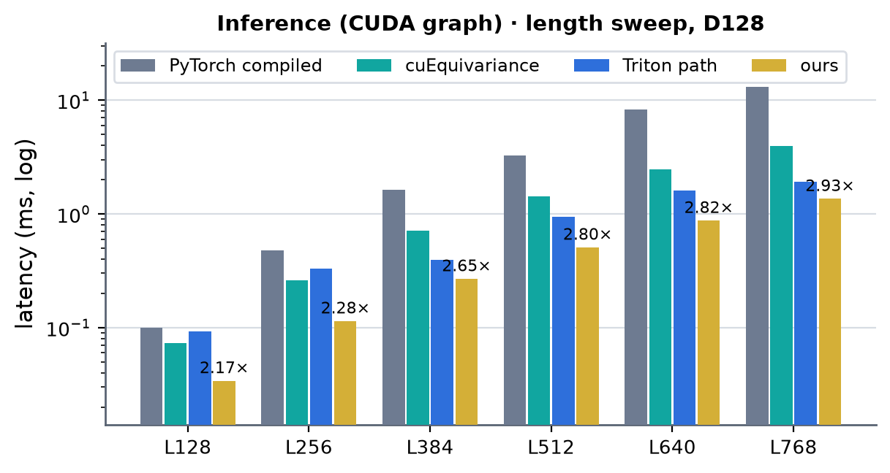
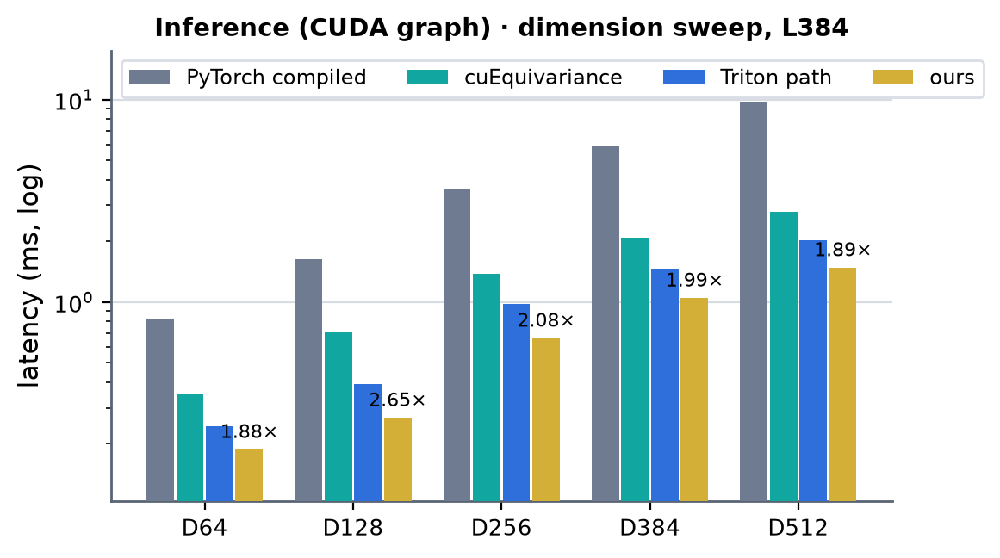
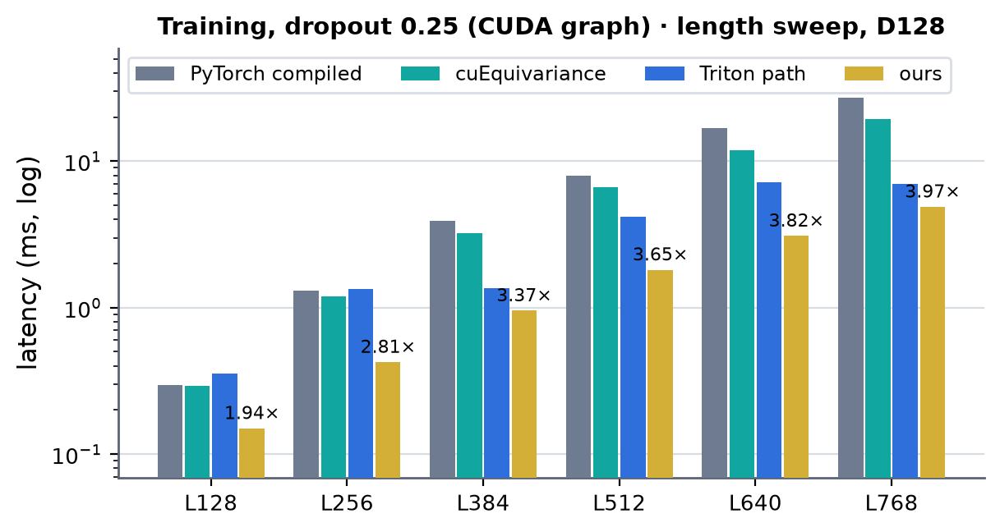
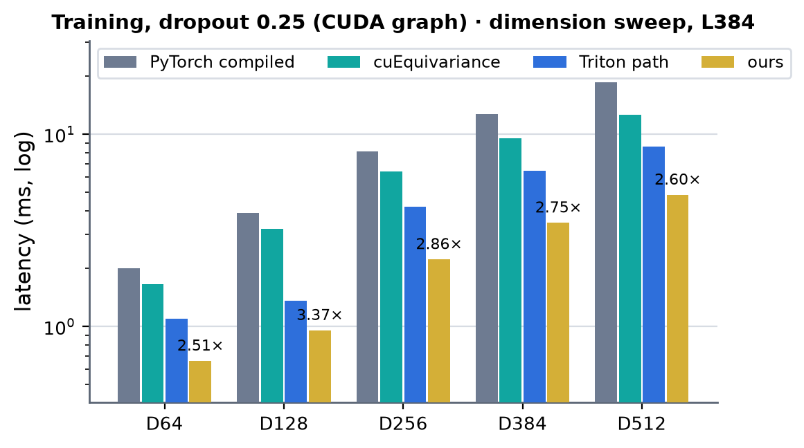

# TriangleAttention on H100: superseded measurements and studies (2026-09-30, 2026-10-05)

Moved verbatim from [docs/gpus/h100/triattn/triattn.md](../gpus/h100/triattn/triattn.md) on 2026-10-18 (figure and record links rewritten
for this directory). The page keeps the current measurements (2026-10-15); the 2026-10-13 .. 10-15 re-measurements are in
[triattn_h100_remeasure_20261013_15.md](triattn_h100_remeasure_20261013_15.md). "Triton path" / "existing" below is the module with
`_h100_cuda = False` as it was then (Triton core + prebuilt CUDA pieces); H100 has had no Triton fallback since.

## Measurements, all widths (2026-10-05)

H100 80GB HBM3 (132 SMs), torch 2.13.0+cu129, triton 3.7.1, cuEquivariance 0.12.0, B=1, bf16, starting node, no mask, dropout 0.25 in
training. PyTorch compiled and cuEquivariance: `benchmarks/runners/bench.py target=triangle_attention level=module min_seq_len=128
max_seq_len=768 implementations=[pytorch,cuequivariance]` with `d_pair=<C> +tri_d_hidden=<HD> +tri_n_head=<heads>` (compiled, manual CUDA
graph; "—" = out of memory: PyTorch training at (768, 512)). "Triton path" = the module with `_h100_cuda = False` (the repository's
previous H100 path: Triton core + prebuilt CUDA pieces) and "ours", both timed by one module call (forward, or forward + autograd.grad of
the input and every parameter) replayed from a CUDA graph (median of 5 × 10 replays); the harness gives the same numbers where
spot-checked (`+tri_h100_cuda=true|false`, L384, ms: d_pair 64 / 4 × 32 inference ours 0.298 / Triton path 0.318, training 1.086 / 1.664;
d_pair 256 inference 0.664 / 0.981, training 2.262 / 3.960). Latency in ms, median. × = ours vs the faster of PyTorch compiled /
cuEquivariance; the last column is ours vs the Triton path.
Anthropic's payload is not in this table (its native cell serves 4-head d_pair 128 inference only; see the 2026-09-30 table below).

The d_pair 128 rows are the fused path, all others the width-generic path. The generic path is bound by its GEMMs and HBM passes
at d_pair 64 and by the cuBLAS projections (about 2.7 ms of the 7.7 ms at (768, 512)) above; the attention core is the same kernel
as the fused path's. Where the Triton path is close (L384 and L768 at d_pair 64: 0.98-1.18×) the Triton kernels happen to sit at
a good tile for that shape; the 4 × 16 layout pays for the zero-padded 32-channel heads.

### Inference (CUDA graph)

#### Heads × 32 (d_pair 64: 2 × 32, 128: 4, 256: 8, 384: 12, 512: 16)

| (Length, Dimension) | PyTorch compiled | cuEquivariance | Triton path | ours | × | × vs Triton path |
|---|---|---|---|---|---|---|
| (128, 64) | 0.062 | 0.051 | 0.069 | 0.031 | 1.65 | 2.21× |
| (256, 64) | 0.238 | 0.143 | 0.214 | 0.084 | 1.69 | 2.54× |
| (384, 64) | 0.816 | 0.350 | 0.243 | 0.187 | 1.88 | 1.30× |
| (512, 64) | 1.495 | 0.711 | 0.486 | 0.337 | 2.11 | 1.44× |
| (640, 64) | 3.790 | 1.249 | 0.829 | 0.553 | 2.26 | 1.50× |
| (768, 64) | 6.560 | 1.989 | 1.291 | 0.834 | 2.38 | 1.55× |
| (128, 128) | 0.099 | 0.073 | 0.092 | 0.034 | 2.17 | 2.74× |
| (256, 128) | 0.475 | 0.261 | 0.330 | 0.114 | 2.28 | 2.89× |
| (384, 128) | 1.621 | 0.708 | 0.394 | 0.268 | 2.65 | 1.47× |
| (512, 128) | 3.251 | 1.417 | 0.949 | 0.507 | 2.80 | 1.87× |
| (640, 128) | 8.313 | 2.457 | 1.616 | 0.872 | 2.82 | 1.85× |
| (768, 128) | 13.098 | 3.973 | 1.927 | 1.357 | 2.93 | 1.42× |
| (128, 256) | 0.185 | 0.121 | 0.132 | 0.084 | 1.44 | 1.57× |
| (256, 256) | 1.165 | 0.539 | 0.596 | 0.287 | 1.88 | 2.08× |
| (384, 256) | 3.613 | 1.382 | 0.978 | 0.663 | 2.08 | 1.47× |
| (512, 256) | 7.812 | 2.756 | 1.909 | 1.254 | 2.20 | 1.52× |
| (640, 256) | 16.617 | 4.845 | 3.276 | 2.091 | 2.32 | 1.57× |
| (768, 256) | 26.038 | 7.788 | 5.179 | 3.265 | 2.38 | 1.59× |
| (128, 384) | 0.268 | 0.186 | 0.204 | 0.126 | 1.47 | 1.62× |
| (256, 384) | 2.012 | 0.813 | 0.864 | 0.450 | 1.81 | 1.92× |
| (384, 384) | 5.937 | 2.079 | 1.465 | 1.047 | 1.99 | 1.40× |
| (512, 384) | 16.919 | 4.092 | 2.995 | 1.969 | 2.08 | 1.52× |
| (640, 384) | 31.749 | 7.306 | 5.144 | 3.434 | 2.13 | 1.50× |
| (768, 384) | 55.265 | 11.916 | 8.218 | 5.301 | 2.25 | 1.55× |
| (128, 512) | 0.452 | 0.239 | 0.265 | 0.172 | 1.39 | 1.54× |
| (256, 512) | 3.141 | 1.078 | 1.117 | 0.623 | 1.73 | 1.79× |
| (384, 512) | 9.672 | 2.791 | 2.024 | 1.480 | 1.89 | 1.37× |
| (512, 512) | 22.699 | 5.558 | 4.114 | 2.862 | 1.94 | 1.44× |
| (640, 512) | 42.557 | 10.048 | 7.083 | 4.863 | 2.07 | 1.46× |
| (768, 512) | 73.912 | 18.310 | 11.316 | 7.651 | 2.39 | 1.48× |

  <!-- measure_bars -->

#### d_pair 64 · 4 × 32 (d_hidden 128)

| (Length, Dimension) | PyTorch compiled | cuEquivariance | Triton path | ours | × | × vs Triton path |
|---|---|---|---|---|---|---|
| (128, 64) | 0.097 | 0.067 | 0.084 | 0.041 | 1.63 | 2.06× |
| (256, 64) | 0.444 | 0.235 | 0.274 | 0.126 | 1.86 | 2.17× |
| (384, 64) | 1.550 | 0.628 | 0.314 | 0.299 | 2.10 | 1.05× |
| (512, 64) | 3.100 | 1.271 | 0.811 | 0.551 | 2.31 | 1.47× |
| (640, 64) | 7.409 | 2.260 | 1.417 | 0.929 | 2.43 | 1.53× |
| (768, 64) | 12.756 | 3.669 | 1.687 | 1.434 | 2.56 | 1.18× |

#### d_pair 64 · 4 × 16 (d_hidden 64)

| (Length, Dimension) | PyTorch compiled | cuEquivariance | Triton path | ours | × | × vs Triton path |
|---|---|---|---|---|---|---|
| (128, 64) | 0.090 | 0.089 | 0.074 | 0.057 | 1.57 | 1.31× |
| (256, 64) | 0.397 | 0.201 | 0.231 | 0.146 | 1.38 | 1.58× |
| (384, 64) | 1.433 | 0.540 | 0.311 | 0.318 | 1.70 | 0.98× |
| (512, 64) | 2.931 | 1.145 | 0.650 | 0.568 | 2.02 | 1.14× |
| (640, 64) | 7.100 | 2.095 | 1.166 | 0.955 | 2.19 | 1.22× |
| (768, 64) | 12.281 | 3.445 | 1.872 | 1.447 | 2.38 | 1.29× |

### Training, dropout 0.25 (CUDA graph)

#### Heads × 32 (d_pair 64: 2 × 32, 128: 4, 256: 8, 384: 12, 512: 16)

| (Length, Dimension) | PyTorch compiled | cuEquivariance | Triton path | ours | × | × vs Triton path |
|---|---|---|---|---|---|---|
| (128, 64) | 0.191 | 0.198 | 0.272 | 0.133 | 1.44 | 2.05× |
| (256, 64) | 0.698 | 0.646 | 0.896 | 0.319 | 2.03 | 2.81× |
| (384, 64) | 2.009 | 1.660 | 1.094 | 0.662 | 2.51 | 1.65× |
| (512, 64) | 3.933 | 3.416 | 2.144 | 1.183 | 2.89 | 1.81× |
| (640, 64) | 8.197 | 6.060 | 3.633 | 1.944 | 3.12 | 1.87× |
| (768, 64) | 13.673 | 9.814 | 5.668 | 2.934 | 3.34 | 1.93× |
| (128, 128) | 0.296 | 0.291 | 0.356 | 0.150 | 1.94 | 2.37× |
| (256, 128) | 1.309 | 1.194 | 1.348 | 0.425 | 2.81 | 3.17× |
| (384, 128) | 3.894 | 3.219 | 1.355 | 0.955 | 3.37 | 1.42× |
| (512, 128) | 7.991 | 6.626 | 4.188 | 1.814 | 3.65 | 2.31× |
| (640, 128) | 16.855 | 11.827 | 7.142 | 3.092 | 3.82 | 2.31× |
| (768, 128) | 27.115 | 19.391 | 6.992 | 4.880 | 3.97 | 1.43× |
| (128, 256) | 0.520 | 0.505 | 0.558 | 0.299 | 1.69 | 1.87× |
| (256, 256) | 2.795 | 2.374 | 2.331 | 0.958 | 2.48 | 2.43× |
| (384, 256) | 8.139 | 6.391 | 4.199 | 2.234 | 2.86 | 1.88× |
| (512, 256) | 17.093 | 13.155 | 8.271 | 4.267 | 3.08 | 1.94× |
| (640, 256) | 33.526 | 23.870 | 14.328 | 7.430 | 3.21 | 1.93× |
| (768, 256) | 53.775 | 40.181 | 22.788 | 11.966 | 3.36 | 1.90× |
| (128, 384) | 0.800 | 0.785 | 0.807 | 0.436 | 1.80 | 1.85× |
| (256, 384) | 4.410 | 3.509 | 3.300 | 1.425 | 2.46 | 2.32× |
| (384, 384) | 12.666 | 9.522 | 6.458 | 3.463 | 2.75 | 1.86× |
| (512, 384) | 31.114 | 19.839 | 12.815 | 6.769 | 2.93 | 1.89× |
| (640, 384) | 57.713 | 37.594 | 22.198 | 12.047 | 3.12 | 1.84× |
| (768, 384) | 97.936 | 64.748 | 35.381 | 19.623 | 3.30 | 1.80× |
| (128, 512) | 1.113 | 0.996 | 1.020 | 0.572 | 1.74 | 1.78× |
| (256, 512) | 6.309 | 4.648 | 4.247 | 1.944 | 2.39 | 2.19× |
| (384, 512) | 18.606 | 12.590 | 8.646 | 4.839 | 2.60 | 1.79× |
| (512, 512) | 41.645 | 27.032 | 17.337 | 9.544 | 2.83 | 1.82× |
| (640, 512) | 77.060 | 52.430 | 30.224 | 17.274 | 3.04 | 1.75× |
| (768, 512) | 130.947 | 88.535 | 48.087 | 27.497 | 3.22 | 1.75× |

  <!-- measure_bars -->

#### d_pair 64 · 4 × 32 (d_hidden 128)

| (Length, Dimension) | PyTorch compiled | cuEquivariance | Triton path | ours | × | × vs Triton path |
|---|---|---|---|---|---|---|
| (128, 64) | 0.274 | 0.267 | 0.317 | 0.160 | 1.66 | 1.98× |
| (256, 64) | 1.194 | 1.076 | 1.141 | 0.471 | 2.29 | 2.42× |
| (384, 64) | 3.654 | 2.956 | 1.369 | 1.044 | 2.83 | 1.31× |
| (512, 64) | 7.529 | 6.126 | 3.578 | 1.956 | 3.13 | 1.83× |
| (640, 64) | 15.517 | 11.115 | 6.268 | 3.302 | 3.37 | 1.90× |
| (768, 64) | 26.073 | 18.331 | 6.964 | 5.141 | 3.57 | 1.35× |

#### d_pair 64 · 4 × 16 (d_hidden 64)

| (Length, Dimension) | PyTorch compiled | cuEquivariance | Triton path | ours | × | × vs Triton path |
|---|---|---|---|---|---|---|
| (128, 64) | 0.251 | 0.251 | 0.290 | 0.191 | 1.31 | 1.52× |
| (256, 64) | 1.073 | 0.928 | 1.014 | 0.500 | 1.86 | 2.03× |
| (384, 64) | 3.348 | 2.597 | 1.522 | 1.060 | 2.45 | 1.44× |
| (512, 64) | 7.079 | 5.593 | 3.095 | 1.960 | 2.85 | 1.58× |
| (640, 64) | 14.711 | 10.260 | 5.451 | 3.344 | 3.07 | 1.63× |
| (768, 64) | 25.007 | 17.081 | 8.780 | 5.128 | 3.33 | 1.71× |

## Measurements, d_pair 128 (2026-09-30)

H100 80GB HBM3 (132 SMs), torch 2.13.0+cu129, B=1, bf16, starting node, mask all-true,
`benchmarks/runners/bench.py target=triangle_attention level=module min_seq_len=128 max_seq_len=768` (compiled, CUDA graph).
Latency in ms, median. "existing" = the module's previous H100 path (`_h100_cuda = False`: Triton core + prebuilt CUDA pieces);
× = ours vs the fastest of the others. Anthropic: `integrations.anthropic` row `block:triattn_native` (its H100 native cell), inference only.

### Inference (CUDA graph)

| (Length, Dimension) | PyTorch compiled | cuEquivariance | Anthropic | existing | ours | × |
|---|---|---|---|---|---|---|
| (128, 128) | 0.100 | 0.073 | 0.052 | 0.056 | 0.032 | 1.63 |
| (256, 128) | 0.475 | 0.259 | 0.184 | 0.183 | 0.108 | 1.69 |
| (384, 128) | 1.631 | 0.711 | 0.445 | 0.393 | 0.253 | 1.55 |
| (512, 128) | 3.232 | 1.417 | 0.863 | 0.950 | 0.490 | 1.76 |
| (640, 128) | 8.305 | 2.439 | 1.467 | 1.593 | 0.837 | 1.75 |
| (768, 128) | 12.948 | 3.950 | 2.326 | 1.923 | 1.298 | 1.48 |

### Training, dropout 0.25 (CUDA graph)

| (Length, Dimension) | PyTorch compiled | cuEquivariance | Anthropic | existing | ours | × |
|---|---|---|---|---|---|---|
| (128, 128) | 0.296 | 0.290 | — | 0.213 | 0.142 | 1.50 |
| (256, 128) | 1.304 | 1.194 | — | 0.789 | 0.418 | 1.89 |
| (384, 128) | 3.888 | 3.197 | — | 1.284 | 0.959 | 1.34 |
| (512, 128) | 7.985 | 6.604 | — | 3.944 | 1.798 | 2.19 |
| (640, 128) | 16.817 | 11.902 | — | 6.751 | 3.043 | 2.22 |
| (768, 128) | 27.103 | 19.496 | — | 6.778 | 4.821 | 1.41 |

### Training, dropout 0.25 (no CUDA graph)

| (Length, Dimension) | PyTorch compiled | cuEquivariance | ours | × |
|---|---|---|---|---|
| (128, 128) | 0.671 | 0.938 | 0.537 | 1.25 |
| (256, 128) | 1.384 | 1.288 | 0.540 | 2.39 |
| (384, 128) | 3.941 | 3.316 | 0.989 | 3.35 |
| (512, 128) | 8.072 | 6.728 | 1.833 | 3.67 |
| (640, 128) | 16.948 | 11.927 | 3.089 | 3.86 |
| (768, 128) | 27.382 | 19.601 | 4.849 | 4.04 |

Without a graph, ours costs ~0.5 ms at L128 / L256 regardless of L: host-side time (tensor-map encoding, the autograd function,
a dozen launches) above the GPU work, as on B200.

Run-to-run determinism: the parameter gradients are reduced from per-CTA partial slots in a fixed order (no float atomics); the only
order-dependent sum left is dbias (fp32 TMA reduce-adds of the query-side kernel), which reaches the parameters at ≤ 1.3e-6
relative (fp32 master parameters; the harness checks 1e-4). The bias projection's B_h reads dbias as a bf16 hi + lo pair so that
order noise cannot flip a bf16 rounding.

## Kernel times (2026-09-30)

One training step (fwd + bwd, dropout 0.25), `torch.profiler` device time, µs:

| kernel | (384, 128) | (768, 128) |
|---|---|---|
| F1 · tri_front | 73.0 | 284.3 |
| F2 · triattn_fwd (+ LSE) | 126.7 | 814.0 |
| F3 · tri_tail | 54.0 | 198.9 |
| B1 · tri_gate_bwd | 96.6 | 338.0 |
| B2 · triattn_bwd_kv | 188.7 | 1145.9 |
| B3 · triattn_bwd_q | 190.9 | 1181.0 |
| B4 · tri_head_bwd | 98.7 | 361.8 |
| B5 · tri_wgrad + finish | 106.9 | 346.5 |
| step | ~938 | ~4673 |

The attention core (F2, B2, B3) is 54 % of the step at L384 and 67 % at L768. B2 runs at ~404 TFLOP/s at L768 (41 % of the
bf16 dense peak, FlashAttention-3 hdim-64 backward class); D = 32 attention is bound by the exponentials and the per-step
issue overhead rather than the tensor core. The module kernels run at 2.2–2.8 TB/s of HBM traffic.

Accuracy (`tests/integrations/test_triattn_h100_gpu.py`, 24 cases: L128–768 inference and training, ending node, B=2, mask
layouts, dropout on both nodes, fp32 master parameters, CUDA-graph capture): against an fp32 autograd reference, the output and
every gradient stay within 1.25× the bf16 PyTorch module's own error (+2e-3). The attention core alone (fp32 reference, same bf16
operands): out 2.2e-3, dK 2.4e-3, dV 2.4e-3, dQ 2.5e-3 relative Frobenius (bf16 autograd: 7–8e-3), dbias 5e-4.

## Kernel times, width-generic path (2026-10-05)

`torch.profiler` device time per module call, µs (mean of 5 calls after warm-up, eager, B=1, no mask). The cuBLAS row sums the GEMM launches
(forward: y [Wq; Wk; Wv; Wg]^T, y Wb^T, u Wo^T; training adds du = ddrop Wo, dWo, dyln = dall Wcat, dW = dall^T y with its split-K reduce).

| kernel | inference (512, 256) | training (512, 256) | training (384, 64 · 4 × 32) |
|---|---|---|---|
| G1 · ln_fwd | 104 | 103 | 14 |
| G2 · front_bias | 7 | 6 | 4 |
| F2 · triattn_fwd (+ gate; LSE and O in training) | 595 | 605 | 155 |
| G3 · residual | 138 | 140 | 19 |
| B1 · gate_bwd_in | | 94 | 15 |
| B2 · gate_bwd_out (do, dg, Delta) | | 275 | 77 |
| B3 · triattn_bwd_kv | | 751 | 179 |
| B4 · triattn_bwd_q | | 790 | 203 |
| B5 · assemble (dbias columns) | | 21 | 11 |
| B6 · ln_bwd (+ gamma / beta partials) | | 232 | 32 |
| cuBLAS GEMMs | 397 | 1110 | 288 |
| torch glue (memset, casts, sums) | | 38 | 32 |
| call | ~1245 | ~4170 | ~1030 |

The attention core is 48 % of the inference call at (512, 256) and 51 % of the training call at (384, 64); the GEMMs run at
550-800 TFLOP/s. What the fused path avoids and this one pays: one write and one read of y (G1), the t tensor between the out-projection
and the residual (G3) and the q | k | v | g round trip through HBM before the core. An LN + projection kernel with the weights
streamed in K (they do not fit shared memory above d_pair 128) is the next step for d_pair 64 / 256-512.

Accuracy (`tests/integrations/test_triattn_h100_generic_gpu.py`, 58 cases): inference and training at the eight (d_pair, d_hidden,
heads) shapes of the table, padded lengths (80, 192, 304 and an unmasked 208), starting and ending node, B=2, dropout on both nodes,
fp32 master parameters, determinism, CUDA-graph capture with and without grad, the compiled module replayed from a CUDA graph. Against an fp32 autograd reference the output and every
gradient stay within 1.25× the bf16 PyTorch module's own error (+2e-3). Run-to-run: the output and the q / k / v / gate / out weight
gradients are bitwise equal; the x, LayerNorm and bias-projection gradients carry the order noise of the core's fp32 dbias reduce-add
(a bf16 ulp at most; the fused path's hi + lo trick for the bias projection is not applied here).
